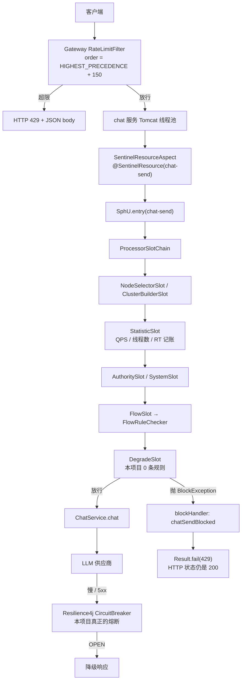
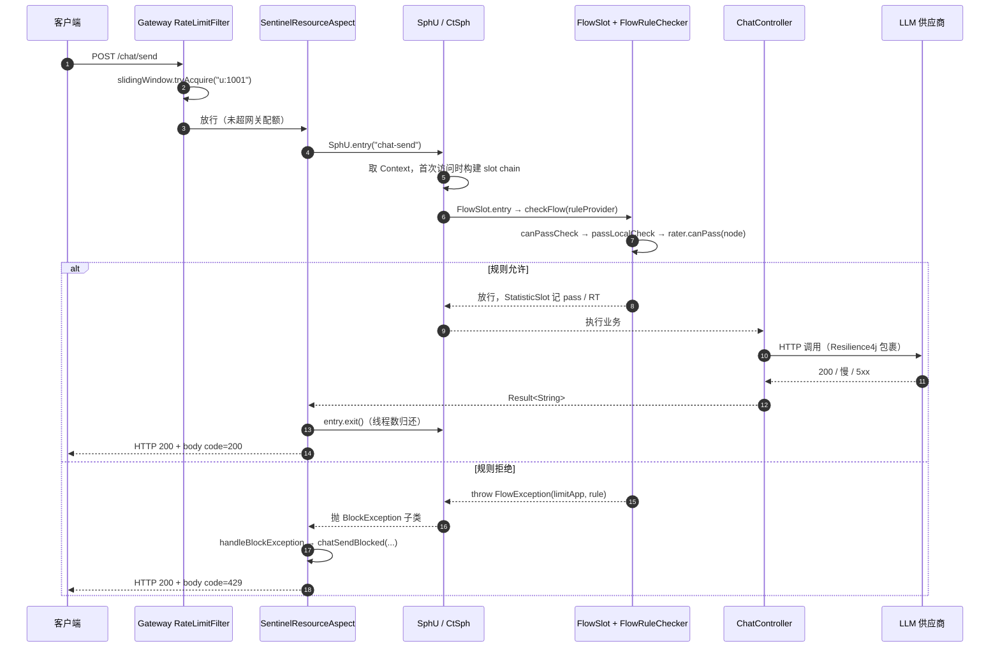

# Sentinel 限流与熔断降级：限流保护自己，熔断保护下游

> **一句话结论**：Sentinel 里"限流"和"熔断"共用一个骨架（资源 / 规则 / 槽链），但触发条件完全不同——限流看**入口流量每秒进来多少**、拦住的是**还没进业务**的请求；熔断看**调用结果的慢和错**、拦住的是**已经知道下游不行了之后的请求**。本项目把第一条链接通了（chat-send 有真规则也有真资源），第二条在 Sentinel 侧一条规则都没落地，实际由 Resilience4j 承担。
> **阅读前置**：知道 Spring Boot 自动配置、`@Configuration` + `@PostConstruct` 的执行时机、AOP 代理是什么；读过任一篇 [24-源码分析](../24-源码分析/README.md) 篇目，习惯"现象 → 地图 → 证据"的读法。不需要读过 Sentinel 源码，本篇也不复述其内部实现（那部分在 [sentinel-限流降级原理](../24-源码分析/04-SpringCloud/06-熔断限流与容错/02-sentinel-限流降级原理.md)）。
> **证据基线**：Spring Boot 4.2.0 / Spring Cloud 2026.0.0 / Spring Cloud Alibaba 2025.1.0.0 / JDK 17 → 实际解析 **sentinel-core 1.8.9**（由 `spring-cloud-alibaba-dependencies-2025.1.0.0.pom` 第 52 行 `<sentinel.version>` 实测；24-源码分析 的源码归档来自 1.8.10，本篇引用的 3 个归档文件 + 全部 `javap` 结论都已在 1.8.9 上复核）。A 级引用 10 处（3 个归档文件、8 个行号锚点 + 2 处 src 标注）、B 级本项目引用 9 个文件、C 级实测 6 组。预计阅读 40~50 分钟。

---

## 0. 先看现象

### 症状一：大促时 DB 连接池被打满，Sentinel 一条都没拦

应用启动日志里有这么一行，看上去"限流已就绪"：

```text
Sentinel 流控规则已注册: chat-send QPS<=10 (WarmUp 10s), chat-rag QPS<=5
```

（原文出自 `ai-cs-chat/src/main/java/com/aics/chat/config/SentinelFlowConfig.java#L42-L44`。）

但压测 `/chat/rag` 到 200 QPS，Sentinel 拦下的请求数是 **0**，连接池照样打满。原因不是规则写错，而是规则挂在一个**不存在的资源**上：全仓 `@SentinelResource` 注解只出现过 1 次，就在 `ai-cs-chat/src/main/java/com/aics/chat/controller/ChatController.java#L79`，资源名是 `chat-send`；`chat-rag` 只出现在规则里（`SentinelFlowConfig.java#L36-L39`），从来没有代码为它声明资源。

```java
        FlowRule ragRule = new FlowRule();
        ragRule.setResource(SentinelRules.RESOURCE_CHAT_RAG);
        ragRule.setGrade(RuleConstant.FLOW_GRADE_QPS);
        ragRule.setCount(SentinelRules.CHAT_RAG_QPS_THRESHOLD);
```

规则注册成功、日志打印成功、单测也通过（`SentinelFlowConfigTest` 断言 `FlowRuleManager.getRules()` 里有 2 条规则），但**没有任何请求会经过这条规则**——规则是挂在资源名上的判据，资源名没人声明，判据就永远不被求值。

### 症状二：下游 500 之后，上游 Tomcat 线程被占满

LLM 供应商开始返 500 或者干脆不响应时，chat 服务的 200 个 Tomcat 线程全部卡在等 HTTP 响应上，随后网关侧出现大面积读超时、前端转圈。此时 Sentinel 侧**没有任何降级规则**：在 `ai-cs-chat` 里搜 `DEGRADE_GRADE` 无任何命中，只有流控规则（`FLOW_GRADE_QPS`）。

这正是"限流救不了熔断场景"的典型：入口 QPS 只有 10，**远没到流控阈值**，但每个请求要占用一个线程 30 秒，10 QPS × 30s ≈ 300 个并发线程——线程池先死，而不是 QPS 先超。项目在这里靠的是 Resilience4j（`ai-cs-chat/src/main/resources/application.yml#L71-L73` 起是 `resilience4j.*` 配置块），Sentinel 的 `DegradeSlot` 里一条规则也没有。

### 症状三：控制台里调好的阈值，服务一重启就回到 10/5

`docker-compose.yml#L259-L266` 起了 `bladex/sentinel-dashboard:1.8.6`，`deploy/k8s/sentinel-dashboard.yaml#L6` 自己也写明了：

```text
# 注意：控制台只存内存，规则重启即失（生产要接入 Nacos 持久化规则）
```

而客户端侧 `ai-cs-chat/src/main/resources/application.yml`（178 行）里**一个 `spring.cloud.sentinel` 都没有**：既没有 `transport.dashboard`（控制台看不到这个应用），也没有 `datasource`（规则不落任何配置中心）。于是"在控制台加规则"在本项目是不成立的：应用不上报、控制台看不到、重启后只剩代码里硬编码的 10 / 5。

### 这些现象指向同一件事

**Sentinel 的"资源"和"规则"必须在同一个进程里对上号，"限流"和"熔断"又各自依赖不同的统计入口（前者看入口流量，后者看调用结果）；本项目把其中一条半链接通了——一条真流控规则 + 一个真资源 + 一个兜底方法——其余部分（`chat-rag` 资源、降级规则、控制台联动、规则持久化）是"配置或文档存在、代码未落地"，看起来生效，实际空转。**

---

## 1. 整体地图

一次对话请求在本项目要穿过两层保护：网关自研限流器（Redis / 本地内存）和 chat 服务内的 Sentinel。下图只画与本篇相关的部分：



> **读图说明**：图里有两条**互不相通**的判定路径，这是全篇最重要的一件事。第一条是 `F4`：它只读 "这个资源每秒进来了多少 / 此刻有多少线程正在处理"，**它完全不知道下游是死是活**，所以下游挂了它也照样放行——这就是症状二。第二条是 `J`：它读"调用结果慢不慢、错多少"，只在已经拿到结果（或超时）之后才改变状态。看错哪个会错：把 `F4` 当成"下游保护"，就会得出"配了流控就不会被下游拖死"的错误结论；把 `J` 当成"入口保护"，就会得出"配了熔断就能扛住流量洪峰"的错误结论。另外注意 `H` 与 `L` 两条出口的协议不一致：`H` 是 HTTP 200 + body 里 code=429（`Result` 只封装 body），`L` 是 HTTP 503（网关 `GatewayFallbackController` 上有 `@ResponseStatus`），监控口径完全不同。

### 组件、责任、调用方

| 组件 | 责任 | 调用方 | 本项目状态 |
| --- | --- | --- | --- |
| `SentinelResourceAspect` | 把 `@SentinelResource` 方法包成 `SphU.entry` / `exit` | Spring AOP（starter 自动配置） | 已生效（chat-send） |
| `SphU` / `CtSph` | 资源入口门面、Context 与 Entry 管理 | Aspect、`Sph.entry` | 已生效 |
| `ProcessorSlotChain` | 按固定顺序串起各 Slot | `CtSph.entryWithPriority` | 已生效 |
| `FlowSlot` + `FlowRuleChecker` | 流控判定（QPS / 线程数 / 关联 / 链路） | 槽链 | 已生效（2 条规则，1 条空转） |
| `DegradeSlot` + `DegradeRuleManager` | 熔断降级判定 | 槽链 | **未落地**（0 条规则） |
| `SystemSlot` / `AuthoritySlot` / `ParamFlowSlot` | 系统自适应 / 授权 / 热点参数 | 槽链 | 未使用 |
| `FlowRuleManager` | 内存规则表 | 应用启动注册 / 控制台推送 | 代码注册（`SentinelFlowConfig`） |
| Sentinel Dashboard | 看指标、推规则（内存态） | 运维 | 已部署容器，**应用未上报**（缺 transport 配置） |
| Nacos 规则数据源 | 规则持久化 | 应用拉取 | **未落地**（无 datasource 配置） |
| `RateLimitFilter` + `SlidingWindowRateLimiter` / `TokenBucketRateLimiter` | 网关侧自研限流 | 网关 GlobalFilter 链 | 代码存在，默认 `enabled: false` |
| Resilience4j `CircuitBreaker` | 对下游熔断 / 超时 / 重试 | chat 服务内部调用 | 已落地（本篇不展开） |

---

## 2. 关键概念与关键类

先统一术语（后文全部按这套说法）：

- **资源（resource）**：Sentinel 的统计单位，就是一个字符串名字。可以是 URL、方法、一段代码、一条路由。规则必须绑定资源名，没有资源就没有统计，没有统计规则就无从判定。
- **规则（rule）**：绑在资源名上的判据。类型有 5 类：流控（flow）、熔断降级（degrade）、热点参数（param-flow）、系统（system）、授权（authority）。
- **槽链（slot chain）**：一个资源首次被访问时构建的责任链，顺序固定：节点选择 → 集群节点 → 统计 → 授权 → 系统 → 流控 → 降级 → 退出统计。所有判定都在链上，任一 Slot 抛 `BlockException` 就短路。
- **Entry**：`SphU.entry()` 的返回值，表示"请求进入了资源"，必须配对 `entry.exit()`；漏掉 `exit` 的后果是线程数统计只增不减（线程数限流会永久误拦）。
- **BlockException**：所有"被规则拦下"异常的父类，子类就是拦截原因：`FlowException`（流控）、`DegradeException`（熔断）、`ParamFlowException`（热点）、`SystemBlockException`（系统）、`AuthorityException`（授权）。
- **QPS 与线程数**：QPS 限"每秒进来多少请求"；线程数限"同时正在处理多少个请求"。二者关系近似 `并发 ≈ QPS × 平均RT`，所以**慢**的时候先撞线程数上限，**快而猛**的时候先撞 QPS 上限。

| 名称 | 位置 | 角色 | 关键方法 |
| --- | --- | --- | --- |
| `SphU` | A 级归档 [SphU.java.md](../24-源码分析/assets/source/SphU.java.md) | 对外门面，业务代码唯一需要认识的类 | `entry` / `entryWithType` / `exit` |
| `CtSph` | A 级归档 [CtSph.java.md](../24-源码分析/assets/source/CtSph.java.md) | `entry` 的真实实现，管 Context 与 Entry | `entryWithPriority` |
| `ProcessorSlotChain` | A 级 `[[源码:ProcessorSlotChain.java.md#L23-L37]]` | 责任链容器 | `addFirst` / `addLast` |
| `FlowRuleChecker` | A 级 `[[源码:FlowRuleChecker.java.md#L44-L86]]` | 流控判定主体 | `checkFlow` / `canPassCheck` / `passLocalCheck` |
| `LeapArray` | A 级 `[[源码:LeapArray.java.md#L41-L72]]` | 滑动窗口容器（把 1 秒切成若干桶） | `currentWindow` |
| `DefaultNode` | A 级归档 [DefaultNode.java.md](../24-源码分析/assets/source/DefaultNode.java.md) | 资源维度的统计节点 | 线程数 / 通过数 / 阻塞数计数 |
| `FlowRule` | 1.8.9 jar 内（未入库） | 流控规则模型 | `setGrade` / `setCount` / `setStrategy` / `setControlBehavior` |
| `FlowRuleManager` | 1.8.9 jar 内（未入库） | 内存规则表 | `loadRules` / `getRules` |
| `RuleConstant` | 1.8.9 jar 内（未入库） | 全部常量（`javap -constants` 已核） | `FLOW_GRADE_QPS = 1` 等 |
| `AbstractSentinelAspectSupport` | `sentinel-annotation-aspectj-1.8.9.jar`（未入库） | 注解的拦截/兜底派发 | `handleBlockException` / `handleFallback` / `handleDefaultFallback` |
| `SentinelProperties` | `spring-cloud-starter-alibaba-sentinel-2025.1.0.0.jar`（未入库） | `spring.cloud.sentinel.*` 绑定 | `getDatasource` / `getTransport` / `getFlow` |
| `SentinelRules` | `ai-cs-chat/src/main/java/com/aics/chat/config/SentinelRules.java#L15-L30` | 资源名与阈值常量（单一来源） | 6 个常量 |
| `SentinelFlowConfig` | `ai-cs-chat/src/main/java/com/aics/chat/config/SentinelFlowConfig.java#L27-L45` | 代码注册规则 | `initFlowRules` |
| `ChatController` | `ai-cs-chat/src/main/java/com/aics/chat/controller/ChatController.java#L79-L104` | 声明资源 + 提供兜底 | `chat` / `chatSendBlocked` |
| `RateLimitFilter` | `ai-cs-gateway/src/main/java/com/aics/gateway/filter/RateLimitFilter.java#L55-L100` | 网关侧限流（非 Sentinel） | `filter` / `tooManyRequests` |

---

## 3. 原理与证据逐段精读

以下每小节都按四层展开：**在干什么 → 为什么这么设计 → 换写法会怎样 → 常见坑**。内部实现细节留给 [sentinel-限流降级原理](../24-源码分析/04-SpringCloud/06-熔断限流与容错/02-sentinel-限流降级原理.md)，这里只讲到"能指导配置与排障"的深度。

### 3.1 资源与 Entry：所有统计都以资源名为主键

**在干什么**：业务方法被 `@SentinelResource` 标记后，切面在方法前后插入 `SphU.entry("chat-send")` / `entry.exit()`。`entry` 时候做两件事：找到（或创建）这个资源对应的 SlotChain 与 Node，然后让整条链跑一遍；`exit` 时把线程数和耗时记回去。

**为什么这么设计**：把"名字"当主键，规则就能与代码解耦——规则里只写 `"chat-send"`，不需要引用任何类。这样一来，控制台、Nacos、代码三种来源才能共用一套规则模型（`FlowRule` 就是纯 POJO）。

**换写法会怎样**：本项目另一种选择是 `@WebServlet` 式的 URL 资源——引入 `spring-cloud-starter-alibaba-sentinel` 后 web 适配器会自动把所有 URL 注册成资源（starter jar 依赖里有 `sentinel-spring-webmvc-v6x-adapter`，实测存在）。那样 `chat-rag` 其实**会**有一条同名（或路径式）资源，只是名字是 `/chat/rag` 不是 `chat-rag`，规则照样对不上。两条路都能走，但**规则里的字符串必须与实际资源名逐字符一致**。

**常见坑**：
1. 资源名改了一处忘了另一处 → 规则空转（本项目的 `chat-rag` 就是活例子）；
2. 同一个业务被两种方式声明（URL + 注解），名字不同 → 统计被劈成两半，每条规则的阈值都只有一半效果；
3. `entry` 无 `exit`：注解方式由切面保证配对，手写 `SphU.entry` 的代码（如 `common` 里的工具类）容易漏，表现为线程数只涨不落。本项目全仓没有手写 `SphU.entry`，风险为 0，但新增手写代码时这是第一个要检查的点。

### 3.2 槽链：为什么一次判定要拆成一条链

**在干什么**：`ProcessorSlotChain` 是一条单向链表（`[[源码:ProcessorSlotChain.java.md#L23-L37]]` 只声明了 `addFirst` / `addLast` 两个抽象方法，说明"顺序"是外部装配决定的），链上依次挂着节点选择、集群节点、统计、授权、系统、流控、降级、退出统计。`entry` 从链头走到链尾，`exit` 反向走。

**为什么这么设计**：
- **顺序即语义**：`StatisticSlot` 一定在 `FlowSlot` 之前，因为流控要用到"到此刻为止已经通过了多少"这个计数；`FlowSlot` 一定在业务之前，因为被拦下的请求不应该消耗业务资源。
- **开闭**：加一类规则（比如后来的热点参数、集群流控）只需要在链上插一个 Slot，不动其他 Slot。
- **短路**：任一 Slot 抛 `BlockException`，后面的 Slot 与业务都不执行，`exit` 仍要走（由 `CtSph` 的 finally 保证）。

**换写法会怎样**：如果不用链而用一个 `if/else` 大函数，规则类型一旦增加（Sentinel 从 3 类长到 5 类、再长出集群流控），这个函数会变成不可维护的巨石；而且"哪些判定该在统计之前/之后"这种顺序知识会被埋进 if 顺序里，改一处错一片。

**常见坑**：
1. 以为"没配规则就没有开销"——链照走，`StatisticSlot` 照记账，只是 `checkFlow` 里规则集合为空直接返回。开销小但非零；
2. 以为降级 Slot 会兜底所有异常——它只对**配了降级规则且熔断器打开**的资源抛 `DegradeException`，业务异常是 `fallback` 的职责（见 3.12）；
3. 在 `Slot` 之外的地方改规则（例如直接改 `FlowRule` 对象字段而不 `loadRules`），不会生效：`loadRules` 那一刻才会重建 Controller。

### 3.3 流控判定三要素：选节点 → 算阈值 → 决定放不放

**在干什么**：`FlowRuleChecker.checkFlow` 遍历该资源上的所有流控规则，任何一条不通过就抛 `FlowException(rule.getLimitApp(), rule)`（`[[源码:FlowRuleChecker.java.md#L44-L57]]`，其中 `L52-L53` 就是那个 `if (!canPassCheck(...)) throw`）。判定本身分三层：

```java (src: FlowRuleChecker.java.md#L64-L86)
    public boolean canPassCheck(/*@NonNull*/ FlowRule rule, Context context, DefaultNode node, int acquireCount,
                                                    boolean prioritized) {
        String limitApp = rule.getLimitApp();
        if (limitApp == null) {
            return true;
        }

        if (rule.isClusterMode()) {
            return passClusterCheck(rule, context, node, acquireCount, prioritized);
        }

        return passLocalCheck(rule, context, node, acquireCount, prioritized);
    }

    private static boolean passLocalCheck(FlowRule rule, Context context, DefaultNode node, int acquireCount,
                                          boolean prioritized) {
        Node selectedNode = selectNodeByRequesterAndStrategy(rule, context, node);
        if (selectedNode == null) {
            return true;
        }

        return rule.getRater().canPass(selectedNode, acquireCount, prioritized);
    }
```

**为什么这么设计**：三层各自解决一个正交问题。
- 第一层（`limitApp == null` 直接放行）是**调用来源**维度：规则可以只针对某个来源生效（`default` / `other` / 具体 origin）。`limitApp` 为空意味着"这条规则没有来源约束"，但注意——空值在这里被当成"不拦"，是个容易误读的默认值。
- 第二层（`isClusterMode`）决定阈值是**单机**算还是**集群**算。集群模式要依赖 token server（1.8.9 jar 里同时有 `sentinel-cluster-server-default` 与 `sentinel-cluster-client-default`，实测存在），本地单机模式则纯内存、零依赖。
- 第三层 `passLocalCheck` 才是真正"选统计节点 + 问限流器"：`selectNodeByRequesterAndStrategy` 按 `strategy` 选节点，`rule.getRater().canPass(node, count, prioritized)` 按 `controlBehavior` 选算法。**"关联/链路"影响的只是"看哪个节点的计数"，不影响"用什么算法"** ——这句是很多人配错的根源。

**换写法会怎样**：若不选节点、直接看自己这个资源的计数，那么"关联限流"（读接口被写接口拖累）和"链路限流"（只限某个入口进来的流量）都无法表达。选节点这一步就是这两类规则的全部实现所在：

```java (src: FlowRuleChecker.java.md#L88-L108)
    static Node selectReferenceNode(FlowRule rule, Context context, DefaultNode node) {
        String refResource = rule.getRefResource();
        int strategy = rule.getStrategy();

        if (StringUtil.isEmpty(refResource)) {
            return null;
        }

        if (strategy == RuleConstant.STRATEGY_RELATE) {
            return ClusterBuilderSlot.getClusterNode(refResource);
        }

        if (strategy == RuleConstant.STRATEGY_CHAIN) {
            if (!refResource.equals(context.getName())) {
                return null;
            }
            return node;
        }
        // No node.
        return null;
    }
```

**常见坑**：
1. **`refResource` 写错 = 永不拦截**：`STRATEGY_RELATE` 时 `ClusterBuilderSlot.getClusterNode(refResource)` 取不到节点就返回 `null`，回到 `passLocalCheck` 里 `selectedNode == null` → `return true`（放行）。所以"关联限流配了没效果"，第一个要看的是被关联资源名拼错；
2. **链路模式的 `refResource` 必须等于 Context 名**（网关场景通常是入口资源名，例如 `sentinel_web_servlet_context` 或网关路由名），写业务资源名永远不会命中，同样是静默放行；
3. 三种 strategy 的常量值是 `DIRECT = 0` / `RELATE = 1` / `CHAIN = 2`（1.8.9 `javap -constants` 实测），老教程里靠数字硬编码的写法一升级就错位，用常量名。

### 3.4 统计窗口：固定窗口为什么会在边界放过 2 倍流量

**在干什么**：QPS 限流的"当前 QPS"不是实时算的，而是把 1 秒切成若干等长桶（`LeapArray` 的 `windowLengthInMs` / `sampleCount` / `intervalInMs`，见 `[[源码:LeapArray.java.md#L41-L72]]`），每个请求落在"当前桶"里加 1，判定时把窗口覆盖的桶相加。这就是**滑动窗口**。

**为什么这么设计**：如果只用一个固定窗口计数器（每秒清零），会出现经典的"边界双倍"：窗口 1 的最后 100ms 放满阈值，窗口 2 开头 100ms 又放满阈值，于是 **200ms 内实际放行了 2 倍阈值**。滑动窗口让"最近 1 秒"始终是最近的真 1 秒，把这种抖动压掉一个量级。

**C 级实测（虚拟时钟，确定性输出，无需启动服务）**：把下面脚本存成 `%TEMP%\sentinel-window.mjs`，`node` 运行即可复现（本机 node 24 可跑，纯算术、无网络、无中间件）：

```javascript
const LIMIT = 5;
const WIN = 1000;
const reqs = [...Array(5)].map((_, i) => 900 + i).concat([...Array(5)].map((_, i) => 1100 + i));

function fixedWindow(ts) {
  const counter = new Map();
  const pass = [];
  for (const t of ts) {
    const key = Math.floor(t / WIN);
    const used = counter.get(key) || 0;
    if (used < LIMIT) { counter.set(key, used + 1); pass.push(t); }
  }
  return pass;
}

function slidingWindow(ts) {
  const q = [];
  const pass = [];
  for (const t of ts) {
    while (q.length && q[0] <= t - WIN) q.shift();
    if (q.length < LIMIT) { q.push(t); pass.push(t); }
  }
  return pass;
}

function tokenBucket(ts) {
  let tokens = LIMIT;
  let last = 0;
  const pass = [];
  for (const t of ts) {
    tokens = Math.min(LIMIT, tokens + ((t - last) / 1000) * LIMIT);
    last = t;
    if (tokens >= 1) { tokens -= 1; pass.push(t); }
  }
  return pass;
}

const name = (f, label) => {
  const p = f(reqs);
  console.log(`${label.padEnd(10)} 放行 ${String(p.length).padStart(2)} 条 -> ${p.join(',')}`);
  return p.length;
};

console.log(`请求时间线(ms): ${reqs.join(',')}   阈值 QPS=${LIMIT}  窗口=${WIN}ms`);
const a = name(fixedWindow, 'fixed');
const b = name(slidingWindow, 'sliding');
const c = name(tokenBucket, 'token');
console.log(`fixed/sliding = ${(a / b).toFixed(2)}x   固定窗口多放行 ${a - b} 条`);
console.log(`前五条与后五条间隔 = ${reqs[5] - reqs[4]}ms，远小于窗口 ${WIN}ms`);
```

真实输出（`node %TEMP%\sentinel-window.mjs`，本机 2026-11 实测）：

```text
请求时间线(ms): 900,901,902,903,904,1100,1101,1102,1103,1104   阈值 QPS=5  窗口=1000ms
fixed      放行 10 条 -> 900,901,902,903,904,1100,1101,1102,1103,1104
sliding    放行  5 条 -> 900,901,902,903,904
token      放行  6 条 -> 900,901,902,903,904,1101
fixed/sliding = 2.00x   固定窗口多放行 5 条
前五条与后五条间隔 = 196ms，远小于窗口 1000ms
```

**怎么读这个输出**：
- `fixed` 放行了 **10** 条，是阈值 5 的两倍——因为它把 900~904 记在窗口 0、把 1100~1104 记在窗口 1，两个窗口各有 5 条合法性；而人类感知的"最近 1 秒"在 t=1104 时其实只过了 204ms。
- `sliding` 只放行 5 条：t=1100 时窗口是 (100, 1100]，900 那条已经过期被剔除，但 901~904 还在，队列已满 5 → 全部拒绝。
- `token` 放行 6 条：桶容量 5，900~904 花光，之后按 5 token/s 补充，到 1101 攒够 1 个 token 放 1 条。**令牌桶不消除突发，只把突发速率封在"容量 + 速率"内**，所以能放 6 条而不是 5 条。
- 结论：**滑动窗口关心"最近一个窗口内的累计"，令牌桶关心"长期平均速率 + 允许的突发容量"**。网关的 `RateLimitProperties` 同时暴露 `requests/windowSeconds`（滑窗）与 `qps/burstCapacity`（令牌桶）两套参数，就是这两种语义（`ai-cs-gateway/src/main/resources/application.yml#L34-L49`）。

**换写法会怎样**：用固定窗口 + 低阈值来"补偿"边界问题是很常见的错解——把阈值调到 5 仍然会在边界放过 10 条，真正的后果是下游收到周期性双倍脉冲，DB 连接池被瞬时打满，这正是症状一里"限流没触发但库满了"的一种成因（另一成因是资源根本没声明）。

**常见坑**：
1. Sentinel 的窗口是**每个资源各自维护**的，多实例之间不共享（除非开集群模式），所以 10 QPS 的规则在 3 副本下实际是 30 QPS；
2. 预热/排队模式下"阈值"的含义变了（见 3.5），压测时看到的通过量不是 `count`；
3. `intervalInMs % sampleCount == 0` 是硬约束（`LeapArray` 构造器里有断言，`[[源码:LeapArray.java.md#L41-L72]]`），自己写 `sampleCount` 时除不尽会直接抛 `IllegalArgumentException`。

### 3.5 四种流控行为：拒绝、预热、排队、预热+排队

**在干什么**：`FlowRule.controlBehavior` 决定用哪个限流器（`TrafficShapingController` 实现）。1.8.9 的 `com/alibaba/csp/sentinel/slots/block/flow/controller/` 下实测有 4 个类：`DefaultController`、`ThrottlingController`、`WarmUpController`、`WarmUpRateLimiterController`；`RuleConstant` 里对应 4 个常量：`CONTROL_BEHAVIOR_DEFAULT = 0`、`CONTROL_BEHAVIOR_WARM_UP = 1`、`CONTROL_BEHAVIOR_RATE_LIMITER = 2`、`CONTROL_BEHAVIOR_WARM_UP_RATE_LIMITER = 3`（`javap -constants` 实测）。

| 行为 | 常量 | 语义 | 超阈值时 | 适用 |
| --- | --- | --- | --- | --- |
| 快速失败 | `DEFAULT = 0` | 桶满即拒 | 立刻抛 `FlowException` | 有降级兜底、要求响应快的入口 |
| WarmUp 预热 | `WARM_UP = 1` | 从 `count / coldFactor` 线性爬到 `count` | 超过当前允许值就拒 | 冷启动、缓存/JIT/连接池未热 |
| 匀速排队 | `RATE_LIMITER = 2` | 按固定间隔放行，请求排队 | 等超过 `maxQueueingTimeMs`（默认 500）才拒 | 希望"不丢但慢一点"的写接口 |
| 预热+排队 | `WARM_UP_RATE_LIMITER = 3` | 上面两者叠加 | 同上 | 冷启动期的写接口 |

**为什么这么设计**：三种行为对应三种"过载后的现实选择"——**丢**（快失败）、**慢一点进**（排队）、**慢慢放开**（预热）。它们都不是"限得更准"，而是"限得更符合业务体感"。

**证据（本项目真实配置）**：`chat-send` 的规则是"QPS 10 + 预热 10 秒"：

```java
        FlowRule sendRule = new FlowRule();
        sendRule.setResource(SentinelRules.RESOURCE_CHAT_SEND);
        sendRule.setGrade(RuleConstant.FLOW_GRADE_QPS);
        sendRule.setCount(SentinelRules.CHAT_SEND_QPS_THRESHOLD);
        sendRule.setControlBehavior(SentinelRules.CONTROL_BEHAVIOR_WARM_UP);
        sendRule.setWarmUpPeriodSec(SentinelRules.WARM_UP_PERIOD_SEC);
```

（`ai-cs-chat/src/main/java/com/aics/chat/config/SentinelFlowConfig.java#L29-L34`。）

**预热到底从多少开始**：`WarmUpController` 的 `coldFactor` 字段在 1.8.9 里已是私有字段，`FlowRule` 上**没有** `coldFactor` 可配；`WarmUpController(double, int)` 双参构造器在字节码里以 `iconst_3` 调用三参构造（`javap -c` 实测），也就是**冷启动因子默认 3**。所以 `count = 10` 的预热规则，起步允许量约为 `10 / 3 ≈ 3.3 QPS`，在 10 秒内线性爬到 10。

把 `count = 10`、`coldFactor = 3`、`warmUpPeriodSec = 10` 代进预热曲线，本项目大促前 10 秒的允许量大致是：

| 预热内时刻 | 允许 QPS（约） | 说明 |
| --- | --- | --- |
| t = 0s | 3.3 | 起步 = `count / coldFactor` |
| t = 5s | 6.6 | 线性上升 |
| t = 10s | 10 | 达到稳态阈值 |

（线性是近似说法，真实实现用令牌数与斜率逼近，见 `WarmUpController.syncToken` / `coolDownTokens`，类在 1.8.9 jar 内、未入库。）

**换写法会怎样**：如果把 `chat-send` 改成 `CONTROL_BEHAVIOR_DEFAULT`，冷启动瞬间就会被压到 10 QPS 满额，LLM 连接池/线程池在没有任何热身的情况下接满——这正是"预热"要避免的。反过来，如果给 `/chat/send` 配匀速排队，用户会等（最多 `maxQueueingTimeMs` 默认 500ms），对话型接口等待体感很差，**排队适合写接口，不适合对话**。

**常见坑**：
1. **压测误判**：开预热后压测前 10 秒的通过量只有额定的 1/3，报告写"限流失效"是冤枉它；
2. `ragRule` 没设 `controlBehavior`（`SentinelFlowConfig.java#L36-L39`），取 `FlowRule` 构造器默认值 `controlBehavior = 0`（`javap -c` 实测），即快速失败——如果哪天真给 `chat-rag` 声明了资源，它的行为与 `chat-send` 并不一致，这是很容易忽略的不对称；
3. `warmUpPeriodSec` 的默认值也是 10（`FlowRule` 构造器 `bipush 10`，实测），项目里显式设成 10 等于没改，属于"看起来配了其实用默认"。

### 3.6 熔断降级：从"计数阈值"到"断路器状态机"

**在干什么**：降级规则（`DegradeRule` / 1.8.x 的熔断器规则）判定"要不要暂时切断这个资源"。三种 grade（`RuleConstant` 实测）：`DEGRADE_GRADE_RT = 0`（慢调用 RT 阈值）、`DEGRADE_GRADE_EXCEPTION_RATIO = 1`（异常比例）、`DEGRADE_GRADE_EXCEPTION_COUNT = 2`（异常数）。共同的前置门槛是"最小请求数"与"统计窗口"：`DEGRADE_DEFAULT_MIN_REQUEST_AMOUNT = 5`、`DEGRADE_DEFAULT_SLOW_REQUEST_AMOUNT = 5`（实测），含义是**统计窗口内样本不足时不做判定**——否则一个请求超时就把整个资源熔断。

**为什么这么设计**：熔断是"有状态的决策"，不是"一次计数"。1.8.9 的 jar 里同时存在两套东西：老的 `DegradeSlot` + `DegradeRuleManager` + `DegradeException`，和新的 `DefaultCircuitBreakerSlot` + `DefaultCircuitBreakerRuleManager` + `circuitbreaker/AbstractCircuitBreaker` / `ExceptionCircuitBreaker` / `ResponseTimeCircuitBreaker`（`jar tf` 实测）。后者是**状态机**：`CLOSED → OPEN → HALF_OPEN → CLOSED`，`HALF_OPEN` 期放少量探针请求，成功才恢复。状态机的价值在于"下游恢复后自动接回流量"，而纯计数阈值只能靠时间窗口滚动。

**三种 grade 的实际区别**：

| grade | 观测对象 | 触发条件 | 典型误配 |
| --- | --- | --- | --- |
| 慢调用比例（RT） | 调用耗时 | 窗口内慢请求占比超过阈值，且样本 ≥ 最小请求数 | `maxAllowedRtMs` 设得比正常 P99 还低，一上线就常开 |
| 异常比例 | 异常数 / 总请求数 | 比例超阈值且样本够 | 把 4xx 业务异常也算进去，用户输错参数就把资源熔断 |
| 异常数 | 绝对异常条数 | 条数超阈值且样本够 | 大流量下阈值太小，抖动一次就熔断 |

**一个数值例子（慢调用比例）**：设慢调用比例阈值 10%、统计窗口 1s、最小请求数 5，则同样"下游变慢"在不同流量下结论可能相反：

| 窗口内请求数 | 慢请求数 | 是否熔断 | 原因 |
| --- | --- | --- | --- |
| 3 | 3 | 否 | 样本 < 最小请求数，不判定 |
| 10 | 1 | 是 | 比例 10% 达标且样本够 |
| 100 | 5 | 否 | 比例 5% 未达标（条数多也没用） |
| 100 | 11 | 是 | 比例 11% 达标 |

结论：**比例型规则看"占比"，条数型规则看"绝对条数"**；低流量时异常数更灵敏，高流量时比例更稳。选错口径的典型后果是"低峰期一次抖动就熔断"或"高峰期怎么错都不熔断"。

**换写法会怎样**：本项目对这一层做的是"换组件"而不是"换参数"——chat 的熔断交给 Resilience4j：`application.yml#L71-L73` 起是 `resilience4j.circuitbreaker` 配置，`VisionModelClient` 上用 `@CircuitBreaker(name = "visionService", fallbackMethod = "fallbackDescribe")`。两种做法都能防"被下游拖死"，差别见 §5 对比表。**但如果两边都配且阈值不一致**，会出现"Sentinel 放行、Resilience4j 拒绝"的双层漏斗，排障时先看异常类型是 `BlockException` 家族还是 `CallNotPermittedException`。

**常见坑**：
1. **没有降级规则就等于没有熔断**（本项目的现状）：`DegradeSlot` 空转，症状二必现；
2. 熔断阈值配在"资源"上而不是"下游"上：同一个资源调两个供应商时，一个供应商抖动会连带熔断另一个；
3. 熔断与重试叠加会放大流量：网关 `addResilience` 里 GET 带 2 次重试（`ai-cs-gateway/src/main/java/com/aics/gateway/config/RouteConfig.java#L174-L187`），下游不稳时重试量 = 原流量 × 3，熔断判定要按"重试前"还是"重试后"统计必须想清楚。

### 3.7 热点参数限流：同一条规则按参数值分桶

**在干什么**：普通流控对整个资源计数；热点参数限流（`ParamFlowSlot` + `ParamFlowRule`，依赖 `sentinel-parameter-flow-control` 模块，starter 已带入，实测在依赖树下）对**某个参数的每个取值分别计数**，还能给"某几个特别热的值"单独设阈值（例如 VIP 商品比普通商品给更高配额，或反过来把刷接口的单个 sessionId 单独限死）。

**为什么这么设计**：现实中的突刺往往集中在少数 key 上（一个爆款 SKU、一个刷单账号、一段被疯狂重试的 sessionId）。全局 QPS 阈值要么为了防突刺设得太低（误伤正常用户），要么设得合适但对单 key 无效。

**换写法会怎样**：本项目 chat 的入口限流是"全资源 10 QPS"，如果某个 sessionId 被脚本狂刷，10 QPS 全被它吃掉，其他用户直接 429。**若要把资源保护升级为"公平性保护"，热点参数限流是标准答案**（参数索引指向 `sessionId`／`X-User-Id`）。注意：这是一条**未落地**的设计建议——`ai-cs-chat` 里没有任何 `ParamFlowRule`（本篇写作时 grep 结果为空），要落地需要新增规则注册代码并给 `@SentinelResource` 加 `@SentinelResource` 参数索引配置或改用手写 `SphU.entry(name, EntryType.IN, 1, sessionId)`。

**常见坑**：
1. 热点参数限流**只对入口那一次 `entry` 生效**，业务内部再调用的资源不会继承；
2. 参数是数组/对象时要给 `参数索引`，索引从 0 开始，与"第几个参数"不完全等价（可变参数展开后索引会变）；
3. 热点规则需要 `param-flow-control` 依赖与 `ParamFlowSlot` 在链上，缺依赖时规则**静默不生效**。

### 3.8 系统自适应规则：按整机负载来兜底

**在干什么**：`SystemSlot` + `SystemRule` 不看单个资源，而看**整机指标**：CPU 使用率、平均 RT、并发线程数、入口总 QPS、（1.8.x 还有 load1）。任一指标越线，所有入口资源一起拒。

**为什么这么设计**：单资源阈值永远配不全——新接口、忘了配规则的接口、被临时加进来的批处理都会成为漏洞。系统规则是"最后一道闸"，语义是"不管你是谁，机器快死了就都别进来"。它是**唯一能兜住"没配规则的资源"的规则类型**。

**换写法会怎样**：本项目的兜底实际交给了 K8s 的 CPU limit（`deploy/k8s/sentinel-dashboard.yaml#L64-L70` 里可见 CPU limit 的写法）与网关层限流，问题是 CPU 打满时 K8s 只会限流 CPU 时间片（表现为所有请求一起变慢），不会"优雅拒掉后 20% 的请求"。**系统规则的价值是"拒掉一部分、救活其余"，而不是"一起慢死"**。这是本项目可以补的一层（未落地）。

**常见坑**：
1. `highestSystemLoad` 在容器的 cgroup 限额下取的是**宿主机** load，容器里看到的值往往偏大/偏小，容易误触；
2. 系统规则一旦触发是 `SystemBlockException`，如果兜底方法只判断了 `FlowException`，会漏掉这一类；
3. 阈值型指标（如 RT）需要 `StatisticSlot` 有数据，冷启动期为 0，不会误拦但也不会保护。

### 3.9 授权规则：按调用来源放行

**在干什么**：`AuthoritySlot` + `AuthorityRule` 按"来源"做黑白名单，来源由 `RequestOriginParser` 从请求里解析（例如从 header 里取调用方标识）。

**为什么这么设计**：微服务里"谁能调我"是安全边界问题，把它放在槽链上而不是网关，可以在服务内部做第二道校验（网关被绕过时的兜底）。它和流控的区别是：**流控看量，授权看身份**。

**换写法会怎样**：本项目用的是网关 `AuthFilter` + JWT（`RateLimitFilter` 的 order 是 `HIGHEST_PRECEDENCE + 150`，明确排在鉴权之后，注释写着"优先使用可信用户ID 限流"），服务内没有授权规则。也就是说**一旦请求绕过网关直连 chat，Sentinel 这层不会拦**。要落地需要：定义 `RequestOriginParser` Bean + 给 `chat-send` 加白名单来源 + 前提是内部调用链路都带可信标识。

**常见坑**：`origin` 的解析失败会返回 `""` 或 null，而这在授权规则里可能导致"谁都不匹配"（全拦）或"规则不生效"（全放），具体取决于规则里写的名单，**必须自己写单测固定这个行为**。

### 3.10 与 Spring Cloud Gateway 整合：两种完全不同的做法

**在干什么**：Sentinel 提供网关适配器，把**每条路由**注册成一个资源（`sentinel-api-gateway-adapter-common`，starter 依赖里已带入，实测存在）。配好以后，网关维度就能按 `routeId` 配流控，且能用 Sentinel 的全套行为（预热、排队、热点参数）。本项目**没有**走这条路，而是自研了三层：

| 做法 | 资源粒度 | 规则来源 | 分布式 | 本项目 |
| --- | --- | --- | --- | --- |
| Sentinel 网关适配器 | 路由 id / 自定义 API 分组 | Dashboard / Nacos | 需集群流控才准 | 未落地（未引入 `sentinel-spring-cloud-gateway-adapter`） |
| 网关自研 `RateLimitFilter`（本地） | 用户 id 或 IP | `aics.gateway.rate-limit.*` | 否（每实例独立计数） | 已落地，但 `enabled` 默认 false |
| 网关 `RequestRateLimiter`（Redis） | `KeyResolver`（`u:` / `ip:`） | 路由级 `replenishRate`/`burstCapacity` | 是（redis-rate-limiter） | 已落地（`RouteConfig` 里的 `RedisRateLimiter` Bean） |
| 服务内 Sentinel 流控 | 方法/资源名 | 代码注册 | 否（每实例独立） | 已落地（chat-send） |

**为什么这么设计（本项目的选择）**：网关层管"总量与租户公平"（Redis 计数共享，能跨实例），服务内管"自己的关键资源"（零外部依赖，Redis 挂了也能自保）。这两层语义不同，所以没有互相替代。

**换写法会怎样**：要用 Sentinel 的网关适配器，需要额外引入 `sentinel-spring-cloud-gateway-adapter` 并注册 `SentinelGatewayFilter` + `SentinelGatewayBlockExceptionHandler`，然后把路由 id 加进流控规则；好处是规则能统一在控制台管理，坏处是多一层依赖、且与现有 `RequestRateLimiter`（Redis 共享计数）的语义重叠，容易"两道闸阈值不一致，先撞哪道说不清"。**本项目保持现状是合理的**，但要在文档里写清楚"网关 429 来自哪一层"。

**常见坑**：
1. 网关适配器的资源名默认是 `routeId`，与 `@SentinelResource` 的名字不在一个命名空间，控制台里会看到两批互不相关的资源；
2. 网关层限流按 IP 计数时，NAT 后的用户共享 IP，实际是"按出口限流"，大促时误伤一片；
3. 网关返回的 429 是**真 HTTP 429**（`RateLimitFilter.java#L94-L100`），服务内 blockHandler 返回的是 **HTTP 200 + 业务码 429**，两者在监控上必须分开统计。

### 3.11 规则来源与控制台：三种模式，本项目只落地了一种

**在干什么**：规则最终都落到 `FlowRuleManager` / `DegradeRuleManager` 的内存表里，区别只在"谁把规则推进入"：

| 模式 | 载体 | 生效时机 | 重启后 | 本项目 |
| --- | --- | --- | --- | --- |
| 代码注册 | `@PostConstruct` + `FlowRuleManager.loadRules` | 应用启动 | 仍在（代码里） | 已落地（`SentinelFlowConfig`） |
| 控制台推送 | Dashboard → 客户端 `transport` 端口 | 实时 | **丢失** | 未生效（客户端未配 transport） |
| 配置中心数据源 | `spring.cloud.sentinel.datasource.*`（Nacos） | 启动拉取 + 变更推送 | 仍在（Nacos 里） | **未落地** |

**为什么这么设计**：三种模式各有不可替代的场景——代码注册是"随发布走的兜底规则"，控制台是"大促前临时调阈值"，Nacos 是"规则即配置、可审计、可回滚"。生产上常见组合是"代码兜底 + Nacos 主控"。

**证据（本项目现状）**：
- 代码注册确实生效：`SentinelFlowConfig.java#L41` 调 `loadRules`，单测 `SentinelFlowConfigTest` 断言了 2 条规则与阈值；
- 控制台**部署了但连不上**：`docker-compose.yml#L259-L266`、`deploy/k8s/sentinel-dashboard.yaml#L13-L23` 都在，但客户端 `ai-cs-chat/src/main/resources/application.yml` 全文没有 `transport.dashboard`，应用不会向 `sentinel-dashboard:8858` 上报；
- Nacos 数据源**完全没有**：`SentinelProperties` 确实有 `getDatasource()`（`javap` 实测，说明配置面存在），但项目里没有 `spring.cloud.sentinel.datasource` 任何键，starter jar 里的 `custom/SentinelDataSourceHandler` 从未被喂数据。

要把这条链接通，需要动的就是这两个文件的这一段（**当前未落地，此处只写清落地面**）：

```yaml
spring:
  cloud:
    sentinel:
      transport:
        dashboard: sentinel-dashboard:8858
        port: 8719
      datasource:
        flow:
          nacos:
            server-addr: nacos:8848
            data-id: chat-sentinel-flow.json
            group-id: SENTINEL_GROUP
            data-type: json
            rule-type: flow
```

插入位置是 `ai-cs-chat/src/main/resources/application.yml`（`transport.port` 是客户端与控制台通信的本地端口，控制台侧用 `-Dcsp.sentinel.dashboard.server` 指回自己）。同时必须删掉 `SentinelFlowConfig.initFlowRules` 里的 `loadRules`，否则代码注册与数据源两套来源会互相覆盖——`loadRules` 是整体替换语义。

**换写法会怎样**：如果真按"控制台调阈值"的运维习惯操作，会遇到"调完重启就回退"（症状三）。正确做法是二选一：把规则写进 Nacos 让应用拉，或者把控制台改动**回写到代码**再发布——**绝不能把控制台当规则唯一存储**。

**常见坑**：
1. 只配 `transport.dashboard` 不配 `datasource`：控制台能调，重启即失，团队会陷入"每次重启都要重配一遍"的循环；
2. 同时有代码注册与 Nacos 数据源时，两者会**互相覆盖**（`loadRules` 是整体替换），必须约定谁是唯一来源；
3. Dashboard 镜像 1.8.6 与客户端 1.8.9 版本不一致（`docker-compose.yml#L260` vs BOM 的 1.8.9），1.8.x 内基本兼容但排障时要先怀疑版本。

### 3.12 `@SentinelResource`：blockHandler 与 fallback 到底差在哪

**在干什么**：注解有两个兜底钩子，取自不同异常、走不同代码路径（证据：`AbstractSentinelAspectSupport` 里同时存在 `handleBlockException(ProceedingJoinPoint, SentinelResource, BlockException)`、`handleFallback(ProceedingJoinPoint, SentinelResource, Throwable)`、`handleDefaultFallback(...)` 三个方法，`javap` 实测）：

| 钩子 | 触发条件 | 参数要求 | 语义 |
| --- | --- | --- | --- |
| `blockHandler` | 被**规则**拦下（`BlockException` 及其子类） | 原方法签名 + 末尾 `BlockException` | "限流/熔断/授权拒绝时怎么回" |
| `fallback` | 方法**抛业务异常**（可配 `exceptionsToIgnore` / `exceptionsToTrace`） | 原方法签名 + 末尾 `Throwable`（或对应异常类型） | "业务失败时怎么回" |
| `defaultFallback` | 未单独指定 fallback 时的兜底 | 建议无参或只带 `Throwable` | 统一兜底 |

**项目真实用法**：

```java
    @SentinelResource(value = SentinelRules.RESOURCE_CHAT_SEND, blockHandler = "chatSendBlocked")
    public Result<String> chat(@RequestParam("sessionId") @NotBlank(message = "会话ID不能为空") String sessionId,
                               @RequestParam("message") @NotBlank(message = "消息内容不能为空") String message,
                               @RequestHeader(value = "X-User-Id", required = false) Long userId) {
```

（`ai-cs-chat/src/main/java/com/aics/chat/controller/ChatController.java#L79-L82`。）

```java
    public Result<String> chatSendBlocked(String sessionId, String message, Long userId, BlockException ex) {
        log.warn("对话接口触发Sentinel流控: resource={}, rule={}", SentinelRules.RESOURCE_CHAT_SEND,
                ex.getRule() != null ? ex.getRule().getClass().getSimpleName() : "unknown");
        return Result.fail(ResultCode.TOO_MANY_REQUESTS, "当前对话人数过多，请稍后再试");
    }
```

（`ChatController.java#L100-L104`。）

**为什么这么设计**：把"被限流"和"业务失败"分开，因为二者的处理方式天然不同——限流应该**快速、友好、可重试**（不该打日志到 error、不该触发告警），业务失败可能要重试/补偿/上报。混成一个钩子会导致"限流把错误率曲线拉爆"。

**换写法会怎样**：如果只写 `fallback`，被限流时抛出的 `BlockException` 会走到 `fallback`（`exceptionsToTrace` 默认包含 `Throwable`），看起来也能兜住，但语义混了：你无法在同一个方法里区分"是我自己限的"还是"下游真的坏了"，告警口径直接失真。反之如果只写 `blockHandler`，业务异常会原样冒出，被全局异常处理器转成 500。

**常见坑**：
1. **签名必须"原方法 + 末尾一个异常参数"**，顺序/类型错一个就匹配不上，Sentinel 会退回抛异常（表现为 500 而不是 429）；
2. 兜底方法与原方法**同类的 public 方法**（本项目就是同类 public），跨类要用 `blockHandlerClass` 且方法必须是 `static`；
3. 本项目的兜底返回 `Result.fail(...)`，**HTTP 状态码仍是 200**（`ai-cs-common/src/main/java/com/aics/common/result/Result.java#L64-L66` 只封装 body），所以"限流"在浏览器网络面板和网关访问日志里都看不出异常——这条在 §6 会作为踩坑再强调一次。

---

## 4. 一次完整执行时序

以 `POST /chat/send` 被限流为例（未超网关配额，最终由 Sentinel 拒绝）：



> **读图说明**：第 3 步（网关放行）与第 5 步（Sentinel 判定）是两道互不知情的闸；第 9 步的 `alt` 分支点是全篇的分水岭——**能到这里说明请求已经"进来了"**，流的量在这里判定，下游的状态完全不参与。第 10 步的 `StatisticSlot` 记账发生在业务之前，是"通过数"；业务耗时是在 `exit` 时（第 15 步）才记入 RT 的，所以**正在处理的请求会体现为线程数增长，而不是 QPS 增长**——看错这一点就会在"线程池满但 QPS 只有 10"时找不到原因。第 17 步走的是 `handleBlockException`，不是 `fallback`，这就是为什么本项目限流日志是 `warn` 而不是 error。

### 哪一步失败，报什么错

| 失败点 | 异常/现象 | 谁抛的 | 本项目表现 |
| --- | --- | --- | --- |
| 网关限流阈值超了 | HTTP 429 + `{"code":429,...}` | `RateLimitFilter.tooManyRequests` | 真实 429（`RateLimitFilter.java#L94-L100`） |
| 流控拒绝 | `FlowException` | `FlowRuleChecker.checkFlow` | 被 `blockHandler` 接住 → 业务码 429 |
| 熔断打开 | `DegradeException` | `DegradeSlot` | **不会出现**（0 条降级规则） |
| 热点参数超阈值 | `ParamFlowException` | `ParamFlowSlot` | 不会出现（未配热点规则） |
| 系统指标越线 | `SystemBlockException` | `SystemSlot` | 不会出现（未配系统规则） |
| 授权不通过 | `AuthorityException` | `AuthoritySlot` | 不会出现（未配授权规则） |
| 兜底方法签名不匹配 | 原异常直接抛出 → 全局异常处理器转 500 | `AbstractSentinelAspectSupport` | 不会出现（签名正确，有单测风格注释说明） |
| 下游超时/5xx | `TimeoutException` / 供应商 5xx | HTTP 客户端 | Resilience4j 计数并可能打开断路（另有配置） |

### 如果这条请求撞上的是熔断而不是限流

同一个时序在第 5~9 步完全一样（照样 `SphU.entry`、照样走槽链），差别出在 `DegradeSlot`：它内部维护熔断器状态，`CLOSED` 时放行并收集结果；比例或条数越线后转 `OPEN`，此后**在 `entry` 阶段就直接抛 `DegradeException`，根本走不到业务方法，也就不会再去打下游**。统计窗口过去后转 `HALF_OPEN`，只放少量探针：探针成功回 `CLOSED`，失败继续 `OPEN`。

本项目这条路径上一条规则都没有，所以 `DegradeException` 一次也不会出现——这就是"下游已经挂了、请求还在源源不断打过去"的机制原因：不是 Sentinel 判错了，而是根本没让它判。

---

## 5. 设计取舍

### 5.1 三套限流/熔断机制的取舍

| 维度 | Sentinel（本项目 chat 入口） | Resilience4j（本项目下游熔断） | 网关自研 `RateLimitFilter` / Redis `RequestRateLimiter` |
| --- | --- | --- | --- |
| 观测对象 | 入口流量（QPS / 线程数） | 调用结果（异常比例 / 慢调用比例） | 入口流量（按 key 计数） |
| 规则载体 | 代码 / 控制台 / Nacos | 配置文件 + 注解 | `application.yml` + 路由定义 |
| 分布式一致 | 单机精确，集群需 token server | 单机（每实例独立断路） | Redis 版跨实例精确，本地版不精确 |
| 失败语义 | `BlockException`（可自定义响应） | 返回 fallback / 抛 `CallNotPermittedException` | HTTP 429（网关直接写响应） |
| 配置成本 | 中（要维护资源名与规则一致） | 低（注解即用） | 低 |
| 本项目状态 | 1 条真规则生效、1 条空转 | 已落地（模型级） | 已落地（默认关闭 / 路由级） |
| 适合放在哪 | 服务内关键入口 | 服务内所有出站调用 | 网关（总量与租户公平） |

**为什么这个组合合理**：三者观测对象互不重叠——网关看"谁的流量多了"，Sentinel 看"我的入口撑不撑得住"，Resilience4j 看"我依赖的下游还活着吗"。**重叠才是要警惕的**：如果给同一个出站调用既配 Sentinel 降级规则又配 Resilience4j，就会有两套阈值互相打脸。

### 5.2 限流之后，用户体验有哪几种

| 处理方式 | 实现 | 用户感受 | 适用 | 本项目 |
| --- | --- | --- | --- | --- |
| 快速失败 + 友好文案 | `blockHandler` 返回 429 语义 | 立刻得到"稍后再试"，可重试 | 对话、查询 | 已落地（`chatSendBlocked`） |
| 快速失败 + 真 429 | `@ResponseStatus(TOO_MANY_REQUESTS)` 或 `ResponseEntity` | 客户端库/网关能识别并退避 | 开放 API | 未落地（当前是 HTTP 200 + code 429） |
| 排队等待 | `CONTROL_BEHAVIOR_RATE_LIMITER`（默认最多等 500ms） | "慢一点但有结果" | 下单、支付 | 未使用 |
| 降级响应 | `fallback` / 网关 `fallbackUri` | 拿到缓存值或"服务繁忙"页面 | 熔断场景 | 网关已落地（`GatewayFallbackController`，真 503） |

**取舍**：对话类接口排队几乎没有价值（用户等 500ms 得到答案，和直接说"人太多"差不多），所以"快失败 + 可重试文案"是对的；但**必须是真 429 才能让客户端做退避**，当前用 HTTP 200 承载业务码，客户端库不会自动退避，这是可改进项。

### 5.3 可扩展点清单（按性价比排序）

1. **给 `/chat/rag` 加资源声明**（1 行注解）：让已注册的 `chat-rag` 规则真正生效，改 `ChatController.java#L118-L132`。
2. **把 429 变成真 HTTP 429**：`chatSendBlocked` 改为直接写 `ResponseEntity.status(429)` 或加 `@ResponseStatus`，改动局部但会影响前端判断逻辑（前端要看 `code` 字段）。
3. **接入 Nacos 规则数据源**：`application.yml` 加 `spring.cloud.sentinel.datasource.flow.nacos.*`，把规则从代码搬到配置中心，同时删掉 `SentinelFlowConfig` 的 `loadRules`（避免互相覆盖）。
4. **配 `transport.dashboard`**：让控制台能看见 chat 的实时 QPS/拒绝数，至少获得"限流有没有触发"的观测能力。
5. **补系统自适应规则**：给 chat 配一条 RT/线程数系统规则，兜住"没配规则的资源"。
6. **热点参数限流**：对 `sessionId` 或 `X-User-Id` 做单用户配额，防脚本刷。
7. **网关侧确认 `aics.gateway.rate-limit.enabled`**：默认 false，意味着本地限流器当前不生效，只有路由级 Redis 限流在起作用。

### 5.4 如果要把"熔断"这半张网也补上（未落地清单）

| 目标 | 要改的文件 | 改动内容 | 风险 |
| --- | --- | --- | --- |
| Sentinel 侧也能熔断 | `ai-cs-chat/src/main/java/com/aics/chat/config/SentinelFlowConfig.java#L27-L45` | 新增 `DegradeRule`（或熔断器规则）与流控规则一起 `loadRules` | 与 Resilience4j 形成双层熔断，阈值必须错开 |
| 规则可运维、可持久化 | `ai-cs-chat/src/main/resources/application.yml#L71-L73` | 加 `spring.cloud.sentinel.datasource.*` | 与代码注册互相覆盖 |
| 限流可观测 | 同上 | 加 `spring.cloud.sentinel.transport.dashboard` | 需要 dashboard 网络可达 |
| 真实 429 语义 | `ai-cs-chat/src/main/java/com/aics/chat/controller/ChatController.java#L100-L104` | 改返回 `ResponseEntity` 或加 `@ResponseStatus` | 前端依赖 body 里的 `code` 字段 |
| RAG 链路也受限 | 同文件 `#L118-L132` | 补 `@SentinelResource` 与兜底方法 | 阈值 5 可能误伤正常使用，需灰度 |

---

## 6. 踩坑与调试手法

### 坑 1：规则配了但资源从未声明（本项目真实缺口）

`chat-rag` 的规则从 2026-08 就注册了，但 `POST /chat/rag`（`ChatController.java#L118-L132`）没有 `@SentinelResource`，也没有手写 `SphU.entry`。**规则的判定代码从未被调用过一次**。

**调试手法（真实可跑）**：数注解 vs 数规则，一比就露馅：

```powershell
Get-ChildItem -Recurse -Include *.java ai-cs-chat\src\main |
  Select-String -Pattern "@SentinelResource" |
  ForEach-Object { "$($_.Path):$($_.LineNumber)" }
```

真实输出（本机实测，路径已截短）：

```text
...\config\SentinelRules.java:6
...\controller\ChatController.java:79
```

两行命中里，`SentinelRules.java:6` 只是 javadoc 里提到注解，真正的注解只有 1 处。而 `FlowRuleManager` 里躺着 2 条规则——**1 个资源对 2 条规则**，立刻能定位空转的那条。

### 坑 2：业务码 429，但 HTTP 状态是 200

`chatSendBlocked` 返回 `Result.fail(ResultCode.TOO_MANY_REQUESTS, ...)`（`ChatController.java#L103`），而 `Result` 只是 body 封装（`ai-cs-common/src/main/java/com/aics/common/result/Result.java#L64-L66`），Controller 的返回类型是 `Result<String>`——所以 HTTP 状态码是 **200**。后果：网关访问日志、Prometheus 的 `http_server_requests_seconds_count{status="429"}`、前端 `response.ok` 全都看不出限流；告警规则配在状态码上等于没配。

**调试手法**：不要看 body 的 code 就下结论，先看状态码：

```powershell
curl.exe -s -o NUL -w "%{http_code}`n" -X POST "http://localhost:8081/chat/send?sessionId=s1&message=hi"
```

（本机没有启动 chat 服务，未实测；判读方法：网关层限流会打印 `429`，而 `chatSendBlocked` 触发时打印 `200`——**同一个业务语义、两种状态码**，这就是要修的缝隙。）

### 坑 3：阈值配了，重启就丢

控制台改动只存在客户端内存里（`deploy/k8s/sentinel-dashboard.yaml#L6` 自己写了这一点），而 `application.yml` 里没有 datasource。**排查顺序**：① 看应用启动日志有没有 `Sentinel 流控规则已注册`（有 = 代码注册生效）；② 看 `spring.cloud.sentinel.datasource` 是否存在（无 = 重启必回退）；③ 看控制台"机器列表"里有没有这个应用（无 = transport 没配，控制台根本没参与）。

### 坑 4：控制台看不到应用，误以为 Sentinel 没接入

`sentinel-dashboard` 容器在 `docker-compose.yml#L259-L266` 里跑得好好的、`8858` 也映射了，但应用不会主动上报，因为缺 `spring.cloud.sentinel.transport.dashboard`。这属于"部署了不等于接入"。判读要点：控制台左栏应用名列表为空 = 客户端没上报；列表有但规则页为空 = 上报了但没规则。

### 坑 5：预热让压测前 10 秒"限流失效"

`chat-send` 配了 `WarmUp 10s`，`coldFactor` 默认 3（字节码实测），起步允许量约 3.3 QPS。压测脚本前 10 秒的通过量会被压在 3~10 之间线性爬升，报告如果只看"前 10 秒通过量 vs 阈值"就会得出"规则没生效"。**正确读数**：预热结束后（>10s）再看稳态通过量。

### 坑 6：关联/链路限流的 `refResource` 写错 = 静默放行

`selectReferenceNode` 在 `refResource` 为空、关联资源取不到节点、或链路模式的 Context 名不匹配时统统 `return null`，`passLocalCheck` 拿到 null 就 `return true`（`[[源码:FlowRuleChecker.java.md#L78-L108]]`，两处 `return true` 是同一个坑的两端）。**这类配置错误没有任何报错**，只能靠"配了规则但拒绝数恒为 0"反推。判读手法：在控制台看该资源的"拒绝 QPS/通过 QPS"曲线——规则存在但拒绝数永远 0，就是没命中。

### 坑 7：线程数限流被 `entry` 泄漏放大

线程数模式（`FLOW_GRADE_THREAD = 0`）依赖 `entry.exit()` 归还计数。注解方式由切面保证；一旦有人在业务里手写 `SphU.entry` 而异常路径漏了 `exit`（没用 try-finally），线程数统计只增不减，最终把资源永久锁死。**本项目的防御性做法**值得抄：`ChatController.chat` 用 `try/finally` 清理 `ChatUserContext`（`ChatController.java#L83-L90`），同一思路适用于任何"进入-退出"配对。

### 静态核对工具链（无中间件也能查）

本机没有 Redis / RocketMQ / ES / MinIO / MySQL / docker，**下面这些是基于 jar 与文件的静态取证，全部真实可跑**，特别适合回答"这条规则到底会不会生效"：

```powershell
$jar = "$env:USERPROFILE\.m2\repository\com\alibaba\csp\sentinel-core\1.8.9\sentinel-core-1.8.9.jar"
javap -constants -cp $jar com.alibaba.csp.sentinel.slots.block.RuleConstant |
  Select-String "CONTROL_BEHAVIOR|FLOW_GRADE|DEGRADE_GRADE|STRATEGY_"
```

真实输出：

```text
public static final int DEGRADE_GRADE_EXCEPTION_COUNT = 2;
public static final int DEGRADE_GRADE_EXCEPTION_RATIO = 1;
public static final int DEGRADE_GRADE_RT = 0;
public static final int FLOW_GRADE_QPS = 1;
public static final int FLOW_GRADE_THREAD = 0;
public static final int STRATEGY_CHAIN = 2;
public static final int STRATEGY_DIRECT = 0;
public static final int STRATEGY_RELATE = 1;
public static final int CONTROL_BEHAVIOR_DEFAULT = 0;
public static final int CONTROL_BEHAVIOR_RATE_LIMITER = 2;
public static final int CONTROL_BEHAVIOR_WARM_UP = 1;
public static final int CONTROL_BEHAVIOR_WARM_UP_RATE_LIMITER = 3;
```

**怎么读**：项目里 `SentinelRules.CONTROL_BEHAVIOR_WARM_UP = 1`（自己定义的常量）与框架常量 `= 1` 一致——这次是巧合正确，但**自定义常量与框架常量并列是隐患**（框架改值你就悄悄错了）。更好的写法是直接引用 `RuleConstant.CONTROL_BEHAVIOR_WARM_UP`。

第二组：看"我没设的字段到底是什么值"，比查文档可靠（同一台机器、同一条命令）：

```powershell
javap -c -p -cp $jar com.alibaba.csp.sentinel.slots.block.flow.FlowRule |
  Select-Object -First 32
```

真实输出（构造器部分，节选）：

```text
    public com.alibaba.csp.sentinel.slots.block.flow.FlowRule();
      Code:
         4: aload_0
         5: iconst_1
         6: putfield      #9                  // Field grade:I
         9: aload_0
        10: iconst_0
        11: putfield      #15                 // Field strategy:I
        14: aload_0
        15: iconst_0
        16: putfield      #18                 // Field controlBehavior:I
        19: aload_0
        20: bipush        10
        22: putfield      #21                 // Field warmUpPeriodSec:I
        25: aload_0
        26: sipush        500
        29: putfield      #24                 // Field maxQueueingTimeMs:I
        32: aload_0
        33: ldc           #27                 // String default
```

**怎么读**：`grade = 1`（QPS）、`strategy = 0`（直接）、`controlBehavior = 0`（快速失败）、`warmUpPeriodSec = 10`、`maxQueueingTimeMs = 500`、`limitApp = "default"`。项目里只显式设了 resource / grade / count / controlBehavior / warmUpPeriodSec，其余全靠默认——`strategy` 默认 0 意味着"就限自己这个资源"，这正是 `chat-rag` 那条规则的真实语义（既没关联、也没链路约束），与"RAG 链路更重所以阈值更低"的设计意图只对了一半：阈值确实更低，但**它限的不是"RAG 内部那个更重的调用"，而是同名资源本身**。

---

## 7. ⚠️ 版本差异

| 项 | 旧写法 / 旧认知 | 当前基线（实测） | 变化点（从哪个版本开始） | 迁移动作 |
| --- | --- | --- | --- | --- |
| Sentinel 版本 | 规范表与 24-源码分析 归档写 1.8.10 | **1.8.9**（`spring-cloud-alibaba-dependencies-2025.1.0.0.pom` 第 52 行 `<sentinel.version>1.8.9</sentinel.version>`） | 从 SCA 2025.1.0.0 起，BOM 锁的是 1.8.9；归档源码抓的是 1.8.10 | 文档不要写死小版本，以 BOM 为准；本篇引用的 `checkFlow`/`canPassCheck`/`passLocalCheck` 等签名已在 1.8.9 上 `javap` 复核一致 |
| `FlowRule.coldFactor` | 老教程 `rule.setColdFactor(3)` | `FlowRule` **已无该字段**（`javap -c` 构造器只初始化 grade/strategy/controlBehavior/warmUpPeriodSec/maxQueueingTimeMs/limitApp） | 1.8.9 上确认不存在；`coldFactor` 收进 `WarmUpController` 内部（双参构造器 `iconst_3`） | 删掉 `setColdFactor` 调用，预热因子只能靠版本内置的 3 |
| 熔断模型 | 只有 `DegradeRule`（RT / 异常比例 / 异常数三档计数阈值） | 1.8.9 jar 内同时有 `DegradeSlot`/`DegradeRuleManager` 与新的一套 `DefaultCircuitBreakerSlot`/`DefaultCircuitBreakerRuleManager`/`circuitbreaker/{Abstract,Exception,ResponseTime}CircuitBreaker` | 1.8.0 起引入断路器状态机（CLOSED/OPEN/HALF_OPEN），旧 `DegradeRule` 保留兼容 | 新代码用熔断器规则；旧规则不要与熔断器规则混在同一资源上 |
| 限流行为枚举 | 只有 0/1/2（快速失败 / 预热 / 排队） | 1.8.9 常量表有 **4 个**：0/1/2/**3**（`WARM_UP_RATE_LIMITER`），对应 4 个 Controller 类 | 3 在 1.8.9 已存在（本篇未考证其首次引入的确切小版本，以你手上的 jar 为准） | 需要"预热 + 排队"时用 3，别自己拼 |
| Servlet 适配器 | `sentinel-spring-webmvc-adapter`（`javax.servlet`） | starter 依赖的是 **`sentinel-spring-webmvc-v6x-adapter`**（`jakarta.servlet`，`jar tf` 实测） | Spring Boot 3 起 Servlet API 迁到 `jakarta.*`，适配器必须换 v6x；这是 1.8.6 之前版本在 Boot 3/4 上注解失效的根因 | Boot 3/4 项目必须用带 v6x 适配器的 SCA 版本（本项目 2025.1.0.0 满足） |
| 自动配置载体 | `META-INF/spring.factories` | `META-INF/spring/org.springframework.boot.autoconfigure.AutoConfiguration.imports`，实测 5 个类：`SentinelWebAutoConfiguration` / `SentinelWebFluxAutoConfiguration` / `SentinelEndpointAutoConfiguration` / `SentinelAutoConfiguration` / `SentinelFeignAutoConfiguration` | Boot 2.7 起引入 `.imports`，3.x 起成为主流 | 排查"自动配置没生效"时看 `.imports`，不要只看 `spring.factories` |
| Dashboard 版本 | 客户端 1.8.9 / 控制台镜像 `bladex/sentinel-dashboard:1.8.6`（`docker-compose.yml#L260`） | 二者小版本不一致 | 镜像版本由第三方打包决定，非本项目代码 | 排障前先对齐（或至少确认 1.8.x 兼容），并注意控制台默认账号 `sentinel/sentinel`（`deploy/k8s/sentinel-dashboard.yaml#L8`） |
| 项目内旧稿的说法 | "重启即生效"、"控制台可实时调整" | 代码注册确实重启生效；控制台推送的规则**重启即丢**，本项目控制台还连不上 | — | 旧稿把"三种模式"并列却不标落地状态，本篇按"已落地 / 仅配置未生效 / 未落地"重新标注 |

---

## 8. 面试高频问与答

1. 限流和熔断到底是不是一回事？各自的触发条件是什么？
2. 为什么"限流配好了"仍然会被下游拖死？举一个具体的数值例子。
3. QPS 限流和线程数限流分别适合什么场景？二者与 RT 的关系是什么？
4. Sentinel 的滑动窗口为什么要切成多个桶？固定窗口会在什么情况下放过 2 倍流量？
5. 快速失败、WarmUp、匀速排队三种流控行为，分别对应什么样的业务体感？`maxQueueingTimeMs` 超过会怎样？
6. `coldFactor` 是什么？为什么 `count = 10` 的预热规则一开始只放 3~4 个 QPS？
7. 慢调用比例、异常比例、异常数三种熔断策略的判定差异？"最小请求数"和"统计窗口"各解决什么问题？
8. 熔断器的半开（HALF_OPEN）状态为什么必须存在？只有"打开/关闭"两态会怎样？
9. 关联限流与链路限流的区别？`refResource` 写错会有什么现象，为什么没有报错？
10. `@SentinelResource` 的 `blockHandler` 和 `fallback` 分别拦什么？签名有什么硬要求？
11. 规则持久化有哪几种模式？为什么只接控制台不接数据源是"假持久化"？
12. 网关层限流、服务内 Sentinel 限流、Resilience4j 熔断，三者能同时存在吗？阈值冲突时谁先触发？
13. Sentinel 集群流控为什么需要 token server？单机模式在多副本下有什么偏差？
14. 被限流后应该返回 429、排队还是降级响应？各自的适用面与副作用是什么？

---

## 9. 动手练习

1. **补上 `chat-rag` 的资源声明**：给 `POST /chat/rag` 加 `@SentinelResource(value = SentinelRules.RESOURCE_CHAT_RAG, blockHandler = "chatRagBlocked")` 并实现兜底方法。
   验收：`SentinelFlowConfigTest` 仍绿；新增单测断言兜底方法签名可被反射匹配到"原方法参数 + BlockException"；全仓 `@SentinelResource` 计数从 1 变为 2。
2. **把 429 变真 HTTP 429**：改造 `chatSendBlocked` 返回 `ResponseEntity<Result<String>>` 或加 `@ResponseStatus(HttpStatus.TOO_MANY_REQUESTS)`。
   验收：`curl -o NUL -w "%{http_code}"` 输出 `429`；body 仍是统一 `Result` 结构；前端判断逻辑（若依赖 `code` 字段）不受影响。
3. **用脚本验证阈值语义**：把 §3.4 的脚本改成"阈值 5、两个突发各 10 条、间隔 300ms"，跑三种算法并解释差异。
   验收：能说出每种算法放行条数与原因；能算出 `fixed` 相对 `sliding` 的倍数并与输出一致。
4. **静态核对规则与资源的一致性**：写一个 PowerShell 脚本，扫 `ai-cs-*/src/main/java` 里所有 `@SentinelResource(value = X)` 与 `setResource(...)` 的资源名，输出"只有规则没有资源"的差集。
   验收：当前应输出 `chat-rag`；补上练习 1 后差集为空。
5. **给 chat 加一条系统自适应规则**：注册 `SystemRule`（例如 `highestCpuUsage = 0.8`），并在兜底方法里区分 `SystemBlockException` 与 `FlowException` 两种日志。
   验收：单测能构造两种 `BlockException` 子类并验证日志分支；文档里写清该规则仅在本机 CPU 越线时生效（本机无中间件不影响此练习）。
6. **整理一张"限流出口对照表"**：把网关真 429、Sentinel 业务码 429、网关 503 fallback 三条出口的触发条件、HTTP 状态码、body 结构、日志关键字列成表，并核对每个结论都能指到具体文件行。
   验收：表里每一行都能给出文件路径 + 行号；至少能指出一处"同为 429 但协议不同"的不一致。

---

## 小结

- Sentinel 的骨架只有三件东西：**资源名、挂在资源名上的规则、按固定顺序执行的槽链**。规则与资源名必须逐字符对上，否则规则永不被求值——本项目的 `chat-rag` 就是这个状态。
- **限流看入口流量，熔断看调用结果**。同一个资源可以既限流又熔断，但二者的触发条件、统计对象、失败语义完全不同；"配了流控就安全"是错的，慢调用会先撞线程池而不是 QPS 阈值。
- 流控的三层结构是：选节点（直接/关联/链路）→ 选算法（快速失败/预热/排队）→ 比阈值。**关联与链路只影响"看哪个节点"**，`refResource` 写错会静默放行（`FlowRuleChecker` 里两处 `return true`）。
- 统计窗口是滑动桶，不是固定计数器；固定窗口在边界会放过 2 倍流量（C 级实测 `fixed/sliding = 2.00x`），令牌桶则允许"容量 + 速率"范围内的突发。
- 熔断在 1.8.x 已经是**状态机**（CLOSED/OPEN/HALF_OPEN），靠"最小请求数 + 统计窗口"避免抖动误判；本项目 Sentinel 侧一条降级规则都没有，熔断实际由 Resilience4j 承担，二者不要重复配。
- `blockHandler` 只拦 `BlockException`（规则拒绝），`fallback` 拦业务异常；签名规则是"原方法参数 + 末尾一个异常参数"。本项目的 429 目前是 **HTTP 200 + 业务码**，监控口径上是个缺口。
- 规则的三种来源要分清：代码注册（本项目已落地）、控制台（部署了但客户端未上报）、Nacos 数据源（未落地）。**只接控制台 = 假持久化**，重启回到代码里的 10/5。
- 下一篇要读：[sentinel-限流降级原理](../24-源码分析/04-SpringCloud/06-熔断限流与容错/02-sentinel-限流降级原理.md) 看槽链与 `LeapArray` 的内部实现，以及 [circuitbreaker 抽象与 resilience4j](../24-源码分析/04-SpringCloud/06-熔断限流与容错/01-circuitbreaker-抽象与resilience4j.md) 看本项目真正在用的熔断链路。

---

## 自测题

**Q1. 一个资源注册了流控规则但从来没有被声明为资源，会发生什么？**
<details><summary>参考答案</summary>
规则会正常保存在 `FlowRuleManager` 的内存表里，日志照打、单测照过，但 `FlowRuleChecker.checkFlow` 永远不会被这条规则触发，因为它是按资源名从 `ruleProvider` 取规则集合的，没有资源就没有 entry。项目里的 `chat-rag` 就是这种情况：规则在 `SentinelFlowConfig` 里注册，`ChatController` 只有 `chat-send` 一处注解。表现为"拒绝数恒为 0、下游照样被打满"。</details>

**Q2. 为什么"入口 QPS 只有 10，远低于阈值"还会把线程池打满？**
<details><summary>参考答案</summary>
因为 QPS 限的是"每秒进来多少"，不是"同时有多少个在处理"。当下游变慢（例如每次调用 30 秒），10 QPS × 30s 稳定占用约 300 个并发线程，远超常见 Tomcat 默认 200 线程。这是线程数维度的问题，应该用线程数限流或熔断（`DEGRADE_GRADE_RT`）解决，QPS 规则对此无能为力。</details>

**Q3. 固定窗口限流在什么情况下会放过 2 倍流量？给出数值例子。**
<details><summary>参考答案</summary>
窗口 1000ms、阈值 5 时，若请求集中在窗口边界两侧各 5 条（例如 900~904ms 与 1100~1104ms），固定窗口把两批分别记在两个窗口里，各自合法，于是 204ms 内实际放行 10 条。本篇 C 级脚本实测输出为 `fixed 放行 10 条`、`sliding 放行 5 条`，比值恰好 2.00x。滑动窗口按"最近 1 秒"累计，第二批会被第一批占满而拒绝。</details>

**Q4. `CONTROL_BEHAVIOR_WARM_UP` 的 `count = 10` 表示什么？实际起步放行量是多少？**
<details><summary>参考答案</summary>
`count` 是预热完成后的稳态阈值，不是起步阈值。预热期允许量从 `count / coldFactor` 线性爬升到 `count`；1.8.9 中 `coldFactor` 默认 3（`WarmUpController` 双参构造器字节码里以 `iconst_3` 调三参构造，`javap -c` 实测），所以 10 QPS 的规则起步约为 3.3 QPS。这也是压测前 10 秒"看起来限流失效"的原因。</details>

**Q5. 关联限流的 `refResource` 写错了会怎样？为什么排查时没有任何报错？**
<details><summary>参考答案</summary>
`selectReferenceNode` 用 `refResource` 去 `ClusterBuilderSlot.getClusterNode(refResource)` 取节点，取不到就返回 `null`；回到 `passLocalCheck` 时 `selectedNode == null` 直接 `return true`，即"放行"。整条路径没有异常、没有警告日志，所以只能靠"配了规则但拒绝数恒为 0"反推。链路模式同理，`refResource` 必须等于 Context 名才返回节点。</details>

**Q6. 熔断的"最小请求数"和"统计窗口"分别解决什么问题？**
<details><summary>参考答案</summary>
统计窗口定义"回看多久的样本"，最小请求数定义"样本太少时不做判定"。前者保证判定反映近期状态而不是全天平均，后者避免"只有一个请求慢/错就把整个资源熔断"。1.8.9 的默认值是 `DEGRADE_DEFAULT_MIN_REQUEST_AMOUNT = 5`、`DEGRADE_DEFAULT_SLOW_REQUEST_AMOUNT = 5`（`javap -constants` 实测）。</details>

**Q7. 熔断器的 HALF_OPEN 状态为什么必须存在？**
<details><summary>参考答案</summary>
没有半开就只有"打开/关闭"两态，恢复只能靠计时器到点硬切回 CLOSED，此时下游如果还没好会立刻再次被压垮并重新打开，形成周期性雪崩。HALF_OPEN 只放少量探针请求，用真实结果决定"回 CLOSED"还是"继续 OPEN"，把恢复过程变成可控的小流量试探。</details>

**Q8. `blockHandler` 和 `fallback` 分别拦什么？签名有什么硬要求？**
<details><summary>参考答案</summary>
`blockHandler` 拦规则拒绝（`BlockException` 及其子类，如 `FlowException`、`DegradeException`、`ParamFlowException`），`fallback` 拦业务异常（可配 `exceptionsToIgnore`）。两者签名都必须是"原方法参数列表 + 末尾一个异常参数"（`BlockException` / `Throwable` 或具体异常），方法要在同一个类里且为 public（跨类需要用 `blockHandlerClass`/`fallbackClass` 且方法为 static）。签名不匹配时不会被调用，异常原样抛出。</details>

**Q9. 本项目 Sentinel 的 429 与网关的 429 有什么本质区别？**
<details><summary>参考答案</summary>
网关 `RateLimitFilter.tooManyRequests` 设置的是真实 HTTP 状态 429 并写 JSON body；而 chat 的 `chatSendBlocked` 返回 `Result.fail(ResultCode.TOO_MANY_REQUESTS, ...)`，`Result` 只封装 body，Controller 返回 `Result<String>`，所以 HTTP 状态仍是 200。两者在访问日志、状态码监控和客户端自动退避上表现完全不同，必须按"业务码"和"HTTP 状态码"两套口径分别统计。</details>

**Q10. 为什么"只接控制台不接数据源"被称为假持久化？**
<details><summary>参考答案</summary>
控制台推送的规则只存在客户端进程内存里（`deploy/k8s/sentinel-dashboard.yaml` 的注释也这么写），进程重启后回到代码里注册的值。真正的持久化要用 `spring.cloud.sentinel.datasource` 指向 Nacos 等配置中心，应用启动时拉取、变更时推送。本项目当前两者都没配（`application.yml` 无 `spring.cloud.sentinel.*`），而且控制台还看不到该应用。</details>

**Q11. 网关限流、服务内 Sentinel、Resilience4j 三者能同时存在吗？什么情况下会互相打脸？**
<details><summary>参考答案</summary>
能，三者的观测对象不同：网关看租户/总量，Sentinel 看服务入口流量，Resilience4j 看出站调用的结果。打脸的典型情形是给同一出站调用既配 Sentinel 降级规则又配 Resilience4j 断路，两套阈值不一致时会出现"一层放行一层拒绝"，排障时异常类型（`BlockException` 家族 vs `CallNotPermittedException`）是快速区分手段。另一个冲突点是网关 GET 重试（最多 2 次）会放大流量，使"重试前/后"的统计口径不一致。</details>

**Q12. 被限流后应该返回 429、排队还是降级响应？**
<details><summary>参考答案</summary>
对话/查询类接口适合"快失败 + 可重试文案"，让用户立刻知道并稍后重试，排队反而浪费等待时间；写接口（下单、支付）更适合匀速排队，因为"稍慢但有结果"通常优于"失败"。降级响应属于熔断场景，用缓存值或"服务繁忙"页兜住可用性。无论哪种，返回真 429（而非 HTTP 200 + 业务码）才能让客户端库和网关自动退避，这是本项目可改进之处。</details>

**Q13. 分布式部署下，代码注册的 10 QPS 规则实际会是多少？**
<details><summary>参考答案</summary>
单机模式下每个实例各自维护窗口与计数，3 个副本就是 30 QPS（假设流量均匀）。要做到全局 10 QPS 必须启用集群流控（`clusterMode = true` 并部署 token server，1.8.9 jar 内有 `sentinel-cluster-server-default` / `sentinel-cluster-client-default`），或者把限流上移到带共享计数的网关 Redis 限流器。</details>
