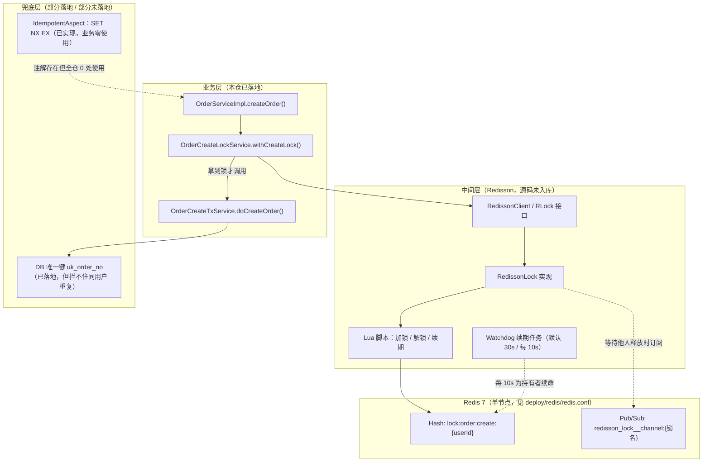
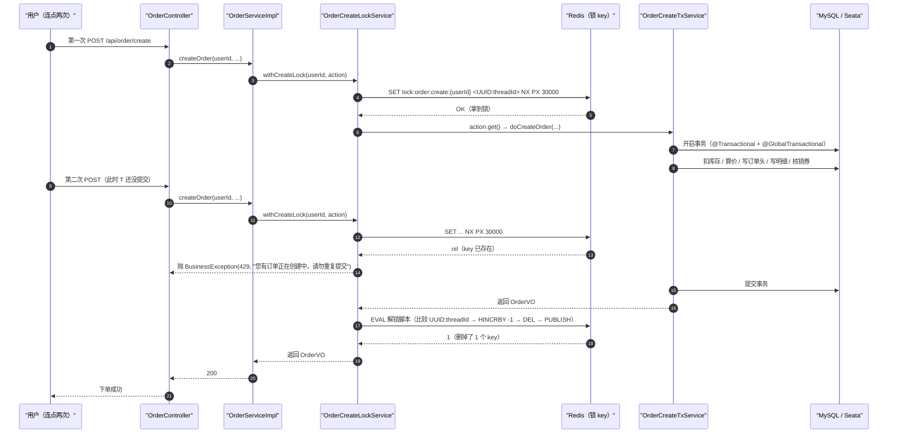

# Redisson 分布式锁：锁只保证"同一时刻一个执行者"，保证不了业务正确

> **一句话结论**：分布式锁能保证的只有"同一时刻最多一个线程在临界区里"，它不保证这段时间够用、不保证 Redis 不丢锁、也不保证"没人同时进来"就等于"结果唯一"——本仓下单重复事故真正发生的地方，是锁工作正常、日志里全是"加锁成功"的那一类时刻。
> **阅读前置**：需要会 Redis 的 `SET`/过期语义（[01-Redis缓存实战.md](./01-Redis缓存实战.md)），知道 Spring 声明式事务靠代理生效（[15-SpringAOP与声明式事务原理](../02-Spring微服务/15-SpringAOP与声明式事务原理.md)）。不需要读过 Redisson 源码。
> **证据基线**：Redisson 3.27.2（`pom.xml#L80`）、Redis 7、Spring Boot 4.2.0 / JDK 17。⚠️ **Redisson 本体源码未入库**（`24-源码分析/assets/source/` 中没有 RedissonLock / RedissonBaseLock / RedissonClient），所以本篇的类名、默认 30s 租期、看门狗周期、Lua 脚本文本一律标注"未入库，依据 Redisson 官方 wiki"，A 级摘录只有 2 处（网关限流器的 Lua 脚本，用来证明"多条命令塞进一个脚本由服务端原子执行"这一机制），其余为逐行核对过的本仓代码与可复现推演。预计阅读 55 分钟。

## 0. 先看现象

### 现象 1：第二次点击被"拦住了"，库里却有两条订单

用户连点两次"提交订单"，第二次请求返回了明确的拒绝，前端也没再转圈：

```text
POST /api/order/create -> 200 {"code":429,"message":"您有订单正在创建中，请勿重复提交"}
```

可运营在后台按用户查未支付订单，查到两条。这条链路之所以可能，是因为"拦住"只是**那个瞬间**拦住了，而锁并没有把两个请求在时间上分开：

```text
[    0ms] A 加锁成功（SET NX PX 10000）→ owner=tokA expireAt=10000ms
[12000ms] A 业务第 12 秒仍在跑（尚未提交事务）；此刻 key 已过期被删
[12000ms] B 加锁成功（A 的 key 已不在，NX 通过）→ owner=tokB expireAt=22000ms
[13000ms] B 查"该用户有无未支付订单"：A 还没提交，读不到 → 判定可下单
[15000ms] A 业务结束：插入订单 SO-A，提交事务
[15000ms] A unlock（Lua 比较 token=tokA，但 key 现值=tokB）→ 删 0 个 key
[16000ms] B 业务结束：插入订单 SO-B，提交事务
[17000ms] SELECT ... WHERE user_id=? AND status=PENDING_PAY → 命中 2 行（SO-A、SO-B）
```

这段输出不是日志，是本篇 §6.4 那个 40 行 node 脚本跑出来的真实 stdout（推演规则见那节）。它说明一件事：**A 的锁在 10 秒时就已经不归 A 了，但 A 还在临界区里写数据；而 B 进来时，校验"有没有已存在的订单"这一步被读已提交隔离级别干掉了（A 还没 commit）。**

数据库这一层也没有任何兜底——订单表只有订单号唯一键，没有"同一用户只能有一条未支付订单"的约束：

```sql
-- deploy/mysql/all-init.sql#L604-L608（原文节选，注释为讲解所加）
PRIMARY KEY (id),
UNIQUE KEY uk_order_no (order_no),
KEY idx_user_id (user_id),
KEY idx_status (status),
KEY idx_expire_time (expire_time)
```

`uk_order_no` 保护的是"订单号不重复"，而订单号是 `generateOrderNo()` 现生成的随机串（`ai-cs-order/src/main/java/com/aics/order/service/impl/OrderCreateTxService.java#L104`），两个请求必然生成两个不同订单号——唯一键拦不到它们。

### 现象 2：服务起不来，报 `AUTH` 相关的错

引入 Redisson 的那次上线，order 服务启动即失败：

```text
org.redisson.client.RedisException: ERR AUTH called without any password configured for the default user.
Have you configured your password? https://redis.io/docs/latest/operate/oss_and_stack/management/security/acl/
```

根因不是密码写错了，而是"没密码"这件事在 YAML 里表达不出来，被中间件还原成了空串——详见 `ai-cs-order/src/main/java/com/aics/order/config/RedissonConfig.java#L10-L20` 里记的踩坑记录，处理办法和判读方法在 §6.1。

### 现象 3：`attempt to unlock lock, not locked by current thread`

另一个更隐蔽的版本：偶发 500，堆栈里是

```text
java.lang.IllegalMonitorStateException: attempt to unlock lock, not locked by current thread by node id: 8b1f... thread-id: 87
```

这行文本出自 Redisson 的解锁实现（Redisson 未入库，无法给出该类行号，属"官方实现抛出的异常原文"，判断依据见 §3.2 的解锁逻辑）：它说明**释放锁的线程不是持有锁的线程**——要么锁已经过期被别人拿走，要么 `unlock()` 被写在了 `finally` 之外的分支上。

> 这些现象指向同一件事：**锁是一个"租约"，不是一把"门闩"**——它有有效期、会在你没结束时就失效、会因为你放松警惕的写法（常量 value、裸 `DEL`、`leaseTime` 写死、解锁不在 `finally`）而完全失去意义。事故的根因几乎都在"锁外面那一圈"：临界区时长、事务边界、幂等兜底。

## 1. 整体地图



> **读图说明**：
> ① 最关键的一根箭头是 `M3 -.-> R1`（看门狗给 Hash 续期）。它决定了"锁能活多久"，而几乎所有"锁失效"事故都是这根箭头断了或压根不存在——**如果你以为"加了锁就一直锁着"，后面所有结论都会错**。
> ② 第二关键的是 `A2 -->|拿到锁才调用| A3` 这个顺序：锁在事务**外层**，事务提交发生在 `action.get()` 返回之前（§3.8）。若把它理解成"锁在事务里面"或"解锁发生在提交之后"，就会错误地以为本项目不存在"锁释放早于提交"的风险，从而在重构时把注释删掉，退回 `docs/28-故障案例库.md` 里 C1 那个事故。
> ③ `S1 -.-> A1` 是虚线：`IdempotentAspect` 代码已存在（`SET NX EX` 占位），但全仓搜 `@Idempotent` 没有任何业务使用点，"幂等兜底"目前只是设计意图，不是运行时事实——这是本篇"落地面"最重要的一条。

| 组件 | 责任 | 调用方（本仓真实调用点） |
| --- | --- | --- |
| `OrderCreateLockService` | 把"按 userId 加锁 → 执行 → 释放"收敛成模板方法，保证异常路径也释放 | `OrderServiceImpl.createOrder()` |
| `RLock` / `RedissonClient` | 提供 `tryLock` / `unlock` 语义；可重入计数、等待队列、续期都在这层 | 只有 `OrderCreateLockService` 一个调用点 |
| Redis（Hash + 频道） | 存锁状态（持有者标识 + 重入次数）与过期时间；发布"已释放"通知 | 由 Redisson 客户端访问，业务代码不直连 |
| 看门狗（Redisson 内部任务） | 未显式传 `leaseTime` 时，每 1/3 租期续一次 | 由 `RedissonClient` 内部的 `HashedWheelTimer` 驱动 |
| `OrderCreateTxService` | 真正的下单事务边界（`@Transactional` + `@GlobalTransactional`） | `OrderCreateLockService` 的回调 `action` |
| `IdempotentAspect` | 另一套去重机制：`SET NX EX` 首次占位 + 失败重放拒绝 | 设计上给业务用，实际 0 处使用 |

## 2. 关键概念与关键类

先统一 6 个术语，后面反复用到：

- **租约（lease）**：锁带一个过期时间，持有者必须在过期前完成临界区或续期，否则锁自动失效。分布式锁天生是租约，不是互斥体。
- **临界区**：持锁期间执行的那段代码。它的**时长**是选锁方案的第一个输入，不是事后拍脑袋。
- **可重入**：同一线程可以再次获取同一把锁而不阻塞，代价是要记"进来了几层"。
- **看门狗（watchdog）**：Redisson 内置的续期任务，未指定 `leaseTime` 时代替你不断把过期时间往后推。
- **fencing token（栅栏令牌）**：每次加锁递增的单调号，让下游能识别"旧持有者的迟到写入"。本项目**未实现**。
- **占位（idempotency key）**：一次请求一个 key，抢到就执行、抢不到就拒，语义是"同一次请求只跑一次"，与"同一时刻只跑一个"不是一回事。

| 名称 | 位置 | 角色 | 关键方法 / 字段 |
| --- | --- | --- | --- |
| `RLock` | Redisson 3.27.2，**未入库** | 锁接口，`java.util.concurrent.locks.Lock` 的分布式版 | `tryLock()` / `tryLock(wait, unit)` / `tryLock(wait, lease, unit)` / `unlock()` / `isHeldByCurrentThread()` |
| `RedissonLock` | 未入库 | `RLock` 实现，负责 Hash 结构、Lua 加解锁、Pub/Sub 等待 | `tryLockInnerAsync` / `unlockInnerAsync`（名称依据官方 wiki） |
| `RedissonBaseLock` | 未入库 | 续期（看门狗）与线程标识的公共父类 | `scheduleExpirationRenewal` / `ExpirationEntry`（名称依据官方 wiki） |
| 锁 Hash 结构 | Redis 内 | field=`UUID:threadId`，value=重入次数 | `HINCRBY` 加一、减一；归零才 `DEL` |
| 看门狗参数 | Redisson `Config.lockWatchdogTimeout` | 默认租期 30s，续期间隔 = 30/3 = 10s | 未显式 `leaseTime` 时才启动 |
| `OrderCreateLockService` | `ai-cs-order/src/main/java/com/aics/order/lock/OrderCreateLockService.java#L32-L62` | 本仓唯一锁封装：key 规约 + `tryLock(0, SECONDS)` + `finally` 释放 | `withCreateLock(Long userId, Supplier<T> action)` |
| `RedissonConfig` | `ai-cs-order/src/main/java/com/aics/order/config/RedissonConfig.java#L24-L40` | 手工装配单机 `RedissonClient`（不走 starter 自动配置） | `Redisson.create(Config)`、`setRetryAttempts(5)` |
| `IdempotentAspect` | `ai-cs-common/src/main/java/com/aics/common/idempotent/IdempotentAspect.java#L49-L84` | 另一条去重路线：`SET NX EX` + 失败释放，异常 fail-open | `around(...)`、`tryRelease(...)` |
| `BusinessException` | `ai-cs-common`（`ResultCode.TOO_MANY_REQUESTS`） | 锁竞争失败被翻译成 429 语义的响应 | 抛出即结束请求，不排队 |

⚠️ 诚实边界：上表里凡是标"未入库"的类，本篇**不会**给出源码摘录与行号，只描述行为；本仓代码的行号都逐行核对过，可直接跳到文件对照。

补一个容易被忽略的映射：锁竞争失败被翻译成 `ResultCode.TOO_MANY_REQUESTS`（HTTP 429 语义），而不是 500——含义是"你现在别来"，前端应当提示用户而不是自动重试。这条映射与 `log.warn("下单防重锁竞争失败: userId={}")` 一起写在 `OrderCreateLockService.java#L50-L53`，那行 warn 也是线上**唯一**能证明"防重锁真的在起作用"的信号：埋点、告警、竞争率统计（§6.10）都应该抓它。如果哪天这条日志一条都没有，先怀疑锁被谁改成永真了。

## 3. 原理与证据逐段精读

### 3.1 为什么 `SETNX` + `EXPIRE` 两条命令一定会留死锁

```text
SETNX lock:order:create:1001  tokA        ← 返回 1，A 认为"锁是我的"
        ↓  在这里 JVM OOM / 被 kill / 网络断 / STW 40 秒
EXPIRE lock:order:create:1001  30         ← 永远没机会执行
```

**这段在做什么。** 用两条独立命令"先占位、再设过期"。占位成功与设过期之间有一个窗口，窗口内进程异常终止，key 就永久存在——不是"锁住 30 秒"，是"锁住到有人手工 `DEL`"。

**为什么这么设计。** 老教程这么写，是因为 Redis 2.6.12 之前没有"带过期的 `SETNX`"。那时只能两条命令拼，于是大家用"值里存过期时间戳 + 读到再判断"这类补丁，复杂度全转移给了业务。

**换写法会怎样。** 把两条命令合成一条 `SET key value NX PX 30000`：Redis 单线程执行命令，"判断不存在"与"设置过期"在同一命令内完成，不存在中间态。这是当前基线（Redis 7）唯一正确的加锁原语，Redisson 内部也是走这个分支（未入库，依据官方 wiki 的 `tryLockInnerAsync` 描述）。

**常见坑。** ① 用 `SETNX` 后忘记 `EXPIRE`，测试环境靠重启 Redis 才恢复，于是谁都学会"重启一下就好了"，问题被掩盖；② 用 `SET key value EX 30` 但**漏了 `NX`**——这行代码会覆盖别人的锁，等于没有锁；③ 把 `NX` 写成 `EXISTS` 判断再 `SET`，又回到两条命令。

A 级旁证：Redis 服务端确实会把一个脚本里的多条命令当整体执行。Spring Cloud Gateway 的令牌桶就是这么写的——`get`、算、`setex` 三步在一个 Lua 脚本里：

```lua
-- (src: request_rate_limiter.lua.md#L29-L42)
local last_tokens = tonumber(redis.call("get", tokens_key)) or capacity
local last_refreshed = tonumber(redis.call("get", timestamp_key)) or 0

local delta = math.max(0, now-last_refreshed)
local filled_tokens = math.min(capacity, last_tokens+(delta*rate))
local allowed = filled_tokens >= requested
local new_tokens = allowed and filled_tokens - requested or filled_tokens

if ttl > 0 then
  redis.call("setex", tokens_key, ttl, new_tokens)
  redis.call("setex", timestamp_key, ttl, now)
end

return { allowed and 1 or 0, new_tokens }
```

调用方只发一次请求，不关心里面几条命令：

```java
// (src: RedisRateLimiter.java.md#L262-L269)
List<String> keys = getKeys(id, routeId);
List<String> scriptArgs = Arrays.asList(replenishRate + "", burstCapacity + "", "", requestedTokens + "");
// allowed, tokens_left = redis.eval(SCRIPT, keys, args)
Objects.requireNonNull(this.redisTemplate, "redisTemplate may not be null");
Objects.requireNonNull(this.script, "script may not be null");
Flux<List<Long>> flux = this.redisTemplate.execute(this.script, keys, scriptArgs);
```

**注意别读错**：这是**网关限流器**，不是分布式锁——它证明的是机制（脚本由服务端原子执行、客户端只发一次），不证明 Redisson 的锁脚本长什么样。Redisson 的加锁/解锁脚本未入库，本篇只描述其语义（§3.2、§3.3）。

### 3.2 value 必须唯一，释放时必须比较后删除

**这段在做什么。** 加锁时写一个"只有我知道"的字符串，解锁时先比对再删。本项目正例与反例并存：

```java
// ai-cs-order/src/main/java/com/aics/order/lock/OrderCreateLockService.java#L44-L62
public <T> T withCreateLock(Long userId, Supplier<T> action) {
    RLock lock = redissonClient.getLock(KEY_PREFIX + userId);
    boolean acquired = false;
    try {
        // waitTime=0：快速失败；未指定 leaseTime → 触发看门狗自动续期
        acquired = lock.tryLock(0, TimeUnit.SECONDS);
        if (!acquired) {
            log.warn("下单防重锁竞争失败: userId={}", userId);
            throw new BusinessException(ResultCode.TOO_MANY_REQUESTS, "您有订单正在创建中，请勿重复提交");
        }
        return action.get();
    } catch (InterruptedException e) {
        Thread.currentThread().interrupt();
        throw new BusinessException(ResultCode.INTERNAL_ERROR, "下单操作被中断");
    } finally {
        if (acquired && lock.isHeldByCurrentThread()) {
            lock.unlock();
        }
    }
}
```

这里没有出现任何 `token` 变量：唯一性由 Redisson 自己生成（官方 wiki 记为 `UUID:threadId`），比较-删除由它的解锁脚本完成。

反例在本仓另一处——幂等切面用常量 `"1"` 当 value，释放时**裸删**：

```java
// ai-cs-common/src/main/java/com/aics/common/idempotent/IdempotentAspect.java#L61-L84
acquired = Boolean.TRUE.equals(ops.setIfAbsent(redisKey, TOKEN, ttl));
if (!acquired) {
    throw new IdempotentRejectException(idempotent.message());
}
...
private void tryRelease(String key) {
    try {
        redisTemplate.delete(key);
    } catch (RuntimeException e) {
        log.warn("幂等组件释放 key 失败（等待 TTL 到期自然失效）: {}", key, e);
    }
}
```

**为什么 `"1"` 在这里可以接受、在锁里不行。** 因为它们的语义不同：幂等 key 绑定的是一次**请求**（`@Idempotent(key = "'pay:callback:' + #orderNo")`），同一 key 只该有一次成功执行、且执行者是"抢到的那一个"，不存在"我又把它删了而它已属别人"以外的第二需要区分的持有者；而锁的 key 会长寿、会被反复争抢，若 value 是常量，A 迟到解锁就会删掉 B 的锁。§6.4 的场景 1b 就是这个后果的真实推演：

```text
[15000ms] A unlock 是裸 DEL：不看 token，直接 DEL key
[15100ms] C 加锁成功（B 的锁被 A 删掉了）→ owner=tokC expireAt=25100ms
[15200ms] 此刻 B 与 C 同时在临界区：互斥彻底失效
```

**换写法会怎样。** 若目标是"锁"，就必须走"比较再删"，而且必须原子——`GET` 拿出来比、比完再 `DEL`，三步之间又出现窗口。Redisson 的做法是把整件事写进一个 Lua 脚本（未入库）：语义等价于

```text
if redis.call('hexists', KEYS[1], ARGV[3]) == 0 then return nil end
local counter = redis.call('hincrby', KEYS[1], ARGV[3], -1)
if counter > 0 then redis.call('pexpire', KEYS[1], ARGV[2]) return 0 end
redis.call('del', KEYS[1])
redis.call('publish', KEYS[2], ARGV[1])
return 1
```

（这段是**按官方 wiki 描述重写的等价伪代码**，不是仓库入库摘录，不可当源码引用。）

**常见坑。** ① 以为 `isHeldByCurrentThread()` 能防住一切——它只判断"当前 JVM 的这个线程是不是持有者"，返回 false 时你只是静默跳过解锁，锁照样在过期前被别人占着；本项目 `finally` 用它是为了避免"锁已过期/已释放"时抛 `IllegalMonitorStateException` 把业务结果冲掉（现象 3）。② 手写 `unlock` 时用 `if (redis.hasKey(key)) del(key)`，两个命令两次往返，中间同样有窗口。③ 用业务主键当 value（如 `userId`），两个并发请求 value 相同，比较就失效了。

### 3.3 可重入：为什么锁的数据结构是 Hash 而不是 String

**这段在做什么。** Redisson 的锁在 Redis 里是一个 **Hash**：field 是"哪台机器的哪个线程"（`UUID:threadId`），value 是"这一层线程进来了几次"。加锁 = `HINCRBY field 1` 并设过期；释放 = `HINCRBY field -1`，减到 0 才 `DEL`。

**为什么这么设计。** Java 里 `synchronized` 是可重入的，`ReentrantLock` 也是；如果分布式锁不可重入，一个"下单服务里 service A 调 service B，B 又加同一把锁"的正常调用链就会自己把自己锁死（并且是等待超时后失败，比死锁更难查）。用 Hash 而不是 String，是因为要同时表达两件事：**谁持有** + **重入几层**；String 只能存一个值。

**换写法会怎样。** 若用 String 存持有者、另一个 key 存计数，两个 key 不能原子地一起更新（除非又写 Lua），而且过期时间分散在两个 key 上，很容易出现"计数还在、锁没了"。若干脆不支持重入，就得在代码里严格保证"同一线程不会嵌套加同一把锁"——本仓做到了吗？`tryLock(` 在 `src/main` 中只有 1 处调用（§6.3 的统计），所以现在安全；但这个约束没人写在注释里，加第二个锁点的人不会知道。

**常见坑。** ① 在异步线程/线程池里加锁、在另一个线程解锁：`field` 里的 threadId 变了，`HINCRBY -1` 减的是另一个 field，于是原 field 永远停在 1，锁只能等过期——这正是现象 3 的一种来源。② `Supplier` 里又提交了一个 `@Async` 子任务并在里面解锁，同上。③ 以为"重入"意味着"跨 JVM 重入"：不同机器的 `UUID` 不同，跨进程一定是两把"不同的 field"，第二个进程会阻塞或失败。

### 3.4 看门狗：不传 `leaseTime` 才有续期，传了就一定不续

**这段在做什么。** 本项目调的是两参数 `tryLock(0, TimeUnit.SECONDS)`——第一个参数是"愿意等多久"（0 = 不排队），**没有** `leaseTime`。这种情况下 Redisson 采用默认租期 `lockWatchdogTimeout = 30000ms`，并启动续期任务，每 `lease/3 = 10000ms` 把过期时间重置回 30 秒，直到 `unlock()` 或客户端宕机。

**为什么这么设计。** 因为临界区时长很难预估：一个下单接口在压测下 200ms，在大促 + 慢 SQL 下可能 8 秒。硬编码租期必然在某个时刻不够用（§3.5 场景 1），所以给一个"你自己管好自己的租约"的默认策略。

**换写法会怎样。** 一旦调用三参数版本 `tryLock(waitTime, leaseTime, unit)`，**看门狗不启动**，锁到点必失效。这不一定错——当你能证明临界区上限（比如 `leaseTime = 30s` 而 P99 是 800ms）时，显式租期反而更可控，因为不会出现"进程半死不活还在续期、锁永不释放"的僵尸锁。**错的写法是随大流写 `tryLock(3, 10, SECONDS)` 又不检查业务时长**：10 秒一到锁没了，而业务还在跑，症状就是现象 1。

**常见坑。** ① 以为看门狗能解决所有问题：续期任务本身是 JVM 里的线程，一旦 STW / 容器 CPU 被限流 / 线程池被业务占满，续期同样停摆，锁照样过期（§3.5 场景 3）。② 在 `leaseTime` 版本上叠加长事务：`@Transactional` 包住整段 15 秒业务 + 10 秒租期 = 稳定复现双写。③ 以为 `unlock()` 之后续期任务还在跑——正常实现会先取消续期，但**如果 `unlock()` 因为线程不匹配失败**（现象 3），续期任务会继续把锁续下去，形成"永远不释放且没人敢动的锁"，只能等重启。

### 3.5 锁的三大失效场景：业务超时、主从切换、GC 停顿

**这段在做什么。** 把"锁什么时候会骗你"列全。三者机理不同，但共同点是：**Redis 那边一切正常，日志里没有一句报错**。

| 场景 | 触发条件 | 现象 | 本仓现状 |
| --- | --- | --- | --- |
| 业务超时超过租期 | 显式 `leaseTime` 且临界区更长；或看门狗停摆 | 后者拿到锁，两写并发 | 代码走看门狗（无 `leaseTime`），风险来自 STW/线程饥饿 |
| 主从切换丢锁 | 主节点写入锁后未同步到从，主挂、从升主 | 新主上锁不存在，两人同时持锁 | **未部署**：`deploy/redis/redis.conf` 无 `replicaof`，`deploy/docker-compose/docker-compose-master-slave.yml#L82-L138` 三个节点各自 `redis-server redis.conf`，是"三份单机"不是主从 |
| GC / STW 停顿 | 停顿跨过租期，续期线程同时停 | 锁过期 → 他人进入 → 原持有者醒来继续写 | 未做防护；临界区幂等缺失（§3.10） |

真实推演（同一脚本，§6.4 可复跑）：

```text
=== 场景3 进程 STW 40s，超过 30s 租期 ===
[    0ms] A 加锁成功 → owner=tokA expireAt=30000ms
[ 5000ms] A 所在 JVM 进入 40s 的 Full GC / STW
[10000ms] 看门狗本应在此刻续期，但续期线程也被 STW 挂起 → 一次续期都没发生
[30000ms] key 到期被 Redis 删除（没人续期）
[31000ms] B 加锁成功 → owner=tokB expireAt=61000ms
[45000ms] A 的 STW 结束，继续往下跑：插入订单 SO-A 并提交
[45100ms] A unlock（Lua 比较 token=tokA，但 key 现值=tokB）→ 删 0 个 key
[46000ms] B 也插入订单 SO-B 并提交 → 又是两条订单，两边日志都写着"加锁成功"
```

三个场景的共同点是"锁的持有者身份在时间上不确定"。工程上的补偿手段只有三种，按改动面从小到大：

| 补偿方式 | 具体做法 | 能防住 | 代价 |
| --- | --- | --- | --- |
| 唯一约束 | 给业务唯一键加 DB 唯一索引，插入冲突即回滚 | 重复插入 | 需要一个真正的业务唯一键（"用户 + 未支付"要用生成列或独立表） |
| 状态机校验 | 写入前 `UPDATE ... WHERE status = 'INIT'`，按受影响行数判断有没有抢到 | 非法状态流转 | "查 + 改"必须同一事务，且状态设计要正确 |
| fencing token | 加锁时取单调递增号，随写请求带给存储层，存储层拒绝更小的号 | 迟到写入（§3.5 全部三种） | 存储层要支持比较：多一列 + 一条条件更新 |

fencing token 的最小形态（本仓**未实现**，此处只示意方向）：

```text
加锁：token = INCR lock:order:create:1001:fence          -> 得到 7
写库：UPDATE orders_guard SET last_token = 7
              WHERE user_id = 1001 AND last_token < 7
      受影响行数 = 0 说明已经有更大的号写过库 -> 拒绝这次迟到写入
```

关键在最后一行：**递增号必须由存储层比较**。只把 token 打进日志、或者在应用里 `if (token < lastToken) return;`（读后写、无锁），等于什么都没做。

**为什么这么设计。** 一切租约型分布式锁都在"可用性"与"正确性"之间做同一个取舍：**宁可让锁提前失效（可用），也不能让锁永远不失效（不可用）**。只要选了 Redis 锁，就必须接受"极端情况下会有两个人同时进来"，并把正确性押在别处（唯一键、状态机、fencing token）。

**换写法会怎样。** 想彻底消除"两人同时进"只有一个方向：让**被保护的资源自己**拒绝迟到写入——DB 唯一索引、`UPDATE ... WHERE version=?`、或 fencing token（把递增号带给存储层，存储层拒绝更小的号）。这三者的共同点是"判断与写入在同一个事务/同一条命令里"，与锁无关。

**常见坑。** ① 把"锁"当"事务"用：以为加了锁就不会有并发不一致，于是不加唯一键、不加状态校验。② 主从切换这个问题在单机部署下"看不见"，所以测试环境永远复现不出来——本篇明确标注**本仓未部署主从/Sentinel/Cluster**，所以这条风险属于"将来上云上集群时会突然出现"的债。③ 用 `maxmemory-policy allkeys-lru`（`deploy/redis/redis.conf#L25`）的实例存锁：内存压力下**锁 key 可能被 LRU 淘汰**，这是比主从切换更早发生的丢锁路径。

### 3.6 RedLock：争议在哪，为什么本仓不用

**这段在做什么。** RedLock 的思路是"向 N 个**独立** Redis 主节点依次加锁，超半数成功才算成功"，用多副本投票压低"单点丢锁"概率。

**为什么这么设计，以及它为什么被质疑。** Martin Kleppmann 的《How to do distributed locking》(2016) 指出：即使多数派加锁成功，仍无法防御"持有者 GC 停顿后迟到写入"，除非引入 fencing token；而为了解决 GC 停顿去引入多节点，代价（N 倍连接、N 倍故障面、需要独立部署的 5 个主节点）远大于收益。antirez 的回应强调"RedLock 的目的是比单节点更安全，而不是绝对安全"。

这场争论的工程落地形态是"分层承认风险"：

- 2016 年 Kleppmann 质疑 RedLock 的强一致承诺，核心论据是"持有者在锁有效期内停顿，锁过期后仍继续写"，主张用 fencing token；
- antirez 随后回应，强调 RedLock 的目标是"比单机更不易丢锁"，并反驳时钟假设的悲观化；
- 此后主流实践分成了两派：**要么**用单节点锁 + 存储层约束（大多数业务系统的现实选择），**要么**上真正的共识系统（ZK/etcd）做协调。为"业务防重"专门部署 5 个互不复制的主节点，收益与成本不成比例。

**换写法会怎样。** 假设本仓改用 RedLock，要付的账很具体：RedLock 要求 N 个**互不复制**的独立主节点，而本仓 `deploy/docker-compose/` 目前只有一个 Redis 服务（`deploy/docker-compose/docker-compose-all.yml#L32-L49`），意味着要新增 4 套部署与监控；`RedissonConfig.java#L32-L38` 的 `useSingleServer()` 要改成逐节点建 `RedissonClient` 再用 `RedissonRedLock` 组装；每次下单从 1 轮网络往返变成 N 轮，`tryLock(0)` 下任何一轮超时都直接变成"下单被拒"，可用性反而下降。换来的只是"单点丢锁概率"变小，而 §3.5 的三种迟到写入一条都没被防住——因为它不改变"锁过期后原持有者仍在写"这件事。

**结论（本篇立场）。** ① 官方与社区在"必须有 fencing token 才能谈强一致"这一点上已经没有分歧；② 单节点 Redis 锁 + 下游幂等，和 RedLock + 没有幂等，前者在真实业务里更不容易出事；③ Redisson 3.x 提供过 `RedissonRedLock`，后续版本标记弃用/移除——**本机 `.m2` 里只有 3.27.2 的 pom、没有 jar（§6.3 统计为 0 个 jar），无法核对 3.27.2 是否仍包含该类**，写代码前先看 IDE 是否提示弃用，不要照抄教程。④ 本项目**未使用 RedLock**，全仓 0 处引用。

**常见坑。** ① 以为"5 个节点"就是"5 个 Redis 实例"：RedLock 要求节点之间**互不复制**，若 5 个节点是同主从架构，投票毫无意义。② 用 RedLock 但不处理"部分成功"的清理：少数派节点上的锁必须显式释放，否则会残留。③ 把它当"账务级强一致锁"用：账务类场景的答案通常是数据库行锁 + 唯一约束 + 流水号去重，而不是分布式锁。

### 3.7 除了 `getLock`，Redisson 还给了一套并发原语

**这段在做什么。** Redisson 除 `getLock`（可重入互斥锁）之外还导出了一整套分布式同步器，签名与 `java.util.concurrent` 一一对应。理解它们的意义不在"多学几个 API"，而在于看清**每一种原语都在放弃一部分吞吐来换取某种顺序或数量保证**——这类保证恰好是"防重"不需要、但"排队公平"或"限并发"需要的。

| 原语 | API（依据官方 wiki，未入库） | 语义 | 什么时候值得用 | 代价 |
| --- | --- | --- | --- | --- |
| 公平锁 | `getFairLock(name)` | 按请求顺序排队，先来先得 | 顺序敏感（如库存扣减的排队公平性申诉） | 需要额外有序集合维护排队顺序，吞吐更低 |
| 读写锁 | `getReadWriteLock(name)` | 读读并发、读写互斥 | 读多写少的配置/字典刷新 | 写饥饿风险；跨节点语义复杂 |
| 信号量 | `getSemaphore(name)` | 限制同时执行者数量（>1） | 限并发的批处理、控制下游压力 | 与限流器职责重叠，通常 Sentinel/网关更合适 |
| 联锁 | `getMultiLock(l1, l2, ...)` | 多个锁同时持有才继续 | 一次操作跨两个互斥维度（用户 + 商品） | 死锁风险上升，必须全序加锁 |
| 计数/闭锁 | `getCountDownLatch` / `getAtomicLong` | 跨进程协调 | 分布式任务编排 | 一致性同样受租约与主从影响 |

**为什么本项目只用最朴素的可重入锁。** 因为下单防重的需求是"同一用户同一时刻一个请求"，粒度是 userId，冲突窗口毫秒级，`tryLock(0)` 快速失败比排队更符合用户体验（排队意味着请求被挂住，反而拉长临界区压力）。上表里其余原语解决的都不是这个问题：公平性、读写分离、限并发、多维互斥，本仓一个都不需要。

**换写法会怎样。** 用公平锁排队，用户连点两次会得到"第二次也成功"而不是"第二次被拒"，看似更友好，但 Redis 里多一份有序排队结构，排队者超时后仍然失败，收益不明显；用联锁把"用户 + 商品"两把锁一起拿，可以同时防"同一用户重复下单"和"超卖"，但必须约定加锁全序（先用户后商品），否则两个方向相反的下单请求会互相等死。

**常见坑。** 用信号量 `permits=2` 以为能"提高吞吐"，其实等于允许两个请求同时进入防重临界区，直接破坏防重语义；读写锁在读多写少场景下若不设写超时，写请求可能长期饥饿。

### 3.8 锁与事务的顺序：先锁后事务，且解锁必须在提交之后

**这段在做什么。** 本项目把事务放在锁的回调里，而回调指向**另一个 Bean**：

```java
// ai-cs-order/src/main/java/com/aics/order/service/impl/OrderServiceImpl.java#L50-L60
@Override
public OrderVO createOrder(Long userId, List<Long> cartItemIds, Long couponId, String paymentMethod) {
    // 锁在全局事务外层：同一用户的并发下单请求快速失败，
    // 拿到锁才进入 @GlobalTransactional 边界，避免锁内空占事务资源
    return orderCreateLockService.withCreateLock(userId,
            () -> orderCreateTxService.doCreateOrder(userId, cartItemIds, couponId, paymentMethod));
}
```

而被锁包住的临界区到底有多长？把 `doCreateOrder` 的步骤按行号列出来，答案就不靠猜了：

```text
L78   @GlobalTransactional(rollbackFor = Exception.class, name = "order-create")
L79   @Transactional(rollbackFor = Exception.class)
L82   取购物车
L93   for (CartItem item : cartItems) productClient.deductStock(...)   <- 每个商品一次远程调用
L98   计算价格 promotionService.calculatePrice(...)
L104  generateOrderNo()
L117  orderMapper.insert(...)
L120  循环 orderItemMapper.insert(...)
L133  优惠券核销
L144  rocketmqTemplate.syncSend("order-timeout-topic", ..., 5000, 16)
```

一个买 5 件商品的订单，临界区里有 5 次库存远程调用 + 1 次算价 + 1 次插头 + 5 次插明细 + 1 次核销 + 1 次同步发消息——**锁的持有时间是这些调用的总和**，与"加锁代码写了三行"给人的直觉完全不同。这也是 §3.4 里"不能拍脑袋传 `leaseTime`"的量化理由。

**为什么这么设计。** 顺序决定两个风险：① 锁在事务**内层**（先开事务再加锁）→ 事务已开启、连接已占用、`undo_log` 可能已有记录，然后在锁上等 3 秒，连接池被排队请求吃干；② 锁在事务**外层**但事务注解实际没生效 → 锁保护了一段没有事务的代码，`docs/28-故障案例库.md` 的 C1 就是这件事：修复前 `withCreateLock(userId, () -> doCreateOrder(...))` 是**同类内部调用**，走的是原始对象，`@Transactional` 被绕过，"分布式锁包住事务"只剩下了锁。

**换写法会怎样。** 顺序对了还有一个隐藏条件：**解锁必须发生在事务提交之后**。本项目靠"回调返回时子方法的事务已经提交"满足它——`action.get()` 是外部 Bean 的调用，事务在 `doCreateOrder` 返回前完成提交（`OrderCreateTxService.java#L78-L80`）。如果哪天有人为了"省一次 Bean 调用"把事务注解挪回 `OrderServiceImpl` 并在同一个方法里自调用，解锁就会早于提交：后来者拿到锁时读不到前者的数据，双写重现。**"锁释放早于事务提交"是这类代码最容易被重构破坏的性质，注释比代码更值钱。**

**常见坑。** ① 在 `finally { unlock() }` 里又抛异常，把业务异常吞掉（用 `isHeldByCurrentThread` + try-catch 兜住解锁异常）。② 用 `@Transactional(propagation = REQUIRES_NEW)` 把提交点挪到回调之外。③ 在锁内做 `@Async`/MQ 异步落库：主线程提交后立刻解锁，异步任务还在写——锁保护范围与数据可见范围错位。

### 3.9 锁粒度、热点行与等待超时

**这段在做什么。** 三个可调参数：key 的粒度、`waitTime`、`leaseTime`。本仓的取值：粒度 = `lock:order:create:{userId}`（`OrderCreateLockService.java#L32`），`waitTime = 0`，`leaseTime` 未传。

| 粒度 | 冲突范围 | 优点 | 风险 |
| --- | --- | --- | --- |
| 全局 `lock:order:create` | 所有用户 | 实现最简单 | 全站下单串行，QPS 直接掉到个位数 |
| 用户级（本仓） | 同一 userId | 不同用户完全并行，符合"防重"语义 | 一个用户开多个端狂点时的热点；对"跨用户抢同一张券"无效 |
| 订单级 `lock:order:{orderNo}` | 同一订单 | 适合支付回调、状态流转 | 创建阶段还没有 orderNo，无法用于防重 |

热点 key 的三层解法，按改动面从小到大：① 业务上换维度——按券 ID、按购物车行锁，而不是按用户；② 把"锁 + 校验"换成一条原子 SQL（`UPDATE stock SET qty = qty - 1 WHERE id = ? AND qty >= 1`，按受影响行数判断成败），从根上不需要锁；③ 分片锁（`lock:order:create:{userId % 16}`）+ 片内校验，代价是热点只是被摊薄，业务上仍可能出现"两个分片各写一条"，必须配合唯一约束。

**为什么 `waitTime = 0`。** 同一用户的并发下单是**用户误操作**，不是需要排队处理的正常流量：让它排队 3 秒再失败，用户已经点了五次；直接快速失败 + 明确文案（"您有订单正在创建中，请勿重复提交"）成本最低、用户体验反而更清楚。

**换写法会怎样。** 若改成 `tryLock(3, SECONDS)`，系统吞吐不变，但 RT 拉长：每个冲突请求会占住一个 Tomcat 线程 3 秒，冲突率高时线程池被打满，故障从"下单被拒"升级为"整个服务不可用"。§6.4 场景 2 就是这条路径的真实推演——B 等满 3 秒仍拿不到，`tryLock` 返回 false，白等。

**常见坑。** ① 热点 key：大 V 用户/秒杀商品集中到一个 key，Redis 单分片压力上来，锁的 RT 从 1ms 涨到 50ms；正确做法是业务上拆（按购物车行、按券 ID）而不是加大租期。② key 里拼了可变维度（如把请求时间戳拼进去），锁形同虚设——每个请求一把新锁。③ 忘记 `KEY_PREFIX` 规约，不同业务用了同一个 key 前缀，互相干扰。

### 3.10 锁 ≠ 幂等：一次请求只跑一次，和同一时刻只跑一个，是两件事

**这段在做什么。** 把"互斥"和"幂等"分开。互斥解决"同时"；幂等解决"重复"。两者防护的攻击面不同，缺一个就有洞：

| 你有的东西 | 能防住 | 防不住 |
| --- | --- | --- |
| 只有分布式锁 | 同一时刻两个请求 | 锁过期/丢锁/STW 后的迟到写入；重试、超时重发、用户回退再点 |
| 只有幂等 key | 同一次请求重复执行 | 同一用户的两次不同请求（合法但重复下单） |
| 锁 + 幂等 key | 上面两个 | 数据层没有任何约束时，仍是"应用层自觉" |
| 锁 + 唯一键/状态机 | 应用层 + 存储层 | 需要设计正确的业务唯一键（如"用户 + 未支付"需用生成列或独立表） |

本仓的现实是：**锁已落地，幂等组件已实现但 0 处使用，DB 层没有能拦"同用户两条未支付订单"的约束**（`deploy/mysql/all-init.sql#L604-L608`）。所以现象 1 的链路在本仓是**可能发生**的，只是需要"业务超过租期或看门狗停摆"这个前提——这正好是"落地面"里最该补的一条。

**为什么本项目没在临界区再查一次"是否已有未支付订单"。** 已核对 `OrderCreateTxService` 全流程：取购物车 → 扣库存 → 算价 → 落订单头 → 落明细 → 核销券 → 发延迟消息，**没有**"该用户是否已有 PENDING_PAY 订单"的二次校验。加这一条也不完美（读已提交下仍可能与未提交事务交错），但它能把"锁失效 + 无校验"降级为"锁失效 + 大概率被拦"；真正的兜底是 DB 层约束。

**换写法会怎样。** 三种替换都试一遍就知道为什么必须分层：① 把"锁"换成"幂等 key"（`SET NX EX` 占位后不释放）——能挡住重试，但同一用户的两笔不同请求是两个不同 key，重复下单照旧；② 把"二次校验 + 插入"合成一条 `INSERT ... SELECT ... WHERE NOT EXISTS`——判断与写入在同一条语句里，窗口消失，代价是 SQL 变复杂；③ 干脆在 `orders` 上建"用户 + 未支付"的唯一索引（用生成列表达"未支付"）——最彻底，冲突时抛 `DuplicateKeyException`，代码要接住并翻译成"请勿重复提交"。三种都比锁更靠近数据，也都比锁难写对。

**常见坑。** ① 用锁实现幂等：把 `lock:order:{requestId}` 当成幂等 key，锁释放后重试就能再执行一次——幂等 key 应该是**占位后不主动释放**（或释放条件严格受限）的，正如 `IdempotentAspect` 只在业务抛异常时才 `tryRelease`（`IdempotentAspect.java#L69-L74`）。② 幂等 key 的 value 用常量但**同时**把它当锁用，两种语义混在一个 key 上（§3.2）。③ 幂等组件 `fail-open`（Redis 挂了就放行，`IdempotentAspect.java#L62-L65`）是**有意的取舍**，但若把幂等当唯一防线，Redis 抖动就等于防护归零——所以注释里写"权威在业务状态检查与 DB 唯一键"。

### 3.11 与 ZooKeeper / etcd 锁的对比

**这段在做什么。** 把 Redis 锁放回"分布式协调"这个更大的范围里比较：三种系统都能做出"互斥"，但它们对"持有者失联"的定义完全不同，而这个定义决定了锁什么时候会被别人拿走。ZK 靠会话（session），etcd 靠租约（lease），Redis 只靠你自己设的过期时间——**Redis 是三者中唯一需要应用侧主动续期的**。

| 维度 | Redis（Redisson） | ZooKeeper | etcd |
| --- | --- | --- | --- |
| 实现机制 | `SET NX PX` / Hash + Lua + Pub/Sub | 临时顺序节点 + watch 前一个节点 | lease + revision + watch |
| 断开连接后 | 锁还能活到过期（甚至被续期） | 会话超时后临时节点自动消失 | lease 到期自动撤销 |
| 天然顺序性 | 无（需额外 fencing token） | 有（节点序号即排队顺序） | 有（revision 单调） |
| 性能/延迟 | 最高（内存单命令） | 较低（写要过半派+磁盘） | 中等（Raft 落盘） |
| 典型故障 | 主从切换丢锁、租约到期 | 会话超时抖动导致"锁闪断"，羊群效应 | lease 续期间隔设置不当 |
| 适合 | 高频、短临界区、能接受幂等兜底 | 强顺序、低并发、选主 | 配置/协调、K8s 生态 |

**为什么本仓选 Redis。** 下单防重是高频、短临界区场景，而 Redis 已经是本仓的既有基础设施（Nacos 里的 `spring.data.redis.*`，见 `tools/nacos-config/aics-shared.yml#L6-L12`）；ZK/etcd 则要额外一套集群与运维。真实情况也能核对：在 `ai-cs-*` 与 `deploy/` 下检索 `zookeeper|curator`，只有 `ai-cs-order/eff-order.xml`（Maven 依赖树快照，间接依赖）命中，**没有任何 Java 代码或部署配置引用它们**。

**换写法会怎样。** 迁到 ZK 会拿到两样 Redis 给不了的东西："客户端断开 → 会话超时 → 临时节点消失"的自动释放，以及节点序号天然表达的排队顺序。代价是引入新中间件、写操作要落盘并过半数派（延迟上升一个量级），还要处理连接抖动造成的"锁闪断"——GC 或网络瞬断触发会话超时，锁在业务还在跑的时候被删掉，症状与 §3.5 场景 3 一模一样。

**常见坑。** 以为 ZK 锁"绝对安全"：它同样无法防御"持有者停顿后迟到写入"，fencing token 仍是唯一解；另外 ZK 的 watch 是一次性的，大量客户端等待同一节点会引发羊群效应，工程上还要改成链式 watch。本仓的 ZK/etcd 只出现在 [16-ZooKeeper与etcd分布式协调.md](./16-ZooKeeper与etcd分布式协调.md) 的学习内容里。

### 3.12 客户端装配：本仓为什么不用 starter 的自动配置

**这段在做什么。** `ai-cs-order` 引了 `redisson-spring-boot-starter`（`ai-cs-order/pom.xml#L138-L142`），但没有让它的自动配置生效，而是自己造 `RedissonClient`：

```java
// ai-cs-order/src/main/java/com/aics/order/config/RedissonConfig.java#L24-L38
@Bean(destroyMethod = "shutdown")
public RedissonClient redissonClient(
        @Value("${spring.data.redis.host}") String host,
        @Value("${spring.data.redis.port:6379}") int port,
        @Value("${spring.data.redis.database:0}") int database,
        @Value("${spring.data.redis.connect-timeout:15000}") int connectTimeout,
        @Value("${spring.data.redis.timeout:15000}") int timeout) {
    Config config = new Config();
    config.useSingleServer()
            .setAddress("redis://" + host + ":" + port)
            .setDatabase(database)
            .setConnectTimeout(connectTimeout)
            .setTimeout(timeout)
            .setRetryAttempts(5)
            .setRetryInterval(3000);
```

紧跟在这段之后的第 39 行是一句作者注释，原文为「注意：不调用 setPassword —— Redis 未启用 AUTH」，第 40 行 `return Redisson.create(config);`。这三个细节值得逐个说清：

- **`destroyMethod = "shutdown"`**：容器关闭时关闭 Netty 线程组与看门狗定时任务。漏了它，`spring-boot:run` 反复启动会出现线程泄漏与"关不掉的连接"，表现是本地调试时第二次启动报端口占用或连接数超限。
- **`setRetryAttempts(5)` + `setRetryInterval(3000)`**：Redis 不可达时先重试 5 次、每次间隔 3 秒——**失败路径的 RT 是 15 秒**。这解释了为什么 Redis 抖动时下单接口是"卡住 15 秒再 500"，而不是快速失败；如果业务不能接受，这里要对齐接口超时。
- **不用 `setPassword`**：这是"无密码"唯一能被准确表达的方式——不调用，就没人和 null/空串打交道（§6.1）。

**为什么这么设计。** starter 的自动配置会从 `spring.data.redis.*` 全量映射到 `Config`，看起来省事，但它的映射是"单向照搬"：配置里写 `password:`（空值）时，绑定结果是空串，Redisson 会真的发 `AUTH`。自定义 Bean 之后，starter 的 `@ConditionalOnMissingBean(RedissonClient.class)` 自动让位（`RedissonConfig.java#L10-L20` 的注释写明了这条），于是能精确控制。

**换写法会怎样。** 直接用 starter 自动配置：本项目会在**启动时**失败（现象 2），因为 `tools/nacos-config/aics-shared.yml#L11` 与 `tools/nacos-config/ai-cs-order.yml#L7` 都是 `password:` 空值。**但也不是"自定义一定更好"**：自动配置还顺带装了 `RedissonConnectionFactory`，能让 `RedisTemplate`/`CacheManager` 也走 Redisson；本项目既然绕开了它，缓存链路用的仍是 Lettuce——两套客户端连同一个 Redis，内存与连接数都是双份。

**常见坑。** ① 自定义了 `RedissonClient` 却以为缓存也换成了 Redisson，测缓存序列化差异时对不上；② 只配 `useSingleServer()`，将来 Redis 换成主从/Sentinel 时要改代码而不是改配置（本仓当前是单节点，见 §3.5 表格）；③ 把 `connect-timeout` 当业务超时用——它只约束建连，`timeout` 才约束命令往返。

## 4. 一次完整执行时序



> **读图说明**：
> ① 第 4 跳（`SET ... NX PX 30000`）是唯一决定"谁进临界区"的一步，它的返回值只有 OK / nil 两种，没有"部分成功"。
> ② 第 11 跳（第二次 `SET`）必须是**第 9 跳（事务提交）之前**发生的，这正是"防重"生效的关键时序；如果第二次请求落在第 13 跳之后，它就会**正常成功**——因为那时第一单已提交，从业务上说确实允许再下单（本仓没有"合并/取消上一单"的逻辑）。看错这根箭头会得出"锁能防止用户下两单"的错误结论：**它只能防止"同一时刻"的两单。**
> ③ 第 15 跳（解锁脚本）不是 `DEL`，而是"比较持有者 → 减重入计数 → 归零才删 → 发布通知"，最后一步 `PUBLISH` 用于唤醒第 12 跳里正在等锁的客户端。

**为什么第 4 跳用 `tryLock(0, ...)` 而不是 `lock()`。** `lock()` 是无参阻塞版本，拿不到就一直等，在 Web 线程里等于把一个 Tomcat 线程挂起去等一把可能永不释放的锁；`tryLock(0, ...)` 立即返回布尔值，把"等不等、等多久"的决定权留给业务层（这里的选择是"不等"）。全仓 `.lock(` 命中 0（§6.3）说明这个约定目前没有被破坏，加锁点新增时请沿用。

哪一步失败，报什么错：

| 失败位置 | 典型异常 / 返回 | 怎么认 |
| --- | --- | --- |
| 第 4 跳 Redis 不可达 | `RedisConnectionException` / `RedisTimeoutException`，`setRetryAttempts(5)`、`setRetryInterval(3000)`（`RedissonConfig.java#L37`）会先重试 15 秒 | 日志里连续 5 次 connection refused，接口 RT ≈ 15s 后 500 |
| 第 4 跳密码错/空串 | `ERR AUTH called without any password configured ...` | 启动即失败，不是运行期（§6.1） |
| 第 11 跳竞争失败 | `BusinessException(TOO_MANY_REQUESTS, "您有订单正在创建中，请勿重复提交")` + `log.warn("下单防重锁竞争失败: userId={}")` | 429 + 该 warn 成对出现 |
| 第 13 跳业务异常 | 事务回滚，`finally` 里仍执行解锁 | 异常栈是业务异常，日志无锁相关告警 |
| 第 15 跳解锁时线程不匹配 | `IllegalMonitorStateException: attempt to unlock lock, not locked by current thread` | 业务已成功但接口 500（异常从 `finally` 抛出），见现象 3 |
| 第 15 跳前线程被中断 | `BusinessException(INTERNAL_ERROR, "下单操作被中断")` + 中断标志被恢复（`OrderCreateLockService.java#L55-L57`） | 500 + 日志有中断堆栈 |

## 5. 设计取舍

| 决策点 | 本仓选择 | 放弃了什么 | 换来的什么 |
| --- | --- | --- | --- |
| 锁实现 | Redisson `RLock`（不手写 `SETNX`） | 一次依赖引入 + 学习成本 | 原子加锁、可重入、看门狗、等待通知全都现成 |
| 客户端装配 | 手工 `Redisson.create(Config)`（`RedissonConfig.java#L24-L40`），屏蔽 starter 自动配置 | starter 的零配置便利、`spring.data.redis.*` 全量映射 | 能精确控制"不发 AUTH"、重试次数、超时；AUTH 空串问题被彻底绕开 |
| 等待策略 | `tryLock(0, SECONDS)` 快速失败 | 请求排队、更高"成功率" | 不占线程、不排队雪崩、文案明确 |
| 租期策略 | 不传 `leaseTime`，用看门狗 | 临界区时长不可控、僵尸锁可能长期存在 | 慢业务不会自破锁 |
| 事务位置 | 锁在外、事务在内，事务在独立 Bean（`OrderCreateTxService`） | 多一个类、多一跳 Bean 调用 | 锁持有时间 ≈ 临界区最短；事务注解真的生效（C1 事故的修复） |
| 幂等兜底 | `IdempotentAspect` 已实现，**业务 0 处使用** | —— | 目前**没有**运行时兜底，只有设计意图 |
| 数据库兜底 | 只有 `uk_order_no` | 无法阻止"同用户两条未支付订单" | 简化的表结构；风险留给了应用层 |
| 高可用 | 单节点 Redis（`deploy/docker-compose/docker-compose-all.yml#L32-L49`） | 主从/Sentinel/Cluster 的复杂度 | 部署简单；代价是主从切换丢锁这条风险**暂不存在，也暂未防护** |

**可扩展点清单（按"改动面从小到大"）：**

- 在 `OrderCreateTxService.doCreateOrder` 开头加"该用户是否已有 PENDING_PAY 订单"的校验：改 1 个方法，能拦掉大部分重复下单，但读已提交下对未提交事务无效。
- 给 `orders` 加"用户 + 未支付"的库级约束：改 DDL + 迁移脚本（如生成列 `pending_uk = IF(status='PENDING_PAY', user_id, NULL)` 加唯一索引），是唯一真正兜底的方案，代价是要处理历史数据与"取消后重下"。
- 把 `@Idempotent` 用到下单入口（key 用 `#userId + '-' + 请求号`）：改 1 个注解 + 确认前端传请求号，代价是 fail-open 语义下 Redis 挂时防护归零。
- 引入 fencing token：需要存储层配合（`UPDATE ... WHERE lock_version >= ?`），改动面跨 2~3 个模块，收益是彻底消除 §3.5 三类失效。
- 上 Redis 主从 + Sentinel 前先确认锁方案：一旦从单机变主从，"主从切换丢锁"从理论变成可发生事件，需要同步上 §3.9 的兜底。

**为什么不用数据库锁直接搞定？** 这是评审时最常被问的一句，答案在"被保护的东西存不存在"：

| 方案 | 互斥范围 | 何时释放 | 什么时候够用 |
| --- | --- | --- | --- |
| 分布式锁（本仓） | 跨库、跨服务，按业务键（userId） | 显式 `unlock` 或租约到期 | 临界区里有多段远程调用、或要保护"还不存在的记录" |
| 行锁 `SELECT ... FOR UPDATE` | 单库单行 | 事务提交/回滚自动释放 | 该行已经存在，且临界区只碰这一个库 |
| 乐观锁 `version` / 条件更新 | 单行的一次更新 | 无需释放 | 更新已有行（插入场景用不上） |

本仓要防的是"同一用户不该有两条未支付订单"，而要被"锁住"的那行数据在第一个请求提交前**根本不存在**，`FOR UPDATE` 锁不到不存在的行；反过来，如果只是扣库存，`UPDATE stock SET qty = qty - 1 WHERE id = ? AND qty >= 1` 一条语句就够了，压根不需要任何锁——**能不用锁就别用锁**，这是比"选哪种锁"更重要的判断。

## 6. 踩坑与调试手法

### 6.1 坑：`password:` 写成空串，Redisson 会发 `AUTH` 被拒（现象 2 的根因）

`ai-cs-order/src/main/java/com/aics/order/config/RedissonConfig.java#L10-L20` 的类注释把这件事记全了：starter 从 `spring.data.redis.password` 取密码，YAML 里 `password:` 表达"没有密码"，但绑定时会变成**空串**；Redisson 拿到空串会真的发一次 `AUTH`，而被注释掉 `requirepass` 的 Redis（`deploy/redis/redis.conf#L11` 是 `# requirepass aics_redis_2024`）直接拒绝，报 `ERR AUTH called without any password configured`。Lettuce 对空串的处理是"跳过 AUTH"，所以同一份配置下缓存能用、锁用不了。

**判读方法**：启动日志里看到 `AUTH called without any password configured`，先别改 Redis，先确认三件事——① 配置里 `password:` 后面是不是空的（空 = null，`""` = 空串，两者在 YAML 里长得几乎一样）；② 是不是走的是 starter 自动配置（走它就无法 `setPassword(null)`，因为 starter 会照搬属性值）；③ 本项目怎么修的：自己 `new Config().useSingleServer()` 且**不调用** `setPassword`（`RedissonConfig.java#L39`）。

### 6.2 坑：解锁写在 `finally` 之外，或忘记 `isHeldByCurrentThread`

```java
// 反面写法（不要照抄）
RLock lock = redissonClient.getLock(key);
lock.tryLock(0, TimeUnit.SECONDS);
doBusiness();      // 抛异常 → unlock 永远不执行
lock.unlock();
```

后果分两种：业务异常时锁要等到看门狗停止后的 30 秒才自然过期（用户体验 = "等 30 秒后又可以下单了"）；如果业务成功但锁已过期，`unlock()` 抛 `IllegalMonitorStateException`，接口返回 500，而订单其实已经写成功——用户看到报错又点一次，正好触发重复下单。正解就是 `OrderCreateLockService.java#L58-L62` 那个写法：`acquired` 标志 + `isHeldByCurrentThread()` + `finally`。

### 6.3 【调试手法】用静态统计确认"锁到底用在哪、有没有人传 `leaseTime`"

```powershell
# 1) 谁引了 Redisson（业务模块应该只有 order）
Get-ChildItem -Recurse -Filter pom.xml | Select-String "redisson-spring-boot-starter" |
  ForEach-Object { $_.Path -replace [regex]::Escape("$PWD\"),'' }
# 2) 锁 API 的调用面（.lock( 命中 0 说明没人用无限等待的阻塞加锁）
foreach($p in @('tryLock\(','\.unlock\(','isHeldByCurrentThread','setIfAbsent\(','\.lock\(')){
  $m = Get-ChildItem -Recurse -Include *.java -Path ai-cs-*\src\main\java | Select-String $p
  "{0,-22} 文件数={1} 命中={2}" -f $p,(($m.Path|Select-Object -Unique).Count),$m.Count
}
```

真实结果（本机跑过，2026-11-27）：

```text
pom.xml
ai-cs-order\pom.xml
tryLock\(              文件数=1 命中=1
\.unlock\(             文件数=1 命中=1
isHeldByCurrentThread  文件数=1 命中=2
setIfAbsent\(          文件数=1 命中=1
\.lock\(               文件数=0 命中=0
```

**怎么读这张表**：命中数是 1 而不是 0，说明锁没有被悄悄弃用；`.lock(` 为 0 说明没人写"一直等到拿到锁"的阻塞版本（这是好事，阻塞版本在 Web 线程里等于线程池泄漏）；`isHeldByCurrentThread` 命中 2（`import` 不算，一处在 `if` 判断）说明只有一个释放点。**若哪天 `tryLock(` 命中变 3 而不变 1**，去确认新调用点是不是传了 `leaseTime`——这是最容易悄悄引入 §3.4 风险的地方。另有一个坑：这一版命令我第一版只统计 `RLock` 关键字，结果把 `import org.redisson.api.RLock;` 与字段声明算成两处，看起来像"有两个锁实现"，改成按方法名统计才对。

### 6.4 【调试手法】用 node 复现"锁租期 vs 业务时长"的交错时序

本机没有 Redis（探测结果见 6.5），所以不能真连；但把"谁在哪一刻还持有 key"抽成一个状态量（`owner` + `expireAt`），用虚拟时钟推演就够了——它比手写假日志可信，因为**每一步的成功/失败都是算出来的**：

```javascript
// C:\Users\16680\AppData\Local\Temp\lock-sim2.mjs（40 行，节选核心）
function keyState(t, st) {           // Redis 惰性过期：到点即视为不存在
  return t < st.expireAt ? st.owner : null;
}
run('场景1 显式 leaseTime=10s，业务跑 15s', [
  { t: 0,     act: (t, st) => { st.owner = 'tokA'; st.expireAt = t + 10000; return `A 加锁成功（SET NX PX 10000）→ ${toString(st)}`; } },
  { t: 12000, act: (t, st, alive) => `A 业务第 12 秒仍在跑（尚未提交事务）；此刻 key ${alive ? '仍存在' : '已过期被删'}` },
  { t: 12000, act: (t, st, alive) => { if (alive) return 'B 加锁失败'; st.owner = 'tokB'; st.expireAt = t + 10000; return `B 加锁成功 → ${toString(st)}`; } },
  { t: 15000, act: (t, st, alive) => { const hit = alive === 'tokA'; if (hit) { st.owner = null; return 'A unlock 删 1 个 key'; } return `A unlock（Lua 比较 token=tokA，但 key 现值=${alive ?? 'nil'}）→ 删 0 个 key`; } },
]);
```

真实输出（`node lock-sim2.mjs` 的 stdout，§0 现象 1 引的就是它）：

```text
=== 场景1 显式 leaseTime=10s，业务跑 15s ===
[    0ms] A 加锁成功（SET NX PX 10000）→ owner=tokA expireAt=10000ms
[12000ms] A 业务第 12 秒仍在跑（尚未提交事务）；此刻 key 已过期被删
[12000ms] B 加锁成功（A 的 key 已不在，NX 通过）→ owner=tokB expireAt=22000ms
[13000ms] B 查"该用户有无未支付订单"：A 还没提交，读不到 → 判定可下单
[15000ms] A 业务结束：插入订单 SO-A，提交事务
[15000ms] A unlock（Lua 比较 token=tokA，但 key 现值=tokB）→ 删 0 个 key
[16000ms] B 业务结束：插入订单 SO-B，提交事务
[17000ms] SELECT ... WHERE user_id=? AND status=PENDING_PAY → 命中 2 行（SO-A、SO-B）
```

**怎么读**：`[12000ms]` 那一行是分水岭——A 的锁在 10 秒就没了，而 A 到 15 秒才提交，中间 5 秒是"裸奔窗口"。`删 0 个 key` 说明 Lua 比较正确地保护了 B 的锁：**如果这里删了 1 个 key，问题就不是"锁太短"而是"解锁写错了"**（对应场景 1b 的 B 与 C 同时在临界区）。把 `leaseTime` 换成"不传"再跑，输出会变成 §3.5 场景 3——差别只在看门狗有没有机会续期。

### 6.5 【调试手法】在真 Redis 上怎么看一把锁（本机无 Redis，未实测）

本机探测：`.m2` 里 `org/redisson/**` 的 jar 数量为 0（只有 pom），且无 `redis-server`/`redis-cli`，所以以下命令**未实测**，只给判读方法：

```bash
# 1) 锁在 Redis 里是什么类型、谁持有、重入几次
TYPE lock:order:create:1001        # 期望 hash；返回 string 说明有人手写 SETNX 过
HGETALL lock:order:create:1001     # field = 8f3a...:87（UUID:threadId），value = 重入次数
PTTL lock:order:create:1001        # 剩余租期；应 ≤ 30000，若恒为 30000 说明看门狗在续
# 2) 一次性看清锁的加/解锁与续期
MONITOR                            # 过滤 EVAL / HEXISTS / HINCRBY / PEXPIRE / PUBLISH
SLOWLOG GET 10                     # 锁脚本变慢会在这里出现（阈值见 deploy/redis/redis.conf#L38-L39）
```

**怎么读**：`PTTL` 是关键指标——业务跑着时它应该在 30s→20s 之间**周期性跳回 30000**（看门狗在续）；如果它一路单调递减到 0，说明续期没生效（可能是显式传了 `leaseTime`，或续期线程被饿死）。`HGETALL` 的 value 若大于 1，说明有嵌套加锁（§3.3 的重入），去确认那两层是否真的需要。`MONITOR` 里若看到 `DEL`，那就是裸删除——正常实现只发 `EVAL`。

### 6.6 坑：把"等锁 3 秒"当成"提高成功率"

`waitTime` 换来的是"更多请求排队成功"，代价是**每个排队请求占住一个 Web 线程**。冲突率 10%、单节点 200 线程时，3 秒等待足以把 Tomcat 线程池打满，于是 `/actuator/health` 都超时，健康检查把实例摘掉——故障从"部分下单失败"升级成"服务不可用"。本仓取 0 是对的；若某天必须排队，应在**网关/前端**层面做按钮节流，而不是在业务线程里等。

### 6.7 坑：临界区里做 Feign 扣库存和发 MQ，把锁"拉长"到几百毫秒

`OrderCreateTxService.doCreateOrder` 的临界区包含：取购物车、**循环调 `productClient.deductStock`**（每个商品一次远程调用，`OrderCreateTxService.java#L93-L95`）、算价、写订单头、循环写明细、核销券、`syncSend` 发一条延迟消息。任何一个远程调用抖动 1 秒，锁的持有时间就成倍上涨。**这就是本项目"不能传死 `leaseTime`"的直接理由**：临界区时长由下游决定，不归你控。优化方向是减少临界区里的远程调用（合并扣库存接口、MQ 发送移出锁外），而不是加大租期。

### 6.8 坑：锁的 key 粒度错，等于加了锁也没加

三个真实反例：把 userId 拼成"userId + 时间戳"（每个请求一把新锁，永不冲突）；把所有下单请求都用全局 key（吞吐归零）；key 里漏了业务前缀，与缓存 key 撞名（`lock:order:create:1001` 与 `order:create:1001` 混用）。**自查方法**：搜 `getLock(` 的所有调用点，把 key 模式写成表，逐列确认"这个维度真的需要互斥吗"。

### 6.9 坑：单测把 `RLock` mock 掉，于是"锁真的生效"从来没被验证过

本仓与锁相关的测试全是纯 Mockito：

```text
OrderCreateLockServiceTest（@Mock RedissonClient / @Mock RLock / @InjectMocks）
  1) executeAndRelease            锁 key 按 userId 规约生成，执行成功后释放   断言 verify(lock).unlock()
  2) lockContentionRejected       锁竞争失败时快速拒绝且不执行业务           断言 verify(lock, never()).unlock()
  3) releaseOnBusinessException   业务异常时也必须释放锁（finally 兜底）      断言 verify(lock).unlock()
  4) zeroWaitTime                 waitTime 为 0：tryLock 不等待立即返回      断言 verify(lock).tryLock(0, TimeUnit.SECONDS)
OrderCreateTxWiringTest（最小 Spring 上下文，同样把 RLock mock 掉）
  when(lock.tryLock(anyLong(), any(TimeUnit.class))).thenReturn(true);
  when(lock.isHeldByCurrentThread()).thenReturn(true);
```

这 4 + 1 个用例证明的是"调用没错"：调了谁、参数是什么、异常路径有没有走到 `unlock`。它们**证明不了**"两个线程真的不会同时进临界区"——那需要真实 Redis（Testcontainers 或嵌入式 Redis）。**本仓没有这样一条集成测试**，所以锁的真实互斥性目前只有"读过 Redisson 文档"这一层信心。这也解释了为什么锁相关事故总在线上才暴露：单测永远绿。

**常见坑**：① Mockito 对 `boolean` 的默认返回值是 `false`，忘了 stub `tryLock` 时，测试会走"竞争失败"分支，于是有人"顺手"把断言改成期望异常，测试又绿了，但锁的能力一点没测到；② 把 `isHeldByCurrentThread` stub 成 `true` 后，`finally` 里的解锁永远会被执行——正好掩盖了"真实环境里它可能返回 false 而漏释放"这条路径。

### 6.10 【调试手法】用日志计数算"锁竞争率"，再决定要不要改粒度

```powershell
# 1) 竞争失败次数（日志路径按部署实际调整；本机无运行日志，以下未实测，只给判读方法）
(Select-String -Path ai-cs-order\logs\ai-cs-order.log -Pattern "下单防重锁竞争失败").Count
# 2) 成功建单次数（对应 OrderCreateTxService 里的成功日志）
(Select-String -Path ai-cs-order\logs\ai-cs-order.log -Pattern "订单创建成功").Count
# 3) 竞争集中在哪些用户（把 userId 抽出来聚合）
Select-String -Path ai-cs-order\logs\ai-cs-order.log -Pattern "下单防重锁竞争失败: userId=(\d+)" |
  ForEach-Object { $_.Matches[0].Groups[1].Value } | Group-Object | Sort-Object Count -Descending | Select-Object -First 5
```

**怎么读**：竞争率 = 失败数 /（失败数 + 成功数）。① 竞争率 > 5% 且集中在少数 `userId` → 是用户狂点，去前端做按钮防抖，而不是改锁；② 竞争率长期 < 0.1% 却仍出现重复订单 → 锁基本没在起作用，去查 key 粒度（§6.8）和看门狗是否在续期（§6.5 的 `PTTL`）；③ 若第 3 条命令输出的 `userId` 遍布全站 → 说明有全局性冲突，先确认有没有人误用了全局 key。

## 7. ⚠️ 版本差异

| 主题 | 旧写法（教程 / 旧稿常见） | 当前基线（本仓实测） | 变化点 | 迁移动作 |
| --- | --- | --- | --- | --- |
| 加锁命令 | `SETNX` + `EXPIRE` 两条 | `SET key value NX PX <ms>` 一条（Redis ≥ 2.6.12） | 原子性；后者不可能留死锁 | 见到 `setIfAbsent` + 单独 `expire` 的代码，合并成一次调用 |
| 释放方式 | `DEL key` / `GET` 比完再 `DEL` | Lua 脚本里比较 + 减计数 + `DEL` + `PUBLISH` | 裸 `DEL` 会误删他人锁（§6.4 场景 1b） | 有手写锁的一律换 Redisson，或至少改成 Lua 比较删除 |
| 重入 | 不支持，或自己用两个 key 拼 | Hash：field=`UUID:threadId`，value=次数 | 支持嵌套加锁，且过期时间统一 | 检查是否有"加锁后调用另一个也加同一把锁的方法" |
| 续期 | 手动定时 `EXPIRE` | 看门狗：无 `leaseTime` 时 30s 租期、每 10s 续期 | 三参数 `tryLock` **不续期** | 审计所有 `tryLock(a, b, unit)` 调用，确认临界区上限 |
| RedLock | 教程推荐"5 节点投票更安全" | 争议已知，本仓未使用；`RedissonRedLock` 在 3.x 后续版本被标记弃用/移除（**本机无 jar，无法核对 3.27.2 是否仍含该类**） | 没有 fencing token 时，RedLock 不解决 §3.5 的迟到写入 | 别为了"更安全"引入；要强一致就走 DB 约束 |
| 配置前缀 | `spring.redis.host` 等 | `spring.data.redis.host`（`tools/nacos-config/aics-shared.yml#L6-L12`） | Boot 3 起前缀迁移，`spring.redis.*` 不再生效 | 老配置整体搬移，并检查 `password:` 是否为空串（§6.1） |
| 客户端装配 | 只加 `redisson-spring-boot-starter` 靠自动配置 | 手工 `Redisson.create(Config)`（`RedissonConfig.java#L24-L40`），自动配置因 `@ConditionalOnMissingBean` 让位 | 空串密码无法经自动配置绕开 | 自定义 Bean 时别忘 `destroyMethod = "shutdown"` |
| Spring Data 适配 | starter 里的 `redisson-spring-data-xx` 与项目同版本 | 本机 `.m2` 里 3.27.2 拉的是 `redisson-spring-data-32`（面向 Spring Data Redis 3.2），而本仓 Spring Boot 4.2.0 的 Spring Data Redis 更高 | 适配层可能不匹配（本仓正因为不用 starter 的自动配置而绕过该风险） | 若要用 `RedissonConnectionFactory` 接缓存，先验证 `CacheManager` 是否正常 |
| 等待他人释放 | `Thread.sleep` + 循环重试（老写法） | 释放时 `PUBLISH` 通知，等待者订阅后立刻醒（Pub/Sub） | 轮询有固定延迟且放大 Redis QPS | 手写重试循环一律换成 `tryLock(waitTime, unit)` |
| 幂等实现 | 业务里手写 `if (redis.hasKey()) return;` | `SET NX EX` 占位 + 失败即拒（`IdempotentAspect`） | 手写的"判断后执行"两步之间有窗口 | 用切面或统一组件，别在业务里手写 |

> 旧稿（58 行那版）有两处现在必须纠正：① 它把"看门狗 30s/10s"写成无条件生效，其实**传了 `leaseTime` 就没有续期**；② 它完全没提 `RedissonConfig` 的存在与"不发 AUTH"的原因，读者按旧稿加 starter 直接加依赖会在本项目直接启动失败。

## 8. 面试高频问与答

> 本节只列问题，不给答案：参考答案散落在 §3 的对应小节和 §6 的踩坑记录里。面试前请先自答，再回去对照；需要成段答案时用 `## 自测题` 的折叠参考答案。

1. `SETNX` + `EXPIRE` 为什么必然有死锁？`SET k v NX PX` 凭什么能解决？
2. 锁的 value 为什么必须唯一？如果 value 用 `userId` 会发生什么？
3. 解锁时"先 `GET` 比较再 `DEL`"有什么问题？Lua 脚本解决了什么？
4. Redisson 的锁在 Redis 里是什么数据结构？为什么用 Hash 而不是 String？
5. 可重入是怎么实现的？重入计数什么时候减？减到 0 之后发生了什么？
6. 看门狗的默认租期和续期间隔是多少？什么情况下它**不会**启动？
7. `tryLock(waitTime, leaseTime, unit)` 与 `tryLock(waitTime, unit)` 的行为差异是什么？分别在什么场景选？
8. 列举至少三种"锁明明加了却没锁住"的场景，并给出各自的兜底方案。
9. 主从切换为什么会丢锁？为什么"加个从节点"反而让问题变复杂？
10. RedLock 的核心思路是什么？Kleppmann 的批评点在哪？fencing token 怎么解决？
11. 分布式锁和幂等键的区别是什么？为什么"有了锁就不做幂等"是错的？
12. 锁应该在事务里层还是外层？"锁释放早于事务提交"会造成什么后果？
13. `waitTime` 设大一定更好吗？为什么本仓选 0？
14. 锁的粒度过粗/过细分别有什么代价？怎么选择 key 的维度？
15. 为什么 `IdempotentAspect` 在 Redis 异常时选择 fail-open，而锁不能 fail-open？

## 9. 动手练习

**练习 1（验证 §3.1）**：把 `OrderCreateLockService` 复制一份到临时类（不要改原文件），把加锁改成"先 `setIfAbsent(key, "1")` 再 `expire(key, 30s)`"两条命令，并在两条命令之间抛 `RuntimeException`，然后用一个 main 方法或测试跑一遍，观察 Redis 里 key 是否永久存在（本机无 Redis 时，用 `IdempotentAspect` 的 `ops.setIfAbsent(key, TOKEN, ttl)` 对比"一条命令带 TTL"的写法即可）。
验收标准：能说清"窗口在哪一毫秒"，并写出对应的单条 `SET NX PX` 替代语句。

**练习 2（验证 §3.2）**：读 `IdempotentAspect.java#L61-L84`，回答两个问题：为什么它的 value 用常量 `TOKEN = "1"` 在幂等语义下可接受？如果把这段代码原样搬去当"用户级防重锁"，在什么时序下会误删他人的锁？
验收标准：能用 §6.4 场景 1b 的时间线讲出"误删 → 第三人进入 → 两人同时在临界区"，并指出需要改哪一行（value 换成唯一标识 + 释放改比较删除）。

**练习 3（验证 §3.4）**：把 `tryLock(0, TimeUnit.SECONDS)` 改成 `tryLock(0, 10, TimeUnit.SECONDS)`（只在本地实验分支上改），然后在 `withCreateLock` 里 `Thread.sleep(12000)` 模拟慢业务，观察第 10 秒后另一个线程能否进入临界区。
验收标准：能给出"租期 10s / 业务 12s"时两人同时进入的时间点，并说明为什么改回不传 `leaseTime` 后该现象消失（而 STW 场景下仍会出现）。

**练习 4（验证 §3.8）**：在 `OrderServiceImpl` 里把 `orderCreateTxService.doCreateOrder(...)` 换回 `this.doCreateOrder(...)`（本地实验分支），运行 `OrderCreateTxWiringTest`，观察哪个断言先红。
验收标准：能指出 `docs/28-故障案例库.md` C1 对应的失败信息（`Expecting value to be true but was false`），并解释"锁还在、事务没了"为什么会造成订单头有、明细无。

**练习 5（验证 §3.10）**：给"同一用户不能有两条未支付订单"设计库级约束（生成列 + 唯一索引方案），写出 DDL 与"用户取消订单后可以重新下单"的兼容处理；再说明为什么在应用层 `SELECT ... WHERE user_id=? AND status='PENDING_PAY'` 校验不足。
验收标准：DDL 能通过 MySQL 8.0 语法（`GENERATED ALWAYS AS ... STORED` + `UNIQUE KEY`），并能解释读已提交下"查不到未提交的行"造成的漏洞。

**练习 6（验证 §3.5）**：复跑本机 node 推演脚本（`node C:\Users\16680\AppData\Local\Temp\lock-sim2.mjs`），在场景 3 里把 STW 从 40s 改成 20s（小于 30s 租期），预测输出会变成什么样，再验证。
验收标准：预测"25s 时看门狗续期成功，A 不丢锁，B 加锁失败"与真实输出一致，并能说明"STW 只要短于续期间隔就不会丢锁"这个边界条件。

**练习 7（验证 §3.12）**：把 `RedissonConfig` 里的 `setRetryAttempts(5)`/`setRetryInterval(3000)` 临时改成 `1`/`100`（本地实验分支），再把 `spring.data.redis.host` 指向一个不存在的地址，启动 order 服务并触发一次下单，记录失败耗时；然后改回 5/3000 对比。
验收标准：能给出两次失败耗时的大致关系（约 15 秒 vs 约 0.1 秒），并说明这对"接口超时设置"与"熔断降级阈值"意味着什么。

**练习 8（验证 §6.9）**：为 `OrderCreateLockService` 补一个真连 Redis 的集成测试（Testcontainers 或本地嵌入式 Redis），起两个线程同时调 `withCreateLock(sameUserId, ...)`，统计"同时进入临界区"的次数；若本机无法起容器，就写出测试骨架与断言，并说明它相比 Mockito 版多验证了什么。
验收标准：断言"临界区内并发计数始终保持 ≤ 1"，并能说清 Mockito 版为什么断言不出这一点。

约束：**不许修改别人模块的文件**；所有实验在本地临时分支或临时副本上做，做完还原。

## 小结

- 分布式锁是**租约**：有有效期、会自动失效、需要有人续期。把它当"门闩"理解，第一批事故就来了。
- 加锁必须原子（`SET NX PX`）、value 必须唯一（`UUID:threadId`）、释放必须比较后删除（Lua）。三件事缺一件，锁就可能"锁了个寂寞"。
- Redisson 的可重入靠 Hash（field=持有者、value=重入次数），续期靠看门狗（默认 30s 租期、每 10s 续一次）；**一旦显式传 `leaseTime`，看门狗不启动**。
- 三类失效无法靠"锁本身"消除：业务超时超过租期、主从切换丢锁、GC/STW 停顿。兜底只能做在被保护的数据上（唯一键、状态机、fencing token、幂等键）。
- 锁在事务外层、事务在独立 Bean、解锁在 `finally` —— 本仓这三件事都做对了，且每条都有事故记录支撑（`docs/28-故障案例库.md` C1）。
- 锁 ≠ 幂等：锁管"同一时刻一个执行者"，幂等管"同一请求只跑一次"；本仓幂等组件已实现但 0 处使用，DB 也无"同用户唯一未支付订单"约束，这是当前最该补的一环。
- **可操作的一条**：打开 `ai-cs-order/src/main/java/com/aics/order/service/impl/OrderCreateTxService.java`，在 `doCreateOrder` 开头加"该用户是否已有 PENDING_PAY 订单"的校验，并同步给 `orders` 表加"用户 + 未支付"的唯一索引——这两处改动是"锁失效时仍不产生脏数据"的最低成本方案，验收方式见练习 5。

## 自测题

**1. 为什么 `SETNX` + `EXPIRE` 两条命令会导致锁永久不释放？**
<details><summary>参考答案</summary>两条命令之间存在窗口，若进程在 `SETNX` 成功后崩溃、被 kill、长时间 STW 或网络断开，`EXPIRE` 就永远不会执行，key 没有过期时间而永久存在。解法是把"判断不存在 + 设置过期"合成一条 `SET key value NX PX <ms>`，由 Redis 单线程原子执行。</details>

**2. 锁的 value 为什么不能用业务主键（如 userId）？**
<details><summary>参考答案</summary>因为释放锁之前的"比较"会失去区分度：同一用户的两个并发请求 value 相同，A 迟到的解锁会认为 key 还是自己的而删掉 B 的锁。value 必须是"只有持有者知道"的唯一串，Redisson 用 `UUID:threadId`，手写时用 `UUID` 或雪花号。</details>

**3. Redisson 的锁在 Redis 里是什么类型？field 和 value 分别是什么含义？**
<details><summary>参考答案</summary>是 Hash。field 是持有者标识（官方 wiki 记为 `UUID:threadId`），value 是该持有者对这把锁的重入次数。加锁时 `HINCRBY field 1` 并设过期，释放时减一、减到 0 才 `DEL` 并 `PUBLISH` 通知等待者。</details>

**4. 看门狗的默认租期和续期间隔是多少？什么情况下它不会启动？**
<details><summary>参考答案</summary>默认 `lockWatchdogTimeout = 30000ms`，每 1/3 租期（10 秒）续一次，把过期时间重置回 30 秒。一旦调用三参数 `tryLock(waitTime, leaseTime, unit)` 显式指定了 `leaseTime`，看门狗就不启动，锁到点必失效。</details>

**5. 为什么"看门狗开着"仍然可能丢锁？**
<details><summary>参考答案</summary>因为续期任务跑在同一个 JVM 里，Full GC / STW、CPU 被限流、线程池饥饿都会让续期线程一起停摆，跨越租期后锁就过期了。看门狗只能续期，不能保证续期一定被执行。</details>

**6. 主从切换为什么会丢锁？本项目目前有这个问题吗？**
<details><summary>参考答案</summary>锁写入主节点后若尚未异步复制到从节点，主节点宕机、从节点升主时锁就不存在了，新持有者与原持有者同时认为自己持锁。本项目目前是单节点部署（`deploy/redis/redis.conf` 无 `replicaof`，master-slave 编排里三个节点各自独立启动），因此这条风险尚未暴露，也尚未防护。</details>

**7. RedLock 想解决什么问题？它的批评点是什么？**
<details><summary>参考答案</summary>它想通过"向 N 个互相独立的 Redis 主节点加锁、超半数成功才算成功"来降低单点丢锁概率。Kleppmann 的批评是：它无法防御持有者 GC 停顿后的迟到写入，除非引入 fencing token；而为此付出的多节点成本远高于收益，所以单节点锁 + 下游幂等往往更划算。</details>

**8. 锁应该在事务的里层还是外层？为什么？**
<details><summary>参考答案</summary>应在外层：先拿锁，再开启事务。若锁在事务里层，请求会先占用数据库连接与事务资源再排队等锁，锁竞争会连带耗尽连接池。本仓 `OrderServiceImpl.createOrder` 就是"锁包住 `@GlobalTransactional` 的入口"。</details>

**9. "锁释放早于事务提交"会造成什么后果？什么写法会导致它？**
<details><summary>参考答案</summary>后来者拿到锁时读不到前者尚未提交的数据，于是重复插入，双写重现。典型诱因是把事务注解和被调方法放回同一个类、用 `this.doCreateOrder(...)` 自调用使事务失效（`docs/28` C1），此时锁还在但事务没了，解锁就发生在"根本没有事务"之后。本仓通过独立 Bean `OrderCreateTxService` 避免了这一点。</details>

**10. `waitTime` 设大一些能提高成功率，为什么本仓选 0？**
<details><summary>参考答案</summary>因为同一用户的并发下单属于误操作，不是需要排队处理的正常流量；排队会把 Web 线程占住若干秒，冲突率高时线程池被打满，故障从"部分请求被拒"升级成"服务不可用"。快速失败 + 明确文案成本最低，且用户体验更清楚。</details>

**11. 分布式锁能替代幂等键吗？为什么？**
<details><summary>参考答案</summary>不能。锁保证"同一时刻一个执行者"，防不住锁过期、丢锁、STW 之后的迟到写入，也防不住重试与超时重发；幂等键保证"同一次请求只执行一次"，但防不住同一用户的两次不同请求。两者攻击面不同，正确做法是锁 + 幂等 + 存储层约束叠加。</details>

**12. 本仓哪一处代码把"锁"和"幂等"的语义混在了一起？该怎么改？**
<details><summary>参考答案</summary>`IdempotentAspect` 用常量 `"1"` 作为 `SET NX EX` 的 value，并在业务异常时裸 `delete(key)` 释放——作为"一次请求的占位"可以接受，但若有人把这段代码当"用户级防重锁"使用，迟到释放会删掉他人的锁。改法是 value 换成唯一标识、释放改成 Lua 比较删除，或者直接用 `RLock` 而不是自制占位。</details>

**13. 为什么 `IdempotentAspect` 在 Redis 异常时选择 fail-open，而锁的加锁失败不能这样处理？**
<details><summary>参考答案</summary>幂等层被定位为"加速挡而非权威"（权威在业务状态检查与 DB 唯一键），Redis 抖动时放行不会立刻产生脏数据；而锁一旦 fail-open 就等于"没有互斥"，两个请求直接并发进入临界区，可能立刻双写。所以幂等可以 fail-open，锁必须 fail-closed（拿不到锁就拒绝）。</details>

**14. 举一个"锁的 key 粒度写错导致锁形同虚设"的具体例子。**
<details><summary>参考答案</summary>把 key 写成 `lock:order:create:{userId}:{timestamp}`，每个请求都会生成一个新 key，`NX` 永远成功，锁从不冲突。另一种相反的错误是全局 key `lock:order:create`，所有用户串行，吞吐归零。正确粒度是"业务上真正需要互斥的最小维度"，本仓用 `lock:order:create:{userId}`。</details>

**15. 如果要把本仓的防重从"锁"升级为"真正不产生重复数据"，需要改哪几处？**
<details><summary>参考答案</summary>三处：① 在 `OrderCreateTxService.doCreateOrder` 开头加"该用户是否已有 PENDING_PAY 订单"的校验（减少但不消除窗口）；② 在 `orders` 上加"用户 + 未支付"的唯一约束（生成列 + 唯一索引，真正兜底）；③ 在入口用 `@Idempotent` 或请求号去重，防重试与超时重发。前两处是必须的，第三处是加固。</details>

**16. 本仓的锁已经写对了，为什么还能出现"两条未支付订单"？**
<details><summary>参考答案</summary>因为锁保护的是"同一时刻"，而事故发生在"锁的时间窗失效之后"：租期到期、看门狗被 STW 停摆、或主从切换丢锁时，后来者能进入临界区，而临界区里没有"该用户是否已有未支付订单"的二次校验，数据库也没有对应唯一约束，于是两条订单都能落库。锁写得对只保证了正常路径。</details>

**17. 如果一个业务"必须严格不重复"，你会怎么设计防护顺序？**
<details><summary>参考答案</summary>按"离数据越近越可靠"排序：第一层是存储层约束（唯一索引 / 条件更新 / 版本号），它不依赖任何中间件；第二层是幂等键（`SET NX EX` 占位，用于挡住重试与超时重发）；第三层才是分布式锁（用于减少无效竞争、缩短冲突窗口）。只把希望放在第三层，前两层缺失时任何抖动都会产生脏数据。</details>

**18. 为什么本仓不用 `SELECT ... FOR UPDATE` 代替分布式锁？**
<details><summary>参考答案</summary>本仓要防的"那条记录"在第一个请求提交前还不存在，行锁锁不到不存在的行；而且临界区里包含多次 Feign 库存调用与 MQ 发送，用数据库锁会把事务和连接占用拉得很长。反过来，若只是"扣库存"这种单行更新，一条 `UPDATE ... WHERE qty >= n` 就够，根本不需要任何锁。</details>
