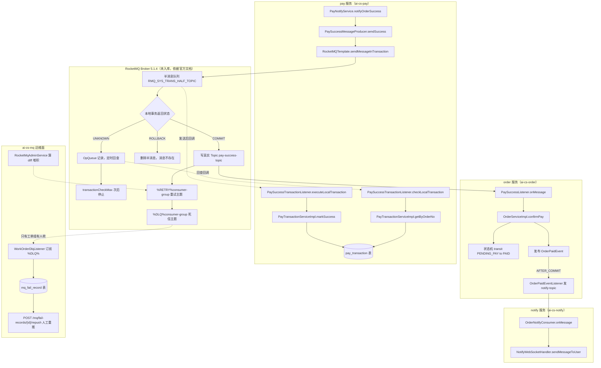
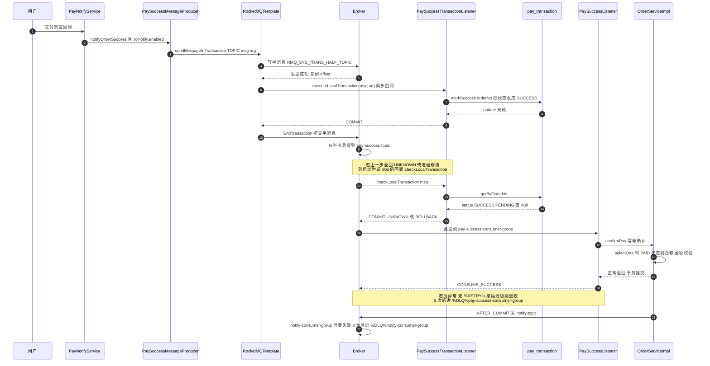

# RocketMQ 事务消息与死信队列：本地事务 + 消息最终一致，可靠性全押在回查和幂等这两个"可省环节"上

> **一句话结论**：事务消息只解决"本地事务提交了、消息一定发出去"这一半问题；剩下另一半——回查能不能判定本地事务真实状态、消费端能不能承受重复投递——没有任何框架替你兜，省掉它们，一致性就从"最终一致"退化成"偶尔丢、偶尔重"。
>
> **阅读前置**：读过本目录 [02-RocketMQ消息队列](./02-RocketMQ消息队列.md)（Topic/Tag/消费组/重试主题）；知道 Spring `@Transactional` 的代理边界；了解 Seata AT 的基本角色（可对照 [分布式事务 seata-at 模式源码](../24-源码分析/04-SpringCloud/07-分布式事务与链路追踪/01-分布式事务-seata-at模式源码.md)）。
>
> **证据基线**：JDK 17 / Spring Boot 4.2.0 / Spring Cloud 2026.0.0 / rocketmq-spring 2.3.0（`pom.xml#L56`）/ apache/rocketmq 5.1.4 镜像（`deploy/docker-compose/docker-compose-all.yml#L108`）/ Seata 1.7.1（`pom.xml#L52`）。A 级摘录只覆盖 Spring 事务族（RocketMQ 本体源码未入库）；项目侧代码均逐行核对过；本机无 Broker，C 级一律是"静态统计 + 状态机推演"。预计阅读 45~60 分钟。

## 0. 先看现象

**现象 1：订单已经变成 `PAID`，库存却没扣，通知也没推给用户。**

查 order 库，`order.status` 是 2（PAID）、`pay_time` 有值；查 RocketMQ，`notify-topic` 里没有这条消息；生产侧日志干净，只有一行 warn：

```text
WARN  c.a.order.event.OrderPaidEventListener - 事务提交后支付成功通知投递失败: orderNo=SO20261127001, err=sendDefaultImpl call timeout
```

这不是"消息丢了"，而是**消息从来没被可靠地托付给 Broker**。本项目支付成功的通知走的是"本地事务提交后发普通消息"：`OrderServiceImpl#confirmPay` 在事务内只发布领域事件（`ai-cs-order/src/main/java/com/aics/order/service/impl/OrderServiceImpl.java#L149-L151`），真正的 MQ 发送被 `@TransactionalEventListener(AFTER_COMMIT)` 挪到事务提交之后（`ai-cs-order/src/main/java/com/aics/order/event/OrderPaidEventListener.java#L30-L41`），而那段代码失败只 `log.warn` 一行就结束。订单事务早已提交，没人会再发一次。

**现象 2：消息消费失败进了死信，没人知道。**

`notify-consumer-group` 消费失败重试耗尽后，消息被 Broker 挪进 `%DLQ%notify-consumer-group`。这个主题在本仓**没有任何消费者**：全仓 8 个 `@RocketMQMessageListener` 里只有工单链路订阅了死信主题（`ai-cs-mq/src/main/java/com/aics/mq/consumer/WorkOrderDlqListener.java#L33-L37`）。更麻烦的是，`OrderNotifyConsumer` 的注释写着"可通过 mq 服务的 /mq/dead-letter 接口观测并人工介入"（`ai-cs-notify/src/main/java/com/aics/notify/consumer/OrderNotifyConsumer.java#L28-L29`），而 `MqController` 只有 `/mq/overview`、`/mq/cluster`、`/mq/topics`、`/mq/topic/{topic}`、`/mq/groups`、`/mq/group/{group}` 六个端点，**没有 dead-letter**（`ai-cs-mq/src/main/java/com/aics/mq/controller/MqController.java#L25-L58`）。文档里的一条逃生通道，代码里不存在。

**现象 3：同一条支付成功消息被消费了 3 次，用户收到 3 条一模一样的"支付成功"推送。**

`confirmPay` 是幂等的（先判 `PAID` 直接 return），所以订单状态没错；但通知链路完全没有去重：`OrderNotifyConsumer#onMessage` 拿到 `userId`/`message` 就直接 `NotifyWebSocketHandler.sendMessageToUser(...)`（`ai-cs-notify/src/main/java/com/aics/notify/consumer/OrderNotifyConsumer.java#L34-L42`）。把同样的代码换成"账户余额 +1"或"积分 +100"，重复消费就是重复加钱。

这些现象指向同一件事：**"本地事务 + 消息"的可靠性被拆成了三段责任，而项目只兜住了中间一段。** 生产端要保证"本地事务成功 ⇒ 消息一定可投递"（事务消息或本地消息表），消费端要保证"同一消息投递 N 次 ⇒ 业务副作用只发生一次"（幂等），运维端要保证"投递失败的消息有人看见"（死信闭环）。少任何一段，前面做得再好都是白做。

## 1. 整体地图



> **读图说明**：
> 1. `N3 → B1` 是唯一"发消息"的动作，但它发的是**半消息**——写进 Broker 内部的半消息主题 `RMQ_SYS_TRANS_HALF_TOPIC`，对 `pay-success-topic` 的消费者完全不可见，这是整张图最关键的一条边。
> 2. `N3 → N4` 是"发送成功后同步回调本地事务"，走的是**同一个应用进程**，不是 Broker 回调 HTTP；所以本地事务执行慢会直接拖慢发送线程。
> 3. `B5 → N6` 才是真正由 Broker 发起的回查，只有本地事务返回 `UNKNOWN`（或应用根本没能返回状态，比如进程被杀）才会进入这条支路；`B6` 说明回查不是无限的。
> 4. `B3 → C1` 是消息对下游"变得可见"的那一步。注意它发生在 pay 的本地事务已经提交之后，所以 order 侧看到的永远是"流水已成功"的事实。
> 5. `C4 → C5` 是本项目支付成功通知的真实链路：订单库事务内只发领域事件，AFTER_COMMIT 之后才发 `notify-topic` 普通消息——这条边**没有**事务消息保护，`C5` 失败即丢通知（现象 1 的根因）。
> 6. 右下 `E1/E2/E3` 是本仓唯一成闭环的死信通道：`%DLQ%` → 落 `mq_fail_record` → 人工重推。pay/notify 两条业务链路都没有对应的 `%DLQ%` 消费者，所以要盯死信只能靠 `E4` 这类管理端只读接口 + 命令行。

组件与责任划分：

| 组件 | 责任 | 关键约束 | 调用方 |
| --- | --- | --- | --- |
| `PaySuccessMessageProducer` | 组装载荷、调 `sendMessageInTransaction` | 必须在本地事务**之前**调用 | `PayNotifyService` |
| `PaySuccessTransactionListener` | 执行本地事务 + 提供回查判定 | 两个方法都必须幂等，且以落库状态为唯一权威 | Broker（回查时）/ 发送线程（首次） |
| `pay_transaction` 表 | 本地事务的唯一事实源 | `order_no` 有唯一键（`uk_order_no`） | pay 服务 |
| `RocketMQTemplate` | 封装 Producer、序列化 payload | 一个应用一个事务监听器绑定主模板 | pay 服务 |
| `PaySuccessListener` | 消费支付成功事件、触发订单确认 | `maxReconsumeTimes=8` | Broker 推送 |
| `OrderServiceImpl#confirmPay` | 订单状态机迁移 + 领域事件 | 幂等靠"已支付直接 return" | `PaySuccessListener` |
| `%DLQ%<group>` | 重试耗尽后的最后容器 | 不订阅就永远没人处理 | `WorkOrderDlqListener`（仅工单组） |

## 2. 关键概念与关键类

概念先对齐，否则后面每一节都会读歪：

| 概念 | 一句话解释 | 容易误解的点 |
| --- | --- | --- |
| 半消息（Half Message） | 先写进 Broker 内部半消息主题、对业务消费者不可见的消息 | 不是"消息体积的一半"，也不是"延迟消息" |
| 本地事务（Local Transaction） | 业务库自己的事务，本例是 `pay_transaction` 的一条 update | 它和消息的原子性由 Broker 的回查来"补齐"，不是分布式事务 |
| 回查（Transaction Check） | Broker 对状态未决的半消息反向问生产者"你那边到底成没成" | 回查**不是**重发消息，也不会重新执行本地事务 |
| `UNKNOWN` | 生产者明确告诉 Broker"我还不能判定" | 它既不是成功也不是失败，是"请稍后再问" |
| 幂等（Idempotent） | 同一请求执行 N 次，业务结果与执行 1 次相同 | "结果相同"不等于"副作用为零"（计数器会飘） |
| 死信队列（DLQ, `%DLQ%group`） | 消费重试次数耗尽后消息被挪进去的**普通 Topic** | 它不特殊、不自动重投，就是个没人消费的 Topic |
| 重试主题（`%RETRY%group`） | 消费失败后消息先进这里，按延迟级别重新投递 | 它和 DLQ 是两个不同 Topic，别混 |
| outbox / 本地消息表 | 业务数据和"待发消息"同一事务写库，再由后台任务投递 | 它换来的不是"不丢"，而是"可补偿" |

关键类与证据等级（A 级 = `24-源码分析/assets/source/` 已入库摘录；B 级 = 本仓真实代码）：

| 名称 | 位置 | 角色 | 关键方法 |
| --- | --- | --- | --- |
| `PaySuccessMessage` | `ai-cs-common/src/main/java/com/aics/common/mq/PaySuccessMessage.java#L22-L37` | 跨服务消息契约（orderNo/paymentMethod/amount/tradeNo） | 无逻辑，纯载荷 |
| `PaySuccessMessageProducer` | `ai-cs-pay/src/main/java/com/aics/pay/mq/PaySuccessMessageProducer.java#L47-L55` | 发半消息 | `sendSuccess` |
| `PaySuccessTransactionListener` | `ai-cs-pay/src/main/java/com/aics/pay/mq/PaySuccessTransactionListener.java#L39-L68` | 本地事务 + 回查 | `executeLocalTransaction`、`checkLocalTransaction` |
| `PayTransactionServiceImpl` | `ai-cs-pay/src/main/java/com/aics/pay/service/impl/PayTransactionServiceImpl.java#L53-L70` | 流水状态机（PENDING/SUCCESS/CLOSED…） | `markSuccess`、`markClosed`、`getByOrderNo` |
| `PaySchemaInitializer` | `ai-cs-pay/src/main/java/com/aics/pay/config/PaySchemaInitializer.java#L20-L47` | 启动时建 `pay_transaction` 表 | `run` |
| `PaySuccessListener` | `ai-cs-order/src/main/java/com/aics/order/listener/PaySuccessListener.java#L27-L42` | 消费支付成功事件 | `onMessage` |
| `OrderServiceImpl#confirmPay` | `ai-cs-order/src/main/java/com/aics/order/service/impl/OrderServiceImpl.java#L115-L164` | 幂等确认订单 | `confirmPay` |
| `OrderPaidEventListener` | `ai-cs-order/src/main/java/com/aics/order/event/OrderPaidEventListener.java#L30-L41` | AFTER_COMMIT 才发通知 | `handle` |
| `WorkOrderDlqListener` | `ai-cs-mq/src/main/java/com/aics/mq/consumer/WorkOrderDlqListener.java#L33-L89` | 唯一成闭环的死信消费者 | `onMessage` |
| `TransactionAspectSupport` | `TransactionAspectSupport.java.md#L363-L409` | A 级：本地事务的标准划分（get→proceed→commit/rollback） | `invokeWithinTransaction` |
| `TransactionalApplicationListenerSynchronization` | `TransactionalApplicationListenerSynchronization.java.md#L108-L126` | A 级：AFTER_COMMIT 由 `afterCompletion` 驱动 | `beforeCommit`、`afterCompletion` |
| `TransactionalApplicationListenerMethodAdapter` | `TransactionalApplicationListenerMethodAdapter.java.md#L84-L102` | A 级：没有活动事务时**直接跳过**监听器 | `onApplicationEvent` |

> ⚠️ **本文的诚实边界**：RocketMQ 本体源码（Producer / Broker / `TransactionMessageServiceImpl` / `SendMessageProcessor`）**不在** `24-源码分析/assets/source/` 中，本篇所有关于半消息存储、回查次数、延迟级别的陈述都来自官方文档与本仓代码注释，正文中会逐处标注，绝不编造文件名和行号。能给出 A 级摘录的只有 Spring 事务族——而这恰好是"本地事务那一半"的关键。
>
> 关于"本项目已实现"的边界：**事务消息已落地**（pay → order 支付成功事件）；**死信闭环只在工单链路落地**（ai-cs-mq）；**outbox / 本地消息表全仓 0 处**（`grep -ci outbox` 为 0，见 6.6 的真实统计）；**顺序消息全仓 0 处**（`MessageListenerOrderly` 出现 0 次）。

## 3. 原理与证据逐段精读

### 3.1 半消息：为什么"先存一个谁也看不见的消息"

**在干什么。** `rocketMQTemplate.sendMessageInTransaction(TOPIC, msg, message)` 做两件事：把消息正文写进 Broker 的半消息主题（对业务 Topic 的消费者不可见），同时**在同一个调用栈里**回调本地的 `executeLocalTransaction`（`ai-cs-pay/src/main/java/com/aics/pay/mq/PaySuccessMessageProducer.java#L47-L55`）。只有本地事务返回 `COMMIT`，Broker 才把这条消息从半消息队列搬到真正的 `pay-success-topic`。

**为什么这么设计。** 目标是拆掉"写库"和"发消息"之间的那个崩溃窗口。如果把顺序反过来（先发消息再写库），消费者可能在库还没写成功时就收到消息；如果先写库再发消息，写库成功、发消息前进程被杀，消息就永久丢了。半消息把两步变成"先埋一个钩子，再让钩子去决断"，钩子（半消息）在崩溃后依然留在 Broker 磁盘上，谁都不能消费它，只能等生产者回答。

**换写法会怎样。** 本项目实际并存的三种写法，对比一下就很清楚：

| 写法 | 崩溃在"写库成功、发消息前"会发生什么 | 在哪个文件 |
| --- | --- | --- |
| 先写库再直接 `send` | 消息永久丢，只能靠对账/查单补 | `ai-cs-mq/src/main/java/com/aics/mq/service/WorkOrderService.java#L46-L61`（注释自认是教学简化） |
| 事务消息（半消息） | 应用重启后 Broker 回查 → 判定 SUCCESS → 补发 | `ai-cs-pay/src/main/java/com/aics/pay/mq/PaySuccessTransactionListener.java` |
| AFTER_COMMIT 事件发普通消息 | 丢失且**只打一行 warn** | `ai-cs-order/src/main/java/com/aics/order/event/OrderPaidEventListener.java#L38-L40` |

**常见坑。** 半消息阶段抛异常不等于本地事务没执行：`sendMessageInTransaction` 内部是"发送 + 回调"，如果发送成功但回调里 `markSuccess` 抛了运行时异常，你的库可能部分写了、也可能没写，而消息已经进了 Broker 等着回查。所以回查逻辑必须只信库，不信内存变量——项目的 `checkLocalTransaction` 恰好做到了（查库），而 `executeLocalTransaction` 的返回值处理有 bug（见 6.1）。

### 3.2 本地事务：executeLocalTransaction 的四层责任

先看真实实现（B 级，逐行核对）：

`ai-cs-pay/src/main/java/com/aics/pay/mq/PaySuccessTransactionListener.java#L39-L53`

```java
    @Override
    public RocketMQLocalTransactionState executeLocalTransaction(Message msg, Object arg) {
        PaySuccessMessage payload = arg instanceof PaySuccessMessage p ? p
                : (PaySuccessMessage) msg.getPayload();
        try {
            // 本地事务：支付流水 PENDING → SUCCESS（幂等，重复通知不重复处理）
            payTransactionService.markSuccess(payload.getOrderNo(), payload.getTradeNo(), payload.getAmount());
            log.info("事务消息本地事务执行成功: orderNo={}", payload.getOrderNo());
            return RocketMQLocalTransactionState.COMMIT;
        } catch (Exception e) {
            log.error("事务消息本地事务执行失败，半消息将回滚: orderNo={}, err={}",
                    payload.getOrderNo(), e.getMessage(), e);
            return RocketMQLocalTransactionState.ROLLBACK;
        }
    }
```

**在干什么。** 三步：从 `arg`（发送时原样传进来的对象）或 `msg.getPayload()` 取载荷；调 `markSuccess` 把流水 PENDING → SUCCESS；按结果返回 `COMMIT`/`ROLLBACK`。`arg` 优先是 rocketmq-spring 2.3.0 的便利：发送时传的对象不走序列化，省一次 JSON round-trip；回查路径拿不到 `arg`，只能从 `msg.getPayload()` 反序列化。

**为什么这么设计。** 本地事务必须由业务代码自己写，因为它要写在**你的**数据库里；Broker 只能通过返回值知道结果。这里只允许三种答案，设计上把"我不确定"显式化成 `UNKNOWN`，而不是逼你在 `true/false` 之间二选一——这一点是理解回查的前提。

**换写法会怎样。** 如果这里返回 `UNKNOWN`，消息不会立刻可见，而是进入回查队列；如果这里直接 `return COMMIT` 而不做任何库操作（"空事务"），消息照发，但回查时查不到任何证据——这正是 6.1 那个缺陷的极端形态。如果这里给 `markSuccess` 加上 `@Transactional`，因为它是单条 update，收益仅为"失败时不留半截"，但它会被当作外层事务的一部分而不是新事务，反而容易和调用方的事务语义打架（`Propagation.REQUIRED` 下这里根本没有外层事务，所以等于自己开一个）。

**常见坑。** `catch (Exception e)` 把**所有**异常都映射成 `ROLLBACK`，包括数据库瞬时不可用、连接池耗尽这类"重试就能好"的异常。`ROLLBACK` 是终态：半消息被删，消息永久消失，只能靠对账补偿。更稳的映射是：可重试异常 → `UNKNOWN`（让 Broker 60 秒后再问一次），只有业务确定失败（如流水已关闭）才 `ROLLBACK`。

### 3.3 回查：什么时候触发、问几次、问不到怎么办

**在干什么。** 当半消息的状态迟迟未决（生产者返回 `UNKNOWN`、或生产者进程直接没了、或返回了状态但 Broker 没收到），Broker 会按固定间隔反向调用生产者的 `checkLocalTransaction`。本项目实现（B 级）：

`ai-cs-pay/src/main/java/com/aics/pay/mq/PaySuccessTransactionListener.java#L55-L68`

```java
    @Override
    public RocketMQLocalTransactionState checkLocalTransaction(Message msg) {
        PaySuccessMessage payload = (PaySuccessMessage) msg.getPayload();
        PayTransaction tx = payTransactionService.getByOrderNo(payload.getOrderNo());
        if (tx == null) {
            log.warn("回查未找到支付流水，回滚半消息: orderNo={}", payload.getOrderNo());
            return RocketMQLocalTransactionState.ROLLBACK;
        }
        return switch (tx.getStatus()) {
            case "SUCCESS" -> RocketMQLocalTransactionState.COMMIT;
            case "PENDING" -> RocketMQLocalTransactionState.UNKNOWN; // 流水未决，等待下次回查
            default -> RocketMQLocalTransactionState.ROLLBACK; // CLOSED/REFUNDING 等
        };
    }
```

注意这里拿的是 Spring 的 `Message`、用 `msg.getPayload()`，**不是** `MessageExt` + `msg.getBody()`——网上大量 4.x 时代的示例是后者，照抄会编译不过（见第 7 节）。

**为什么这么设计。** 回查的回调参数必须和发送时序列化后的形态一致，所以只能从消息体里恢复载荷；判定必须只查库，因为内存里的状态早就随进程没了。`PENDING → UNKNOWN` 是最容易被误删的一行：删掉它，慢支付（用户 3 分钟后才付完）就会被误判成失败。

**换写法会怎样。** 用状态机推演最直观。规则：Broker 端 `transactionCheckMax` 默认 15 次、`transactionCheckInterval` 默认 60s（《RocketMQ 官方文档 · 事务消息》回查机制一节，参数名为 Broker 侧 `transactionCheckMax` / `transactionCheckInterval`；本机无 Broker，无法实测，参数默认值以所部署 5.1.4 版本的 broker 配置为准）。在仓库根新建临时脚本 `tmp-tx-check-sim.mjs`：

```javascript
// 回查状态机推演：分支规则从本项目 PaySuccessTransactionListener.java 真实源码抽取
import { readFileSync } from 'node:fs';
const SRC = 'ai-cs-pay/src/main/java/com/aics/pay/mq/PaySuccessTransactionListener.java';
const code = readFileSync(SRC, 'utf8');

// 1) 抽取 checkLocalTransaction 里 case "STATUS" -> State.XXX 的映射
const cases = [...code.matchAll(/case\s+"([A-Z_]+)"\s*->\s*RocketMQLocalTransactionState\.([A-Z_]+)/g)]
  .map((m) => `${m[1].padEnd(8)} -> ${m[2]}`);
const hasDefaultRollback = /default\s*->\s*RocketMQLocalTransactionState\.ROLLBACK/.test(code);
const nullThenRollback = /tx == null[\s\S]{0,220}?RocketMQLocalTransactionState\.ROLLBACK/.test(code);

console.log('=== 步骤1：从 PaySuccessTransactionListener.java 抽出的回查分支 ===');
console.log(cases.join('\n'));
console.log(`default(其它状态) -> ROLLBACK : ${hasDefaultRollback}`);
console.log(`tx == null(查不到流水) -> ROLLBACK : ${nullThenRollback}`);

const CHECK_MAX = 15;   // transactionCheckMax 官方默认值
const INTERVAL = 60;    // transactionCheckInterval 官方默认值，单位秒
const decide = (s) => (s == null ? 'ROLLBACK' : s === 'SUCCESS' ? 'COMMIT' : s === 'PENDING' ? 'UNKNOWN' : 'ROLLBACK');

console.log('\n=== 步骤2：推演 A —— 用户 3 分钟后才付完，流水 t=200s 才变 SUCCESS ===');
for (let i = 1; i <= 6; i++) {
  const t = (i - 1) * INTERVAL;
  const status = t >= 200 ? 'SUCCESS' : 'PENDING';
  const state = decide(status);
  const note = state === 'COMMIT' ? '半消息提交，pay-success-topic 对 order 可见'
    : state === 'ROLLBACK' ? '半消息回滚，消息被丢弃' : `UNKNOWN，Broker ${INTERVAL}s 后再回查`;
  console.log(`check#${String(i).padStart(2)} t=${String(t).padStart(3)}s status=${status.padEnd(7)} => ${state.padEnd(7)} ${note}`);
  if (state !== 'UNKNOWN') break;
}

console.log('\n=== 步骤3：推演 B —— 渠道回调永远不来，流水永远 PENDING ===');
for (let i = 1; i <= CHECK_MAX; i++) {
  decide('PENDING');
  if (i === 3 || i === CHECK_MAX - 1 || i === CHECK_MAX) {
    console.log(`check#${String(i).padStart(2)} t=${String((i - 1) * INTERVAL).padStart(4)}s status=PENDING => UNKNOWN（第 ${i}/${CHECK_MAX} 次）`);
  }
}
console.log(`回查次数达到 transactionCheckMax=${CHECK_MAX} 后：Broker 不再回查，半消息直接丢弃，consumer 永远不会收到`);

console.log('\n=== 步骤4：推演 C —— 回查时流水行被归档删除（tx == null） ===');
console.log(`t=60s 查 pay_transaction 无此 order_no => ${decide(null)}：半消息回滚，但用户钱已经付了`);
```

真实输出（`node tmp-tx-check-sim.mjs`，本机 Node 24，纯静态 + 推演，未连 Broker）：

```text
=== 步骤1：从 PaySuccessTransactionListener.java 抽出的回查分支 ===
SUCCESS  -> COMMIT
PENDING  -> UNKNOWN
default(其它状态) -> ROLLBACK : true
tx == null(查不到流水) -> ROLLBACK : true

=== 步骤2：推演 A —— 用户 3 分钟后才付完，流水 t=200s 才变 SUCCESS ===
check# 1 t=  0s status=PENDING => UNKNOWN UNKNOWN，Broker 60s 后再回查
check# 2 t= 60s status=PENDING => UNKNOWN UNKNOWN，Broker 60s 后再回查
check# 3 t=120s status=PENDING => UNKNOWN UNKNOWN，Broker 60s 后再回查
check# 4 t=180s status=PENDING => UNKNOWN UNKNOWN，Broker 60s 后再回查
check# 5 t=240s status=SUCCESS => COMMIT  半消息提交，pay-success-topic 对 order 可见

=== 步骤3：推演 B —— 渠道回调永远不来，流水永远 PENDING ===
check# 3 t= 120s status=PENDING => UNKNOWN（第 3/15 次）
check#14 t= 780s status=PENDING => UNKNOWN（第 14/15 次）
check#15 t= 840s status=PENDING => UNKNOWN（第 15/15 次）
回查次数达到 transactionCheckMax=15 后：Broker 不再回查，半消息直接丢弃，consumer 永远不会收到

=== 步骤4：推演 C —— 回查时流水行被归档删除（tx == null） ===
t=60s 查 pay_transaction 无此 order_no => ROLLBACK：半消息回滚，但用户钱已经付了
```

怎么读这份输出：**"回查 3 次仍 UNKNOWN"本身不是事故**——第 3 次（t=120s）时它还在正常等待，真正决定命运的是第 15 次；只有超过 `transactionCheckMax` 才是"半消息被丢弃，`pay-success-topic` 永远收不到"。所以线上排查要盯两个不同的信号：`UNKNOWN` 反复出现说明本地事务迟迟无法定案（多半是渠道回调没来），而"回查次数耗尽 + 消息丢弃"才是真丢。要查的地方只有两处：`pay_transaction` 表里该 `order_no` 的 `status`（是不是一直 PENDING）、以及 pay 服务日志里的 `回查未找到支付流水` / `流水未决` 关键字。

**常见坑。** 推演 C 暴露了本项目一个真实风险：`tx == null → ROLLBACK` 假设"查不到流水 = 事务没成"，但如果流水表做过归档清理（历史数据搬走），回查发生在归档之后就会误回滚——用户的支付成功事件被永久丢弃。正确姿势是归档时保留订单号→状态的索引，或把 `tx == null` 也当 `UNKNOWN`（多问几次，别急着下终态）。

### 3.4 回查必须幂等，且必须能"判定本地事务状态"

**在干什么。** 回查可能对同一条消息发生多次，也可能和首次执行并发（应用刚起来、Broker 正好来问）。所以 `checkLocalTransaction` 必须是**只读 + 幂等**，而它依赖的库状态必须能被清晰判定。本项目把这条责任放在 `markSuccess` 上（B 级）：

`ai-cs-pay/src/main/java/com/aics/pay/service/impl/PayTransactionServiceImpl.java#L53-L70`

```java
    @Override
    public boolean markSuccess(String orderNo, String tradeNo, BigDecimal amount) {
        PayTransaction tx = getByOrderNo(orderNo);
        if (tx == null || STATUS_SUCCESS.equals(tx.getStatus())) {
            return false;
        }
        tx.setStatus(STATUS_SUCCESS);
        tx.setTradeNo(tradeNo);
        tx.setPayAmount(amount);
        tx.setNotifyCount(tx.getNotifyCount() == null ? 1 : tx.getNotifyCount() + 1);
        tx.setPayTime(LocalDateTime.now());
        payTransactionMapper.updateById(tx);
        return true;
    }
```

**为什么这么设计。** 幂等的实现成本大致三档：唯一键（最硬，DB 保证）→ 状态判等（软一点，先查后改）→ 什么都不做（最危险）。这里选了中间档：先查、状态已经是 SUCCESS 就直接 `return false`。之所以能这么做，是因为 `pay_transaction` 有 `UNIQUE KEY uk_order_no`（`ai-cs-pay/src/main/java/com/aics/pay/config/PaySchemaInitializer.java#L36-L38`），流水行本身不会重复。

**换写法会怎样。** 改成"无条件 update"也能跑，但 `notify_count` 会随每次回查 +1，监控指标（本来可能用来判断"重试了几次"）就废了。改成 `UPDATE ... WHERE status='PENDING'` 的单语句原子更新，比"先查后改"更安全——本项目没走这一步，所以两个线程同时进来时都能通过 `!SUCCESS` 判断，各自 update 一次，`notify_count` 会 +2。

**常见坑。** 这个方法**没有 `@Transactional`**，也就是没有"读-判-写"的原子性；而且它的返回值在 6.1 那个调用点被直接丢掉。幂等的证据链有两个薄弱环节，靠 `uk_order_no` 兜住了行数、但没兜住副作用。

### 3.5 本地事务的边界到底在 Spring 哪里

**在干什么。** 上面反复出现"本地事务""事务提交后"，但 Spring 的事务边界是切面画出来的，不是方法体里的花括号。A 级摘录（Spring Framework 7.1.0），见 [[源码:TransactionAspectSupport.java.md#L363-L380]]：

(src: TransactionAspectSupport.java.md#L363-L380)

```java
		if (txAttr == null || !(ptm instanceof CallbackPreferringPlatformTransactionManager cpptm)) {
			// Standard transaction demarcation with getTransaction and commit/rollback calls.
			TransactionInfo txInfo = createTransactionIfNecessary(ptm, txAttr, joinpointIdentification);

			Object retVal;
			try {
				// This is an around advice: Invoke the next interceptor in the chain.
				// This will normally result in a target object being invoked.
				retVal = invocation.proceedWithInvocation();
			}
			catch (Throwable ex) {
				// target invocation exception
				completeTransactionAfterThrowing(txInfo, invocation, ex);
				throw ex;
			}
			finally {
				cleanupTransactionInfo(txInfo);
			}
```

**为什么这么设计。** 事务边界 = `getTransaction` … `proceedWithInvocation` … `commitTransactionAfterReturning`（同文件 `#L408`）。这解释了 `confirmPay` 为什么必须由外部 Bean 调用：`@Transactional` 只挂在代理上，`this.confirmPay(...)` 这种自调用根本不进切面，事务根本不存在。项目为此专门把下单逻辑拆到 `OrderCreateTxService`，类注释写得很直白（`ai-cs-order/src/main/java/com/aics/order/service/impl/OrderCreateTxService.java#L37-L44`）。

**换写法会怎样。** 一旦 `confirmPay` 失去 `@Transactional`，`@TransactionalEventListener(AFTER_COMMIT)` 的监听器会**静默不执行**。A 级证据在 [[源码:TransactionalApplicationListenerMethodAdapter.java.md#L84-L102]]：`register(...)` 返回 false（因为没有活动事务），且 `isDefaultExecution()` 为 false 时直接走到"跳过"分支——没有异常、没有 warn，通知就这么没了。

(src: TransactionalApplicationListenerMethodAdapter.java.md#L84-L102)

```java
	@Override
	public void onApplicationEvent(ApplicationEvent event) {
		if (TransactionalApplicationListenerSynchronization.register(event, this, this.callbacks)) {
			if (logger.isDebugEnabled()) {
				logger.debug("Registered transaction synchronization for " + event);
			}
		}
		else if (isDefaultExecution()) {
			if (getTransactionPhase() == TransactionPhase.AFTER_ROLLBACK && logger.isWarnEnabled()) {
				logger.warn("Processing " + event + " as a fallback execution on AFTER_ROLLBACK phase");
			}
			processEvent(event);
		}
		else {
			// No transactional event execution at all
			if (logger.isDebugEnabled()) {
				logger.debug("No transaction is active - skipping " + event);
			}
		}
	}
```

**常见坑。** AFTER_COMMIT 的回调由 `afterCompletion(status)` 驱动，且必须 `status == STATUS_COMMITTED` 才执行，见 [[源码:TransactionalApplicationListenerSynchronization.java.md#L108-L126]]。这意味着：**事务回滚时监听器不执行**（这是好事，杜绝"订单没支付却推送支付成功"），但同时意味着它执行时已经在事务外——这段代码里做 MQ 发送、HTTP 调用，既不在事务保护内，也不会反向影响事务。本项目正是这样：`OrderPaidEventListener` 的 catch 只 warn（`ai-cs-order/src/main/java/com/aics/order/event/OrderPaidEventListener.java#L38-L40`），消息丢了没人知道。想要"事务提交 + 一定发出去"，就必须上事务消息或 outbox。

### 3.6 消费端幂等：四种实现与一条真实链路

**在干什么。** 消息可能重复到达，来源有三个：生产者发送超时重试（`sendMessageInTransaction` 超时后可能已经发成功）、消费者 `onMessage` 抛异常触发重投、Broker 在主从切换/重平衡时重投。三种都会让 `PaySuccessListener` 收到同一条消息，而它只做一件事——调 `confirmPay`（B 级）：

`ai-cs-order/src/main/java/com/aics/order/service/impl/OrderServiceImpl.java#L115-L147`

```java
    @Override
    @Transactional(rollbackFor = Exception.class)
    public void confirmPay(String orderNo, String paymentMethod, BigDecimal amount, String tradeNo) {
        Order order = orderMapper.selectOne(
                new LambdaQueryWrapper<Order>().eq(Order::getOrderNo, orderNo));
        if (order == null) {
            log.warn("支付确认订单不存在: orderNo={}", orderNo);
            return;
        }

        // 状态机是迁移唯一入口：PAID 回调仍幂等，其他非法态忽略。
        if (OrderStatus.PAID.getCode().equals(order.getStatus())) {
            log.info("订单已支付，忽略重复确认: orderNo={}", orderNo);
            return;
        }
        try {
            order.setStatus(orderStateTransitionService.transit(order.getStatus(), OrderEvent.PAY).getCode());
        } catch (BusinessException e) {
            log.warn("订单状态不允许支付确认，忽略: orderNo={}, status={}", orderNo, order.getStatus());
            return;
        }

        // 金额校验（安全红线：回调金额必须与订单金额一致）
        if (amount != null && order.getPayAmount() != null
                && amount.compareTo(order.getPayAmount()) != 0) {
            log.error("支付金额与订单不一致: orderNo={}, callbackAmount={}, orderAmount={}",
                    orderNo, amount, order.getPayAmount());
            throw new BusinessException(ResultCode.ORDER_PAY_AMOUNT_MISMATCH);
        }
```

**为什么这么设计。** 这里用的是"状态机幂等"：`PAID` 直接 return，其余状态必须能通过 `OrderEvent.PAY` 合法迁移。状态机天然带幂等性——因为"从 PAID 再迁到 PAID"这条边根本不存在。它比"去重表"轻，比"什么都做"稳。四种实现方式的取舍：

| 实现 | 机制 | 成本 | 适用 | 本仓落点 |
| --- | --- | --- | --- | --- |
| 唯一键 | DB 唯一索引挡住重复插入 | 最低 | 插入型业务（下单、流水） | `uk_order_no`、`uk_msg_id`、`uk_ticket_no` |
| 状态机 | 只接受合法状态迁移 | 低 | 有明确生命周期的实体 | `confirmPay` + `OrderStateTransitionService` |
| 去重表 | 消费前插 `msgId`，冲突即跳过 | 中 | 无状态实体、外部副作用 | 死信落库用 `msg_id` 查重（`WorkOrderDlqListener`） |
| 幂等 token | 请求方带 token，服务端一次性核销 | 中高 | 面向用户的写操作 | 未落地 |

**换写法会怎样。** 把 `PAID` 判断删掉，第二次消费会走 `transit`，状态机抛 `BusinessException` → 被 catch → `log.warn` 忽略——看起来"也幂等"，但语义变了：真正的状态冲突和重复消费被混成同一条日志，出问题时分不清是 bug 还是重投。

**常见坑。** `confirmPay` 在金额不一致时**抛异常**，这个异常会被 `PaySuccessListener` 抛回 Broker → 触发重试（`maxReconsumeTimes=8`）→ 8 次全失败进 `%DLQ%pay-success-consumer-group` → 而该 topic 无人订阅。一笔金额不一致的脏数据，最终会变成一条死信 + 一个永远待支付的订单，两条线索谁也不指向对方。金额校验失败更合适的处理是"记录 + 人工介入"，而不是无限重试。

### 3.7 死信：它只是"重试次数用完后的一个普通 Topic"

**在干什么。** 消费失败不是立刻进死信：`onMessage` 抛异常 → Broker 把消息投到 `%RETRY%<consumerGroup>`，按延迟级别递增重投（本项目注释给的量级是"约 10s/30s/1m"，见 `ai-cs-mq/src/main/java/com/aics/mq/consumer/WorkOrderListener.java#L22-L25`）→ 超过 `maxReconsumeTimes` 后进 `%DLQ%<consumerGroup>`。全仓 8 个消费者的重试配置（真实静态统计，见 6.6）：

| 消费者 | Topic | 消费组 | maxReconsumeTimes |
| --- | --- | --- | --- |
| `PaySuccessListener` | pay-success-topic | pay-success-consumer-group | 8 |
| `OrderNotifyConsumer` | notify-topic | notify-consumer-group | 3 |
| `WorkOrderListener` | 工单 Topic | work-order-consumer-group | 3 |
| `WorkOrderDlqListener` | `%DLQ%work-order-consumer-group` | work-order-dlq-consumer-group | 未设置（默认 16） |
| `OrderTimeoutListener` | order-timeout-topic | order-timeout-consumer-group | 未设置（默认 16） |
| `KnowledgeSyncConsumer` | knowledge-doc-sync-topic | knowledge-sync-group | 未设置（默认 16） |
| `ChatMessageConsumer` | chat-message-topic | chat-consumer-group | 未设置（默认 16） |
| `ProductCdcConsumer` | c-product-sync | search-product-cdc-consumer | 未设置（默认 16） |

**为什么这么设计。** 把"重试"和"死信"分开，是为了让失败有一个**有界的**自动处理期（重试）和一个**无界的**人工处理期（死信）。死信主题本身是普通 Topic，Broker 不再重投，所以必须有人消费。本项目的正确示范是工单链路：`WorkOrderDlqListener` 订阅 `%DLQ%work-order-consumer-group`，把消息落进 `mq_fail_record`（`msg_id` 唯一键保证落库幂等），并给工单打 `FAILED`，然后由 `POST /mq/fail-records/{id}/repush` 人工重推（`ai-cs-mq/src/main/java/com/aics/mq/controller/WorkOrderController.java#L65-L76`）。

**换写法会怎样。** 不订阅 `%DLQ%` 的后果分两种：消息还在（Broker 磁盘上，直到过期被清理），但没人处理、没有告警、没有重推手段——`notify-consumer-group` 就是这种状态。另一种更糟：死信消费者自己也用默认 `maxReconsumeTimes`（16），它消费失败会把消息送进 `%DLQ%work-order-dlq-consumer-group`，形成"死信的死信"。Kafka 侧已经意识到这个问题并显式修掉了（`ai-cs-mq/src/main/java/com/aics/mq/config/KafkaConsumerConfig.java#L57-L70`，`FixedBackOff(0L, 0)` = 不重试），RocketMQ 侧还没对齐。

**常见坑。** 重试不是"隔 10 秒重试一次"这么简单：延迟级别是递增的，`maxReconsumeTimes=8` 意味着最后几次间隔已经到分钟级，整条链路可能拖十几分钟。如果 `onMessage` 里包含不可重试的错误（反序列化失败、参数永远不合法），8 次重试只是把问题延迟放大。这类错误应该在 `onMessage` 内部消化成"落库 + 人工处理"，而不是抛出去交给 Broker。

### 3.8 消息不丢：三处配置与本体源码缺失的诚实说明

**在干什么。** "消息不丢"是三层防线，缺一层就退化成"概率不丢"：

| 层 | 手段 | 配置项（Broker 侧） | 本项目状态 |
| --- | --- | --- | --- |
| 生产侧 | 发送确认：同步发送/事务消息拿到 Broker 的写入确认 | 客户端 `sendMsgTimeout`、`retryTimesWhenSendFailed` | 部分：事务消息已用；`tools/nacos-config/ai-cs-pay.yml#L21-L26` 配了 `send-message-timeout: 10000` |
| 存储侧 | 同步刷盘：消息落盘后才返回成功 | `flushDiskType=SYNC_FLUSH` | **未落地**：`deploy/docker-compose/docker-compose-all.yml#L125-L141` 的 broker 启动命令是 `sh mqbroker -n rocketmq-namesrv:9876`，没有 `-c` 指向自定义 `broker.conf`；`deploy/` 下只有 `deploy/redis/redis.conf` 和 mysql 的 `.cnf`，全仓没有 `broker.conf` |
| 存储侧 | 同步复制：主从都写完才返回成功 | `brokerRole=SYNC_MASTER`、`slave` 的 `flushDiskType` | **未落地**：默认单 master；`docker-compose-master-slave.yml#L220` 虽然挂了 `-c .../conf/broker.conf`，但那是镜像内置默认配置，仓内没有覆盖 |

**为什么这么设计。** 三处的默认值都偏向性能：异步刷盘（`ASYNC_FLUSH`）、异步复制（`ASYNC_MASTER`）。这是 RocketMQ 作为高吞吐 MQ 的合理默认，但对"支付成功事件"这种不能丢的数据必须改成同步。RocketMQ 官方文档《事务消息》《消息可靠性》两节都强调"刷盘方式与主从复制方式决定可靠性等级"，具体默认值请以所部署 5.1.4 版本镜像内的 `conf/broker.conf` 为准（本文未实测，本机无 Broker）。

**换写法会怎样。** 开了 `SYNC_FLUSH` + `SYNC_MASTER`，单条消息的写延迟从亚毫秒级升到毫秒级、吞吐掉一个量级——所以才没人默认开。反过来，不开的后果是：Broker 所在机器断电/进程被 kill -9，OS 页缓存里还没刷盘的消息直接消失，而生产者早已收到"发送成功"。**事务消息也救不了这个**：半消息和真实消息都在同一个 commitlog 里，一起丢。

**常见坑。** 很多人以为"用了事务消息就不会丢"。事务消息保证的是"本地事务成功 ⇒ 消息最终可见"，前提是消息已经写进 Broker；如果 Broker 本身不持久化，这条链在存储层就断了。另一个坑是忘记主从：单 master 的 broker 挂了，消费者会一直重连不上，堆在磁盘上的消息要等 broker 恢复——这段时间的死信、重试全都停摆。

## 4. 一次完整执行时序



> **读图说明**：
> 1. 第 3~5 步是"半消息先落盘"，此时 `pay-success-topic` 的消费者看不到任何东西——这是事务消息与普通消息的唯一结构性差别。
> 2. 第 6~8 步是同步回调：`executeLocalTransaction` 跑在**发送线程**里，所以 `markSuccess` 的耗时直接算进发送超时（本项目 `send-message-timeout: 10000`，即 10 秒）。
> 3. 第 9~11 步 `EndTransaction` 才是"让消息可见"的动作。注意：即使这里网络断了，Broker 也会因为半消息状态未决而回来问（第 12 步支路），这就是事务消息比"发完就算"强的地方。
> 4. 第 13~16 步是回查：**Broker 主动**调生产者，参数只有消息体，没有 `arg`，所以只能从 payload 里恢复订单号。
> 5. 第 17~19 步是消费端。`confirmPay` 的幂等点在第 19 步的"判 PAID"上；只要这一步在，重复投递无副作用。
> 6. 第 20~21 步是"消费失败的分叉"：`onMessage` 抛异常 → `%RETRY%` → 8 次后 `%DLQ%`。**这个分支上没有任何告警**，是本项目最需要补监控的地方。
> 7. 最后两步是另一条独立链路（订单通知），它发的是普通消息，不享受事务消息保护——丢了就只有一行 warn 日志。

哪一步失败会报什么错，逐段对照：

| 失败位置 | 现象 / 报错 | 最终结果 |
| --- | --- | --- |
| 第 4 步写半消息失败 | 生产侧 `MQClientException: sendDefaultImpl call timeout` | 本地事务**未执行**，`pay_transaction` 仍是 PENDING，需查单兜底 |
| 第 6~7 步 `markSuccess` 抛异常 | 日志 `事务消息本地事务执行失败，半消息将回滚` | 返回 `ROLLBACK`，半消息删除，消息永久不发 |
| 第 6~7 步进程被 kill | 无日志（进程没了） | 半消息悬置 → Broker 回查 → 靠 `pay_transaction` 真实状态定案 |
| 第 13~15 步回查返回 UNKNOWN × 15 | 无异常，仅 Broker 侧记录 | 超过 `transactionCheckMax` 后丢弃，pay 侧只能从"订单永远待支付"反推 |
| 第 15 步查不到流水 | 日志 `回查未找到支付流水，回滚半消息` | `ROLLBACK`，即使用户已付款也不会通知下游 |
| 第 17~19 步消费抛异常 | order 日志栈 + `%RETRY%` 堆积 | 8 次后进 `%DLQ%pay-success-consumer-group`，**无人处理** |
| 第 21 步 AFTER_COMMIT 投递失败 | `事务提交后支付成功通知投递失败` | 只 warn，通知永久丢 |

## 5. 设计取舍

事务消息只是四种方案里的一种，把它和其他三种放一起才好选：

| 维度 | 事务消息（本项目 pay→order） | Seata AT（本项目下单链路） | 本地消息表 / outbox | AFTER_COMMIT 事件（本项目订单通知） |
| --- | --- | --- | --- | --- |
| 一致性 | 最终一致，靠回查兜 | 强一致（两阶段），靠 undo_log 回滚 | 最终一致，靠定时补偿兜 | 最弱：投递失败即丢 |
| 改造成本 | 中：写监听器 + 回查 + 幂等 | 中高：加 `@GlobalTransactional`、建 undo_log、改 RPC 传播 | 中：加表 + 补偿任务 + 去重 | 最低：一个注解 |
| 对中间件依赖 | 强：必须有 Broker，且要能回查 | 强：必须有 TC（Seata Server） | 弱：只要有 DB | 弱：只要有 MQ |
| 性能开销 | 一次额外半消息写入 + 一次提交 | 全局锁 + 两次 RPC + undo 日志 | 一次同库写入（几乎零额外开销） | 一次普通发送 |
| 重复消费风险 | 有，必须自己做幂等 | 无（分支事务回滚） | 有，补偿任务可能重复投递 | 有 |
| 长期未决的处理 | 回查耗尽即丢弃，需对账 | 全局事务超时自动回滚 | 补偿任务重试到成功为止 | 无处理，直接丢 |
| 适用场景 | 跨服务、必须"本地成功则事件必达" | 跨服务、必须"要么全成否则全败" | 无法保证 MQ 可用、要求可审计 | 通知类、丢了可接受 |

本仓的真实用法很值得对照：**下单**用 Seata AT（`ai-cs-order/src/main/java/com/aics/order/service/impl/OrderCreateTxService.java#L78-L80` 的 `@GlobalTransactional` + 本地 `@Transactional`，库存扣减走 Feign 分支事务）；**支付成功事件**用事务消息；**订单通知**用 AFTER_COMMIT 普通消息；**工单**用"先插库后发消息 + 死信落库 + 人工重推"（`ai-cs-mq/src/main/java/com/aics/mq/service/WorkOrderService.java#L24-L25` 的注释把它自己定位为教学简化，并指明生产可演进为事务消息或本地消息表）。四种方案在一个仓库里各就各位，不是随手选的。

outbox 与事务消息的对比值得单独记一句：事务消息把"未决消息"存在 Broker（半消息主题），outbox 把"待发消息"存在你自己的库（`outbox` 表）。前者的补偿动作由 Broker 驱动（回查），后者由你的定时任务驱动（扫描 + 重投）；前者依赖 MQ 可用，后者只要 DB 活着就能继续补。**当 MQ 长时间不可用时，事务消息这条链会卡在"半消息写不进去"，而 outbox 会把消息攒在库里等 MQ 恢复。**

可扩展点清单（按落地成本从低到高）：

1. `PaySuccessTransactionListener` 的异常映射：可重试异常改返回 `UNKNOWN`，只对确定失败返回 `ROLLBACK`（改 1 个方法）。
2. 消费端补告警：`%DLQ%pay-success-consumer-group`、`%DLQ%notify-consumer-group` 各加一个死信消费者，复用 `WorkOrderDlqListener` 的落库模式。
3. `mq_fail_record` 通用化：现在 `consumer_group` 字段写死工单组，改成按消费者注入后可服务全仓。
4. 通知链路改 outbox：`OrderPaidEventListener` 改为写 `outbox` 表，定时任务扫表发送，彻底消除"只 warn 就丢"。
5. 顺序性要求出现时（如同一订单的多条状态事件），改 `MessageListenerOrderly` + 业务键选队列，此时事务消息必须让位给 outbox。
6. 对账任务：日终扫描 `pay_transaction.status='SUCCESS'` 但 order 侧未 `PAID` 的订单，这是回查耗尽后唯一能发现丢失的手段。

## 6. 踩坑与调试手法

**6.1 `markSuccess` 的 `false` 被丢掉，本地事务"什么都没做"却返回 COMMIT。**

`executeLocalTransaction` 的第 45 行直接调用 `payTransactionService.markSuccess(...)`，**没有接收返回值**（`ai-cs-pay/src/main/java/com/aics/pay/mq/PaySuccessTransactionListener.java#L45`）。而 `markSuccess` 在"流水不存在"时是 `return false` 且不抛异常（`ai-cs-pay/src/main/java/com/aics/pay/service/impl/PayTransactionServiceImpl.java#L55-L57`）。于是：流水不存在 → `markSuccess` 返回 false → 没异常 → 日志打"本地事务执行成功" → 返回 `COMMIT` → 消息发给 order → order 侧 `confirmPay` 把订单改成 PAID。而回查路径对同一个场景是 `tx == null → ROLLBACK`。**两条路径对同一事实给出相反判定**，这就是"下单成功但库存/流水对不上"的经典成因。修法一行：`if (!markSuccess(...)) return ROLLBACK;`（或至少 `UNKNOWN`）。现有单测 6 个用例没有覆盖这条分支（`ai-cs-pay/src/test/java/com/aics/pay/mq/PaySuccessTransactionListenerTest.java#L53-L101` 只测了成功/异常/回查四种状态），所以它一直没被发现。

**6.2 回查 `tx == null → ROLLBACK` 与流水归档撞车，误杀已付款订单。**

见 3.3 推演 C。触发条件很具体：支付渠道回调延迟超过"流水表清理周期"，或运营手工归档历史流水。排查手法：搜 pay 日志 `回查未找到支付流水`，再去 order 库查该 `order_no` 是否 PENDING_PAY 且渠道侧已收款。如果两条同时成立，就是被误回滚。

**6.3 AFTER_COMMIT 投递失败只打一行 warn，通知永久丢。**

`ai-cs-order/src/main/java/com/aics/order/event/OrderPaidEventListener.java#L38-L40`。这段代码的选择是有意的（注释说明"MQ 投递失败只告警，不反向回滚已提交的订单事务"），问题不是"要不要回滚"，而是**没有任何补偿**：没有 outbox、没有重试、没有告警升级。真正落地要靠"写 outbox 表 + 定时补偿"，或把这条链也改成事务消息。

**6.4 `@TransactionalEventListener` 在没有活动事务时会"静默跳过"监听器。**

A 级证据：`TransactionalApplicationListenerMethodAdapter.java.md#L84-L102`——`register()` 返回 false 且 `isDefaultExecution()` 为 false 时，只打 `debug` 级日志 `No transaction is active - skipping`。生产日志级别是 INFO，所以什么都看不到。这条坑的可怕之处在于：一旦有人把 `confirmPay` 上的 `@Transactional` 注释掉（或改成自调用），订单照常更新，**通知静默消失**，且没有任何报错。调试手法：把 `org.springframework.transaction.event` 的日志级别调到 DEBUG，看有没有 `Registered transaction synchronization for`。

**6.5 注释里承诺的 `/mq/dead-letter` 端点不存在。**

`OrderNotifyConsumer` 的注释（`ai-cs-notify/src/main/java/com/aics/notify/consumer/OrderNotifyConsumer.java#L28-L29`）说"可通过 mq 服务的 /mq/dead-letter 接口观测并人工介入"，`MqController` 实际只有 6 个只读端点（`ai-cs-mq/src/main/java/com/aics/mq/controller/MqController.java#L25-L58`）。查死信只能靠命令行或管理台。真调试手法：

```text
# 1) 看有哪些死信主题（本机无 Broker，命令未实测，只给判读方法）
sh mqadmin topicList -n 127.0.0.1:9876 | findstr DLQ
#    判读：出现 %DLQ%pay-success-consumer-group 说明确实有消息被投进死信

# 2) 看某个死信主题的堆积量
sh mqadmin statsAll -n 127.0.0.1:9876 | findstr /C:"%DLQ%"
#    判读：InTPS 为 0、Diff 大于 0 = 有消息但没人消费，等于丢了

# 3) 看消费组在哪个队列卡住
sh mqadmin consumerProgress -n 127.0.0.1:9876 -g notify-consumer-group
#    判读：Broker Offset 减去 Consumer Offset 的差值就是待处理量
```

**6.6 用静态统计代替"感觉"：先数清楚有几个消费者、几个设了重试上限。**

不用连中间件也能查出结构性风险。在仓库根建 `tmp-mq-stats.mjs`，遍历所有 `ai-cs-*/src/main/java/**/*.java`，用正则抽取 `@RocketMQMessageListener` 的 topic / consumerGroup / maxReconsumeTimes，同时统计 `RocketMQLocalTransactionListener`、`sendMessageInTransaction`、`MessageListenerOrderly`、`outbox` 的出现次数。真实输出（本机 Node 24，纯文件读取）：

```text
文件 | topic | consumerGroup | maxReconsumeTimes
ai-cs-knowledge/src/main/java/com/aics/knowledge/mq/KnowledgeSyncConsumer.java | knowledge-doc-sync-topic | knowledge-sync-group | (默认16)
ai-cs-message/src/main/java/com/aics/message/consumer/ChatMessageConsumer.java | chat-message-topic | chat-consumer-group | (默认16)
ai-cs-mq/src/main/java/com/aics/mq/consumer/WorkOrderDlqListener.java | %DLQ%work-order-consumer-group | work-order-dlq-consumer-group | (默认16)
ai-cs-mq/src/main/java/com/aics/mq/consumer/WorkOrderListener.java | WorkOrderProducer.TOPIC | work-order-consumer-group | 3
ai-cs-notify/src/main/java/com/aics/notify/consumer/OrderNotifyConsumer.java | notify-topic | notify-consumer-group | 3
ai-cs-order/src/main/java/com/aics/order/listener/OrderTimeoutListener.java | order-timeout-topic | order-timeout-consumer-group | (默认16)
ai-cs-order/src/main/java/com/aics/order/listener/PaySuccessListener.java | pay-success-topic | pay-success-consumer-group | 8
ai-cs-search/src/main/java/com/aics/search/cdc/ProductCdcConsumer.java | c-product-sync | search-product-cdc-consumer | (默认16)

消费者总数=8
显式设置 maxReconsumeTimes 的=3
RocketMQLocalTransactionListener 实现数=1
sendMessageInTransaction 调用点=1
MessageListenerOrderly / ORDERLY 出现次数=0
outbox / local_message 出现次数=0
```

怎么读：8 个消费者里 5 个吃默认值（16 次，最后几次间隔到分钟级），说明"重试次数"从来没人系统设计过，是默认值在替你决策；`MessageListenerOrderly=0` 说明全仓没有任何顺序消费，一旦出现"同一订单的事件必须有序"的需求，需要整体重设计；`outbox=0` 说明 5 节里那套补偿方案确实一行都没落地。

**6.7 判断一条消息"是没发出去"还是"发了没消费"——查两边，别猜。**

先看消费侧有没有堆积（`RocketMqAdminService.examineConsumeStats` 算的就是 `brokerOffset - consumerOffset`，`ai-cs-mq/src/main/java/com/aics/mq/service/RocketMqAdminService.java#L247-L257`），再看生产侧有没有"发送完成"的日志。判读规则：

| 现象 | 结论 |
| --- | --- |
| 生产有 `事务消息发送完成`，消费侧 Diff=0，业务没变化 | 消息发出去了，消费者逻辑或幂等判断把它跳过了（查 `订单已支付，忽略重复确认`） |
| 生产有 `事务消息发送完成`，消费侧 Diff>0 | 消费者挂了/在重试（查 `%RETRY%` 与 `onMessage` 异常栈） |
| 生产**没有**发送日志，`pay_transaction` 是 SUCCESS | 本地事务成了但发送失败——这正是 outbox 要解决的形态 |
| 生产日志出现 `未找到支付流水` | 回查误判，消息已回滚，订单永远待支付 |

## 7. ⚠️ 版本差异

本文涉及的 API 在近两年变过两轮，网上抄来的代码大概率编译不过：

| 旧写法 | 当前基线 | 变化点 | 迁移动作 |
| --- | --- | --- | --- |
| `@RocketMQTransactionListener(txProducerGroup = "xxx")` | `@RocketMQTransactionListener`（无参，`ai-cs-pay/src/main/java/com/aics/pay/mq/PaySuccessTransactionListener.java#L33-L34`） | rocketmq-spring 2.3.0 移除了 `txProducerGroup` 属性，监听器绑定主 `RocketMQTemplate` | 删掉属性；一个应用只能有一个事务监听器，多事务场景需多个 `RocketMQTemplate` Bean |
| `rocketMQTemplate.sendMessageInTransaction(msg, arg)`（旧签名以消息为首参） | `sendMessageInTransaction(destination, message, arg)`（`ai-cs-pay/src/main/java/com/aics/pay/mq/PaySuccessMessageProducer.java#L51-L52`） | 2.3.0 把 destination 提前，兼容 Spring Messaging 风格 | 补第一个参数（topic 字符串），第三个参数 `arg` 原样传给 `executeLocalTransaction` |
| `implements TransactionListener` + `checkLocalTransaction(MessageExt msg)` 用 `msg.getBody()` | `implements RocketMQLocalTransactionListener` + `checkLocalTransaction(Message msg)` 用 `msg.getPayload()`（`#L56-L57`） | 接口与参数类型都换成了 Spring 的 `Message` | 用 `getPayload()`；要原始字节仍可退化为 `getBody()` 再自己反序列化 |
| 声明 `TX_PRODUCER_GROUP` 常量并引用 | 常量仍在但**无人使用**（`ai-cs-pay/src/main/java/com/aics/pay/mq/PaySuccessMessageProducer.java#L38` 全仓仅此一处出现） | `txProducerGroup` 移除后的遗留物 | 删除或注释说明，避免误导"这里还需要配组名" |
| RocketMQ 4.x 客户端 `rocketmq-client` + 手写 `DefaultMQProducer` | `rocketmq-spring-boot-starter` 2.3.0（`pom.xml#L182-L186`）+ `RocketMQTemplate` | 客户端随 starter 传递，Broker 侧镜像为 5.1.4（`deploy/docker-compose/docker-compose-all.yml#L108`） | 不要单独引 `rocketmq-client`，版本冲突会导致 `NoSuchMethodError` |
| Seata 2.x 教程里的 `@GlobalTransactional` | 本仓 `seata-spring-boot-starter` 1.7.1（`pom.xml#L52`、`#L150-L158`） | 1.x/2.x 在配置键名（`seata.tx-service-group`）与 undo_log 表结构上有差异 | 改版本前先核对 `deploy/mysql/seata-undo-log.sql` 的列定义 |
| `flushDiskType` 默认 `SYNC_FLUSH`（很多老博客这么写） | 官方默认 `ASYNC_FLUSH`、单 master | 5.x 默认为吞吐优先 | 生产必须显式配置 `broker.conf`；本仓未落盘（见 3.8） |

## 8. 面试高频问与答

1. RocketMQ 事务消息的三步分别是什么？半消息存在哪里、对谁不可见？
2. 为什么必须"先发半消息再执行本地事务"，反过来会出什么问题？
3. `executeLocalTransaction` 返回 `UNKNOWN` 与返回 `ROLLBACK` 在 Broker 侧的行为差别是什么？
4. 回查由谁发起、什么时候触发、问几次？超过上限后消息去哪了？
5. 回查接口为什么必须幂等？它能不能重新执行本地事务？
6. 如果回查时数据库查不到这条业务记录，应该返回什么？为什么不能一律 `ROLLBACK`？
7. 消息重复有哪三个来源？分别对应生产端和消费端的哪项配置？
8. 消费端幂等的四种常见实现各有什么代价？唯一键和状态机分别适合什么实体？
9. `@TransactionalEventListener(AFTER_COMMIT)` 与事务消息的本质差别是什么？前者丢了消息怎么发现？
10. 死信队列 `%DLQ%group` 是怎么产生的？它会自动重投吗？
11. `maxReconsumeTimes` 与延迟级别的关系是什么？为什么设成 8 会让链路拖十几分钟？
12. 消息不丢需要哪三处配置？为什么用了事务消息仍可能丢？
13. 事务消息、Seata AT、本地消息表三者的适用边界怎么划？
14. 顺序消息和事务消息能不能同时用？不能的话怎么选？
15. 事务消息的回查失败率突然升高，你会按什么顺序排查？

## 9. 动手练习

**练习 1：修掉 6.1 那个"吞掉 false"的缺陷，并补单测。**
把 `executeLocalTransaction` 改成检查 `markSuccess` 返回值，流水不存在时返回 `ROLLBACK`（或 `UNKNOWN`，二选一并写明理由）；在 `PaySuccessTransactionListenerTest` 里加一个用例：mock `markSuccess` 返回 false，断言最终状态。
验收标准：新用例在修复前失败、修复后通过；`mvn -pl ai-cs-pay test -Dtest=PaySuccessTransactionListenerTest` 全绿；提交信息里写清"两条路径判定不一致"。

**练习 2：让异常映射区分"可重试"与"确定失败"。**
给 `executeLocalTransaction` 加分支：`DataAccessException`（数据库瞬时故障）→ `UNKNOWN`，`BusinessException`（业务确定失败）→ `ROLLBACK`。用 Mockito 让 `markSuccess` 分别抛这两类异常。
验收标准：两个新用例分别断言 `UNKNOWN` 和 `ROLLBACK`；在类注释里写清"为什么数据库异常不能回滚"。

**练习 3：给 `%DLQ%pay-success-consumer-group` 补一个死信消费者。**
参照 `WorkOrderDlqListener` 写 `PaySuccessDlqListener`：订阅 `%DLQ%pay-success-consumer-group`，按 `msgId` 查重后落 `mq_fail_record`，`consumer_group` 字段填 `pay-success-consumer-group`，`biz_key` 填 `orderNo`。注意把 `maxReconsumeTimes` 显式设为 0（避免"死信的死信"）。
验收标准：`@RocketMQMessageListener` 的 topic 以 `%DLQ%` 开头；重推同一 `msgId` 两次只有一条记录（`uk_msg_id` 生效）；用 `node` 跑一遍 6.6 的统计脚本，确认"显式设置 maxReconsumeTimes 的"从 3 变成 4。

**练习 4：把订单通知从 AFTER_COMMIT 改成 outbox。**
新增 `outbox` 表（`id/msg_id/topic/payload/status/create_time/send_time`，`msg_id` 唯一键）；`OrderPaidEventListener` 改为在 AFTER_COMMIT 里**写 outbox 表**（不再直接发 MQ）；加一个 `@Scheduled` 任务扫描 `status='PENDING'` 的记录发送并更新状态。
验收标准：表 DDL 落到 `deploy/mysql/` 下并有真实行号可引；模拟发送失败时 outbox 留下 PENDING 记录且下一轮补发成功；`OrderPaidEventListener` 里不再出现 `convertAndSend`。

**练习 5：用状态机脚本对比"回查 3 次"和"回查 15 次"的差别。**
改造 3.3 的脚本，把 `CHECK_MAX` 改成 3 再跑一遍，输出两种参数下"慢支付"（t=240s 才 SUCCESS）的结局。
验收标准：`CHECK_MAX=3` 时输出"半消息被丢弃"、`CHECK_MAX=15` 时输出"COMMIT"；在文末写一句结论说明"回查上限必须大于最慢支付时延"。

**练习 6：给 `RocketMqAdminService` 加一个死信巡检端点。**
新增 `GET /mq/dead-letters`，遍历 `topics()` 里以 `%DLQ%` 开头的主题，用 `examineConsumeStats` 取对应消费组的 `diff`，返回"哪些死信主题有堆积"。
验收标准：端点在 `MqController` 或 `WorkOrderController` 里有真实映射；返回结构包含 `topic/consumerGroup/diff`；顺手把 `OrderNotifyConsumer` 注释里那句"可通过 /mq/dead-letter 观测"改成真实路径，让注释和代码一致。

## 小结

- 事务消息只做一件事：让"本地事务成功"和"消息最终可见"绑在一起；它不保证消息不丢、不保证不重复、不保证有序。
- 半消息是这套机制的物理基础——先落盘一个谁都看不见的消息，再用本地事务的返回值决定把它搬去业务 Topic 还是删掉。
- `UNKNOWN` 是设计里最有价值的一档：它承认"现在判不了"，把决断权推给 60 秒后的回查；把它删掉，慢支付就会被误判成失败。
- 回查次数有上限（Broker 侧 `transactionCheckMax`，默认 15 次、间隔 60s），超过上限是"消息被丢弃"这个终态，唯一补救手段是对账。
- 回查必须只信库、必须幂等、必须能判定状态；本项目在"查不到流水"和"本地事务返回 false"两条路径上给出了相反结论，是真实存在的缺陷。
- 消费端幂等是四项里最容易被省掉的一项：状态机（`confirmPay` 判 PAID）、唯一键（`uk_order_no`/`uk_msg_id`）、去重表、幂等 token，选一个都行，不选就是重复加钱。
- 死信不是"失败"而是"待办"：`%DLQ%` 是普通 Topic，不订阅等于把消息扔进黑洞；本仓库只有工单链路把这条闭环做完整了。
- 落地顺序建议：**先补死信消费者与告警（成本最低、救火最快）→ 再修回查与本地事务的判定一致性 → 最后才考虑把通知链路改成 outbox**，前两步都不需要新增表结构。

## 自测题

**第 1 题：半消息对谁不可见？为什么必须"先发半消息再执行本地事务"？**

<details><summary>参考答案</summary>
半消息被写进 Broker 内部的半消息主题，对业务 Topic 的消费者完全不可见，只有生产者的本地事务返回值能让它变得可见。反过来做（先写库再发普通消息）会在"写库成功、发消息前"留下崩溃窗口，消息永久丢失；半消息先落盘，正是为了让这个窗口里有一个可以被回查的凭据。
</details>

**第 2 题：`executeLocalTransaction` 返回 `UNKNOWN` 和 `ROLLBACK`，Broker 的行为差在哪？**

<details><summary>参考答案</summary>
`ROLLBACK` 是终态：Broker 删除半消息，消息永远不会投递给消费者。`UNKNOWN` 不是终态：Broker 保留半消息并把它放进待回查队列，在 `transactionCheckMax` 次以内反复回查生产者，直到拿到 `COMMIT` 或 `ROLLBACK`。所以"暂时判不了"应该返回 `UNKNOWN`，而不是拿 `ROLLBACK` 当默认值。
</details>

**第 3 题：本项目 `checkLocalTransaction` 对"查不到流水"返回什么？这个选择有什么风险？**

<details><summary>参考答案</summary>
返回 `ROLLBACK`，并打日志"回查未找到支付流水，回滚半消息"。风险在于它把"查不到"等价成"事务没成功"：如果流水表做过归档清理，或者渠道回调极晚而流水被清理，回查就会误回滚一条用户已经付款的消息。更稳的做法是保留订单号→状态的长期索引，或对 `tx == null` 返回 `UNKNOWN` 多问几次。
</details>

**第 4 题：回查最多问几次、间隔多少？超限后的后果是什么？**

<details><summary>参考答案</summary>
由 Broker 侧 `transactionCheckMax`（默认 15 次）与 `transactionCheckInterval`（默认 60s）控制，具体值以所部署版本的 broker 配置为准。超过上限后 Broker 停止回查，半消息按官方文档说明被丢弃，业务 Topic 永远收不到这条消息，只能靠对账/查单补偿发现。
</details>

**第 5 题：为什么回查接口不能重新执行本地事务？**

<details><summary>参考答案</summary>
回查可能发生多次，也可能与首次执行并发；如果它重跑本地事务，就会产生重复副作用（重复扣款、重复计数），而且它拿不到发送时的 `arg`，只能从消息体恢复载荷，本就缺少执行所需的完整上下文。回查的正确职责是"读状态、给判定"，写操作只应由首次执行完成。
</details>

**第 6 题：消息重复的三个来源分别是什么？**

<details><summary>参考答案</summary>
生产者重试（发送超时但 Broker 已写入成功，客户端重发）、消费者重试（`onMessage` 抛异常后 Broker 按延迟级别重投）、Broker 重投（主从切换、消费位点回退、重平衡）。三者叠加的结果是"至少一次投递"，所以消费端必须自己做到幂等。
</details>

**第 7 题：本项目的 `confirmPay` 用哪种幂等实现？它的判断依据是什么？**

<details><summary>参考答案</summary>
状态机幂等。它先查订单，若状态已是 `PAID` 直接 return 并打日志"订单已支付，忽略重复确认"；否则必须能通过 `OrderEvent.PAY` 合法迁移。因为"PAID → PAID"这条迁移边不存在，重复消费天然无副作用。
</details>

**第 8 题：`@TransactionalEventListener(AFTER_COMMIT)` 的监听器在什么情况下会静默不执行？**

<details><summary>参考答案</summary>
当发布事件时没有活动事务、且监听器没有开启 `fallbackExecution` 时。A 级代码里 `register()` 返回 false 后走 `isDefaultExecution()` 判断，为 false 时只打 debug 级日志"No transaction is active - skipping"。生产日志是 INFO 级别，所以完全看不到，通知就静默消失。
</details>

**第 9 题：死信主题 `%DLQ%group` 和重试主题 `%RETRY%group` 有什么区别？**

<details><summary>参考答案</summary>
`%RETRY%group` 是消费失败后的**自动**重投通道，Broker 按递增的延迟级别重新投递，次数受 `maxReconsumeTimes` 限制；`%DLQ%group` 是次数耗尽后的最终容器，它是一个普通的 Topic，Broker 不再重投，必须有人主动订阅消费才有意义。
</details>

**第 10 题：为什么"用了事务消息"仍然可能丢消息？**

<details><summary>参考答案</summary>
事务消息只保证"本地事务成功 ⇒ 消息最终对消费者可见"，前提是消息确实被 Broker 持久化了。如果 Broker 用默认的异步刷盘与单 master 异步复制，断电或进程被强杀时页缓存里未刷盘的消息会直接消失，而生产者早已收到成功。所以还要配同步刷盘与同步复制，形成"生产确认 + 存储持久化 + 消费确认"三层防线。
</details>

**第 11 题：什么场景应该选本地消息表（outbox）而不是事务消息？**

<details><summary>参考答案</summary>
当 MQ 可能长时间不可用、或者你需要"消息投递过程可审计、可人工干预"时。事务消息把未决消息放在 Broker 的半消息主题里，MQ 挂了就连半消息都写不进去；outbox 把待发消息存在自己的库里，只要数据库活着就能继续攒、等 MQ 恢复后再补发，代价是要自己写扫描补偿任务和去重逻辑。
</details>

**第 12 题：顺序消息和事务消息能不能同时满足？不能的话怎么选？**

<details><summary>参考答案</summary>
不能。事务消息的发送路径没有队列选择器参数，无法把同一业务键的消息固定到同一队列，而顺序消费依赖"同一队列单线程消费"；两者机制冲突。若必须"既最终一致又严格有序"，应改用本地消息表 + 按业务键选队列的顺序投递，把一致性交给补偿任务而不是 Broker 回查。本仓目前 `MessageListenerOrderly` 出现 0 次，说明还没有这类需求。
</details>
