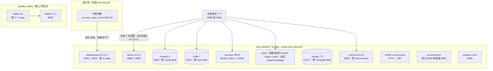
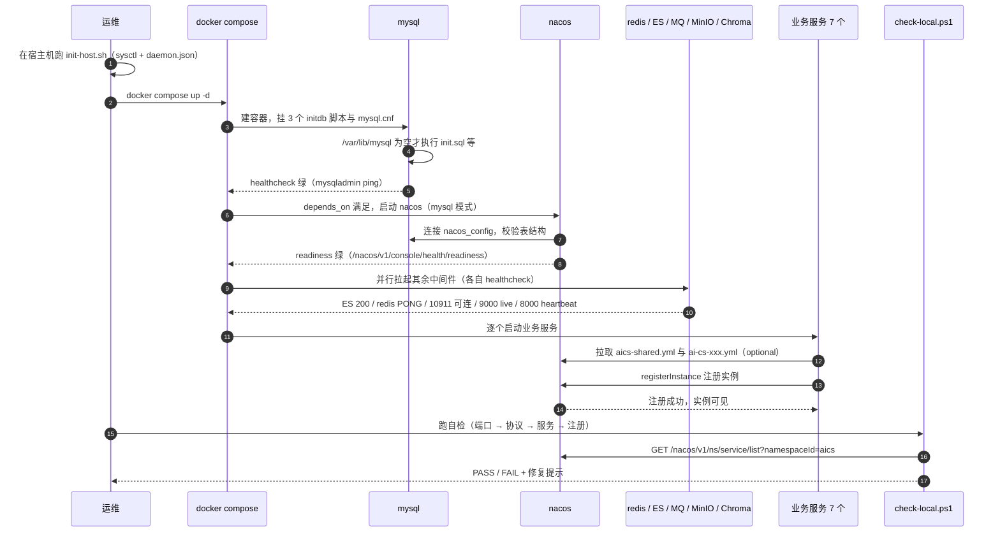

# 09-AI 与治理中间件部署：内存、端口、启动顺序、数据卷，四件事必须同时正确

> **一句话结论**：本地"一键起十个中间件"的难点不在 compose 语法，而在四条互相拉扯的硬约束——宿主端口不能撞、内存总和不能超过机器、启动顺序只能靠探活而不能靠"进程起来了"、数据卷决定"第二次起为什么就好了"；本仓 `docker-compose.yml` 里 14 个服务只声明了 4 处堆上限（合计 1792MiB）却 **0 处 `mem_limit`**，把"内存够不够"整件事交给宿主机，这就是 8 GB 机器起全栈被打死的结构性原因。
> **阅读前置**：读得懂 YAML 缩进，知道镜像/容器/卷/网络的差别，跑过一次 `docker compose up -d`。想先补中间件自身行为，看同目录 `02-RocketMQ消息队列.md`、`03-Elasticsearch搜索引擎.md`、`06-Sentinel限流与熔断降级.md`；想先补注册中心客户端行为，看 [nacos-服务注册与发现源码.md](../24-源码分析/04-SpringCloud/02-注册中心Nacos/01-nacos-服务注册与发现源码.md)。
> **证据基线**：`docker-compose.yml`（359 行，逐行核对）、`deploy/docker-compose/` 下 6 个编排、`deploy/scripts/init-host.sh`、`deploy/scripts/check-local.ps1`（821 行）、`deploy/mysql/init.sql`；注册中心侧引 `24-源码分析/assets/source/` 已入库摘录。**本机未安装 Docker**（`docker` 命令不存在，已实测），所以凡是"容器内会发生什么"的结论，要么给配置行号，要么明确写成推演。预计阅读 40 分钟。

---

## 0. 先看现象

三个症状，来自三种完全不同的失败面：内核参数、内存账本、服务发现地址。它们的共同点是——**报错都不在"中间件能不能起来"上，而在"起来以后对不对"上**。

### 现象 1：8 GB 笔记本上起全栈，五分钟后容器一个个消失

`docker compose ps` 里 MySQL 还在，Elasticsearch、broker 变成了 `Exited (137)`，`docker events` 只有一行 `oom`。137 = 128 + 9，即被 `SIGKILL` 终止，这是 Docker 官方对"进程被内核杀掉"的约定退出码；用 `docker inspect` 的模板查询能直接读到 `OOMKilled` 字段（模板取自 `deploy/scripts/check-local.ps1` 第 251 行，脚本本来就用它判容器状态）：

```powershell
docker inspect --format '{{.State.Status}}|{{if .State.Health}}{{.State.Health.Status}}{{else}}none{{end}}' aics-elasticsearch
```

判据是：`Exited` + `OOMKilled=true` 才是内存杀，`Exited (1)` 是应用自己退出，两者的修法完全不同（前者减内存，后者看日志）。**本机没有 Docker，这条命令未实测**，只给判读方法。

### 现象 2：Elasticsearch 起不来，日志最后一段是内核参数

官方报错原文（Elasticsearch 官方文档 Bootstrap Checks 章节，`max virtual memory areas` 一项；本机无 Docker 未复现）：

```text
max virtual memory areas vm.max_map_count [65530] is too low, increase to at least [262144]
```

Linux 默认 `vm.max_map_count=65530`，ES 用 mmap 打开大量段文件，要求至少 262144。本仓的补丁不在 compose 里，而在宿主机初始化脚本 `deploy/scripts/init-host.sh` 第 70 行：

```sh
sysctl -w vm.max_map_count=262144
echo "vm.max_map_count=262144" >> /etc/sysctl.conf
```

注意第二行：只跑 `sysctl -w` 是临时的，重启即失效；脚本把它写进 `/etc/sysctl.conf` 才是持久的。

### 现象 3：容器全 Up，Nacos 控制台的服务列表却是空的

业务服务日志里出现（格式串来自 `NacosServiceRegistry` 已入库摘录，见 §3.4；地址来自本项目配置）：

```text
nacos registry, DEFAULT_GROUP ai-cs-knowledge 172.18.0.4:8082 register failed...
```

而配置里明明写的是 `${NACOS_ADDR:127.0.0.1:8848}`——容器里 `127.0.0.1` 就是容器自己，注册请求打到了自己的 8848 端口，当然 `Connection refused`。更隐蔽的是：`config.import` 用的是 `optional:nacos:...`（`ai-cs-gateway/src/main/resources/application.yml` 第 29 行），"拉不到配置"这件事**连警告都可能被吞掉**，进程照常启动，于是你看到的是"服务健康、注册为空"。

### 三个症状的共同点

| 现象 | 第一反应 | 真实原因 | 定位入口 |
| --- | --- | --- | --- |
| `Exited (137)` 连环倒 | 镜像坏了 / 配置写错 | 14 个容器 0 个 `mem_limit`，未声明的 JVM 默认吃宿主内存的 1/4，总和超卖 | `docker inspect` 看 `OOMKilled`；`docker stats` 看实时占用 |
| ES 启动即退出 | 数据卷权限问题 | 宿主 `vm.max_map_count=65530` < 262144，且 compose 无法设置内核参数 | `sysctl vm.max_map_count`；`docker logs` 搜 `max virtual memory` |
| 起来了但注册不上 | Nacos 挂了 | 环境变量名 `NACOS_SERVER` 与代码读的 `NACOS_ADDR` 不一致，回落 127.0.0.1 | Nacos 服务列表 API；日志搜 `nacos registry` |

这些现象指向同一件事：**这套编排把"就绪"交给了运气**——内存不封顶、就绪只看端口、地址靠默认值兜底。下面按"端口 → 内存 → 顺序 → 注册 → 存储 → 内核 → 网络 → 数据面 → 初始化"的顺序，把这四件事拆开讲。

---

## 1. 整体地图



> **读图说明**：① `APP --> NACOS` 这条箭头是**控制面**（注册 + 拉配置），不是业务流量；把它误读成"网关转发路径"会得出"8080 是业务入口所以必须最后起"的错误结论——实际上 Nacos 好不好，决定的是业务服务能不能**被**发现。② `JOB` 节点写的是"宿主 8099 到容器 8080"：左边是宿主端口、右边是容器端口，把 `127.0.0.1:8099` 抄进容器里的配置就必然连不上（§3.1）。③ `PROF` 子图默认不存在：不带 `--profile kafka` 时 `docker compose up -d` 不会拉起 Kafka，看到 9092 没监听**不是故障**（`docker-compose.yml` 第 283-284 行）。④ `KERNEL` 指向 ES 而不是指向"整个网络"：`vm.max_map_count` 是宿主机内核参数，容器内既看不到也改不了，这就是它必须写在 `init-host.sh` 而不是 compose 里的原因。

十个中间件各自的"责任 / 谁调用 / 端口 / 卷 / 健康判据"，逐项来自 `docker-compose.yml`：

| 服务键 | 镜像（行号） | 宿主端口 | 数据卷 | 健康检查判据（行号） | 谁依赖它 |
| --- | --- | --- | --- | --- | --- |
| `mysql` | `mysql:8.0`（12） | 3306 | `mysql-data` + 3 个 initdb 脚本（21-25） | `mysqladmin ping -uroot -proot`（28） | nacos、xxl-job-admin、全部业务服务 |
| `redis` | `redis:7`（38） | 6379 | `redis-data` + `redis.conf`（44-45） | `redis-cli ping`（48） | 业务服务（限流、会话、锁） |
| `nacos` | `nacos/nacos-server:v2.3.2`（57） | 8848、9848 | **无** | `curl .../health/readiness`（77） | 全部业务服务 |
| `elasticsearch` | `elasticsearch:8.12.0`（87） | 9200、9300 | `es-data`（99） | `curl .../_cluster/health`（101） | search-service（已过期，见 §3.4） |
| `rocketmq-namesrv` | `apache/rocketmq:5.1.4`（111） | 9876 | 无 | `nc -w 2 localhost 9876`（120） | broker、message-service |
| `rocketmq-broker` | `apache/rocketmq:5.1.4`（129） | 10911、10909 | **无**（未挂 `broker.conf`） | `nc -w 2 localhost 10911`（142） | message-service |
| `minio` | `quay.io/minio/minio:latest`（152） | 9000、9001 | `/data/minio/data:/data`（162，唯一绑定挂载） | `/minio/health/live`（165） | knowledge-service |
| `mongodb` | `mongo:7.0`（175） | 27017 | `mongodb-data`（183） | `mongosh ... ping`（185） | 对话审计归档 |
| `chroma` | `chromadb/chroma:0.5.20`（195） | 8000 | `chroma-data`（201） | `python urllib ... /api/v1/heartbeat`（203） | knowledge-service、ai-chat-service |
| `neo4j` | `neo4j:5-community`（212） | 7474、7687 | `neo4j-data`、`neo4j-logs`（223-224） | `wget :7474`（226） | 未在编排内被依赖 |
| `xxl-job-admin` | `xuxueli/xxl-job-admin:2.4.1`（236） | 8099 → 8080 | 无 | `wget /xxl-job-admin/`（251） | order（默认关闭） |
| `sentinel-dashboard` | `bladex/sentinel-dashboard:1.8.6`（260） | 8858 | 无 | `wget :8858/`（268） | 各服务（按需接入） |
| `kafka` | `apache/kafka:3.7.1`（280） | 9092 | `kafka-data`（309） | `kafka-broker-api-versions.sh`（311） | 仅 `--profile kafka` |

---

## 2. 关键概念与关键类

部署类文档里"类"往往不是 Java 类，而是**编排原语 + 配置项 + 少量自动配置类**。下表是本篇会反复用到的全部名词，后文不再重复解释。

| 名称 | 位置 | 角色 | 关键方法 / 字段 |
| --- | --- | --- | --- |
| 服务键（service key） | `docker-compose.yml` 第 11、37、56… 行 | 编排最小单元，同时就是**容器网络内的 DNS 名** | `image`、`ports`、`volumes`、`environment`、`depends_on`、`healthcheck` |
| `container_name` | 同上（如第 13 行 `aics-mysql`） | 给人看的容器名，也是 `docker exec` 的目标 | 与"服务名"是两套名字：`mysql` 服务、`aics-mysql` 容器 |
| `healthcheck` | 第 27-32 行等 | 给容器加第三态（starting/healthy/unhealthy） | `test`、`interval`、`timeout`、`retries`、`start_period` |
| `depends_on` + `condition: service_healthy` | 第 73-75、138-140、247-249 行 | 编排层唯一的"顺序保证" | 只等 healthcheck 变绿的**那一刻**，之后不再管 |
| `${NACOS_ADDR:127.0.0.1:8848}` | `ai-cs-gateway/src/main/resources/application.yml` 第 19、23 行 | 注册/配置中心地址，`:` 后半段是默认值 | 环境变量名必须与 compose 传的名字一致，否则永远用默认值 |
| `spring.config.import` | 同上 第 28-30 行 | 从 Nacos 拉共享配置与私有配置 | `optional:nacos:aics-shared.yml` 拉不到**不报错** |
| `NacosServiceRegistry#register` | `24-源码分析/assets/source/NacosServiceRegistry.java.md` 第 60-89 行 | 真正发注册 HTTP 请求的地方 | `registerInstance(serviceId, group, instance)` |
| `NacosDiscoveryProperties#failFast` | 同上目录 `NacosDiscoveryProperties.java.md` 第 231 行 | 注册失败时是否让启动失败 | `private boolean failFast = true;`（默认**中断**） |
| `NacosAutoServiceRegistration#register` | 同上目录 `NacosAutoServiceRegistration.java.md` 第 72-81 行 | Spring 容器就绪后触发注册 | 先判 `isRegisterEnabled()`，再 `super.register()` |
| `spring.ai.vectorstore.chroma.client.host` | `ai-cs-knowledge/src/main/resources/application.yml` 第 32 行 | 向量库地址 | 写成 `http://${aics.mysql.host:localhost}`——变量名复用了 MySQL 的 |
| `MinioProperties` | `ai-cs-common/src/main/java/com/aics/common/storage/MinioProperties.java` 第 10-26 行 | 对象存储四要素 | 前缀 `aics.minio`；`endpoint` 默认 `http://123.60.31.79:9000` |
| `FileStorageService#ensureBucket` | `ai-cs-common/src/main/java/com/aics/common/storage/FileStorageService.java` 第 94-104 行 | 桶的懒创建 | `bucketExists` → `makeBucket` |
| `MinioAutoConfiguration` | `ai-cs-common/src/main/java/com/aics/common/autoconfigure/MinioAutoConfiguration.java` 第 15-33 行 | 条件装配 MinioClient | `@ConditionalOnClass(MinioClient.class)` |
| `initdb 脚本` | `deploy/mysql/init.sql`、`xxl-job-init.sql`、`canal-init.sql` | 只在数据目录为空时执行一次 | 决定了"第一次失败、第二次就好" |
| `init-host.sh` | `deploy/scripts/init-host.sh` | 宿主机一次性初始化 | 内核参数、`daemon.json`、镜像加速 |
| `check-local.ps1` | `deploy/scripts/check-local.ps1` | 只读自检：端口 → 协议 → 服务 → 注册 | 端口探测、`docker inspect`、Nacos API |

---

## 3. 原理与证据逐段精读

### 3.1 端口：18 个宿主发布端口，与"容器内的 127.0.0.1"是两个世界

**在干什么。** `ports: - "3306:3306"` 的语义是"把宿主机 3306 转发到容器 3306"。用 node 静态解析 `docker-compose.yml`（本机真实输出，见 §6.1 的脚本）：

```text
docker-compose.yml
  服务=14 宿主端口=18 仅容器端口=0 healthcheck=13/14 挂载条目=14 mem_limit=0
  宿主端口: 3306,6379,8848,9848,9200,9300,9876,10911,10909,9000,9001,27017,8000,7474,7687,8099,8858,9092
```

18 个端口里有两个容易看错：`9848` 是 Nacos 2.x 起的 gRPC 端口（客户端长连接走它，不是 8848+1000 的巧合）；`9001` 是 MinIO 控制台，`9000` 才是 S3 API。少发布 9848 的后果不是"连不上 Nacos"，而是**能注册、但配置监听收不到推送**，表现为"改了 Nacos 配置，服务不刷新"。

**为什么这么设计。** 容器网络里每个服务用服务名互相访问（`mysql:3306`、`nacos:8848`），宿主进程才用 `127.0.0.1:端口`。同一份应用配置要在两种场景下都正确，就必须由环境变量决定地址——这也是 §3.4 那条 bug 的土壤。

**换写法会怎样。** 用 `network_mode: host` 可以让容器直接共享宿主网络栈，端口不再需要映射，`127.0.0.1` 在容器里也就是宿主；代价是所有端口冲突立刻变成启动失败，且 macOS/Windows 的 Docker Desktop 上 host 网络行为与 Linux 不同。另一种是干脆不发布端口（只写 `expose`），安全但宿主工具连不上。

**常见坑。** ① `xxl-job-admin` 是 `8099:8080`（第 240 行），容器内是 8080；② MinIO 的 `container_name` 是 `minio`（第 153 行）不是 `aics-minio`，`docker exec aics-minio ...` 会直接报"No such container"——`deploy/scripts/check-local.ps1` 第 490-504 行专门为这点写了提示；③ 6 个编排文件之间有 **21 个宿主端口重复**（§5 表），它们不能同机同时 `up`。

### 3.2 内存：4 处堆声明、0 处 `mem_limit`，这是 OOM 的结构性原因

**在干什么。** 解析器把所有"堆上限"形态都抓了一遍（`-Xmx`、`JAVA_OPT_EXT`、`JVM_XMX`），7 个文件合计：

```text
docker-compose.yml                              堆声明(4个)=1792MiB: nacos=512m elasticsearch=512m rocketmq-namesrv=256m rocketmq-broker=512m
deploy/docker-compose/docker-compose-all.yml    堆声明(11个)=5376MiB
===== 7 个文件合计 =====
堆声明合计=13824MiB ≈ 13.50GiB
```

根 compose 的 1792MiB 是这样来的：ES 512 + broker 512 + namesrv 256 + Nacos 512（`JVM_XMX: 512m`，第 72 行）。而 `redis`、`minio`、`mongo`、`chroma`、`neo4j`、`xxl-job-admin`、`sentinel-dashboard` 里，**只有 redis 和 neo4j 声明了上限**（`redis.conf` 第 24 行 `maxmemory 256mb`；compose 第 221 行 `NEO4J_server_memory_heap_max__size: 512m`），其余五个（minio 是 Go、chroma 是 Python，问题不大；**xxl-job-admin 和 sentinel-dashboard 是 Java**）没有任何边界。

**为什么这么设计。** 写 compose 的人默认"容器就是轻的"，用 JVM 参数控制堆比用 `mem_limit` 更直观——但它有个致命副作用：`mem_limit` 缺席时，容器看到的"可用内存"是**宿主机总量**，而 JDK 10+ 的 `MaxRAMPercentage` 默认 25%，于是没写 `-Xmx` 的 Java 容器会按"宿主内存 / 4"设堆。8 GB 机器上两个这样的容器就能吃掉 4 GB。

**换写法会怎样。** 正经做法是 `mem_limit`（compose v2 也可写 `deploy.resources.limits.memory`）与 `-Xmx` 成对出现，并让堆 ≤ 容器上限的 70%（剩下给元空间、直接内存、线程栈、ES 的 Lucene 页缓存）。本项目在 k8s 侧已经这么做了——`deploy/k8s/elasticsearch.yaml` 第 58 行 `value: "-Xms512m -Xmx512m"`、第 63 行 `memory: "1Gi"`（requests）、第 66 行 `memory: "2Gi"`（limits），注释明确写"容器内存需大于 JVM 堆 + 堆外内存"；而 compose 侧一个都没有，这就是"同一套系统两套资源口径"的漂移。

**常见坑。** 别拿"我本机 32 GB 起得来"当结论——本机真实内存：

```powershell
(Get-CimInstance Win32_ComputerSystem).TotalPhysicalMemory / 1GB
```

```text
31.7
```

31.7 GB 的机器上 13.50 GiB 堆都吃得下，所以"我这里没问题"完全不能证明 8 GB 目标机没问题。粗算账：8 GB 机器上，声明部分 1.75 GiB + 两个未声明 Java 容器各约 2 GiB + MySQL 默认 buffer pool + ES 堆外 ≈ 已超 8 GB，**必然有容器被 OOM kill**（推演，本机无 Docker 未实测）。

### 3.3 启动顺序：`depends_on` + `healthcheck` 只能证明"进程活着"

**在干什么。** 根 compose 里 13/14 个服务有 healthcheck，但判据强度差别极大。把判据按"它证明了什么"重新排一遍：

| 服务 | 判据原文 | 证明了 | **没证明** |
| --- | --- | --- | --- |
| mysql | `mysqladmin ping -uroot -proot`（28 行） | 进程能接受连接 | 库表是否建完（initdb 可能还在跑） |
| nacos | `/nacos/v1/console/health/readiness`（77 行） | 服务端已就绪 | 客户端能否从容器解析到它 |
| elasticsearch | `curl -f .../_cluster/health`（101 行） | HTTP 200 | 集群状态是 green 还是 red（单节点恒为 yellow） |
| rocketmq-namesrv | `nc -w 2 localhost 9876`（120 行） | 端口可连 | 路由信息是否已加载 |
| rocketmq-broker | `nc -w 2 localhost 10911`（142 行） | 端口可连 | 是否已向 namesrv 注册成功 |
| chroma | `urllib ... /api/v1/heartbeat`（203 行） | 心跳接口通 | 集合是否已创建 |

**为什么这么设计。** compose 只有"容器是否运行"这一个原始信号，`healthcheck` 是社区补出来的第二信号，而 `depends_on: condition: service_healthy` 是**一次性等待**：等到绿的那一刻就放行，之后下游再挂，compose 不管、也不会重启上游。这不是 compose 的缺陷，而是"编排器不该理解业务依赖"的边界。

**换写法会怎样。** 想让"顺序"真正可靠，只有两条路：应用侧自己重试（Spring Cloud 的注册与配置拉取天然带重试，`failFast` 决定失败是否中断），或者交给 k8s 的 `readinessProbe` + `restartPolicy`。注意 k8s 侧的探针也有同样的问题——`deploy/k8s/elasticsearch.yaml` 第 68 行的 `livenessProbe` 打的还是 `/_cluster/health`，而该接口在集群 red 时也返回 200，探针永远绿。

**常见坑（"第一次失败、第二次就好"的根因）。** MySQL 官方镜像只在 `/var/lib/mysql` **为空**时执行 `/docker-entrypoint-initdb.d/` 里的脚本。本仓挂了三个：

```yaml
    volumes:
      - mysql-data:/var/lib/mysql
      - ./deploy/mysql/mysql.cnf:/etc/mysql/conf.d/mysql.cnf
      - ./deploy/mysql/init.sql:/docker-entrypoint-initdb.d/init.sql
      - ./deploy/mysql/xxl-job-init.sql:/docker-entrypoint-initdb.d/xxl-job-init.sql
      - ./deploy/mysql/canal-init.sql:/docker-entrypoint-initdb.d/canal-init.sql
```

（`docker-compose.yml` 第 20-25 行）第一次 `up` 时 `mysql-data` 是空的，脚本边跑边建库，Nacos 可能先起来并因为"表不存在"启动失败；第二次 `up` 时卷里已有数据，initdb 整体跳过，一切正常。**所以"第二次就好"不是玄学，是 initdb 的幂等边界**：想知道第一次是否真的跑完，看 `docker compose logs mysql` 里 entrypoint 的收尾行；想重来，只能 `docker compose down -v`（会删数据，别在有用数据的机器上敲）。

### 3.4 注册与配置：变量名不匹配 → `optional` 静默 → `failFast` 默认中断

**在干什么。** 三个组件串成一条链。第一，compose 传的环境变量叫 `NACOS_SERVER`：

```yaml
    environment:
      SPRING_PROFILES_ACTIVE: prod
      NACOS_SERVER: nacos:8848
      DB_HOST: mysql
      MINIO_ENDPOINT: http://minio:9000
```

（`deploy/docker-compose/docker-compose-all.yml` 第 190-192 行，`knowledge-service`；`api-gateway` 在 173 行、`ai-cs-chat-service` 在 231 行、`search-service` 在 251 行，同样的名字）。第二，所有服务的配置读的是另一个名字：

```yaml
  cloud:
    nacos:
      discovery:
        server-addr: ${NACOS_ADDR:127.0.0.1:8848}
        namespace: aics
        group: DEFAULT_GROUP
      config:
        server-addr: ${NACOS_ADDR:127.0.0.1:8848}
```

（`ai-cs-gateway/src/main/resources/application.yml` 第 17-24 行；`ai-cs-knowledge` 在 13、17 行，`ai-cs-chat` 在 19、23 行，其余 8 个模块同款）。第三，注册动作在 `NacosServiceRegistry#register`：

```java (src: NacosServiceRegistry.java.md#L73-L76)
namingService.registerInstance(serviceId, group, instance);
log.info("nacos registry, {} {} {}:{} register finished",
        group, serviceId, instance.getIp(), instance.getPort());
```

注册成功打的是 `... register finished`；失败则走 `failFast` 分支：`isFailFast()` 为真就 `log.error` 后抛异常，否则只 `log.warn`[[源码:NacosServiceRegistry.java.md#L78-L88]]。而 `NacosDiscoveryProperties` 把默认值定成了 `private boolean failFast = true;`[[源码:NacosDiscoveryProperties.java.md#L231]]——默认行为是"注册失败 = 启动失败"。

**为什么这么设计。** 这样设计的意图是"宁可起不来，也不要起一个别人找不到的服务"——`failFast=true` 让注册中心不可用暴露成启动失败，对生产是对的。但本地部署里它和 `optional:nacos:` 的组合很别扭：配置拉取被设计成"可选"（拉不到就用本地默认值继续），注册却被设计成"必须成功"。于是同一个 Nacos 不可用，会同时产生两种行为。

**换写法会怎样。** 把 compose 里的 `NACOS_SERVER` 改成 `NACOS_ADDR`（最小修复，一处改名解决 11 个模块）；或反过来把配置改成 `${NACOS_SERVER:...}`。两者都行，但必须二选一并对齐——现在是"传的没人读、读的没人传"。另一种是给容器加 `/etc/hosts` 之外的兜底：把默认值写成 `host.docker.internal:8848`，但 Windows 的 Docker Desktop 之外的平台不一定支持这个名字。

**常见坑。** ① `DB_HOST` 同样没人读：`ai-cs-mq/src/main/resources/application.yml` 第 27 行连的是 `${MYSQL_HOST:123.60.31.79}`，`ROCKETMQ_NAMESRV` 也一样（读的是 `${ROCKETMQ_ADDR:127.0.0.1:9876}`，第 42 行）。② `ES_HOST` 是**过期依赖**：search 服务已把全文检索切到 Chroma（`ai-cs-search/src/main/resources/application.yml` 第 32 行注释），compose 里 `search-service` 仍然 `depends_on: elasticsearch`（`docker-compose-all.yml` 第 257-258 行），白白多等一个已经没用的容器。③ 硬编码远端 IP `123.60.31.79` 在全仓 `.yml` 里有 **39 处**（含 `tools/nacos-config/` 与 `tools/nacos/data/tenant-config-data/aics/DEFAULT_GROUP/` 下的配置导出），所以"本地起全栈"很可能变成"本地起着、连的是别人服务器上的库"。

### 3.5 Nacos 存储：derby 单机 → MySQL，谁建库、谁插用户

**在干什么。** Nacos 有两种持久化：内嵌 derby（单机、零配置）与外部 MySQL（要建库建表）。容器版直接走 MySQL：

```yaml
    environment:
      MODE: standalone
      SPRING_DATASOURCE_PLATFORM: mysql
      MYSQL_SERVICE_HOST: mysql
      MYSQL_SERVICE_PORT: 3306
      MYSQL_SERVICE_DB_NAME: nacos_config
      MYSQL_SERVICE_USER: root
      MYSQL_SERVICE_PASSWORD: root
```

（`docker-compose.yml` 第 63-70 行）它没有自己的卷，数据全在 MySQL 里（第 56-83 行整个服务**没有 `volumes:` 段**）。库和初始用户由 initdb 脚本准备：`deploy/mysql/init.sql` 第 337-338 行建库并 `USE`，第 340 行起是官方标准表结构，第 509-510 行插入默认用户：

```sql
INSERT INTO users (username, password, enabled) VALUES ('nacos', '$2a$10$...', TRUE) ON DUPLICATE KEY UPDATE username = VALUES(username);
INSERT INTO roles (username, role) VALUES ('nacos', 'ROLE_ADMIN') ON DUPLICATE KEY UPDATE role = VALUES(role);
```

**为什么这么设计。** derby 不能集群，且数据在同一台机器上，一旦容器重建就没了；MySQL 模式让 Nacos 变成无状态服务，才能横着扩。项目里两套并存：容器用 MySQL 模式，本机 `tools/nacos/`（Windows 解压版）用 derby——`tools/nacos/conf/application.properties` 第 36 行 `# spring.datasource.platform=mysql` 是注释掉的，第 44 行的 `db.url.0` 也是注释掉的，而 `tools/nacos/data/` 下确实有 `derby-data` 目录和 `derby.log`。

**换写法会怎样。** 想升级成集群，必须切 MySQL，并且**三处一起改**：每台 `cluster.conf` 里列全节点、共用同一个 `nacos_config`、对外经 VIP/Nginx 暴露 8848 与 9848（gRPC 单独走）。本项目有现成的多机编排可参考（`deploy/docker-compose/docker-compose-host1.yml` 里的 `nacos` 开了 `NACOS_AUTH_ENABLE: true`）。

**常见坑。** ① 容器版 Nacos 和本机 derby 版 Nacos 抢同一个 8848，只能起一个；② MySQL 模式下一旦 `nacos_config` 没建好，Nacos 启动会失败，但 `depends_on: service_healthy` 只保证 MySQL 的 ping 通，**不保证库表已建**（§3.3）；③ 鉴权三档差异：本机 `tools/nacos/conf/application.properties` 第 146 行 `nacos.core.auth.enabled=false`、第 164 行 `nacos.core.auth.plugin.nacos.token.secret.key=`（空），容器版没传鉴权变量，只有 host1 集群版开了 `NACOS_AUTH_ENABLE`——本地随便用，上生产必须先补这一块。

### 3.6 Elasticsearch：`vm.max_map_count` 与 `-Xms/-Xmx` 必须一起对

**在干什么。** ES 的两道门槛，一道在内核、一道在 JVM：

```yaml
    environment:
      - discovery.type=single-node
      - xpack.security.enabled=false
      - xpack.security.http.ssl.enabled=false
      - ES_JAVA_OPTS=-Xms512m -Xmx512m
    volumes:
      - es-data:/usr/share/elasticsearch/data
```

（`docker-compose.yml` 第 93-99 行）`-Xms` 等于 `-Xmx` 是 ES 的硬要求（堆不扩容就无需停顿做对象搬迁）；512m 是本地能跑的最小值，官方建议不要超过物理内存的 50% 且不超过 32 GB（压缩指针边界）。

**为什么这么设计。** `vm.max_map_count` 限制的是单个进程能建立的虚拟内存映射数。ES 把每个 Lucene 段文件 `mmap` 进地址空间，段一多就撞上默认 65530 这个上限，于是启动时的 bootstrap check 直接拒绝启动——**这是"保护性失败"，不是 bug**：让它带着不够的映射数启动，后续查询会随机失败，更难查。

**换写法会怎样。** compose 无法设置内核参数（`sysctl` 是宿主级的），所以必须在宿主侧做：`deploy/scripts/init-host.sh` 第 70-71 行写入 `/etc/sysctl.conf`。放到 k8s 里则要用 privileged 的 `initContainer` 或 `securityContext.sysctls`（只允许安全 sysctl 列表内的项，`vm.max_map_count` 自 k8s 1.18 起在安全列表里）。本仓 k8s 清单**没有**做这件事——`deploy/k8s/elasticsearch.yaml` 只有 resources 与探针，没有 initContainer。

**常见坑。** ① healthcheck 只看 HTTP 200（第 101 行），单节点集群永远是 yellow，`curl -f` 照样通过；想让"就绪"更严格，可以学 `deploy/docker-compose/docker-compose-host3.yml` 的写法用 `grep -q green`——但单节点上它**永远不会绿**，反而会让依赖它的服务永不起动。② 卷 `es-data` 必须存在，否则容器重建后索引全丢，需要重新灌数据（本仓有 `deploy/scripts/sync-kb-to-es.py` 这类补数脚本，正是为这种情况准备的）。

### 3.7 RocketMQ：`brokerIP1` 与那份"写了但没挂进去"的 `broker.conf`

**在干什么。** broker 的启动命令引用了一个配置文件：

```yaml
    command: sh mqbroker -n rocketmq-namesrv:9876 -c /home/rocketmq/rocketmq-5.1.4/conf/broker.conf
```

（`docker-compose.yml` 第 135 行）但整个 `rocketmq-broker` 服务（第 128-148 行）**没有 `volumes:` 段**——也就是说 `-c` 指向的是镜像自带的默认文件，仓库里那份 `tools/rocketmq/conf/broker.conf` 从未进入容器。静态解析可以印证：broker 服务的"挂载条目=0"（§6.1 输出）。而仓库里那份文件的全部内容只有 7 项：`brokerClusterName`、`brokerName`、`brokerId`、`deleteWhen`、`fileReservedTime`、`brokerRole`、`flushDiskType`——**没有 `brokerIP1`**。

**为什么这么设计。** RocketMQ 的 broker 启动时会把"自己的地址"注册到 namesrv，客户端从 namesrv 拿到地址后再直连 broker。容器里它看到的本机地址是 `172.x.x.x`，于是注册进去的就是这个内网 IP；宿主机的进程（IDE 里跑的服务）拿到它之后连不上——这正是 `brokerIP1` 存在的意义：**显式告诉 broker"对外宣告哪个地址"**。同类问题本项目在 Kafka 上解决得很规范：

```yaml
      KAFKA_ADVERTISED_LISTENERS: PLAINTEXT://localhost:9092,INTERNAL://kafka:29092
```

（`docker-compose.yml` 第 296 行）`ADVERTISED_LISTENERS` 就是 Kafka 版的 `brokerIP1`，一套给宿主、一套给容器内互访，命名直白得多。

**换写法会怎样。** 三种修法：① 在 `broker.conf` 里加 `brokerIP1=<宿主机IP>` 并把它挂进容器（同时修 135 行的 `-c` 路径与 volumes）；② compose 里加 `network_mode: host`（Linux 上可行，Windows/Mac 上语义不同）；③ 一切都跑在容器里，用服务名 `rocketmq-broker:10911` 互访，就根本不需要对外宣告宿主地址。**这三种在本仓都未落地**——本篇按"未落地、需要改哪几个文件"标注。

**常见坑。** ① 只发布 10911 不够：客户端还要 10909（VIP 通道），否则时好时坏；② namesrv 9876 的 healthcheck 是 `nc` 探端口（第 120 行），端口通 ≠ 路由已就绪，broker 抢先注册失败后会靠 `restart: always` 反复重试——这就是"日志里第一条 broker 注册失败、后面又正常"的由来。

### 3.8 对象存储与向量库：懒建桶、绑定挂载、语义错位的变量名

**在干什么。** MinIO 在编排里有两处特殊：唯一使用**宿主绝对路径绑定挂载**（`/data/minio/data:/data`，第 162 行，其余全是具名卷），以及 root 账号密码硬编码 `minioadmin`（第 159-160 行）。桶不在编排里创建，而在应用侧懒创建：

```java
private void ensureBucket() throws Exception {
    boolean exists = minioClient.bucketExists(BucketExistsArgs.builder()
            .bucket(properties.getBucket())
            .build());
    if (!exists) {
        minioClient.makeBucket(MakeBucketArgs.builder()
                .bucket(properties.getBucket())
                .build());
        log.info("桶不存在，已自动创建: {}", properties.getBucket());
    }
}
```

（`ai-cs-common/src/main/java/com/aics/common/storage/FileStorageService.java` 第 94-104 行，调用点在 `upload()` 第 53 行）桶名默认 `ai-cs`，来自 `MinioProperties` 第 23 行；四要素端点/账号/密码/桶的默认值全在 `MinioProperties`（第 14-23 行），其中 `endpoint` 默认值就是远端 `http://123.60.31.79:9000`。

**为什么这么设计。** 懒创建让"MinIO 还没准备好"不会阻塞服务启动，代价是把故障推迟到**第一次上传**才爆——那时报的是 `S3 API` 错误，与"部署"看起来毫无关系。而绑定挂载的选择很危险：宿主机路径 `/data/minio/data` 在 Windows/Mac 上根本不存在，`docker compose up` 会创建一个 root 权限的空目录，之后容器写不进去。

**换写法会怎样。** 编排里显式初始化桶更可控（起一个一次性 `mc` 容器：`mc alias set` + `mc mb --ignore-existing`，或用 `minio/mc` 镜像 + `entrypoint` 脚本），失败即时可见；但要注意它得排在 minio healthy 之后。变量方面，`docker-compose-all.yml` 第 212 行传的是 `MINIO_ENDPOINT`，而代码读的是 `aics.minio.endpoint`（前缀固定在第 10 行）——**这个名字绑不上**，容器里仍然拿到默认的远端地址。

**常见坑。** ① Chroma 的 host 写成了 `http://${aics.mysql.host:localhost}`（`ai-cs-knowledge/src/main/resources/application.yml` 第 32 行）：变量名复用了 MySQL 的 host，语义错位，且 `localhost` 在容器里指向容器自己；② Chroma 的 heartbeat 路径在 0.5.x 是 `/api/v1/heartbeat`（第 203 行），更新版本改成了 `/api/v2/heartbeat`，`deploy/scripts/check-local.ps1` 第 506-529 行因此写成"先探 v2、失败回落 v1、只有 v1 给 WARN"；③ MongoDB 只传了 `MONGO_INITDB_DATABASE`（第 181 行），**没传 `MONGO_INITDB_ROOT_USERNAME/PASSWORD`**，即 27017 暴露到宿主且无鉴权——本地学习可接受，任何共享环境都必须补认证（改 174-191 行 + 应用连接串）。

### 3.9 数据库初始化：3 个脚本 vs 6 个库，39 处硬编码 IP

**在干什么。** 根 compose 挂了 3 个 initdb 脚本（第 23-25 行），而 `deploy/mysql/init.sql` 建的是 6 个库：`user_db`（第 7 行）、`user_db_0`/`user_db_1`（47-48 行，分片用）、`knowledge_db`（220 行）、`chat_db`（283 行）、`nacos_config`（337 行）。另外 3 个库在别的脚本里：`product_db`（`deploy/mysql/all-init.sql` 第 15 行、`deploy/mysql/product-init.sql` 第 6 行）、`ai_customer_service`（`all-init.sql` 第 569 行）、`mq_db`（`all-init.sql` 第 865 行、`deploy/mysql/mq-workorder-init.sql` 第 10 行）。**`all-init.sql` / `product-init.sql` / `mq-workorder-init.sql` 都没有被 compose 挂载**，所以 order/pay/product/mq 四个模块的库在本机全栈里不会被自动创建。

**为什么这么设计。** 单模块开发时各人只建自己需要的库，脚本自然长成"一模块一文件"；而"一键部署"需要的是"全量"。两者没对齐，是典型的部署漂移。同类漂移还有：`deploy/` 下**不存在 `nacos/` 目录**（真实只有 `docker-compose/`、`k8s/`、`mysql/`、`observability/`、`redis/`、`scripts/`、`testdata/`），但 `deploy/scripts/check-local.ps1` 第 688 行的提示仍让用户"执行 `deploy/nacos/` 下的 `publish-to-nacos.ps1` 发布配置（如该脚本存在）"——脚本自己都用"如存在"打了补丁，而该目录与脚本都不存在。

**换写法会怎样。** 把 `all-init.sql` 挂进 `/docker-entrypoint-initdb.d/`（或把所有 `CREATE DATABASE` 合并进一个文件）就能一次建全；代价是首次启动时间变长、且必须接受"卷非空就整体跳过"的语义。

**常见坑。** ① 分片配置里的 URL 是硬编码的：`ai-cs-user/src/main/resources/sharding-user.yaml` 第 27、36、45 行分别是 `jdbc:mysql://123.60.31.79:3306/user_db`、`user_db_0`、`user_db_1`，而账号密码反倒正确用了占位符 `$${DB_USER::root}`（第 28-29 行）——说明作者知道怎么写占位符，只是 URL 没改；② 共享配置把地址钉死在远端：`tools/nacos-config/aics-shared.yml` 第 7 行 `spring.data.redis.host: 123.60.31.79`、第 17 行 `aics.mysql.host: 123.60.31.79`，这份文件被所有服务 `optional:nacos:aics-shared.yml` 引入，所以即使本地 Nacos 起来了，业务也会按这份配置连远端；③ 同一份文件第 34 行 `show-details: never` 关掉了健康详情，而 `check-local.ps1` 第 621 行的提示是"逐项看 detail 字段"——按提示去查会发现 detail 根本不存在。

### 3.10 可观测性与日志：跨网络、跨文件的两块拼图

**在干什么。** 观测栈是独立编排、独立网络：`deploy/docker-compose/docker-compose-observability.yml` 第 15-17 行定义 `aics-observe` 网络，4 个服务是 prometheus（9090）、grafana（3000）、tempo（3200）、otel-collector（4317/4318），静态解析结果是 **`healthcheck=0/4`**。业务侧的 OTLP 端点默认指向宿主：`ai-cs-knowledge/src/main/resources/application.yml` 第 42 行 `${OTLP_ENDPOINT:http://127.0.0.1:4318/v1/traces}`。两个网络互不通，而 compose 侧也没人传 `OTLP_ENDPOINT`。

**为什么这么设计。** 观测栈按"可选"设计：不起它也能跑，指标端点照样暴露（共享配置 `tools/nacos-config/aics-shared.yml` 第 31 行 `include: health,info,prometheus`）。代价是链路追踪在容器里默认失效——`127.0.0.1:4318` 指向业务容器自己。

**换写法会怎样。** 要让追踪开箱可用，需要三件事同时成立：观测栈并入 `aics-network`、业务服务显式传 `OTLP_ENDPOINT=http://otel-collector:4318/v1/traces`、collector 的 exporter 指向 `tempo:4317`。注意 tempo 的 4317 只写了容器端口（`docker-compose-observability.yml` 第 52 行 `- "4317"`），**没发布到宿主**——这就是"宿主能抓指标、却永远看不到链路"的直接原因。

**常见坑。** ① `depends_on: [prometheus, tempo]`（第 43、67 行）是列表写法，等价于 `service_started`，既不等健康、也无健康可等；② 观测栈 0 个 healthcheck，`docker compose ps` 只能告诉你"进程在"，读写是否正常得打开 3000 端口看 Grafana 数据源状态；③ 三类数据的落点完全不同：容器 stdout 走 `daemon.json` 的 json-file 轮转，Prometheus 落在 `prometheus-data` 卷（保留 7 天，第 30 行 `--storage.tsdb.retention.time=7d`），Tempo 落在 `tempo-data` 卷——清理磁盘时别只盯着容器日志。

---

## 4. 一次完整执行时序



> **读图说明**：① 第 5-8 步是**唯一的串行段**：`depends_on: service_healthy` 只用在 mysql→nacos、namesrv→broker、mysql→xxl-job 这几处（`docker-compose.yml` 第 73-75、138-140、247-249 行），其余容器是"同时拉起、各自探活"；把整条链想成"一个接一个起"会误判启动耗时。② 第 12-14 步是**控制面**，箭头方向是 `A->N`（服务主动连注册中心），不是 Nacos 来扫描服务——这也是为什么 §3.4 那个地址写错时，Nacos 侧完全看不出异常，只有业务日志里有痕迹。③ 第 4 步的自环 `My->My` 标出了"只有一次"的语义：它决定第 6 步 nacos 第一次是否失败。

同一个时序里，每一步失败长什么样：

| 失败步 | 现象 | 报错/关键字 | 先看哪里 |
| --- | --- | --- | --- |
| 1 | ES 容器起即退 | `max virtual memory areas ... too low` | `sysctl vm.max_map_count` |
| 3-4 | MySQL 起来但库缺失 | 后续服务 `Unknown database 'chat_db'` | `docker compose logs mysql` 里 initdb 段落 |
| 5 | MySQL 一直 `starting` | healthcheck `mysqladmin ping` 失败 | 密码/`mysql.cnf`；retries 10 × interval 10s 后转 unhealthy |
| 7 | Nacos 反复重启 | `Table 'nacos_config.config_info' doesn't exist` | `nacos_config` 库是否建好（§3.5） |
| 8 | Nacos 一直 `starting` | readiness 接口 500 | Nacos 日志里 derby/mysql 数据源报错 |
| 10 | ES `unhealthy` 但服务能用 | `_cluster/health` 返回 yellow | 单节点恒 yellow，属正常 |
| 13 | 注册失败但进程活着 | `nacos registry, ... register failed` / `Failfast is false` | `NACOS_ADDR` 是否被正确注入（§3.4） |
| 14 | 注册成功但调用方找不到实例 | 网关 503 `Unable to find instance` | namespace/group 是否与服务端一致（都是 `aics` / `DEFAULT_GROUP`） |

---

## 5. 设计取舍

| 决策点 | 本项目选择 | 备选 | 代价 | 什么情况下该换 |
| --- | --- | --- | --- | --- |
| 编排粒度 | 根 `docker-compose.yml` 单机 14 服务；另有 6 个按主机/用途拆的文件 | 只用一份大文件；或 Helm | 6 文件共 **21 个宿主端口重复**，同机不能同时起 | 多机联调时按 host1/2/3 成套启动，单机开发只用根文件 |
| Nacos 持久化 | 容器 MySQL 模式；本机 `tools/nacos` derby 模式 | 全用 derby；或全用 MySQL | 两套并存易混，且抢 8848 | 一旦要集群或要保留配置历史，立刻统一到 MySQL |
| ES 拓扑 | 单节点 + 关闭安全 | 3 节点 + 开启 TLS | 单节点 yellow、无副本、无鉴权 | 生产必须换集群并打开 `xpack.security` |
| 内存控制 | 只写 JVM 堆，不写 `mem_limit` | `mem_limit` + 堆 ≤70% | 起得来全靠宿主机内存大 | 目标机 ≤16 GB 时必换（§3.2） |
| MinIO 持久化 | 宿主绝对路径绑定挂载 | 具名卷 | Windows/Mac 路径不存在、权限坑 | 换具名卷，或改成 k8s 的 PVC |
| MinIO 桶 | 应用侧懒创建（首次上传） | 编排里一次性初始化 | 故障推迟到第一次上传 | 部署验收需要"桶已存在"作为通过条件时 |
| MongoDB | 无认证，仅初始化库名 | 开 root 用户 + 应用带账号 | 27017 裸奔 | 任何非本机环境 |
| RocketMQ 地址 | 未设 `brokerIP1`，broker 宣告容器 IP | `brokerIP1` + 挂 `broker.conf`；或 host 网络 | 宿主机客户端连不上 broker | 只要"宿主跑服务、容器跑 MQ"就必须设 |
| 观测栈 | 独立文件、独立网络 `aics-observe`，无 healthcheck | 并入主网络 | 服务里的 OTLP 默认打 `127.0.0.1:4318`，跨网络不通 | 想让链路追踪开箱可用，得并网并显式传 `OTLP_ENDPOINT` |
| Kafka | `profiles: kafka` 默认不启动 | 默认启动 | 新人以为漏起了 | 需要双栈对比时用 `--profile kafka` |

**可扩展点清单（按性价比排序）：**

1. 把 compose 里的 `NACOS_SERVER`/`DB_HOST`/`ROCKETMQ_NAMESRV`/`MINIO_ENDPOINT` 改名成代码真正读取的 `NACOS_ADDR`/`MYSQL_HOST`/`ROCKETMQ_ADDR`/`aics.minio.endpoint` 对应形态。
2. 给每个 Java 容器补 `mem_limit`，与 `-Xmx` 成对出现。
3. 给 `rocketmq-broker` 补 `volumes: ./tools/rocketmq/conf/broker.conf:/home/rocketmq/rocketmq-5.1.4/conf/broker.conf` 并在该文件里加 `brokerIP1`。
4. 把 `all-init.sql` 挂进 initdb 目录，或把 `product_db`/`ai_customer_service`/`mq_db` 的建库语句合并进 `init.sql`。
5. MinIO 改具名卷，并加一次性初始化桶的容器。
6. 给 `aics-shared.yml` 里的地址改成 `${REDIS_HOST:...}`、`${MYSQL_HOST:...}` 占位符，让本地与远端只差一次环境变量注入。
7. 给 `mongo` 补 root 账号；给 `neo4j` 的默认弱口令改成必填（当前 `NEO4J_AUTH` 有默认值 `neo4j/aics-neo4j-password`，第 219 行）。
8. 给 6 个业务服务补 healthcheck（当前 `docker-compose-all.yml` 只有 6/14 有），并把观测栈并入 `aics-network`。

---

## 6. 踩坑与调试手法

### 6.1 手法一：静态解析 compose 做"资源与端口预算"（不需要 Docker）

本机没有 Docker 也能算清"这套编排到底要多少端口、多少内存"。脚本只读文件、按缩进解析，30 秒内出结果：

```bash
node -e "const fs=require('fs');const L=fs.readFileSync('docker-compose.yml','utf8').split(/\r?\n/);console.log('行数',L.length)"
```

真实输出：`行数 359`。把它扩展成完整审计（服务数、宿主端口、healthcheck、堆上限、`mem_limit`），本机真实输出节选：

```text
docker-compose.yml
  服务=14 宿主端口=18 仅容器端口=0 healthcheck=13/14 挂载条目=14 mem_limit=0
  堆声明(4个)=1792MiB: nacos=512m elasticsearch=512m rocketmq-namesrv=256m rocketmq-broker=512m
deploy/docker-compose/docker-compose-observability.yml
  服务=4 宿主端口=5 仅容器端口=1 healthcheck=0/4 挂载条目=7 mem_limit=0
  堆声明(0个)=0MiB:
===== 7 个文件合计 =====
服务定义=63 宿主端口发布=88 healthcheck=41 挂载条目=58
跨文件重复占用的宿主端口=21: 3306,6379,8848,9848,9200,9300,9876,10911,10909,9000,9001,8080,8081,8082,8083,8084,8085,8086,16379,8091,7091
堆声明合计=13824MiB ≈ 13.50GiB
```

怎么读：`mem_limit=0` 是"内存没封顶"的直接证据；`healthcheck=13/14` 里缺的那一个是 `kafka-init`（一次性容器，本来不需要）；`仅容器端口=1` 是 tempo 的 `- "4317"`（`docker-compose-observability.yml` 第 52 行，只写容器端口、不发布到宿主），所以宿主进程连不上这个端口而容器之间可以。

### 6.2 手法二：用 `docker inspect` 区分"被内存杀"与"自己退出"

```powershell
docker inspect --format '{{.State.Status}}|{{.State.ExitCode}}|{{.State.OOMKilled}}|{{if .State.Health}}{{.State.Health.Status}}{{else}}none{{end}}' aics-elasticsearch
```

判读：`exited|137|true` = 内存杀（去减堆、加 `mem_limit`）；`exited|1|false` = 应用异常（去 `docker compose logs`）；`running||false|unhealthy` = 进程活着但探针失败（去看探针判据是否本身写错）。查探针历史：`docker inspect --format '{{json .State.Health.Log}}' aics-mysql`，能看到每一次 test 的输出与退出码。

### 6.3 手法三：用项目自带的自检脚本定位"哪一层坏了"

`deploy/scripts/check-local.ps1` 是只读脚本，按 6 层检查：前置依赖 → 容器运行态 → 端口连通性 → 中间件协议 → 业务服务 → 前端。本机真实运行输出（无 Docker 环境）：

```text
--- [0] 前置依赖 ---
  [PASS] JDK                            Java 17
  [PASS] Maven                          Maven 3.9.16
  [PASS] Node.js                        v24.16.0
  [FAIL] Docker Engine                  未安装 Docker CLI
--- [2] 端口连通性（127.0.0.1） ---
  [FAIL] MySQL :3306                    TCP 不可达
  [FAIL] Nacos HTTP :8848               TCP 不可达
--- [3] 中间件协议态（真实接口探活） ---
  [SKIP] Nacos 就绪                       端口 8848 未监听，已在上层报失败
```

怎么读：脚本的层间依赖是刻意设计的——端口没通就 `SKIP` 协议探活，避免你被一串"连接超时"淹没；第 0 层 `FAIL` 会直接决定后面全 `SKIP`，所以**永远从最上面那个 FAIL 开始修**。完整跑一次（`powershell -File deploy\scripts\check-local.ps1`）会在 `reports/fde/` 下留一份带时间戳的 Markdown 报告。

### 6.4 手法四：注册不上 Nacos 的四步定位

先在容器外确认服务端有货，再看客户端为什么没送到：

```bash
curl "http://127.0.0.1:8848/nacos/v1/ns/service/list?pageNo=1&pageSize=200&namespaceId=aics"
curl "http://127.0.0.1:8848/nacos/v1/cs/configs?dataId=aics-shared.yml&group=DEFAULT_GROUP&tenant=aics"
```

（这两个 URL 就是 `check-local.ps1` 第 643、674 行实际使用的接口。）判读顺序：① 服务列表空 → 客户端根本没注册成功，去业务日志搜 `nacos registry` 与 `Failfast is false`；② 配置接口 404 → Nacos 里根本没这份配置，而 `optional:nacos:` 不会报错，服务会带着默认值启动；③ 列表里有服务但网关 503 → 查 namespace（`aics`）与 group（`DEFAULT_GROUP`）两端是否一致；④ 从容器内验证解析：`docker compose exec knowledge-service getent hosts nacos`，解析不到就是网络/服务名问题而非代码问题。

### 6.5 手法五：`vm.max_map_count` 与 ES 启动失败

```bash
sysctl vm.max_map_count
docker compose logs elasticsearch | grep -i "max virtual memory"
```

判读：第一条应输出 `vm.max_map_count = 262144`；如果还是 65530，说明只跑了临时 `sysctl -w` 没写 `/etc/sysctl.conf`（重启后回退），或者宿主机根本没执行过 `deploy/scripts/init-host.sh`。**本机是 Windows，没有 `/proc/sys/vm`，这条命令无法实测**，只给 Linux 目标机的判读方法。

### 6.6 手法六：端口冲突一查一个准

```powershell
Get-NetTCPConnection -LocalPort 3306 -ErrorAction SilentlyContinue | Select-Object LocalAddress,LocalPort,OwningProcess
```

判读：有 `OwningProcess` 就是宿主已有进程占着；再 `Get-Process -Id <pid>` 看是谁（常见是本机的 MySQL 服务、Windows 版 Redis、或上一次没退干净的容器）。注意 6 个编排文件之间有 21 个重复端口，**同一台机同时 `up` 两份编排必然撞**，这不是配置错误而是设计使然（§5）。

### 6.7 手法七：磁盘被日志和卷吃掉

镜像构建日志、容器 stdout、ES 索引三处都在涨。判读三连：

```bash
docker system df
docker volume ls
docker compose logs --tail 50 mysql
```

`docker system df` 会分列 images / containers / local volumes / build cache；如果 `local volumes` 异常大，多半是 `es-data` 或 `mysql-data`。日志侧本仓已经有轮转：`init-host.sh` 写入了 `daemon.json`，`"log-driver": "json-file"`、`"max-size": "100m"`、`"max-file": "3"`（第 58、60、61 行），意味着单容器最多留 300 MB 历史日志——**这也是"为什么我的日志被截断了"的正解**，看全量要 `docker compose logs -f --tail 0` 或直接落盘。

### 6.8 手法八：数据卷备份与"想重来"

具名卷的数据全在 `/var/lib/docker/volumes/<项目名>_<卷名>/_data`——但别直接拷目录，正确姿势是临时容器打包：

```bash
docker run --rm -v aics_mysql-data:/data -v "$PWD":/backup alpine tar czf /backup/mysql-data.tgz -C /data .
```

判读：卷前会带 compose 项目前缀（根 compose 的项目名取目录名，所以是 `aics_mysql-data` 这类名字；`docker volume ls` 能看到真实名称）。想"彻底重来一次"用 `docker compose down -v`，**它会删卷**，等价于删库——这就是为什么 §3.3 那个"第一次失败第二次就好"的问题不能靠 `down -v` 反复试。

### 6.9 常见启动失败五例（现象 → 原因 → 修法）

本机没有 Docker（§6.3 的第 `[0]` 项就是 `Docker Engine FAIL: 未安装 Docker CLI`），所以下面每一例的"现象"给的是**判据原文**——你在真机上会在日志/退出码里看到的关键字——而不是我在本机抄来的输出；每一例的"原因"都能对上本篇引用过的配置行。

**例 1：8 GB 机器上容器连环 `Exited (137)`。** 现象：`docker compose ps` 里 mysql / nacos / elasticsearch / rocketmq 短时间内反复从 `Up` 变 `Exited (137)`，`docker inspect` 里 `.State.OOMKilled` 为 `true`。原因：整套编排声明的 JVM 堆合计 1792 MiB（§6.1 实测），且**没有任何 `mem_limit`**，容器除堆之外还要吃 metaspace、直接内存、page cache，叠加宿主系统与 IDE 就超过 8 GB，内核 OOM killer 按 `oom_score` 挑最大的进程开刀。修法：只起要用的服务（`docker compose up -d mysql redis nacos` 而不是裸 `up -d`），或按 §6.1 的预算表给每个服务补 `mem_limit` 并下调 `-Xmx`。

**例 2：ES 启动即退，日志 `max virtual memory areas vm.max_map_count [65530] is too low, increase to at least [262144]`。** 现象：`elasticsearch` 容器反复 `Restarting`，健康检查永远停在 `starting`。原因：Lucene 的 mmap 需要更高的 vm area 上限，而系统默认 65530；全仓只有 `deploy/scripts/init-host.sh` 第 70 行 `sysctl -w vm.max_map_count=262144` 这一处设置，容器内无权自己改。修法：宿主执行该行并落盘（第 71 行追加到 `/etc/sysctl.conf`）；k8s 环境需要补 `securityContext.sysctls` 或特权 initContainer，而 `deploy/k8s/elasticsearch.yaml` 目前没有（§3.7）。

**例 3：所有容器 `Up (healthy)`，Nacos 服务列表却是空的。** 现象：`GET /nacos/v1/ns/service/list?pageNo=1&pageSize=200&namespaceId=aics` 返回 `{"count":0,...}`，而 `docker compose ps` 一片绿。原因：两处都静默——compose 传的变量名是 `NACOS_SERVER`，服务读的是 `${NACOS_ADDR:127.0.0.1:8848}`（§3.4），容器内回落成自己；`optional:nacos:` 又让配置拉取失败不报错。修法：先 `docker exec <服务容器> env` 确认容器里到底有没有这个变量，再看服务日志有没有 A 级那行 `nacos registry, ... register finished`（成功才会打），最后改名对齐并重启服务。

**例 4：Nacos 反复重启，日志 `Table 'nacos_config.config_info' doesn't exist`。** 现象：`aics-nacos` 十几秒重启一次，`docker compose logs nacos` 里是建表 SQL 失败。原因：容器版把配置存 MySQL（`docker-compose.yml` 第 64-70 行），而 `nacos_config` 库由 `init.sql` 第 337 行创建；MySQL 首次启动时 initdb 仍在跑，而 `depends_on: service_healthy` 只等到 `mysqladmin ping`（第 28 行）通，不等建表完成。修法：等 `docker compose logs mysql` 出现 entrypoint 收尾行后 `docker compose restart nacos`——这正是 §3.3 的"第一次失败、第二次就好"。

**例 5：MySQL 起来了，服务日志 `Unknown database 'product_db'`。** 现象：服务启动失败栈里是 `java.sql.SQLSyntaxErrorException: Unknown database`。原因：根 compose 只挂载 `init.sql`、`xxl-job-init.sql`、`canal-init.sql` 三个脚本（第 23-25 行），而 `product_db`、`ai_customer_service`、`mq_db` 的建库语句在**没被挂载**的 `deploy/mysql/all-init.sql` 里（§3.9）。修法：一次性手工导入 `docker exec -i aics-mysql mysql -uroot -proot < deploy/mysql/all-init.sql`，或把该脚本加进挂载列表后 `down -v` 重建——注意 `down -v` 会连已有业务数据一起删。

---

## 7. ⚠️ 版本差异

本篇所有结论以 `docker-compose.yml`（359 行）为基线。下面是"仓库现状 vs 事实基线/新版本"的差异，每条都写了来源与迁移动作。

| 项 | 旧写法（仓库现状） | 当前基线 / 新版本 | 变化点 | 迁移动作 |
| --- | --- | --- | --- | --- |
| Nacos 镜像 | `nacos/nacos-server:v2.3.2`（第 57 行） | 事实基线 Nacos 3.3 | 3.x 与 2.x 的客户端/控制台语义有差异，环境变量前缀（`MYSQL_SERVICE_*`、`JVM_XMS`）在 3.x 仍需核对官方 Release Notes | 升级前先确认 SCA 2025.1.0.0 对 3.x 的支持矩阵；升级后重跑 `check-local.ps1` |
| Nacos 存储 | 容器 MySQL 模式；本机 `tools/nacos` 用 derby | 生产/集群一律 MySQL | derby 无法集群、容器重建即丢 | 统一到 MySQL，并给 `nacos_config` 做备份 |
| compose 语法 | 首行 `version: '3.8'`（第 1 行） | Compose v2 已废弃 `version` 字段 | 新版本会告警"属性已过时"，但不影响运行 | 删除首行即可，无需其他改动 |
| MySQL 认证插件 | `--default-authentication-plugin=mysql_native_password`（第 26 行） | MySQL 8.4 起该插件默认禁用，9.x 移除 | 镜像仍是 8.0 所以合法；一旦换 8.4+ 该参数会报错 | 升级前改连接串为 `caching_sha2_password`，或去掉这个参数 |
| MongoDB healthcheck | `mongosh --quiet --eval ...`（第 185 行） | mongo 6+ 移除了旧 `mongo` shell | 用 `mongo` 写探针会在 6+ 镜像里失败 | 保持 `mongosh`，别照抄老教程 |
| Sentinel Dashboard | `bladex/sentinel-dashboard:1.8.6`（第 260 行） | 事实基线 Sentinel 1.8.10 | 1.8.6 与 1.8.10 客户端-控制台协议差异会导致控制台看不到实时 QPS | 换成官方 `sentinel/sentinel-dashboard:1.8.10` 或对齐服务端 jar 版本 |
| MinIO 镜像 | `quay.io/minio/minio:latest`（第 152 行） | 官方建议固定 RELEASE 版本 | `latest` 不可复现，不同时间拉到的镜像行为不同 | 固定成具体 `RELEASE.20xx-xx-xx` tag |
| Kafka 模式 | KRaft 单节点（第 290-293 行），注释写"4.0 起唯一模式" | Kafka 4.0 起不再支持 ZooKeeper | 仓库已按 KRaft 写，是对的 | 升级 4.x 时只需换镜像 tag |
| Chroma 心跳路径 | `/api/v1/heartbeat`（第 203 行） | 新版本为 `/api/v2/heartbeat` | 版本升级后探针会一直 unhealthy | 探针改成 v2，或保留 `check-local.ps1` 那种"v2 失败回落 v1"的写法 |

补充一条"没差异也要说清"的项：`depends_on + condition: service_healthy` 的语义在 Compose v2 全系列未变（只支持 `service_started`/`service_healthy`/`service_completed_successfully` 三种），所以本篇关于"它只保证一次性等待"的结论在 v2 各版本都成立。

---

## 8. 面试高频问与答

1. `depends_on` 的 `condition: service_healthy` 能保证什么、不能保证什么？为什么它救不了"服务起来了但用不了"？
2. 容器没有写 `mem_limit` 也没写 `-Xmx` 时，JVM 的堆上限是怎么定出来的？为什么 8 GB 机器会被自己的容器打死？
3. 为什么 `vm.max_map_count` 必须写在宿主机而不能写在 compose 里？k8s 里有哪些替代手段？
4. `-Xms` 与 `-Xmx` 对 Elasticsearch 为什么要设成相等？为什么官方建议不要超过 32 GB？
5. 单节点 ES 的集群健康为什么恒为 yellow？把 healthcheck 写成 `grep -q green` 会发生什么？
6. RocketMQ 的 `brokerIP1` 解决什么问题？Kafka 里对应的配置叫什么？两者为什么都必须"宣告地址"？
7. 为什么 Nacos 2.x 除了 8848 还要暴露 9848？少暴露会发生什么现象？
8. 为什么 MySQL 容器"第一次启动失败、第二次就好了"？`docker compose down -v` 在这里的作用和风险是什么？
9. 环境变量注入写法与代码里 `${NACOS_ADDR:127.0.0.1:8848}` 不匹配时，为什么进程还能正常启动？`optional:nacos:` 与 `failFast=true` 为什么会给出两种相反表现？
10. MinIO 的桶是"部署时创建"还是"运行时创建"？懒创建把什么故障推迟到了什么时候？
11. 同一个服务在 compose 里叫 `mysql`、容器名却是 `aics-mysql`，这两个名字分别在哪一层生效？写错会以什么形式报错？
12. 为什么数据卷要用具名卷而不是宿主目录绑定挂载？两者在备份、跨平台、权限上分别有什么差别？
13. 一个中间件占了 300 MB 日志，你觉得是哪里配的？日志轮转参数写在哪、生效范围是什么？
14. 本地开发用 derby 版 Nacos、部署用 MySQL 版 Nacos，会在哪几个环节产生"本地对、线上错"的差异？

---

## 9. 动手练习

1. **给编排加内存预算。** 打开 `docker-compose.yml`，为至少 5 个 Java 服务补 `mem_limit` 与 `-Xmx`（堆 ≤ 上限的 70%），并写下"8 GB 机器上这套编排的内存账本"。
   *验收标准：`node` 解析脚本输出中 `mem_limit` 计数 > 0，且你给出的总账本 ≤ 8 GB，每一项能对上具体行号。*
2. **修掉变量名不匹配。** 选一个服务（如 `knowledge-service`），把 `docker-compose-all.yml` 里的 `NACOS_SERVER` 改成 `NACOS_ADDR`，并说明为什么只改一处就能让 11 个模块受益。
   *验收标准：`grep -n "NACOS_" docker-compose-all.yml` 与 `grep -rn "NACOS_ADDR" ai-cs-*/src/main/resources/application.yml` 两侧名字一致，能在文中指出改动行号。*
3. **让 RocketMQ 的 broker 宣告正确地址。** 写出 `brokerIP1` 该加在哪个文件、compose 的哪一行要补 `volumes`。
   *验收标准：给出 `tools/rocketmq/conf/broker.conf` 的修改位置与 `docker-compose.yml` 第 128-148 行区间的补丁草稿，并解释容器内 IP 与宿主 IP 为何不同。*
4. **补一次 MinIO 的桶初始化。** 在编排里加一个一次性容器（`minio/mc`），`depends_on: minio: condition: service_healthy`，创建桶 `ai-cs`。
   *验收标准：`mc mb --ignore-existing` 出现在命令里；说明为什么不能放在应用侧懒创建（对照 `FileStorageService#ensureBucket`）。*
5. **复现并解释"第二次就好"。** 用 `docker compose up -d` → 记录第一次失败点 → `docker compose down`（不加 `-v`）→ 再 `up -d`。
   *验收标准：两次的 `docker compose logs mysql` 中 initdb 段落一个有、一个没有；能指出这是 `/var/lib/mysql` 非空导致的跳过语义。*
6. **写一份端口预算表。** 统计根 compose 的 18 个宿主端口，标出哪些与 6 个拆机编排名义冲突（提示：共 21 个重复端口）。
   *验收标准：表中每个端口都有"谁的哪个文件哪一行"，并给出"同机最多能起几份编排"的结论。*
7. **给 ES 探针改判据。** 把 `curl -f .../_cluster/health` 改成检查 `status` 字段（green 或 yellow 都算就绪），说明为什么单节点上不能要求 green。
   *验收标准：新命令形如 `curl -s ... | grep -Eq '"status":"(green|yellow)"'`，并解释 yellow 的成因（副本未分配）。*

---

## 小结

- 本地一键起全栈的四条硬约束是**端口、内存、顺序、数据卷**，任何一条算错都表现为"某个容器起不来"，但修法完全不同。
- 本仓编排的裸数据：根 `docker-compose.yml` 14 个服务、18 个宿主端口、13/14 有健康检查、4 处堆声明合计 1792MiB、**0 处 `mem_limit`**；7 个编排合计 63 个服务定义、88 个宿主端口、13.50 GiB 堆声明、21 个重复端口。
- `depends_on + service_healthy` 只提供一次性等待，健康判据本身弱（`nc` 探端口、`curl` 只看 200）时，它保证的只是"进程活着"。
- "第一次失败第二次就好"来自 MySQL initdb 的幂等边界：`/var/lib/mysql` 非空即整体跳过；`down -v` 是唯一重来方式，代价是删数据。
- 部署漂移在本仓有三处确凿证据：环境变量名 `NACOS_SERVER`/`DB_HOST`/`ROCKETMQ_NAMESRV` 与代码读取名不一致、`ES_HOST` 是已弃用依赖、`deploy/nacos/` 目录不存在但脚本仍在提示。
- 落地状态要分清：`init-host.sh` 的 `vm.max_map_count`、MinIO 懒建桶、Nacos MySQL 模式表结构、观测栈 compose 都已存在；而 `mem_limit`、`brokerIP1`、MongoDB 认证、MinIO 具名卷、`product_db`/`mq_db` 自动建库均**未落地**。
- 下次动手前先跑一遍 `powershell -File deploy\scripts\check-local.ps1`：它按"前置 → 容器 → 端口 → 协议 → 服务 → 前端"分层，**永远从最上面那个 FAIL 开始修**，比逐个 `docker logs` 快一个数量级。

---

## 自测题

**1. 为什么根 `docker-compose.yml` 的 14 个服务里只有 4 个声明了堆上限，却一个 `mem_limit` 都没有？这有什么风险？**

<details><summary>参考答案</summary>写编排的人用 JVM 参数而非 cgroup 限制来控制内存，4 处分别是 Nacos 512m、ES 512m、namesrv 256m、broker 512m，合计 1792MiB。风险是没写 `-Xmx` 的 Java 容器会按宿主机内存的 1/4 设堆，8 GB 机器上两个这样的容器就能吃掉 4 GB，导致被内核 OOM kill（退出码 137）。</details>

**2. `depends_on: condition: service_healthy` 能保证什么？**

<details><summary>参考答案</summary>它只保证"等目标容器的 healthcheck 变绿那一刻再启动自己"，是一次性等待。它不保证目标服务业务就绪（比如 MySQL ping 通但 initdb 还没建完库），也不在下游后续故障时做任何补偿——重试是应用侧的职责。</details>

**3. ES 报 `max virtual memory areas vm.max_map_count [65530] is too low` 时，正确修在哪一层？**

<details><summary>参考答案</summary>修在宿主机内核层，因为 `sysctl` 不能由 compose 设置。本仓写在 `deploy/scripts/init-host.sh` 第 70-71 行：`sysctl -w vm.max_map_count=262144` 并追加到 `/etc/sysctl.conf` 使其持久。k8s 里可用 privileged initContainer 或安全列表内的 `securityContext.sysctls`。</details>

**4. 为什么单节点 ES 的 healthcheck 只写 `curl -f .../_cluster/health` 而不检查 green？**

<details><summary>参考答案</summary>因为单节点没有副本可分配，集群健康恒为 yellow，而 `_cluster/health` 在 yellow/red 时仍返回 HTTP 200，`curl -f` 只看状态码。若按 `grep -q green` 写（如 host3 编排那样），单节点上永远不会绿，依赖它的服务将永远不启动。</details>

**5. RocketMQ 的 `brokerIP1` 解决什么问题？本仓设了吗？**

<details><summary>参考答案</summary>broker 启动时把自身地址注册到 namesrv，客户端拿到后直连；容器里的本机地址是 172.x 内网 IP，宿主机进程不可达。`brokerIP1` 用来显式宣告对外地址。本仓**未设置**：`docker-compose.yml` 第 135 行用 `-c` 引用了 `broker.conf`，但该服务没有 `volumes` 段，`tools/rocketmq/conf/broker.conf` 也没写 `brokerIP1`。</details>

**6. Kafka 里与 `brokerIP1` 等价的概念是什么？本仓怎么配的？**

<details><summary>参考答案</summary>是 `KAFKA_ADVERTISED_LISTENERS`——它决定 broker 向客户端宣告哪些地址。本仓配了两套（第 296 行）：`PLAINTEXT://localhost:9092` 给宿主机/IDE，`INTERNAL://kafka:29092` 给容器内互访。</details>

**7. 为什么 compose 传了 `NACOS_SERVER: nacos:8848`，服务却连去 `127.0.0.1:8848`？**

<details><summary>参考答案</summary>因为代码读的变量名是 `NACOS_ADDR`，写法是 `${NACOS_ADDR:127.0.0.1:8848}`——变量名不匹配时占位符不被替换，直接采用冒号后的默认值。11 个模块的 `application.yml` 都是这个写法，所以改名或改配置二选一即可修复。</details>

**8. `optional:nacos:aics-shared.yml` 拉不到配置会发生什么？**

<details><summary>参考答案</summary>`optional:` 前缀意味着拉取失败不中断启动，服务会带着本地默认值继续运行，可能只有一条不显眼的日志。于是会出现"服务健康但行为异常"——比如连去了 `application.yml` 里兜底的远端地址。</details>

**9. 为什么 MySQL 容器第一次启动失败、第二次启动就正常？**

<details><summary>参考答案</summary>官方镜像只在 `/var/lib/mysql` 为空时执行 `/docker-entrypoint-initdb.d/` 下的脚本。第一次要边跑边建库表，依赖它的 Nacos 可能先启动并因表不存在失败；第二次卷里已有数据，initdb 整体跳过，因此一切正常。要真正重来必须 `docker compose down -v`（删卷）。</details>

**10. 本仓的 MinIO 桶是什么时候创建的？**

<details><summary>参考答案</summary>运行时懒创建：首次上传时 `FileStorageService#upload` 调用 `ensureBucket()`（第 53 行），后者 `bucketExists` 不存在则 `makeBucket`（第 94-104 行）。编排里没有初始化桶的容器，所以"MinIO 起来了但没桶"是正常状态，故障被推迟到第一次上传才暴露。</details>

**11. 为什么容器里的服务不能用 `127.0.0.1` 访问宿主上的中间件？**

<details><summary>参考答案</summary>容器有自己的网络命名空间，`127.0.0.1` 指向容器自身。要访问宿主要么用服务名走容器网络（`mysql:3306`），要么用 `host.docker.internal`（Docker Desktop），要么用宿主真实 IP——后者又引出 `brokerIP1` 一类"宣告地址"的需求。</details>

**12. 本仓的 MongoDB 有认证吗？依据是什么？**

<details><summary>参考答案</summary>没有。`docker-compose.yml` 第 174-191 行的 mongodb 服务只设了 `MONGO_INITDB_DATABASE: aics_chat`（第 181 行），没有 `MONGO_INITDB_ROOT_USERNAME/PASSWORD`；缺这两项时官方镜像不开启鉴权，而 27017 已发布到宿主。共享环境必须补认证。</details>

**13. 日志被截断了，先怀疑哪里？**

<details><summary>参考答案</summary>先看 `daemon.json` 的日志轮转配置：本仓 `deploy/scripts/init-host.sh` 第 58、60、61 行设了 `log-driver: json-file`、`max-size: 100m`、`max-file: 3`，单容器最多保留 300 MB 历史日志。要全量就落盘或及时 `docker compose logs -f` 抓取。</details>

**14. 6 个编排文件为什么不能在同一台机器上同时 `up`？**

<details><summary>参考答案</summary>静态解析显示它们之间有 21 个宿主端口重复（3306、6379、8848、9200、8080-8086、8091、7091、16379 等）。宿主端口是全局独占资源，重复即冲突，所以要么按机器分布（host1/2/3），要么同一时间只起一份。</details>

**15. 为什么"我本机 32 GB 起得来"不能证明 8 GB 目标机没问题？**

<details><summary>参考答案</summary>因为编排没有 `mem_limit`，容器能用的内存随宿主机变化：32 GB 机器上 JVM 默认堆上限约 8 GB 也吃得下，而 8 GB 机器上同样的默认值会把总量推到物理内存之上，触发 OOM kill。资源账本必须按目标机算，而不是按开发机算。</details>
