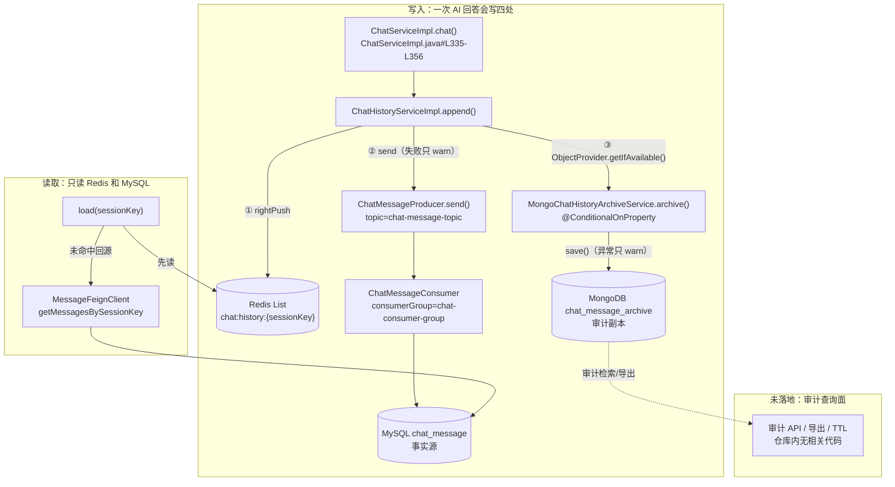
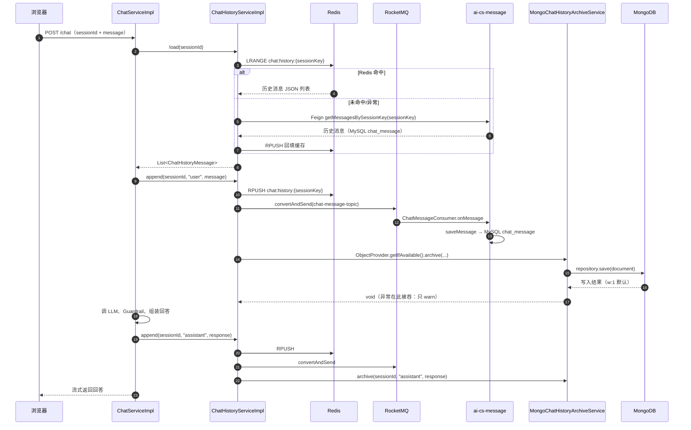

# MongoDB 对话审计归档：一条消息一个文档，换来的自由与放弃的约束

> **一句话结论**：本项目只有 `ai-cs-chat` 一个模块真的碰了 MongoDB——`ChatMessageArchiveDocument`（`ai-cs-chat/src/main/java/com/aics/chat/history/mongo/ChatMessageArchiveDocument.java#L14-L29`）把**每条消息写成一个独立文档**进 `chat_message_archive` 集合，由 `MongoChatHistoryArchiveService` 在 `aics.chat.mongo-archive.enabled=true` 时才装配、失败只 `log.warn` 不抛；对话的**事实源仍然是 MySQL `chat_message`**，Mongo 里那份是"可重建的审计副本"。文档库给你的是"字段随便加"的自由，代价是你得自己补上关系库白送你的东西：索引要自己建、保留期要自己设、大文档要自己拆、跨文档一致要自己扛。
>
> **阅读前置**：Redis List 做会话热缓存（[01-Redis缓存实战.md](01-Redis缓存实战.md)）、RocketMQ 投递与消费（[02-RocketMQ消息队列.md](02-RocketMQ消息队列.md)）、Spring 条件装配与 `ObjectProvider` 的语义（[02-MyBatisPlus实战.md](../03-数据库与ORM/02-MyBatisPlus实战.md) 的"自动配置未入库怎么讲"那一节可对照读法）。不需要会写 Mongo 查询。
>
> **证据基线**：Spring Boot 4.2.0 / Spring Data MongoDB 5.2.0（随 `spring-data-bom 2026.1.0` 进来）/ JDK 17 / MongoDB 7.0（`docker-compose.yml#L173-L190` 的 `mongo:7.0`）。**MongoDB 服务端源码与 Spring Data MongoDB 源码都不在 `learning-docs/24-源码分析/assets/source/` 里**（本机实测 908 份摘录、0 份含 `Mongo`），所以本文 A 级只引一份能解释条件装配的 `OnPropertyCondition`，涉及 Mongo 语义的地方一律写"依据官方手册 + 本仓代码/配置"，并用本机 jar 字节码与静态统计（C 级）兜底。预计阅读 50~65 分钟。

---

## 0. 先看现象

### 现象 1：会话文档写到 20 MB，`$push` 直接写失败

把整个会话塞进一个文档（`{sessionId, messages:[...]}`）是最直觉的建模方式，长会话跑到 20 MB 后，写入侧收到的是这个：

```text
com.mongodb.MongoCommandException: Command failed with error 10334 (BSONObjectTooLarge):
'BSONObj size: 20971520 (0x1400000) is invalid. Size must be between 0 and 16793600(16MB)'
on server 127.0.0.1:27017. The full response is {...}
```

（构造示例，本机无 MongoDB 实例、未复现；依据 MongoDB 官方手册 *Storage → Document Size Limit*：单文档上限 16 MiB，服务端拒绝超限写入。复现方法见 §6.2。）

注意失败的粒度：不是"那条消息没写进去"，而是**整个会话文档的这次更新失败**。一条越界的 AI 长回答，能让这个会话从此刻起所有追加都写不进去——这是"内嵌数组"建模最贵的坑，本项目在建模阶段就绕开了它（§3.1）。

### 现象 2：按时间范围查审计流水，从毫秒级变成 30 秒超时

审计接口按"某用户/某段时间"翻历史，SQL 里习惯性写的 `find({createdAt: {$gte: ..., $lt: ...}})` 在集合涨到千万级后变成全集合扫描，客户端先扛不住：

```text
com.mongodb.MongoTimeoutException: Timed out after 30000 ms while waiting for a server
that matches ReadPreferenceServerSelector{readPreference=primary}. Client view of cluster
state is {type=UNKNOWN, servers=[{address=127.0.0.1:27017, type=UNKNOWN, state=CONNECTING,
exception={com.mongodb.MongoSocketOpenException: Exception opening socket}}]}
```

（构造示例，未复现；这条报错也可能来自"连不上 Mongo"而不是"查询慢"，两者的区分手法见 §6.3——**这是本篇最容易读错的一条报错**。）

真正的慢查询判据不是这条报错，而是 `explain("executionStats")` 里的 `COLLSCAN` 与 `totalDocsExamined`。本项目建了 `session_created_idx`（`sessionKey: 1, createdAt: -1`），能覆盖"按会话倒序取最近 N 条"；但它**不覆盖**"按时间范围跨会话扫描"，因为复合索引只能从最左字段 `sessionKey` 开始用（§3.3）。

### 现象 3：合规要求保留 6 个月，磁盘一周就满

这个现象在本项目有**静态可查的真实证据**：整个仓库里 `expireAfterSeconds` 出现 0 次，`application.yml` 里没有任何 TTL/保留期配置，`chat_message_archive` 上只有 `@CompoundIndex` 与两个 `@Indexed`（§6.1 给了可复现的计数命令）。也就是说：**数据只进不出**。

按一条消息平均 300 字节（中文 UTF-8 约 3 字节/字，含 `role`/`createdAt` 与 BSON 字段名开销）粗算，日活 5 万轮问答 ≈ 10 万文档/天 ≈ 30 MB/天，一年 11 GB 左右——单机磁盘撑得住，但配上副本集三份、再叠加备份快照，磁盘增速就是 3 倍；反过来，如果每轮对话还要存 RAG 检索到的原文片段，单条能到 5~10 KB，一天就是 GB 级。审计要求"至少 6 个月"，而磁盘"一周就满"，通常不是 Mongo 写得太胖，而是**没有保留期 + 没有冷热分离**（§3.4、§3.10）。

> 这些现象指向同一件事：文档模型把"能写什么"变得极其自由（加字段不用 DDL、嵌套不用建表），于是所有**结构约束和生命周期**的责任从数据库转移到了应用与运维身上——16 MiB 是唯一还由数据库强制执行的边界，其余（索引、保留期、一致性、分页策略）全靠你自己写对。

---

## 1. 整体地图



> **读图说明**：
> ① 注意 `B --> G` 这条线是**可选边**：`MongoChatHistoryArchiveService` 上有 `@ConditionalOnProperty(prefix="aics.chat.mongo-archive", name="enabled", havingValue="true")`，默认 `enabled=false`（`ai-cs-chat/src/main/resources/application.yml#L160-L164`），Bean 根本不存在，`append()` 里 `getIfAvailable()` 返回 `null`，这条线**整段消失**。看错它会得出"归档默认开着"的错误结论。
> ② 注意读取路径**完全不经过 Mongo**（`I --> C`、`I --> J`）：`load()` 只读 Redis，回源走 Feign 到 `ai-cs-message` 查 MySQL。如果你以为"Mongo 是历史对话的来源"，会得出"清空 Redis 会丢历史"的错误结论——清空 Redis 只是下一次回源变慢。
> ③ 虚线边 `H -.-> K` 是我们**没有实现**的部分：仓库里没有任何审计查询 Controller、没有导出、没有 TTL。审计"能力"目前只等于"数据落进去了"。

| 组件 | 责任 | 调用方 | 源码是否入库 |
| --- | --- | --- | --- |
| `ChatHistoryServiceImpl` | 会话历史读写的门面：Redis 热缓存 + MQ 落库 + 可选归档 | `ChatServiceImpl`（12 处调用点） | ✅ 本仓代码 |
| `StringRedisTemplate` | 会话热缓存，`LIST` + `rightPush` | `ChatHistoryServiceImpl` | ❌ Spring Data Redis 未入库 |
| `ChatMessageProducer` → `ChatMessageConsumer` | 异步把消息落到 MySQL | 生产：`ChatHistoryServiceImpl.append`；消费：RocketMQ | ✅ 本仓代码 |
| `MongoChatHistoryArchiveService` | 条件装配的可选归档写入口 | `ChatHistoryServiceImpl.append`（经 `ObjectProvider`） | ✅ 本仓代码 |
| `ChatMessageArchiveRepository` | `MongoRepository` 派生查询，按会话倒序取 50 条 | 归档服务（未来审计接口） | ✅ 本仓代码 |
| MongoDB 服务端 | 存文档、建索引、执行 TTL 清理线程 | Spring Data MongoDB 驱动 | ❌ 未入库 |
| `@ConditionalOnProperty` 判定 | 决定归档 Bean 是否存在 | Spring Boot 容器 | ✅ A 级摘录 `OnPropertyCondition.java.md` |

---

## 2. 关键概念与关键类

先立几个术语，后面不再解释：

- **文档（document）**：Mongo 里的一条 JSON/BSON 记录，就是"一行"；**集合（collection）**约等于"表"，但不强制同一集合内字段一致。
- **BSON**：Binary JSON，Mongo 的二进制存储格式。和 JSON 的差别在于有类型（`ObjectId`、`Date`、`Decimal128`、二进制）和长度前缀，所以能跳读字段，也所以有 16 MiB 上限。
- **索引（index）**：与关系库同理的 B-tree，但 Mongo 的复合索引也是"最左前缀"规则；另有 `sparse`（只索引存在该字段的文档）、`unique`、`TTL` 等修饰。
- **TTL 索引**：给 `Date` 字段建的特殊单列索引，服务端后台线程（官方手册 *TTL Indexes* 说明约每 60 秒一轮）按 `expireAfterSeconds` 删过期文档——**不是精确定时器**。
- **写关注（write concern）**：`w`（几个节点确认才算成功）、`j`（是否等 journal 落盘）的组合。默认 `w:1`，"主节点内存里有了"就算成功。
- **读关注（read concern）**：答应返回"多新的数据"，`local`（默认）/`majority`/`linearizable` 等。
- **聚合管道（aggregation pipeline）**：`$match`/`$group`/`$sort`/`$limit` 串成的服务端计算流水线，相当于 Mongo 的 `GROUP BY`。

| 名称 | 位置 | 角色 | 关键方法/注解 |
| --- | --- | --- | --- |
| `ChatMessageArchiveDocument` | `ai-cs-chat/src/main/java/com/aics/chat/history/mongo/ChatMessageArchiveDocument.java#L14-L29` | 审计文档模型，映射集合 `chat_message_archive` | `@Document` / `@CompoundIndex(session_created_idx)` / `@Id` / `@Indexed` |
| `ChatMessageArchiveRepository` | `ai-cs-chat/src/main/java/com/aics/chat/history/mongo/ChatMessageArchiveRepository.java#L8-L10` | 派生查询接口（Spring Data 按方法名生成实现） | `findTop50BySessionKeyOrderByCreatedAtDesc(String)` |
| `MongoChatHistoryArchiveService` | `ai-cs-chat/src/main/java/com/aics/chat/history/mongo/MongoChatHistoryArchiveService.java#L16-L37` | 归档写入器，条件装配 + 吞异常 | `archive(sessionKey, role, content)`、`extractUserId` |
| `ChatHistoryServiceImpl` | `ai-cs-chat/src/main/java/com/aics/chat/service/impl/ChatHistoryServiceImpl.java#L32-L83` | 编排三条写路径 | `load` / `append` / `fallbackToMessage` |
| `ObjectProvider<MongoChatHistoryArchiveService>` | 同上 `#L36` | 延迟、可缺省的依赖注入 | `getIfAvailable()` |
| `ChatMessage` | `ai-cs-message/src/main/java/com/aics/message/entity/ChatMessage.java#L20-L46` | MySQL `chat_message` 的实体（事实源） | `@TableName("chat_message")` |
| `ModelUsage` | `ai-cs-message/src/main/java/com/aics/message/entity/ModelUsage.java#L38-L90` | Token/费用计量表——**说明"按天统计 token"实际在 MySQL 做** | `@TableName("model_usage")` |
| `OnPropertyCondition` | A 级 `[[源码:OnPropertyCondition.java.md#L154-L175]]` | `@ConditionalOnProperty` 的判定实现 | `collectProperties` / `isMatch` |
| `MongoMappingContext` | Spring Data MongoDB 5.2.0 jar（未入库） | 决定 `@Indexed` 是否在启动时自动建索引 | `setAutoIndexCreation(boolean)` |

---

## 3. 原理与证据逐段精读

### 3.1 一条消息一个文档：先拆散，才能不撞 16 MiB

**在干什么**：`ChatMessageArchiveDocument` 的字段是"扁平"的——`sessionKey`、`userId`、`role`、`content`、`createdAt`（`#L21-L29`），一条消息 = 一个文档，会话关系只靠 `sessionKey` 这个普通字段串起来，**没有任何内嵌数组**。归档服务每次 `append` 就 `repository.save(new ...)` 一个新文档。

**为什么这么设计**：把它和"会话文档内嵌消息"放一起对比，代价是数量级的：

| 维度 | 内嵌（`{sessionKey, messages:[{role,content,createdAt}...]}`） | 独立集合（本项目：1 消息 = 1 文档） |
| --- | --- | --- |
| 单次追加 | `$push` 整个会话文档，文档体积随会话线性增长，**到 16 MiB 就永久写不进** | 插入 ~300 字节的新文档，体积与会话长度无关 |
| 写放大 | 文档变大后每次更新要重写/移动整块，长会话越写越慢 | 恒定，只写新增 |
| 并发 | 同一会话两个请求同时 `$push`，一个会因乐观并发或锁重试，冲突率随会话活跃度上升 | 无写冲突（不同文档，甚至不同分片） |
| 读"最近 50 条" | 一次 `findOne` 读回整段历史（可能几 MB），应用侧再截断 | 复合索引 `(sessionKey, createdAt)` 直接取 50 条 |
| 读"整会话" | 一次查询（这是内嵌唯一赢的地方） | 一次范围查询，但要多传 N 个文档的字段名开销 |
| 单文档原子性 | 一次 `$push` 天然原子（内嵌的**唯一**真优势） | 单文档原子，但"用户消息 + AI 回复"成对写入不原子（见 §3.9） |

**换写法会怎样**：如果真按"会话聚合"内嵌，你会先撞 16 MiB 硬上限（官方手册 *Document Size Limit*，**这是服务端强制的，没有开关**），然后被迫"会话分片"（`sessionId + partNo`），一旦分片，"按会话读全部"就更接近独立集合的写法了；再往后想加"按 `userId` 查所有会话"，内嵌结构必须在数组元素上加索引（multikey index），索引条目数暴增。相反，独立集合想回答"整会话上下文"，代价是 N 次文档拼装——但**这个场景本项目根本不用 Mongo 回答**，上下文走 Redis List（`ChatHistoryServiceImpl.java#L45-L60`）。

**常见坑**：不要因为"Mongo 是文档库"就默认"聚合在一起才叫文档模型"。判断标准是**增长方向**：只有"有界且小"的子结构（比如一条消息的 `tokenUsage: {input, output}`、`attachments: [3 个文件]`）才适合内嵌；会随使用无限增长的（消息列表、日志行）必须拆成独立文档。Mongo 官方手册 *Data Modeling → Embedded Documents vs References* 给的就是这条"基数与增长速度"判据。

### 3.2 `@Indexed` 不等于"索引已存在"：Spring Data 默认不建

**在干什么**：`ChatMessageArchiveDocument` 上有三类索引声明——`@Document("chat_message_archive")` 定集合名，`@CompoundIndex(name="session_created_idx", def="{'sessionKey': 1, 'createdAt': -1}")` 定复合索引，两个字段上的 `@Indexed` 定单列索引（`#L17-L26`）。这些注解**只是元数据**，真正把 BSON 索引建到库里的动作由 Spring Data 的 `MongoMappingContext`（是否自动建索引）决定。

**为什么这么设计**：自动建索引在生产环境是"隐式 DDL"——应用启动时对每张集合下发 `createIndex`，大集合上会阻塞、且多个副本同时启动会互相打架。所以 Spring 把它做成显式开关 `spring.data.mongodb.auto-index-creation`。

**证据（C 级：本机 jar 字节码，可复现）**：

```text
> javap -p -c -classpath ...\spring-data-mongodb-5.2.0.jar \
        org.springframework.data.mongodb.core.mapping.MongoMappingContext
  private boolean autoIndexCreation;
  public org.springframework.data.mongodb.core.mapping.MongoMappingContext();
    Code:
       ...
      12: iconst_0
      13: putfield      #16                 // Field autoIndexCreation:Z
```

```text
> javap -p -c -classpath ...\spring-boot-data-mongodb-4.2.0.jar \
        org.springframework.boot.data.mongodb.autoconfigure.DataMongoProperties
  private java.lang.Boolean autoIndexCreation;     ← 无初值（构造器里没有 putfield），即 null
```

两条字节码合起来读：Spring Data 自己的默认值是 `false`（`iconst_0`），Boot 的属性是 `Boolean` 且不设默认；`DataMongoConfiguration` 里通过 `MongoMappingContext.setAutoIndexCreation(Z)` 把属性灌进去。而本项目 `application.yml` 里 `spring.data.mongodb` 段只有一行 `uri`（`ai-cs-chat/src/main/resources/application.yml#L56-L57`），`auto-index-creation` **未出现**（§6.1 的可复现检查）。结论：**`session_created_idx` 在库里大概率还不存在**，必须手工 `createIndex` 一次。

**换写法会怎样**：若为省事打开 `auto-index-creation: true`，开发环境立刻"对上了"，但你会得到三个副作用：① 应用启动即对集合下发建索引命令，集合大时启动变慢甚至超时；② 索引定义改一次名（`name` 属性）就先建新再删旧，期间双份索引占空间；③ 多副本同时滚动发布，可能出现并发建索引的锁竞争。审计这种"写多"的集合，索引应当由运维脚本/迁移工具管理，和库表 DDL 一样受版本控制。

**常见坑**：`@Indexed` 复制粘贴多份（本项目 `sessionKey`、`userId` 各一个）后，很多人以为复合索引可以把单列省掉——**不能**：`session_created_idx` 的最左列虽然是 `sessionKey`，但 `findTop50BySessionKeyOrderByCreatedAtDesc` 走它没问题，"只按 `sessionKey` 等值查"也能走它（最左前缀）；真正冗余的是**专门再建一条 `{sessionKey:1}` 单列索引**。判断方式见 §6.3 的 `explain` 手法。

### 3.3 复合索引的顺序与"一个有字段没数据的索引"

**在干什么**：`session_created_idx` 定义为 `{sessionKey: 1, createdAt: -1}`——等值字段在前、排序字段在后、排序方向和查询一致（倒序取最近 N 条）。这正是 `findTop50BySessionKeyOrderByCreatedAtDesc` 想要的最优形状：一次索引区间扫描，不需要内存排序（`sort` 阶段被索引消掉）。

**为什么这么设计**：Mongo 复合索引是 B-tree，键按 `(sessionKey, createdAt)` 字典序排列。要让"按会话过滤 + 按时间倒序"变成"顺着索引读一段"，必须让**过滤字段在左、排序字段紧跟其后**。反过来 `{createdAt: -1, sessionKey: 1}` 对"按会话倒序"几乎无用（只能靠 `createdAt` 的范围再逐个过滤 `sessionKey`）。

**换写法会怎样**：改成 `{createdAt: 1, sessionKey: 1}`，查询仍然"能跑"，只是 `explain` 会出现 `SORT` 阶段和暴涨的 `totalDocsExamined`——这就是 §0 现象 2 的成因之一。再加一个"按 `userId` + 时间范围"的审计需求时，正确做法是**另建** `{userId: 1, createdAt: -1}`，而不是指望 `session_created_idx` 兼顾（它没有 `userId` 列）。

**常见坑**：`userId` 字段上挂着 `@Indexed`（`#L25-L26`），但写入时 `extractUserId(sessionKey)` **恒返回 `null`**（`MongoChatHistoryArchiveService.java#L33-L36`，注释说明 `sessionKey` 格式由调用方决定、无法稳定解析）。后果是：① 这个索引对所有人都建成 `null` 条目，查询 `{userId: "1001"}` 永远零命中；② 非 `sparse` 索引会把 `null` 也入索引，等于白占空间；③ 未来真要从认证上下文补齐 `userId`（`MessageFeignClient` / JWT 里取），还得分批回填历史文档，否则新旧数据混着 `null`。**判断是否踩了**：`db.chat_message_archive.distinct("userId")` 只返回 `[null]` 就说明索引是装饰品。这条和"预留字段忘了填"是同一类事故，审计系统里尤其致命（审计要按人查，结果查不到）。

### 3.4 TTL 索引就是保留期：合规要求的"6 个月"只能靠它落地

**在干什么**：TTL 索引是"服务端自动删"的唯一声明式手段：

```javascript
// 本机无 MongoDB 实例，以下命令未实测，只给判读方法
// 给 createdAt 建 TTL 索引，保留 180 天（15552000 秒）
db.chat_message_archive.createIndex(
  { createdAt: 1 },
  { expireAfterSeconds: 15552000, name: "ttl_createdAt_180d" }
)
// 判读：看返回的 ok:1 与索引名；再看 getIndexes() 里 expireAfterSeconds 是否是 180 天秒数
db.chat_message_archive.getIndexes()
```

**为什么这么设计**：把"删数据"交给数据库后台线程，应用不需要写定时任务，也不需要和"删除时的锁/大事务"搏斗。代价是三条硬事实（官方手册 *TTL Indexes*）：① 后台线程约 **每 60 秒**扫一轮，所以过期数据可能多活一两分钟，**不是 SLA**；② TTL 索引只能建在 `Date` 类型字段上（本项目 `createdAt` 是 `Instant`，Spring Data 会存成 BSON `Date`，符合要求）；③ 索引一旦建成想改期限，只能 `collMod` 改 `expireAfterSeconds` 或者删了重建——**误设成 `expireAfterSeconds: 0` 会立刻把所有历史删光**，这是"不可逆"操作的经典姿势。

**换写法会怎样**：用应用侧定时任务 `deleteMany({createdAt: {$lt: cutoff}})` 删除，优点是"可以按天分批、可以删前导出、可以留审计痕迹"，缺点是：每批删除都产生 oplog、副本集上要同步删除、大集合上删除速度可能跟不上新写入（写放大）——真到"一周写满磁盘"的紧急状态，`deleteMany` 反而会拖死库。现实方案通常是**两者分工**：TTL 管"在线库的机械过期"，归档导出管"合规要求的完整保留"（§3.10）。

**常见坑**：本项目**没有**这条索引（`expireAfterSeconds` 全仓 0 命中），所以"审计要求保留 6 个月"目前只是纸面要求，实际是"永久保留"——反过来说，一旦有人急着补 TTL 又写错秒数，就是一次性删库事故。上线 TTL 前必须做三件事：先 `getIndexes()` 确认现状、在影子库验证秒数换算（6 个月按 180 天 = `15552000`）、确认有备份且导出通道可用。

### 3.5 失败只 warn + `ObjectProvider`：归档必须"可缺席、可失败"

**在干什么**：两处防御叠在一起。

第一处，Bean 级缺席：`@ConditionalOnProperty(prefix = "aics.chat.mongo-archive", name = "enabled", havingValue = "true")`（`MongoChatHistoryArchiveService.java#L19`）。A 级摘录能解释它的判定逻辑——`OnPropertyCondition.determineOutcome` 先收集"缺失属性"和"值不匹配属性"，两者任一非空就 `noMatch`：

```java
// (src: OnPropertyCondition.java.md#L154-L175)
private void collectProperties(PropertyResolver resolver, List<String> missing, List<String> nonMatching) {
    for (String name : this.names) {
        String key = this.prefix + name;
        if (resolver.containsProperty(key)) {
            if (!isMatch(resolver.getProperty(key), this.havingValue)) {
                nonMatching.add(name);
            }
        }
        else {
            if (!this.matchIfMissing) {
                missing.add(name);
            }
        }
    }
}

private boolean isMatch(@Nullable String value, String requiredValue) {
    if (StringUtils.hasLength(requiredValue)) {
        return requiredValue.equalsIgnoreCase(value);
    }
    return !"false".equalsIgnoreCase(value);
}
```

第二处，调用级容错：`append()` 用 `ObjectProvider.getIfAvailable()` 取 Bean，为 `null` 就跳过（`ChatHistoryServiceImpl.java#L78-L82`）；`archive()` 内部 `try/catch(Exception)` 后只 `log.warn`（`MongoChatHistoryArchiveService.java#L24-L31`），测试类专门钉住这个契约：`MongoChatHistoryArchiveServiceTest.java#L26-L34` 用 `doThrow(...).when(repository).save(any())` 后断言"不抛"。

**为什么这么设计**：审计/归档是**旁路**。AI 回答是主链路，用户等的是流式回复；如果 Mongo 抖一下就让 `append` 抛异常，表现就是"对话报错、但 MySQL 里已经有一条半截记录"。所以这里的取舍明确写在代码注释里："失败不阻断对话"。`ObjectProvider` 则是"可选依赖"的标准解法——Spring 的依赖注入是"要就必须有"，`ObjectProvider` 把"必须"降级成"问问有没有"。

**换写法会怎样**：三种错法各有各的死法。① 直接构造器注入 `MongoChatHistoryArchiveService`：关闭归档时 Bean 不存在，**整个 chat 服务启动失败**（`NoSuchBeanDefinitionException` 或 `UnsatisfiedDependencyException`），一个可选功能把主服务拖死。② 用 `@Autowired(required=false)`：能用，但字段可空、编译期无从知道会不会 NPE，且不好测。③ 把 `@ConditionalOnProperty` 去掉、用 `if (enabled)` 在方法里判断：Bean 一定存在，于是 `MongoClient`/`Repository` 也跟着一定存在，Mongo 不可达时健康检查和连接池都会受影响（§6.4）。

**常见坑**：`@ConditionalOnProperty` 写在**服务类**上，但 `ChatMessageArchiveRepository` 是接口——Spring Data 的仓库注册（`DataMongoRepositoriesAutoConfiguration`）**不看你的条件注解**，它会照常为接口生成代理 Bean。所以"关掉归档就完全不碰 Mongo"是错的：仓库 Bean、`MongoClient`、`MongoTemplate` 依然被创建，只是没人调用。用 `OnPropertyCondition` 的语义理解就是：条件只管**注解所在的那个类的 Bean 定义**，管不到别的自动配置。

### 3.6 写关注与读关注：默认 `w:1` 意味着"写了可能没有"

**在干什么**：默认情况下，一次 `save()` 的成功语义是"主节点接受了写入"，不保证落盘、更不保证多数副本已同步。`w:1` + `j:false` 的组合在"主节点宕机且来不及刷盘"时会**丢最近若干写入**——对审计数据这是合规问题，不是性能问题。

**为什么这么设计**：Mongo 的默认值偏向吞吐（这也是它写快的来源）。要换取"确认落盘 / 多数派确认"，得显式声明。三种常见档位：

| 档位 | 语义 | 代价 | 适用 |
| --- | --- | --- | --- |
| `w:1, j:false`（默认） | 主节点内存确认 | 最快，宕机可能丢 | 可丢的埋点、调试日志 |
| `w:1, j:true` | 主节点 journal 落盘确认 | 每次写多一次刷盘延迟 | 单节点部署、要"不丢"但没副本集 |
| `w:"majority"` | 多数副本确认 | 延迟最高，需要副本集 | 审计/资金/合规类数据 |

本项目**什么都没配**：`application.yml#L56-L57` 只有 `uri`，全仓 `writeConcern`/`readConcern` 关键字 0 命中（§6.1）。最省事的做法是写在 URI 里，不用改代码：

```yaml
# 若要让审计写入真正"多数派确认"，uri 可以带上写关注与超时参数（未落地，当前只有 uri）
spring:
  mongodb:
    uri: ${MONGODB_URI:mongodb://127.0.0.1:27017/aics_chat?w=majority&journal=true&readPreference=primary&maxPoolSize=20&connectTimeoutMS=3000&socketTimeoutMS=5000}
```

**换写法会怎样**：把 `w` 提到 `majority` 而不加副本集是无效配置（单节点时 `majority` 退化成 `w:1`，心理安慰）。真正的组合是：**副本集 + `w:majority` + `j:true`**，同时把 `connectTimeoutMS`（连不上多久放弃）和 `socketTimeoutMS`（连上后等多久）压到 3~5 秒——否则默认值可能让一次归档把 Tomcat 线程占住几十秒：这才是"审计拖垮主链路"的真实路径，比 `save` 抛异常更隐蔽（异常被 `catch` 了，线程占用没有）。

**常见坑**：超时和连接池这两个参数在 `spring.data.mongodb.uri` 之外**没有** `application.yml` 原生键（不像 Redis 有 `spring.data.redis.timeout`），所以很多人以为"没得配"。真实做法只有两条：塞进 URI 查询参数，或注册一个 `MongoClientSettingsBuilderCustomizer` Bean（该类确实存在于 `spring-boot-mongodb-4.2.0.jar` 的 `org.springframework.boot.mongodb.autoconfigure` 包下，本机 jar 清单可查）。默认连接池上限是 100（驱动默认），对本项目这种"每个 app 实例每秒几条归档"的量远超需求，反而浪费连接数——压到 10~20 更合理。

### 3.7 聚合管道：按天统计 Token、按用户取最近 N 轮

**在干什么**：Mongo 的 `$group` 就是关系库的 `GROUP BY`，做审计统计很顺手。两个最常被问到的管道（**未落地**，本项目没有这两个接口）：

```javascript
// 未实测：本机无 MongoDB 实例。按天统计 token 用量（假设文档里有 tokenUsage/role）
db.chat_message_archive.aggregate([
  { $match: { createdAt: { $gte: ISODate("2026-11-01T00:00:00Z") } } },
  { $group: {
      _id: { day: { $dateToString: { format: "%Y-%m-%d", date: "$createdAt", timezone: "+08:00" } },
             role: "$role" },
      docs: { $sum: 1 },
      tokens: { $sum: "$tokenUsage.total" } } },
  { $sort: { "_id.day": 1, "_id.role": 1 } }
], { allowDiskUse: true })
```

```javascript
// 未实测：按用户取最近 N 轮（10 条 = 5 轮问答）。$facet 一次查询同时给"本页"和"总数"
db.chat_message_archive.aggregate([
  { $match: { userId: "1001" } },
  { $sort: { createdAt: -1 } },
  { $facet: {
      page:  [ { $limit: 10 } ],
      total: [ { $count: "n" } ] } }
])
```

**为什么这么设计**：把计算下推到存储层，避免"查回 10 万条到应用内存里再累加"。这也是审计系统的分水岭：能下推的统计（按天、按模型、按角色）走管道；需要跨集合 `$lookup`（相当于 join）的报表，就该回 MySQL/数仓做。

**换写法会怎样（本项目的真实选择）**：本项目的 token 统计**根本没放 Mongo**。`ai-cs-message` 有 `model_usage` 表（`ai-cs-message/src/main/java/com/aics/message/entity/ModelUsage.java#L38-L90`，含 `inputTokens`/`outputTokens`/`totalTokens`/`estimatedCost`），统计实现是**全量查出来在内存求和**：

```java
// ModelUsageServiceImpl.stats(...)：ai-cs-message/src/main/java/com/aics/message/service/impl/ModelUsageServiceImpl.java#L89-L107（节选）
public ModelUsageStatsVO stats(Long userId, String scenario, String model, LocalDateTime startTime, LocalDateTime endTime) {
    LambdaQueryWrapper<ModelUsage> wrapper = new LambdaQueryWrapper<>();
    ...
    List<ModelUsage> records = modelUsageMapper.selectList(wrapper);
    // 各 Token 维度用 mapToLong(...).sum()，null 显式按 0 计入
```

这条对比很有教育意义：**同样是"按时间段聚合"，MySQL 版能跑是因为数据量还小、且 `model_usage` 是纯追加表**；一旦这张表到千万行，这个实现就是"每次统计把全表扫进 JVM"，和 Mongo 里不建索引的 `COLLSCAN` 是同一个病。所以"要不要 MongoDB"的真正问题不是"文档库香不香"，而是**"这份数据的聚合形态是什么"**：聚合维度固定、需要 join → 关系库 + 预聚合表；字段形态多变、按会话/按主体取切片 → 文档库。

**常见坑**：① `$group` 的 `_id` 里没写时区，`$dateToString` 默认 UTC，"按天"统计在东八区会错 8 小时（跨日数据归错日期），必须显式 `timezone: "+08:00"`；② 不写 `allowDiskUse: true`，超过 100 MB 内存的分组会直接报 `Exceeded memory limit for $group`；③ `$facet` 里放 `$match` 是无效的（`$match` 要在 `$facet` 之前），很多人把"分页 + 总数"写成两个查询还庆幸"能跑"。

### 3.8 16 MiB 与分页：深翻页是文档库的第二个天花板

**在干什么**：本项目用"一消息一文档"避开了 16 MiB，但审计接口一旦要"导出某用户全部历史"，就会撞上第二个问题：`skip(n)` 深翻页。`skip` 不是免费的，服务端必须**逐条跳过**前面的文档才返回后面的——`skip(200000)` 就是白白扫描 20 万条。

**为什么这么设计**：Mongo 的游标是"服务端遍历 + 批量返回"，没有关系库那种"基于 B-tree 行号随机定位"的能力，深偏移只能扫。所以官方手册（*Query Documents → Pagination*、*Cursor*）推荐的模式是**按键集分页（keyset / range pagination）**：用上一页最后一条的排序键当游标。

**换写法会怎样**：

```javascript
// 未实测。错误姿势：深翻页，越往后越慢
db.chat_message_archive.find({ sessionKey: "s-1001" }).sort({ createdAt: -1 }).skip(5000).limit(50)

// 正确姿势：键集分页——把上一页最后一条的 createdAt 当"书签"传回来
db.chat_message_archive.find({ sessionKey: "s-1001", createdAt: { $lt: ISODate("2026-11-20T10:00:00Z") } })
  .sort({ createdAt: -1 }).limit(50)
```

键集分页的代价是"不能跳到第 N 页"（只能上一页/下一页），但审计场景本来就是"顺序翻 + 按时间过滤"，这个限制完全可以接受。**反过来**，如果业务真要求"跳到第 500 页"，那说明数据不该由 Mongo 直接服务——该进 ES（本项目有 [03-Elasticsearch搜索引擎.md](03-Elasticsearch搜索引擎.md)）或数仓。

**常见坑**：`findTop50...` 这种派生查询是"取前 50"（`limit 50`，无 `skip`），看起来安全；但有人在 Repository 里改成 `Page<T>` 返回（`PageRequest.of(5000, 50)`），框架会生成 `skip(250000)`，于是"某天审计突然超时"。判断方式：`explain("executionStats")` 里 `totalKeysExamined` 远大于 `nReturned` 就是这个病。

### 3.9 事务边界：单文档原子就够了，别急着上多文档事务

**在干什么**：MongoDB 4.0 起支持副本集上的多文档事务（4.2 起支持分片集群），API 形态是 `session.startTransaction()` / `commitTransaction()`。Spring 侧对应 `MongoTransactionManager` + `@Transactional`。**本项目没用**：`ai-cs-chat` 主代码里 `@Transactional` 出现 0 次、`MongoTemplate` 出现 0 次（§6.1），归档就是一次 `save()`。

**为什么这么设计**：Mongo 的**单文档写入天然原子**（官方手册 *Atomicity and Transactions*：单文档操作总是原子的）。而"一消息一文档"的模型正好把原子性需求降到了单文档粒度——每条消息要么在、要么不在，不存在"半条消息"。真正需要事务的是"用户消息 + AI 回复必须一起出现"这种跨文档成对写入，而这个需求在本项目由**另一个系统承担**：MySQL `chat_message` 是事实源，Mongo 只是副本，副本丢一条的后果是"审计少一条"，不是"对话不一致"。

**换写法会怎样**：如果给 `archive()` 套上多文档事务，你会立刻付三笔费用：① 事务必须走副本集（单节点 `mongod` 报 `Transaction numbers are only allowed on a replica set member or mongos`）；② 每次写多一轮 `startTransaction`/`commit` 往返，延迟翻倍；③ 事务默认 60 秒超时、且长事务会占用 WiredTiger 的 snapshot 资源，与"写多"的审计流最不搭。**这就是"放弃强约束"的具体代价之一**：关系库里一个 `BEGIN...COMMIT` 兜住的事，在文档库里要么退化成"单文档原子 + 幂等重放"，要么付出事务成本。

**常见坑**：① 以为"`save()` 成功 = 数据安全"——`w:1` 下并不（§3.6）；② 用 `saveAll()` 批量写时以为"要么全成要么全不成"——`saveAll` 默认**不是**事务，中间失败会留半批数据；③ 在事务里做幂等判断（先 `find` 再 `insert`），并发下仍可能双写，真正的幂等要靠 `unique` 索引兜底（本项目 `@Id` 是 `String` 且由 Mongo 生成，天然没有业务唯一键，这也是个可扩展点，见 §5）。

### 3.10 与 MySQL 的分工：元数据在关系库，内容副本在文档库；冷热靠归档

**在干什么**：同一个"对话"，在两个库里各存一份，但**职责不同**：

| 数据 | 落哪 | 证据 | 为什么 |
| --- | --- | --- | --- |
| 会话/消息正文（事实源） | MySQL `chat_message`（`session_id`/`session_key`/`role`/`content`/`create_time`） | `deploy/mysql/init.sql#L305-L318`；实体 `ChatMessage.java#L20-L46` | 需要按 `sessionKey` 关联、需要被 Feign 回源、需要事务与唯一约束 |
| 审计副本（可重建） | MongoDB `chat_message_archive` | `ChatMessageArchiveDocument.java#L14-L29` | 字段会变、要按会话切片、写多读少 |
| Token/费用计量 | MySQL `model_usage`、`llm_trace` | `ModelUsage.java#L38-L90`、`LlmTrace.java#L43-L79` | 统计维度固定、要 join 会话与用户 |
| 会话热上下文 | Redis List `chat:history:{sessionKey}` | `ChatHistoryServiceImpl.java#L39`、`#L45-L60` | 读取延迟要求最高，且可丢（有回源） |

**为什么这么设计**：这是"分工"而不是"重复"——`chat_message` 回答"对话是什么"（强 schema、要能被 join、要被业务读）；`chat_message_archive` 回答"当时到底发生了什么"（宽 schema、只写少读、允许丢）。审计的一条铁律是：**审计副本不能是唯一副本**，否则它就变成了"带审计字段的生产库"，读写互相拖累。所以归档失败只 `warn`（§3.5）是设计决策，不是偷懒。

**换写法会怎样**：如果哪天有人提议"把 `chat_message` 迁到 Mongo，省一套库"，会立刻遇到三面墙：① `chat_message.session_id` 是 `BIGINT`，`chat_message` 被 `ai-cs-message` 的 MyBatis-Plus 分页/条件构造器大量使用，迁移等于重写整个 DAO 层；② 计费/报表要跨 `model_usage`、`chat_session`、`chat_feedback` 做 join（`init.sql` 里这三张表都按 `session_id` 关联），Mongo 侧只能用 `$lookup`，性能与可维护性都更差；③ 现有回源链路（`MessageFeignClient.getMessagesBySessionKey`）与 Redis 重建逻辑都假设"有 MySQL 事实源"，去掉它就是给系统拆掉唯一可靠的地基。

**冷热分离怎么做**：把"在线库只留近 N 天"和"全量留 6 个月"分开——Mongo 的 TTL 管在线集合的机械过期（§3.4），合规保留靠**定期导出**到对象存储（本项目有 MinIO，见 [04-MinIO对象存储.md](04-MinIO对象存储.md)）或专用归档集合。判据是"读频率"：超过 30 天的审计记录几乎只被合规导出读一次，就不该占用与在线查询同一套索引与内存。更完整的冷热设计可直接对照 [08-大表治理-冷热分离与数据归档.md](../03-数据库与ORM/08-大表治理-冷热分离与数据归档.md)，那篇讲的是 MySQL 侧同类问题，原则完全通用。

**审计合规三条底线（本篇是设计说明，均未落地）**：① **不可篡改**：应用侧不能提供 `update`/`delete` 接口，写入用只插不改的账号，条件允许再加"链式哈希"（每条文档存上一条的 `hash`）做防篡改证据；② **保留期**：TTL 秒数要有配置项与变更记录，不能散落在人脑里（本项目目前既无 TTL 也无配置项）；③ **导出**：导出必须带"查询条件 + 导出人 + 导出时间"的元数据记录，且导出走只读账号。这三条都属于"文档库不会帮你做，但审计员一定会问"的部分。

### 3.11 审计字段一定会变：半结构化省下的是 DDL，不是思考

**在干什么**：本项目审计文档只有 6 个字段（§6.1 实测：`id/sessionKey/userId/role/content/createdAt`）。而"AI 审计"真被问到的东西远不止这些——旧稿曾列过一份"可扩展字段清单"（`model`、`promptVersion`、`tokenUsage`、`latency`、`feedback`、`traceId`、`retrievalDocuments`、`safetyLabels`）并暗示 Mongo 里都能放，**实际一个都没有**，它们各自落在了别处：

| 审计字段 | 审计为什么要它 | 本项目现状 | 实际落在哪 |
| --- | --- | --- | --- |
| `model` / `promptVersion` | 回答"换了模型/提示词后，同一句话还答得一样吗" | 审计文档里没有 | 模型名在 `llm_trace.scenario` 邻近字段与 `model_usage.model`，提示词版本在 Nacos 配置（不在库） |
| `tokenUsage` | 成本分摊到会话/用户 | 没有 | MySQL `model_usage`（`ModelUsage.java#L67-L79`） |
| `latency` / `spansJson` | 定位"慢在哪一环" | 没有 | MySQL `llm_trace.spans_json`、`total_duration_ms`（`LlmTrace.java#L65-L69`） |
| `traceId` / `requestId` | 把一条审计记录和一次调用链对上 | 没有（文档 `@Id` 是 Mongo 生成的 ObjectId，无业务含义） | MySQL `llm_trace.request_id`（`LlmTrace.java#L49-L51`） |
| `feedback` | 质量抽检：差评回答回溯 | 没有 | MySQL `chat_feedback`（`deploy/mysql/init.sql#L320-L330`） |
| `retrievalDocuments` | 回答依据（合规常问"你凭什么这么答"） | 没有，且**不建议**塞进审计文档 | 检索/评估链路日志；塞进来会让单文档从 ~300 B 涨到 KB 级 |

**为什么这么设计**：文档库确实把"加字段"变成了零成本——不用 `ALTER TABLE`、不用担心加列锁表、不同历史文档可以有不同字段集合。这正是"半结构化写起来舒服"的真实含义。但审计数据的价值取决于**能不能和别的数据对上**：只有 `sessionKey` + `createdAt` 的副本，答不了"这条回答用的哪个模型、花了多少钱、慢在哪一环"；而那些能 join 的字段，恰好都在关系库里。

**换写法会怎样**：若真把上表字段全塞进审计文档，一份文档会从 ~300 字节涨到 ~6 KB（20 倍），§0 现象 3 的磁盘压力立刻恶化；更麻烦的是这些字段一改版，历史文档全是"缺字段"，读取侧每处都要写兼容分支——Mongo 不会替你补默认值，`$ifNull` 得一段段手写。

**常见坑**：① 以为"不用 schema 就等于不用设计 schema"——你其实**一定**有一个隐式 schema，只是它散落在写入代码与读取代码里，改一次要人肉对账；② 查"老文档缺字段"写成 `{field: null}`，会把"字段不存在"的情况也混进来，需要 `$exists` 语义的显式组合；③ 用 `ZonedDateTime` 之类非 `java.util.Date`/`Instant` 的类型写 `createdAt`，TTL 索引会因字段不是 BSON `Date` 而**静默不生效**——这是 TTL "配了没用"的第一名原因。

---

## 4. 一次完整执行时序

以"归档开关打开 + 用户发一句话 + AI 回答"为例（`MONGO_ARCHIVE_ENABLED=true` 分支）：



> **读图说明**：
> ① 第 7~10 步的 `alt` 是**同步阻塞**的：Redis 未命中时 `load()` 要等 Feign 回源，这一步慢会直接拖慢首字延迟；而第 15、16 步的 MQ 与第 17、18 步的 Mongo 写入是**同线程顺序执行**（不是异步）——`append()` 是普通方法调用，`convertAndSend` 和 `repository.save` 都在请求线程里。看错这点会误判"归档慢不影响对话"。
> ② 第 20 步是答案所在的边界：`AR-->>CH` 永远返回 `void`，`archive()` 内部 `catch(Exception)` 吞掉一切。所以"第 19 步失败"在**应用视角是不可见的**，只在日志里留一行 `warn`；而第 15 步 `send` 失败同样只 `warn`（`ChatMessageProducer.java#L40-L42`）。这两个静默点是本篇最值得盯的运维盲区。
> ③ 如果开关是 `false`（默认），第 17~20 步**整段不存在**——图上那条边被条件装配剪掉了（§1 读图说明①）。

各步失败分别报什么、在哪看得见：

| 步骤 | 失败现象（报错/日志） | 主链路是否受影响 | 看哪里 |
| --- | --- | --- | --- |
| 4 读 Redis | `读取 Redis 会话历史失败，走回源: sessionKey=..., err=...` | 否（降级回源） | chat 服务日志 + [01-Redis缓存实战.md](01-Redis缓存实战.md) |
| 9 Feign 回源 | `回源 message 表拉取会话历史失败，降级为空历史: ...` | 否（返回空历史，模型少上下文） | chat 日志（warn） |
| 15 投递 MQ | `对话消息投递失败: sessionKey=..., role=..., err=...` | 否（消息永久丢，MySQL 无记录） | chat 日志（warn）+ MQ 控制台无消息 |
| 16 消费落库 | `聊天消息消费失败: sessionId=...` + 抛异常触发重试 | 否（重试，最终进死信：见 [08-RocketMQ事务消息与死信队列.md](08-RocketMQ事务消息与死信队列.md)） | ai-cs-message 日志 |
| 19 Mongo 写 | `Mongo 对话归档失败（不阻断对话）: sessionKey=..., err=...` | 否（审计少一条） | chat 日志（warn）+ Mongo 集合计数 |
| 启动装配 | `UnsatisfiedDependencyException` / `NoSuchBeanDefinitionException`（只有在"直接注入而非 ObjectProvider"时才会发生） | **是，服务起不来** | 启动日志 |

---

## 5. 设计取舍

| 决策 | 收益 | 代价 | 本项目的落地状态 |
| --- | --- | --- | --- |
| 一消息一文档（不内嵌会话数组） | 无 16 MiB 风险、写放大恒定、无同会话写冲突 | "整会话一次读"要多文档拼装 | ✅ 已落地（`ChatMessageArchiveDocument#L21-L29` 扁平字段） |
| Mongo 只做可选审计副本 | 主链路与 Mongo 完全解耦，失败只 warn | 双写不保证一致，审计可能缺条 | ✅ 已落地（`@ConditionalOnProperty` + `try/catch` warn） |
| 用 `ObjectProvider` 拿可选 Bean | 关闭归档不影响启动 | 调用点要自己判 `null` | ✅ 已落地（`ChatHistoryServiceImpl#L36`、`#L78-L82`） |
| 复合索引 `(sessionKey, createdAt desc)` | `findTop50...` 走索引区间扫描 | 只服务"按会话"；不覆盖"按时间跨会话" | ✅ 声明已写，**是否建成取决于 auto-index-creation**（§3.2） |
| `userId` 字段 + `@Indexed` 但值为 null | 结构上为事后补人留位 | 索引空转，审计按人查不到 | ⚠️ 半落地（`extractUserId` 恒 `null`） |
| TTL 索引做保留期 | 声明式过期，无需定时任务 | 非精确（约 60 秒一轮）、误设不可逆 | ❌ 未落地（全仓 `expireAfterSeconds` = 0） |
| 写关注 `w:majority` + `j:true` | 审计数据不丢 | 需要副本集、写入延迟上升 | ❌ 未落地（只有 `uri`，默认 `w:1`） |
| 连接池/超时显式配置 | 防归档慢拖住请求线程 | 需要按量调参 | ❌ 未落地（URI 无参数、无 customizer） |
| 多文档事务 | 成对写入原子 | 需副本集、延迟翻倍、长事务风险 | ❌ 未落地（且不建议：见 §3.9） |
| K8s 内 MongoDB 清单 | 统一编排 | 需 StatefulSet + PVC + 副本集初始化 | ❌ 未落地（`deploy/k8s/` 无 mongodb 清单） |

**反面清单：这些事别交给文档库**（同一个项目里，判断"放不放 Mongo"比"会不会用 Mongo"更重要）

| 场景 | 为什么文档库吃不下 | 本项目该放哪 | 依据 |
| --- | --- | --- | --- |
| 需要跨实体 join 的报表/对账（会话 ↔ 订单 ↔ 支付） | 文档库没有真正的 join 执行器，`$lookup` 只能"每条左表记录回查右表"，左表 10 万条就是 10 万次索引查；而且 join 的语义（外键、唯一性）它一概不管 | MySQL 本地 join + 数仓 | 订单/支付在 `ai-cs-order`、`ai-cs-pay`，MySQL 事务内完成 |
| 需要唯一约束的元数据（会话、用户、订单号） | 唯一索引只在**单集合**内生效，跨集合无从约束；业务唯一性通常还要参与事务 | MySQL 唯一索引 | `deploy/mysql/init.sql#L305-L318` 的 `chat_message`、`chat_session` |
| 需要多文档强一致（扣库存 + 建订单 + 记流水） | 多文档事务要副本集、写延迟翻倍，长事务还会拖垮 WT 缓存 | MySQL 本地事务 | §3.9 |
| 按任意维度做即席筛选的运营后台 | 索引要穷举组合，筛三个条件的组合就得建一条复合索引 | Elasticsearch | [03-Elasticsearch搜索引擎.md](03-Elasticsearch搜索引擎.md) |
| 高频自增/计数（未读数、点赞数） | 文档级原子更新会把这个文档变成热点，写冲突全排它身上 | Redis `INCR` / MySQL | [01-Redis缓存实战.md](01-Redis缓存实战.md) |
| 大二进制（附件、录音、导出包） | 16 MiB 文档上限直接把大文件挡死，塞 GridFS 也只是换了个难用的接口 | MinIO | [04-MinIO对象存储.md](04-MinIO对象存储.md) |
| 实时会话上下文（当前这轮对话的窗口） | 每轮都要读全量历史，延迟敏感，且能被 Redis List 一次 `range` 全取 | Redis List | [01-Redis缓存实战.md](01-Redis缓存实战.md) |

这张表的用法是**反过来**的：先把"必须 join / 必须唯一 / 必须强事务 / 必须模糊检索 / 必须大对象"这五条排除，剩下的才是文档库的地盘——对话审计正好落在剩下的那一格里（写入形态是"追加一条事实"，读取形态是"按会话按时间取一段"）。

**可扩展点清单**（按"投入/收益"排序，若要落地需改的文件都写清了）：

1. **显式建索引**：在 `deploy/mysql/` 同级的部署脚本目录加一个 `mongo-init.js`（当前不存在），内容为 `createIndex` 两条（`session_created_idx`、`ttl_createdAt_180d`），并由 compose 的 `mongodb` 服务挂载进去；同时**不要**打开 `auto-index-creation`。
2. **补 `userId`**：改 `MongoChatHistoryArchiveService.java#L24-L36`，把 `archive(sessionKey, role, content)` 扩一个 `userId` 参数，调用点 `ChatHistoryServiceImpl.java#L78-L82` 从认证上下文/会话信息传入；历史数据用 `updateMany({userId: null}, ...)` 回填。
3. **写关注与超时**：改 `ai-cs-chat/src/main/resources/application.yml#L56-L57` 的 URI 参数，或新增一个 `MongoClientSettingsBuilderCustomizer` 配置类。
4. **归档指标**：给 `archive()` 加 `success/failure` 计数器（Micrometer 已在 `pom.xml` 依赖里），把"静默丢失"变成可告警数字。
5. **审计查询面**：新增 `GET /admin/chat-archives?sessionKey=&from=&to=`（当前**不存在**任何归档 Controller），分页用键集分页（§3.8），并配只读账号。
6. **合规导出**：定时把过期区间导出到 MinIO（[04-MinIO对象存储.md](04-MinIO对象存储.md)），导出记录单独留痕。
7. **批量写入**：把逐条 `save()` 改成攒批 `insertAll`（当前 `saveAll` 计数 0），高并发下可减少往返次数。
8. **K8s 化**：在 `deploy/k8s/` 下补一份 MongoDB 清单（StatefulSet + PVC + `--replSet` 初始化 Job），才能用上 `w:majority`。

---

## 6. 踩坑与调试手法

### 6.1 用静态统计先给"以为配了"打假（可复现，C 级）

下面这段在本机直接可跑（不需要 Mongo、不需要启动服务），它把本文所有"配了/没配"的判断变成数字：

```powershell
cd D:\Projects\Persion\ai-customer-service
# ① 谁在用 Mongo（全仓 java，排除 target）
Get-ChildItem -Recurse -Include *.java -Path ai-cs-* |
  Where-Object { $_.FullName -notmatch "\\target\\" } |
  Select-String -Pattern "Mongo" -List |
  ForEach-Object { $_.Path }

# ② 关键注解/调优项计数（chat 主代码）
foreach ($p in @('@Document\(','@CompoundIndex','@Indexed','expireAfterSeconds',
                 'writeConcern|WriteConcern','readConcern|ReadConcern',
                 'MongoTemplate','saveAll','@Transactional')) {
  $c = (Get-ChildItem -Recurse -Include *.java -Path ai-cs-chat\src\main |
        Select-String -Pattern $p -AllMatches | Measure-Object).Count
  "{0,-32}{1}" -f $p, $c
}
```

真实输出（本次运行）：

```text
ai-cs-chat\src\main\java\com\aics\chat\history\mongo\ChatMessageArchiveDocument.java   (30 行)
ai-cs-chat\src\main\java\com\aics\chat\history\mongo\ChatMessageArchiveRepository.java  (10 行)
ai-cs-chat\src\main\java\com\aics\chat\history\mongo\MongoChatHistoryArchiveService.java (37 行)
ai-cs-chat\src\main\java\com\aics\chat\service\impl\ChatHistoryServiceImpl.java          (121 行)
ai-cs-chat\src\test\java\com\aics\chat\history\mongo\MongoChatHistoryArchiveServiceTest.java (35 行)

@Document\(                     1
@CompoundIndex                  1
@Indexed                        2
expireAfterSeconds              0
writeConcern|WriteConcern       0
readConcern|ReadConcern         0
MongoTemplate                   0
saveAll                         0
@Transactional                  0
```

**怎么读**：`expireAfterSeconds=0` → 没有 TTL，保留期没落地；`writeConcern/readConcern=0` + `MongoTemplate=0` → 全部走默认 `w:1`、没有自定义读偏好；`saveAll=0` → 逐条写；`@Indexed=2` 但 `userId` 恒 `null` → 有一条索引是装饰品。**整个仓库只有 `ai-cs-chat` 一个模块用 Mongo**（`ai-cs-message` 里没有任何 Mongo 代码，它只写 MySQL）。

### 6.2 坑位一览

| 坑 | 现象 | 根因 | 处置 |
| --- | --- | --- | --- |
| 坑 1：把会话内嵌成一个文档 | 长会话写入报 `BSONObjectTooLarge`，且此后该会话所有追加失败 | 单文档 16 MiB 硬上限 | 一消息一文档；有界子结构才内嵌（§3.1） |
| 坑 2：以为 `@Indexed` 就等于"索引已建" | 查询全表扫，`explain` 里 `COLLSCAN` | `auto-index-creation` 默认关闭且本项目未配 | 部署脚本显式 `createIndex`（§3.2） |
| 坑 3：复合索引字段顺序写反 | `findTop50...` 变慢、`explain` 出现 `SORT` | 过滤字段必须在最左，排序字段紧随其后且方向一致 | 按查询形状定序（§3.3） |
| 坑 4：`userId` 建了索引但永远 `null` | 审计按人查零命中 | `extractUserId` 恒返回 `null` | 补参数 + 回填历史（§3.3、§5-2） |
| 坑 5：上线 TTL 秒数写错 | 历史数据瞬间消失（`expireAfterSeconds: 0`） | 秒数换算错、TTL 不可中断 | 先在影子库验证，`collMod` 而非重建（§3.4） |
| 坑 6：`w:1` 当"数据安全" | 主节点宕机后丢最近写入，且无任何报错 | 默认写关注只等主节点内存确认 | 副本集 + `w:majority&journal=true`（§3.6） |
| 坑 7：归档拖住请求线程 | AI 首字延迟抖动，但日志只有偶尔 `warn` | 无超时/连接池配置，`save` 阻塞在默认超时上 | URI 加 `connectTimeoutMS/socketTimeoutMS/maxPoolSize`（§3.6） |
| 坑 8：`$dateToString` 不写时区 | 按天统计在东八区错位 8 小时 | 默认 UTC | 显式 `timezone: "+08:00"`（§3.7） |
| 坑 9：`PageRequest` 深翻页 | 审计翻到后面几页就超时 | `skip` 要逐条跳过 | 键集分页（§3.8） |
| 坑 10：生产/编排从没打开过归档 | Mongo 里数据是空的，但没人发现 | 默认 `enabled=false`，`deploy/` 与根 compose 都没有注入 `MONGO_ARCHIVE_ENABLED`/`MONGODB_URI`（本次 grep 实测 0 命中） | 要上线就显式注入环境变量并加"归档条数"监控 |
| 坑 11：同一轮对话被归档两次 | 审计条数比 MySQL `chat_message` 多，按会话看出现成对的重复行 | `archive()` 用 `repository.save()` 且 `@Id` 由 Mongo 生成（ObjectId），没有业务唯一键；客户端重试、MQ 重投都会再插一条 | 把上游 messageId/requestId 带进文档并建唯一索引；上线前先用 `(sessionKey, role, createdAt)` 做一次重复度统计 |
| 坑 12：Mongo 侧 `sessionKey` 正常、MySQL 侧 `session_id` 恒为 NULL | 两边对不上账，按会话统计数量不一致 | `ChatMessageProducer#L32-L43` 投的是 `Map{sessionKey, role, content}`，`ChatMessageConsumer#L49-L58` 却按 `ChatMessage`（字段名 `sessionId`）反序列化，字段名不匹配就落 null | 统一 DTO 字段名，或在消费端显式用 `sessionKey` 回填 `sessionId` |

### 6.3 真调试手法之一：分清"连不上"与"查得慢"

这两种故障在客户端可能报同一种 `MongoTimeoutException`，但处置完全不同。判读顺序：

```text
1) 连通性：在能访问 MongoDB 的机器上
   mongosh "mongodb://127.0.0.1:27017/aics_chat" --quiet --eval 'db.runCommand({ping:1})'
   期望：{ ok: 1 }        ← ok:1 = 连得上；连不上会直接报 MongoNetworkError/SocketOpenException

2) 索引现状（判断坑 2/坑 4 的现场）
   db.chat_message_archive.getIndexes()
   期望：能看到 session_created_idx(sessionKey:1, createdAt:-1)；
        若有 TTL，应看到 expireAfterSeconds:15552000；
        userId_1 存在但 distinct("userId") 只有 [null] → 索引空转

3) 查询到底怎么执行（判断坑 3/坑 9）
   db.chat_message_archive.find({sessionKey:"s-1001"})
     .sort({createdAt:-1}).limit(50)
     .explain("executionStats")
   判读：winningPlan 里有 IXSCAN(session_created_idx) 且 totalKeysExamined ≈ nReturned → 健康；
        出现 COLLSCAN 或 SORT → 索引没用上；
        totalKeysExamined 远大于 nReturned → 深翻页（skip）

4) 集合膨胀与环境（判断现象 3）
   db.chat_message_archive.stats(1024*1024)   // 单位 MB
   db.serverStatus().metrics.document        // 看 inserted/updated/deleted 速率
```

**本机没有 MongoDB 实例，以上四步均未实测**，只给判读方法；命令语法依据官方手册 *Indexes / explain Results / TTL Indexes*。

### 6.4 真调试手法之二：用 Actuator 健康检查暴露"旁路库拖累主服务"

`spring-boot-starter-data-mongodb` 在依赖里（`ai-cs-chat/pom.xml#L214-L218`），所以 Boot 的 Mongo 自动配置与**健康检查贡献者**都生效（本机 `spring-boot-mongodb-4.2.0.jar` 的 `AutoConfiguration.imports` 里确实列了 `MongoHealthContributorAutoConfiguration`，属性元数据里有 `management.health.mongodb.enabled`）。

```powershell
# 未实测（需要启动 chat 服务，本篇不启动）：看 Mongo 组件是否 DOWN
curl.exe -s http://127.0.0.1:8083/actuator/health | ConvertFrom-Json | Select-Object -ExpandProperty components
```

**怎么读**：如果 `mongo`/`mongodb` 组件是 `DOWN`，而**归档开关是 `false`**，说明 Mongo 不可达已经在影响你的健康检查（进而可能影响网关路由/负载均衡摘除），尽管业务代码一行都没调它——这时要么把健康检查里的 Mongo 关掉（`management.health.mongodb.enabled=false`），要么接受"Mongo 是运行期强依赖"的事实。另外注意本项目 `application.yml` 里**没有** `management` 段（`ai-cs-chat/src/main/resources/` 只有 `application.yml`、`application-prompt.yml`、`golden-set.json`），所以用的是 Boot 默认暴露面。

### 6.5 日志关键字清单（出事时先 grep 这几条）

```text
# chat 服务日志里，归档相关只有这一条，且是 warn 不是 error
Mongo 对话归档失败（不阻断对话）: sessionKey=..., err=...

# 会话历史降级（Redis 挂 / 回源失败）
读取 Redis 会话历史失败，走回源: sessionKey=...
回源 message 表拉取会话历史失败，降级为空历史: sessionKey=...

# MQ 投递（可能是"消息永久丢"的唯一线索）
对话消息投递失败: sessionKey=..., role=..., err=...

# ai-cs-message 侧
聊天消息消费失败: sessionId=...
```

判读口诀：**"对话正常但审计空白"先看 `Mongo 对话归档失败`；"对话正常但 MySQL 少数据"先看 `对话消息投递失败`；"两条日志都没有但数据缺失"去看开关是否根本没开（`aics.chat.mongo-archive.enabled`）**。

---

## 7. ⚠️ 版本差异

Spring Boot 4.x 把自动配置按技术拆成了独立模块，Mongo 相关的**属性前缀也刚改过名字**。本项目正在用的正是"旧键名 + 新框架"的组合，这是最值得注意的一节。

| 项 | 旧写法（≤ Spring Boot 3.x 的常见形态） | 当前基线（Boot 4.2.0） | 变化点 | 迁移动作 |
| --- | --- | --- | --- | --- |
| 连接配置键 | `spring.data.mongodb.uri` | `spring.mongodb.uri`（旧键仍被识别，但元数据标注 `deprecated: true`、`level: error`、`since: 4.0.0`、`replacement: spring.mongodb.uri`） | 属性整体从 `spring.data.mongodb.*` 迁到 `spring.mongodb.*`，别名逐个列在 `additional-spring-configuration-metadata.json` | 把 `application.yml#L56-L57` 的键改为 `spring.mongodb.uri`，保留 `${MONGODB_URI:...}` 占位符；改完用 §9-2 的方式验证连到的是同一个库 |
| 自动配置所在模块 | `spring-boot-autoconfigure` 里的 `org.springframework.boot.autoconfigure.mongo.MongoAutoConfiguration` | `spring-boot-mongodb-4.2.0.jar` 里的 `org.springframework.boot.mongodb.autoconfigure.MongoAutoConfiguration` | 包名与 artifact 双变，按老包名写 `@AutoConfigureAfter`/`exclude` 会静默失效 | 检查有没有按旧全限定类名排除过自动配置；用 `META-INF/spring/...AutoConfiguration.imports` 的清单核对 |
| 健康检查属性 | `management.health.mongo.enabled` | `management.health.mongodb.enabled` | 名称对齐 `mongodb`，旧名 deprecated | 若曾关闭 Mongo 健康检查，改键 |
| 连接池/超时配置位置 | 部分人用 `spring.data.mongodb.*` 的零散键 | 依旧**没有**原生键，只能塞 URI 参数或 `MongoClientSettingsBuilderCustomizer` | 行为未变，但常被误以为"Boot 4 有 key 了" | 维持 URI 参数方案（§3.6） |
| Spring Data MongoDB | 4.2.x（Boot 3.4 时代） | **5.2.0**（`spring-data-bom 2026.1.0`） | `MongoMappingContext.autoIndexCreation` 默认仍为 `false`（本机 `javap` 已验证 4.2.5 与 5.2.0 一致） | 不要指望升级后"索引自动建了" |
| MongoDB 服务端 | 4.x/5.x/6.x | **7.0**（`docker-compose.yml#L183` 的 `mongo:7.0`） | TTL/事务/`$facet` 能力都在；`mongosh` 取代老 `mongo` shell | 脚本里不要再用 `mongo` 命令 |
| 旧文档说法纠偏 | 旧稿写"根 `docker-compose.yml` 需要**新增** mongodb 段" | 该段**早就存在**：`docker-compose.yml#L173-L190`（`mongo:7.0` + `aics-mongodb` + `MONGO_INITDB_DATABASE: aics_chat` + healthcheck + `#L349` 的 `mongodb-data` 卷） | 不是待办，是既成事实 | 别重复加；相反，`deploy/` 下 6 个编排文件与 `deploy/k8s/` 里**没有** mongodb 清单，那才是缺口 |

---

## 8. 面试高频问与答

> 只列问题。每题都应当能用本篇的某张表/某段代码给出"有证据的答案"。

1. 什么数据适合放进 MongoDB？请用"增长方向"和"聚合维度"两个判据说明，并举出本项目的正例与反例。
2. 会话消息为什么不该内嵌进一个会话文档？请从 16 MiB、写放大、并发写冲突三个角度讲，并给出替代建模。
3. `@Indexed` / `@CompoundIndex` 加了就一定会有索引吗？`spring.data.mongodb.auto-index-creation` 的作用与默认值是什么？
4. 复合索引 `(sessionKey:1, createdAt:-1)` 能覆盖哪些查询、不能覆盖哪些查询？"按时间跨会话扫描"为什么用不上它？
5. 如何用 TTL 索引实现"审计保留 180 天"？它有什么精度限制、误设后果、以及和"定时删除"的取舍？
6. `w:1`、`w:1&journal=true`、`w:majority` 三者的可靠性差别是什么？为什么没有副本集时配 `majority` 意义有限？
7. 一次归档写入为什么会拖慢 AI 首字延迟？超时与连接池参数该配在哪，为什么 `application.yml` 里没有对应的原生键？
8. 单文档原子性和多文档事务的边界在哪？本项目为什么不需要事务，"用户消息 + AI 回复成对写入"的不一致又由谁兜底？
9. 写一个"按天统计 token、按时区分桶"的聚合管道，并说明常见错误（时区、内存上限、`$facet` 位置）。
10. 深翻页为什么慢？键集分页（keyset pagination）怎么实现、牺牲了什么能力？
11. 为什么这里的归档必须 `ObjectProvider` + 失败只 `warn`？直接构造器注入会怎样失败？
12. `@ConditionalOnProperty` 的 `havingValue` 匹配规则是什么？`matchIfMissing` 默认值是什么（用 `OnPropertyCondition` 的源码回答）？
13. `@ConditionalOnProperty` 关掉服务 Bean 后，`MongoRepository` 接口和 `MongoClient` 还在吗？为什么？
14. 对话内容为什么仍在 MySQL？如果把 `chat_message` 迁到 Mongo 会遇到哪三面墙？
15. 审计数据的"不可篡改 / 保留期 / 导出"三条底线，文档库分别提供了什么、又没提供什么？
16. Spring Boot 4 里 `spring.data.mongodb.uri` 是什么状态？升级后有哪些地方会静默失效？

---

## 9. 动手练习

> 每题给"目标 / 步骤 / 验收"。除标注外都可离线完成；涉及 MongoDB 的步骤本机无实例，标注"未实测"，需自备实例或容器。

**练习 1（离线，必做）：给自己出"配置体检报告"**
目标：用静态统计回答"本模块到底配了什么、没配什么"。
步骤：跑 §6.1 的两段 PowerShell；把结果写成 4 行结论（谁用 Mongo、有没有 TTL、写关注是什么、有没有批量写）。
验收：能指出 `expireAfterSeconds=0`、`writeConcern=0`、`saveAll=0` 三处证据，并说明各自对应哪个坑。

**练习 2（需实例，未实测）：验证 `spring.data.mongodb.uri` 与 `spring.mongodb.uri` 是否等价**
目标：确认 Boot 4 里旧键是否仍生效。
步骤：起一个 `mongo:7.0` 容器 + 建库 `aics_chat`；先用现有旧键启动，通过 `/actuator/health` 或驱动日志确认连接目标库；再把键改为 `spring.mongodb.uri` 重跑；最后故意把两个键都写错（指向 `aics_chat_wrong`）观察日志。
验收：写清"旧键是否被识别、日志里怎么体现"，并给出你建议的最终写法。

**练习 3（需实例，未实测）：从"全表扫"到"走索引"**
目标：亲手看到 `COLLSCAN → IXSCAN` 的差别。
步骤：灌 10 万条假文档到 `chat_message_archive`（`for` 循环 `insertMany` 分批 1 千）；先在不建索引时 `explain("executionStats")` 跑一次 §3.8 的查询；再 `createIndex({sessionKey:1, createdAt:-1})` 重跑。
验收：贴出两次 `winningPlan.stage`、`totalDocsExamined`、`nReturned` 的对比，并解释为什么第二次 `totalDocsExamined` 大幅下降。

**练习 4（需实例，未实测）：给 TTL 做一次"影子验证"**
目标：在不误删数据的前提下验证保留期秒数。
步骤：建一个**临时集合** `chat_archive_ttl_test`，写入 `createdAt` 为"now - 200 天"和"now - 10 天"各一条；建 TTL 索引 `expireAfterSeconds: 15552000`；等待 2 分钟以上观察文档数变化。
验收：说明"为什么不是立刻删"（后台线程约 60 秒一轮）、以及 `15552000` 秒 = 多少天的换算过程。

**练习 5（离线）：把归档改成带 `userId` 的版本**
目标：修掉"有字段没数据"的索引。
步骤：给 `MongoChatHistoryArchiveService.archive(...)` 加 `userId` 参数；调用点 `ChatHistoryServiceImpl#L78-L82` 从上下文传入；更新 `MongoChatHistoryArchiveServiceTest` 的 `argThat` 断言。
验收：`verify(repository).save(argThat(doc -> doc.getUserId() != null && ...))` 通过；并能写出历史数据回填命令（`updateMany`）。

**练习 6（离线）：给归档加成功率指标**
目标：把"静默丢失"变可观测。
步骤：在 `archive()` 的 `try`/`catch` 两侧各加一个 Micrometer `Counter`（依赖已在 `ai-cs-chat/pom.xml` 里）；在测试里断言异常路径计数 +1。
验收：能说明"为什么这条指标比 `warn` 日志更早发现问题"，并写出告警阈值建议（例如 5 分钟内失败率 > 5%）。

**练习 7（设计）：写一份"审计上线检查单"**
目标：把 §3.10 的三条底线变成可执行清单。
步骤：列出 TTL 秒数、写关注、只读账号、导出留痕、备份校验、按人检索六项，每项写"证据从哪看"。
验收：六项都能对应到本篇的具体章节或命令，不允许出现"理论上应该"这类无据表述。

---

## 小结

- 本项目的 Mongo 用法极小：**1 个文档类 + 1 个仓库接口 + 1 个条件装配的写入服务**，全部在 `ai-cs-chat` 的 `history/mongo` 包里，其余模块一行都不碰。
- 建模选择是"**一条消息一个文档 + `sessionKey` 关联**"，不是"一个会话一个文档"：这直接绕开了 16 MiB 与服务端拒写的大坑，代价是把"整会话一次读"交给 Redis/MySQL 去回答。
- 文档库给你的自由是"字段随时加"，收走的约束是"索引、保留期、一致性、分页策略全得自己声明"——本文 §3.2~§3.9 每一条都是"你不再自动拥有"的东西。
- 归档是**旁路**：`@ConditionalOnProperty` 决定它在不在，`ObjectProvider` 决定调用点能不能缺，`try/catch` + `warn` 决定它失败不伤主链路。三件事缺一件，主链路就有被拖死的可能。
- 现状有四处明确的空白：**没有 TTL（保留期未落地）、没有显式建索引（`auto-index-creation` 未开也未脚本化）、没有写关注/超时配置（`w:1` + 驱动默认超时）、没有审计查询与导出接口**；`deploy/` 与根 compose 也从未注入 `MONGO_ARCHIVE_ENABLED`/`MONGODB_URI`。
- 版本层面有一条容易踩的新坑：Boot 4 把属性从 `spring.data.mongodb.*` 迁到 `spring.mongodb.*`（旧键已挂 `level: error` 弃用标记），本项目 yml 仍在用旧键。
- 与 MySQL 的分工不要动：`chat_message` 是事实源、要 join、要事务；`chat_message_archive` 是审计副本、要宽 schema、可丢失。这一条同时解释了"为什么归档失败只 `warn`"。
- **可操作归纳**：若要真正上线审计能力，按顺序做四件事——① 用部署脚本建 `session_created_idx` 与 `ttl_createdAt_180d`（不要开 `auto-index-creation`）；② URI 补 `w=majority&journal=true&connectTimeoutMS=3000&maxPoolSize=20`；③ 归档加 `userId` 与成功率指标；④ 新增只读审计查询 + MinIO 导出留痕。做完这四步，§0 的三个现象才会真正消失。

---

## 自测题

**1. 本项目把对话审计数据写进哪个集合，文档粒度是什么？**
<details><summary>参考答案</summary>集合是 `chat_message_archive`（`ChatMessageArchiveDocument` 上的 `@Document`），粒度是**一条消息一个文档**，字段为 `id/sessionKey/userId/role/content/createdAt`，会话关系靠 `sessionKey` 普通字段关联而非内嵌数组。</details>

**2. 为什么"一个会话一个文档、内嵌消息数组"的建模会失败？**
<details><summary>参考答案</summary>单文档硬上限 16 MiB（官方手册 *Document Size Limit*），长会话迟早越界，且失败粒度是整个会话文档的更新；此外文档越大写入重写成本越高，同会话并发 `$push` 还会冲突。本项目的替代方案是一条消息一个文档。</details>

**3. `@Indexed` / `@CompoundIndex` 声明后，索引会自动出现在库里吗？**
<details><summary>参考答案</summary>不会。Spring Data 的 `MongoMappingContext.autoIndexCreation` 默认 false（本机 `javap` 可见构造器 `iconst_0 putfield`），Boot 的属性 `spring.data.mongodb.auto-index-creation` 本项目也未配。所以索引必须用部署脚本显式 `createIndex`。</details>

**4. `session_created_idx` 能加速哪些查询、不能加速哪些？**
<details><summary>参考答案</summary>能加速"按 `sessionKey` 等值过滤 + 按 `createdAt` 倒序取前 N 条"（`findTop50BySessionKeyOrderByCreatedAtDesc` 正是这种形状）。不能加速"按时间范围跨会话扫描"，因为复合索引最左列是 `sessionKey`；也不能服务"按 `userId` + 时间"的查询。</details>

**5. 为什么 `userId` 上的索引目前是"装饰品"？**
<details><summary>参考答案</summary>`MongoChatHistoryArchiveService.extractUserId(sessionKey)` 恒返回 `null`，所以所有文档的 `userId` 都是 null，按人检索永远零命中，非 sparse 索引还会把 null 也入索引白占空间。</details>

**6. TTL 索引怎么实现"保留 180 天"，有什么坑？**
<details><summary>参考答案</summary>`createIndex({createdAt:1},{expireAfterSeconds:15552000})`（180 天秒数）。坑：后台线程约每 60 秒一轮、非精确 SLA；只能建在 `Date` 字段上；秒数写错（尤其 0）会立刻删光且不可逆，改期限要用 `collMod`。</details>

**7. 默认写关注 `w:1` 的风险是什么？本项目该怎么改？**
<details><summary>参考答案</summary>`w:1` 只等主节点内存确认，主节点宕机可能丢最近写入且应用无感。审计数据应配副本集 + `w:majority&journal=true`，并把 `connectTimeoutMS/socketTimeoutMS/maxPoolSize` 一起显式写进 URI 或 `MongoClientSettingsBuilderCustomizer`。</details>

**8. 为什么归档写入可能拖慢 AI 首字延迟？**
<details><summary>参考答案</summary>`ChatHistoryServiceImpl.append()` 里 `archive()` 是**同线程同步调用**（不是异步），且超时用驱动默认值、连接池 100；Mongo 抖动时请求线程被占住，而异常又被 `catch` 吞掉，所以表现为"偶发延迟抖动 + 日志只有 warn"。</details>

**9. 单文档原子性覆盖了什么、"用户消息 + AI 回复成对写入"由谁兜底？**
<details><summary>参考答案</summary>Mongo 保证单文档写入原子，所以"一条消息要么在要么不在"。跨文档成对写入不原子，但本项目由 MySQL `chat_message` 作为事实源兜底，Mongo 只承担可丢的审计副本，因此不需要多文档事务。</details>

**10. 按天统计 token 的聚合管道最容易错在哪？**
<details><summary>参考答案</summary>三处：`$dateToString` 不写 `timezone` 会按 UTC 归日（东八区错位 8 小时）；分组超 100 MB 内存不写 `allowDiskUse:true` 会报错；`$facet` 内部放 `$match` 无效，过滤要在 `$facet` 之前。</details>

**11. 为什么要用 `ObjectProvider` 而不是直接构造器注入归档服务？**
<details><summary>参考答案</summary>因为服务类上有 `@ConditionalOnProperty(prefix="aics.chat.mongo-archive", name="enabled", havingValue="true")`，默认 `enabled=false` 时 Bean 不存在。直接注入会导致 chat 服务启动失败（`UnsatisfiedDependencyException`），`ObjectProvider.getIfAvailable()` 把"必须"降级为"可缺席"。</details>

**12. `havingValue` 的匹配规则是什么？`matchIfMissing` 默认呢？**
<details><summary>参考答案</summary>来自 `OnPropertyCondition`：属性存在时用 `requiredValue.equalsIgnoreCase(value)` 比较（大小写不敏感）；属性缺失时看 `matchIfMissing`，默认 false 即不匹配、直接判定 `noMatch`。所以"不写这个配置"等于"归档关闭"。</details>

**13. 关掉归档后，`MongoClient` 和仓库接口 Bean 还在吗？**
<details><summary>参考答案</summary>还在。`@ConditionalOnProperty` 只作用于它所在的服务类；`spring-boot-starter-data-mongodb` 仍会触发 `MongoAutoConfiguration` 与仓库扫描，所以 `MongoClient`、`MongoTemplate`、`ChatMessageArchiveRepository` 代理照常创建，只是没人调用——这也是健康检查可能报 mongo DOWN 的原因。</details>

**14. 为什么不让 Mongo 取代 `chat_message` 当事实源？**
<details><summary>参考答案</summary>三面墙：`chat_message` 被 MyBatis-Plus 大量使用且 `session_id` 是 `BIGINT`（DAO 层要重写）；计费/报表要跨 `chat_session`/`model_usage`/`chat_feedback` join（Mongo 只能 `$lookup`）；现有 Feign 回源与 Redis 重建都假设有 MySQL 事实源。</details>

**15. Spring Boot 4.2 里 `spring.data.mongodb.uri` 是什么状态？**
<details><summary>参考答案</summary>已被标记弃用：本机 `spring-boot-mongodb-4.2.0.jar` 的属性元数据显示 `deprecated: true`、`level: error`、`replacement: spring.mongodb.uri`、`since: 4.0.0`；本项目 `application.yml#L56-L57` 仍在用旧键，属于待迁移项。</details>

**16. 审计"不可篡改"和"导出留痕"在文档库里谁负责？**
<details><summary>参考答案</summary>数据库不负责：Mongo 不会阻止你 `update`/`delete`。要靠应用侧（不提供改删接口、写入用只插账号）、可选的链式哈希、以及导出时记录"条件+导出人+时间"的元数据；这三条本项目均未落地。</details>

**17. 深翻页为什么慢？替代方案牺牲了什么？**
<details><summary>参考答案</summary>`skip(n)` 要求服务端逐条跳过前 n 条，越往后越慢。替代是键集分页：用上一页最后一条的排序键（如 `createdAt`）作范围条件，`totalKeysExamined ≈ nReturned`。代价是不能随机跳到第 N 页，只能顺序翻。</details>
