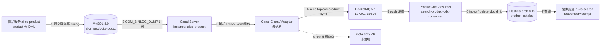
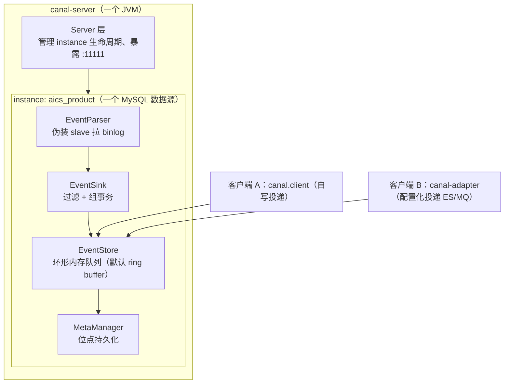
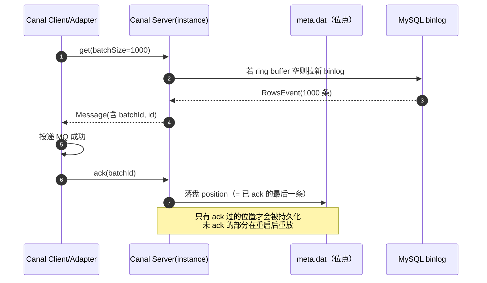
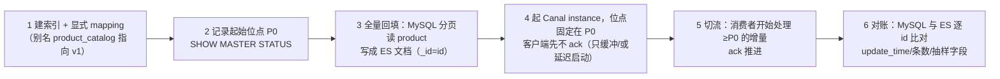

# Canal CDC 商品索引同步：位点、幂等与表结构变更

> **一句话结论**：CDC 要回答的是"数据库改了，搜索引擎凭什么知道"，Canal 的答案是"把 MySQL binlog 当成一条可重放的变更日志，伪装成 slave 去订阅"；代价是你得自己接管 MySQL 原本替你管好的三件事——**位点**（从哪继续读、ack 到哪）、**幂等**（同一条事件重放两次会怎样）、**表结构变更**（新列要不要进索引、旧列改名怎么办）。本仓库只落地了这条链路最右端的一小段（`ai-cs-search` 里 66 行消费者），Canal 服务端、投递层、全量初始化、索引 mapping 管理**全部未落地**，所以本篇是"设计 + 现状核对"文档，不是"已上线链路说明书"。
> **阅读前置**：①知道 binlog 有三种格式、`ROW` 记的是行镜像而不是 SQL 文本（[06-事务进阶-MVCC实现与三大日志](../03-数据库与ORM/06-事务进阶-MVCC实现与三大日志.md)）；②知道 Spring 事务真正落库发生在 `DataSourceTransactionManager#doCommit` 里那一行 `con.commit()`（[01-分布式事务-seata-at模式源码](../24-源码分析/04-SpringCloud/07-分布式事务与链路追踪/01-分布式事务-seata-at模式源码.md)）；③知道 ES 的写入要等 refresh 才可见、`_id` 相同即覆盖（[03-Elasticsearch搜索引擎](./03-Elasticsearch搜索引擎.md)）。
> **证据基线**：Spring Boot 4.2.0 / Spring Cloud 2026.0.0 / Spring Cloud Alibaba 2025.1.0.0 / JDK 17 / MySQL 8.0 / RocketMQ 5.1 / Elasticsearch 8.12 / Nacos 3.3。Canal 服务端**未在仓库锁定版本、未入库**（`canal.properties` 全仓 0 个），凡涉及 Canal 自身语义处一律标注"依据 Canal 官方文档 1.1.x（未入库）"。A 级源码摘录来自 `learning-docs/24-源码分析/assets/source/`（`org.springframework:spring-jdbc:7.1.0`）。B 级为当次 `read` 核对过的本仓文件行号，C 级为当次真实执行的命令输出（本机无 docker/MySQL/ES/RocketMQ，已探测确认）。预计阅读 55~70 分钟。

---

## 0. 先看现象

### 现象 1：后台把库存从 100 改成 80，搜索页还是 100，日志里一条 CDC 记录都没有

先看配置默认值。消费者是挂上了，但开关默认关着：

```yaml
# ai-cs-search/src/main/resources/application.yml#L48-L58（摘录）
# ===== RocketMQ（Canal CDC 商品变更） =====
rocketmq:
  name-server: ${ROCKETMQ_NAME_SERVER:127.0.0.1:9876}
  consumer:
    group: search-product-cdc-consumer

# ===== Canal CDC 商品同步（默认关闭，Canal 基础设施部署后开启） =====
aics:
  cdc:
    product:
      enabled: ${CANAL_PRODUCT_CDC_ENABLED:false}
```

再看消费者的第一道守卫，开关关掉时它是**静默 return**，一行日志都不打：

```java
// ai-cs-search/src/main/java/com/aics/search/cdc/ProductCdcConsumer.java#L32-L41（摘录）
@Override
public void onMessage(CanalChangeEvent event) {
    if (!enabled || event == null
            || !"product".equalsIgnoreCase(event.getTable())
            || event.getData() == null) {
        return;                     // ← 这里，no log
    }
    for (Map<String, Object> row : event.getData()) {
        syncOne(event.getType(), row);
    }
}
```

所以现象 1 的"没有报错"本身就是证据：`enabled=false` 时整条链路的唯一入口被短路；即使打开开关，成功路径也只打 `log.debug("CDC 商品索引 upsert: id={}", docId)`（`ProductCdcConsumer.java#L60`），默认 INFO 级别下同样看不到。**"改了库但搜索不变且无日志"= 先怀疑开关与守卫，而不是先怀疑 ES。**

### 现象 2：Canal 重启后从旧位点重放，库存被写回旧值

这是 CDC 最反直觉的一类事故。消费端的行为本身是"幂等"的——`docId = String.valueOf(id)`，同一个商品永远写同一个 `_id`，写两次不会多出一条文档：

```java
// ai-cs-search/src/main/java/com/aics/search/cdc/ProductCdcConsumer.java#L59-L60（摘录）
elasticsearchClient.index(i -> i.index(INDEX).id(docId).document(row));
log.debug("CDC 商品索引 upsert: id={}", docId);
```

**幂等 ≠ 顺序正确**。`upsert` 保证"重复不脏"，不保证"最后写的就是最新值"。Canal 的重放语义是"从上次 ack 的位点重新投递"，于是 `stock=100 → stock=80` 两条事件可能在重放后以相反顺序抵达，而后写覆盖先写，页面又回到 100。此时日志里出现的往往只有重试栈：

```text
# 消费端失败时抛出的异常（本仓代码里唯一的错误路径，字符串原文）
java.lang.IllegalStateException: CDC 商品索引同步失败: id=1001
```

`ProductCdcConsumer.java#L61-L64` 抛 `IllegalStateException` 是**故意的**：让 RocketMQ 走重试（默认 16 次后进 `%DLQ%search-product-cdc-consumer`，见 RocketMQ 官方文档"消费重试/死信队列"章节，未入库）。但重试只解决"写失败"，解决不了"写对了但是旧值"。

### 现象 3：给商品表加了个字段，同步任务从此没动静（或偶发静默失败）

本仓 `product` 表的真实列（12 列）：

```powershell
# C 级实测（当次真实输出）
PS> $l = Get-Content deploy\mysql\product-init.sql; ...（按 ^\s{4}([a-z_]+)\s+(BIGINT|VARCHAR|...) 抽取）
列数=12
L24:id L25:name L26:description L27:price L28:stock L29:category_id L30:image L31:status L32:sales L33:create_time L34:update_time L35:deleted
```

加一列（比如 `promotion_tag`）之后会发生什么，取决于两个"没人写下来"的约定：

1. **Canal 的 filter 只到库表级，不到列级**（依据 Canal 官方文档 `instance.properties` 的 `canal.instance.filter.regex` 语义，未入库）。新列不会因为没配白名单而被过滤掉，它会**自动出现在 `row` map 里**。
2. **消费端把整行 map 直接当文档投给 ES**：`document(row)`（`ProductCdcConsumer.java#L59`）。于是新字段的 ES 类型由 **dynamic mapping 自动推断**；本仓没有任何 `product_catalog` 的 mapping 创建代码（`createEsIndexIfNeeded` 只建 `knowledge`，见 `ai-cs-search/src/main/java/com/aics/search/service/impl/SearchServiceImpl.java#L44-L48`）。

一旦有人按"最佳实践"补上 `dynamic: strict` 却没同步改 mapping，新列写入就会被拒：

```text
# 依据 Elasticsearch 8.x 官方文档 "Dynamic field mapping / strict_date_optional_time"
# （未入库，本机无 ES 实例，未实测）
strict_dynamic_mapping_exception: [strict_dynamic_mapping_exception]
mapper_parsing_exception: failed to parse field [promotion_tag] ...
```

这条异常会被消费端 catch 后包成 `IllegalStateException` 抛出（`ProductCdcConsumer.java#L61-L64`），表现为"任务没挂、但索引不更新"，只有翻 RocketMQ 客户端日志和 DLQ 才看得到。

### 三件事的表面对比

| 现象 | 你的第一反应 | 真正常见的原因 | 本篇对应节 |
| --- | --- | --- | --- |
| 改库存，搜索不变，无日志 | ES 写失败 / 搜索服务缓存 | 开关默认 `false`，守卫静默 return；或 debug 日志没开 | §3.8、§6 |
| 重启后老值覆盖新值 | Canal 有 bug / binlog 位点坏了 | 至少一次投递 + 没有版本比较，乱序后写覆盖 | §3.5、§3.9 |
| 加字段后同步静默失败 | 消费者代码坏了 | filter 不拦列 + dynamic mapping 推断/`strict` 拒写，mapping 无管理 | §3.6、§3.10 |

**这些现象指向同一件事：CDC 把"写数据库"变成"写索引"，但位点、幂等、表结构变更这三件事必须由业务方自己接管，而本仓库目前只接管了其中最浅的一层（按主键 upsert + `deleted=1` 转删除）。**

---

## 1. 整体地图



> **读图说明**：
> 1. **箭头 1 是整条链路的信任基础**：binlog 是 MySQL 事务提交的副产物，所以它能拿到"已提交"的事实，且天然有顺序。如果这一步被人改成业务代码里"手动发消息"（也就是双写），箭头 1 就退化成两个独立写入，本篇之后所有"最终一致"的论证全部失效。
> 2. **箭头 2 是 Canal 的全部秘密**：`Canal` 冒充一个 MySQL slave（用 `canal` 账号的 `REPLICATION SLAVE` 权限，见 `deploy/mysql/canal-init.sql#L2-L4`），所以它看到的是**主库** binlog。看错这一点会得出错误结论——比如以为"从库已经做了 `replicate-do-db` 过滤，Canal 连从库就能少收数据"，实际上 `deploy/mysql/slave.cnf#L15-L18` 只过滤了 `user_db/knowledge_db/chat_db/nacos_config`（连 `product` 库都没包含），而主库 binlog 永远记全库，过滤只影响从库自己的 relay 应用。
> 3. **箭头 3→4 是本仓最空的一段**：仓库里既没有 `canal.properties` 也没有 `instance.properties`，`deploy/docker-compose/docker-compose-all.yml` 的 15 个 service 里没有 canal-server/adapter（§6 有实测输出）。所以箭头 4 的 topic 名 `c-product-sync` 目前是"消费端声明了、生产端不存在"的单边契约。
> 4. **箭头 8 是反向的，且是"至少一次"的根源**：位点不是"读到哪"，而是"客户端 ack 到哪"。箭头 5→6 成功之后才允许 8 推进；一旦 ack 前进程挂掉，重启就从旧位点重放——这就是现象 2。
> 5. 注意 `S`（搜索服务）现在的主要检索走 Chroma 向量库（`ai-cs-search/src/main/resources/application.yml#L32-L46`），`product_catalog` 是商品全文/过滤检索的旁路索引，两条检索通道不要混为一谈。

### 组件、责任与落地状态

| 组件 | 责任 | 上游调用方 | 下游 | 本仓落地 |
| --- | --- | --- | --- | --- |
| MySQL binlog（ROW + FULL） | 提供已提交、有序、含前后镜像的变更流 | 商品服务的 DML | Canal | ✅ 配置已落地：`deploy/mysql/mysql.cnf#L23-L28` |
| `canal` 复制账号 | 供 Canal 伪装 slave 拉 binlog | Canal 连接 | — | ✅ 已落地：`deploy/mysql/canal-init.sql#L2-L4` |
| Canal Server + instance | 订阅 binlog、按 filter 过滤、维护位点 | 无（自成服务） | Client/Adapter | ❌ 未落地（无配置文件、无 compose service） |
| Canal Client / Adapter | 把 ChangeEvent 投递到 MQ/ES | Canal Server | RocketMQ | ❌ 未落地 |
| RocketMQ `c-product-sync` | 削峰、重试、解耦 | Adapter | 消费者 | ⚠️ 半落地：消费端 + 配置有，生产端无 |
| `ProductCdcConsumer` | 行级 upsert / delete | RocketMQ | Elasticsearch | ✅ 已落地 66 行 |
| `product_catalog` 索引 | 商品检索 | 消费者写入 | 搜索服务 | ⚠️ 写入有、index/mapping 创建代码无 |
| 全量初始化脚本 | 首次灌数据、重建索引 | 运维手工 | ES | ❌ 未落地（`scripts/sync-kb-to-es.py` 不存在，§6 实测） |

---

## 2. 关键概念与关键类

| 名称 | 位置 | 角色 | 关键方法/字段 | 是否入库 |
| --- | --- | --- | --- | --- |
| `ProductCdcConsumer` | `ai-cs-search/src/main/java/com/aics/search/cdc/ProductCdcConsumer.java#L23-L65` | 唯一的 CDC 消费端；把变更写成 ES 文档 | `onMessage`（守卫）、`syncOne`（upsert/delete） | ✅ 本仓代码 |
| `CanalChangeEvent` | `ai-cs-search/src/main/java/com/aics/search/cdc/CanalChangeEvent.java#L10-L15` | 投递契约（只有 4 个字段） | `database`/`table`/`type`/`data` | ✅ 本仓代码 |
| `@RocketMQMessageListener` | `ai-cs-search/src/main/java/com/aics/search/cdc/ProductCdcConsumer.java#L23` | 声明 topic/消费组，Spring 启动时注册容器 | `topic="c-product-sync"`, `consumerGroup="search-product-cdc-consumer"` | ✅（注解本体即 broker 客户端，未入库） |
| `ElasticsearchClient`（Java API Client） | `ai-cs-search/src/main/java/com/aics/search/config/ElasticsearchConfig.java#L35-L49` | ES 8.x 官方客户端（替代已移除的 `RestHighLevelClient`） | `index(...)`、`delete(...)` | ✅ 本仓配置 |
| `product` 表 | `deploy/mysql/product-init.sql#L23-L41` | 变更源；`id` 主键、`deleted` 软删标记、`update_time` 更新时间 | 12 列，见 §3.10 | ✅ DDL 已落地 |
| Canal `serverId` | Canal 官方文档（未入库） | 伪装 slave 的编号；同库不同 serverId 冲突会报 `Maybe slaveId conflict` | `canal.instance.mysql.slaveId` | ❌ |
| Canal `position` | Canal 官方文档（未入库） | `binlog 文件名 + offset`，位点续传依据 | `master position` / `journalName` | ❌ |
| Canal `gtid` | Canal 官方文档（未入库） | 用 GTID 集合代替文件位点，主从切换更稳 | `canal.instance.gtidon` | ❌ |
| Canal `filter.regex` | Canal 官方文档（未入库） | 库表白名单/黑名单，**不含列级** | `canal.instance.filter.regex=aics_product\\.product` | ❌ |
| `createEsIndexIfNeeded` | `ai-cs-search/src/main/java/com/aics/search/service/impl/SearchServiceImpl.java#L196` | 现有唯一"建索引"范本，只用于 `knowledge` | 可照抄给 `product_catalog` | ✅ 范本存在 |

---

## 3. 原理与证据逐段精读

### 3.1 为什么"改数据库"不会自动变成"改索引"：双写和 afterCommit 都不原子

**在干什么**：先掐死一个幻想——"在 Service 里 `productMapper.update()` 之后再 `esClient.index()`"这种双写，看似同步，其实中间有一个不可消除的失败窗口。

先看 MySQL 侧的唯一落盘点，A 级源码：

```java
	// (src: DataSourceTransactionManager.java#L336-L348)
	@Override
	protected void doCommit(DefaultTransactionStatus status) {
		DataSourceTransactionObject txObject = (DataSourceTransactionObject) status.getTransaction();
		Connection con = txObject.getConnectionHolder().getConnection();
		if (status.isDebug()) {
			logger.debug("Committing JDBC transaction on Connection [" + con + "]");
		}
		try {
			con.commit();
		}
		catch (SQLException ex) {
			throw translateException("JDBC commit", ex);
		}
	}
```

**为什么这么设计**：`con.commit()`（L343）返回之后，MySQL 已经提交、binlog 已经落盘、数据对别的会话可见；但它**返回之后**、你的 Java 代码执行 `esClient.index()` 之前，JVM 可能正好被 kill（发版、OOM、机器掉电）。这段窗口没有任何机制能补——你的"第二条写"只存在于内存里。

那用 Spring 的 `afterCommit` 回调呢？它同样不解决问题，A 级 javadoc 说得很直白：

```java
	// (src: TransactionSynchronization.java#L150-L166)
	/**
	 * Invoked after transaction commit. Can perform further operations right
	 * <i>after</i> the main transaction has <i>successfully</i> committed.
	 * ...
	 * <p><b>NOTE:</b> The transaction will have been committed already, but the
	 * transactional resources might still be active and accessible. As a consequence,
	 * any data access code triggered at this point will still "participate" in the
	 * original transaction, allowing to perform some cleanup (with no commit following
	 * anymore!), unless it explicitly declares that it needs to run in a separate
	 * transaction. Hence: <b>Use {@code PROPAGATION_REQUIRES_NEW} for any
	 * transactional operation that is called from here.</b>
	 */
	default void afterCommit() {
	}
```

"the transaction will have been committed already" —— 回调运行时主事务已提交，回调本身**不在**任何事务里（所以官方让你给回调内部的操作加 `REQUIRES_NEW`）。这意味着回调失败无法回滚数据库，回调进程崩溃就没有第二次机会。

**换写法会怎样**：

- 改成"先写 ES 再写库"：失败窗口调换方向，问题不变，还会造成"索引有新值、库是旧值"的更糟状态（搜索能搜到、点进去 404）。
- 改成"本地消息表/事务性发件箱"：把"事件"和"业务数据"放进**同一个本地事务**，就能真正原子；代价是要多一张 outbox 表 + 一个投递器，本质是自建迷你 CDC。
- 用 Canal 读 binlog：把"事件"交给 MySQL 自己产生（binlog 与数据同一事务），业务代码只写库，**这才是本篇选择的路线**。

**常见坑**：把 `@Transactional` 方法里的 `esClient.index()` 当成"事务的一部分"，以为异常会一起回滚——ES 不参与 JDBC 事务，它已经写进去了；排查时表现为"数据库回滚了，索引里有脏文档"。

### 3.2 CDC 两条路线：查询轮询 vs 日志订阅

**在干什么**：把"数据库的变更"变成"可消费的事件流"，业界只有两种做法。

| 维度 | 查询轮询（polling，`WHERE update_time > ?`） | 日志订阅（binlog，Canal/Debezium） |
| --- | --- | --- |
| 实现成本 | 极低，一个定时任务 + 一条 SQL | 高，要部署 Canal、配账号、配 filter、管位点 |
| 延迟 | 等于轮询周期（秒级起步） | 毫秒~百毫秒级 |
| 能否捕获中间态 | 不能，只看得到"当前值" | 能，每次 RowsEvent 都在 |
| 物理删除 | 捕获不到（行没了就没痕迹） | 能（`DELETE` 类型事件） |
| 重复/漏读 | 漏：同一秒多次更新（`update_time` 是 `DATETIME` 秒精度，见 `deploy/mysql/product-init.sql#L34`），`>` 判据分不清 | 不漏；但会因重放产生"重复" |
| 对源库压力 | 每次全表/索引扫描 | 顺序读 binlog，压力小 |
| 需要权限 | 只读账号 | `REPLICATION SLAVE` + `REPLICATION CLIENT` |

**为什么必须选 binlog（本项目的具体理由）**：`product` 表有 `stock`、`sales` 这种**高频小字段**，一次下单会改库存、改销量，同一秒内多次更新在 `DATETIME` 秒精度下 `update_time` 完全一样，`WHERE update_time > ?` 会一次性漏掉同秒的其余变更；加上表里有软删列 `deleted`（`product-init.sql#L35`），轮询还得靠 `update_time` 变来发现"逻辑删"，而"改 `deleted` 不改 `update_time`"的写法（比如手写 UPDATE 忘了 `ON UPDATE` 生效范围）会让轮询永久漏事件。

**换写法会怎样**：如果只有"商品资料低频变更"这种需求（比如一天改几次标题），轮询完全够用，且运维成本几乎为零——这也是为什么很多团队最后是"低频表轮询、高频表 CDC"混合。

**常见坑**：轮询方案里把"扫到的行"当事件，导致**同一行的多次变更被合并成一条**，下游拿不到"中间态"，做不了库存流水类的需求；反过来 CDC 方案里以为"事件里有 `before` 就能算增量"，结果用了 `binlog-row-image=MINIMAL` 之后 `before` 只剩主键（§3.3）。

### 3.3 binlog 三格式与为什么必须是 ROW + FULL

**在干什么**：MySQL binlog 记录"变更"有三种格式，选错格式 CDC 直接做不成。

| 格式 | 记录内容 | 对 CDC 的影响 |
| --- | --- | --- |
| `STATEMENT` | 原始 SQL 文本 | Canal 要当数据库用：得解析 SQL、还原上下文（`NOW()`、`@@session`、自增 ID、`LIMIT` 无 `ORDER BY` 的不确定结果），基本不可靠 |
| `ROW` | 每行变更的"镜像"（列值二元组） | 直接可消费，不看 SQL 语义；本项目选它 |
| `MIXED` | 引擎自行在两者间切换 | 时而是 SQL、时而是行，下游得同时实现两套解析，最糟的选择 |

本仓真实配置（B 级，`deploy/mysql/mysql.cnf#L23-L28`）：

```ini
# Binlog CDC（Canal 必需：ROW 记录每行变化，FULL 保留完整前后镜像）
server-id=1
log-bin=mysql-bin
binlog-format=ROW
binlog-row-image=FULL
expire-logs-days=7
```

**为什么这么设计**：`binlog-format=ROW` 解决"变更长什么样"；`binlog-row-image=FULL` 解决"一行给多少列"。`FULL` 意味着 `before` 和 `after` 都是**整行所有列**；`MINIMAL` 则只给"主键 + 真正变化的列"。为什么本仓必须 `FULL`？看消费端的写法：它把整行 map 直接 `document(row)` 投给 ES（`ProductCdcConsumer.java#L59`）。若用 `MINIMAL`，一条"只改库存"的事件里 `row` 只有 `id/stock/update_time`，写进 ES 就是**残缺文档**——名字、价格、分类全被覆盖成 `null`。

**换写法会怎样**：`FULL` 的代价是 binlog 体积变大（一行 12 列全记一遍），写入热点表时 binlog 增长更快（本仓 `expire-logs-days=7`、`max-binlog-size=500M`，见 `deploy/mysql/master.cnf#L7-L11`）。如果接受"下游回查数据库补全字段"，可以用 `MINIMAL` + 消费端回查，但那会把读压力加回业务库，且回查到的可能是**更新的**值（读放大 + 时序错乱）。

**常见坑**：①以为改了 `my.cnf` 就生效——`binlog-format` 是动态可变参数（`SET GLOBAL` 即刻生效），但 `binlog-row-image`、`log-bin` 属于启动参数，必须重启 mysqld；②主从格式不一致，从库 `binlog_format=STATEMENT` 时主从切换后 Canal 会突然解析失败；③`expire-logs-days=7` 太短：停机超过 7 天，位点指向的 binlog 文件已被 purge，Canal 恢复时直接报找不到文件（§6 第 6 条）。binlog 三种格式的底层原理见 [06-事务进阶-MVCC实现与三大日志](../03-数据库与ORM/06-事务进阶-MVCC实现与三大日志.md)。

### 3.4 Canal 架构：server / instance / client / adapter 四层

**在干什么**：Canal 不是单一进程，而是四层结构（依据 Canal 官方文档"架构"章节，未入库）：



> **读图说明**：1）**`server` 与 `instance` 是 1:N**，一个 instance 绑定一个 MySQL 数据源（对应一组 filter），所以"给 `product` 库单独开一个 instance"是标准做法，不要把所有业务库塞进一个 instance 再用 filter 细分（位点会互相牵制）。2）**`EventStore` 是内存环形队列**——它是"至少一次"而不是"恰好一次"的结构根源：客户端读走但未 ack，位置就不会推进，重启后重放。3）**客户端有两种**（自写 `canal.client` 或配置化的 `canal-adapter`），二者对位点的语义相同；本仓的 `CanalChangeEvent` 只有 4 个字段，说明它是"自己造了个极简 DTO"的路线（§3.7），而非直接用 adapter 的 ES 映射配置。4）看错"`EventStore` 在 server 侧"这一点，会误以为"客户端可以随便重启、反正 server 缓存着"——实际上客户端断开期间 server 的 ring buffer 有容量上限，写满后 `EventStore` 会 block，反而拖慢 binlog 拉取。

**为什么这么设计**：拆 instance 是为了"一个数据源一套位点"；拆 client 与 server 是为了"多消费者共享一次 binlog 解析"（server 只解析一次，多个 client 各拿全量/分片）。

**换写法会怎样**：如果不做 server/client 分离，直接每个消费者自己伪装 slave 拉 binlog（Debezium 的嵌入式模式就是这样，见 [19-Debezium与Canal的CDC对比](./19-Debezium与Canal的CDC对比.md)），那么 N 个消费者就是 N 个 slave 连接，主库 `max_connections` 与 binlog dump 线程都要乘 N。

**常见坑**：`canal.instance.mysql.slaveId` 与真实从库（`deploy/mysql/slave.cnf#L4` 的 `server-id=2`）**撞号** → 主库 kick 掉其中一个，报 `Maybe slaveId conflict`；以及 `:11111` 管理端口默认直接暴露，无鉴权。

### 3.5 位点：serverId、position/gtid，以及"重启从哪续"

**在干什么**：位点（position）决定 Canal 重启后从 binlog 的哪一行继续读；它由两部分组成：`journalName`（`mysql-bin.000007` 这种文件名）+ `position`（文件内偏移）。位点存在 `meta.dat`（默认 file 模式，`canal.meta.dir`）或 ZooKeeper 里。



> **读图说明**：1）关键在最后两个箭头：**位点记的是"已 ack"而不是"已读"**。这正是现象 2 的机制来源。2）`batchId` 必须原样回传，否则 ack 不生效（客户端常见 bug：自己造 batchId 或丢字段，表现为"位点永远停在启动点、每次重启全量重放"）。3）如果想"重放历史窗口"，把 `meta.dat` 里的 position 手工改小即可——这是排查事故的常用手法，也是**生产危险动作**（会造成大量重复投递，依赖 §3.9 的幂等兜住）。4）用 GTID（`canal.instance.gtidon=true`）时位点变成"已执行的 GTID 集合"，主从切换后仍然有效；文件位点则在切换后可能指向不存在的事务。

**为什么这么设计**：ack 语义把"至少一次"的选择权交给消费者——要么丢（先 ack 后处理），要么重（先处理后 ack）。开源实现一律选后者。

**换写法会怎样**：改成"读到就 ack"能消灭重复，但进程在 ack 之后、投递之前崩溃就会**永久丢**一条变更，且丢失是静默的（索引少一次更新，没人报错）。

**常见坑**：①`serverId` 复用导致两个 instance 抢同一份 binlog；②`expire-logs-days=7`（本仓配置）与"停机一周以上"直接冲突；③把 `canal.meta.dir` 放在容器内非挂载目录 → 容器重建位点清零，整个 binlog 从头重放（本仓 canal 尚未容器化，若落地必须挂卷，见 §3.11）。

### 3.6 订阅过滤：库表白名单，以及"列不过滤"带来的穿透

**在干什么**：`canal.instance.filter.regex` 用正则描述"要哪些库表"，例如 `aics_product\\.product` 表示只要 `aics_product.product` 一张表。多个表达式用逗号分隔。

**为什么这么设计**：binlog 是**实例级**的（一个 MySQL 里所有库共用一个 binlog 序列），所以过滤只能在"解析之后"做——它省的是网络与投递成本，不是 binlog 读取成本。理解这一点才能理解为什么加列会穿透：**filter 的粒度是 `库.表`，没有列的位置**。

**换写法会怎样**：如果想让"加列不影响下游"，唯一可靠的写法是**下游显式声明字段白名单**——消费端不要 `document(row)` 整行投递，而是 `Map.of("id",..,"name",..,"price",..)` 显式挑字段。这样新列被自然忽略，mapping 也不会被动态扩展。本仓目前是整行投递（`ProductCdcConsumer.java#L59`），所以"加列穿透"是**必然行为**，不是 bug。

**常见坑**：①正则写成 `aics_product.product`（点号未转义 → 匹配任意字符），把 `aics_productXproduct` 之类的怪表名也匹配进来；②用排除法 `.*\\..*,aics_product\\.log_.*`（先全匹配再排除），顺序与逗号位置写错就变成"全排除"；③以为"改了 filter 就能过滤掉某列"，实际上要么改消费端字段白名单，要么改 `binlog-row-image`（但那会影响所有表）。

### 3.7 投递契约：4 个字段的 DTO 决定了幂等能力的上限

**在干什么**：本仓的 CDC 事件 DTO 只有 4 个字段。C 级实测它的编译产物（真实输出）：

```text
PS> javap -p -classpath ai-cs-search\target\classes com.aics.search.cdc.CanalChangeEvent
Compiled from "CanalChangeEvent.java"
public class com.aics.search.cdc.CanalChangeEvent {
  private java.lang.String database;
  private java.lang.String table;
  private java.lang.String type;
  private java.util.List<java.util.Map<java.lang.String, java.lang.Object>> data;
  public com.aics.search.cdc.CanalChangeEvent();
  public java.lang.String getDatabase();
  public java.lang.String getTable();
  public java.lang.String getType();
  public java.util.List<java.util.Map<java.lang.String, java.lang.Object>> getData();
  ...（setter 4 个 + equals/canEqual/hashCode/toString，Lombok @Data 生成）
}
```

**为什么这么设计**：4 个字段足够实现"按表路由 + 按行写文档"这个最小闭环，写起来最省事。DTO 源码在 `ai-cs-search/src/main/java/com/aics/search/cdc/CanalChangeEvent.java#L10-L15`。

**换写法会怎样**：Canal 原生 `Entry` 里其实有更多信息（`header.executeTime`、`header.logfileName/offset`、`entryType`、`RowChange` 的 `beforeColumns/afterColumns` 与 `isUpdated` 标记、`sql` 语句）。本仓把它们全丢了，于是：

| 想做的事 | 需要哪个原生字段 | 本仓 DTO 有吗 |
| --- | --- | --- |
| 丢弃"旧值"（乱序保护） | `header.executeTime` 或 `logfileName+offset` | ❌ 没有 |
| 精确判断哪些列变了 | `afterColumns[i].isUpdated` | ❌ 没有（只有整行 map） |
| 区分 `INSERT/UPDATE/DELETE` 强度 | `entryType`（TRANSACTIONBEGIN/ROWDATA…）+ `eventType` | ⚠️ 只有一个 `type` 字符串 |
| 幂等去重（消息级） | 位点二元组做消息 key | ❌ 没有 |
| 回放定位"这条哪来的" | `logfileName/offset` | ❌ 没有 |

**常见坑**：把 `type` 当成可靠枚举用——`syncOne` 里判断删除用的是 `("DELETE".equalsIgnoreCase(type) || "1".equals(String.valueOf(row.get("deleted"))))`（`ProductCdcConsumer.java#L51`），也就是**同时赌两个来源**：投递层给的 `type` 字符串、以及行里的 `deleted` 列。一旦上游把 `type` 写成小写以外的变体（`DELETE`/`delete`/`ROWDATA`/空）或 `deleted` 是 MySQL 的 `TINYINT` 被 JSON 化成 `1` 还是 `"1"`，判据就会漂移——代码里已经用 `String.valueOf(...)` 兜住了 `1` 与 `"1"` 两种形态，这本身就是"契约不明确"的证据。

### 3.8 消费端逐行：守卫、主键、软删转物理删、抛异常重试

**在干什么**：66 行代码做四件事，逐段看。第一段是三道守卫（§0 已引），第二段是主键与软删：

```java
// ai-cs-search/src/main/java/com/aics/search/cdc/ProductCdcConsumer.java#L43-L58（摘录）
void syncOne(String type, Map<String, Object> row) {
    Object id = row.get("id");
    if (id == null) {
        log.warn("忽略无主键 CDC 商品事件: {}", row);
        return;
    }
    String docId = String.valueOf(id);
    try {
        if ("DELETE".equalsIgnoreCase(type) || "1".equals(String.valueOf(row.get("deleted")))) {
            try {
                elasticsearchClient.delete(d -> d.index(INDEX).id(docId));
            } catch (Exception ignored) {
                // 重复 delete/doc 不存在保持幂等
            }
            return;
        }
        // …（L59-L64：index upsert + debug 日志 + catch 后 throw IllegalStateException）
```

外层 `try`（L50）把"删除"和"写入"都包住了，所以 L61-L64 的 `catch` 对两条分支都生效。

**为什么这么设计**：①**主键即文档 `_id`**，是幂等的最小实现：重放多少次都是同一篇文档；②**软删要转成物理删**——ES 里留着 `deleted=1` 的文档，搜索就会把下架商品搜出来，所以必须 `delete`；③`delete` 的异常被 `catch (Exception ignored)` **吞掉**，是因为"文档本来就不存在"时 ES 返回 `404`（`index_not_found_exception`），这在"先删后建索引"或重放场景里是正常状态，不该触发重试。

**换写法会怎样**：

- 若把 `docId` 改成自增序号或 UUID：重放就变成"插入重复文档"，幂等彻底失效。
- 若 `deleted=1` 时不删而是"写一篇 `deleted:1` 的文档"：查询端必须每条查询都带 `filter: deleted=0`，一旦有人漏写（比如聚合、联想词）就会召回下架商品——把一致性责任推给每个查询，是本末倒置。
- 若 `delete` 的异常不吞：首次全量同步时"删不存在的文档"会 404 → 抛异常 → RocketMQ 重试 16 次 → 进 DLQ，把真实故障淹没在噪声里。

**常见坑**：①`id` 的键名写死 `"id"`——如果表主键叫 `product_id`（本仓 `product` 恰好叫 `id`，`product-init.sql#L24`），整条链路会以"忽略无主键"静默丢弃全部事件（只有 `log.warn`）；②`delete` 成功后没有 `refresh`，紧接着的查询仍可能读到旧文档（ES 的 `refresh_interval` 默认 1s，官方文档 "Near real-time search"）；③`ignored` 吞异常掩盖了"集群 503/鉴权失败"这类真故障——只吞 `404` 才安全，应该 `catch (ElasticsearchException e) { if (e.status() != 404) throw ...; }`。

### 3.9 幂等与乱序：主键只是第一层，还需要"丢弃旧值"

**在干什么**：把"重复投递"与"错序到达"两类问题分开治理。前者靠主键 `_id`（已落地）；后者必须靠**版本比较**（未落地）：

| 层次 | 目标 | 手段 | 本仓状态 |
| --- | --- | --- | --- |
| 重复（同一事件到两次） | 不产生两份文档 | `_id = 主键` | ✅ `ProductCdcConsumer.java#L59` |
| 乱序（新事件先到、旧事件后到） | 旧值不覆盖新值 | 文档带 `version`，写时带 `version_type=external` | ❌ 未落地 |
| 缺失（事件永久丢） | 兜底修复 | 定时对账（比对 MySQL 与 ES 的 `update_time`/条数） | ❌ 未落地 |

**为什么这么设计**：ES 的 `index` 是"最后写的赢"（last write wins）。要让"旧事件不能覆盖新值"，只能让**版本号参与判定**：如果文档已存在且 `version >= 新事件版本`，就丢弃这次写。

**换写法会怎样（三个版本源的取舍）**：

1. 用 `update_time` 转 epoch 当版本：最省事，但 `product.update_time` 是 `DATETIME` 秒精度（`deploy/mysql/product-init.sql#L34`），**同一秒内的两次变更版本号相同**，乱序照样分辨不出——这是本仓表结构带来的硬约束，要修就得把列改成 `DATETIME(3)`/`DATETIME(6)`（需要 DDL 变更 + 数据迁移）。
2. 用 binlog 位点（`logfileName + offset`）当版本：最强、严格全序，但当前 `CanalChangeEvent` 没有这个字段（§3.7），需要同时改投递端与 DTO。
3. 用 Redis 分布式自增序列：多一次外部依赖，且要保证"取号 → 写 ES"之间的顺序，复杂度反升。

**落地要改哪些文件（明确"未落地"）**：`ai-cs-search/src/main/java/com/aics/search/cdc/CanalChangeEvent.java`（加 `version`/`offset` 字段）、`ai-cs-search/src/main/java/com/aics/search/cdc/ProductCdcConsumer.java`（`index(...)` 链上加 `version(...)`/`versionType(VersionType.External)`，并把 `catch` 里的 `version_conflict_engine_exception` 当作成功）、投递端（不在仓内，需新建）。

**常见坑**：`version_type=external` 下，**任何**一次写都要求版本严格递增，若用 `update_time`（秒精度、可能回退，如手工改数据把时间改早）会导致"新数据永远写不进去"——表现为索引停在某个时间点，静默无报错（`version_conflict_engine_exception` 被当成功吞掉）。

### 3.10 表结构变更：索引与 mapping 怎么跟进

**在干什么**：DDL 变更时，让"数据库列"和"ES 字段"重新对齐。本仓 `product` 的 12 列（`deploy/mysql/product-init.sql#L23-L41`）现在是一比一"裸映射"进 ES 的：

| MySQL 列 | 类型 | ES 动态推断结果（无显式 mapping 时） | 隐患 |
| --- | --- | --- | --- |
| `id` | `BIGINT` | `long` | 用作 `_id`，不要放进 `_source` 参与排序 |
| `name` | `VARCHAR(200)` | `text` + `keyword` 子字段 | 中文需 `ik` 分词器，动态推断给的是 standard |
| `description` | `TEXT` | `text` | 长文本，占 `_source` 体积 |
| `price` | `DECIMAL(10,2)` | `float`/`double` | **金额精度坑**，应显式 `scaled_float(scaling_factor=100)` |
| `stock`/`sales` | `INT` | `long` | 高频变更字段；`sales` 排序/聚合 |
| `status` | `TINYINT` | `long` | 语义是枚举（0 下架 / 1 上架），查询端要按数字过滤 |
| `create_time`/`update_time` | `DATETIME` | `date`（date detection） | 格式依赖 `strict_date_optional_time`，若 JDBC 输出 `2025-11-27 05:23:01` 与格式不符会被拒 |
| `deleted` | `TINYINT` | `long` | 转删除后不该出现在文档里；若出现说明 `delete` 失败被吞 |

**为什么这么设计（现状）**：仓内没有任何 `product_catalog` 的 mapping 创建代码——`grep product_catalog` 在 `ai-cs-search` 里只命中消费者一处；`createEsIndexIfNeeded` 只服务于 `knowledge`（`SearchServiceImpl.java#L44-L48`）。所以第一次写入时索引被自动创建、mapping 由 ES 猜。

**换写法会怎样**：显式 mapping + 别名（alias）切换，是让"加列/改类型"可控的唯一办法：

```text
标准动作（ES 8.x 官方文档 "Aliases" / "Reindex" / "dynamic 参数"）：
1) 建新索引 product_catalog_v2 + 显式 mapping（含 dynamic: strict 或 false）
2) 起全量回填任务，把 MySQL 现有商品灌进 v2
3) 增量流量同时写 v1 与 v2（消费端双写，或让 CDC 消费者按别名写）
4) 校验条数/抽样字段后，原子切换：POST _aliases {add: v2, remove: v1}
5) 观察一个窗口（≥ 一个 refresh + 一次对账）后删除 v1
```

注意 `dynamic: strict` 与 §0 现象 3 的联动：一旦 strict 生效，**加列必须同步改 mapping**，否则写入被拒。

**常见坑**：①直接 `PUT product_catalog/_mapping` 改已有字段类型 → 报 `illegal_argument_exception: mapper [price] cannot be changed from type [float] to [scaled_float]`，必须重建索引；②用 `dynamic: strict` 却仍整行 `document(row)` 投递（本仓现状），任何 DDL 都会变成故障；③忘了 `_source` 里塞进了 `deleted=1` 的残留字段，导致"下架但还是搜到"——根源往往是 §3.8 的 `delete` 404 被吞之外的真故障。

### 3.11 全量初始化 + 增量追平：先建索引后切流

**在干什么**：新上线/换 mapping 时，ES 是空的，必须"先全量灌、再接增量"，且**顺序不能反**。



> **读图说明**：1）关键是 2 与 4 的配合：位点必须**早于**全量快照的读时刻（P0 先取），否则"全量读期间发生的变更"会漏；取早了没关系（会重复，靠 §3.9 幂等兜）。2）第 3 步的全量读必须**按主键分页**（`WHERE id > ? ORDER BY id LIMIT ?`），而不是 `LIMIT offset`，否则深翻页会越来越慢。3）第 4 步"先不 ack"依赖 §3.5 的 ack 语义——这也是为什么不能先切流再回填：回填的旧数据会覆盖增量写的新值。4）第 6 步对账是唯一的"止损"手段：任何漏投/丢事件，最终只能通过对账发现。

**为什么这么设计**：Canal 本身**不负责全量**（它只消费 binlog；`canal-adapter` 提供了 ETL/全量能力，但需要额外配置，未入库）。所以"全量"这件事在开源方案里通常由业务方写脚本完成。

**换写法会怎样**：如果先用 `mysqldump` 导出一份 SQL 再转 JSON，快照点与 binlog 位点很难对齐（dump 的一致性快照是 `--single-transaction` 提供的，能对齐但需要 `--master-data`，见 MySQL 官方文档 "Dump 与复制位点"）；用 Debezium 则内置 snapshot→streaming 切换，不需要自己拼位点（这正是它相对 Canal 的一大优势，见 [19-Debezium与Canal的CDC对比](./19-Debezium与Canal的CDC对比.md)）。

**常见坑**：①旧稿与 `19-Debezium与Canal的CDC对比.md` 里提到的 `scripts/sync-kb-to-es.py` ——**本仓不存在这个文件**（§6 有实测 `Test-Path` = `False`），全量脚本需要自建；②回填用 `bulk` 不设 `refresh=false`，回填期间集群 refresh 压力暴涨；③回填的 `_id` 与增量不一致（比如回填用了 `product_1001` 前缀），导致同一商品两篇文档。

### 3.12 积压与延迟监控：位点差才是真指标

**在干什么**：CDC 链路的健康度不能用"进程活着"衡量，要用三个"差"：

| 指标 | 怎么取（标准命令/接口，未在无实例环境实测） | 正常值 | 异常含义 |
| --- | --- | --- | --- |
| binlog 位点差 | 主库 `SHOW MASTER STATUS` 的 `Position`/`File` 与 Canal 已 ack 的位点比较 | 秒级 | 差持续扩大 = Canal 消费跟不上（instance 阻塞/客户端不 ack） |
| binlog 文件数 | `SHOW BINARY LOGS` 行数 × `max-binlog-size=500M`（`deploy/mysql/master.cnf#L10`） | 与写入量匹配 | 文件数突然暴涨 = 有热点大事务，或 Canal 早已不消费 |
| MQ 堆积 | RocketMQ 控制台/`mqadmin consumerProgress -g search-product-cdc-consumer` | 稳定在低位 | 堆积 = 消费端慢或 ES 拒绝写 |
| ES 写入失败 | 消费端 `IllegalStateException` 计数 + DLQ topic `%DLQ%search-product-cdc-consumer` 长度 | 0 | 非 0 = mapping 冲突/集群问题，已在丢数据 |
| 端到端延迟 | 文档写入时间 - binlog `executeTime` | p99 < 1~2s | 单点变大 = 某一段卡住 |

**为什么这么设计**：位点差是唯一能反映"Canal 到底跟没跟上"的端到端指标；只看"instance 是 RUNNING"会漏掉"RUNNING 但不 ack"这种僵死状态。

**换写法会怎样**：用"最后同步时间"监控（`max(update_time)`）在**没有写入的低峰期**会误报（本来就没变更），必须配合"是否有待处理位点"一起判断。

**常见坑**：①监控只覆盖应用侧，没有覆盖 MySQL 侧 `expire-logs-days=7`（`mysql.cnf#L28`）——停写/停机 7 天后位点失效，属于"迟早会发生"的定时炸弹；②DLQ 没人看：RocketMQ 重试 16 次后进 DLQ，业务侧完全无感。

---

## 4. 一次完整执行时序

```mermaid
sequenceDiagram
  autonumber
  participant P as 商品服务 ai-cs-product
  participant DB as MySQL aics_product.product
  participant CS as Canal Server / instance
  participant AD as Canal Client / Adapter（未落地）
  participant MQ as RocketMQ c-product-sync
  participant C as ProductCdcConsumer
  participant ES as Elasticsearch product_catalog
  P->>DB: BEGIN; UPDATE product SET stock=80 WHERE id=1001; COMMIT
  DB-->>DB: 事务提交 → binlog 写入 RowsEvent（ROW+FULL）
  CS->>DB: COM_BINLOG_DUMP（serverId=X, position=mysql-bin.000007:15432）
  DB-->>CS: RowsEvent(before 全列, after 全列)
  CS->>CS: EventSink 按 filter=aics_product.product 过滤并组事务
  CS->>CS: 解析成 ChangeEvent，写入 EventStore（环形队列）
  CS-->>AD: get(batchSize=1000) 返回该批
  AD->>MQ: send(topic=c-product-sync, body=ChangeEvent JSON)
  MQ-->>C: push（consumerGroup=search-product-cdc-consumer）
  C->>C: 守卫：enabled? table==product? data!=null?
  C->>C: docId = String.valueOf(row.get("id")) → "1001"
  C->>ES: index(index=product_catalog, id=1001, document=row)
  ES-->>C: result=updated, _version=1（不用 version_type=external 时）
  C-->>MQ: 返回消费成功（无异常）
  AD->>CS: ack(batchId) → 位点推进并落盘 meta.dat
```

> **读图说明**：
> 1. **第 2 步是"事件真的存在"的证明**：它发生在 `con.commit()` 内部（§3.1 A 级源码 L343），所以任何"业务代码里再发一次消息"的方案都无法与之等价。
> 2. **第 3~6 步在 Canal 内部**，一条 RowsEvent 可能包含多行（一次 UPDATE 影响 500 行就是 500 个行镜像），也可能一个事务跨多条 RowsEvent（`EventSink` 负责按事务边界组装）。
> 3. **第 7~8 步是本仓缺失的两步**：没有 Canal Server 也没有 Adapter，所以 `c-product-sync` 目前没有生产者（§6 实测：全仓 `@RocketMQMessageListener` 只有这一处，`canal.properties` 0 个）。
> 4. **第 9~13 步是唯一已落地的部分**，也是唯一"出事能查日志"的部分。
> 5. **最后一条 ack 是异步的、且不在消费者手里**：`ProductCdcConsumer` 只对 MQ 负责（返回成功 = 消息不重投），它对 **Canal 位点没有任何控制权**。这个"两段 ack"结构决定了故障语义：MQ 侧"至少一次"，Canal 侧也是"至少一次"，二者叠加后重复概率更高，但**都不会丢**（前提是 ack 顺序正确）。

### 哪一步失败，报什么错

| 失败点 | 现象 | 典型错误原文 | 责任方 |
| --- | --- | --- | --- |
| 步骤 2：binlog 未开/格式不对 | Canal 起来但收不到数据 | Canal 启动时校验 `binlog_format` 失败（要求 `ROW`，依据 Canal 官方文档"MySQL 配置"；本仓 `mysql.cnf#L26` 已是 ROW） | DBA 配置（本仓已 OK） |
| 步骤 3：账号权限不足 | 连不上或 dump 被拒 | `Access denied for user 'canal'@'%'` / `SHOW MASTER STATUS denied` | `canal-init.sql` 权限 |
| 步骤 3：serverId 冲突 | 实例不断断连重连 | `Maybe slaveId conflict` / `Slave can not handle replication events` | instance 配置 |
| 步骤 3：位点失效 | 启动失败 | 找不到 `mysql-bin.000007`（文件被 `expire-logs-days=7` purge） | 运维（停机时长） |
| 步骤 7：客户端不 ack | 位点不推进、重启重放 | 无报错，位点差持续扩大 | 投递端代码（未落地） |
| 步骤 10：行里无主键 | 事件被丢弃 | `忽略无主键 CDC 商品事件: {...}`（`ProductCdcConsumer.java#L46`） | 上游 DTO/表结构 |
| 步骤 12：ES mapping 冲突 | 写入被拒 | `mapper_parsing_exception` / `strict_dynamic_mapping_exception` | mapping 管理（未落地） |
| 步骤 12：ES 不可用 | 重试 16 次后进 DLQ | `CDC 商品索引同步失败: id=1001`（`ProductCdcConsumer.java#L63`） | 集群/网络 |
| 步骤 14：ack 丢失 | 重复投递 → 旧值覆盖 | 无报错，仅数据不对 | 位点存储（file 模式无副本） |

---

## 5. 设计取舍

| 决策点 | 本仓选择 | 备选方案 | 为什么（以及代价） |
| --- | --- | --- | --- |
| 同步机制 | CDC（Canal 订阅 binlog） | 业务双写 / 定时轮询 | 双写有不可消除的失败窗口（§3.1）；轮询漏同秒更新与物理删（§3.2）。代价：多一套中间件要运维 |
| 投递通道 | RocketMQ（`c-product-sync`） | Canal Adapter 直写 ES | Adapter 配置化更省代码但可编程性差（做不了版本比较/字段白名单）；走 MQ 能重试、能多消费者、能削峰。代价：多一段延迟与一个要监控的堆积 |
| DTO 形态 | 4 字段极简 DTO | 直接用 Canal `Entry` | 极简好维护；代价是丢掉了 `executeTime`/位点（§3.7），做不了乱序保护 |
| 软删处理 | `deleted=1` → ES `delete` | 写 `deleted:1` 文档，查询过滤 | 删除对查询端零负担；代价是丢失"下架"这个状态本身（想展示"已下架"就得回源查 MySQL） |
| 幂等层次 | 只做 `_id=主键` | 加 `version_type=external` | 已覆盖重复，未覆盖乱序（§3.9）。根因是 `update_time` 秒精度，改版本需要 DDL |
| 开关默认值 | `aics.cdc.product.enabled` 默认 `false` | 默认开 | 链路不完整时默认开会让"消息不存在"与"链路故障"混在一起；默认关的代价是现象 1 那种静默（§0） |
| 索引管理 | 无（dynamic mapping） | 显式 mapping + 别名 | 显式 mapping 是可控前提（§3.10）；本仓缺这段，DDL 一变就是事故 |
| 全量初始化 | 无脚本 | 自建分页回填 + 位点对齐 | 没脚本就不能重建索引，等于把 ES 变成"不可重建的存储" |

**可扩展点清单（按投入产出排序）**：

1. `CanalChangeEvent` 增加 `version`（或 `logfile`+`offset`），`ProductCdcConsumer` 写 ES 时带 `versionType(External)` —— 解决乱序（§3.9）。
2. 显式 `product_catalog` mapping + 别名；新增 `ProductIndexInitializer`，照抄 `SearchServiceImpl#createEsIndexIfNeeded` 的写法（§3.10）。
3. 消费端字段白名单：`syncOne` 里显式构造 document，屏蔽新列（§3.6）。
4. `catch (Exception ignored)` 收窄为只忽略 404，其余抛出重试（§3.8）。
5. 对账任务：按 `update_time` 比对 MySQL 与 ES，落"差异表"而不是直接修 —— 覆盖"永久丢事件"（§3.11 第 6 步）。
6. 部署补齐：`deploy/docker-compose/docker-compose-all.yml` 增 `canal-server`（挂 `canal.properties`/`instance.properties` 与 `meta.dat` 卷），`expire-logs-days` 与业务停机预案对齐（§3.5、§6）。

---

## 6. 踩坑与调试手法

### 手法 1：先静态核对"Canal 到底落地了没有"（C 级，真输出）

任何关于 CDC 的讨论开始前先做这一步，否则会把设计当现状：

```powershell
PS> @(Get-ChildItem -Recurse -Filter canal.properties -ErrorAction SilentlyContinue | Where-Object {$_.FullName -notmatch '\\target\\'}).Count
0
PS> @(Select-String -Path deploy\docker-compose\*.yml -Pattern "canal" -ErrorAction SilentlyContinue).Count
0
PS> Test-Path scripts\sync-kb-to-es.py
False
```

结论：**Canal 服务端零落地、compose 里没有 canal service、全量初始化脚本也不存在**。这三条决定了本篇 §3.4~§3.6、§3.11 只能是设计而非现状。

### 手法 2：用 `javap` 确认投递契约，别信文档里的字段（C 级，真输出）

```powershell
PS> javap -p -classpath ai-cs-search\target\classes com.aics.search.cdc.CanalChangeEvent
```

得到 4 个字段（§3.7 全文）。当怀疑"是不是丢了 `executeTime` 才没法做幂等"时，这一步 3 秒就能确认，比翻文档快且不会过期。

### 手法 3：区分"没投递"还是"投了没写进 ES"（B 级配置 + 手工命令）

按链路从右往左切三段排查，每段都有确定判据：

```text
① ES 侧有没有这条文档（有 = 前面通了，问题在值不对/时序）：
   GET product_catalog/_doc/1001
   GET product_catalog/_search  {"query":{"ids":{"values":["1001"]}}}
② ES 侧有没有被拒写（mapping 类问题必看）：
   GET product_catalog/_mapping
③ MQ 侧有没有堆积/进 DLQ：
   mqadmin consumerProgress -g search-product-cdc-consumer
   （DLQ topic 名：%DLQ%search-product-cdc-consumer）
④ MySQL 侧源数据与位点（确认"该发的事件是否存在"）：
   SELECT id, stock, update_time, deleted FROM aics_product.product WHERE id = 1001;
   SHOW MASTER STATUS;   -- 当前位点
   SHOW BINARY LOGS;     -- 位点所指文件是否还在
```

判读要点：①有文档但值旧 → 卡在顺序/版本（§3.9）；②无文档但 MQ 无堆积 → 卡在投递（当前根本没有投递端）；③无文档且 DLQ 有量 → 卡在 ES 写入（§3.8/§3.10）；④本机无 ES/RocketMQ/MySQL 实例（见手法 5），以上命令未实测，只给判读方法。

### 手法 4：直接看 binlog 里到底写了什么（DBA 手法，未实测）

不用起 Canal，也能验证"事件是否存在、镜像是否完整"：

```bash
# 需要 MySQL 客户端工具，本机未安装（`Get-Command mysql` → 无），以下命令未实测
mysql -ucanal -p -h127.0.0.1 -e "SHOW MASTER STATUS\G"
mysqlbinlog --base64-output=DECODE-ROWS -vv --start-position=15432 mysql-bin.000007 | head -80
```

看什么：输出里 `### UPDATE aics_product.product` 之后的 `### WHERE`（before 镜像）与 `### SET`（after 镜像）。如果 `SET` 只有主键和变动列，说明 `binlog-row-image` 不是 `FULL`（本仓配置是 `FULL`，见 `deploy/mysql/mysql.cnf#L26-L27`），此时 §3.8 的整行 `document(row)` 会写残文档。

### 手法 5：确认"本机到底有没有实例"，别猜

```powershell
PS> foreach($c in 'docker','mysql','java','node','javap','git'){ $p=Get-Command $c -ErrorAction SilentlyContinue; if($p){"$c -> $($p.Source)"}else{"$c -> 无"} }
docker -> 无
mysql -> 无
java -> D:\DevTools\jdk\jdk17.0.19\bin\java.exe
node -> C:\Program Files\nodejs\node.exe
javap -> D:\DevTools\jdk\jdk17.0.19\bin\javap.exe
git -> D:\DevTools\Git\cmd\git.exe
PS> foreach($port in 3306,9200,9876,11111,8084){ "port $port 监听数=" + @(Get-NetTCPConnection -LocalPort $port -State Listen -ErrorAction SilentlyContinue).Count }
port 3306 监听数=0
port 9200 监听数=0
port 9876 监听数=0
port 11111 监听数=0
port 8084 监听数=0
```

**本机无 docker/MySQL/ES/RocketMQ，3306/9200/9876/11111/8084 全部无监听**，所以本篇不提供任何"实测通过"的运行结果，所有运行时命令均标注为"未实测，只给判读方法"。

### 坑 6：`expire-logs-days=7` 与停机时长

`deploy/mysql/mysql.cnf#L28` 是 7 天。Canal 停机超过 7 天（或该库 7 天无写入而别的高频库把 binlog 挤掉），位点指向的文件被 purge，恢复时报"找不到 binlog 文件"。处置只有两条：重建（全量 + 新位点），或改 GTID + 保留更长。这不是配置 bug，是"位点续传需要介质存在"的必然。

### 坑 7：把"从库过滤"当成"CDC 过滤"

`deploy/mysql/slave.cnf#L15-L18` 用 `replicate-do-db` 只复制了 `user_db/knowledge_db/chat_db/nacos_config`。有同学据此认为"Canal 连从库就能只收这几个库/或以为 canal 收不到 product"。事实是：**主库 binlog 记全库**，`replicate-do-db` 只影响从库自己重放哪些库；Canal 必须连主库（或用 GTID 从从库读 relay log，那是另一套配置）。

### 坑 8：软删被当成"更新写进去"

即使 `ProductCdcConsumer` 已经把 `deleted=1` 转成 `delete`（`ProductCdcConsumer.java#L51`），只要 `delete` 走 404 被吞、或者上游 `type` 字段不是 `DELETE` 且 `deleted` 被 JSON 化成 `true`（而不是 `1`/`"1"`），下架商品就会以 `deleted:1` 的文档留在索引里。可用 `GET product_catalog/_count {"query":{"term":{"deleted":1}}}` 自查（未实测）。

### 坑 9：以为 `refresh` 是同步的

写成功后立刻查询可能仍读不到新值（ES 默认 `refresh_interval=1s`）。这不是"没同步"，而是"没刷新"。测试用例里若断言"写完立刻搜到"，必须用 `refresh=wait_for`（`index` 请求参数）或测试环境 `refresh_interval=-1` + 手动 `_refresh`。

---

## 7. ⚠️ 版本差异

| 旧写法（很多教程/旧稿） | 当前基线 | 变化点 | 迁移动作 |
| --- | --- | --- | --- |
| `RestHighLevelClient` 写 ES | `co.elastic.clients:elasticsearch-java` 的 `ElasticsearchClient`（本仓 `ElasticsearchConfig.java#L35-L49`） | ES 7.15 起 `RestHighLevelClient` 被 deprecated，8.0 移除（Elasticsearch 官方文档 "Java High Level REST Client → Java API Client"） | 旧代码 `client.index(new IndexRequest(...))` 改写为 lambda builder：`c.index(i -> i.index(..).id(..).document(..))` |
| 用 `Spring Cloud Stream` + Bus 做"配置变更/事件广播" | 直接用 `rocketmq-spring-boot-starter` 的 `@RocketMQMessageListener` | SCA 2025.1 / Spring Cloud 2026 生态里，"MQ 事件"更多直连具体 MQ 客户端；Bus 那套广播式做法见 [05-配置中心与Bus](../24-源码分析/04-SpringCloud/05-配置中心与Bus/README.md) | 把 `@StreamListener`/`Consumer<Message>` 改为 `RocketMQListener<DTO>` + `@RocketMQMessageListener(topic=.., consumerGroup=..)` |
| Canal 1.0.x 只支持文件位点 | 1.1.x 支持 GTID（`canal.instance.gtidon=true`） | 主从切换/位点失效场景下 GTID 更稳（Canal 官方文档 "GTID 支持"，未入库） | 开启 gtidon 需重启 instance，且要求 MySQL `gtid_mode=ON`；本仓 MySQL 配置未见 GTID 项（`deploy/mysql/mysql.cnf` 全文 32 行，无 gtid） |
| `binlog-format=MIXED` 也能凑合 | 必须 `ROW`；且下游整行覆盖时强烈建议 `binlog-row-image=FULL` | MySQL 8.0 默认 `ROW`，但 `MINIMAL` 镜像仍可配 | 已落地：`deploy/mysql/mysql.cnf#L25-L28`；`master.cnf#L7-L8` 另配了 `binlog-cache-size/max-binlog-size` |
| 客户端 `ack` 传消息自己造的 batchId | 必须回传 Canal 给的 `Message.getId()` | 位点不推进=每次重启全量重放（§3.5） | 投递端落地时核对 ack 参数（本仓无投递端） |
| ES 5/6 用 `_type` 区分表 | ES 8 无 `type`，一个索引一种文档，表名放字段或拆索引 | 8.x 移除 mapping types（官方文档 "Removal of mapping types"） | 用 `event.getTable()` 做路由（本仓已有），一表一索引或加 `table` 字段过滤 |
| MySQL 5.7 用 `show master status` | 8.4+ 改名 `SHOW BINARY LOG STATUS`，`SHOW MASTER STATUS` 仍可用但 deprecated（MySQL 官方文档 "SHOW BINARY LOG STATUS"） | 本仓 MySQL 是 8.0（`docker-compose-all.yml#L7-L29`） | 8.0 用旧名；升级 8.4 时脚本里的命令要跟着改 |

---

## 8. 面试高频问与答

1. 为什么"业务代码里改库 + 改索引"这种双写最终一定会不一致？`@Transactional` + `afterCommit` 也不行吗？
2. CDC 的两种实现路线（查询轮询 vs 日志订阅）各自的适用边界是什么？为什么高频更新的表几乎只能选 binlog？
3. MySQL binlog 的 `STATEMENT`/`ROW`/`MIXED` 对下游消费方分别意味着什么代价？为什么 CDC 场景几乎不用 `MIXED`？
4. `binlog-row-image` 的 `FULL` 与 `MINIMAL` 对"把整行投递给 ES"这种消费方式有什么致命区别？
5. 简述 Canal 的 server / instance / client / adapter 四层，以及各自的职责边界。为什么一个 MySQL 数据源通常对应一个 instance？
6. Canal 的位点（position）记录的是"读到哪"还是"处理到哪"？这个设计如何决定了"至少一次"语义？
7. `serverId` 是什么？它与 MySQL 从库的 `server-id` 冲突会发生什么？如何避免？
8. Canal 的 filter 只能过滤到哪一级？为什么"表加了一列"会自动穿透到下游？
9. "幂等"和"顺序正确"是两个不同的问题，本仓的 `_id = 主键` 解决了哪一个？另一个靠什么手段解决？
10. 用 `update_time` 当版本号做乱序保护有什么陷阱（结合 `DATETIME` 精度谈）？如果改用 binlog 位点当版本，需要改哪些东西？
11. DDL 变更（加列、改类型、改名）时，ES 侧的索引和 mapping 应该怎么演进？为什么通常要"新建索引 + 别名切换"而不是原地改 mapping？
12. 全量初始化与增量追平为什么要"先取位点、再全量、最后切流"？顺序反了会怎样？
13. 一条 CDC 链路要用哪些指标监控才算完整？为什么"进程存活"和"最后同步时间"都不够？
14. Canal 与 Debezium 在架构形态、全量初始化、offset 管理、DDL 处理上的关键差异是什么？什么场景会选 Debezium？

---

## 9. 动手练习

### 练习 1：核对本仓 CDC 落地边界（30 分钟）

按 §6 手法 1、手法 2 复现三条实测，并产出一张"落地/未落地"清单（组件 × 状态 × 证据文件行号）。

**验收标准**：清单里每个"✅"都能给出 `文件#L行号`，"❌"能给出"查了什么命令得到 0/False"；`javap` 输出贴出 4 个字段。

### 练习 2：写一版显式 mapping（60 分钟）

为 `product_catalog` 写 mapping JSON：`id` → `long`、`name` → `text`(ik) + `keyword`、`price` → `scaled_float(100)`、`status`/`deleted` → `integer`、`create_time`/`update_time` → `date`（显式 `format`），并设 `dynamic: strict`。

**验收标准**：能列出"`dynamic: strict` 之后仓库里哪些地方会立刻写失败"（提示：`document(row)` 整行投递），并给出至少 1 个修复方案；`deleted` 字段是否该进 mapping 有明确结论 + 理由。

### 练习 3：给消费端加字段白名单（60 分钟）

改造 `ai-cs-search/src/main/java/com/aics/search/cdc/ProductCdcConsumer.java` 的 `syncOne`，从整行 `document(row)` 改成显式挑字段（只挑 §3.10 表里那 12 列中确实要进索引的），并补一个单测：传入含未知列 `promotion_tag` 的事件，断言写入的 document 不含该键。

**验收标准**：单测在 `ai-cs-search/src/test/java/com/aics/search/cdc/ProductCdcConsumerTest.java` 里新增且通过（现有两个用例只覆盖"忽略"，没有任何正例，见该文件 `#L25-L40`）；改动只碰自己负责的文件。

### 练习 4：设计乱序保护并说明代价（90 分钟）

在两个版本源里选一个实现方案并写出改造清单：①`update_time` 转 epoch 当 `version_type=external`；②DTO 加 binlog 位点当版本。要求给出"同秒两次变更"与"手工把数据改早"两个场景下的行为差异。

**验收标准**：明确指出方案①在本仓 `update_time DATETIME` 秒精度下会失效（`deploy/mysql/product-init.sql#L34`），并给出 DDL 改造建议；方案②列出要改的文件（DTO、消费者、投递端）与"投递端不在仓库内"的说明。

### 练习 5：补一个"不该被吞的异常"（45 分钟）

把 `delete` 分支的 `catch (Exception ignored)` 收窄为"只吞 404，其他重抛"，并补单测覆盖 404 与非 404 两条路径。

**验收标准**：单测里用 mock 让 `elasticsearchClient.delete(...)` 抛 `ElasticsearchException`（status 404 与非 404 各一），断言前者不抛、后者抛；解释为什么"全吞"会让真故障静默（§3.8 常见坑③）。

### 练习 6：写出上线检查清单（45 分钟）

围绕位点、幂等、DDL、监控四块各写 3 条 checklist（共 12 条），每条都必须可验证（有命令或指标名）。

**验收标准**：12 条里至少 8 条能在本篇找到出处小节；至少 3 条是"本仓当前会不通过"的（例如"全量脚本存在"、"mapping 已显式化"、"位点差有监控"）。

---

## 小结

- CDC 的价值不在"能实时"，而在"事件由 MySQL 事务自己产生"，因此天然不丢、天然有序；业务双写和 `afterCommit` 回调都会在 `con.commit()` 与第二次写之间留下不可消除的失败窗口（A 级源码：`DataSourceTransactionManager#L336-L348`、`TransactionSynchronization#L150-L166`）。
- 选 binlog 而不是轮询，本仓的具体理由是 `stock/sales` 高频小字段 + `DATETIME` 秒精度的 `update_time` + 软删列 `deleted`，轮询会漏同秒更新且看不见物理删。
- `ROW` 解决"变更长什么样"，`binlog-row-image=FULL` 解决"一行给多少列"；本仓两者都已落地（`deploy/mysql/mysql.cnf#L23-L28`），而消费端"整行投递"的写法**依赖** `FULL`。
- Canal 是 server/instance/client/adapter 四层，位点记"已 ack"而非"已读"，所以它是"至少一次"投递；`serverId` 冲突、位点文件被 `expire-logs-days=7` purge 是两个最常见的运维雷。
- 幂等与顺序是两件事：`_id = 主键` 只解决重复（已落地），丢掉旧值必须靠版本比较（未落地，根因是 DTO 里没有 `executeTime`/位点、表里 `update_time` 秒精度）。
- 表结构变更必须靠"显式 mapping + 别名切换 + 消费端字段白名单"三件套管控，本仓目前是零管控（`product_catalog` 连建索引代码都没有），这是最容易被一次 DDL 打成事故的地方。
- 全量初始化 + 位点对齐 + 对账是"可重建性"的三块砖，本仓三块全缺（`scripts/sync-kb-to-es.py` 不存在）。
- 落地顺序建议：先补显式 mapping 与字段白名单（可独立验证）→ 再补 Canal 部署与位点卷挂载 → 再接版本比较 → 最后上线对账与位点差监控；每一层都能单独验收，不要等"整条链路跑通"才验收。

---

## 自测题

**1. 为什么在 Service 里"先 update 数据库，再 index 到 ES"必然会有一致性缺口？**

<details><summary>参考答案</summary>
因为 MySQL 的提交发生在 `DataSourceTransactionManager#doCommit` 的 `con.commit()`（源码 L343），它返回后数据已提交且不可回滚，而"第二次写 ES"是进程内的普通调用，两者之间没有事务能覆盖。若这期间进程被 kill，数据库有新值、ES 是旧值，且没有任何机制补发。用 Spring 的 `afterCommit` 也不行：官方 javadoc 明说此时主事务已提交，回调不在事务内，失败无法回滚数据库。
</details>

**2. 本仓为什么不能改成"定时轮询 `WHERE update_time > last`"来同步商品？**

<details><summary>参考答案</summary>
`deploy/mysql/product-init.sql#L34` 的 `update_time` 是 `DATETIME`（秒精度），同一秒内的多次更新无法用 `>` 区分，会漏；另外物理 `DELETE` 在轮询里没有任何痕迹，`deleted=1` 的逻辑删若不改 `update_time` 也会漏。轮询还会带来全表/索引扫描读压力。因此高频字段（`stock`/`sales`）场景应选日志订阅。
</details>

**3. `binlog-format=ROW` 与 `binlog-row-image=FULL` 分别解决什么问题？只配前者会怎样？**

<details><summary>参考答案</summary>
`ROW` 决定"记行镜像而不是 SQL 文本"，让下游不必解析 SQL 语义；`FULL` 决定"每行镜像给全部列"。若只配 `ROW` 而镜像为 `MINIMAL`，一条只改库存的事件里 `after` 只有主键与变动列，而本仓消费端是整行 `document(row)` 覆盖写（`ProductCdcConsumer.java#L59`），会把商品名、价格等字段写空，形成残缺文档。
</details>

**4. Canal 的位点为什么会导致"重放"，而不是"跳过"？**

<details><summary>参考答案</summary>
位点记录的是客户端 **ack** 的位置，不是 Canal 读到的位置（EventStore 读走但未 ack 不会推进位点）。这样设计是为了不丢数据：宁可重放也不能跳过。代价是必须由消费端保证幂等，否则重放会带来重复或旧值覆盖。
</details>

**5. 本仓的 `_id = String.valueOf(id)` 属于哪一层保障？还缺哪一层？**

<details><summary>参考答案</summary>
属于"重复投递不产生多份文档"这一层（幂等）。缺的是"旧事件不能覆盖新值"这一层（顺序），需要文档带版本并用 `version_type=external` 比较，或借助 Canal 的 `executeTime`/位点做版本。目前 DTO 只有 4 个字段（`CanalChangeEvent`），没有可用版本源。
</details>

**6. 用 `update_time` 当版本号有什么具体陷阱？**

<details><summary>参考答案</summary>
本仓 `update_time` 是 `DATETIME` 秒精度，同秒两次变更版本相同，无法判定先后；另外手工把数据时间改早或事务乱序提交会让版本回退，在 `external` 版本语义下"更小的版本"永远写不进去，表现为索引停在某个时间点且不报错（冲突被当成功吞掉）。要修需改成毫秒精度或改用 binlog 位点。
</details>

**7. 为什么 `deleted=1` 必须转成 ES 的 `delete`，而不是写一篇 `deleted:1` 的文档？**

<details><summary>参考答案</summary>
写文档会把"过滤下架商品"的责任推给每个查询（包括聚合、联想、推荐），任何一个查询漏写 `deleted=0` 就会召回下架商品；而 `delete` 让索引里根本不存在该文档，查询端零负担。代价是丢失"已下架"这个状态本身，需要展示时要回源查 MySQL。
</details>

**8. `catch (Exception ignored)` 包住 `delete` 有什么好处和风险？正确写法是什么？**

<details><summary>参考答案</summary>
好处是"文档本来不存在"时 ES 返回 404（`index_not_found_exception`），吞掉可以避免无意义的重试与 DLQ 噪声。风险是把集群 503、鉴权失败、mapping 错误等真故障一起吞掉，表现为"任务正常但索引不动"。正确写法是只吞 404（判断 `ElasticsearchException.status() == 404`），其余重抛让 MQ 重试。
</details>

**9. Canal 的 filter 为什么拦不住"新增一列"？要怎么才能拦住？**

<details><summary>参考答案</summary>
`canal.instance.filter.regex` 的粒度是 `库.表`，没有列级语法；binlog 又是实例级的，加列后新列自动出现在行镜像里。要拦住只能在消费端做字段白名单（显式构造 document），或极端的用 `binlog-row-image` 控制（但影响所有表，不可取）。
</details>

**10. 显式 mapping 已经是 `dynamic: strict` 时又加了一列，会发生什么？**

<details><summary>参考答案</summary>
写入该字段会被拒绝，报 `strict_dynamic_mapping_exception`，本仓消费端会 catch 后抛 `IllegalStateException`，RocketMQ 重试 16 次后进 `%DLQ%search-product-cdc-consumer`。现象是"任务没挂但索引不更新"，只有 DLQ 与 error 日志能看出问题。正确做法是走"新索引 + 别名切换"流程，而不是临时改 mapping。
</details>

**11. 全量初始化时为什么要"先取位点 P0，再做全量，最后切流"？**

<details><summary>参考答案</summary>
先取位点保证增量覆盖"全量读开始之后"的所有变更；若先做全量再取位点，全量读期间发生的变更就落在空档里永久丢失。取早了只会多投（重复），可被幂等兜住；取晚了必然漏，不可恢复。切流放在最后是为了避免回填的旧数据覆盖增量写的新值。
</details>

**12. 只监控"Canal 进程存活 + ES 有写入"够不够？不够的话补什么？**

<details><summary>参考答案</summary>
不够。进程 RUNNING 可能是"读但不 ack"的僵死态；`max(update_time)` 类指标在无写入的低峰期会误报。需要补：主库 `SHOW MASTER STATUS` 位点与 Canal 已 ack 位点的差值、binlog 文件数增长、RocketMQ `consumerProgress` 堆积、DLQ 长度与消费端异常计数、端到端延迟（写入时间 - binlog `executeTime`）。
</details>

**13. 本仓当前有哪些"CDC 落地缺口"？至少说出四个并给出证据。**

<details><summary>参考答案</summary>
①无 Canal 服务端：`canal.properties` 全仓 0 个、compose 中 `canal` 命中 0；②无投递端：`c-product-sync` 只有消费者，全仓仅一处 `@RocketMQMessageListener`；③无索引/mapping 管理：`product_catalog` 仅消费者一处引用，`createEsIndexIfNeeded` 只服务 `knowledge`；④无全量初始化脚本：`scripts/sync-kb-to-es.py` 不存在（`Test-Path` 为 `False`）；⑤无乱序保护与对账。另：消费者默认 `enabled=false`。
</details>

**14. 为什么 `deploy/mysql/slave.cnf` 里的 `replicate-do-db` 不能让 Canal 少收数据？**

<details><summary>参考答案</summary>
`replicate-do-db` 是**从库**的过滤，只决定从库重放哪些库的事务，主库 binlog 依旧记录全库全部事务。Canal 伪装 slave 直接读主库 binlog，因此看到的是全量流；要收窄只能靠 Canal 自己的 `filter.regex`，且必须保证它真的被配置了（本仓尚未有任何 instance.properties）。
</details>
