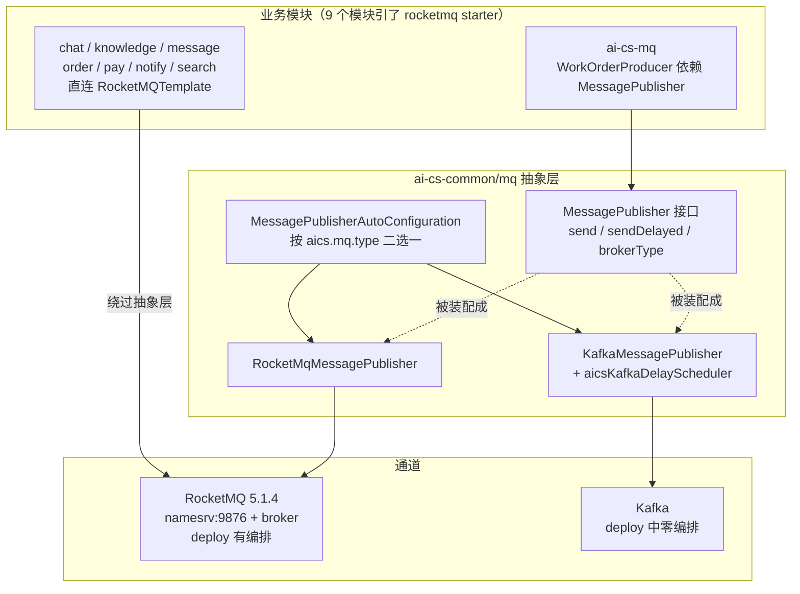
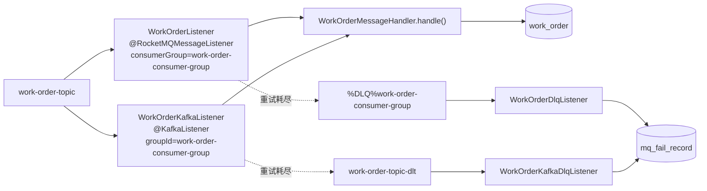
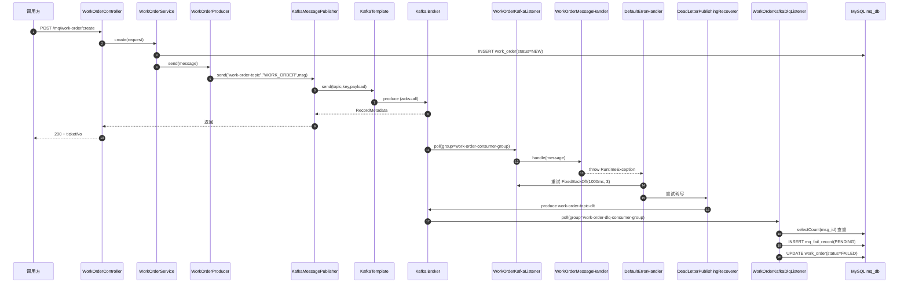

# Kafka 与 RocketMQ 双栈切换：两套语义都要维护，先算清切换期的账

> **一句话结论**：双栈的成本不在"多写一个实现类"，而在切换期必须**同时维护两套投递语义**——顺序范围、延迟能力、重试与死信、offset 提交、事务边界、序列化头；本仓只有 `ai-cs-mq` 真的双栈（生产/消费/死信/重推都能切），其余 6 个业务类仍直连 `RocketMQTemplate`，且 deploy 下**没有任何 Kafka 编排**，所以 Kafka 分支的准确状态是"代码通了、环境没上"。
> **阅读前置**：先读同目录 [02-RocketMQ消息队列](./02-RocketMQ消息队列.md) 与 [08-RocketMQ事务消息与死信队列](./08-RocketMQ事务消息与死信队列.md)（Tag、消费组、`%DLQ%`、事务消息回查）；需要能读懂 Spring Boot 的 `@ConditionalOn*` 条件装配。
> **证据基线**：Spring Boot 4.2.0 / Spring Cloud Alibaba 2025.1.0.0 / rocketmq-spring 2.3.0 / spring-kafka 由 Boot BOM 管理（本机 `~/.m2` 同时存在 3.1.4 与 4.2.0，kafka-clients 3.6.2 与 4.4.0）/ RocketMQ 5.1.4（deploy 镜像版本）。**A 级 0 条**：Kafka 与 RocketMQ 本体源码未入库，凡涉及 Broker 内部机制的结论一律写"未入库，依据官方文档/本项目代码"。全篇 B 级引用均当次 `read` 核对过行号。预计阅读 45 分钟。

---

## 0. 先看现象

三个症状，都出现在"把 `aics.mq.type` 从 `rocketmq` 改成 `kafka`"之后，而且**报错都不在启动阶段**——服务能起、接口能回 200，坏在语义。

**现象 A：消息顺序变了，而且没人报警。**

Kafka 侧消费日志是这条格式串（`ai-cs-mq/src/main/java/com/aics/mq/consumer/kafka/WorkOrderKafkaListener.java#L39-L40`）：

```text
收到 Kafka 工单消息: topic=work-order-topic, partition=?, offset=?, key=?
```

判据很简单：把 `partition` 那一列拉出来看，如果**所有工单都是同一个数字**，说明分区退化了；如果**同一张工单的多条消息落在不同数字**，说明顺序没了。根因在 `ai-cs-mq/src/main/java/com/aics/mq/producer/WorkOrderProducer.java#L28-L40`：`TAG = "WORK_ORDER"` 是**常量**，而 Kafka 侧把它当 Record Key 用：

```java
public static final String TAG = "WORK_ORDER";
// ...
messagePublisher.send(TOPIC, TAG, message);
```

常量 key ⇒ 所有消息同分区 ⇒ 分区内确实有序，但并行度被压成 1；哪天有人"顺手"把 key 改成 `null` 或改成 `ticketNo`，同一工单的消息就会散到不同分区，顺序立刻消失。**在 RocketMQ 上 `WORK_ORDER` 只是一个 Tag（二级分类），跟顺序毫无关系**——顺序要靠顺序消息（`MessageQueueSelector` / `ConsumeMode.ORDERLY`）另外开，而 `ai-cs-mq/src/main/java/com/aics/mq/consumer/WorkOrderListener.java#L33-L37` 的注解里根本没有 `consumeMode`，即 RocketMQ 侧默认也是并发消费、不保证顺序。所以真相是：**两侧都没有顺序保证，只是在 Kafka 上"错得更隐蔽"**。

**现象 B：rebalance 之后同一条消息被消费两次。**

Kafka 的消费组在成员变动（重启、扩容、心跳超时）时会重新分配分区，期间客户端可能直接抛：

```text
org.apache.kafka.clients.consumer.CommitFailedException
```

这个类确实存在于本项目解析到的 `kafka-clients 4.4.0`（`jar tf kafka-clients-4.4.0.jar | Select-String CommitFailedException` 能列出，见 §6 调试手法 3）。抛了之后 offset 没提交，分区被交给别的消费者，于是**同一条消息又被投一次**。更值得记住的是：`ai-cs-mq/src/main/resources/application-kafka.yml#L26-L33` 里配的

```yaml
      acks: all
      retries: 3
      properties:
        enable.idempotence: true
```

只保证"生产者 → Broker 不重复写"，**跟消费端重复消费一点关系都没有**。项目真正的兜底是业务幂等：`ai-cs-mq/src/main/java/com/aics/mq/service/WorkOrderMessageHandler.java#L42-L52` 按 `ticketNo` 更新状态（重复执行结果一致），死信侧按 `msgId` 查重并靠 `deploy/mysql/mq-workorder-init.sql#L40` 的 `UNIQUE KEY uk_msg_id (msg_id)` 兜底。所以判断"幂等到底靠什么"，看的是这张唯一索引，不是 `enable.idempotence`。

**现象 C：延迟消息能力凭空消失了，只有一个 warn。**

`ai-cs-common/src/main/java/com/aics/common/mq/kafka/KafkaMessagePublisher.java#L59-L62` 的真实日志文案：

```text
Kafka 无原生延迟消息，降级为进程内调度（重启会丢失）: topic={}, key={}, delayMillis={}
```

这句话在它自己的源码注释里就被反复提醒（L25-L27："只用于本地演示 / 非关键路径；进程重启即丢"）。但更致命的一点在这条 warn 覆盖不到的角落：订单超时取消**压根没走抽象层**——`ai-cs-order/src/main/java/com/aics/order/service/impl/OrderCreateTxService.java#L144` 直接

```java
rocketMQTemplate.syncSend("order-timeout-topic", /* 带延迟参数 */ ...);
```

也就是说，切 Kafka 时这条链路不会"降级"，它会**继续连接 RocketMQ**；如果 RocketMQ 已经下线，抛的是连接超时而不是任何 Kafka 相关异常——排查方向会被彻底带偏。

这些现象指向同一件事：**双栈不是"多一个备胎"，而是"两套语义都要维护"**。切换期的账要按语义算，不能按"编译通过 + 单测绿"算。

---

## 1. 整体地图

先看落地面：哪些代码真的能切，哪些只是看起来能切。



> **读图说明**：最关键的一根箭头是 `DIRECT --> RMQ`（绕过抽象层直连）。**看错它就会得出"全仓都能切 Kafka"的错误结论**——实际上 `aics.mq.type` 这个开关至今只在 `ai-cs-mq` 一个模块里有意义；第二关键的是 `K --> KFK` 这条虚线终点：deploy 目录里没有任何 Kafka 服务定义，所以这条边在物理上是断的。

| 组件 | 责任 | 谁调用它 |
|------|------|----------|
| `MessagePublisher` | 唯一的发布契约：`send`（同步语义，失败抛 `MessagePublishException`）、`sendDelayed`、`brokerType` | `WorkOrderProducer`、`WorkOrderController`（仅此两处，`select-string -Pattern MessagePublisher` 可核对） |
| `MessagePublisherAutoConfiguration` | 按 `aics.mq.type` 二选一装配实现，并注册 Kafka 降级延迟用的调度器 | Spring Boot 自动装配（已注册在 `ai-cs-common/src/main/resources/META-INF/spring/org.springframework.boot.autoconfigure.AutoConfiguration.imports`） |
| `RocketMqMessagePublisher` | 把 `(topic, key)` 拼成 `topic:tag` 目的地；把毫秒延迟映射到 18 级固定延迟 | `WorkOrderProducer`（间接） |
| `KafkaMessagePublisher` | `key` 直接做 Record Key；`send` 用 `future.get(timeout)` 收敛成同步语义；延迟降级为进程内调度 | 同上 |
| `WorkOrderListener` / `WorkOrderKafkaListener` | 两个 Broker 各自的入口，都委托同一个 `WorkOrderMessageHandler` | Broker 客户端 |
| `WorkOrderDlqListener` / `WorkOrderKafkaDlqListener` | 死信入口：RocketMQ 用 Broker 内建的 `%DLQ%` 主题，Kafka 用应用侧 `-dlt` 主题 | Broker 客户端 |
| `KafkaConsumerConfig` | 只在 `aics.mq.type=kafka` 时装配，重造"重试 → 死信"语义 | Spring Kafka 容器 |
| `MqController` | RocketMQ 运维接口（集群/Topic/消费组），底层用 `rocketmq-tools 5.1.4` | 运维/排查 |
| `RocketMQTemplate`（第三方） | RocketMQ 原生门面，被 6 个业务类直接注入 | chat/knowledge/message/order/pay |

消费侧的双入口结构（同一份业务逻辑，两条通道）：



> **读图说明**：中间那条 `RL --> H` 与 `KL --> H` 汇合是全文的立论基础——**业务逻辑只有一份，语义差异全在两端的"通道适配"里**；下边两条虚线才是花钱的地方：`%DLQ%` 是 Broker 免费送的，`-dlt` 是要自己造、自己建 topic、自己防递归的。看漏这一点会低估切换成本。

---

## 2. 关键概念与关键类

先对齐名词。第一次出现的术语都在括号里解释。

| 名称 | 位置 | 角色 | 关键方法 / 属性 |
|------|------|------|-----------------|
| `Topic` | 两侧都有 | 消息的逻辑分类 | RocketMQ `topic`；Kafka `topic`（同名可直接沿用） |
| `Tag` | RocketMQ 专有 | Topic 下的二级分类，消费端可 `selectorExpression` 过滤 | 本仓被借用成"业务类型"，见 `WorkOrderProducer.TAG` |
| `Record Key` | Kafka 专有 | 决定分区（同 key 同分区），不是过滤器 | `KafkaMessagePublisher#send` 第二参 |
| `MessageQueue` / `Partition` | RocketMQ / Kafka | 并行与顺序的最小单位 | 队列数 ≈ 分区数 ≈ 消费并行度上限 |
| `ConsumerGroup` / `groupId` | 两侧都有 | 消费进度（offset / 位点）的归属主体 | RocketMQ `consumerGroup`；Kafka `groupId` |
| offset 提交 | Kafka 核心语义 | 消费者自己提交"我消费到哪了" | 项目未显式配置 `ack-mode`，走 Spring Kafka 默认批量提交 |
| 位点（Broker 托管） | RocketMQ 核心语义 | 消费进度由 Broker 记录，客户端上报 | `%DLQ%`、重试队列都由 Broker 自动维护 |
| `DLQ` / `DLT`（死信） | 两侧语义相当、实现相反 | 重试耗尽的最终归宿 | RocketMQ：`%DLQ%<consumerGroup>`；Kafka：`<topic>-dlt`（应用侧造） |
| `MessagePublisher` | `ai-cs-common/src/main/java/com/aics/common/mq/MessagePublisher.java#L22-L47` | 双栈唯一契约，业务只认它 | `send` / `sendDelayed` / `brokerType` |
| `MessagePublisherAutoConfiguration` | `ai-cs-common/src/main/java/com/aics/common/mq/MessagePublisherAutoConfiguration.java#L31-L88` | 开关的落点 | 两个内部 `@Configuration` + 一个 `TaskScheduler` |
| `MqProperties` | `ai-cs-common/src/main/java/com/aics/common/mq/MqProperties.java#L15-L27` | `aics.mq.*` 绑定，默认值 `ROCKETMQ` | `type`、`sendTimeoutMillis=5000` |
| `MessageBrokerType` | `ai-cs-common/src/main/java/com/aics/common/mq/MessageBrokerType.java#L9-L16` | 只有两个值的枚举 | `ROCKETMQ` / `KAFKA` |
| `KafkaConsumerConfig` | `ai-cs-mq/src/main/java/com/aics/mq/config/KafkaConsumerConfig.java#L32-L70` | 把重试/死信语义"重装"回 Kafka | 两个 `ConcurrentKafkaListenerContainerFactory` |
| `DefaultErrorHandler` | Spring Kafka（未入库） | 消费异常的默认处理器：重试 + 恢复 | 构造入参 `(recoverer, FixedBackOff)` |
| `DeadLetterPublishingRecoverer` | Spring Kafka（未入库） | 重试耗尽后把消息转发到死信主题 | 项目自定义后缀常量 `-dlt` |
| `KafkaTemplate`（第三方） | Spring Kafka（未入库） | Kafka 侧门面，`send` 返回 `CompletableFuture`（异步），项目在 `KafkaMessagePublisher` 里 `get` 成同步 | `send(topic, key, value)` |
| `ConcurrentKafkaListenerContainerFactory` | `ai-cs-mq/src/main/java/com/aics/mq/config/KafkaConsumerConfig.java#L42-L70` | Kafka 的"监听器容器工厂"：一个监听方法 = 一个容器 = 一条独立消费线程（`concurrency` 未配则 1） | `setCommonErrorHandler` |
| `DefaultMQPushConsumer`（第三方） | rocketmq-spring（未入库） | RocketMQ 侧真正的消费者：客户端内部是 pull 循环，对业务表现为 push 回调，位点由 Broker 记录 | 由 `@RocketMQMessageListener` 自动装配 |

> ⚠️ **本文的诚实边界**：`24-源码分析/assets/source/` 里没有任何 Kafka / RocketMQ 本体源码摘录（我列过目录核对），因此**本篇 A 级证据为 0**。凡是"Broker 内部怎么做到"的话，只写官方文档口径或本项目代码能直接证明的部分；凡是能静态核对的（类是否存在、配置是否生效、常量几个、测试几绿），一律给出可复现命令和真实输出，归 C 级。

---

## 3. 原理与证据逐段精读

### 3.1 语义对照：`(topic, key)` 这一个签名到底映射成什么

**在干什么**：抽象层只设计了两个入参 `topic` 和 `key`，两侧各自解释。`ai-cs-common/src/main/java/com/aics/common/mq/rocketmq/RocketMqMessagePublisher.java#L73-L75`：

```java
static String destination(String topic, String key) {
    return StringUtils.hasText(key) ? topic + ":" + key : topic;
}
```

Kafka 侧则把同一个 `key` 原样传给 `kafkaTemplate.send(topic, key, payload)`（`KafkaMessagePublisher.java#L48-L49`）。接口 javadoc（`MessagePublisher.java#L9-L14`）把这张表写死了：`key` → RocketMQ 是 Tag，→ Kafka 是 Record Key。

**为什么这么设计**：两个 Broker 唯一都具备的"二级维度"就是这两样，硬凑在一起才能做到"业务代码零改动"。若不合并，业务方就得传一个"Tag 或 Key"的联合结构，抽象层反而泄漏了实现。

**换写法会怎样**：如果按 Kafka 语义设计（`key` 只做分区键），那 RocketMQ 侧就没有过滤能力，`WorkOrderProducer.TAG` 会退化成无意义的字符串；如果按 RocketMQ 语义设计（`key` 只做 Tag），Kafka 侧就永远无法控制分区——**所有消息落同一分区，并行度恒为 1**。

**常见坑**：这两套语义**不等价**。Tag 是"过滤器"（消费端可以选择只收某个 Tag，且不同 Tag 的消息照样并行），Key 是"路由器"（不能过滤，但决定顺序边界）。所以同一段业务代码在 RocketMQ 上"看起来并行、可分组"，到 Kafka 上要么全挤一个分区、要么顺序全乱——这正是 §0 现象 A 的机理。

### 3.2 延迟消息：18 级固定档位 vs 完全没有

**在干什么**：`RocketMqMessagePublisher.java#L25-L30` 硬编码了一张 18 项的换算表：

```java
private static final long[] DELAY_LEVEL_MILLIS = {
        1_000L, 5_000L, 10_000L, 30_000L,
        60_000L, 120_000L, 180_000L, 240_000L, 300_000L,
        360_000L, 420_000L, 480_000L, 540_000L, 600_000L,
        1_200_000L, 1_800_000L, 3_600_000L, 7_200_000L
};
```

`resolveDelayLevel`（L83-L94）做的是"向上取整到最近的档位"：遍历数组，返回第一个 `>= delayMillis` 的下标 +1（因为 RocketMQ 的 `delayLevel` 从 1 开始）；`delayMillis <= 0` 抛 `IllegalArgumentException`，超过 2 小时抛"RocketMQ 最大延迟级别为 2 小时…请改用定时任务或延迟队列"。

**为什么这么设计**：RocketMQ 的延迟是**服务端 18 个固定队列**（`SCHEDULE_TOPIC_XXXX` + 每个 level 一个队列，官方文档"定时/延时消息"章节），不是任意时刻触发器。代码必须把"我想要 90 秒"这种自然语言翻译成"档位 6（120 秒）"。向上取整而不是向下，是为了**宁晚不早**——订单超时取消宁可晚 30 秒，也不能提前把还在支付的订单关掉。

**换写法会怎样**：如果向下取整，90 秒变 60 秒，业务语义就变成"提前超时"；如果超 2 小时静默改成 7200 秒，调用方会以为"2 小时后到"，实际 2 小时到，看起来一样，但 3 小时的场景就会**静默丢单**——这正是代码选择抛异常的原因（L79 注释："而不是静默改小"）。

**常见坑**：Kafka 侧根本没有这张表。`KafkaMessagePublisher.java#L59-L71` 只是把任务塞给 `aicsKafkaDelayScheduler`（单线程 `ThreadPoolTaskScheduler`，`MessagePublisherAutoConfiguration.java#L78-L87`），重启即丢，且**单线程**意味着大量延迟任务会互相排队。所以任何"必须准时且不能丢"的延迟（订单超时、支付回调补单）**必须留在 RocketMQ 或改成定时任务扫描**，不能靠这个降级。

### 3.3 重试与死信：Broker 免费送的 vs 应用侧自己造的

**在干什么**：RocketMQ 侧只写一个注解就完事——`ai-cs-mq/src/main/java/com/aics/mq/consumer/WorkOrderListener.java#L32-L38`：

```java
@ConditionalOnProperty(prefix = "aics.mq", name = "type", havingValue = "rocketmq", matchIfMissing = true)
@RocketMQMessageListener(
        topic = WorkOrderProducer.TOPIC,
        consumerGroup = "work-order-consumer-group",
        maxReconsumeTimes = 3
)
public class WorkOrderListener implements RocketMQListener<WorkOrderMessage> {
```

Kafka 侧要在配置类里**手工搭出等价链路**（`ai-cs-mq/src/main/java/com/aics/mq/config/KafkaConsumerConfig.java#L49-L54`）：

```java
DeadLetterPublishingRecoverer recoverer =
        new DeadLetterPublishingRecoverer(castOperations(kafkaTemplate));
// 对齐 RocketMQ 侧 maxReconsumeTimes=3：固定 1s 间隔、额外重试 3 次
factory.setCommonErrorHandler(new DefaultErrorHandler(recoverer, new FixedBackOff(1_000L, 3)));
```

**为什么这么设计**：RocketMQ 把重试队列和 `%DLQ%` 做进了 Broker（重试是"另投一个 `%RETRY%<group>` 主题、按延迟级别递增"），客户端什么都不用管；Kafka 只提供"分区 + offset"，**没有死信概念**，所以 Spring Kafka 用 `DefaultErrorHandler`（重试）+ `DeadLetterPublishingRecoverer`（转发）在应用进程里补齐。

**换写法会怎样**：不自定义 `kafkaListenerContainerFactory` 而用 Boot 自动配置的那个？可以，但你拿不到自定义错误处理器——`KafkaConsumerConfig.java#L27-L30` 的类注释点明了原因：Boot 自动配置的容器工厂带 `@ConditionalOnMissingBean(name="kafkaListenerContainerFactory")`，**同名 Bean 会覆盖它**，这是拿到"错误处理控制权"的唯一入口。

**常见坑**（本文最值得记的一条）：注释说"对齐 `maxReconsumeTimes=3`"，但**两者并不等价**。
- RocketMQ 侧 `WorkOrderListener.java#L22-L23` 自己写着："按 `maxReconsumeTimes=3` 自动重试（默认延迟级别约 10s/30s/1m）"——重试间隔是**递增**的，总时长约 100 秒；
- Kafka 侧是 `FixedBackOff(1_000L, 3)`——**固定 1 秒**，约 3 秒后进死信。

对业务的实际影响：RocketMQ 下"1 分钟内可能自愈的抖动"（比如数据库主从切换 30 秒）会被重试覆盖；Kafka 下 3 秒就判死进了 `mq_fail_record`，需要人工重推。**这不是 bug，是没算清的账**——切栈时要按这个差异重新评估 `reconsumeTimes` 与死信告警阈值。

### 3.4 幂等键：`msgId` 与 `topic-partition-offset` 不是同一个东西

**在干什么**：两个死信消费者各自生成幂等键。RocketMQ 侧用 Broker 分配的全局消息 ID（`ai-cs-mq/src/main/java/com/aics/mq/consumer/WorkOrderDlqListener.java#L51-L52`）：

```java
Long exists = mqFailRecordMapper.selectCount(new LambdaQueryWrapper<MqFailRecord>()
        .eq(MqFailRecord::getMsgId, message.getMsgId()));
```

Kafka 侧自己拼一个（`ai-cs-mq/src/main/java/com/aics/mq/consumer/kafka/WorkOrderKafkaDlqListener.java#L48`）：

```java
String msgId = record.topic() + "-" + record.partition() + "-" + record.offset();
```

**为什么这么设计**：Kafka 没有 RocketMQ 那种全局 `msgId`，但 `(topic, partition, offset)` 三元组在**一个分区生命周期内**是天然的唯一定位符；项目把 `msg_id` 建成 `VARCHAR(64)` 并加唯一索引（`deploy/mysql/mq-workorder-init.sql#L40`），两者都能塞进去。`WorkOrderKafkaDlqListener.java#L28-L29` 的注释把这个权衡写清楚了。

**换写法会怎样**：如果 Kafka 侧改用消息体哈希做幂等键，两条内容相同的合法消息（比如用户连点两次同一工单）会被误判为重复而丢一条；如果用生产者生成的 UUID 并要求写进 header，则要额外保证"生产者重试时 header 不变"——比 `topic-partition-offset` 脆弱得多。

**常见坑**：`topic-partition-offset` 的"唯一性"依赖**分区不被删除重建**。一旦 `work-order-topic-dlt` 因为保留策略过期被删掉又自动重建，offset 从 0 重新开始，历史 `msg_id` 就会撞车，**新死信被当成旧死信跳过**（`WorkOrderKafkaDlqListener.java#L54-L57` 直接 `return`）。表现为"死信队列有消息，但 `mq_fail_record` 没新增"——排查时先看 `msg_id` 是否与旧记录重复。

### 3.5 装配：三层条件 + 一个不对称的默认值

**在干什么**：`MessagePublisherAutoConfiguration.java#L40-L53` 的 RocketMQ 分支挂了三个条件：

```java
@Configuration(proxyBeanMethods = false)
@ConditionalOnClass(RocketMQTemplate.class)
@ConditionalOnBean(RocketMQTemplate.class)
@ConditionalOnProperty(prefix = "aics.mq", name = "type", havingValue = "rocketmq", matchIfMissing = true)
static class RocketMqPublisherConfiguration {

    @Bean
    @ConditionalOnMissingBean(MessagePublisher.class)
    public MessagePublisher rocketMqMessagePublisher(RocketMQTemplate rocketMqTemplate,
                                                    MqProperties properties) {
```

Kafka 分支（L56-L59）结构相同，但 `@ConditionalOnProperty` **没有** `matchIfMissing`。

**为什么这么设计**：三层条件各管一件事——`@ConditionalOnClass` 管"这个模块有没有引入该 starter"（`ai-cs-common/pom.xml#L86-L95` 里两个 MQ 依赖都是 `<optional>true</optional>`，不向下游传递，所以"没引 MQ 的服务"也能正常启动）；`@ConditionalOnBean` 管"上游自动配置有没有真的造出可用客户端"；`@ConditionalOnProperty` 才是业务开关。另外类上还有 `@AutoConfigureAfter`（L33-L36）按**类名字符串**排序，保证本抽象层在 `RocketMQAutoConfiguration` / `KafkaAutoConfiguration` 之后装配——用字符串而不是 `Class` 引用，是为了在自己没引对应依赖时不触发 `ClassNotFoundException`。

**换写法会怎样**：`matchIfMissing = true` 只在 RocketMQ 分支上出现，意味着**不配 `aics.mq.type` 时默认走 RocketMQ**（`MqProperties.java#L19` 的字段默认值也是 `ROCKETMQ`），存量服务零改动；如果 Kafka 分支也 `matchIfMissing=true`，两个分支会在缺省配置下同时满足条件，装配出两个 `MessagePublisher`——虽然有 `@ConditionalOnMissingBean` 兜住，但谁先谁后取决于配置类顺序，属于"能跑但没人说得清"的状态。

**常见坑**：把 `aics.mq.type=kafka` 设到一个**只引了 rocketmq starter 的模块**（比如 `ai-cs-chat`），开关会**静默失效**：`spring-kafka` 是 optional、没有传递过来，`KafkaTemplate` 不在 classpath，`@ConditionalOnClass` 直接不通过；同时 RocketMQ 分支因为 `havingValue` 不匹配也不装配——最终**没有** `MessagePublisher` Bean。之所以没炸，是因为这些模块本来就直接注入 `RocketMQTemplate`（见 §1 表格），压根没用抽象层。这就是"开关只在一个模块有语义"的准确含义。

### 3.6 序列化与消息头：`__TypeId__` 是隐式契约

**在干什么**：Kafka 侧生产端用 `JsonSerializer`、消费端用 `JsonDeserializer`（`ai-cs-mq/src/main/resources/application-kafka.yml#L25-L43`）：

```yaml
    producer:
      key-serializer: org.apache.kafka.common.serialization.StringSerializer
      # JsonSerializer 会同时写入 __TypeId__ 头，消费端据此还原成原类型
      value-serializer: org.springframework.kafka.support.serializer.JsonSerializer
```

并在消费端显式放开白名单（L41-L43）：

```yaml
      properties:
        # 反序列化白名单：JsonDeserializer 默认拒绝未知包，必须显式放开业务 DTO 包
        spring.json.trusted.packages: com.aics.mq.dto
```

**为什么这么设计**：RocketMQ 侧 `RocketMQTemplate.syncSend(destination, payload)` 默认用 Jackson 把对象序列化成 JSON 字符串，消费端由 `RocketMQListener<WorkOrderMessage>` 的泛型还原类型；Kafka 侧没有"泛型推断"，只能靠消息头 `__TypeId__` 带上类名。白名单是安全防线：反序列化可以实例化任意类，是经典的利用面。

**换写法会怎样**：把 `value-deserializer` 换成 `StringDeserializer` 自己 `readValue`？可行，但要自己维护"主题 → DTO"映射，抽象层的 `send(topic, key, Object payload)` 就失去意义；把白名单写成 `*`？Spring Kafka 4.x 的报错文案里明确反对这种做法（见下方"常见坑"原文）。

**常见坑**：忘配 `trusted.packages` 时抛的 `IllegalArgumentException` 原文（我把它从本机 `spring-kafka-4.2.0.jar` 里 `DefaultJackson2JavaTypeMapper.class` 的常量池抠出来核对过，见 §6 手法 3）：

```text
The class '<类名>' is not in the trusted packages: <已信任包>. If you believe this class is safe to deserialize,
add its package via the 'spring.json.trusted.packages' property or the 'addTrustedPackages()' method.
Trusting all packages with '*' allows any type on the classpath to be deserialized,
so list the specific packages you need instead.
```

另一个坑：`__TypeId__` 里带的是**生产端的全限定类名**。一旦生产端把 DTO 从 `com.aics.mq.dto.WorkOrderMessage` 挪到别的包，消费端即使白名单里有新包，旧消息（含旧类名）也会反序列化失败——重放历史消息时尤其致命。

### 3.7 消费并行度：分区数 vs 队列数，以及"常量 key"这个隐形天花板

**在干什么**：两个 Broker 的并行度上限都是"分区/队列数"，而不是"消费者个数"。项目现状：

- Kafka 侧并发度没有显式配置，走 Spring Kafka 默认（每个 `@KafkaListener` 单线程）；`@KafkaListener` 只有 `topics` 和 `groupId` 两个属性（`WorkOrderKafkaListener.java#L34-L37`）。
- 分区数由谁决定？**没人决定**。`application-kafka.yml#L45-L48` 明确写着"项目未声明 `NewTopic` Bean，KafkaAdmin 会直接跳过 initialize"，配合 `admin.fail-fast: false`——即**主题靠 Broker 端 `auto.create.topics.enable` 自动创建**，分区数就是 Broker 默认值（Kafka 出厂默认 1）。

**为什么这么设计**：演示/本地环境图省事，不预建 topic。生产上这是反面教材：自动创建的分区数不可控，且一旦 topic 已存在，改分区数只能增不能减（减分区会破坏 key→partition 映射）。

**换写法会怎样**：声明 `NewTopic` Bean 并把 `admin.fail-fast` 设 `true`，启动即校验主题存在与分区数——多一层启动依赖（Broker 不可用则启动失败），但换来"幂等键与并行度可控"。

**常见坑**：把并行度当成"加机器就能扩"。Kafka 单分区只能被同一消费组的一个消费者消费，10 个实例消费 1 分区的 topic，**9 个在空转**；RocketMQ 同理（队列数固定为 4 时最多 4 个消费者有效）。而且叠加 §3.1 的常量 key，即使把分区数调到 12，因为 key 恒为 `WORK_ORDER`，**所有消息还是落同一个分区**，扩分区毫无收益。判断串行瓶颈的正确顺序是：先看 key 是否分散，再看分区数，最后才看实例数。

### 3.8 顺序性：两边的"保证范围"根本不是同一段

**在干什么**：RocketMQ 的顺序消息要求三件事同时成立——生产端顺序发（同一队列）、Broker 顺序写、消费端 `ConsumeMode.ORDERLY`（单队列单线程）。项目里三件都没有：`WorkOrderListener.java#L33-L37` 没写 `consumeMode`（默认 `CONCURRENTLY`），生产端走 `syncSend`（`RocketMqMessagePublisher.java#L44`，由 Broker 轮询选队列）。

Kafka 的顺序保证是**单分区内有序**：同 key → 同分区 → 分区内按 offset 严格有序；跨分区没有任何保证。

**为什么这么设计**：这不是"谁更强"，而是设计目标不同。RocketMQ 默认把顺序当**可选能力**（要显式开，因为顺序消费会牺牲吞吐和可用性——队列锁）；Kafka 把顺序**绑定在分区模型上**（免费但范围窄）。抽象层的 `send(topic, key, payload)` 没有"顺序模式"参数，所以**抽象层天然无法表达顺序语义**。

**换写法会怎样**：想让抽象层支持顺序，就得加 `sendOrdered(topic, shardingKey, payload)`，RocketMQ 侧实现成 `MessageQueueSelector`（按 shardingKey 哈希选队列）+ 消费端 `ORDERLY`，Kafka 侧就是现在的 `key` 语义——但那是**不兼容的升级**（顺序消费失败会阻塞整个队列，需要额外的"卡住告警"）。

**常见坑**：以为"用了 key 就有顺序"就够。Kafka 侧如果消费者抛异常并触发重试，Spring Kafka 的 `DefaultErrorHandler` 会**跳过**那条消息继续往后消费（seek 到失败记录之后），此时后续消息先被消费——**同 key 内也出现乱序**。这种"乱序 + 不丢消息"的组合极难在生产复现，只能在日志里靠 offset 跳变发现。

### 3.9 事务消息：RocketMQ 的"半消息 + 回查"在 Kafka 上没有对应物

**在干什么**：`ai-cs-pay/src/main/java/com/aics/pay/mq/PaySuccessMessageProducer.java#L52` 发半消息：

```java
var result = rocketMQTemplate.sendMessageInTransaction(TOPIC, msg, message);
```

配套的执行器/回查器在 `ai-cs-pay/src/main/java/com/aics/pay/mq/PaySuccessTransactionListener.java#L34-L67`：`executeLocalTransaction` 里把支付流水标记成功，返回 `COMMIT`/`ROLLBACK`；`checkLocalTransaction` 在 Broker 回查时按流水状态二次判定（`SUCCESS→COMMIT`、`PENDING→UNKNOWN`、其他`→ROLLBACK`）。

**为什么这么设计**：这是"本地数据库事务"与"消息发送"的最终一致方案——先发半消息（对消费者不可见），再执行本地事务，再提交/回滚；进程在中间宕机就靠回查。Kafka 的事务（`transactional.id` + `read_committed`）解决的是**跨分区多消息 + offset 的原子写**，**没有"回查本地数据库"这一步**，语义完全不同。

**换写法会怎样**：想用 Kafka 达到同样效果，只能改用**事务性发件箱（outbox）**：本地事务里同时写业务表和 outbox 表，再由独立 relay 把 outbox 投递到 Kafka（配合 `KafkaTemplate.executeInTransaction` 保证 relay 侧不重不漏）。这需要新增表、新增 relay 进程、新增对账任务——**不是改配置能解决的**。

**常见坑**：本仓 `select-string -Pattern 'executeInTransaction|KafkaTransactionManager'` 在全部 Java 源里**零命中**（16 处 `@Transactional` 全是数据库事务），说明 Kafka 事务链路从未落地。所以任何"支付成功事件切到 Kafka"的方案，都必须先补 outbox，否则就是**用至少一次投递冒充恰好一次**。RocketMQ 侧还有一条版本坑：`PaySuccessTransactionListener.java#L33` 注释写明"rocketmq-spring 2.3.0：`txProducerGroup` 属性已移除，监听器默认绑定主 `RocketMQTemplate`"——按老博客写 `@RocketMQTransactionListener(txProducerGroup="xxx")` 会直接编译失败。

### 3.10 协调组件与运维面：NameServer 的轻 vs KRaft 的重

**在干什么**：RocketMQ 的协调靠 NameServer——**无状态、节点间不通信、各自从 Broker 收心跳**（`deploy/docker-compose/docker-compose-all.yml#L106-L118` 起一个 `apache/rocketmq:5.1.4` 容器跑 `sh mqnamesrv`，端口 9876）。Kafka 侧的元数据协调在 4.x 是 KRaft（Controller quorum + 元数据日志）。

**为什么这么设计**：NameServer 刻意做"薄"——挂了不影响已有连接，重启后重新注册即可，代价是**元数据可能短暂不一致**（各自视角不同）；KRaft 用 Raft 保证元数据强一致，代价是**引入 controller quorum 这一新组件**（要奇数节点、要选主、要处理日志膨胀）。

**换写法会怎样**：本项目运维面已经被 RocketMQ 绑定了：`ai-cs-mq/src/main/java/com/aics/mq/controller/MqController.java#L30-L58` 提供 `/mq/cluster`、`/mq/topics`、`/mq/groups` 等接口，底层是 `rocketmq-tools 5.1.4`（`ai-cs-mq/pom.xml#L34-L38`）。切到 Kafka 后这套面板全部失效，得换成 Kafka AdminClient 或外置 UI。这是"双栈要维护两套运维面"的具体含义。

**常见坑**：以为 KRaft 只是"少装个 ZooKeeper"。实际要重算的是：controller quorum 的容量与磁盘、`__cluster_metadata` 日志的保留、controller 与 broker 的角色隔离（合设只适合单机/演示）。本仓没有 Kafka 编排，所以这些参数**一个都还没定**——这正是"环境未部署"的真实含义。

### 3.11 Spring 抽象层的真实差异：容器工厂 vs push 消费者

**在干什么**：两侧的"Spring 门面"不是同一形状的东西。Kafka 侧用 `KafkaTemplate` 发、用**监听器容器**收；RocketMQ 侧用 `RocketMQTemplate` 发、用 `@RocketMQMessageListener` 声明、由客户端起一个 push 消费者收。项目里这个差异落在监听方法签名上：

`ai-cs-mq/src/main/java/com/aics/mq/consumer/kafka/WorkOrderKafkaListener.java#L38` 收的是 `ConsumerRecord`：

```java
public void onMessage(ConsumerRecord<String, WorkOrderMessage> record) {
```

`ai-cs-mq/src/main/java/com/aics/mq/consumer/WorkOrderListener.java#L43` 收的是裸对象：

```java
public void onMessage(WorkOrderMessage message) {
```

容器工厂是 Kafka 侧独有的扩展点，项目为此显式覆盖了 Boot 的同名 Bean（`KafkaConsumerConfig.java#L42-L55`），再给死信单独造一个（`#L61-L70`，被 `WorkOrderKafkaDlqListener.java#L45` 的 `containerFactory = "workOrderDltContainerFactory"` 引用）。

**为什么这么设计**：Kafka 消费端是"拉 + 本地循环"，Spring 必须替你把 `poll` 循环、批量提交、异常处理、暂停/恢复都包进容器里，所以错误处理器、并发度、位点提交策略全挂在**容器**上；RocketMQ 把重试队列、位点、死信都放在 Broker 侧，客户端只剩"回调 + 重平衡"，所以 rocketmq-spring 只需要一个注解（默认装配 `DefaultMQPushConsumer`，未入库，依据 rocketmq-spring 官方文档）。一句话：**Kafka 的可调项在客户端，RocketMQ 的可调项在 Broker**。

**换写法会怎样**：如果不覆盖 `kafkaListenerContainerFactory`，就落到 Boot 自动配置的默认容器上，那个容器没有自定义 `DefaultErrorHandler`——即**没有重试、没有 `-dlt` 转发**，异常只会刷日志然后继续往后消费（等于静默丢消息）。反过来，给 RocketMQ 侧也统一成容器模型就得放弃 `@RocketMQMessageListener`，改成手写 `DefaultMQPushConsumer` + `registerMessageListener`，代价是失去注解式的消费组/重试配置。

**常见坑**：`consumer` 侧的批量与压缩两边**在本仓都是"单条、不压缩"**，别按网上教程想当然：

```powershell
# ai-cs-common + ai-cs-mq 全量 Java/YAML 里搜批量与压缩开关
(Get-ChildItem -Recurse -Include *.yml,*.yaml,*.java -Path ai-cs-common,ai-cs-mq |
  Select-String -Pattern 'compression\.type|batchListener|setBatchListener|concurrency\s*=').Count
```

真实输出：

```text
0
```

也就是说 `application-kafka.yml` 里既没有 `compression.type`（走 Broker/客户端默认，即不压缩），也没有 `concurrency`（每个 `@KafkaListener` 只有 1 条消费线程），更没有 `batchListener`。要开批量消费，监听方法签名必须从单条改成 `List<ConsumerRecord<...>>`，`WorkOrderKafkaListener.java#L38` 与 `WorkOrderKafkaDlqListener.java#L47` 都要改，属于**不兼容改动**；而 RocketMQ 侧对应的是 `consumeMode` / 批量拉取参数，同样没有开。切栈时把"批量"当成免费性能项，是最常见的乐观估计。

### 3.12 三种迁移策略：双写、双读、影子流量，以及它们共同的幂等前提

**在干什么**：迁移期的消息不是"切过去"而是"怎么并存"。本仓的代码形状决定了三种策略各自的改法：

| 策略 | 在代码里怎么落 | 前提 | 主要风险 |
|------|----------------|------|----------|
| 双写 | 要改 `MessagePublisherAutoConfiguration` 的 `@ConditionalOnMissingBean(MessagePublisher.class)`（`#L40-L53` / `#L56-L71`），改成"两个实现同时装配 + 一个组合发布器按顺序投两栈" | 两侧投递必须可重放、可对账；发布端要有统一消息 ID | 一侧成功一侧失败的中间态（无分布式事务），只能靠补偿或对账 |
| 双读 | 两套监听器同时订阅同一主题（`WorkOrderListener` + `WorkOrderKafkaListener` 都在，但受 `@ConditionalOnProperty` 互斥），改成两个独立条件即可 | 消费端必须幂等且无副作用，否则一次消息写两遍库 | 下游压力翻倍；两边处理结果不一致时无法自动判定谁对 |
| 影子流量 | 新栈只"旁路观察"：把 Kafka 监听结果写进独立的影子表/日志，**不更新业务状态**（参照 `WorkOrderMessageHandler.java#L42-L52` 的更新语句，影子副本里删掉） | 要能把影子链路在任意时刻关掉，且不留业务痕迹 | 影子链路自身故障会污染排障视线 |

**为什么这么设计**：三者都是"用重复计算换确定性"，代价从低到高分别是影子 < 双读 < 双写。之所以都强制要求幂等，是因为**迁移期必然出现重复投递**——双写天然两倍投递，双读天然两倍消费，影子也要重放历史消息回溯校验。

**换写法会怎样**：直接"改开关 + 重启"是第四种做法，也是最省事的，但它把风险集中在一次发布里：一旦语义不对，回滚窗口等于"重启的那几分钟"，且期间产生的数据没有对照物。所以只在**非关键链路**（如 `knowledge-doc-sync-topic` 这类可重建的索引同步）上可接受。

**常见坑**：本仓的幂等其实是两层拼起来的——业务层按 `ticketNo` 更新状态（重复执行结果一致），存储层靠唯一索引兜底（`deploy/mysql/mq-workorder-init.sql#L40` 的 `UNIQUE KEY uk_msg_id (msg_id)`，以及 `work_order` 上的 `uk_ticket_no`）。做双写时**只有存储层唯一索引会真的拦住重复**，`mq_fail_record` 的查重是"先查后插"，两个并发消费同一消息仍可能同时通过检查，此时靠 `DuplicateKeyException` 兜——代码里没有捕获它，所以会看到异常日志但不影响数据正确性。看到这条异常不要当 bug，先确认 `msg_id` 是否重复。

### 3.13 切流开关与回滚：为什么"全局单值"撑不住灰度

**在干什么**：现在的开关只有一个维度——`aics.mq.type`（`ai-cs-common/src/main/java/com/aics/common/mq/MqProperties.java#L15-L27`，字段 `type` 默认 `ROCKETMQ`），粒度是**整个应用**。它被三个地方读取：自动配置的两个 `@ConditionalOnProperty`、两个监听器的 `@ConditionalOnProperty`、以及 `GET /mq/broker-type` 的回显。

**为什么这么设计**：单值是"零改动上线"的最短路径，存量服务不配就走 RocketMQ。但它只支持"整机切换"，无法回答"只把 `work-order-topic` 先切过去、`chat-message-topic` 留在 RocketMQ"这个最常见的需求。

**换写法会怎样**：按 topic 灰度要把单值扩成映射 `aics.mq.topics.<topic>.type`（绑定成 `Map<String, MessageBrokerType>`），并在三处同时改造：
1. `MqProperties.java` 加字段与默认值回落逻辑（未配的 topic 走全局 `type`）；
2. 发布端不再"装配哪个 Bean 用哪个"，而是一个组合实现按 topic 路由到两个具体实现；
3. 消费端两个监听器的条件从 `aics.mq.type` 改成"该 topic 是否指向自己"，否则会出现两个监听器同时订阅同一主题。

**常见坑（回滚）**：回滚不是"把开关改回去"就完事，四件事必须先想好：
- **未消费完的消息**：Kafka 里已被消费但业务未提交的部分，回滚后不会自动补投；要有"按 offset 区间重放"的脚本或"以业务表为准反查缺失"的对账 SQL。
- **位点不对齐**：RocketMQ 的位点由 Broker 托管、Kafka 由消费者提交，两边没有共同坐标。回滚后必须给 RocketMQ 侧一个明确的起始位点（如按时间戳回溯），否则会重放或漏读。
- **死信残留**：`-dlt` 主题与 `%DLQ%` 是两套，回滚后 `-dlt` 里的消息没人消费，需要一次性搬运进 `mq_fail_record`（复用 `WorkOrderKafkaDlqListener` 的落库逻辑）。
- **残留记录**：`mq_fail_record` 里 `status=PENDING` 的记录来自哪套栈无法从表结构分辨，建议切流前先加一列 `broker_type`，否则回滚后重推会重复处理。

---

## 4. 一次完整执行时序

以 Kafka 模式、`simulateFail=true`（触发全链路）为例。这是唯一能同时走通"生产 → 消费失败 → 重试 → 死信 → 落库 → 重推"的路径。



> **读图说明**：两个关键箭头——第 12 步 `L->>H` 的返回值是**异常而不是结果**（`WorkOrderMessageHandler.java#L36-L39` 里 `simulateFail=true` 直接 `throw new RuntimeException("模拟工单消费失败: ticketNo=...")`），以及第 18 步 `RP->>B` 是**应用进程在发消息**（不是 Broker 行为）。看错后者会以为"Kafka 会自动把坏消息挪到死信主题"，从而漏掉"转发目标主题必须存在"这个前置条件。

**哪一步失败报什么错**（按可观测性排序）：

| 步骤 | 失败表现 | 关键判据 |
|------|----------|----------|
| 5-6 生产 | `MessagePublishException`（包装后抛出），日志 `Kafka 消息发送失败: topic=...` | `KafkaMessagePublisher.java#L54-L56` 的 catch 分支；根因多为 broker 不可达或 `sendTimeoutMillis` 超时 |
| 6 生产 | `TimeoutException`（`future.get(5000ms)` 超时） | `KafkaMessagePublisher.java#L48-L49`，`aics.mq.send-timeout-millis` 控制上限 |
| 10-11 消费 | 业务异常直接抛出，**不包装** | `WorkOrderMessageHandler.java#L38`，消息体、工单号都在异常文本里 |
| 12-13 重试 | 日志刷 3 次同样的异常栈 | `FixedBackOff(1_000L, 3)`，间隔固定 1 秒 |
| 14-15 转发 | `DeadLetterPublishingRecoverer` 抛错（主题不存在 / 序列化失败） | 转发本身失败会向上抛，此时**原 offset 未提交**，消息会被反复重投 |
| 16-17 死信消费 | 日志 `死信消息已落库，跳过: msgId=...` | 说明幂等键撞了（见 §3.4 常见坑） |
| 17 落库 | `DuplicateKeyException`（`uk_msg_id`） | `deploy/mysql/mq-workorder-init.sql#L40`，被查重逻辑先挡住才不会撞 |

RocketMQ 模式下的差异只有三处：第 5 步换成 `rocketMqTemplate.syncSend("work-order-topic:WORK_ORDER", payload)`；第 12-15 步换成 Broker 内的 `%RETRY%work-order-consumer-group`（延迟递增，约 10s/30s/1m）；第 16 步换成 `%DLQ%work-order-consumer-group`。**业务侧看到的终态完全一致**（`NEW → FAILED → 重推 → DONE`），这是抽象层存在的唯一理由。

---

## 5. 设计取舍

| 取舍点 | 本项目选了 | 代价 | 什么时候该反过来 |
|--------|-----------|------|-----------------|
| 抽象粒度 | 只抽象**发布端**（`MessagePublisher`），消费端各写两个监听器 | 消费语义（重试/死信/顺序）无法统一，只能靠"业务处理类复用"对齐 | 如果消费端也要统一，得引入 Spring Cloud Stream / 自研注解 + 双实现，复杂度陡增 |
| 默认值 | `matchIfMissing=true` 偏向 RocketMQ | Kafka 分支必须显式配两处（`aics.mq.type` + profile），漏一个就静默失效 | 若 Kafka 是主栈，默认值应反转，并让 RocketMQ 分支显式声明 |
| `key` 语义 | 一参两用（Tag / Record Key） | 顺序与过滤语义无法同时表达，常量 key 会把并行度压成 1 | 有强顺序需求时应加独立参数 `shardingKey`，而不是复用 `key` |
| 延迟消息 | RocketMQ 走 18 级档位、Kafka 降级为进程内调度 | Kafka 侧不可靠（重启丢、单线程排队） | 强延迟需求必须留在 RocketMQ，或换时间轮 + 定时任务扫描（可参考 [07-Redisson分布式锁](./07-Redisson分布式锁.md) 里的延迟手段对比） |
| 死信 | RocketMQ 用 Broker 内建 `%DLQ%`，Kafka 应用侧造 `-dlt` | Kafka 侧要自己防递归（`FixedBackOff(0,0)` 的 `workOrderDltContainerFactory`） | 想统一就统一在**应用侧**（都落 `mq_fail_record`），代价是失去 Broker 的原生重试队列 |
| 事务消息 | 支付链路继续用 RocketMQ 事务消息 | Kafka 侧必须补 outbox 才能等价 | 真的要用 Kafka 承载支付事件时，先建 outbox 表 + relay，再谈切换 |
| 部署 | 只有 RocketMQ 有 compose 编排（`deploy/docker-compose/docker-compose-all.yml#L106-L138`） | Kafka 分支"代码能跑、环境没上"，无法端到端验证 | 真上 Kafka 前先补齐编排 + 预建 topic + 分区数规划 |

**双栈 vs 单栈的成本对比**（本节是选型判断，不是实测数字；每格都标注"凭什么这么判断"）：

| 维度 | 单栈 RocketMQ（当前） | 单栈 Kafka | 双栈（本仓目标态） | 判断依据 |
|------|----------------------|-----------|-------------------|----------|
| 运维组件 | namesrv + broker，`deploy/docker-compose/docker-compose-all.yml#L106-L138` 两个容器搞定 | 4.x 起只需 broker + controller quorum（KRaft），但至少 3 节点才有多副本语义 | 两套都要，且**两套监控面板**（`MqController` 只认 RocketMQ） | 本仓编排现状 + `ai-cs-mq/pom.xml#L34-L38` 的 `rocketmq-tools` 依赖 |
| 磁盘 | 所有 topic 共享 commitlog，顺序写，单机磁盘利用率高 | 按 partition 分段日志，分区数 × 副本数直接放大文件数与索引开销；配 `compression.type` 才能省 | 两份存储、两份保留策略、两次容量规划 | 两侧存储模型（未入库，依据各自官方文档的存储设计章节）；压缩项本项目**未配置**（见 §3.11 实测输出 0） |
| 语义能力 | 延迟消息（18 级）、事务消息、顺序消息、`%DLQ%` 全部内建 | 只有分区顺序 + 生产端幂等；延迟/死信/事务回查都要应用侧补 | 补齐成本按"每个能力一套应用侧实现"计（`KafkaConsumerConfig` 已经示范了"补死信"要写多少代码） | §3.2 / §3.3 / §3.9 的逐段对照 |
| 社区与生态 | 中文资料多、与阿里系（Nacos/Sentinel）同源，Spring Cloud Alibaba 线配套完整 | 全球生态最大，CDC / 流处理 / 托管服务（各云 MSK、Confluent）选择最多 | 需要同时跟两条升级线（rocketmq-spring 2.3.0 与 Spring Kafka 4.x 的 API 变更都在发生） | 本仓 pom：`rocketmq-spring.version=2.3.0` 自行管理，`spring-kafka` 由 Boot 4.2.0 BOM 管理 |
| 人力与排障 | 一套日志、一套面板、一个心智模型 | 同左 | **排障成本非线性上升**：任何一个"消息没到"的问题，第一步都要先判定"走的哪套栈"（见 §6 坑 8） | 本项目 6 个业务类直连 `RocketMQTemplate`，抽象层只覆盖发布端 |

一句话读这张表：双栈省下的是"选型自由"，付出的是**语义补齐 + 运维面翻倍 + 排障路径变长**；只有当"确实需要 Kafka 生态里的某项能力（如大规模流处理、跨云托管）"时，这笔账才算得过来。

**可扩展点清单**（想做下一步时，按这个顺序改，每一格都指到具体文件）：

1. **把抽象层下沉到消费端**：新增 `MessageConsumer` 抽象 + 两个 `@ConditionalOnProperty` 实现，替换现在的双监听器写法（改 `ai-cs-mq/src/main/java/com/aics/mq/consumer/` 下的四个类）。
2. **让开关真正全仓有效**：把 `spring-kafka` 从 `<optional>` 提为普通依赖（改 `ai-cs-common/pom.xml#L91-L95`），并给每个服务补 `spring.kafka.*` 配置。
3. **给抽象层加顺序参数**：`sendOrdered(topic, shardingKey, payload)`，RocketMQ 侧用 `MessageQueueSelector`（改 `RocketMqMessagePublisher.java`），Kafka 侧复用 key。
4. **补齐 Kafka 编排**：在 `deploy/docker-compose/` 下新增 Kafka 服务 + topic 初始化容器（当前为零），并声明 `NewTopic` Bean 让 `admin.fail-fast` 有意义。
5. **统一重试节奏**：把 `FixedBackOff(1_000L, 3)` 改成 `ExponentialBackOff`（约 10s/30s/1m）以真正对齐 RocketMQ，改 `ai-cs-mq/src/main/java/com/aics/mq/config/KafkaConsumerConfig.java#L52`。
6. **按 topic 灰度切流**：把全局 `aics.mq.type` 拆成 `aics.mq.topics.<topic>.type`，用 `Map<String, MessageBrokerType>` 绑定，实现"一个服务内两套 Broker 并存"。

---

## 6. 踩坑与调试手法

**坑 1：`aics.mq.type=kafka` 设了但没生效，`/mq/broker-type` 仍返回 ROCKETMQ。**

原因只有两个：漏了 `SPRING_PROFILES_ACTIVE=kafka`（`application-kafka.yml` 才提供 `spring.kafka.*` 与 `aics.mq.type=kafka`），或者 Nacos 上的 `ai-cs-mq.yml` 覆盖了本地值（`application.yml#L22-L24` 的 `spring.config.import` 顺序里 Nacos 在后）。判据：启动日志里搜 `aics.mq.type=`——两个实现各有一句（`MessagePublisherAutoConfiguration.java#L50` / `#L68`），装配了哪个一搜就知道。

**坑 2：Kafka 模式下还在刷 RocketMQ 连接告警。**

因为 `ai-cs-mq` 同时保留了 rocketmq starter（`ai-cs-mq/pom.xml#L40-L44`）。`application-kafka.yml#L17-L19` 已用 `spring.autoconfigure.exclude` 排除 `RocketMQAutoConfiguration`；如果你自己新加服务，记得照样补这一段，否则 `RocketMQTemplate` 会被创建并周期性连 NameServer。

**坑 3：怎么确认"这个异常类/这段报错文案"是哪个 jar 里的。**

这是本机唯一能做的"真调试"之一（无 docker、无 Broker）。`jar tf` 看类是否存在：

```powershell
& jar tf "$env:USERPROFILE\.m2\repository\org\apache\kafka\kafka-clients\4.4.0\kafka-clients-4.4.0.jar" |
  Select-String "CommitFailedException|RebalanceInProgressException|RecordTooLargeException"
```

真实输出：

```text
org/apache/kafka/clients/consumer/CommitFailedException.class
org/apache/kafka/common/errors/RebalanceInProgressException.class
org/apache/kafka/common/errors/RecordTooLargeException.class
```

再看报错文案在哪个类里（`.class` 的常量池是 UTF-8，`findstr` 能直接搜到）：

```powershell
$dest = Join-Path $env:TEMP "sk420"; New-Item -ItemType Directory -Force -Path $dest | Out-Null
Copy-Item "$env:USERPROFILE\.m2\repository\org\springframework\kafka\spring-kafka\4.2.0\spring-kafka-4.2.0.jar" "$dest\sk.jar"
Push-Location $dest; & jar xf sk.jar org/springframework/kafka/support/mapping/DefaultJackson2JavaTypeMapper.class; Pop-Location
& findstr /C:"is not in the trusted packages" "$dest\org\springframework\kafka\support\mapping\DefaultJackson2JavaTypeMapper.class"
```

真实输出（截取命中片段）：

```text
The class ' ' is not in the trusted packages: . If you believe this class is safe to deserialize,
add its package via the 'spring.json.trusted.packages' property or the 'addTrustedPackages()' method.
```

**怎么读**：先用 `jar tf` 定位"类存在与否"，再用 `findstr` 定位"这句人话是哪个类说的"。两个动作都不需要联网、不需要 Broker，30 秒内出结果——比搜索引擎可靠，因为它读的是**你项目真正解析到的那个版本**。

**坑 4：死信主题不存在，转发直接失败。**

`DeadLetterPublishingRecoverer` 会往 `<topic>-dlt` 发消息，但本仓没有预建任何 topic（`application-kafka.yml#L45-L48` 的注释说明 `KafkaAdmin` 会跳过 initialize）。若 Broker 关了自动建主题，第 15 步必失败，且因为 offset 未提交，原消息会**反复重投 + 反复转发失败**。判据是消费日志里同一 offset 反复出现。修复方向：预建官方主题 + DLT 主题，并把 `admin.fail-fast` 设为 `true` 让问题在启动期暴露。

**坑 5：死信消费失败导致 `-dlt-dlt-dlt` 无限递归。**

所以 `KafkaConsumerConfig.java#L61-L70` 专门给了死信专用容器工厂，用 `new DefaultErrorHandler(new FixedBackOff(0L, 0))`——不重试、不再转发。**如果你复制这段配置做新主题，务必保留这个"零重试"；用默认工厂接死信是最容易埋的雷。**

**坑 6：`@KafkaListener` 启动就报监听器不唯一 / 容器工厂找不到。**

`KafkaConsumerConfig` 里 Bean 名必须**正好**叫 `kafkaListenerContainerFactory`（覆盖 Boot 自动配置）和 `workOrderDltContainerFactory`（被 `containerFactory` 属性引用，`WorkOrderKafkaDlqListener.java#L45`）。改名不会报"名字错"，而是报"找不到容器工厂"或"多个候选"，容易绕远路。

**坑 7：文档/配置里的路径断链。**

`application-kafka.yml#L9` 的注释指向 `12-Kafka与RocketMQ多消息中间件切换实战.md`，而真实文件名是本文 `12-Kafka与RocketMQ双栈切换.md`。判据（真实输出）：

```powershell
Test-Path "learning-docs\04-中间件\12-Kafka与RocketMQ多消息中间件切换实战.md"   # False
Test-Path "learning-docs\04-中间件\12-Kafka与RocketMQ双栈切换.md"               # True
```

这类断链靠 `node tools/check-doc.mjs 04-中间件` 一键发现，比人工点链接快。

**坑 8：排查顺序建议（省钱）**。①`GET /mq/broker-type` 确认装配的是谁（`ai-cs-mq/src/main/java/com/aics/mq/controller/WorkOrderController.java#L41-L49`，端口 8090 见 `ai-cs-mq/src/main/resources/application.yml#L3`）；②启动日志 grep `aics.mq.type=`；③RocketMQ 侧 `GET /mq/topics`、`GET /mq/groups` 看主题与积压（`MqController.java#L36-L51`）；④Kafka 侧本机无 Broker，只能看应用日志里的 `partition`/`offset`。**先确认"跑在哪套栈上"，再谈语义问题**——顺序错乱、重复消费、延迟失效这几类现象，一半是"以为切了其实没切"。

---

## 7. ⚠️ 版本差异

| 旧写法（网上常见 / 本仓旧稿） | 当前基线 | 变化点 | 迁移动作 |
|------|----------|--------|----------|
| `apache/kafka:3.7.1` + `profiles: ["kafka"]` + `kafka-init` 容器 + `kafka-topics.sh --create --partitions 3` | **本仓 deploy 下 kafka 零命中**（`Select-String -Path deploy\docker-compose\*.yml -Pattern kafka` 返回 0 条）；RocketMQ 编排在 `deploy/docker-compose/docker-compose-all.yml#L106-L138` | 旧稿把"设计草案"写成了"已落地"，且当时也不存在这份 compose | 若要落地：新增 Kafka 服务 + topic 初始化容器，并同步更新本文与 `09-AI与治理中间件部署` |
| "本次新增 23 个单测 / 共 45 个测试全绿" | 实测 MQ 相关 **26 个**：`ai-cs-mq` 7（MqControllerTest 3 + WorkOrderMessageHandlerTest 4）、`ai-cs-common` 19（KafkaMessagePublisherTest 5 + MessagePublisherAutoConfigurationTest 7 + RocketMqMessagePublisherTest 7），全 0 失败 | 旧稿数字对不上 `target/surefire-reports` | 引用测试数一律以 surefire 报告为唯一口径 |
| `Kafka 4.0 起 KRaft 是唯一模式`（旧稿断言） | 本仓 Kafka **无版本基线**（无编排、无 BOM 覆盖）；`spring-kafka`/`kafka-clients` 由 Boot 4.2.0 BOM 决定，本机 `~/.m2` 同时存在 spring-kafka 3.1.4+4.2.0、kafka-clients 3.6.2+4.4.0 | 未跑 `dependency:tree`，不给单一版本结论 | 需要用 Kafka 时先补编排与版本声明，再回来更新此表 |
| `SeekToCurrentErrorHandler`（Spring Kafka 2.x 写法） | `DefaultErrorHandler` + `FixedBackOff`（`KafkaConsumerConfig.java#L52`） | 2.8 起 `SeekToCurrentErrorHandler` 废弃，3.x/4.x 用 `DefaultErrorHandler`，构造签名改为 `(ConsumerRecordRecoverer, BackOff)` | 照抄老博客会编译失败 |
| `@RocketMQTransactionListener(txProducerGroup="xxx")` | 只写 `@RocketMQTransactionListener`（`ai-cs-pay/src/main/java/com/aics/pay/mq/PaySuccessTransactionListener.java#L33-L34`，注释说明 txProducerGroup 已移除） | rocketmq-spring 2.3.0 移除该属性，监听器默认绑定主 `RocketMQTemplate` | 删除属性；多模板场景需显式指定模板 |
| `spring.kafka.consumer.properties.spring.json.trusted.packages=*` | 显式列包 `com.aics.mq.dto`（`application-kafka.yml#L43`） | 4.x 报错文案明确反对 `*`（见 §3.6 原文） | 改成具体包名，逐模块维护 |

> ⚠️ **一条容易搞混的"伪对齐"**：`maxReconsumeTimes=3`（RocketMQ，间隔递增约 10s/30s/1m）与 `FixedBackOff(1_000L, 3)`（Kafka，固定 1s）**看起来都是"3 次"，实际总等待差两个数量级**。代码注释与真实行为不一致时，以行为为准。

---

## 8. 面试高频问与答

1. Kafka 的 Topic/Partition 与 RocketMQ 的 Topic/Queue，在"并行 + 顺序"这两件事上分别怎么对应？
2. 为什么 RocketMQ 的消费进度（位点）由 Broker 托管，而 Kafka 要消费者自己提交 offset？这带来哪些故障模式差异？
3. consumer group 在两边分别解决什么问题？为什么 Kafka 的 rebalance 会造成重复消费和消费停顿？
4. RocketMQ 的 `%DLQ%` 与 Kafka 的 DLT 主题，在"谁负责创建、谁负责重试、谁负责防递归"上有什么本质区别？
5. Kafka 有没有原生延迟消息？如果没有，业界常见的三种替代方案是什么，各自的失败模式是什么？
6. 「Kafka 事务」和「RocketMQ 事务消息」的语义差别在哪？为什么前者不能替代后者？
7. 用 `(topic, partition, offset)` 做幂等键有什么前提？什么情况下会失效？
8. 把 RocketMQ 迁到 Kafka，同一个"至少一次"投递的业务，幂等应该做在哪一层？
9. Kafka 依赖 ZooKeeper/KRaft、RocketMQ 依赖 NameServer，这两种元数据协调方式在可用性与运维成本上如何取舍？
10. `KafkaTemplate` 是异步的、`RocketMQTemplate.syncSend` 是同步的，Spring 抽象层的 `send` 应该暴露哪种语义？为什么？
11. 双写、双读、影子流量三种迁移策略分别要求业务具备什么前提？为什么三者都对幂等有硬要求？
12. 按 topic 灰度切流怎么做？切流开关放在配置中心、数据库还是代码里，各自的回滚代价是什么？
13. 分区数/队列数、消费者实例数、`concurrency` 三者之间是什么关系？为什么"加实例"经常不提速？
14. 消费端序列化用了 `JsonSerializer/JsonDeserializer`，`__TypeId__` 头带来哪些运维约束？
15. 从成本和社区生态看，双栈相比单栈每年多付出什么？（提示：从运维、磁盘、人力、社区四个维度答）
16. Spring Kafka 的 `KafkaListenerContainer` 与 RocketMQ 的 `DefaultMQPushConsumer`，在"谁负责拉消息、谁负责提交位点、谁负责重试"这三件事上分别怎么分工？
17. 批量消费与压缩为什么不是"打开就快"？开启批量后哪些代码必须跟着改，为什么它属于不兼容改动？

---

## 9. 动手练习

**练习 1：把开关的"静默失效"变成可观测。**

在 `ai-cs-mq` 启动时打一条日志，输出 `aics.mq.type` 的原始值、装配出的 `MessagePublisher` 实现类名、以及 classpath 上是否存在 `KafkaTemplate`。改 `ai-cs-mq/src/main/java/com/aics/mq/controller/WorkOrderController.java#L41-L49` 不够——要在自动配置层或一个 `ApplicationRunner` 里做。
**验收标准**：设 `aics.mq.type=kafka` 但**不激活** profile 启动时，日志能明确指出"缺少 spring.kafka 配置导致 KafkaTemplate 未创建，开关被忽略"；`GET /mq/broker-type` 的返回值与该日志一致。

**练习 2：把重试节奏真正对齐。**

把 `KafkaConsumerConfig.java#L52` 的 `FixedBackOff(1_000L, 3)` 换成指数退避（约 10s/30s/1m），并让 `WorkOrderKafkaDlqListener` 落库的 `reconsumeTimes` 不再是硬编码的 `3`。
**验收标准**：单测覆盖"第 3 次失败后转发死信"的调用次数；文档中 §3.3 的"伪对齐"说明随之改成"已对齐"，并给出两边的总等待时长估算。

**练习 3：用静态分析给"双栈落地面"出一张事实表。**

用 pwsh 统计：全仓 `@RocketMQMessageListener` 出现次数与文件数、`@KafkaListener` 文件数、直接注入 `RocketMQTemplate` 的业务类、`String TOPIC*` 常量清单、各模块 pom 里 `spring-kafka` 与 `rocketmq-spring-boot-starter` 的分布。
**验收标准**：输出与本文 §1 表格完全一致（9/8、2、6 个类、5 个常量、9 个模块引 rocketmq 而只有 2 个引 spring-kafka）；任何一项对不上，说明仓库变了，要顺手更新本文。

**练习 4：把常量 key 的并行度问题做成实验。**

写一个不改仓库的计划：假设 `work-order-topic` 有 6 个分区，分别用 `key=WORK_ORDER`（常量）、`key=ticketNo`、`key=null` 三种方式生产 100 条消息。
**验收标准**：能准确预测三种方式的分区分布（全落 1 个分区 / 大致均匀且同工单同分区 / 轮询均匀但同工单可能不同分区），并说明哪种组合能同时满足"同工单有序 + 高并行"（答案：`key=ticketNo`）。

**练习 5：为支付事件设计 outbox 方案。**

在不改动 `ai-cs-pay` 现有事务消息链路的前提下，写一份"若必须迁到 Kafka"的设计：新增 outbox 表 DDL、relay 的投递与标记逻辑、重复投递的幂等键、以及灰度期双写的一致性校验 SQL。
**验收标准**：方案能回答三个问题——relay 宕机重启后如何不重复/不丢；`PayTransaction` 与 outbox 是否在同一事务；灰度期如何证明"Kafka 与 RocketMQ 消费结果一致"。

**练习 6：写一份"回滚预案"。**

假设已按 topic 把 `work-order-topic` 切到 Kafka 三天，现在要回滚到 RocketMQ。
**验收标准**：预案包含①切换期的消息处理（Kafka 里未消费完的消息怎么办）②offset/位点如何对齐避免重放三天前的数据③回滚判据（哪个指标超阈值就回滚）④回滚后如何清理 `-dlt` 主题与残留 `mq_fail_record`。

---

## 小结

- **双栈的真正成本是语义成本**：顺序范围（单分区 vs 顺序消息）、延迟能力（18 级 vs 无）、重试节奏（递增 vs 固定 1s）、死信归属（Broker vs 应用）、事务边界（回查 vs 跨分区原子写）——五条里有四条**不可能靠一个 `MessagePublisher` 接口抹平**。
- **落地面比想象的小**：`aics.mq.type` 只在 `ai-cs-mq` 有效；6 个业务类仍直连 `RocketMQTemplate`，`spring-kafka` 只在 `ai-cs-common`（optional）与 `ai-cs-mq` 里出现，deploy 下 Kafka 编排零命中——Kafka 分支的准确状态是"代码通了、环境没上"。
- **抽象层只该抽象"变的部分"**：它成功统一了发布端的调用形态与失败语义（同步抛 `MessagePublishException`），但没有、也不该假装能统一消费端语义；消费侧的"语义一致"是靠 `WorkOrderMessageHandler` 这一份业务逻辑守住的。
- **幂等是切换期的硬门槛**：RocketMQ 用 Broker 的 `msgId`，Kafka 用 `topic-partition-offset`，两者都靠 `mq_fail_record.msg_id` 唯一索引兜底；`enable.idempotence: true` 与此无关，别拿它当幂等证明。
- **一个开关的默认值会决定故障模式**：`matchIfMissing=true` 偏向 RocketMQ（存量零改动），代价是 Kafka 分支漏配时静默失效——凡是"配了没生效"的问题，先查这个不对称。
- **迁移策略按风险递增**：先影子流量（只观察不消费）→ 再按 topic 双写双读对账 → 最后单写切换；每一步都必须有"回滚不需要数据修复"的设计，否则不叫灰度。
- **下一步的可操作归纳**：要判断本仓某条 MQ 链路能不能切 Kafka，只需三个动作——①`grep` 该链路是否依赖 `RocketMQTemplate`（依赖则不能切）②看是否用到 `sendDelayed` / 事务消息 / 顺序消费（用到则不能切）③检查消费端是否已有业务幂等键（没有则先补）。三条全过，才轮到配 `aics.mq.type=kafka`。

---

## 自测题

**1. `MessagePublisher.send(topic, key, payload)` 里 `key` 在两侧分别是什么？为什么这个统一设计会带来顺序隐患？**

<details><summary>参考答案</summary>
RocketMQ 侧 `key` 被拼成 `topic:tag` 作为 Tag（二级分类/过滤器），Kafka 侧直接做 Record Key（决定分区）。Tag 不影响顺序，Record Key 决定顺序边界，两者语义不等价，所以同一段业务代码在两侧的顺序表现必然不同。项目里 `WorkOrderProducer.TAG` 是常量，导致 Kafka 侧所有消息落同一分区，并行度被压成 1。
</details>

**2. 为什么不配 `aics.mq.type` 时默认走 RocketMQ？这个默认值的代价是什么？**

<details><summary>参考答案</summary>
因为 `MessagePublisherAutoConfiguration` 的 RocketMQ 分支带 `@ConditionalOnProperty(..., matchIfMissing = true)`，且 `MqProperties.type` 字段默认就是 `ROCKETMQ`，这样存量服务零改动。代价是 Kafka 分支没有 `matchIfMissing`，一旦只配了 `aics.mq.type=kafka` 而漏了 profile（缺 `spring.kafka.*` 与 exclude），开关会静默失效，表现为"配了没生效"。
</details>

**3. RocketMQ 的 `%DLQ%` 和 Kafka 的 `-dlt` 主题，谁创建的？**

<details><summary>参考答案</summary>
`%DLQ%<consumerGroup>` 由 RocketMQ Broker 在重试耗尽后自动创建并写入，客户端零代码。`-dlt` 由应用侧通过 `DeadLetterPublishingRecoverer` 在重试耗尽后主动转发产生，主题本身要靠预建或 Broker 自动创建，项目没有预建（`KafkaAdmin` 跳过 initialize）。所以 Kafka 侧多出"主题不存在导致转发失败"的故障模式。
</details>

**4. `maxReconsumeTimes=3` 与 `FixedBackOff(1_000L, 3)` 是不等价的对齐，差在哪？**

<details><summary>参考答案</summary>
RocketMQ 三次重试走延迟递增的重试队列（约 10s/30s/1m，总等待约 100 秒），Kafka 是固定 1 秒间隔、约 3 秒后进死信。同样"重试 3 次"，能覆盖的业务抖动窗口差两个数量级，直接影响死信量与人工重推成本。
</details>

**5. Kafka 消费组的 rebalance 为什么会造成重复消费？项目靠什么兜住？**

<details><summary>参考答案</summary>
rebalance 期间消费者可能失去分区归属，offset 提交失败（客户端抛 `CommitFailedException`，类确实在 kafka-clients 里），分区被重新分配后从上一个已提交位点继续，于是同一条消息被再消费一次。项目靠业务幂等兜：`WorkOrderMessageHandler` 按 `ticketNo` 更新状态（结果一致），死信侧按 `msgId` 查重 + `uk_msg_id` 唯一索引。`enable.idempotence: true` 只作用于生产者，与此无关。
</details>

**6. 想用 Kafka 替代 RocketMQ 的事务消息，最少要补什么？**

<details><summary>参考答案</summary>
补事务性发件箱：本地事务里同时写业务表与 outbox 表，再由独立 relay 投递到 Kafka（可用 `KafkaTemplate.executeInTransaction` 保证 relay 侧原子），并配对账/幂等键处理重复投递。因为 Kafka 事务只解决"跨分区多消息 + offset 原子写"，没有 Broker 回查本地数据库这一步。本仓目前 `executeInTransaction` 零使用，说明该链路未落地。
</details>

**7. 为什么 `aics.mq.type=kafka` 配在 `ai-cs-chat` 上不会生效？**

<details><summary>参考答案</summary>
`ai-cs-common/pom.xml` 里 `spring-kafka` 是 `<optional>true</optional>`，不向下游传递，`ai-cs-chat` 只自带 rocketmq starter，所以 `KafkaTemplate` 不在 classpath，`@ConditionalOnClass` 直接不通过；RocketMQ 分支又因 `havingValue` 不匹配不装配，最终没有 `MessagePublisher` Bean。它不报错是因为该模块直接注入 `RocketMQTemplate`，根本没用抽象层。
</details>

**8. 常量 key `WORK_ORDER` 在什么情况下会导致"扩分区无效"？**

<details><summary>参考答案</summary>
Kafka 用 key 的哈希决定分区，key 恒定则所有消息恒定落同一分区；单分区只能被同组一个消费者消费，所以即使把分区数扩到 12、实例扩到 10 个，仍然只有一个消费线程在干活。要提并行度必须先让 key 分散（如 `ticketNo`），并接受"同工单有序、跨工单并行"的范围收窄。
</details>

**9. `spring.json.trusted.packages` 漏配会报什么？为什么不能写 `*`？**

<details><summary>参考答案</summary>
抛 `IllegalArgumentException`，文案是 "The class '...' is not in the trusted packages: ... add its package via the 'spring.json.trusted.packages' property or the 'addTrustedPackages()' method."（我把这段从本机 spring-kafka-4.2.0.jar 的 `DefaultJackson2JavaTypeMapper` 常量池里核对过）。不能写 `*` 是因为反序列化会实例化任意类型，等于把 classpath 全放开给消息体，Spring Kafka 4.x 的报错文案本身也明确建议列具体包。
</details>

**10. 一次 `simulateFail=true` 的 Kafka 全链路，最终哪张表被写了什么？**

<details><summary>参考答案</summary>
`mq_fail_record` 插入一条 `status=PENDING` 的记录（`msg_id=topic-partition-offset`，`fail_reason` 说明重试 3 次后进死信主题），`work_order` 对应工单被置为 `FAILED`；随后 `POST /mq/fail-records/{id}/repush` 会重新投递并把记录改为 `REPUSHED`，消费成功后工单变 `DONE`。
</details>

**11. 为什么说"Kafka 侧也用了 key，所以有顺序保证"是错的？**

<details><summary>参考答案</summary>
Kafka 的顺序保证只在单分区内，且要求消费端不跳过消息。项目用 `DefaultErrorHandler` 重试后仍失败会跳过该条继续往后消费，此时同一分区内后续消息先被处理，出现"乱序但不丢消息"。要严格有序必须配合失败即停（阻塞消费）或顺序消息专用模型。
</details>

**12. 双写、双读、影子流量三种迁移策略，各自的前提和风险是什么？**

<details><summary>参考答案</summary>
影子流量最安全（新栈只观察不生效，用于验证语义差异，但需要能旁路消费且不产生副作用）；双写要求两侧写入可幂等且能对账（风险是两边不一致且有先后失败）；双读要求读路径能比较两栈结果（风险是双读放大下游压力）。三者都硬性要求业务幂等，否则验证期本身就会造出脏数据。
</details>

**13. 分区数、消费者实例数、`concurrency` 三者的关系是什么？**

<details><summary>参考答案</summary>
有效并行度 = min(分区数, 实例数 × 每实例 `concurrency`)。分区是上限，超出的消费线程没有分区可分（空转），所以"加实例不提速"的根因通常是分区数不够或 key 太集中。RocketMQ 同理：队列数决定上限。
</details>

**14. 切流开关按 topic 灰度，需要改哪一层？为什么全局开关不够？**

<details><summary>参考答案</summary>
全局 `aics.mq.type` 是单值绑定，粒度是整个应用；按 topic 灰度要把配置扩成 `aics.mq.topics.<topic>.type`（`Map<String, MessageBrokerType>`），并在发布器入口按 topic 路由到两个实现，同时消费端要能同时注册两套监听器并按开关过滤。全局开关做不到"同一服务内 A 主题走 Kafka、B 主题走 RocketMQ"，也就无法小步验证和快速回滚。
</details>
