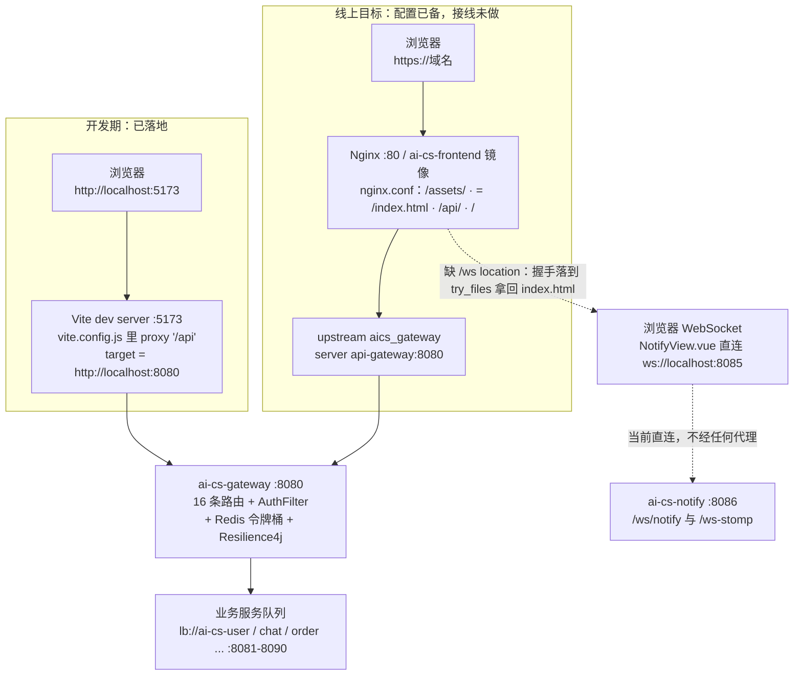
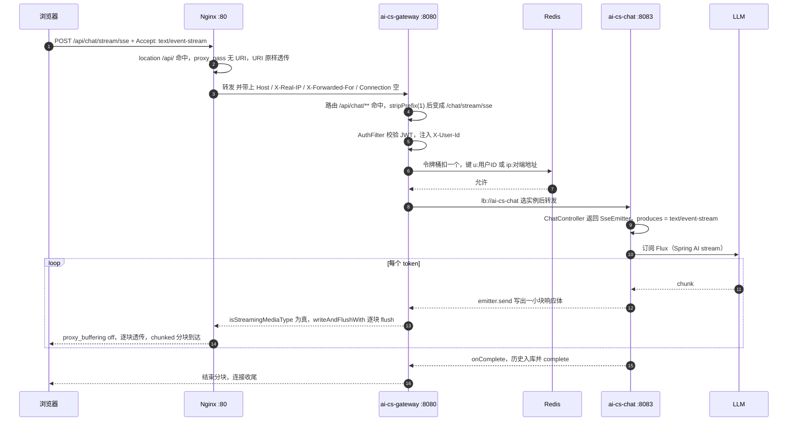

# Nginx 与 OpenResty：流量第一道门的语义，与"配错一个斜杠"的代价

> **一句话结论**：Nginx 这一层几乎不出业务 bug，它出的是**语义 bug**——`proxy_pass` 带不带尾斜杠决定 URI 是"被替换"还是"原样透传"，`proxy_buffering` 的默认 `on` 决定 SSE 是一次吐出还是逐字，`client_max_body_size` 的默认 `1m` 决定上传是 200 还是 413。这三个都是**默认值**，配错了也不报警：代理照样回 200/404/413/502，全都不像"配置写错了"。本项目的情况更微妙：**一份基本正确的 `ai-cs-frontend/nginx.conf` 已经写好了**（含 SSE 关缓冲、immutable 缓存、SPA 兜底），但它在 `deploy/` 里**没有接线**——compose 与 k8s 都没有 frontend 服务、也没有 Ingress，线上这道门目前靠 Vite dev proxy 顶着。
> **阅读前置**：[05-SSE与WebSocket实时通信](./05-SSE与WebSocket实时通信.md)（"缓冲把 token 攒成一坨"的现象侧与容器侧，本篇补代理侧）、[15-计算机基础/03-文件系统与IO多路复用](../15-计算机基础/03-文件系统与IO多路复用.md)（epoll 是 Nginx 高并发的底座）、[04-SpringCloud/04-网关Gateway/01-route-路由断言与过滤器链](../24-源码分析/04-SpringCloud/04-网关Gateway/01-route-路由断言与过滤器链.md)（网关里的 URI 重写和 `proxy_pass` 尾斜杠是同一件事的两层实现）。
> **证据基线 + 预计阅读**：Nginx 1.27（`ai-cs-frontend/Dockerfile#L23` 用的是 `nginx:1.27-alpine`）/ Spring Boot 4.2.0 / Spring Cloud Gateway 5.1.0 / JDK 17。A 级 2 处（`NettyRoutingFilter.java.md`、`NettyWriteResponseFilter.java.md`，来自 `24-源码分析/assets/source/`，已逐行核对）；B 级 25 处本项目真实配置与代码（`ai-cs-frontend`、`ai-cs-gateway`、`deploy/`）；C 级 3 段本机实测（端口探测、`nginx.conf` 静态解析、gzip 压缩率对照，命令与真实输出都在文中）。⚠️ **Nginx / OpenResty 本体源码不在 `assets/source/` 里**，凡讲 `ngx_http_proxy_module` 行为的段落一律标注"依据官方文档"，不编文件名与行号；**本机没有安装 Nginx、也没有 Docker（C 级实测），Nginx 运行期行为未实测**，只给静态解析与判读方法。预计阅读 40 分钟。

## 0. 先看现象

| 现象 | 你可能的第一反应 | 真正常见的原因 |
| --- | --- | --- |
| AI 回答要等十几秒，然后整段文字"唰"一下全出来，打字机效果在线上消失、本地却没有 | 模型慢 / 后端在服务器上行为不同 | 模型 300ms 就开始吐 token 了；是中间某一跳把数据攒住——代理 `proxy_buffering on`（**默认值**）、网关按非流式路径合批、或前端 `await res.text()` |
| 上传一张 3MB 的图 / 一份知识库文档，前端拿到 413，但后端日志里**一条请求都没有** | 后端把大小限制写死了 | 请求在门口就被拒了：`client_max_body_size` 默认 `1m`；本项目已把它改成 `20m`，但 **Spring 侧 `multipart` 上限全项目零配置**，于是变成"20m 的门 + 1MB 的闸"两层阈值不一致 |
| 后台服务 curl 直连好好的，一过网关/代理就 502；容器日志干干净净，没有任何异常 | 服务挂了 | 502 是**代理**发的，不是后端发的：上游连不上、DNS 解析不到、或 `Connection: upgrade` 被改写。后端当然没日志——请求根本没到 |

三个现象背后是同一份配置里的三处细节。先把证据摆出来，§3 再逐段拆。

**证据 1：仓里唯一一份真 Nginx 配置，注释已经把三个坑写在脸上了** —— 说明这些坑本项目踩过一遍：

```nginx
# ai-cs-frontend/nginx.conf#L46-L62
    # ---------- API 反代到网关 ----------
    # 前端代码里的 BASE_URL 是 '/api'（见 src/utils/runtime.js），
    # 所以这里直接透传，不要 rewrite 掉 /api 前缀（网关的路由表就带 /api）。
    location /api/ {
        proxy_pass         http://aics_gateway;
        proxy_http_version 1.1;
        proxy_set_header   Host              $host;
        proxy_set_header   X-Real-IP         $remote_addr;
        proxy_set_header   X-Forwarded-For   $proxy_add_x_forwarded_for;
        proxy_set_header   X-Forwarded-Proto $scheme;
        # SSE 必须走 HTTP/1.1 且关闭缓冲，否则 token 被攒起来一次性返回
        proxy_set_header   Connection        "";
        proxy_buffering    off;
        proxy_cache        off;
        proxy_read_timeout 300s;   # 大模型首 token 可能很慢，默认 60s 会 504
        chunked_transfer_encoding on;
    }
```

注意这份配置的形态：`location` 只有 4 个块（`/assets/`、`= /index.html`、`/api/`、`/`），**没有一处正则**，`upstream` 里只有 1 台后端。这既是它的优点（顺序无关、好维护），也是它的缺口（§3.5、§3.8 会说缺了什么）。

**证据 2：两个"零命中"，比任何解释都硬** —— 在仓库根执行（本机真实输出，命令可复跑）：

```text
PS> Get-ChildItem -Recurse -File -Include *.yml,*.properties -Path ai-cs-common,ai-cs-gateway,ai-cs-chat,... |
      Select-String "multipart|max-file-size|max-request-size"
（无输出：0 命中）

PS> Get-ChildItem -Recurse -File -Include *.java,*.yml,*.js,*.vue,*.conf -Path ai-cs-frontend,ai-cs-gateway,... |
      Select-String "X-Accel-Buffering" | Measure-Object   →  Count = 0

PS> Get-ChildItem -Recurse -File -Include *.yaml,*.yml -Path deploy | Select-String "kind:\s*Ingress"
  →  Count = 0

PS> Get-ChildItem -Recurse -File -Include *.yml,*.yaml -Path deploy | Select-String "frontend"
（无输出：0 命中）
```

四行结论：① Spring 侧上传上限是框架默认值，没人配过；② 应用侧没声明 `X-Accel-Buffering`，所以"关缓冲"这件事完全押在 Nginx 配置上，换个代理就复发；③④ `deploy/` 里既没有 Ingress 也没有 frontend 服务——**反代层与门面容器都没接线**。

**证据 3：本机确实没有 Nginx，也就没有"跑起来看看"这条路**（C 级实测，可直接复跑）：

```text
PS> TcpClient 探测 127.0.0.1（300ms 超时）
port 5173  CLOSED/TIMEOUT
port 8080  CLOSED/TIMEOUT
port 8086  CLOSED/TIMEOUT
port 80    CLOSED/TIMEOUT
port 443   CLOSED/TIMEOUT
--- binaries ---
nginx      <not found>
openresty  <not found>
docker     <not found>
```

所以本文的 C 级证据只做**静态解析与压缩率测量**（§3.9、§9 练习 1 有脚本），凡是"运行起来会怎样"的结论，都会标明依据（官方文档 / 本项目代码 / 上一节的实测）。

**这些现象指向同一件事：Nginx 的错不是"程序错了"，而是三条语义——`默认值`、`继承`、`URI 重写`——把你的请求悄悄改成了另一个请求，然后照常回一个像样的状态码。** 所以排查 Nginx，永远不是"读错误堆栈"，而是"**对齐三样东西：浏览器以为发了什么、Nginx 实际发了什么、上游实际收到了什么**"。

## 1. 整体地图



> **读图说明**：
> 1. 图分成两个框，是本文最重要的一张"现状图"：**开发期这条链是真的跑得通的**（`vite.config.js` 的 `proxy` 充当了 Nginx 的角色），**线上这条链只完成了前半段**——`nginx.conf` 与 `Dockerfile` 写好了，但 compose/k8s 里没有任何地方部署它（证据 2 的第三、四行）。看错这一点，就会以为"我们有 Nginx，只是没开"。
> 2. `P2` 到 `G` 之间只有一跳，因为 `upstream aics_gateway` 里只写了一台 `api-gateway:8080`。也就是说：**这台 Nginx 不做实例级负载均衡**，真正的负载均衡在网关的 `lb://` 里（§3.5）。这决定了排查顺序——"请求分给了哪台实例"要去网关日志看，不是 Nginx 日志。
> 3. `N2 → W` 是虚线，因为 WebSocket 现在是**前端直连端口**、完全绕过代理；而 `P2 ⇢ N2` 也是虚线，表示上线后如果照现有 `nginx.conf` 不加改动，`/ws/notify` 会落进 `location /` 的 `try_files`、拿回一个 `index.html` 的 200（§3.3 例 5）。
> 4. 图上没有画 `deploy/`，因为没有可画的东西：Inspect 了 `deploy/k8s/services/` 只有业务服务清单，`docker-compose-*.yml` 里没有 frontend 容器。这一层是**设计态**，不是运行态。
> 5. 记住这张图的形状再去读 §4 的时序图：时序图是"假设 P2 已经上线"的理想链路，两张图之间的差值，就是本篇 §9 练习要补的东西。

| 组件 | 位置 | 责任 | 谁调用它 |
| --- | --- | --- | --- |
| `ai-cs-frontend/nginx.conf` | `ai-cs-frontend/nginx.conf#L1-L74` | 静态托管 + SPA 兜底 + `/api/` 反代网关 + gzip + 两级缓存头 | `ai-cs-frontend/Dockerfile#L25` 拷进 `nginx:1.27-alpine` 的 `/etc/nginx/conf.d/default.conf` |
| `ai-cs-frontend/Dockerfile` | `ai-cs-frontend/Dockerfile#L11-L34` | 两阶段构建：node 22 构建、nginx 1.27 托管 | **无人调用**：compose 与 k8s 都没有 frontend 服务（证据 2） |
| `upstream aics_gateway` | `ai-cs-frontend/nginx.conf#L8-L12` | 定义上游池，仅 1 台 `api-gateway:8080` | `location /api/` 的 `proxy_pass` |
| Vite dev proxy | `ai-cs-frontend/vite.config.js#L22-L38` | 开发期替代 Nginx：`/api` → 网关，并改写 SSE 响应头 | `npm run dev`（`ai-cs-frontend`） |
| `RouteConfig#customRouteLocator` | `ai-cs-gateway/src/main/java/com/aics/gateway/config/RouteConfig.java#L61-L149` | 16 条路由：`path` 断言 + `stripPrefix(1)` 或 `rewritePath` | `RouteLocatorBuilder`，启动期装配 |
| `RouteConfig#userKeyResolver` | `ai-cs-gateway/src/main/java/com/aics/gateway/config/RouteConfig.java#L155-L167` | 限流键：优先 `X-User-Id`，否则客户端 IP | `RedisRateLimiter` 的 key |
| `NettyRoutingFilter`（A 级） | `24-源码分析/assets/source/NettyRoutingFilter.java.md` | 网关的"转发出口"：改 Host、发请求、超时映射 504 | 网关过滤器链（order 最高的一批） |
| `NettyWriteResponseFilter`（A 级） | `24-源码分析/assets/source/NettyWriteResponseFilter.java.md` | 网关的"回流出口"：按 Content-Type 决定"逐块 flush"还是"合批" | 网关过滤器链（`WRITE_RESPONSE_FILTER_ORDER`） |
| `NotifyWebSocketHandler` 端点 | `ai-cs-notify/src/main/java/com/aics/notify/config/WebSocketConfig.java#L27-L30` | 注册 `/ws/notify`，Origin 白名单 `AICS_ALLOWED_ORIGINS` | 直连的浏览器（`NotifyView.vue`） |

## 2. 关键概念与关键类

| 名称 | 位置 | 角色 | 关键方法 / 指令 |
| --- | --- | --- | --- |
| **master / worker 进程** | Nginx 进程模型（**未入库**，依据官方文档「nginx 进程模型」/「Controlling nginx」） | master 只做特权动作（读配置、绑端口、fork、reload），worker 干全部 I/O | `nginx -s reload` / `-s quit` / `-s reopen` |
| **epoll** | Linux 内核事件机制（未入库；概念侧见 [03-文件系统与IO多路复用](../15-计算机基础/03-文件系统与IO多路复用.md)） | 就绪列表驱动：只处理"已就绪"的连接，线程数不随连接数增长 | `epoll_create` / `epoll_ctl` / `epoll_wait` |
| **配置上下文** `http` / `server` / `location` | 官方文档「Configuration file's structure」 | 三层作用域；子块未写则继承父值，写则覆盖 | 指令的"Context"一栏决定它能写在哪 |
| `location` 修饰符 | 官方文档「location」 | `=` 精确 / `^~` 前缀终止 / `~`、`~*` 正则 / 无修饰符前缀 | 优先级：`=` → `^~` → 正则（按序）→ 最长前缀 |
| `proxy_pass` | 官方文档「ngx_http_proxy_module / proxy_pass」 | 转发动作；**带不带 URI 决定要不要替换匹配到的前缀** | `proxy_pass http://up;` vs `http://up/;` |
| `upstream` | 官方文档「ngx_http_upstream_module」 | 后端池 + 被动健康检查 + 连接池 | `server` / `weight` / `ip_hash` / `least_conn` / `hash ... consistent` / `keepalive` |
| `try_files` | 官方文档「ngx_http_core_module / try_files」 | 按序找文件，全找不到就内部跳转到最后一个参数 | `try_files $uri $uri/ /index.html;` |
| `proxy_buffering` / `X-Accel-Buffering` | 官方文档「proxy_buffering」「proxy_ignore_headers」 | 前者是代理侧开关（默认 `on`），后者是**上游声明**"别缓冲我" | `proxy_buffering off;` / 响应头 `X-Accel-Buffering: no` |
| `Upgrade` + `Connection` 两行头 | 官方文档「WebSocket proxying」 | 把 HTTP/1.1 升级握手转给上游，否则连接退化成普通请求 | `proxy_set_header Upgrade $http_upgrade;` + `proxy_set_header Connection "upgrade";` |
| `limit_req` / `limit_conn` | 官方文档「ngx_http_limit_req_module」「ngx_http_limit_conn_module」 | 入口限速（漏桶）与并发连接数限制，超限默认 **503** | `limit_req_zone` / `limit_req burst=nodelay` / `limit_conn_zone` |
| `NettyRoutingFilter`（A 级，**已入库**） | `24-源码分析/assets/source/NettyRoutingFilter.java.md` | 网关侧转发：`headers.remove(HOST)` 后按需回填、`transfer-encoding` 与 `content-length` 互斥处理、**responseTimeout → 504** | `filter(...)`；超时映射见 `#L202-L210` |
| `NettyWriteResponseFilter`（A 级，**已入库**） | `24-源码分析/assets/source/NettyWriteResponseFilter.java.md` | 网关侧回流：`isStreamingMediaType(contentType)` 决定 `writeAndFlushWith` 还是 `writeWith` | `isStreamingMediaType` 见 `#L167-L176`；分流见 `#L129-L133` |
| `RedisRateLimiter` / `RequestRateLimiter` | Spring Cloud Gateway（**未入库**，依据官方文档与本项目配置） | 网关侧分布式令牌桶，键由 `KeyResolver` 决定，超限 **429** | `replenishRate=5`、`burstCapacity=10`（`ai-cs-gateway/src/main/resources/application.yml#L47-L49`） |
| `502 / 504 / 499` | Nginx 状态码（官方文档「ngx_http_upstream_module」与 access.log 说明） | 502 上游不可用 / 504 上游超时 / 499 客户端先断 | 只有 499 是 Nginx **自造**的状态码，客户端看不到 |

> ⚠️ **本文的诚实边界**：`ngx_http_proxy_module`、`ngx_http_limit_req_module`、epoll 这些都**没有**被收进 `assets/source/`。所以本文对 Nginx 内部只给两类东西：**官方文档可查的语义**（并标注"依据官方文档"），和**可复现的静态证据**（C 级解析脚本）；而"Java 这一侧到底怎么转发、怎么 flush"恰好有入库源码，于是用 `NettyRoutingFilter` / `NettyWriteResponseFilter` 把"代理语义在代码里长什么样"钉死。凡是"本项目怎么配的"，一律给 `文件#L行`。

## 3. 原理与证据逐段精读

### 3.1 master/worker + epoll：为什么一台机器能扛万级并发

**在干什么**：Nginx 启动后先起一个 **master**：它读配置、绑 80/443（特权端口）、fork 出 N 个 **worker**，然后自己基本只做"信号处理"。每一个 worker 是**单线程**的，它把所有监听/已建立的连接都注册进 epoll，然后就在 `epoll_wait` 上睡——**谁有事件就处理谁**，处理完立刻回去睡。

**为什么这么设计**：并发的成本不在"连接数量"，而在"为每个连接准备一套执行上下文"。一请求一线程的模型里，1 万连接 = 1 万线程 ≈ 8GB 栈空间 + 内核调度开销，所以线程池上限就是并发上限（Tomcat 默认 200 就是这么来的）。epoll 把"等待"这件事交给内核的**就绪列表**：worker 只在"有数据可读"时被唤醒，**线程数与连接数解耦**。这就是"一台 2 核机器扛几万空闲长连接"的底账。官方文档里 `worker_connections`（默认 512）乘 worker 数才是单机的连接上限。

**换写法会怎样**：如果 worker 用阻塞模型（每连接一线程），SSE 这种"连接常年挂着但很少说话"的流量会立刻吃光线程——这正是 [05-SSE与WebSocket实时通信](./05-SSE与WebSocket实时通信.md) 里那个结论的代理侧版本："连接数上限是容器的 `maxConnections` 管的，不是线程池"。反过来，Java 侧的 Netty / WebFlux 是同一套思路（事件循环），所以网关 `ai-cs-gateway` 吃长连接比 Tomcat 服务更从容。

**常见坑**：
- **`worker_processes` 的默认值是 `1`，不是 `auto`**（官方文档「worker_processes」：default `1`，`auto` 要显式写）。本项目没写这一行——因为 `ai-cs-frontend/nginx.conf` 被拷进的是 `/etc/nginx/conf.d/default.conf`（`ai-cs-frontend/Dockerfile#L25`），主配置是官方镜像自带的 `/etc/nginx/nginx.conf`（那里是 `worker_processes auto;`）。但如果你把这套配置搬到裸机、自己写主配置，默认就退化成 1 个 worker——多核机器白扔一半以上 CPU，而且**不会报任何错**。
- 长连接会占 `worker_connections` 配额：SSE 一个用户一条连接、WebSocket 也是，`512 × worker 数` 很快就不够，要按"在线用户数"算，而不是按 QPS 算。
- 一个**阻塞**的模块调用（或 OpenResty 里一句 `os.execute`）会卡住整个 worker 的事件循环——这是"为什么不能随便在 worker 里写阻塞代码"的硬理由（§3.10）。

### 3.2 配置层级与继承：为什么"我明明写了，它没生效"

**在干什么**：Nginx 的配置是一棵树：`http`（协议级）→ `server`（虚拟主机）→ `location`（路由块）。每条指令文档里都写着"**Context**"一行，标明它允许出现在哪几层。继承规则只有一条，但分两类：

1. **标量指令**（如 `proxy_read_timeout`、`client_max_body_size`）：子块没写 → 用父块的值；写了 → 覆盖父块。
2. **数组类指令**（`add_header`、`proxy_set_header`、`proxy_set_cookie` 等）：**子块一旦出现任意一条，父块的那一整组就全部失效**（不是追加，是整组替换）。

**为什么这么设计**：让"全局默认 + 局部覆盖"成为默认写法，避免每条 location 抄一遍 20 行头。但"整组替换"这个语义是为了可预测性——否则父块的 `add_header X-Frame-Options` 会渗进某个location、和子块的策略打架，安全头最难 debug。

**换写法会怎样**：完全显式、每层都写全，就不会有"继承惊悚"，代价是配置重复、改一处漏三处。实践里的折中是 `include` 拆分 + 只在一个地方定义共享片段。

**常见坑**：
- 本项目 `ai-cs-frontend/nginx.conf` 在**两个 location 里各写了一条 `add_header`**（`#L35` 的 `Cache-Control "public, immutable"`、`#L42` 的 `no-store...`）。这是**正确**的写法（各自只管自己那份响应头），但如果你哪天在 `server` 级加 `add_header Strict-Transport-Security ...`，**这两个 location 的响应里就不会带 HSTS 了**——因为它们的 `add_header` 组已经"接管"。
- `proxy_set_header` 同理：本项目 `location /api/` 里写了 5 个 `proxy_set_header`（`#L52-L57`），这已经把默认的 `Host $proxy_host`、`Connection close` 整组替换掉了。这也是为什么 L57 那句 `proxy_set_header Connection "";` 必须写——不写的话，虽然默认值是 `close`，但显式写空串才能与 `proxy_http_version 1.1` 配合做连接复用（§3.6）。
- `if` 在 `location` 里会创建隐式嵌套上下文，`proxy_pass` 写在 `if` 里行为会变（"if is evil"）。本项目没有用它——保持这个状态。

### 3.3 location 匹配优先级：一张表 + 5 个真实请求

**在干什么**：一个请求进来，Nginx 要在所有 `location` 里挑一个。规则不是"从上到下第一个匹配"，而是**四轮淘汰**：

| 轮次 | 修饰符 | 语法 | 命中后是否继续找 | 说明 |
| --- | --- | --- | --- | --- |
| ① | `=`（精确） | `location = /index.html` | **停** | 全串相等才命中，O(1) 哈希 |
| ② | `^~`（前缀终止） | `location ^~ /static/` | **停**（跳过正则） | 长前缀匹配后不再试正则，专治"正则抢走静态资源" |
| ③ | 正则 | `location ~ \.php$` / `~*` | **停**（首个命中即用） | 按**配置文件里的出现顺序**逐个试 |
| ④ | 无修饰符（前缀） | `location /api/` | 记下**最长**匹配，若③全不命中才用它 | 兜底 |

完整判定顺序一句话：**先看 `=` 有没有；再找最长前缀，如果这个最长前缀带 `^~` 就直接用它；否则按顺序跑正则，第一个命中就用；正则全不命中才回到那个最长前缀。**

5 个真实请求，拿本项目的 `nginx.conf` 逐步走一遍：

| # | 请求 | 命中 | 过程 | 结果 |
| --- | --- | --- | --- | --- |
| 1 | `GET /index.html` | `location = /index.html`（`#L41`） | ① 精确命中，直接停 | 200 + `Cache-Control: no-store, no-cache, must-revalidate`（`#L42`） |
| 2 | `GET /assets/index-D3f9a1.js` | `location /assets/`（`#L33`） | ① 无精确；② 无 `^~`；③ 无正则；④ 最长前缀 `/assets/` | 200 + `expires 1y` + `Cache-Control: public, immutable`（`#L34-L35`）+ 不计访问日志（`#L36`） |
| 3 | `POST /api/chat/stream/sse` | `location /api/`（`#L49`） | 同上一路走到底，最长前缀 `/api/` 赢过 `/` | 反代到 `http://aics_gateway`，URI **原样** `/api/chat/stream/sse`（§3.4） |
| 4 | `GET /chat/agent/runs/42`（前端深链接，用户按 F5） | `location /`（`#L68`） | 无精确、`/assets/`、`/api/` 都不匹配，只剩 `/` | `try_files $uri $uri/ /index.html;` → 磁盘上没有这个路径 → **内部跳转**返回 `index.html`，状态码 **200**（不是 404，这正是 SPA 兜底的意义） |
| 5 | `GET /ws/notify`（WebSocket 握手，`Upgrade: websocket`） | `location /`（`#L68`） | 同上——**没有 `/ws/` 的 location** | `try_files` 也找不到 `ws/notify` 文件 → 返回 `index.html`，状态码 **200 + Content-Type: text/html**。浏览器 WebSocket 客户端此时报标准错误：`Error during WebSocket handshake: Unexpected response code: 200` |

**为什么这么设计**：先把最高频、最该"绝对命中"的（`=`）用哈希挡掉；再用**前缀树**做长前缀匹配（编译期建树，查找与 location 数量近乎无关）；正则最灵活但最贵、且依赖书写顺序，所以放在最后且"首个命中即止"。`^~` 的存在纯粹是为了解决"正则太贪婪，把 `/static/xx.js` 也吃掉了"这个历史痛点。

**换写法会怎样**：全用正则 → 每个请求线性扫一遍所有 location，且"谁在前面谁赢"这种隐式优先级让配置变成顺序敏感的地雷。全用前缀 → 表达不了 `\.(js|css)$` 这类后缀规则。

**常见坑**：
- **尾斜杠是匹配的一部分**：`location /api/` **不匹配** `GET /api`。本项目因此存在一个"理论上"的坑：`/api` 这个请求会落到 `location /`、拿回 `index.html`。现在没人这么请求（前端 `API_BASE` 恒为 `/api/...`，见 `ai-cs-frontend/src/utils/runtime.js#L24`），但它是一颗等着被踩的雷。
- `^~` 只在"最长前缀"这层生效；写成 `location ^~ /api` 与 `/api/` 的语义差异同样体现在尾斜杠上。
- 本项目 4 个 location **没有正则**，所以"顺序无关"——这是可维护性红利。**加正则之前先想清楚它会不会抢走静态资源**，抢了就用 `^~` 挡住。
- 例 5 是本文最值钱的一行：**WebSocket 握手经由一个"没配对 location"的 Nginx，得到的是一个 200 的 HTML 页面**。它不是 404，所以你在 error.log 里什么也看不到，只能在前端 Console 看到那句 `Unexpected response code: 200`。

### 3.4 proxy_pass 带不带尾斜杠：最高频的那一个 `/`

**在干什么**：`proxy_pass` 的语义只有一条，但它有两种形态（依据官方文档「proxy_pass」节）：

- **不带 URI**：`proxy_pass http://aics_gateway;` → 请求 URI **原样**送给上游（严格说是"规范化后的完整 URI"，客户端发的 `//a//b` 会被压成 `/a/b`）。
- **带 URI**：`proxy_pass http://aics_gateway/;` 或 `http://aics_gateway/v1/;` → **匹配到的 location 前缀被替换**成这段 URI，剩下的部分拼在后面。

四行对照表，请求都是 `POST /api/chat/stream/sse`，location 都是 `location /api/`：

| 写法 | 上游收到的 URI | 说明 |
| --- | --- | --- |
| `proxy_pass http://up;` | `/api/chat/stream/sse` | **本项目采用**（`#L50`）：一个字符都不改 |
| `proxy_pass http://up/;` | `/chat/stream/sse` | 前缀 `/api/` 被替换成 `/` |
| `proxy_pass http://up/v1/;` | `/v1/chat/stream/sse` | 前缀被替换成 `/v1/` |
| `proxy_pass http://up;` + `rewrite ^/api/(.*) /$1 break;` | `/chat/stream/sse` | 效果同第二种，但多一处状态、"谁改了 URI"更难查 |

**为什么本项目必须是"不带 URI"**：因为**网关自己也要剥前缀，而且剥法不统一**。看路由表就知道（`ai-cs-gateway/src/main/java/com/aics/gateway/config/RouteConfig.java#L61-L149`）：`/api/user/**` 走 `stripPrefix(1)` 后变成 `/user/**` 交给 `lb://ai-cs-user`；而 `/api/observability/**`、`/api/prompts/**`、`/api/message/**`、`/api/notify/**` 的注释明确写着"**无需去前缀**"（控制器自己就映射在 `/api/xxx`）。也就是说：**前缀归谁剥，每条路由都有自己的答案**。

于是 `proxy_pass` 一旦多写一个 `/`，就变成"两层各剥一次"：

```text
客户端:  POST /api/user/login
Nginx:   proxy_pass http://up/;      →  上游收到 /user/login
网关:    路由表里只有 /api/user/**   →  没有 /user/** 这条 route
结果:    网关返回 404（不是 502！）
```

Nginx `access.log` 里这一行是 `404`，`error.log` 里**什么都没有**（上游正常应答，代理认为一切成功）。这就是"排查一下午"的典型形态：**Nginx 说自己没犯错，网关说自己没收到这条路径**，而真相是一个尾斜杠。

**为什么这么设计**：上游可能要求带前缀（很多老系统），也可能要求不带（微服务常见）。默认"原样透传"是最小惊讶原则：`proxy_pass` 只负责"把连接交出去"，不改请求内容。

**换写法会怎样**：用 `rewrite ... break` 也能做到，但 `break` 之后 `proxy_pass` 的 URI 语义会再叠一层，两层改写叠起来连老手都要数两遍。用变量写法（`proxy_pass http://up$request_uri;`）会**禁用启动期 DNS 解析**、必须配 `resolver`，还让连接池失效——这是另一个坑。

**常见坑**：
- `proxy_pass http://up` 与 `proxy_pass http://up/` 只差一个字符，diff 时极易漏看；建议在 review 里专门看这一行。
- location 是**正则**时不能用带 URI 的 `proxy_pass`（官方文档明确：正则 location 里要用变量才能指定 URI）。
- `upstream` 名字后面**不要**跟路径——`proxy_pass http://pool/v1;` 是合法写法，但语义是"替换前缀"，很多人以为是"给所有请求加个 /v1"。要加前缀请用 `rewrite`，并且写清注释。

### 3.5 upstream 与四种负载均衡策略：本项目的答案是"不在这层做"

**在干什么**：`upstream` 定义一组后端 + 调度策略 + 被动健康检查 + 连接池。四种主流策略（官方文档「ngx_http_upstream_module」）：

| 策略 | 配置 | 适用 | 代价 |
| --- | --- | --- | --- |
| 轮询（默认） | 什么都不写 | 节点同质、请求耗时均匀 | 慢节点会积压（无感知） |
| 权重 | `server 10.0.0.12:8080 weight=3;` | 机器配置不均、灰度按比例放量 | 权重是静态的，不随负载变化 |
| `ip_hash` | `ip_hash;` | 没有共享 session 的老应用，需要粘性 | 节点增减会导致大量键重映射；同一 NAT 后的一群人被固定到一台 |
| `least_conn` | `least_conn;` | 请求耗时不均（比如有 SSE 长连接） | 需要维护每台上游的活跃连接数，稍重 |
| 一致性哈希（扩展） | `hash $arg_userId consistent;` | 对本地缓存命中敏感 | 需要选好哈希键，键选错等于没做 |

**为什么本项目"不在这层做"**：`ai-cs-frontend/nginx.conf#L8-L12` 的 upstream 里只有一台成员，等于"固定转发"，真正的实例级负载均衡交给了网关：

- `lb://ai-cs-user` 这类 URI 走 Spring Cloud LoadBalancer，默认轮询（`ai-cs-gateway/src/main/resources/application.yml#L54-L57` 的 `algorithm: round-robin`，可切 `least-connections`）；
- `least-connections` 用的是本项目自己写的 `LeastConnectionsLoadBalancer`（`ai-cs-gateway/src/main/java/com/aics/gateway/loadbalancer/LeastConnectionsLoadBalancer.java#L56-L77`）：第一轮找"在途数最小"的实例，并列的用 `AtomicInteger` 轮询打破平局；
- 轮询那一侧有入库源码可看：[01-loadbalancer-负载均衡与轮询策略源码](../24-源码分析/04-SpringCloud/03-负载均衡与调用/01-loadbalancer-负载均衡与轮询策略源码.md)。

**理由与代价**：两层都做负载均衡 = 两个"实例列表"要同步（Nginx 的静态列表 ↔ Nacos 注册表），而 Nacos 会随扩缩容变化、Nginx 不会。代价是：**Nginx 这一层没有故障转移能力**——如果 `api-gateway:8080` 挂了，Nginx 直接 502，不会像 `least_conn` 那样换一台。当前架构里这个风险由 k8s Service（一个 Service 后面多 Pod）或未来把 upstream 拆成多成员来兜（§9 练习 3）。

**换写法会怎样**：如果把实例级均衡放回 Nginx（`upstream` 里手写 3 台网关 IP），你就得到一个**手工维护的实例列表**：扩容要改配置并 reload、缩容要记得删行、Pod IP 变了要重新解析（静态解析只发生在启动期）。想让它自动跟随，就得引入 `resolver` + 变量写法，那又会关掉连接池、并让 `nginx -t` 也校验不了目标。相比之下"网关做均衡、Nginx 只做入口"少一个真相来源，代价就是上文说的失去代理层故障转移。

**常见坑**：
- `server api-gateway:8080;` 是**启动期解析**：DNS 解析不到，Nginx 直接启动失败并打 `host not found in upstream "api-gateway"`（官方 error 格式；本机无 Nginx，未实测）。这就是为什么 `nginx.conf#L9-L10` 的注释老实交代"k8s 里是 `api-gateway.ai-customer-service.svc.cluster.local`，部署时用 ConfigMap 覆盖本行"——**跨 namespace 部署时这一行不改，容器起不来**。
- `max_fails`（默认 1）/`fail_timeout`（默认 10s）是**被动**健康检查：只有真实请求失败了才记账；哪些失败算失败由 `proxy_next_upstream` 决定（默认 `error timeout`，**不包含 5xx**）。以为"Nginx 会自动摘掉返回 500 的节点"是错的。
- 只有一台成员时，所有策略都退化成"往那一台打"，别在只有一台的 pool 上纠结策略。

### 3.6 keepalive 与三个超时：`read_timeout` 不是"总时长"

**在干什么**：代理到上游之间有三个超时 + 一个连接复用参数，各自管一段（官方文档）：

| 参数 | 默认 | 计的是什么 | 配错的症状 |
| --- | --- | --- | --- |
| `proxy_connect_timeout` | 60s | 与上游**建连**的时间 | 上游不可达时，客户端要等到这个值才收到 502/504 |
| `proxy_send_timeout` | 60s | **两次写**之间的间隔（不是整个请求体发完的时间） | 大文件上传卡顿会报 408/504 |
| `proxy_read_timeout` | 60s | **两次读**之间的间隔（不是整个响应的时间） | 默认 60s 会让"首 token 超过 60s"的 AI 请求 504；SSE 只要 token 间隔 < 该值就不会被掐 |
| `keepalive N`（upstream 块内） | 不启用 | 与上游保持的**空闲**连接数（不是最大并发） | 不配 → 每个请求都新建 TCP + 三次握手，TIME_WAIT 堆积 |

**为什么 `read_timeout` 是"间隔"而不是"总时长"**：因为代理无法预知响应有多长（可能是 SSE 的一小时），它只能判断"这条连接是不是死了"。用"两次读的间隔"既能发现死连接，又不会误杀长响应。这直接解释了两件事：① 本项目把它从默认 60s 调到 300s（`ai-cs-frontend/nginx.conf#L60`，注释：大模型首 token 可能很慢）；② SSE 一旦建立，每秒都有 token，`read_timeout` 根本不会触发——**SSE 断流的原因通常不是超时，而是缓冲（§3.7）或客户端断开（§4）**。

**本项目的 keepalive 现状**（C 级静态解析：全文 `keepalive` 命中 **0** 处）：

```text
== 关键指令出现次数（ai-cs-frontend/nginx.conf）==
  keepalive             0 处
  proxy_http_version    1 处  L51
  proxy_buffering       1 处  L58
  proxy_read_timeout    1 处  L60
  limit_req             0 处
  limit_conn            0 处
  Upgrade               0 处
  X-Accel-Buffering     0 处
```

也就是说：**`proxy_set_header Connection ""` 写了，但没有 `keepalive` 池，连接复用并没有真正发生**。要让它生效必须三件套齐全：

```nginx
upstream aics_gateway {
    server api-gateway:8080;
    keepalive 32;                     # 缓存 32 条空闲长连接
}
server {
    location /api/ {
        proxy_http_version 1.1;       # 1.0 不支持长连接
        proxy_set_header Connection "";# 清掉 close，才能复用
        proxy_pass http://aics_gateway;
    }
}
```

**换写法会怎样**：不配 `keepalive` 就是"每请求一次握手"，在 443 上还要多一次 TLS 握手（CPU 与 RTT 双成本）；配了但不清 `Connection` 头，上游会回 `Connection: close`，池子永远是空转。

**常见坑**：`keepalive` 的值不是"最大连接数"而是"空闲连接缓存数"，设成 1000 不会提升并发上限，只会多占内存；它对 `proxy_pass` 指向**变量**的场景默认失效。

### 3.7 buffer 与 SSE：三层缓冲，缺一层都不行

**在干什么**：一条从 LLM 到浏览器的 SSE 响应要穿过**三层**可能"攒数据"的地方：

1. **Nginx `proxy_buffering`**（默认 `on`）：攒够再下发。本项目关掉了（`#L58`）。
2. **网关 Netty 的写出路径**：居然也分"逐块 flush"和"合批"两种，判断依据是 **Content-Type**。这条有入库源码（A 级）：

```java
// (src: NettyWriteResponseFilter.java.md#L129-L133)
HttpClientResponse httpClientResponse = exchange.getAttribute(CLIENT_RESPONSE_ATTR);
Mono<Void> write = (isStreamingMediaType(contentType)
        ? response.writeAndFlushWith(body.map(Flux::just))
        : response.writeWith(body));
return write.then(TrailerHeadersFilter.filter(getHeadersFilters(), exchange, httpClientResponse)).then();
```

```java
// (src: NettyWriteResponseFilter.java.md#L167-L176)
// TODO: use framework if possible
private boolean isStreamingMediaType(@Nullable MediaType contentType) {
    if (contentType != null) {
        for (int i = 0; i < streamingMediaTypes.size(); i++) {
            if (streamingMediaTypes.get(i).isCompatibleWith(contentType)) {
                return true;
            }
        }
    }
    return false;
}
```

   读法：`writeAndFlushWith(body.map(Flux::just))` = 每个 chunk 单独 flush；`writeWith(body)` = 交给 Netty 自己合批。**所以"流式"不只是 Nginx 的事：上游控制器必须把 `Content-Type` 声明成 `text/event-stream`**，否则网关这一跳会把你的 token 合成一大块。本项目恰好是对的：`ai-cs-chat/src/main/java/com/aics/chat/controller/ChatController.java#L166-L180` 的 `produces = MediaType.TEXT_EVENT_STREAM_VALUE`。（`streamingMediaTypes` 的默认清单属于 Spring Cloud Gateway 配置项，**未入库**，依据官方文档：默认包含 `text/event-stream`。）
3. **浏览器侧的读法**：`await res.text()` 也会攒（见 [05-SSE与WebSocket实时通信](./05-SSE与WebSocket实时通信.md)）。本项目用 `fetch + ReadableStream` 手工分帧，没问题。

**`X-Accel-Buffering: no` 是什么**：让**上游自己声明**"这个响应别缓冲我"（依据官方文档「proxy_ignore_headers」/「X-Accel-Buffering」：Nginx 识别该响应头，默认生效，除非被 `proxy_ignore_headers` 忽略）。它和 `proxy_buffering off` 的区别：

| | 谁生效 | 改在哪 | 粒度 | 本项目 |
| --- | --- | --- | --- | --- |
| `proxy_buffering off;` | 运维侧开关 | 运维侧 | **整个 location** | ✅ 已配（`#L58`） |
| `X-Accel-Buffering: no` | 应用侧声明 | 代码 | **单个响应** | ❌ 未做（全仓 0 命中） |

两者不能互相替代：只关 Nginx，换 CDN/换网关就复发；只声明，某些 CDN 不认。稳妥做法是"应用声明 + 代理兜底"。

**为什么这么设计（缓冲本身没错）**：代理要保护上游（慢客户端不拖慢后端）、要复用连接、要做 gzip，就必须能攒。SSE 是代理眼里最不友好的流量形态，所以只能显式退出。

**换写法会怎样**：两件都不做（很多团队的默认状态）→ 响应被攒到缓冲区满或响应结束才下发，用户看到"整段砸下来"；反过来把整个 `server` 的 buffering 全关 → 所有普通 JSON 接口都失去了"慢客户端不拖住上游"的保护，大响应体时上游连接被长时间占用，代价从"打字机消失"变成"连接数上涨"。所以正确粒度是**按 location / 按响应**关，而不是全局关。

**常见坑**：
- **gzip 也会攒**：压缩需要攒够数据才有效。本项目 `gzip_types` 里**没有** `text/event-stream`（`#L26-L27`），所以没踩；但如果有人图省事写 `gzip_types *;`，SSE 会在关了 buffering 之后依然变成一大块。
- `chunked_transfer_encoding on`（`#L61`，默认也是 on）：SSE 响应没有 `Content-Length`，必须靠 chunked 分块。而网关侧有一条对应规则——有 `content-length` 就删掉 `transfer-encoding`（`NettyRoutingFilter.java.md#L178-L185`，"It is not valid to have both the transfer-encoding header and the content-length header"）。两层都不能出现"两个头同时存在"。
- `proxy_cache off;`（`#L59`）同样是必需的：缓存一个 SSE 响应 = 把第一个用户的 token 放给所有人看。

### 3.8 WebSocket 的两行头，与本项目缺的那个 location

**在干什么**：WebSocket 握手是一个"披着 HTTP 外衣"的协议升级：客户端发 `Connection: Upgrade` + `Upgrade: websocket` + `Sec-WebSocket-Key`，服务端回 `101 Switching Protocols`。代理如果不**同时**做两件事，握手就会退化成普通 HTTP 请求：

```nginx
proxy_http_version 1.1;                          # ① 1.0 不支持 upgrade
proxy_set_header Upgrade    $http_upgrade;       # ② 把客户端的 upgrade 意图转给上游
proxy_set_header Connection "upgrade";           # ③ 把 Connection 头改成 upgrade
```

（题面说的"两行头"就是 ②③；① 是前提，官方文档「WebSocket proxying」示例里三行都在。）

**本项目的缺口**（C 级：`Upgrade` 命中 0 处）：`nginx.conf` 里**没有任何** WebSocket location，而且 `location /api/` 里那句 `proxy_set_header Connection "";`（`#L57`）是**反着来的**——它把 `Connection` 清空，正是为了 SSE 复用连接；如果哪天有人把 `/api/ws/...` 挂到这个块下面，握手会被这句直接废掉。所以**SSE 与 WebSocket 必须拆成两个 location**，不能共用 `/api/`。

现状是前端直连、完全绕过代理：`ai-cs-frontend/src/views/NotifyView.vue#L112-L129` 里 `new WebSocket('ws://localhost:8085/ws/notify')`——注意这里**端口还是错的**（notify 是 8086，8085 是 message），这个错位 [05-SSE与WebSocket实时通信](./05-SSE与WebSocket实时通信.md) 已经拆过，本篇只关心它的代理含义：**上线走同域 `wss://域名/ws/notify` 时，必须补一个带 upgrade 头的 location**（骨架见 §9 练习 4）。

**为什么这么设计**：升级握手本质上是一次"协议协商"，必须**双向透明**——代理既不能吞掉客户端的意图，也不能把上游的 `101` 改写成 `200`。

**换写法会怎样**：只在 Nginx 侧配了 upgrade 却让上游 Spring 服务没开 WebSocket 端点，会变成 `101` 之后立刻断（`1006`）；反过来前端用 `ws://` 但页面是 `https`，浏览器直接拒绝（混合内容），连请求都不会发。

**常见坑**：① `Connection "upgrade"` 是**硬编码**，只适合纯 WS 的 location，同一个块里再做 SSE 就矛盾；② 长连接的空闲断开由 `proxy_read_timeout` 管，要配心跳或调大；③ 浏览器报 `1006` 是"异常关闭、没有 close 帧"，通常代表链路被打断（代理、负载均衡空闲超时），不能从 `1006` 推断业务代码有问题。

### 3.9 gzip 与静态缓存头：实测"文本赚、图片赔"

**在干什么**：`gzip on` 只对 `gzip_types` 里列出的 MIME 生效（默认只 `text/html`），`gzip_min_length 1k` 跳过小文件，`gzip_comp_level` 是 CPU/压缩率折中，`gzip_vary on` 告诉缓存服务器"同一 URL 有压缩/未压缩两份"。本项目的完整配置在 `ai-cs-frontend/nginx.conf#L23-L28`（`on` / `1k` / `5` / 一串 MIME / `vary on`）。

本机实测压缩率（C 级，node `zlib` level 5，对齐 `gzip_comp_level 5`，脚本见 §9 练习 1 同目录）：

```text
file                                                          raw(B)   gzip(B)    ratio  判读
-------------------------------------------------------------------------------------------------
ai-cs-frontend\package-lock.json                              139646     34124    24.4%  文本类：gzip 有效，值得开
ai-cs-frontend\src\assets\hero.png                             13057     13080   100.2%  已压缩格式：gzip 基本无用，只烧 CPU
ai-cs-frontend\public\images\test-earphone.png               1018263   1018210   100.0%  已压缩格式：gzip 基本无用，只烧 CPU
ai-cs-frontend\src\assets\vite.svg                              8710      1588    18.2%  文本类：gzip 有效，值得开
```

读法：**文本类（JS/CSS/JSON/SVG/HTML）能压到 20~25%，图片（PNG/JPG）压不动甚至会略涨**。所以 `gzip_types` 里出现 `image/jpeg`、`image/png` 是纯浪费 CPU——本项目只列了 `image/svg+xml`（SVG 是文本，实测 18.2%，列它是**对的**）。这也解释了为什么 `gzip_min_length 1k` 有必要：小于 1k 的文件，压缩头本身的开销就把收益吃掉了。

**缓存三件套**（本项目写法是对的，值得背下来）：

```nginx
location /assets/ {                       # Vite 产物：文件名带 content hash
    expires 1y;
    add_header Cache-Control "public, immutable";
    access_log off;                       # 静态资源不记日志，省 IO
}
location = /index.html {                  # 引用表：绝对不能缓存
    add_header Cache-Control "no-store, no-cache, must-revalidate";
    expires -1;
}
location / {                              # SPA 兜底
    try_files $uri $uri/ /index.html;
}
```

**为什么这么设计（`immutable` 为什么安全）**：Vite 产出的 `assets/*` 文件名里带内容哈希，内容一变文件名就变，所以"永久缓存"不会导致旧内容被复用。反过来 `index.html` 是"引用表"，它必须每次拿最新的，否则发版后用户浏览器还拿着旧表去请求**已经被删掉的 chunk**，表现就是白屏（`nginx.conf#L5` 注释说的就是这个）。

**换写法会怎样**：把 `index.html` 也设成 `expires 1d`，发版后一部分用户会在 24 小时里持续白屏，且你无法复现（他的缓存里有旧表）——这是最典型的"只有部分用户报障"。

**常见坑**：`add_header` 在 `location` 里会顶掉父级同名组（§3.2）；`expires 1y` 与 `add_header Cache-Control` **同时写**时，最终 `Cache-Control` 以 `add_header` 为准（`expires` 自己也会加一条 `Cache-Control: max-age=...`，两条并存会被 Nginx 合并成一条带 `max-age` 和 `public, immutable` 的头）——本项目就是这么写的，浏览器认 `max-age=31536000` + `immutable`，符合预期。

### 3.10 limit_req / limit_conn：为什么本项目把限流放在网关

**在干什么**：Nginx 的两把刀都是**入口级**的，按"连接"或"IP"计数，不知道用户是谁（官方文档）：

| 指令 | 语义 | 关键参数 | 超限状态码 |
| --- | --- | --- | --- |
| `limit_req` | 漏桶限速：稳态 `rate`，允许突发 `burst` | `burst=nodelay` 立即处理不排队 | 默认 **503**（`limit_req_status` 可改，比如 429） |
| `limit_conn` | 并发连接数上限（同一个键同时允许几条） | `limit_conn_zone $binary_remote_addr zone=conn:10m;` | 默认 **503**（`limit_conn_status`） |

```nginx
# 官方文档「ngx_http_limit_req_module」示例形态
limit_req_zone $binary_remote_addr zone=api:10m rate=20r/s;

location /api/ {
    limit_req zone=api burst=40 nodelay;
}
```

**本项目的三层分工**（这张表面试可以直接背）：

| 层 | 组件 | 计数键 | 粒度 | 超限响应 | 本项目 |
| --- | --- | --- | --- | --- | --- |
| 入口 | Nginx `limit_req` | 真实客户端 IP | IP / 全局 | **503**（默认） | ❌ 未配（`limit_req` 0 处） |
| 路由 | 网关 `RequestRateLimiter` + Redis 令牌桶 | `KeyResolver` 决定 | 每用户/每 IP | **429** | ✅ `replenish-rate=5`、`burst-capacity=10`（`ai-cs-gateway/src/main/resources/application.yml#L47-L49`） |
| 接口 | Sentinel 规则 | 资源名（如 `chat_send`） | 接口级 | 429/降级 | ✅ 见 [02-sentinel-限流降级原理](../24-源码分析/04-SpringCloud/06-熔断限流与容错/02-sentinel-限流降级原理.md) |

为什么把限流放在网关？因为**只有它同时看得到"用户身份"和"路由归属"**。Nginx 看得到真实 IP 但不知道用户是谁；Java 侧知道用户是谁，但**默认看不到真实 IP**——这就是下面这个真实缺陷。

**本项目的真实缺陷：挂了 Nginx 之后，所有匿名请求会共用一个令牌桶。** 证据链是三行代码：

```java
// ai-cs-gateway/src/main/java/com/aics/gateway/config/RouteConfig.java#L155-L167
@Bean
public KeyResolver userKeyResolver() {
    return exchange -> {
        ServerHttpRequest request = exchange.getRequest();
        String userId = request.getHeaders().getFirst("X-User-Id");
        if (userId != null && !userId.isBlank()) {
            return Mono.just("u:" + userId);
        }
        InetSocketAddress remote = request.getRemoteAddress();
        String ip = remote == null ? "unknown" : remote.getAddress().getHostAddress();
        return Mono.just("ip:" + ip);
    };
}
```

`request.getRemoteAddress()` 拿到的是**直连对端的地址**。挂上 Nginx 之后，这个对端就是 **Nginx 的地址**（容器网络里通常是 `172.x.x.x` 的网关 IP），不是用户的 IP。而全仓 `grep "X-Forwarded-For|X-Real-IP|getRemoteAddr|forward-headers"` 在 Java 代码里只有 `RouteConfig.java:163` 与 `RateLimitFilter.java:86-87` 这两处 `getRemoteAddress()`，**没有任何代码去读 `X-Forwarded-For`**，也没有配 `server.forward-headers-strategy`。

结果：`nginx.conf` 很用心地设了 `X-Real-IP $remote_addr`（`#L53`）和 `X-Forwarded-For`（`#L54`），**后端一个字节都没读**。未登录用户的限流键全部退化成 `ip:172.x.x.1`，5 r/s 的桶被全站共享——上线当天所有未登录用户一起被 429。

**为什么这么设计（Nginx 的 `$remote_addr` 与 `$proxy_add_x_forwarded_for` 之分）**：`$remote_addr` 是"TCP 对端"，永远可信但可能是代理；`X-Forwarded-For` 是"链路上一路追加"的，**可伪造**，所以后端只能用"可信代理之后的那一跳"。这是一个必须两边配合的契约，任何一边漏了都不生效。

**换写法会怎样**：① 在网关里直接读 `X-Forwarded-For` 的第一段——容易被客户端伪造，等于关掉限流；② 读 `RequestContextHolder` 的 `RemoteAddr`——同样是 Nginx 地址；③ 用 Nginx 的 `limit_req` 兜底——IP 真实但不知道用户。实践答案是"两层都做、键不同"。

**常见坑**：Nginx 的限流默认回 **503**（不是 429），跟"后端挂了"长得一模一样，很多人第一反应是去查服务；`limit_req_zone` 的 `10m` 共享内存按官方文档估算约能存 16 万个 IP 状态，超了会报 `could not allocate node in zone` 并在日志里刷错误。

### 3.11 OpenResty 与 Lua：能力边界，以及"为什么本项目不用它"

**在干什么**：OpenResty = Nginx + LuaJIT + 一组 `ngx.*` 库。它把请求生命周期切成若干阶段（`init_worker` / `rewrite` / `access` / `content` / `log` 等），你可以在每个阶段挂一段 Lua 做任意判断，于是"配置"升级成了"可编程"。Kong、APISIX 都是这套体系的产物。

```lua
-- 形态示意：access 阶段读 cookie 决定上游与灰度（本项目未落地，仅示例）
access_by_lua_block {
    local gray = ngx.var.cookie_gray
    if gray == "1" then
        ngx.var.upstream_group = "gateway_gray"
    end
}
```

**本项目为什么不用它**（四个理由，按重要性排）：

1. **职责已被 Spring Cloud Gateway 覆盖**：16 条路由 + `stripPrefix`/`rewritePath`（`RouteConfig.java#L61-L147`）、JWT/API Key 鉴权、Redis 令牌桶限流、Resilience4j 熔断 + 统一 `503` 降级（`ai-cs-gateway/src/main/java/com/aics/gateway/controller/GatewayFallbackController.java#L20-L24`）、CORS。再引入一层 Lua 等于**两套策略源**，出问题要先判定"是哪一层拒的"。
2. **团队与调试成本**：Java/Reactor 有编译器、单测、堆栈、Actuator；Lua 在 Nginx 里出错往往只有一行 `error.log`，没有调用栈。
3. **阻塞即全局事故**：worker 是单线程事件循环，任何一句阻塞调用（`os.execute`、同步磁盘/网络）都会卡死该 worker 上的**所有**连接。这是"为什么不在网关层塞任意代码"的最硬理由。
4. **收益要 QPS 很高才显现**：OpenResty 的优势在"百万级 QPS 的入口过滤 + 共享字典计数"；本项目的瓶颈在 LLM 推理与数据库，不在这层。

**什么时候该选它**：需要入口级动态能力（灰度路由按 cookie/header 精细分流、WAF、签名验签、极高 QPS 的 IP 级限流共享字典），或者要接 Kong/APISIX 这类平台化网关。**代价**：C+Lua 技术栈、另一套发布链与可观测（本项目已有 Nacos + SkyWalking，再叠一套 Kong 会引入 etcd/DB 依赖）、以及"配置漂移"风险（Lua 文件不走镜像就等于配置不可复现）。

**换写法会怎样**：用 SCG 的 `GlobalFilter` 写同等逻辑，代价是每个请求都穿过 JVM（延迟与 GC），但换来类型安全、可测试、可热更新（配 Nacos）。以本项目规模，这个交易是划算的。

**常见坑**：① `ngx.var.upstream` 是只读的，想改上游必须用 `set $upstream ...` + `proxy_pass http://$upstream`（还会引入 `resolver` 需求）；② `lua_code_cache off` 只用于开发，上生产等于每条请求都编译；③ `shared dict` 需要显式声明大小（`lua_shared_dict mycache 10m`），写满后 `set` 返回 `no memory` 而不是报错。

## 4. 一次完整执行时序：SSE 请求穿过五层



> **读图说明**：
> 1. 数一数"可能攒数据"的点：`N`（Nginx 缓冲）、`G`（Netty 写出路径）两处是**代理侧**的，`C` 的 `SseEmitter` 与前端读法是**端侧**的。图上 `C-->>G-->>N-->>B` 这三段箭头，任何一段变成"合批"，用户就看到"一次性吐出"。
> 2. 第 4 步的 `stripPrefix(1)` 与第 2 步的"URI 原样透传"是**一组**：前者假设 `/api` 还在，后者保证 `/api` 还在。改动任何一边（比如给 `proxy_pass` 加个尾斜杠），这条链立刻在第 4 步之后 404。
> 3. 第 6 步的限流键是本篇最容易被忽略的坑：`u:用户ID` 没问题，`ip:对端地址` 在挂了 Nginx 之后对端就是 Nginx（§3.10）。
> 4. `autonumber` 的 1~14 号步骤里，**没有任何一步是"服务端主动推"**——这是一条 HTTP 响应在慢慢变长，13 步只是它结束。把它当推送去理解，就会去找"谁发起了第二次请求"，那是 WebSocket 的思路。
> 5. 这张图是"目标态"：第 1 步到第 2 步之间的 Nginx 在 `deploy/` 里还没部署（§1 读图说明第 1 条）。开发期这一跳由 Vite dev proxy 顶替，所以本地 200、线上 502 的差异就出在这里。

**哪一步失败，报什么错**（定位顺序从"门口"往"屋里"走）：

| 失败位置 | 客户端看到 | 谁产生的 | 关键判据 / 日志关键字 |
| --- | --- | --- | --- |
| 第 1 步之前（请求体超限） | **413** | Nginx | `error.log`：`client intended to send too large body: N bytes`；网关**无任何日志** |
| 第 2 步（没命中 `/api/`，落到 `location /`） | 200 + HTML（或 404） | Nginx | 响应 `Content-Type: text/html` 而你期望 JSON → 位置配错（§3.3 例 5） |
| 第 2 步（上游连不上 / DNS 解析不到） | **502** | Nginx | `error.log`：`connect() failed (111: Connection refused)`、`no live upstreams`；容器启动期则是 `host not found in upstream` |
| 第 3 步（网关进程不在或端口错） | **502** | Nginx | 同上；`curl` 直连 `:8080` 能通而经代理不通 → 一定是 upstream 地址/端口 |
| 第 5 步（无 token / token 过期） | **401** | 网关 `AuthFilter` | 网关日志有请求、状态 401；Nginx `access.log` 记 401 |
| 第 6 步（超出令牌桶） | **429** | 网关 `RequestRateLimiter` | Nginx 侧看是 429；若配了 `limit_req` 则是 **503**（别混） |
| 第 8/9 步（下游超时） | **504** | Nginx 或网关 | Nginx：`upstream timed out (110: Connection timed out)`；网关：`ResponseStatusException(GATEWAY_TIMEOUT)`（A 级：`NettyRoutingFilter.java.md#L202-L210`）——**两层都会发 504，必须看 `$upstream_addr` 判断是谁超的** |
| 第 9~12 步（用户等不及关页面） | 客户端看不到 | Nginx | `access.log` 记 **499**，`error.log` 可能只有 `client prematurely closed connection`；后端可能继续生成，白烧 token |

## 5. 设计取舍

| 决策点 | 选项 A | 选项 B | 本项目选择 | 代价 / 备注 |
| --- | --- | --- | --- | --- |
| 静态资源谁托管 | Nginx 直接托管（`ai-cs-frontend` 镜像） | Spring Boot 的 `static/` 目录 | **A 方向**（`nginx.conf` + `Dockerfile` 已写好） | A 更快、能上 CDN；但要多维护一个镜像与一份配置，且当前**未接线** |
| 门面放在哪一层 | K8s Ingress-Nginx | 裸 Nginx 容器 / 虚拟机 | **都没做**（`deploy/` 无 Ingress、compose 无 frontend） | Ingress 声明化、随集群生命周期；裸 Nginx 灵活但会配置漂移 |
| URI 前缀谁剥 | Nginx（`proxy_pass` 带 URI / `rewrite`） | 网关（`stripPrefix` / `rewritePath`） | **网关**（`RouteConfig.java#L61-L147`，且逐路由不同） | 好处：一处可查、能热更新；坏处：Nginx 那侧**必须**原样透传，任何尾斜杠都致命 |
| 负载均衡在哪层 | Nginx `upstream` | 网关 `lb://` + Nacos | **网关**（upstream 只 1 台成员） | 实例列表自动跟随扩缩容；但 Nginx 层失去故障转移（§3.5） |
| SSE 缓冲 | `proxy_buffering off`（Nginx） | `X-Accel-Buffering: no`（应用声明） | 只做了 A | B 更好用（改代码比改运维容易），本项目缺（0 命中），换代理即复发 |
| gzip 级别 | `gzip_comp_level 5` | `1`（省 CPU）/ `9`（省带宽） | **5**（`#L25`） | 5 是官方推荐折中；实测文本类已能到 ~24%，再往上边际收益很小 |
| 入口限流 | Nginx `limit_req`（IP 级，503） | 网关 Redis 令牌桶（用户级，429） | **网关**（限流没配在 Nginx） | 用户级更准，但**真实 IP 丢失**（§3.10），需要两侧配合才完整 |
| 可编程入口 | OpenResty/Lua | Spring Cloud Gateway 的 `GlobalFilter` | **SCG** | 类型安全、可测试、配 Nacos 可热更；代价是每请求都过 JVM |

**可扩展点清单**（按"上线必需 → 可选"排序）：

1. **接线**：`deploy/docker-compose/docker-compose-all.yml` 增加 `frontend` 服务（build `ai-cs-frontend`，`80:80`，`depends_on: api-gateway`）；k8s 侧要么加 `Ingress` 指向 `api-gateway`，要么加 frontend Deployment+Service。
2. **upstream 多成员**：把 `server api-gateway:8080` 改成 k8s Service 全名，或列多个网关实例 + `least_conn`。
3. **连接复用三件套**：`keepalive 32` + `proxy_http_version 1.1` + `Connection ""`（已有一件）。
4. **WebSocket location**：`location /ws/`（带 `Upgrade`/`Connection "upgrade"`），并把前端 `NotifyView.vue` 的硬编码 `ws://localhost:8085` 改成同源 `wss://`。
5. **应用侧声明**：SSE 端点加响应头 `X-Accel-Buffering: no`（在网关或 `ChatController` 出口加）。
6. **可信代理配置**：Nginx 已发 `X-Real-IP`/`X-Forwarded-For`，网关侧补 `ForwardedHeaderFilter` 或 `server.forward-headers-strategy`，让限流键恢复成真实 IP。
7. **入口限流兜底**：`limit_req_zone $binary_remote_addr` + `limit_req_status 429`（把默认 503 改成 429，语义更准）。
8. **可观测**：`log_format` 加 `$upstream_addr $upstream_status $request_time $upstream_response_time`，499/502/504 才查得动。

## 6. 踩坑与调试手法

**坑 1：`proxy_pass` 多了个尾斜杠 → 网关 404，而 Nginx 日志"一切正常"。**
手法：先看响应体是谁的。`curl -i http://host/api/user/login` —— 如果 body 是网关的统一 JSON（`Result.fail` 结构）说明请求**到了**网关（问题在网关路由或前缀）；如果 body 是 `<html><head><title>404 Not Found</title></head>...<center>nginx</center>` 说明**没出 Nginx**（location 没匹配上）。同一条命令再看 `access.log` 的 `$request` 与是否有 `$upstream_addr`：有 `upstream_addr` 说明已转发。想看到"上游实际收到的 URI"，只能开 debug：`error_log /var/log/nginx/error.log debug;` 然后 `grep "http proxy header" 或 "proxying to"`（官方 debug 日志文案；本机无 Nginx，未实测）。

**坑 2：502 / 504 / 499 分不清，抓错方向。**
手法（真调试命令，在服务器上执行；本机无 Nginx，未实测）：

```bash
# 1) 先看 access.log 的状态与上游信息（前提：log_format 里加了 upstream 变量）
tail -f /var/log/nginx/access.log | awk '{print $9, $10, $11, $0}' | grep -E " 50[24] | 499 "

# 2) 再按关键字查 error.log —— 四类原因一一对应
tail -n 200 /var/log/nginx/error.log | grep -E "no live upstreams|Connection refused|upstream timed out|prematurely closed|host not found"
```

判读：`no live upstreams` / `Connection refused` → **502**（上游不可用，去查进程与端口）；`upstream timed out` → **504**（上游活着但慢，去查 `proxy_read_timeout` 与下游耗时）；`prematurely closed` + access.log 499 → **客户端先断**（用户关页面 / 前端超时短于后端生成时间）。

**坑 3：SSE 在本地逐字、上线一次性吐出。**
手法（真调试，本机可跑但需要服务在本机；本次实测 5173/8080 均 CLOSED，故未执行）：给每一行打时间戳，看是"同一毫秒全到"还是"逐条递增"：

```bash
curl -N -s -X POST http://127.0.0.1:8080/api/chat/stream/sse \
  -H 'Content-Type: application/json' -H 'Accept: text/event-stream' \
  -H "Authorization: Bearer $TOKEN" \
  -d '{"sessionId":"probe","message":"你好"}' \
| while IFS= read -r line; do printf '%s | %s\n' "$(date +%H:%M:%S.%3N)" "$line"; done
```

判读：所有行时间戳相同 → 中间有代理在攒（先查 `proxy_buffering`，再查网关的 `Content-Type`）；逐条递增 → 代理没问题，去查前端读法。`-N` 必须加，否则 curl 自己也会缓冲。

**坑 4：413 到底是谁发的。**
手法：`curl -i -F "file=@big.bin" http://host/api/knowledge/upload`，看三处：① 响应体是 Nginx 的 HTML 还是 Spring 的 JSON；② 响应头有没有 `Server: nginx`；③ 后端日志有没有请求记录（**没有** = 门口拒的）。本项目当前是"20m 的门 + Spring 默认 1MB 的闸"：`nginx.conf#L21` 已放宽到 20m，而全项目 `multipart` 零配置（证据 2），Spring Boot 默认 `max-file-size=1MB`、`max-request-size=10MB`（依据官方文档「Common Application Properties」）。修法见 §9 练习 5。

**坑 5：配了 `X-Real-IP` 却拿不到真实 IP（限流键退化）。**
手法（真调试）：在 Nginx `log_format` 里加 `$http_x_forwarded_for`（看代理发出的值对不对），再在网关侧打一行 `log.info("remote={}", request.getRemoteAddress())`——如果打印的是 `172.x`/`10.x` 而不是公网 IP，就是后端没读 XFF。快速验证：连续用两个不同出口 IP 请求一个未登录接口，看 Redis 里令牌桶 key 是否**只有一份** `request_rate_limiter.{ip:...}.tokens`（SCG `RedisRateLimiter` 的 key 形态，依据官方文档，未实测）。本项目代码证据见 §3.10。

**坑 6：history 深链接刷新 404（或缺兜底 → 首页白屏）。**
手法：`curl -I http://host/chat/agent/runs/42`，期望 `200` + `Content-Type: text/html`；若 `404` 且 body 是 Nginx 的 404 页，说明缺 `try_files`。若 `200` 但页面白屏，则八成是 `index.html` 被缓存了（`curl -I http://host/index.html` 看有没有 `no-store`）。

**坑 7：本机到底能验证什么（诚实清单）。**

| 验证项 | 本机可行性 | 依据 |
| --- | --- | --- |
| 端口是否有服务在听（5173/8080/8086/80/443） | ✅ 可做 | C 级实测：全部 `CLOSED/TIMEOUT` |
| 静态解析 `nginx.conf`（location 清单、指令计数、proxy_pass 是否带 URI） | ✅ 可做 | C 级脚本，见 §9 练习 1 |
| gzip 压缩率是否值得开 | ✅ 可做 | C 级实测四文件对照（§3.9） |
| `nginx -t` 语法检查 | ❌ 不可做 | 本机 `nginx` `<not found>`；无 docker 也起不了 `nginx:1.27-alpine` |
| 真实 502/504/499 复现 | ❌ 不可做 | 需要一个跑着的上游 + Nginx |
| SSE 分块行为 | ⚠️ 需服务在跑 | 本次实测 5173/8080 都 CLOSED，故只给命令与判读法 |

## 7. ⚠️ 版本差异

| 旧写法 | 当前基线 | 变化点 | 迁移动作 |
| --- | --- | --- | --- |
| `listen 443 ssl; ssl on;` | `listen 443 ssl;`（本项目镜像 `nginx:1.27-alpine`，`ai-cs-frontend/Dockerfile#L23`） | `ssl on` 自 1.15.0 起失效/报错（官方文档 `ssl` 指令标注 obsolete） | 删掉 `ssl on;`，只留 `listen ... ssl` |
| `listen 443 ssl http2;` | `listen 443 ssl;` + `http2 on;` | `listen` 的 `http2` 参数自 **1.25.1** 起废弃，改为独立指令 `http2 on`（官方文档「Changes」） | 拆成两行；老教程里那行照抄会报 `invalid parameter "http2"` |
| `proxy_pass http://up/;` + 后端要求带前缀 | `proxy_pass http://up;`（本项目 `#L50`） | 前缀归属统一交给网关 `stripPrefix`/`rewritePath`（`RouteConfig.java#L61-L147`） | 检查每个 location 的 proxy_pass 是否残留 URI；对照网关路由表逐条确认 |
| 靠 `add_header` 在 server 级下发安全头 | 各 location 自成一组（`#L35`、`#L42`） | `add_header` 的"整组替换"语义从未变过，是版本无关的经典坑 | 需要跨 location 的安全头（HSTS 等）在每个 location 重复声明，或用 `include` 片段 |
| k8s 里手写 `nginx.conf` 反代 | `Ingress` + annotation（如 `nginx.ingress.kubernetes.io/proxy-buffering: "off"`） | 本项目**两者都没有**（无 Ingress）；Ingress-Nginx 的 annotation 与自维护 conf 是两套体系 | 二选一，别叠加；若走 Ingress，`SSE 关缓冲` 要用 annotation 或 ConfigMap 表达 |
| `05-SSE与WebSocket实时通信.md` 里"`deploy/` 下没有任何 Nginx 配置" | 对 `deploy/` 成立；**但仓内有 `ai-cs-frontend/nginx.conf`（74 行）** | 表述精度差异（C 级：`nginx` 配置文件全仓只有这一份） | 引用时区分"deploy/ 未接线"与"配置不存在" |
| 前端直连 `http://localhost:8080` | 同源相对路径 `/api`（`ai-cs-frontend/.env.production` 的 `VITE_GATEWAY` 留空） | 生产靠反代消掉跨域，dev 靠 Vite proxy | 部署时确认 `VITE_GATEWAY` 为空且 `nginx.conf` 的 `/api/` 已接线，否则 404/跨域 |
| Spring Boot 2.x 时代 `X-Forwarded-*` 靠容器自动处理 | Boot 4 / Tomcat 11：需显式 `server.forward-headers-strategy`（本项目**未配**） | 不配则 `request.getRemoteAddress()` 仍是代理地址（§3.10） | 加 `server.forward-headers-strategy: framework`（或网关加 `ForwardedHeaderFilter`）并压测验证限流键 |

## 8. 面试高频问与答

> 本节只列问题，答案请自己先讲一遍，再对着 §3 各段自检。

1. Nginx 的 master/worker 模型解决了什么问题？为什么"一请求一线程"扛不住，而 epoll 能扛住？`worker_processes` 的默认值是多少？
2. `location` 的五种修饰符（`=`、`^~`、`~`、`~*`、无修饰符）完整的优先级是什么？`^~` 是为了解决什么历史痛点？
3. `proxy_pass http://up` 与 `proxy_pass http://up/` 的区别是什么？请举一个"两层各剥一次前缀导致 404 而 Nginx 日志全正常"的例子。
4. 为什么 `upstream` 里配了 `keepalive 32` 却没生效？必须同时满足哪几个条件？
5. `proxy_read_timeout` 计的是"整个响应的总时长"还是别的？SSE 场景为什么设 300s 就够，而大模型首 token 慢也不会被掐？
6. `proxy_buffering` 的默认值是什么？`proxy_buffering off` 与 `X-Accel-Buffering: no` 有什么区别？能互相替代吗？
7. SSE 明明在 Nginx 关了缓冲，为什么经过 Spring Cloud Gateway 还可能被"合批"？判断依据是哪一行源码？
8. WebSocket 经过 Nginx 必须透传哪两个头？为什么它不能和 SSE 共用同一个 `location /api/`？
9. 502、504、499 分别是谁产生的、什么原因？请给出定位顺序和各自对应的 `error.log` 关键字。
10. `limit_req` 的 `burst` 与 `nodelay` 是什么语义？超限默认返回什么状态码？为什么这个状态码容易误导排查？
11. 静态资源为什么可以 `immutable` 缓存一年？`index.html` 为什么必须 `no-store`？两者会冲突吗？
12. OpenResty/Lua 能做哪些 SCG 做不到的事？为什么在本项目里它反而是负担？举一个"Lua 写错会打挂整个 worker"的例子。
13. 项目前面加了 Nginx 之后，网关对未登录用户的限流为什么突然"把所有人限死"？根因在哪几行代码？怎么修？
14. 用户报"上传 413"，你怎么在 30 秒内判断是 Nginx 拒的还是 Spring 拒的？

## 9. 动手练习

**练习 1：写一个 `nginx.conf` 静态体检脚本（本机可做完）。**
解析 `ai-cs-frontend/nginx.conf`，输出：每个 `location` 的行号 + 修饰符分类 + URI + 对应 `proxy_pass` 目标 + **目标是否带 URI**；再统计 `keepalive`/`limit_req`/`Upgrade`/`X-Accel-Buffering`/`proxy_buffers` 等关键指令的出现次数。
验收标准：脚本输出 `location blocks: 4`，且能正确标出 `/api/` 的 `proxy_pass http://aics_gateway` 是"不带 URI（原样透传）"；指令计数里 `keepalive`、`Upgrade`、`limit_req` 均为 0（与本文 §3.6、§3.8、§3.10 的数字一致）。

**练习 2：给配置做一次语法体检。**
本机没有 Nginx/Docker（C 级实测），请在**有 Docker 的机器**上执行：

```bash
docker run --rm -v "$PWD/ai-cs-frontend/nginx.conf:/etc/nginx/conf.d/default.conf:ro" nginx:1.27-alpine nginx -t
```

验收标准：输出 `syntax is ok` + `test is successful`；然后**故意**把 `proxy_pass http://aics_gateway;` 改成 `proxy_pass http://aics_gateway/;` 再跑一次——语法仍然 ok（这说明**语法检查抓不到语义错误**，这正是本篇的主题），并能在文中指出它会在 §3.4 造成 404。

**练习 3：把反代层接上线（当前最重要的缺口）。**
`deploy/docker-compose/docker-compose-all.yml` 里加 frontend 服务（build `ai-cs-frontend`、`80:80`、`depends_on: api-gateway`）；k8s 侧在 `deploy/k8s/` 下二选一：加 `Ingress`（`host` + `path /` → `api-gateway` Service，另加 frontend 的静态托管）**或**加 frontend 的 Deployment+Service。
验收标准：`docker compose config` 能解析且前端容器在列表里；`curl -I http://localhost/` 返回 `200` 且 `Content-Type: text/html`；`curl -I http://localhost/chat` 也返回 `200`（SPA 兜底生效）；在文档里明确写出"这是**未落地**项，改动文件 = compose + k8s 清单 + 一份 ConfigMap"。

**练习 4：补齐三件套（keepalive / WebSocket / X-Accel-Buffering）。**
在 `nginx.conf` 里加 `keepalive 32`（upstream 块内）、新增 `location /ws/`（`proxy_http_version 1.1` + `Upgrade $http_upgrade` + `Connection "upgrade"` + `proxy_read_timeout 300s`），并在 SSE 出口加 `X-Accel-Buffering: no`。
验收标准：练习 1 的脚本重跑后 `keepalive`、`Upgrade`、`X-Accel-Buffering` 计数都不再是 0；能解释为什么 `/ws/` **不能**复用 `location /api/`（`#L57` 的 `Connection ""` 会废掉升级）；前端 `NotifyView.vue#L112-L129` 的 `ws://localhost:8085` 改成同源 `wss://` 后，端口错配问题一并消失。

**练习 5：统一上传阈值（两层都要改）。**
在 `ai-cs-chat/src/main/resources/application.yml`（或 Nacos 共享配置）加：

```yaml
spring:
  servlet:
    multipart:
      max-file-size: 20MB
      max-request-size: 25MB
```

验收标准：`grep -rn "max-file-size" ai-cs-*/src/main/resources` 有命中；能写出一张对照表说明"Nginx 20m / Spring 20MB / 请求总大小 25MB"三者的关系与谁先拒；用 `curl -F` 传一个 15MB 与一个 22MB 的文件，前者到后端、后者被 Nginx 413 且响应体是 HTML。

**练习 6：让网关看懂 `X-Forwarded-For`（修 §3.10 的限流键）。**
给网关加 `server.forward-headers-strategy: framework`（或在 `RouteConfig#userKeyResolver` 前加一层把 XFF 最后一跳写入 exchange 属性），并保留 `X-User-Id` 优先的逻辑。
验收标准：能在日志里看到两个不同客户端 IP 对应**两个**令牌桶 key；能说明"为什么只看 XFF 第一段不安全"（可伪造）以及"为什么必须信任代理层最后追加的那一段"；文档中标注该项**未落地**。

**练习 7：用实测做一次 gzip 减法。**
对 `ai-cs-frontend` 里的静态资源跑一遍压缩率统计（node `zlib` level 5），把 `gzip_types` 里"压不动"的类型删掉。
验收标准：给出至少 4 个文件的 raw/gzip/ratio 表（文本 <40%、图片 ≈100%）；`gzip_types` 里不出现 `image/jpeg`、`image/png`、`video/*`；能解释 `gzip_min_length 1k` 为什么能省 CPU。

## 小结

- Nginx 这一层的 bug 全是**语义** bug：`proxy_pass` 的尾斜杠（URI 替换 vs 原样）、`proxy_buffering` 的默认 `on`、`client_max_body_size` 的默认 `1m`。三者都不报警，都回一个"看起来正常"的状态码。
- 高并发的底账是 **master/worker + epoll**：线程数与连接数解耦；`worker_processes` 默认是 `1`（不是 `auto`），`worker_connections` 与长连接数量直接相关。
- `location` 的判定是四轮淘汰：`=` → 最长前缀（`^~` 直接采用）→ 正则按序 → 最长前缀兜底；尾斜杠参与匹配，所以 `location /api/` 不匹配 `/api`。
- **前缀归属只能有一处**：本项目把它统一交给网关（`stripPrefix(1)` 与"无需去前缀"两种约定并存），因此 Nginx 侧必须 `proxy_pass` 不带 URI——多一个 `/` 就是"两层各剥一次"，结果是网关 404 而 Nginx 日志全绿。
- SSE 要过三道缓冲关口：Nginx（本项目已 `proxy_buffering off`）、网关 Netty（按 `Content-Type` 决定 `writeAndFlushWith` 还是 `writeWith`，A 级源码可查）、前端读法。应用侧 `X-Accel-Buffering: no` 本项目未做，换代理即复发。
- 502 / 504 / 499 三元组：502 是"上游不可用"、504 是"上游超时"（Nginx 与网关**都会**发 504，必须靠 `$upstream_addr` 区分）、499 是 Nginx 自造的"客户端先断"。定位顺序永远是 access.log 的 `$upstream_*` → error.log 的四个关键字。
- **现状落地面**：`ai-cs-frontend/nginx.conf`（74 行）与 `Dockerfile` 是**真配置但未接线**；`deploy/` 里没有 Ingress、没有 frontend 服务（C 级 0 命中），反代层目前由 Vite dev proxy 顶替；Spring 侧 `multipart` 上限、`X-Accel-Buffering`、`keepalive`、`/ws/` location、`forward-headers-strategy` 全部**未落地**。
- 下一步按性价比：**先练习 3（接线）+ 练习 5（上传阈值）+ 练习 6（真实 IP）**，再补练习 4（keepalive/WS/声明头）——顺序反了会在错误的地方花时间，比如先去调 keepalive，而线上根本没有 Nginx。

## 自测题

**1. `proxy_pass http://aics_gateway;` 与 `proxy_pass http://aics_gateway/;` 对同一个请求 `POST /api/chat/stream/sse` 分别把什么 URI 送给上游？**
<details><summary>参考答案</summary>不带 URI 的写法把 `/api/chat/stream/sse` 原样送出去（本项目采用，`nginx.conf#L50`）；带 `/` 的写法把匹配到的 `location /api/` 前缀替换成 `/`，上游收到 `/chat/stream/sse`。网关路由表里只有 `/api/chat/**`，于是后者会被网关回 404，而 Nginx 日志看起来一切正常。</details>

**2. `location /api/` 会匹配 `GET /api` 吗？这个请求在你的配置里会落到哪？**
<details><summary>参考答案</summary>不会——尾斜杠是 URI 的一部分。`GET /api` 会落到 `location /`，经 `try_files $uri $uri/ /index.html` 返回 `index.html`（200 + text/html）。本项目前端 `API_BASE` 恒为 `/api/...`（`ai-cs-frontend/src/utils/runtime.js#L24`），所以暂时没人踩，但这是一颗埋着的雷。</details>

**3. `location` 的完整判定顺序是什么？`^~` 在哪一轮起作用？**
<details><summary>参考答案</summary>① `=` 精确匹配，命中即停；② 找最长前缀，若该前缀带 `^~` 则直接采用并跳过正则；③ 否则按配置文件顺序试正则（`~`/`~*`），首个命中即用；④ 正则全不中，回到最长普通前缀。`^~` 起作用的位置是第 ② 轮，专门用来阻止正则抢走静态资源。</details>

**4. 为什么 `upstream` 里写了 `keepalive 32` 可能完全不生效？**
<details><summary>参考答案</summary>连接复用要三件套齐全：`upstream` 内 `keepalive N`、`proxy_http_version 1.1`、以及清掉 `Connection`（`proxy_set_header Connection ""`）。缺 `proxy_http_version 1.1` 时上游仍是 HTTP/1.0 短连接；不清 `Connection` 时上游看到 `close` 直接关。本项目三项里只有后两项中的 `proxy_http_version` 与 `Connection ""` 写了，**没有 `keepalive`**（静态解析：0 处）。</details>

**5. `proxy_read_timeout 300s` 计的是整个响应的时长吗？SSE 为什么不会被它掐断？**
<details><summary>参考答案</summary>不是总时长，是**两次读之间的最大间隔**。SSE 一旦开始输出，token 间隔通常是几百毫秒，远小于 300s，所以不会触发；它真正保护的是"上游迟迟不吐第一个字节"的场景（本项目注释：大模型首 token 可能很慢，默认 60s 会 504）。</details>

**6. SSE 在 Nginx 关了 `proxy_buffering` 就一定逐字输出吗？**
<details><summary>参考答案</summary>不一定。还有两处会攒：Spring Cloud Gateway 的 `NettyWriteResponseFilter` 用 `isStreamingMediaType(contentType)` 决定 `writeAndFlushWith`（逐块）还是 `writeWith`（合批），`Content-Type` 不对就会被合批；前端若用 `await res.text()` 也会攒。本项目恰好两边都对（控制器 `produces = TEXT_EVENT_STREAM_VALUE`，前端用 `fetch + ReadableStream`）。</details>

**7. `X-Accel-Buffering: no` 和 `proxy_buffering off` 该选哪个？**
<details><summary>参考答案</summary>不是二选一，是"应用声明 + 代理兜底"两层都要。前者粒度细（单响应）、改代码就能发布；后者粒度粗（整个 location）、要改运维配置。本项目只做了后者（`nginx.conf#L58`），应用侧全仓 0 命中，所以换 CDN/换代理后会复发。</details>

**8. WebSocket 过 Nginx 必须补哪两个头？为什么不能和 SSE 共用一个 location？**
<details><summary>参考答案</summary>`proxy_set_header Upgrade $http_upgrade;` 与 `proxy_set_header Connection "upgrade";`（前提是 `proxy_http_version 1.1`）。不能共用是因为 SSE 那个 location 里写着 `Connection ""`（为了连接复用，`nginx.conf#L57`），它会把升级意图清掉，握手直接失败。</details>

**9. 如果 `nginx.conf` 里没有 `/ws/` 的 location，一个 WebSocket 握手请求会发生什么？**
<details><summary>参考答案</summary>它会落到 `location /`，`try_files` 找不到文件 → 内部跳转返回 `index.html`，状态码 **200 + text/html**。浏览器端报标准错误 `Error during WebSocket handshake: Unexpected response code: 200`；Nginx `error.log` 里没有任何记录，所以从日志完全看不出问题。</details>

**10. 502、504、499 分别由谁产生、什么原因？**
<details><summary>参考答案</summary>502 由 Nginx 产生，表示上游不可用（连接被拒、重置、DNS 失败、返回非法响应）；504 也是 Nginx（或网关 `responseTimeout`）产生，表示与上游通信超时；499 是 Nginx **自造**的状态码，表示"客户端在等待上游响应期间关闭了连接"，客户端看不到它，只出现在 access.log。</details>

**11. 网关侧 `ResponseStatusException(HttpStatus.GATEWAY_TIMEOUT)` 出现在哪段逻辑？它和 Nginx 的 504 有什么区别？**
<details><summary>参考答案</summary>在 `NettyRoutingFilter` 的 `responseTimeout` 处理里：`timeout(...)` 抛 `TimeoutException("Response took longer than timeout: ...")`，再 `onErrorMap` 成 504（A 级：`NettyRoutingFilter.java.md#L202-L210`）。和 Nginx 的 504 在客户端看来完全一样，区别只在谁先超时——所以要靠 Nginx 的 `$upstream_status`/`$upstream_response_time` 判断是哪一层超的。</details>

**12. `limit_req` 超限默认返回什么状态码？为什么这个默认值很坑？**
<details><summary>参考答案</summary>默认 **503**（`limit_req_status` 可改，比如改成 429）。坑在语义误导：503 通常意味着"后端不可用"，于是排查方向被打到后端，而真正原因是入口在限速。本项目网关侧的令牌桶超限返回的是 429，两层状态码不一致。</details>

**13. 挂上 Nginx 之后，网关的限流为什么可能"把全站所有人限死"？**
<details><summary>参考答案</summary>`RouteConfig#userKeyResolver`（`RouteConfig.java#L155-L167`）在未登录时用 `request.getRemoteAddress()` 当键，而这个地址在挂了代理后就是 Nginx 的地址；全仓没有任何代码读 `X-Forwarded-For`/`X-Real-IP`，也没有配 `server.forward-headers-strategy`。于是所有匿名请求共用 `ip:<nginx>` 一个桶，`replenish-rate=5` 立刻被打满。</details>

**14. 用户报"上传 413"，你怎么在 30 秒内判断是 Nginx 拒的还是 Spring 拒的？**
<details><summary>参考答案</summary>看三处：① 响应体是 Nginx 的 HTML 错误页还是 Spring 统一 JSON（`Result.fail`）；② 响应头有没有 `Server: nginx` 这类代理痕迹；③ 后端日志有没有对应请求——**没有**就说明在门口被拒。再对照两侧阈值：`nginx.conf#L21` 是 20m，Spring 侧全项目 `multipart` 零配置（默认 1MB/10MB），两者不一致就是根因。</details>

**15. 为什么 `index.html` 必须 `no-store`，而 `/assets/` 可以 `immutable` 一年？**
<details><summary>参考答案</summary>`index.html` 是"引用表"，发版后必须立刻生效，否则用户会拿着旧表去请求已被删除的旧 chunk，表现为白屏且只影响部分用户；`assets/*` 的文件名带内容哈希，内容变则文件名变，所以永久缓存不会命中旧内容。两者不冲突，正是这套组合让"发版即生效"和"静态资源零请求"同时成立。</details>

**16. 本项目为什么不用 OpenResty/Kong 做网关，而是继续用 Spring Cloud Gateway？代价是什么？**
<details><summary>参考答案</summary>网关职责（16 条路由 + `stripPrefix`/`rewritePath`、鉴权、Redis 令牌桶、熔断降级、CORS）已被 SCG 覆盖，团队是 Java 栈，Lua 层会引入第二套策略源、另一套发布与排障面，而且 worker 里一句阻塞调用会打挂所有连接。代价是每个请求都过 JVM（延迟与 GC）、超高 QPS 入口过滤不如 Lua 方案省资源；这个交易在当前规模下是划算的。</details>
