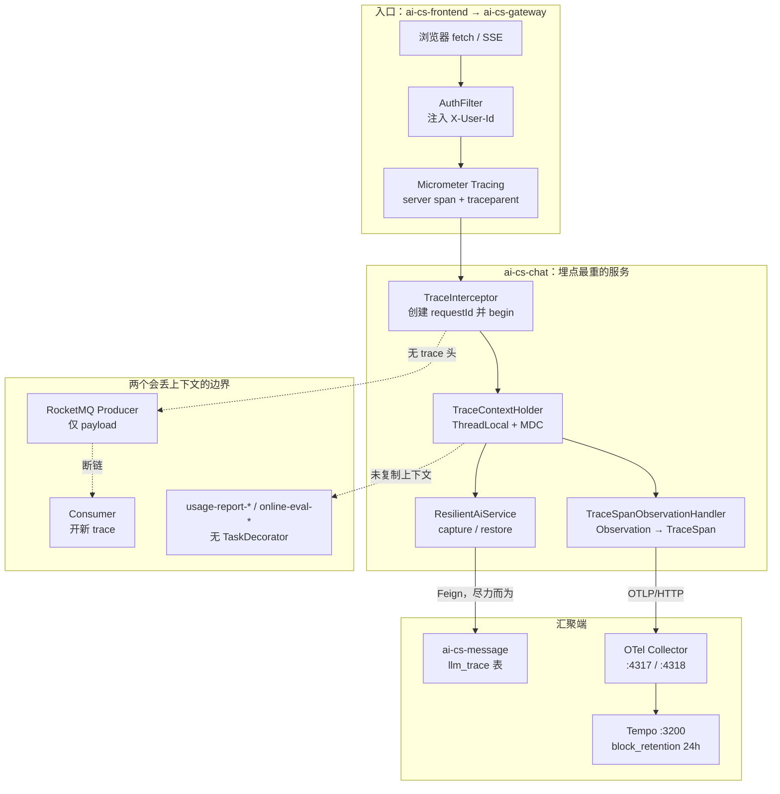
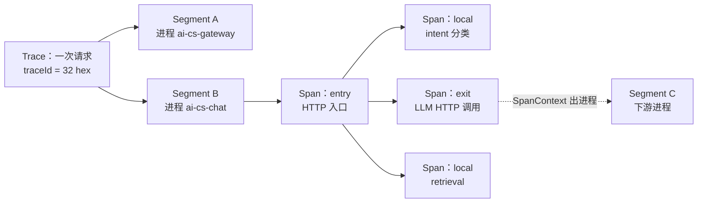
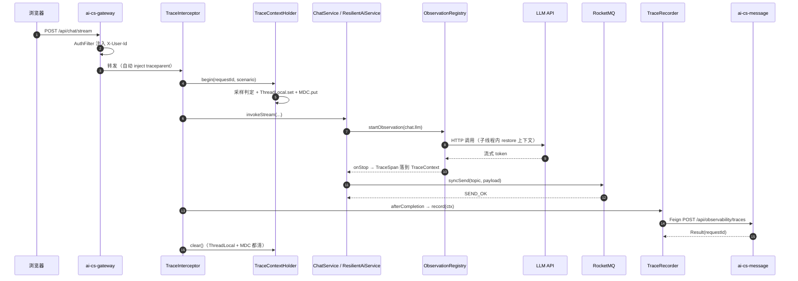

# 14-SkyWalking 与链路追踪：traceId 怎么跨过进程、线程和 MQ

> **一句话结论**：链路追踪的难点从来不在"埋点"，而在**上下文传播**——一个 traceId 要活着穿过 HTTP 边界、线程池边界、MQ 边界；任何一环没接上，现场表现都是同一句话"日志里搜不到这次请求的那几条记录"。
> **阅读前置**：先读 [02-RocketMQ消息队列](02-RocketMQ消息队列.md)（消息头长什么样、`syncSend` 传的是什么）和 [07-运维部署/04-Prometheus可观测性](../07-运维部署/04-Prometheus可观测性.md)（本仓观测栈全景）；想要源码级的 `Tracer`/`Span` 逐个方法精读，看 [24-源码分析/07-2-链路追踪](../24-源码分析/04-SpringCloud/07-分布式事务与链路追踪/02-链路追踪-micrometer-tracing-and-otel.md)。
> **证据基线**：本仓 `main`（Spring Boot 4.2.0 / Spring Cloud 2026.0.0 / JDK 17 / Micrometer Tracing 1.8.0 / OpenTelemetry API 1.68.0，版本来源见 §7）。A 级摘录取自 `learning-docs/24-源码分析/assets/source/` 里已入库的 `opentelemetry-api:1.50.0` 三个文件；B 级引自本仓真实文件（行号已 `read` 核对）；C 级为本机 pwsh / javap 实测输出。预计阅读 30~40 分钟。

**本篇的证据边界，先说清楚再开始**

| 本仓状态 | 事实 | 本篇怎么处理 |
| --- | --- | --- |
| SkyWalking 本体 | 全仓 `skywalking` / `SkyWalking` 关键字命中 **0**（§0 有实测命令），无 agent jar、无 OAP、无 compose 片段 | 只讲架构与原理（概念级），明确标"未入库，依据官方文档"；不编文件名 |
| OTel 二进制依赖 | 11 个服务的 `pom.xml` 都引了 `micrometer-tracing-bridge-otel` + `opentelemetry-exporter-otlp`，`application.yml` 都配了 `management.otlp.tracing.endpoint` | 这是本仓真实链路，B 级证据密集引用 |
| 业务级 trace 落库 | `llm_trace` 表 + `TraceRecorder` → Feign → `ai-cs-message`，已落地 | 作为"跨进程传播"的真实正面案例讲 |
| 日志里的 traceId | `MDC.put("requestId", ...)` 已写，但全仓**没有任何** logback pattern 消费 `%X{...}` | 这是本篇最硬的一个坑，§0 现象 1 与 §6 坑 1 都围绕它 |
| MQ 消息头 | 生产者只用 `MessageBuilder.withPayload(...)`，`putUserProperty` 命中 **0** | "MQ 断链"是必然结果，不是偶发，§3.4 讲怎么修 |
| Tempo / Collector | `deploy/observability/` 配置齐全（Collector:4317/4318 → Tempo:3200，保留 24h） | 引用配置原文当"存储与保留"的实证 |

**本机探测结果**（写这篇时的真实状态，决定哪些 C 级命令能实测）：

```text
docker          MISSING
redis-cli       MISSING
redis-server    MISSING
mysql           MISSING
kafka-topics    MISSING
java            D:\DevTools\jdk\jdk17.0.19\bin\java.exe   (openjdk 17.0.19)
javap / jar     FOUND
node            v24.16.0
```

结论：**起不了 OAP、起不了 Collector、连不上任何后端**。所以本篇的 C 级证据全部是"对真实文件做静态统计"（grep 计数、`javap` 看 jar 里的接口、解析 BOM 的 pom），凡是需要跑起服务才能看到的（TraceQL 查询、`/actuator/beans`），只给判读方法并注明"未实测"。

---

## 0. 先看现象

### 现象 1：一个请求打了三条日志，日志里只搜得到一条

线上排查"这次对话为什么慢"，你按 `requestId` 去 grep 日志，只搜到入口那一行：

```text
2026-11-20 10:31:02.418 DEBUG 1 --- [http-nio-8083-exec-4] c.a.c.o.TraceInterceptor : trace 开始: requestId=9f3c1a5e-..., scenario=chat
```

后面 LLM 调用、检索、落库的日志一条都带不上这个 id。看代码，id 明明进了 MDC：

```java
// ai-cs-chat/src/main/java/com/aics/chat/observability/TraceContextHolder.java#L52-L60
        // requestId 用 UUID 保证全局唯一：它是 trace 查询与用量关联的幂等键，
        // 并发下若用自增/时间戳易碰撞，导致不同请求的 span 串线
        TraceContext ctx = new TraceContext(UUID.randomUUID().toString(), userId, sessionId, scenario);
        // ThreadLocal 绑定当前请求线程：Servlet 线程池复用时必须 clear，否则下个请求读到脏上下文
        HOLDER.set(ctx);
        // MDC 写入 requestId：SLF4J 的 MDC 会自动注入到 %X{requestId} 占位符，
        // 让既有 log.info 日志零改造即可按请求关联——这是"最小侵入"的关键设计
        MDC.put(MDC_REQUEST_ID, ctx.getRequestId());
```

注意最后两行注释里的假设：**"MDC 会自动注入到 `%X{requestId}` 占位符"**——这个说法只在"日志 pattern 里真的写了 `%X{requestId}`"时成立。本仓没有这个 pattern，所以注释描述的是一种意图，不是现状。本机对全仓所有 `logback*.xml` 与 `*.yml` 做一次检索，命中 0：

```text
PS> Get-ChildItem -Recurse -Include logback*.xml,*.yml -File |
      Where-Object { $_.FullName -notmatch "learning-docs|\\target\\" } |
      Select-String -Pattern '%X\{'
（无输出）

PS> Get-ChildItem -Recurse -Include logback-spring.xml -File |
      Where-Object { $_.FullName -notmatch "learning-docs|\\target\\" }
tools\seata\seata\conf\logback-spring.xml
```

也就是说：本仓**根本没有自己的 `logback-spring.xml`**，用的是 Spring Boot 默认输出格式，而默认格式里没有 `%X{requestId}`。**MDC 是"写进去了但没人消费"**——这是"埋点做了、日志还是串不起来"的最典型原因。

### 现象 2：异步线程里的 traceId 变空，span 悄悄消失

chat 服务有两个自建线程池，都叫得上名字，都能在日志里看到：

```java
// ai-cs-chat/src/main/java/com/aics/chat/config/ObservabilityExecutorConfig.java#L27-L40
    @Bean(name = "usageExecutor")
    public ThreadPoolTaskExecutor usageExecutor() {
        ThreadPoolTaskExecutor executor = new ThreadPoolTaskExecutor();
        // 核心 1 / 最大 4：用量上报是低频轻量任务，不需要大线程池，避免无谓的线程开销
        executor.setCorePoolSize(1);
        executor.setMaxPoolSize(4);
        // 队列 1000：削峰缓冲；拒绝策略默认 AbortPolicy，队列满时报错由调用方捕获告警
        executor.setQueueCapacity(1000);
        executor.setThreadNamePrefix("usage-report-");
        // 优雅停机：应用关闭前等待队列任务完成，避免停机瞬间丢失未落库的用量数据
        executor.setWaitForTasksToCompleteOnShutdown(true);
        executor.initialize();
        return executor;
    }
```

日志里出现 `[usage-report-1]` 的线程，它打印的 `requestId` 是空的，而且**在 OTLP 后端里这条用量上报压根不存在**。原因两句话：

1. 这两个线程池**没有设 `TaskDecorator`**（整份文件里没有这个词），提交任务时不会把父线程的 `TraceContext`/MDC 复制到工作线程；
2. 埋点侧有个静默丢弃的分支——拿不到当前上下文就直接返回，连 WARN 都不打：

```java
// ai-cs-chat/src/main/java/com/aics/chat/observability/TraceSpanObservationHandler.java#L45-L48
        TraceContext trace = TraceContextHolder.current();
        if (trace == null) {
            return;
        }
```

所以现象是"不报错、不告警、只是少了一条 span"。这类问题最贵：它不会让任何测试失败。

### 现象 3：MQ 消费端的链路断成两条

`order` 服务下单成功发一条超时关单消息，`message` 服务消费后推通知。在链路平台上看到的是**两条互不相干的 trace**：一条只有生产者的 `send`，另一条从消费者的 `poll` 开始。

看生产者代码，发出去的只有 payload：

```java
// ai-cs-common/src/main/java/com/aics/common/mq/rocketmq/RocketMqMessagePublisher.java#L51-L59
    @Override
    public void sendDelayed(String topic, String key, Object payload, long delayMillis) {
        String destination = destination(topic, key);
        int delayLevel = resolveDelayLevel(delayMillis);
        try {
            rocketMqTemplate.syncSend(destination,
                    MessageBuilder.withPayload(payload).build(),
                    properties.getSendTimeoutMillis(),
                    delayLevel);
```

全仓检索消息头相关的 API，命中 0：

```text
PROPERTY_      5      （都是无关的常量名）
putUserProperty 0
MessageConst    0
```

没有消息头 = 消费端拿不到上游的 traceId = 它只能自己开一条新 trace。**"MQ 断链"在本仓是必然结果，不是偶发**。

> 这些现象指向同一件事：**traceId 的载体在三个边界上都没被搬过去**——HTTP 边界靠 header、线程边界靠 ThreadLocal 的复制、MQ 边界靠消息属性。SkyWalking 这类 APM 的全部工程价值，就是把这三次"搬运"变成框架自动完成；而本仓的选择是"用 OTel 生态 + 少量手写代码"，所以这三处搬运的质量，取决于你自己写没写对。

---

## 1. 整体地图



> **读图说明**：
> 1. 先看**实线主干**：`gateway` 的 server span 建立之后，`TraceInterceptor` 才创建业务自己的 `requestId`——这是本仓"双 id 并存"的根源（§3.1 会讲清两者的分工），两条 id 不是同一个东西。
> 2. 再看**两条虚线**，它们是本篇的主线：一条指向 `usage-report-*` 线程池（上下文没复制过去），一条指向 RocketMQ 生产者（消息头里没带 traceId）。虚线两端的节点在链路平台上是断开的两棵树。
> 3. 汇聚端有**两个互不通信的出口**：左边 `T3 → Collector → Tempo` 是标准 OTel 链路（按 traceId 看整棵树），右边 `T4 → llm_trace` 是自建业务链路（按 requestId 看 LLM 的 token/成本维度）。两者数据模型不同，不能互相替代（§5 有对照）。

| 组件 | 责任 | 调用方（本仓真实类） | 本仓是否落地 | 证据 |
| --- | --- | --- | --- | --- |
| TraceInterceptor（MVC 拦截器） | 入口建 trace、出口落库 + 清理 | Spring MVC，注册于 `ObservabilityWebConfig` | ✅ | `ai-cs-chat/src/main/java/com/aics/chat/config/ObservabilityWebConfig.java#L34-L38` |
| TraceContextHolder | ThreadLocal + MDC 的读写门面 | 拦截器、`ResilientAiService` 等 9 处 | ✅ | `ai-cs-chat/src/main/java/com/aics/chat/observability/TraceContextHolder.java#L23-L25` |
| TraceContext / TraceSpan | 一次请求的 span 列表模型 | `TraceSpanObservationHandler`、`TraceRecorder` | ✅ | `ai-cs-chat/src/main/java/com/aics/chat/observability/TraceContext.java#L45-L48` |
| ObservationRegistry（自建） | 埋点注册表，挂两个 handler | `ObservationConfig` | ⚠️ 与 Boot 自动装配冲突，见 §3.9 | `ai-cs-chat/src/main/java/com/aics/chat/observability/ObservationConfig.java#L40-L57` |
| OtlpObservationHandler | 把 Observation 同步成 OTel span | `ObservationConfig` 条件装配 | ⚠️ 依赖 `aics.observability.otlp-endpoint`，全仓未配置 | `ai-cs-chat/src/main/java/com/aics/chat/observability/OtlpObservationHandler.java#L35-L39` |
| TraceRecorder → TraceFeignClient | 跨进程把 trace 落库到 message 服务 | `TraceInterceptor.afterCompletion` | ✅ | `ai-cs-chat/src/main/java/com/aics/chat/feign/TraceFeignClient.java#L29-L40` |
| llm_trace 表 + LlmTraceServiceImpl | 幂等落库与查询 | `LlmTraceController` | ✅ | `ai-cs-message/src/main/java/com/aics/message/entity/LlmTrace.java#L44-L45` |
| OTel Collector → Tempo | 收 OTLP、按 traceId 存查 | 各服务的 `management.otlp.tracing.endpoint` | ⚠️ 配置就绪，本机无 Docker 未启动 | `deploy/docker-compose/docker-compose-observability.yml#L46-L68` |
| SkyWalking Agent / OAP / UI | 字节码增强采集、聚合、展示 | 无 | ❌ 未落地（全仓关键字 0） | 本篇 §3.5 只做概念讲解 |

---

## 2. 关键概念与关键类

三个词经常被混着用，先把定义钉死（后文所有讨论都建立在这三个定义上）：

- **Trace（链路）**：一次端到端请求的**完整因果树**，由 32 位十六进制 `traceId` 标识。它的边界是"业务上的一次请求"，跨进程不变。
- **Span（跨度）**：树上一个节点，记录"某一段有开始有结束的工作"（一次 HTTP 调用、一次 SQL、一次 LLM 请求）。OpenTelemetry 里它的官方定义是"一段有开始和结束时间的操作"，并且 `Span must be ended by calling end()`；一个 span 只能 `end()` 一次。
- **Segment（分段）**：**SkyWalking 特有的概念**，指"单个进程内产生的所有 span 的集合"，在 OTLP 世界没有直接对应物。之所以要它：SkyWalking 的 agent 以"进程"为上报单位，一个 Segment 一次批量上报，便于按实例聚合。



> **读图说明**：
> 1. 一个 Trace 由**多个 Segment** 拼成，Segment 的边界等于"进程边界"——这正是为什么"跨进程传播"是链路追踪的核心难题：agent 在进程内怎么看都完整，一出门就要靠 header 交接。
> 2. Segment 内部的 Span 分三类：**entry**（谁调我进来的）、**local**（进程内自己做的事）、**exit**（我调了谁出去的）。这三类标签是 SkyWalking 的术语，OTel 里对应的是 `SpanKind.SERVER / INTERNAL / CLIENT`，语义一一对应。
> 3. 虚线上流动的东西不是 Span 本身，而是 **SpanContext**（只有 id + 采样标志 + traceState），下游用它新建自己的 Segment。这就是"传 id 不传数据"的本质——也是本仓 `TraceContextHolder` 手写版只搬 `requestId` 一个字段就显得够用的原因。

| 名称 | 位置 | 角色 | 关键方法 |
| --- | --- | --- | --- |
| `SpanContext`（OTel） | `assets/source/SpanContext.java.md` | 跨进程传播的"小纸条"：`traceId` + `spanId` + 采样标志 + traceState | `getTraceId()` / `getSpanId()` / `isSampled()` / `isRemote()` |
| `Tracer`（OTel） | `assets/source/Tracer.java.md` | 整个 OTel API 里唯一的**创建**入口 | `spanBuilder(String)` |
| `Span`（OTel） | `assets/source/Span.java.md` | 一段操作；取当前 span 靠 `Context` | `current()` / `end()` / `recordException()` / `getSpanContext()` |
| `TraceContextHolder` | `ai-cs-chat/src/main/java/com/aics/chat/observability/TraceContextHolder.java` | 手写传播门面：ThreadLocal + MDC | `begin` / `current` / `capture` / `restore` / `clear` |
| `TraceContext` | `ai-cs-chat/src/main/java/com/aics/chat/observability/TraceContext.java` | 一次请求的容器（相当于一粒"手写 Segment"） | `addSpan` / `totalDurationMs` / `markFailed` |
| `TraceSpan` | `ai-cs-chat/src/main/java/com/aics/chat/observability/TraceSpan.java` | 业务级 span（多了 token、模型、路由原因） | Lombok getter/setter |
| `TraceInterceptor` | `ai-cs-chat/src/main/java/com/aics/chat/observability/TraceInterceptor.java` | MVC 入口/出口切面 | `preHandle` / `afterCompletion` |
| `TraceSpanObservationHandler` | `ai-cs-chat/src/main/java/com/aics/chat/observability/TraceSpanObservationHandler.java` | Observation → `TraceSpan` 的翻译器 | `onStop(Observation.Context)` |
| `TraceRecorder` / `TraceFeignClient` | 前者在 `ai-cs-chat/src/main/java/com/aics/chat/observability/TraceRecorder.java`，后者在 `ai-cs-chat/src/main/java/com/aics/chat/feign/TraceFeignClient.java` | 跨进程落库（幂等键 = requestId） | `record(TraceContext)` / `createTrace(dto)` |
| `LlmTrace` / `LlmTraceServiceImpl` | 实体 `ai-cs-message/src/main/java/com/aics/message/entity/LlmTrace.java`，写入 `ai-cs-message/src/main/java/com/aics/message/service/impl/LlmTraceServiceImpl.java` | 表 `llm_trace` 的实体与幂等写入 | `createTrace` / `getTrace` / `pageTraces` |
| SkyWalking Agent / OAP / Storage / UI | 不在本仓 | 概念级：字节码采集 / 聚合分析 / 存储 / 展示 | 无（未入库） |

---

## 3. 原理与证据逐段精读

### 3.1 trace / span / segment：本仓为什么有两个 id

**在干什么**：给"一次请求"和"请求里的一段工作"各发一个身份，让后续所有记录都能挂到正确的父节点上。OTel 的官方措辞把这件事讲得很死：

```java
// [[源码:SpanContext.java.md#L13-L17]]
 * A class that represents a span context. A span context contains the state that must propagate to
 * child Span s and across process boundaries. It contains the identifiers (a TraceId
 * trace_id and SpanId span_id) associated with the Span and a set of options
 * (currently only whether the context is sampled or not), as well as the TraceState
 * traceState and the boolean remote flag.
```

而"谁负责创建"只有一处，且方法名就把语义写死了：

```java
// [[源码:Tracer.java.md#L61-L71]]
public interface Tracer {
  /**
   * Returns a {@link SpanBuilder} to create and start a new {@link Span}.
   */
  SpanBuilder spanBuilder(String spanName);
}
```

**为什么这么设计**：把"创建"收敛到一个工厂（`Tracer`）、把"传播"收敛到一个不可变值对象（`SpanContext`）、把"当前是谁"委托给语言无关的 `Context`（`Span.current()` 从 `Context.current()` 里取）。三层各管一件事，才能做到"换后端不改业务代码"——今天导出 Tempo，明天导出 SkyWalking，`Tracer` 换个实现就行。

本仓在 `SpanContext` 之外还有 `requestId`，因为两个 id 解决的是不同问题：

| 维度 | OTel `traceId` | 本仓 `requestId` |
| --- | --- | --- |
| 生成者 | Micrometer Tracing / SDK | 手写：`UUID.randomUUID()` |
| 长度 | 32 hex（128 bit） | 36 字符带连字符 |
| 谁看 | 链路后端（Tempo/SkyWalking） | 业务表 `llm_trace`、日志、客服工单 |
| 生命周期 | span 结束即导出 | 落库长期保留（可查历史） |
| 能不能省 | 不能（后端靠它串树） | 不能（业务靠它串人） |

**换成别的写法会怎样**：只用 `requestId` 不用 `traceId`——你做出来的就是"自建审计系统"（本仓的 `llm_trace` 就是），能查"这次对话 LLM 花了多少 token"，但看不到"经过哪几个服务、哪段慢"；反过来只用 `traceId`——链路后端能看树，但你查不到业务语义（`token`、`routeReason` 这类字段通用 APM 没有内建模型）。

**常见坑**：把 `requestId` 当成 `traceId` 写进 `traceparent` header 发给下游。格式不对（32 hex 才合法），下游 `extract` 失败会静默生成新 trace，表现为"传到第二个服务就断"。判断办法：看下游日志里的 traceId 是不是全 0 或与上游不同。

### 3.2 跨进程：header 里那一行字（sw8 vs traceparent）

**在干什么**：出进程时把 `SpanContext` 序列化进协议头，进进程时反序列化出来建子 span。OTel 的约定是 W3C `traceparent`：

```text
traceparent: 00-4bf92f3577b34da6a3ce929d0e0e4736-00f067aa0ba902b7-01
             ^^ ^---------------- 32 hex ----------------^ ^-- 16 hex --^ ^^ sampled
             version              traceId                     spanId       flags
```

SkyWalking 用的是自家 `sw8` 头（8 段用 `-` 分隔：采样标志、traceId、segmentId、父 span、父服务、父实例、父端点、目标地址），这也是它"必须装 agent 才能接上"的原因之一——普通 SDK 不认识这个头。两者能互通的前提是 SkyWalking 的 OAP 开了 OTLP receiver，或者 Agent 插件对 W3C 头做了解析（官方文档口径，本仓未实测）。

**为什么这么设计**：header 是唯一"业务无感、协议允许"的位置——不改 payload 语义、不需要协调上下游。代价是**每一跳都要重新 inject/extract**，少一跳就断。

本仓的真实跨进程有两类，注意它们的区别：

1. **框架层（自动）**：`gateway → chat` 这类 HTTP 调用，靠 `management.otlp.tracing.endpoint` + Micrometer Tracing 的 OTel 桥接自动 inject。证据是全仓 11 个服务都配了同一段：

```yaml
# 每个服务的 src/main/resources/application.yml（以 gateway 为例）
management:
  # ===== 全链路追踪（03-P5）：OTLP 导出至 OTel Collector（observability compose 4318 端口） =====
  tracing:
    sampling:
      probability: ${TRACING_SAMPLING:1.0}   # 生产可调低采样率，本地全采样
  otlp:
    tracing:
      endpoint: ${OTLP_ENDPOINT:http://127.0.0.1:4318/v1/traces}
```

2. **应用层（手写）**：`chat → message` 的 trace 落库，靠 Feign 显式调用，**不依赖**自动注入也能工作，因为它把整个 `TraceContext` 当业务数据传：

```java
// ai-cs-chat/src/main/java/com/aics/chat/observability/TraceRecorder.java#L29-L41
public void record(TraceContext ctx) {
    if (ctx == null) {
        return;
    }
    try {
        LlmTraceDTO dto = new LlmTraceDTO();
        dto.setRequestId(ctx.getRequestId());
        dto.setUserId(ctx.getUserId());
        dto.setSessionId(ctx.getSessionId());
        dto.setScenario(ctx.getScenario());
        dto.setStatus(ctx.getStatus());
        dto.setTotalDurationMs(ctx.totalDurationMs());
        dto.setErrorSummary(ctx.getErrorSummary());
```

**换成别的写法会怎样**：让下游自己去查上游的 span？不可能——跨进程只有"随请求带走"一条路。所以要么 header（协议层），要么 body（业务层）。本仓两种都用了：OTel 走 header，`llm_trace` 走 body（Feign 的 JSON body）。

**常见坑**：全仓检索 `traceparent`、`sw8` 字面量都是 0 命中——**这说明没有任何一行手写代码在拼 header**。好处是不用维护，坏处是：一旦框架的自动注入没生效（比如 Feign 缺少 `feign-micrometer` 这类适配），你不会收到任何提示，链路就静默断开。验证办法见 §6 坑 5。

### 3.3 跨线程：ThreadLocal 为什么必丢，本仓怎么补

**在干什么**：把"当前 span 是谁"从父线程搬到工作线程。OTel 里"当前"存在 `Context.current()` 里（默认实现是 ThreadLocal 的），取法见 [[源码:Span.java.md#L35-L38]]：`Context.current().get(SpanContextKey.KEY)`，取不到就退回 no-op 的 `getInvalid()`。本仓则是自己的 `ThreadLocal<TraceContext>` + MDC：

```java
// ai-cs-chat/src/main/java/com/aics/chat/observability/TraceContextHolder.java#L73-L75
    public static TraceContext capture() {
        return HOLDER.get();
    }
```

```java
// ai-cs-chat/src/main/java/com/aics/chat/observability/TraceContextHolder.java#L87-L95
    public static void restore(TraceContext ctx) {
        if (ctx == null) {
            return;
        }
        // 恢复同一 TraceContext 引用（span 列表是 CopyOnWriteArrayList，线程安全），
        // 异步线程追加的 span 会实时反映到请求主上下文中
        HOLDER.set(ctx);
        MDC.put(MDC_REQUEST_ID, ctx.getRequestId());
    }
```

注意 `restore` 传 `null` 时**什么都不做**（直接 return），不清理线程——清理是调用方在 `finally` 里自己做的事。这个分工很关键：`restore(null)` 若顺手 `remove`，就会把外层还需要的上下文清掉。

调用点在真正的异步边界上，成对出现：

```java
// ai-cs-chat/src/main/java/com/aics/chat/service/impl/ResilientAiService.java#L173-L178
        TraceContext captured = TraceContextHolder.capture(); // 快照当前线程的 traceId/spanId，后面在 supplyAsync 线程里恢复
        // 学习点：ChatUserContext 与 TraceContext 一样是 ThreadLocal，跨 supplyAsync 异步线程不传播——必须在进入异步前捕获 userId，否则配额会按匿名用户计算
        Long userId = ChatUserContext.getUserId();
        return CompletableFuture.supplyAsync(() -> {
            TraceContextHolder.restore(captured); // 在 ForkJoinPool 线程里恢复 trace 上下文，后续日志/观测才能关联到原始请求
            try {
```

**为什么这么设计**：`ThreadLocal` 的语义是"每个线程一份"，线程池的语义是"线程复用"。两者一组合就必然丢/串：丢是因为新线程没有这份值，串是因为复用线程残留上一个任务的值。所以正确做法只有一个：**提交任务时拷一份，任务开始时装回去，任务结束时清干净**。

作者自己也在 Javadoc 里把三条路写清了（这是本仓写得最诚实的一段注释）：

| 方案 | 做法 | 代价 |
| --- | --- | --- |
| 显式传参 | 把 `TraceContext` 当方法参数一路传下去 | 零魔法，但要改所有签名 |
| `InheritableThreadLocal` | 子线程继承父线程的值 | **线程池复用会串数据**（继承只发生在线程创建时） |
| `TransmittableThreadLocal` | 阿里 TTL，装饰线程池实现自动拷贝 | 引入框架，侵入线程池创建处 |
| 本仓选择 | `capture()` / `restore()` 手工成对 + `finally clear()` | 要记得写；漏一处就是一条断链 |

**换成别的写法会怎样**：用 `InheritableThreadLocal` 看起来最省事，但 `usageExecutor` 是**常驻线程池**——第一个任务把值写进线程，后续所有任务都读到第一个请求的 `requestId`。这不是"断链"，是更糟的"串链"：B 用户的耗时被记到 A 用户头上。生产上这类 bug 极难发现。

**常见坑**：`finally` 里只 `HOLDER.remove()` 不 `MDC.remove()`（或反之），会出现"ThreadLocal 已清、MDC 还留着旧 id"的半清状态，于是日志里的 id 和实际 span 不一致。本仓的 `clear()` 是两行都写的，看这段：

```java
// ai-cs-chat/src/main/java/com/aics/chat/observability/TraceContextHolder.java#L104-L107
public static void clear() {
    HOLDER.remove();
    MDC.remove(MDC_REQUEST_ID);
}
```

**当前缺口**：`ObservabilityExecutorConfig` 的两个 bean 都没有 `TaskDecorator`，所以走 `usageExecutor` / `evalExecutor` 的任务**没有**这层保护，除非调用方自己 `capture`/`restore`（`ModelUsageRecorder` 就是这么干的，见 `ai-cs-chat/src/main/java/com/aics/chat/observability/ModelUsageRecorder.java#L83`）。

### 3.4 跨 MQ：消息头是唯一的桥

**在干什么**：MQ 是"异步的进程边界"——生产者和消费者之间隔了 broker 和时间。要接上，只能把 `SpanContext` 塞进消息属性（RocketMQ 的 user property，Kafka 的 record header），消费端取出后当成父上下文。

本仓现状（§0 现象 3 的证据）：只发 payload，没有任何消息属性：

```java
// ai-cs-common/src/main/java/com/aics/common/mq/rocketmq/RocketMqMessagePublisher.java#L44-L44
rocketMqTemplate.syncSend(destination, payload);
```

**为什么这么设计（为什么大家总是漏）**：HTTP 有框架兜底（Servlet/WebClient 拦截），线程池有明确边界（`submit`），MQ 却既没有统一拦截点、API 又长得像"发个字符串"。`syncSend(destination, payload)` 这个重载最容易让人以为"发出去就完事"——它的确发得出去，只是丢了上下文。

**换成别的写法会怎样**：把 traceId 塞进 payload（JSON 里加一个 `traceId` 字段）也能串起来，但污染了业务契约：消费端要改反序列化、上下游要一起发版、以后换中间件全废。正确姿势是消息属性，它不参与业务反序列化：

```java
// 正确姿势（本仓未落地，示意写法，勿照抄行号）
Message<String> msg = MessageBuilder.withPayload(payload)
        .setHeader(MessageConst.PROPERTY_KEYS, bizKey)
        .setHeader("traceparent", currentTraceparent())
        .build();
```

**常见坑**：
1. **只带 traceId 不带 spanId**：消费端建子 span 需要父 spanId，缺了就退化成"同 traceId 的两棵平级树"，看起来连上了其实父子关系错。
2. **重试/死信重复消费**：同一条消息被消费两次，若消费者用 traceId 做幂等键会误判；幂等键要用业务键（本仓 `llm_trace` 用的是 `requestId`，天然唯一）。
3. **采样决策丢失**：上游没采样的请求，如果消息头里没带"不采样"标志，消费端可能又采一次，产生半棵树。采样标志必须跟着 `SpanContext` 一起传。

### 3.5 无侵入：javaagent 字节码增强到底改了什么

**在干什么**：SkyWalking Agent 是一个 `-javaagent` 启动的 jar。JVM 在加载每个类时回调 `ClassFileTransformer`，Agent 用插件规则（匹配类名/父类/注解）决定"这个类要不要改"，要改就用 ByteBuddy 在目标方法前后插入"开 span / 关 span / 上报"的字节码。

```text
java -javaagent:/opt/skywalking/skywalking-agent.jar \
     -Dskywalking.agent.service_name=ai-cs-chat \
     -Dskywalking.collector.backend_service=oap:11800 \
     -jar ai-cs-chat.jar

JVM 加载类 ──► ClassFileTransformer ──► 插件匹配（okhttp/Feign/JDBC/RocketMQ/...）
             ──► ByteBuddy 改写字节码（方法前后织入）──► 定义类
```

> 说明：以上是 SkyWalking 的通用机制，**Agent 本体未入库**（本仓 `skywalking` 关键字 0 命中），参数名与包名依据官方文档；本篇只讲"它为什么能不改代码"。

**为什么这么设计**：SDK 方案（OTel/Micrometer）要求每个服务引依赖、写配置、必要时写代码；Agent 方案把成本从"每个应用"转移到"每个运维动作"——一次加参数，所有 Java 进程全覆盖，连第三方 jar 里的 HTTP 客户端和 JDBC 驱动都埋上了。对"老系统、不让改代码"的场景，这是唯一现实解。

**换成别的写法会怎样**：用 Spring AOP 做同样的事？不行，AOP 只能拦容器里的 Bean：`RestTemplate`/`OkHttpClient`/`DataSource` 是 new 出来的对象或第三方类，AOP 碰不到。这也是老稿里那张"Spring AOP vs Agent"对照表的落点：

| 维度 | Spring AOP | SkyWalking Agent | 本仓 Micrometer Observation |
| --- | --- | --- | --- |
| 织入对象 | 容器管理的 Bean | 类加载期所有匹配类 | 显式埋点 + 框架自带的 Observation 点 |
| 织入时机 | 运行期生成代理 | 类加载期改字节码 | 编译期写死调用 |
| 是否要改代码 | 要（切点/注解） | 不要 | 要（依赖 + 少量代码） |
| 覆盖率 | 你想到的地方 | 插件覆盖到的地方 | 框架覆盖到的地方 |
| 排障体验 | 栈里多代理帧 | 栈里多织入帧 | 栈干净，但没有的东西就是没有 |

**常见坑**：Agent 与"另一个 agent"抢同一个方法（比如同时装 OTel javaagent 和 SkyWalking agent），会互相覆盖字节码，表现为"两边都只有半条链路"。这也是为什么 §5 建议"用 Collector 转发"而不是"两个 agent 都装"。

### 3.6 采样率与开销：本仓有**两套**采样，别叠加

**在干什么**：采样决定"哪些请求真正被记录并上报"。不采样时，SDK 仍会生成 id（保证 header 能传），但不导出数据。

本仓第一套（框架层，全服务生效）：

```yaml
# 每个服务 application.yml：management.tracing.sampling.probability
probability: ${TRACING_SAMPLING:1.0}   # 生产可调低采样率，本地全采样
```

第二套（应用层，只影响手写 trace）：

```java
// ai-cs-chat/src/main/java/com/aics/chat/observability/TraceContextHolder.java#L48-L54
        double rate = properties.getSampleRate();
        if (rate <= 0 || (rate < 1 && Math.random() >= rate)) {
            return null;
        }
        // requestId 用 UUID 保证全局唯一：它是 trace 查询与用量关联的幂等键，
        // 并发下若用自增/时间戳易碰撞，导致不同请求的 span 串线
        TraceContext ctx = new TraceContext(UUID.randomUUID().toString(), userId, sessionId, scenario);
```

配套的默认值在配置类里：`aics.observability.sample-rate` 默认 `1.0`、`enabled` 默认 `true`（`ai-cs-chat/src/main/java/com/aics/chat/observability/ObservabilityProperties.java#L26-L35`）。

**为什么这么设计**：追踪是"按请求量线性增长"的成本——100 QPS 的 20 个 span/请求，一天就是 1.7 亿 span。采样是唯一的价格调节旋钮。默认 1.0 是开发期的正确选择（全采才好排查），生产要显式调低。

**换成别的写法会怎样**：只调一套会得到很迷惑的行为——把 `TRACING_SAMPLING` 调到 0.01，链路后端只剩 1% 的树，但 `llm_trace` 表还是 100% 落库（因为第二套是 `sampleRate`）。反过来调 `aics.observability.sample-rate=0`，`llm_trace` 空了，链路后端却还在收 span。**两套采样的语义完全不同：一套是"要不要导出到 APM"，一套是"要不要记业务审计"**，不要指望一个环境变量同时控制两者。

**常见坑**：`begin()` 里用的是 `Math.random() >= rate`，**无父子一致性**——同一个请求的不同端口径各自掷骰子。真实 OTel SDK 用的是 `TraceIdRatioBased`（对 traceId 做哈希），保证同一条 trace 全链路判定一致。这个差异在本仓表现得出来：`aics.observability.sample-rate=0.1` 时，可能出现"入口 trace 建了、但下游某服务认为不该采"的半截链路。要修就得把判定改成"基于 traceId 的确定性哈希"。

### 3.7 存储与保留：Tempo 24 小时 vs SkyWalking 的 ES/BanyanDB

**在干什么**：链路数据体量大、查询模式特殊（按 traceId 点查为主），所以存储选型与业务库完全不同。

本仓的存储配置是真的，且很短——短到能一眼看出所有取舍：

```yaml
# deploy/observability/tempo.yaml
storage:
  trace:
    backend: local
    local:
      path: /var/tempo/blocks
    wal:
      path: /var/tempo/wal
compactor:
  compaction:
    block_retention: 24h
```

`backend: local` + `block_retention: 24h` 意味着：**单机本地盘、只留一天**。学习环境够用（今天的问题今天查），生产则完全不够——谁也不会只保留 24 小时的链路。

SkyWalking 侧的存储是它的一大卖点（官方文档口径，未入库）：Elasticsearch（最常用，因为复用现有 ES 集群和索引生命周期管理）、BanyanDB（SkyWalking 自研的时序/追踪专用库，10.x 之后主推）、H2（仅内存/文件，做 demo）。与 Tempo 的关键差别是**索引方式**：Tempo 默认只存块 + 少量索引（靠 traceId 点查，其他维度查询靠 TraceQL 扫），SkyWalking 在 ES 里建多张索引表（service/instance/endpoint 维度都能直接查），所以"按服务看慢接口排行榜"这类查询在 SkyWalking 里是原生能力，在 Tempo 里要靠 metrics 侧补。

**为什么这么设计**：链路数据的分层很清晰——**近期明细 + 长期聚合**。24 小时明细 + Prometheus 指标（`--storage.tsdb.retention.time=7d`，见 `deploy/docker-compose/docker-compose-observability.yml#L30`）是常见的最小组合：慢请求从指标里发现，具体哪一段慢再去明细里翻。

**换成别的写法会怎样**：把链路明细也留 30 天、全采样、全字段——成本会以 TB 计，而且 99% 的查询是"看最近一小时"。正确做法是"全采样短期（1~3 天）+ 低采样长期（聚合指标 / 按服务维度的 P99 直方图）"。

**常见坑**：`backend: local` 用了 `tempo-data` 命名卷，容器重建数据还在；但**多副本/多实例时 local 后端会造成数据孤岛**（A 实例的 trace 在 A 盘上，UI 查不到）。生产必须换对象存储（S3/MinIO）——本仓正好有 MinIO，这是最自然的一步演进。

### 3.8 日志与 traceId：MDC 的正确接法

**在干什么**：让每一行日志自带 `traceId`，从而实现"日志 ↔ 链路"双向跳转。机制是 MDC（Mapped Diagnostic Context，Logback 的 ThreadLocal Map）+ 日志 pattern 里的占位符。

本仓**写侧是完整的**：`begin()` 里放、`clear()` 里删、`restore()` 里补；**读侧缺失**：没有任何 pattern 引用它（§0 现象 1）。正确接法只有一行配置：

```xml
<!-- src/main/resources/logback-spring.xml（本仓不存在，示意） -->
<pattern>%d{HH:mm:ss.SSS} %-5level [%thread] [%X{requestId:-}] %logger{36} - %msg%n</pattern>
```

Spring Boot 从 3.x 起还给了一条更省事的路：classpath 上有 Micrometer Tracing 时，Boot 会自动启用 `logging.pattern.correlation`，把 `${spring.application.name}`、`%X{traceId:-}`、`%X{spanId:-}` 插到默认 pattern 里。也就是说**框架的 `traceId` 本来就可能已经在日志里了**，只是本仓更想要的是业务 `requestId`（36 字符 UUID，工单里贴的是它）。

**为什么这么设计**：MDC 用 ThreadLocal 实现，天生只对"当前线程"生效——和 §3.3 的 `TraceContextHolder` 是同一类问题、同一类解法。所以异步任务的日志里丢 traceId，根因往往不在日志配置，而在上下文没传过去。

**换成别的写法会怎样**：不用 MDC，改成每个方法都 `log.info("requestId={}", id)`——能落地，但一旦漏一个方法就断，而且污染所有日志语句。MDC 的价值就是"写一次，全链路生效"。

**常见坑**：
1. **MDC 里放的是 `requestId`，pattern 里写的是 `%X{traceId}`**——键名对不上，日志里就是空。这是最容易犯的错，因为两套 id 名称太像。
2. **异步线程池里 MDC 不复制**：`TaskDecorator` 里要显式 `Map<String,String> ctx = MDC.getCopyOfContextMap();` 再 `MDC.setContextMap(ctx)`。
3. **忘了 `MDC.clear()`**：线程复用时残留旧 id，日志串到别人的请求上。

### 3.9 两条导出链，和一个会"抢注" registry 的坑

**在干什么**：本仓的 chat 服务有**两条**独立的追踪导出路径，都声明在 `ObservationConfig` 里：

```java
// ai-cs-chat/src/main/java/com/aics/chat/observability/ObservationConfig.java#L40-L57
    @Bean
    public ObservationRegistry observationRegistry(ObservabilityProperties properties,
                                                   ObjectProvider<Tracer> tracerProvider) {
        ObservationRegistry registry = ObservationRegistry.create();
        // 1. 组装 span 到 TraceContext（始终生效）
        // 学习点：ObservationHandler 通过 observationConfig().observationHandler() 注册，
        // 埋点方只依赖 ObservationRegistry 接口，具体消费方（TraceContext 组装 / OTLP 导出）
        // 由装配期决定——这是"依赖倒置"在可观测性上的典型应用
        registry.observationConfig().observationHandler(new TraceSpanObservationHandler(properties));
        // 2. OTLP 导出（仅在配置了 otlp-endpoint 且 Tracer Bean 存在时生效）
        // ObjectProvider.getIfAvailable()：找不到 Bean 返回 null 而非抛异常，
        // 实现"可选依赖"——未配置 OTLP 端点时 classpath 里有 OTel 依赖也不初始化任何导出链路
        Tracer tracer = tracerProvider.getIfAvailable();
        if (tracer != null) {
            registry.observationConfig().observationHandler(new OtlpObservationHandler(tracer));
        }
        return registry;
    }
```

一条是"业务落库"（`TraceSpanObservationHandler` → `TraceContext` → `llm_trace`），一条是"标准导出"（`OtlpObservationHandler` → OTel `Span` → Collector → Tempo）。后者还带条件装配：只有配置了 `aics.observability.otlp-endpoint` 才创建 `Tracer` Bean（`ObservationConfig.java#L67-L90`）。

**为什么这么设计**：注释里写得很清楚——"本地开发零配置走日志导出，生产配置端点后自动切换 OTLP 导出，无需改业务代码"。这是 12-factor 的配置与代码分离。

**换成别的写法会怎样（这里就是本篇最大的坑）**：`@Bean ObservationRegistry` 是**自定义 Bean**，而 Spring Boot 的 `ObservationAutoConfiguration` 是按 `@ConditionalOnMissingBean(ObservationRegistry.class)` 装配的——你提供了自己的，Boot 就退让。Boot 的 Micrometer Tracing 集成（`TracingObservationHandler`、`Propagator`、`LoggingSpanExporter` 那套）是挂在**Boot 创建的那个 registry** 上的，registry 被替换后，`management.tracing.*` 与 `management.otlp.tracing.endpoint` 的效果就悬空了：

- `/actuator/prometheus` 的指标照常（那是 Micrometer Metrics 的路径，不受影响）；
- 但 HTTP server/client 的 span 可能**不会**进入这个自建 registry 并导出到 Tempo；
- 日志里的 `traceId`/`spanId`（来自 MDC）可能为空。

这里必须诚实标注：**本篇没有实测**（不允许启动服务，本机也没有 Collector/Tempo）。验证方法在 §6 坑 4，判定依据是 `/actuator/beans` 里 `observationRegistry` 的定义来源。

**已经可以确认的一件事**：`aics.observability.otlp-endpoint` 在全仓任何 yml 里都没配（`otlp-endpoint` 关键字 6 次命中，全部在 Java 源码的注释与字段里）——所以 `otelTracer` 与 `OtlpObservationHandler` **从未被创建**，`ObservabilityProperties.otlpEndpoint` 一直是默认空串。chat 的 span 现状只有"写日志 + 落 `llm_trace` 表"两个出口。

**常见坑**：以为"依赖引了就会导出"。`micrometer-tracing-bridge-otel` + `opentelemetry-exporter-otlp` 只是**能力**，真正导出需要 Boot 的自动装配没被打断（或你自己把 exporter 链建全，包括 propagator 与 sampler）。

---

## 4. 一次完整执行时序



> **读图说明**：
> 1. 第 3~5 步是"埋点"（本篇认为最不难的部分）：建 id、放上下文、开 observation。
> 2. 第 6~9 步是"跨线程"：`OB` 里的 LLM 调用发生在另一个线程上，靠 `restore()` 把上下文搬过去；这一步漏了，`onStop` 会因为 `current() == null` 直接 return，span 静默消失（§0 现象 2）。
> 3. 第 11 步是"跨 MQ"：只传了 `payload`，图中 `MQ` 之后没有回到任何参与者——这正是断链的可视化。修复后应当在图上多一条 `MQ → 消费者 → MSG` 的边，且 consumer 的 span 以 `traceparent` 里的 spanId 为父。
> 4. 第 12~15 步是"跨进程落库"：注意它在业务返回**之后**才做，且失败只 WARN（`TraceRecorder` 的 try-catch），保证 trace 丢了业务不丢。

失败点与报错对照（按图中步骤号）：

| 步骤 | 失败表现 | 真实日志/错误 |
| --- | --- | --- |
| 4（采样） | 请求被判定不采，`begin` 返回 null，后续全部跳过 | 无日志（`rate <= 0` 时静默） |
| 5（MDC） | 日志里没有 requestId | 无报错，只是 pattern 取不到值 |
| 9（observation） | 拿不到上下文，span 丢弃 | 无日志（`current() == null` 直接 return） |
| 11（MQ） | 消费端成为新 trace 根 | 无报错，链路后端出现两条 trace |
| 13（Feign 落库） | `llm_trace` 少一条，业务正常 | `LLM trace 落库失败: requestId={}, err={}`（WARN） |
| 13（序列化） | spans 字段为 `[]` | `trace spans 序列化失败，仅上报元数据: requestId={}, err={}`（WARN） |
| 14（幂等命中） | 重复上报不报错，返回首次结果 | `LLM 调用链追踪已存在，幂等返回: requestId={}`（INFO） |
| 15（清理） | 线程复用后串到下一个请求 | 无报错，只能靠日志里 id 突变发现 |

幂等这一步值得单独看一眼，它是"跨进程写 trace"最容易翻车的地方：

```java
// ai-cs-message/src/main/java/com/aics/message/service/impl/LlmTraceServiceImpl.java#L44-L52
    public String createTrace(LlmTraceDTO dto) {
        // 1. 幂等检查：按 requestId 查询，已存在则直接返回首次创建的 requestId，避免覆盖首次记录。
        //    为什么"先查后写"而不是"insert 后捕获主键冲突"：先查后写是常态路径，日志清晰；
        //    即便并发下有竞态，requestId 是表主键，重复插入会被 DB 主键约束拒绝，不会产生脏数据
        LlmTrace existing = llmTraceMapper.selectById(dto.getRequestId());
        if (existing != null) {
            log.info("LLM 调用链追踪已存在，幂等返回: requestId={}", dto.getRequestId());
            return existing.getRequestId();
        }
```

`requestId` 就是 `llm_trace` 的主键（`selectById(requestId)`），所以"先查后写"即便有并发竞态，重复插入也会被主键约束挡住——这就是"重试安全"的完整实现。

---

## 5. 设计取舍

| 维度 | 本仓选择 | 替代方案 | 代价 / 理由 |
| --- | --- | --- | --- |
| 采集方式 | 引依赖 + 少量手写（Micrometer + OTel 桥接） | SkyWalking Agent 字节码增强 | Agent 覆盖更全（JDBC/MQ/三方客户端自动埋），但版本升级要等探针适配、排障栈变脏；本仓团队更熟 Spring 生态 |
| 后端 | Tempo（Grafana 生态）+ Collector | SkyWalking OAP + ES/BanyanDB | Tempo 便宜、与 Prometheus/Grafana 同屏；SkyWalking 原生服务/接口维度聚合与告警更强 |
| 协议 | W3C `traceparent`（OTel 标准） | SkyWalking `sw8` 私有头 | 标准协议换后端不改代码；私有头必须全家桶一起上 |
| 业务语义 | 自建 `llm_trace`（token/模型/路由原因） | 只靠通用 APM | 通用 APM 没有 LLM 成本模型，两者互补不重叠 |
| 上下文传递 | 手写 `capture/restore` + `finally clear` | TransmittableThreadLocal / TaskDecorator | 手写零依赖但要每处记得写；TTL 一次到位但侵入线程池创建处 |
| 采样 | 双旋钮（`TRACING_SAMPLING` + `aics.observability.sample-rate`） | 单一全局采样 | 导出量与审计量能分开调；但两套语义容易混（§3.6） |
| 存储保留 | Tempo 本地盘 24h + Prometheus 7d | 对象存储 / ES 长保留 | 学习环境够用；生产必须换对象存储（本仓已有 MinIO） |
| 可达性 | 全部"尽力而为"，失败只 WARN | 强一致落库（失败重试队列） | trace 是观测数据，绝不能反过来让业务失败——这是本仓一贯原则 |

**可扩展点清单**（按性价比排序，都给出改哪里）：

1. **给日志接上 requestId**：新增一个 `logback-spring.xml`（本仓各服务的 `src/main/resources/` 下目前都没有这个文件，只有 `tools/seata/seata/conf/` 里有一份与业务无关的），pattern 里加 `%X{requestId:-}`。验收：任一次 `/chat/**` 请求的三条日志能按 requestId grep 到一起。
2. **给线程池加 TaskDecorator**：在 `ai-cs-chat/src/main/java/com/aics/chat/config/ObservabilityExecutorConfig.java` 的两个 bean 上 `executor.setTaskDecorator(...)`，装饰器里做 `MDC` 复制 + `TraceContextHolder.capture/restore/clear`。验收：`[usage-report-*]` 线程的日志带同一个 requestId。
3. **MQ 消息头带上 traceparent**：改 `ai-cs-common/src/main/java/com/aics/common/mq/rocketmq/RocketMqMessagePublisher.java`，发送前 `putUserProperty("traceparent", ...)`；消费侧在 `RocketMQMessageListener` 实现里 `extract` 出来恢复父上下文。验收：链路后端一条 trace 同时包含 producer 与 consumer 的 span。
4. **单点验证 OTel 真的导出**：临时设 `OTLP_ENDPOINT`，用 Collector 的 `debug` exporter 看是否有 span 进来（或者按 §6 坑 4 查 `/actuator/beans`）。验收：Collector 日志里能打出 `ResourceSpans`。
5. **采样改成确定性**：把 `TraceContextHolder.begin()` 里的 `Math.random()` 换成对 traceId 的哈希判定，保证全链路一致。验收：同一 traceId 在任意服务上的采样判定相同。
6. **存储升级**：`deploy/observability/tempo.yaml` 的 `backend: local` 换成 `s3`（指向本仓 MinIO），`block_retention` 提到 7d。验收：容器重建后历史 trace 仍可查。
7. **想试 SkyWalking**：不换采集方式，只在 Collector 里加一条 OTLP exporter 指向 OAP 的 OTLP receiver（SkyWalking 官方文档口径），实现"同一份 span，两套 UI 对比"。

---

## 6. 踩坑与调试手法

### 坑 1：MDC 写了但没人读（本篇第一坑）

**症状**：日志里没有 requestId，但代码里明明 `MDC.put` 了。
**真调试手法**（本机实测，0 命中就是结论）：

```text
PS> Get-ChildItem -Recurse -Include logback*.xml,*.yml -File |
      Where-Object { $_.FullName -notmatch "learning-docs|\\target\\" } |
      Select-String -Pattern '%X\{'
（无输出）
```

**判读**：没有 `%X{...}` 就说明没人消费 MDC。顺带确认项目里连 `logback-spring.xml` 都没有（只有 `tools/seata/...` 那份属于 Seata 自带），所以用的是 Boot 默认 pattern。

### 坑 2：两套采样互相打脸

**症状**：链路后端查不到，但 `llm_trace` 表有；或反之。
**手法**：分别确认两个旋钮的当前值——`management.tracing.sampling.probability`（环境变量 `TRACING_SAMPLING`）与 `aics.observability.sample-rate`。前者不配就是 Boot 默认（开发期常见 1.0），后者默认也是 1.0，所以本地看起来"全都有"，一上生产调了一个另一个没调，就开始撕裂。

### 坑 3：异步线程里的 span 静默消失

**症状**：没有任何错误日志，就是少一条 span。
**手法**：搜这段代码决定"该不该报错"——`TraceSpanObservationHandler` 里 `current() == null` 时直接 return，**故意不打日志**。所以排查方向不是找异常，而是找"上下文有没有传过去"：在任务开头打一行 `log.info("tid={}", TraceContextHolder.current())`，null 就是断点。修复面在 `ObservabilityExecutorConfig`（加 `TaskDecorator`）。

### 坑 4：自定义 `ObservationRegistry` 抢注了 Boot 的装配

**症状**：`management.tracing.*` 配了没用；日志里 traceId 空；Tempo 里没有 HTTP span。
**手法**（需启动服务，本篇未实测，只给判定路径）：

```text
GET http://127.0.0.1:8083/actuator/beans
→ 在 contexts.<app>.beans 里找 observationRegistry
→ bean 定义来自 ObservationConfig（@Configuration 类）而不是 ObservationAutoConfiguration 即命中此坑
```

对照物：同一份响应里 `micrometerObservationsEndpoint`、`prometheus` 等 Boot 装配的 bean 都在，唯独 registry 不是 Boot 的——这就是"只看指标时一切正常、看链路时什么都没有"的典型征兆。

### 坑 5：以为 Feign 会自己带 traceparent

**症状**：`chat → message` 这条 HTTP 链路在 Tempo 里没有 client span。
**手法**：先看依赖树里有没有 Feign 的 Micrometer 适配（`io.github.openfeign:feign-micrometer`）。本机 m2 的实际情况：

```text
PS> Get-ChildItem "$env:USERPROFILE\.m2\repository\io\github\openfeign" -Directory | Select -Expand Name
feign-bom
feign-core
feign-form
feign-form-spring
feign-parent
feign-slf4j
form
parent
```

没有 `feign-micrometer`。**这不等于最终依赖树里没有**（m2 只反映本机解析过的），所以判读要做两步：① `mvn -pl ai-cs-chat dependency:tree -Dincludes=io.github.openfeign:feign-micrometer` 看有没有；② 没有的话，走 §5 可扩展点 3 的"显式消息头/显式 header"路线，别指望框架。

### 坑 6：SSE 长连接里 span 一直不结束

**症状**：Tempo 里看到耗时几十分钟的奇怪 span，或 span 数量比请求数多。
**根因**：流式响应里 span 的 `end()` 挂在 `doFinally` 上（`ResilientAiService` 的 `invokeStream` 里 `restore(streamTrace)` 与 `finally clear()` 分别在 L293、L330）；若客户端提前断开且 `doFinally` 没触发，span 就不结束。
**手法**：在 `doFinally` 里打一行 WARN 带 `requestId` 与耗时，再用请求侧的 `curl --max-time` 主动断开复现。

### 坑 7：`sw8` 与 `traceparent` 混装导致两头都断

**症状**：接入 SkyWalking 后，原来的 Tempo 链路断了一半。
**根因**：两套传播器各自 inject 自己的头，但互相 extract 不认识对方的头，于是各自生成新 trace、"各认各的父"。
**手法**：抓一次请求的 header 看有几个 trace 头（`traceparent` / `sw8` 都在就说明混装）；正确做法是只保留一条采集链（走 Collector 转发），或给 OAP 开 OTLP receiver 用标准协议收（官方文档口径，未实测）。

### 附：本机可用的静态统计手法（无后端也能查现状）

```text
PS> $files = Get-ChildItem -Recurse -Include *.java,*.yml,*.yaml,*.xml,*.json,*.md -File |
      Where-Object { $_.FullName -notmatch "learning-docs|\\target\\|node_modules|\.git\\" }
PS> "scanned files: $($files.Count)"
scanned files: 1059
PS> foreach($p in @("traceparent","sw8","sw-trace","skywalking","ObservationRegistry")){
      "{0,-20} {1}" -f $p, ($files | Select-String -Pattern $p -SimpleMatch | Measure-Object).Count }
traceparent          0
sw8                  0
sw-trace             0
skywalking           0
ObservationRegistry  74
```

**怎么读**：`traceparent`/`sw8` 全 0 = 没有任何手写 header 代码（全靠框架）；`skywalking` 全 0 = 本篇的 SkyWalking 部分是纯选型/认知内容，不是本仓实现；`ObservationRegistry` 74 次说明注册表用得很密（含注释与测试），所以要特别小心 §3.9 那个抢注坑。

依赖侧也可以静态核对（`javap` 直接看 jar 里的接口，比读文档可靠）：

```text
PS> javap -cp "$env:USERPROFILE\.m2\repository\io\opentelemetry\opentelemetry-api\1.68.0\opentelemetry-api-1.68.0.jar" io.opentelemetry.api.trace.Tracer
Compiled from "Tracer.java"
public interface io.opentelemetry.api.trace.Tracer {
  public default boolean isEnabled();
  public abstract io.opentelemetry.api.trace.SpanBuilder spanBuilder(java.lang.String);
}
```

只有一个创建方法——这印证了 §3.1 的说法：OTel API 面极窄，全部复杂性在 SDK 与传播器里。

---

## 7. ⚠️ 版本差异

| 旧写法 / 旧认知 | 当前基线 | 变化点 | 迁移动作 |
| --- | --- | --- | --- |
| 老稿写"SkyWalking 是国产全家桶，靠 agent 零侵入"，暗示它是唯一解 | 本仓实际是 Micrometer Tracing + OTLP（标准协议） | 2023 年后 OTel 成为事实标准，SkyWalking 反过来支持 OTLP 接收 | 认知更新：APM ≠ 某个产品；先问"我的 span 从哪来、发到哪去" |
| `ai-cs-chat/pom.xml` 注释写"micrometer-tracing 1.2.x / opentelemetry 1.31.x" | BOM 实际解析 **1.8.0 / 1.68.0** | Boot 4.2.0 的 BOM 里 `<micrometer-tracing.version>1.8.0`、`<opentelemetry.version>1.68.0`（见下方实测） | 注释是旧版残留，建议改成"由 BOM 管理"，避免误导面试/排障 |
| A 级摘录版本 `opentelemetry-api:1.50.0` | 本仓解析到 1.68.0 | 摘录是抓取时点的版本，与运行版本差 18 个小版本 | 引用接口契约（`SpanContext`/`Tracer`）没问题；引用**具体实现行为**时必须说明版本 |
| `-javaagent` + `-Dskywalking.agent.service_name=...` | 8.x/9.x 之后推荐环境变量 `SW_AGENT_NAME`、`SW_AGENT_COLLECTOR_BACKEND_SERVICES` | 容器化部署下环境变量比 JVM 参数更易注入 | 上 K8s 时用 env，别写死启动参数 |
| SkyWalking 用 H2/ES 起步（老教程） | 10.x 主推 BanyanDB，ES 仍是一等公民 | 自研存储针对追踪/时序负载，写入放大更低 | 新部署评估 BanyanDB；已有 ES 集群则继续用 ES（省运维） |
| 老稿的 `docker run apache/skywalking-oap-server:10.0.1 ...` 命令 | 未验证 | 老稿这条命令是"示意"，镜像 tag/端口未在本仓验证过 | 本文不复述其端口与 tag；要用就查官方 docker-compose 示例 |
| 只配 `management.tracing.enabled` 就以为有链路 | 还需要 `sampling.probability` + `otlp.tracing.endpoint`，且 auto-config 没被打断 | Boot 3.x 起 tracing 自动装配默认开启，但导出端点是空的 | 三件套一起配；配完用 §6 坑 4 验证 |

BOM 版本的实测依据（`read` 到的 pom 原文）：

```text
PS> Select-String -Path "$env:USERPROFILE\.m2\repository\org\springframework\boot\spring-boot-dependencies\4.2.0\spring-boot-dependencies-4.2.0.pom" -Pattern "micrometer.version|micrometer-tracing.version|opentelemetry.version"
149:  <micrometer.version>1.18.0</micrometer.version>
150:  <micrometer-tracing.version>1.8.0</micrometer-tracing.version>
159:  <opentelemetry.version>1.68.0</opentelemetry.version>
```

本机 m2 里同时存在两代目录（`~/.m2/repository/io/opentelemetry/opentelemetry-api/{1.31.0,1.68.0}`、`io/micrometer/micrometer-tracing/{1.2.5,1.8.0}`）——这正是 pom 注释里那串旧版本号的来源：注释写于 Boot 3.2.x 时代，代码升到 4.2.0 后没跟着改。

---

## 8. 面试高频问与答

1. traceId、spanId、segment 三者分别是什么？SkyWalking 的 segment 为什么在 OTel 里没有对应物？
2. 一个 span 的生命周期由哪几个动作界定？为什么 `end()` 只能调一次？
3. `SpanContext` 里到底装了什么？为什么官方要求它不可变？
4. 跨进程传播的最小信息集是什么？W3C `traceparent` 的四段分别代表什么？
5. SkyWalking 的 `sw8` 头与 W3C `traceparent` 能不能互通？互通的前提是什么？
6. MQ 场景下 traceId 应该放在消息体的哪个位置？为什么不能塞进 payload？
7. 线程池里 ThreadLocal 为什么一定会丢？`InheritableThreadLocal` 为什么会串数据？
8. 你在项目里是怎么解决异步链路丢失的？手写 `capture/restore` 与 TTL 各有什么代价？
9. 采样在链路追踪里省的是什么？为什么"按 traceId 哈希"比"每次随机"更正确？
10. 自定义 `ObservationRegistry` Bean 为什么会破坏 Spring Boot 的 tracing 自动装配？
11. 通用 APM（SkyWalking/Tempo）为什么替代不了自建的 LLM 可观测（token/成本/路由原因）？
12. 如果让你在本仓落地"MQ 链路不中断"，你会改哪几个文件、怎么验收？
13. 链路数据为什么通常只保留几天？长期聚合靠什么补？

---

## 9. 动手练习

### 练习 1：让日志真的带上 requestId

新建一个 `logback-spring.xml`（本仓现在没有，放在 `ai-cs-chat` 的 `src/main/resources/` 目录下），pattern 里加 `%X{requestId:-}`（未取到时打 `-`）。
**验收**：一次 `/chat/**` 请求产生的三条日志（入口 debug、span info、出口无 WARN）能按同一个 requestId 一次性 grep 出来；无请求时日志里该位置显示 `-`。

### 练习 2：给线程池加 TaskDecorator

在 `ai-cs-chat/src/main/java/com/aics/chat/config/ObservabilityExecutorConfig.java` 的两个 bean 上挂装饰器，装饰器内做"取父上下文 → 设置 → 执行 → finally 清理"。
**验收**：`usage-report-*` 线程打印的 requestId 与发起请求一致；连续两次不同请求交错执行时，两条日志的 requestId 不串。

### 练习 3：复现"MQ 断链"再修好它

先不改代码，跑一次下单 → 观察链路后端是两条 trace；再在 `RocketMqMessagePublisher` 里加 user property，消费端恢复父上下文。
**验收**：修复前两条 trace 的 traceId 不同；修复后一条 trace 同时包含 producer 的 `send` span 与 consumer 的处理 span，且 consumer 的父 spanId 等于 producer 的 spanId。

### 练习 4：用静态手段证明"当前有没有真导出"

不启动服务，只用 `javap` + `read` 证明两件事：① jar 里有 `OtlpHttpSpanExporter`；② 项目里没有任何 yml 设了 `aics.observability.otlp-endpoint`。
**验收**：给出两条命令与输出，并写一句结论"因此 chat 的 OTLP handler 分支从未装配"。

### 练习 5：把采样改成确定性

把 `TraceContextHolder.begin()` 里的 `Math.random()` 换成基于 traceId 的哈希判定（例如取 traceId 前 8 位转整数再对 10000 取模）。
**验收**：同一 traceId 反复判定结果一致；`sample-rate=0.01` 时统计 1000 个 id，命中数落在 5~15 之间（写个单测统计，不要靠肉眼）。

### 练习 6：给 Tempo 换对象存储

改 `deploy/observability/tempo.yaml`：`backend: s3`，endpoint 指向本仓 MinIO，`block_retention` 提到 7d。
**验收**：compose 起来后打 100 个请求，重启 Tempo 容器，历史 trace 仍能按 traceId 查到（本机无 Docker，此题在有 Docker 的环境做）。

---

## 小结

- **埋点是廉价劳动，传播才是难点**：traceId 只有三种载体——HTTP header、ThreadLocal、MQ 消息属性；三个边界，三种丢法，现象却长得一模一样。
- **本仓是"OTel 标准链路 + 手写业务链路"的双轨制**：Micrometer Tracing 负责跨服务（靠 `management.otlp.tracing.endpoint`），`TraceContextHolder` + `llm_trace` 负责业务语义（token/模型/路由原因），两者不能互相替代。
- **三个已确认的缺口**：MDC 有写无读（无 `%X{}` pattern）、两个线程池无 `TaskDecorator`、MQ 消息头无 traceId；三者都"不报错"，所以只能靠静态统计发现（本篇 §6 附命令）。
- **本节最值钱的一个坑**：自定义 `@Bean ObservationRegistry` 会让 Boot 的 tracing 自动装配退让，于是 `management.tracing.*` 形同虚设——先验证这一点，再谈"为什么 Tempo 里没有 span"。
- **采样有两套**：`TRACING_SAMPLING`（导出量）与 `aics.observability.sample-rate`（审计量），语义不同，别用一个环境变量控制两者；且本仓的随机会破坏父子一致性。
- **SkyWalking 与 OTel 不是对立面**：一个偏"字节码全自动 + 全家桶"，一个偏"标准协议 + 自由组合"；Collector 可以把同一份 span 转给两边，这是本仓选 OTel 的长期价值。
- **动手起点**：先做练习 1（一行 logback 配置）和练习 2（一个 TaskDecorator）——它们不改任何业务逻辑，却能让"日志串不起来"和"异步丢 span"两个老大难立刻可观测。

---

## 自测题

**1. traceId 与 spanId 各自解决什么问题？为什么"传子 span 的 spanId"不够，必须两个都传？**

<details><summary>参考答案</summary>

traceId 标识整条链路（跨进程不变），spanId 标识链路里的某一段工作。下游要建子 span，必须知道父 span 的 spanId 才能挂到正确的父节点上；只传 traceId 会让下游的所有 span 都成为"同一条 trace 下的孤儿节点"，树结构丢失。W3C `traceparent` 因此同时携带两个 id。
</details>

**2. SkyWalking 的 segment 与 OTel 的 trace 是什么关系？**

<details><summary>参考答案</summary>

一个 trace 由多个 segment 组成，segment 的边界是进程边界，等于"单进程内产生的 span 集合"。OTel 没有 segment 概念，因为它以 span 为单位上下报，不像 SkyWalking agent 以进程为上报批次。理解这一点就能理解为什么 SkyWalking 必须装 agent 才能把进程内的 span 打包成一个 segment。
</details>

**3. 为什么 `SpanContext` 必须不可变？**

<details><summary>参考答案</summary>

它会被并发地复制、序列化、跨线程传递，回传给多个子 span。若可变，任何一个持有者的修改都会污染其他分支，导致 id 错乱且极难复现。OTel 官方在 `SpanContext` 的 Javadoc 里明确要求实现必须 immutable 且有良好定义的 equals/hashCode。
</details>

**4. 日志里 traceId 为空的三个常见原因，按排查顺序列出来。**

<details><summary>参考答案</summary>

① 日志 pattern 没有引用 MDC 键（或键名写错，`requestId` vs `traceId`）；② 当前线程的 MDC 没被设置（异步线程池缺 `TaskDecorator`）；③ 采样判定没通过或 tracing 自动装配失效，SDK 没往 MDC 里写 traceId。本仓同时命中 ① 与 ②。
</details>

**5. 为什么不能用 `InheritableThreadLocal` 解决线程池的上下文传播？**

<details><summary>参考答案</summary>

它只在线程**创建**时把父线程的值复制给子线程。线程池的线程是复用的，值在第一个任务创建时就固定了，后续任务全读到第一个任务的值——这不是丢上下文，而是把 A 请求的上下文串到 B 请求上，比丢失更难排查。
</details>

**6. MQ 的 traceId 放在消息属性而不是消息体，好处具体是什么？**

<details><summary>参考答案</summary>

消息属性不参与业务反序列化，上下游不需要一起改契约和发版；换中间件时只改发送/接收适配层。放进消息体则会污染业务 DTO，还可能被业务逻辑误当字段处理，并且要求所有消费方同步升级。
</details>

**7. `management.tracing.sampling.probability` 与本仓的 `aics.observability.sample-rate` 有什么本质区别？**

<details><summary>参考答案</summary>

前者是框架层的采样，控制"要不要把 span 导出到链路后端"；后者是应用层采样，控制"要不要生成手写的 `TraceContext` 并落 `llm_trace` 表"。量纲相同（0~1）但对象不同，调一个不影响另一个，这是排查"为什么两边数据量不一致"的关键。
</details>

**8. 自定义 `ObservationRegistry` Bean 为什么会破坏 tracing 自动装配？**

<details><summary>参考答案</summary>

Spring Boot 的 `ObservationAutoConfiguration` 以 `@ConditionalOnMissingBean` 为前提创建 registry，并把 Micrometer Tracing 的 handler（以及 propagator、exporter 的接线）装到那个 registry 上。用户自定义同名类型 Bean 后自动装配退让，registry 里只有你手动挂的 handler，于是 `management.tracing.*`、`management.otlp.tracing.endpoint` 都不再生效。判定方法：看 `/actuator/beans` 里 registry 的定义来源。
</details>

**9. 为什么通用 APM 覆盖不了 LLM 的可观测性？**

<details><summary>参考答案</summary>

APM 的模型是"调用 + 耗时 + 错误"，而 LLM 关心的是 prompt/补全 token 数、模型版本、路由原因、降级链、首 token 延迟、成本。这些是业务语义，通用埋点无从得知，必须由业务代码（本仓的 `TraceSpan` 与 `ModelUsageRecorder`）显式记录。两者是互补关系：APM 告诉你"哪段慢"，自建 trace 告诉你"这段花了多少钱、为什么选这个模型"。
</details>

**10. 链路数据为什么通常只保留几天？长期怎么补？**

<details><summary>参考答案</summary>

明细 span 的数据量与请求量线性相关，全采样下每天可达数亿条，长期保留成本极高，而绝大多数查询集中在近期。长期靠降采样 + 聚合指标（P99 延迟、错误率直方图）补，本仓就是 Tempo 明细 24h（`block_retention: 24h`）+ Prometheus 指标 7d（`--storage.tsdb.retention.time=7d`）的组合。
</details>

**11. 一个服务同时装了 SkyWalking agent 和 OTel javaagent，会发生什么？**

<details><summary>参考答案</summary>

两个 agent 都会注册 `ClassFileTransformer` 并试图改写同一批方法，字节码互相叠加或覆盖，常见结果是两套 span 都不完整（各自只看到一半的调用），栈里还会出现多层织入帧。正确做法是只保留一套采集，用 Collector 或 OAP 的 OTLP receiver 做"一次采集、多处消费"。
</details>

**12. 若生产环境只有 1% 采样，你怎么定位一个"偶发慢请求"？**

<details><summary>参考答案</summary>

先靠指标（Prometheus 的 P99/慢请求计数 + 分接口维度）定位到时间窗与服务，再在时间窗内用"错误/慢请求强制采样"策略捞明细（很多后端支持基于耗时或错误码的尾部采样）；即便捞不到那一次，也能通过日志里的 requestId 与 `llm_trace` 表（如果审计侧没采样）还原这次请求的业务路径。
</details>
