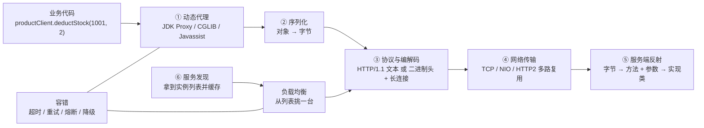
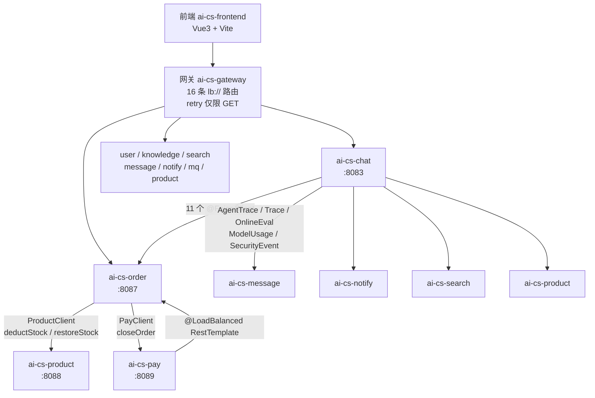
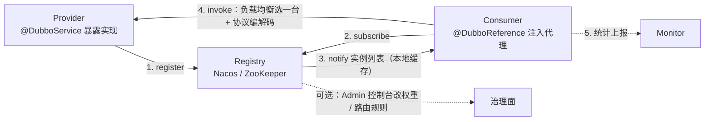
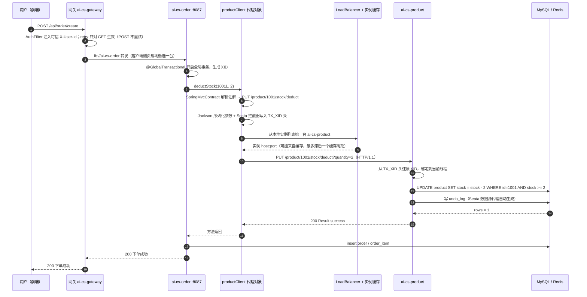

# 04-15 Dubbo 与 RPC 框架：把「远程调用」伪装成「本地方法」，代价是「网络失败伪装成业务异常」

> **一句话结论**：RPC 框架真正卖的不是"性能"，而是**一次普通的方法调用语法**——动态代理替你拼协议、序列化替你抹平字节、服务发现替你藏起 IP 列表；但代价同样明确：**网络超时、实例下线、重试重放，全都变成了一个 `try/catch` 里的异常**，你从一行 `catch (Exception e)` 里再也分不清"库存不足"和"网络超时"，更分不清"扣减成功但响应丢了"。
> **阅读前置**：[01-Java基础/06-反射动态代理与SPI](../01-Java基础/06-反射动态代理与SPI.md)（JDK 代理就是 RPC 的入口）、[02-Spring微服务/07-服务调用统一与SeataXID传播](../02-Spring微服务/07-服务调用统一与SeataXID传播.md)（本项目的 Feign 调用与 XID 传播）、[02-Spring微服务/08-Feign熔断与降级语义](../02-Spring微服务/08-Feign熔断与降级语义.md)（降级语义决定"失败怎么收场"）。想先看源码级细节可跳到 [24-源码分析/03-负载均衡与调用/02-openfeign-动态代理与请求拼接](../24-源码分析/04-SpringCloud/03-负载均衡与调用/02-openfeign-动态代理与请求拼接.md)。
> **证据基线**：A 级 = `org.apache.dubbo:dubbo:3.3.6` 的注解与代理工厂摘录（`DubboReference.java` / `DubboService.java` / `AbstractProxyFactory.java`，共 4 个文件）+ `spring-cloud-openfeign` 的 `FeignClientsConfiguration` / `FeignClientFactoryBean` / `FeignClientProperties` + `spring-cloud-loadbalancer` 的 `NacosLoadBalancer` / `LoadBalancerProperties`，均已入库 `learning-docs/24-源码分析/assets/source/`（**锚点行号是摘录内标注的原始 java 行号**）；B 级 = 本项目 13 个 Feign 客户端、网关路由、订单下单链路（行号当次核对）；C 级 = 本机静态统计（**本机无 Dubbo、无 Nacos/Redis/MySQL 运行实例，C 级只做 grep/计数类静态实测，未启动服务**）。预计阅读 35~45 分钟。

---

## 0. 先看现象

三个现象，来自三种不同的"看起来都很合理"的配置。它们会被后面 3.1~3.8 逐条解释。

### 现象 1：下单接口偶发重复扣款——"我只点了一次，库存掉了 4 件"

订单服务扣库存的落点是这一段（字面量取自 `ai-cs-order/src/main/java/com/aics/order/service/impl/OrderCreateTxService.java#L93-L95`）：

```java
for (CartItem item : cartItems) {
    productClient.deductStock(item.getProductId(), item.getQuantity());
}
```

而被调用的服务端实现是这一段（字面量取自 `ai-cs-product/src/main/java/com/aics/product/service/impl/ProductServiceImpl.java#L195-L199`）：

```java
int rows = productMapper.update(null, new LambdaUpdateWrapper<Product>()
        .eq(Product::getId, productId)
        .ge(Product::getStock, quantity)
        .setSql("stock = stock - " + quantity)
        .setSql("sales = sales + " + quantity));
```

| 现象 | 你的第一反应 | 真正的原因 |
|---|---|---|
| 一次下单，库存少 4 件（quantity=2） | "是不是前端重复提交？" | `stock = stock - 2` 是**相对扣减**，天然不幂等：同一次逻辑调用被网络层重发一次，就是扣两次。前端只提交了一次，重发发生在调用链里 |
| 订单表只有 1 条记录，库存却扣了 2 次 | "事务回滚没生效？" | 库存分支**确实提交过一次**（返回包丢了），调用方按"失败"走了回滚/补偿路径，但相对扣减的第二笔又已落库。回滚按 `undo_log` 回滚它自己那次，多出来的那笔没有归属 |
| 加日志后偶发，压测时更频繁 | "Redis/DB 抖动" | 抖动本身不会造成重复扣款，**抖动 × 重试**才会。抖动只决定"要不要重试"，重试决定"会不会执行两次" |

真正致命的组合是：**一个非幂等的写接口 + 一个自动重试的客户端**。而"自动重试"在这个技术栈里有三个开关，任何一个被打开都够用：

```text
① Feign 自带的 Retryer          → Spring Cloud OpenFeign 默认 NEVER_RETRY（默认关）
② Spring Cloud LoadBalancer 重试 → 默认存在，但对非 GET 请求默认不重试
③ 网关 RetryGatewayFilter        → 本项目真实开启了，retries=2，只限 GET
```

也就是说，**本项目当前在写路径上是安全的**（这三条后面用 A/B 级证据逐一钉住），但它是"三个默认值恰好都对"的安全，不是设计出来的安全——任何人把 `retries` 从默认改成 3，或者给 `defaultConfig` 配一个 `Retryer`，这条链路立刻变成"最多扣 4 次"。这不是假设：Dubbo 的默认容错策略 `failover` 恰好就是"失败换一台重试 2 次"，一个 `@DubboReference` 不写任何参数迁过去，重复扣款立刻从"偶发"变成"必现"。这就是本篇要讲透的东西。

### 现象 2：服务刚上线，调用方还在打旧实例

发布 `ai-cs-product` 之后，网关侧短时间出现 5xx，日志里出现（这是 A 级源码里的原文日志格式，`[[源码:NacosLoadBalancer.java.md#L136-L138]]`）：

```text
No servers available for service: ai-cs-product
```

| 现象 | 你的第一反应 | 真正的原因 |
|---|---|---|
| 新实例起来了，但请求还发往已停的旧实例 | "Nacos 没刷新？" | 调用方持有的是**实例列表的本地副本**，中间还套了一层 LoadBalancer 缓存；注册中心推送再快，也要经过"缓存过期 + 下次请求"才生效 |
| 实例列表明明是新的一批，仍有零星失败 | "网络问题" | 旧实例进入 `server.shutdown: graceful` 的 30s 收尾期（`ai-cs-order/src/main/resources/application.yml#L1-L7`），它**还活着但不接新连接**，正好是"列表里合法、连接被拒"的窗口 |
| 网关 16 条路由全是 `lb://` | — | 16 处 `lb://`（见 6.3 的 C 级统计）意味着**路由到哪台实例完全由客户端负载均衡决定**，网关自己不记地址，所以"Nacos 里对不对"和"请求打到哪"是两件事 |

### 现象 3：超时设 3s，可这个接口实际要 5s

一个非常典型的"改造事故"：有人觉得"3 秒不返回就是挂了"，于是把 `read-timeout` 设成 3000ms。他得到的结果不是"更快失败"，而是"更多重复"：

```text
真实耗时 5s 的写操作 + 3s 读超时 + 任意一层重试
= 第 1 次在 3s 被判超时（服务端仍在跑，5s 时成功提交）
+ 第 2 次在 0s 重新发起（服务端再执行一次）
= 业务上执行了 2 次，客户端看到 1 次成功 1 次超时
```

| 现象 | 你的第一反应 | 真正的原因 |
|---|---|---|
| 超时告警变多，同时库存对不上 | "调小超时不是更安全吗？" | 超时**不取消服务端执行**。它是"我不等了"，不是"你别做了"。对非幂等写，这是最坏的一种失败：既占用了服务端资源，又制造了不确定 |
| 调用方记了失败，服务端记了成功 | "日志对不上，是不是时间不同步？" | 这是分布式系统里唯一诚实的状态：**结果未知（in-doubt）**。要么靠幂等键去查，要么靠对账补偿，不能靠"再试一次" |

这些现象指向同一件事：**RPC 框架把"网络会失败"这件事藏进了一个方法调用的返回值里，而超时、重试、实例缓存这三个各自都合理的机制，只要在写路径上叠加，就会造出"执行了两次"或"执行了零次却报成功"——框架不会提醒你，因为从它的接口看，一切都很正常。**

---

## 1. 整体地图

### 1.1 RPC 的六要素：一次"本地调用"背后被替换掉的六层



> **读图说明**：
> 1. ①②③④ 是"调用能出去"的通道，⑤ 是"调用能落地"的通道，二者合起来才是 RPC 的完整闭环——只有客户端没有服务端反射，那叫 HTTP 客户端。
> 2. **⑥ 服务发现 + 负载均衡**不是必经环节（直连 `url` 也能调），但一旦用了注册中心，它就是"IP 从哪来"的唯一答案；本项目 16 条 `lb://` 路由全走这条路。
> 3. 虚线框外的"容错"是**横切**的：它不参与数据流，只在"第 3 步发出去了、第 5 步没回来"这个缝隙里做决策——所以容错策略的正确性永远等于"业务操作是否幂等"，跟框架本身无关。
> 4. 六要素里只有 ②③ 是"RPC 框架 vs HTTP 框架"的真正分野（Dubbo 换 hessian2/Triple，Feign 用 JSON/HTTP1.1）；①④⑤⑥ 两者机制几乎同构，这也是本项目"不换框架也能活得很好"的根据。
> 5. 图中 ① 是唯一你能"看见"的位置：`productClient` 这个对象不是 Spring 给你的 Bean，而是一个代理对象——`OrderCreateTxService` 注入的字段类型是 interface，实现是运行时生成的。

### 1.2 本项目的真实调用拓扑（13 个 Feign 客户端 + 1 组 RestTemplate）



> **读图说明**：
> 1. 13 个 `@FeignClient` 分布是 **chat 11 个 + order 2 个**（C 级统计见 6.3），不是老文档说的"chat 11 + order/pay 的 RestTemplate"——order 侧早就迁到 Feign 了，只有 pay 模块还留着一个 `@LoadBalanced RestTemplate`。
> 2. 网关 → 服务用的是 **LoadBalancer 客户端侧发现**（`lb://`），服务 → 服务用的是 **Feign + 同一套 LoadBalancer**；两者共享 Nacos 实例列表，所以"某台实例挂了"会同时影响两条链路。
> 3. 图中最值得背的是 **order → product** 这条边：它同时是"RPC 调用"和"Seata AT 分支事务"，一条链路上叠了两个分布式语义，也是本篇所有事故分析的落点。
> 4. chat 是"扇出型"调用方（11 个客户端），说明它的失败面最大：任何一个下游抖动都会在 chat 的线程池里排队——这是"RPC 把远程调用伪装成本地方法"最典型的学习场景。
> 5. 注意 `ai-cs-pay` 有一个反向箭头（pay → order），而且它用的是 `@LoadBalanced RestTemplate`（`ai-cs-pay/src/main/java/com/aics/pay/config/PayRestTemplateConfig.java#L15-L17`），**没有降级、没有超时配置**，这是全仓最脆弱的一条边。
> 6. 节点上的端口不是随口写的，取自各模块 `application.yml` 的 `server.port`：order 8087、chat 8083、product 8088、pay 8089（各文件第 3 行）。看这张图时请把端口当"每台实例的监听口"，**实例地址由注册中心给，不写死在代码里**——这正是 3.3 节讲的"地址从哪来"。

### 1.3 Dubbo 的四角色（本项目未使用，作为对照）



> **读图说明**：
> 1. 第 3 步"notify + 本地缓存"和第 1.1 节的 ⑥ 是同一件事：注册中心挂了，存量调用**还能继续**（只是发现不了新节点）——这与本项目 Nacos 客户端的本地快照是同一思想（详见 [24-源码分析/02-注册中心Nacos/02-服务发现与拉取-服务实例列表如何更新](../24-源码分析/04-SpringCloud/02-注册中心Nacos/02-服务发现与拉取-服务实例列表如何更新.md)）。
> 2. 第 4 步把"负载均衡 + 编解码 + 容错"全塞进一次调用，是 Dubbo 与 Feign 的最大结构差异：Feign 的这几件事由 **Spring Cloud 的过滤器链**分层拼出来，Dubbo 由**一个 Cluster Invoker 的装饰器栈**拼出来。结构不同，出问题时"该去哪一层找"就不同。
> 3. 图的右边"治理面"是本项目最缺的一块：Dubbo 有 Admin 能改权重、加条件路由、灰度，而 Feign 侧这些要靠 Nacos 元数据 + Gateway 自己写。
> 4. Monitor 这一角色在现代落地中基本被 Micrometer/OTLP 取代，本项目走的是 `management.otlp.tracing.endpoint`（`ai-cs-order/src/main/resources/application.yml#L60-L67`）。

### 1.4 组件责任表

| 组件 | 责任 | 本项目对应物 | 调用方（谁依赖它） |
|---|---|---|---|
| 动态代理 | 把 interface 方法调用转成"要发一个请求" | Spring Cloud OpenFeign 的 `FeignClientFactoryBean#getTarget` | 所有注入 Feign 接口的 Service |
| 契约解析 | 把 `@GetMapping` 注解翻译成 HTTP 方法 + 路径 + 参数 | `SpringMvcContract`（A 级 `[[源码:FeignClientsConfiguration.java.md#L135-L136]]`） | 每个 Feign 客户端首次创建时 |
| 编解码 | 对象 ↔ JSON / 二进制 | `SpringEncoder` / `SpringDecoder`（A 级 `[[源码:FeignClientsConfiguration.java.md#L114-L123]]`） | Feign 调用链 |
| 负载均衡 | 从实例列表中挑一台 | `NacosLoadBalancer`（A 级 `[[源码:NacosLoadBalancer.java.md#L128-L132]]`） | Feign 与 Gateway |
| 实例发现 | 提供服务实例列表（含本地缓存） | Nacos Discovery + `CachingServiceInstanceListSupplier` | 负载均衡器 |
| 超时 | 决定"等多久算失败" | `Request.Options`（A 级 `[[源码:FeignClientFactoryBean.java.md#L299-L304]]`） | Feign 调用链 |
| 重试 | 决定"失败后要不要再来一次" | `Retryer`（A 级 `[[源码:FeignClientsConfiguration.java.md#L150-L151]]`） | Feign 调用链 |
| 熔断/降级 | 决定"失败后返回什么" | Resilience4j + `FallbackFactory` | order 的 `ProductClient` / `PayClient` |
| 上下文传播 | 把身份 / 事务 ID 带到下游 | `@RequestHeader` + Seata 的 Feign 拦截器 | order → product 的 XID 传播 |

---

## 2. 关键概念与关键类

| 名称 | 位置 | 角色 | 关键方法 / 关键值 |
|---|---|---|---|
| `@DubboReference` | 已入库 `[[源码:DubboReference.java.md#L170-L174]]` | 消费端声明式引用：一个注解生成远程代理 | `cluster()` 默认空串，javadoc 列 `failover/failfast/failsafe/failback/forking` |
| `retries()` | 已入库 `[[源码:DubboReference.java.md#L208-L213]]` | 调用级重试次数 | `int retries() default -1;` —— **`-1` 不是"不重试"**，是"交给 `Constants#DEFAULT_RETRIES` 决定" |
| `timeout()` | 已入库 `[[源码:DubboReference.java.md#L246-L249]]` | 调用级超时（毫秒） | `int timeout() default -1;` 表示走全局默认 |
| `loadbalance()` | 已入库 `[[源码:DubboReference.java.md#L215-L219]]` | 负载均衡策略名 | javadoc 列 `random, roundrobin, leastactive`（一致性哈希在 `LoadbalanceRules` 里，该常量类未入库） |
| `check()` | 已入库 `[[源码:DubboReference.java.md#L121-L124]]` | 启动时是否强制校验提供者存在 | `boolean check() default true;` —— 启动即失败的来源 |
| `generic`（已废弃） | 已入库 `[[源码:DubboReference.java.md#L106-L111]]` | 泛化调用标记 | 3.x 起 `@Deprecated`，改为"按注入类型与接口自动判定" |
| `AbstractProxyFactory#getProxy` | 已入库 `[[源码:AbstractProxyFactory.java.md#L52-L99]]` | 组装要实现的接口集合，再交给子类生成字节码 | 依次塞入 `INTERFACES` 参数、真实接口、`invoker.getInterface()`，最后补 `INTERNAL_INTERFACES` |
| `JavassistProxyFactory` | 已入库（摘录文件 `JavassistProxyFactory.java.md`） | 真正生成代理类字节码的实现 | 实现 `getProxy(invoker, Class<?>[])`（A 级抽象方法在 `[[源码:AbstractProxyFactory.java.md#L136-L136]]`） |
| `@DubboService` | 已入库 `[[源码:DubboService.java.md#L70-L85]]` | 提供端暴露服务 | `interfaceClass()`、`version()`、`group()`；`retries()` / `timeout()` 同样默认 `-1`（`[[源码:DubboService.java.md#L201-L201]]`、`[[源码:DubboService.java.md#L238-L238]]`） |
| `@FeignClient` | 本项目 `ai-cs-order/src/main/java/com/aics/order/client/ProductClient.java#L27-L28` | 声明式 HTTP 客户端 | `name` = 服务名（走注册中心）、`contextId` = 配置隔离键、`path` = 统一前缀、`fallbackFactory` = 降级工厂 |
| `FeignClientFactoryBean` | 已入库 `[[源码:FeignClientFactoryBean.java.md#L123-L125]]` | 生成 Feign 代理 Bean | 超时初值取自 `new Request.Options()`；无 `url` 时把 `name` 拼成 `http://name` |
| `FeignClientProperties` | 已入库 `[[源码:FeignClientProperties.java.md#L134-L140]]` | `spring.cloud.openfeign.client.config.*` 的绑定类 | `connectTimeout` / `readTimeout` 单位毫秒、`retryer` 是 **Class**（要你给一个实现类） |
| `NacosLoadBalancer` | 已入库 `[[源码:NacosLoadBalancer.java.md#L128-L184]]` | Nacos 版负载均衡器 | 同集群优先 → IP 类型过滤 → `ServiceInstanceFilter` 链 → 按 `serviceId` 选算法 |
| `LoadBalancerProperties` | 已入库 `[[源码:LoadBalancerProperties.java.md#L73-L76]]` | LoadBalancer 全局配置 | 内置 `Retry retry`（Spring-Retry / Reactor Retry 支持）+ `hint`/`hintHeaderName` |
| `TX_XID` | 本项目 `ai-cs-order/src/main/java/com/aics/order/client/ProductClient.java#L18-L21` | Seata 全局事务 ID 的请求头名 | 由 `SeataFeignRequestInterceptor` 自动写入，RestTemplate 链路做不到 |

---

## 3. 原理与证据逐段精读

### 3.1 动态代理：`deductStock(...)` 这一行到底发生了什么

**在干什么**：`OrderCreateTxService` 注入的 `productClient` 字段声明类型是 `ProductClient`（interface），运行时是代理对象。调用 `deductStock(1001L, 2)` 时，真正执行的是代理的 `invoke` → 读方法上的注解元数据（`PUT /product/{id}/stock/deduct`）→ 拼 URL、绑定参数、序列化、发请求。Dubbo 侧同理：`AbstractProxyFactory#getProxy` 先决定"这个代理要实现哪些接口"，再由 `JavassistProxyFactory`/JDK 生成字节码。

A 级证据（`getProxy` 的接口集合是**有序拼装**的，顺序有语义）：

```java
// [[源码:AbstractProxyFactory.java.md#L52-L99]]
public <T> T getProxy(Invoker<T> invoker, boolean generic) throws RpcException {
    LinkedHashSet<Class<?>> interfaces = new LinkedHashSet<>();
    ClassLoader classLoader = getClassLoader(invoker);
    String config = invoker.getUrl().getParameter(INTERFACES);
    if (StringUtils.isNotEmpty(config)) { /* 逐个 forName 加入 */ }
    Class<?> realInterfaceClass = null;
    if (generic) { /* 从 URL 的 interface 参数取真实接口再加入 */ }
    // …… 最后补 invoker.getInterface() 与 INTERNAL_INTERFACES（EchoService、Destroyable）
    return getProxy(invoker, interfaces.toArray(new Class<?>[0]));
}
```

**为什么这么设计**：代理类一旦生成就写死了"实现哪些接口"，所以接口集合必须在生成前一次性算全。用 `LinkedHashSet` 而不是 `HashSet`，是因为 Dubbo 支持 native image（GraalVM）——源码注释直说了 `when compiling with native image, ensure that the order of the interfaces remains unchanged`，顺序变了，生成的代理类就不可复现。`INTERNAL_INTERFACES` 塞进 `EchoService`（连通性探测）和 `Destroyable`（优雅销毁），等于给每个远程代理"免费"加了两个治理方法。

**换写法会怎样**：如果像手写 HTTP 调用那样用 `RestTemplate` 拼字符串，你得到的是"编译期什么都不校验、路径拼错只在运行时 404"。本项目旧实现就是 RestTemplate，`ProductClient` 的类注释写清了迁移收益：接口即契约、`FeignContractTest` 能在编译期/测试期校验路径与参数（`ai-cs-order/src/main/java/com/aics/order/client/ProductClient.java#L16-L17`）。反过来说，动态代理也带来了"看不见的成本"：一次方法调用可能触发 DNS、选实例、建连接、序列化、重试——**它的耗时分布和本地方法调用完全不同**，这是所有"我以为它很快"的事故源头。

**常见坑**：
- 代理对象上读不到真实实现里的注解/字段（`getClass()` 是代理类，不是接口实现类），调试时别拿 `service.getClass().getSimpleName()` 当类型判断依据。
- `@FeignClient` 接口上方法必须是 `public` 且**不能是 default 方法里的自调用**——default 方法内部调 `this.xxx()` 不会经过代理，注解不生效（与 AOP 自调用失效同源，见 [02-Spring微服务/15-SpringAOP与声明式事务原理](../02-Spring微服务/15-SpringAOP与声明式事务原理.md)）。
- 代理对象不能被序列化、不能放进缓存做 key。

### 3.2 序列化与协议：为什么"换个序列化"能快 3 倍，也能让线上全挂

**在干什么**：把方法名 + 参数类型 + 参数值变成字节（序列化），对端再还原（反序列化）。Feign 走 `SpringEncoder`/`SpringDecoder` + Jackson 的 JSON；Dubbo 默认 `dubbo` 协议（二进制头 + 长连接）+ `hessian2` 序列化；Dubbo 3 的 Triple 协议跑在 HTTP/2 上。

A 级证据（Feign 的编解码器就是一层套一层的装饰）：

```java
// [[源码:FeignClientsConfiguration.java.md#L114-L123]]
public Decoder feignDecoder(ObjectProvider<FeignHttpMessageConverters> messageConverters) {
    return new OptionalDecoder(new ResponseEntityDecoder(new SpringDecoder(messageConverters)));
}
```

**为什么这么设计**：JSON 的自描述性换来"抓包就能看懂"；二进制序列化省掉字段名和冗余空格，换来体积与 CPU。RPC 选二进制的前提是**两端都说同一种语言、同一个版本的对象模型**——一旦跨语言（本项目的 `ai-cs-py-chat`）或跨版本（老客户端连新服务端），二进制序列化的"隐式 schema"就会变成灾难：加一个字段、改一个类型，对端直接解析失败，而且**错误信息通常不指向真正的问题**。这也是 Dubbo 3 推 Triple（HTTP/2 + Protobuf 可选）的动机：既要性能，又要跨语言与可观测。

| 维度 | JSON（Feign 默认） | hessian2（Dubbo 默认） | Protobuf（Triple/gRPC） |
|---|---|---|---|
| 可读性 | 抓包即懂 | 需要工具 | 需要 `.proto` + 工具 |
| 体积/速度 | 大 / 一般 | 中 / 快 | 小 / 最快 |
| schema 约束 | 无（靠约定） | 弱（Java 类结构） | 强（IDL 编译期校验） |
| 跨语言 | 天然 | 弱 | 强 |
| 与 HTTP 生态兼容 | 完全兼容（网关、Nginx、调试工具都认） | 不兼容，需专用协议栈 | HTTP/2 层兼容，语义需网关适配 |
| 本项目适用性 | ✅ 网关/前端/多语言/调试全部就绪 | ❌ 需整套换栈 | ⚠️ 需引入 IDL 与代码生成 |

**换写法会怎样**：把 order → product 换成 hessian2，单次调用可能快 30%~50%，但你同时失去：网关侧对 `PUT /product/{id}/stock/deduct` 的路由能力（`ai-cs-gateway/src/main/java/com/aics/gateway/config/RouteConfig.java#L144-L147`）、Nginx/浏览器的可见性、`curl` 直接复现的能力，以及 Python 服务与 Java 服务之间的互调。**性能收益是局部的，可观测性损失是全局的**——这就是本项目在 RPC 序列化上选"最笨的那个"的原因。

**常见坑**：
- JSON 反序列化对"多字段 / 少字段 / null"过于宽容，**接口契约的错会被静默吞掉**（少传一个必填参数，服务端拿到 null，报的是业务异常而不是参数错误）。
- `Result<T>` 泛型擦除后 Feign 侧常被反序列化成 `LinkedHashMap`，取值时 `ClassCastException`——所以本项目给远程返回定义了专用信封结构（`ai-cs-order/src/main/java/com/aics/order/dto/ProductRemoteDTO.java`，由 `ProductClient#L44-L49` 的返回值声明使用）。
- 序列化选择跟**超时**强相关：体积大 → 传输慢 → 更容易超时 → 更容易触发重试。

### 3.3 服务发现：接口级 → 应用级，以及"为什么调用方还在打旧实例"

**在干什么**：调用方需要知道"`ai-cs-product` 现在有哪几台、在哪、健康吗"。Dubbo 2.x 按**接口**注册（一个应用 50 个接口 = 50 条注册记录），Dubbo 3 改为**应用级**注册（一个应用一条，接口清单放元数据）——这一点是官方文档口径（`dubbo` 服务发现与 3.x 迁移文档，**该文档未入库，本篇依据 Apache Dubbo 官方文档**），而本项目天然是应用级：Nacos 里注册的是 `spring.application.name`。

A 级证据：即使拿到了实例列表，"选哪台"还有一层过滤（`ai-cs-product` 跨集群时的日志原文就在这里）：

```java
// [[源码:NacosLoadBalancer.java.md#L134-L155]]
private Response<ServiceInstance> getInstanceResponse(Request<?> request, List<ServiceInstance> serviceInstances) {
    if (serviceInstances.isEmpty()) {
        log.warn("No servers available for service: {}", this.serviceId);
        return new EmptyResponse();
    }
    String clusterName = this.nacosDiscoveryProperties.getClusterName();
    // 有 clusterName 时优先同集群实例；跨集群会 log.warn("A cross-cluster call occurs，name = {}, clusterName = {}, instance = {}")
```

**为什么这么设计**：`EmptyResponse` 而不是抛异常，是为了让上层统一处理"没有实例"和"选了但调用失败"两种不同语义——前者不该计入熔断统计（服务没坏，是没人），后者才该。而"同集群优先"是机房亲和性：跨机房调用延迟高一个数量级，框架宁可把流量集中在同机房。

**换写法会怎样**：不用注册中心（写死 `@FeignClient(url = "http://10.0.0.5:8086")`）能省掉发现层，但换来扩缩容时改配置 + 重启，以及"一台挂了流量全打过去"。Feign 支持 `url` 属性（`FeignClientFactoryBean` 在 `url` 非空时跳过负载均衡），本项目 13 个客户端**一个都没用 `url`**，全走服务名——这是正确的做法。

**常见坑**：
- **"列表是新的"不等于"请求会打到新实例"**：调用方有本地副本 + LoadBalancer 缓存层（`CachingServiceInstanceListSupplier`，默认有 TTL，兜底策略是"缓存过期前继续用旧列表"）。改完注册中心立刻验证往往还是老结果。
- 优雅下线窗口：`server.shutdown: graceful` + `timeout-per-shutdown-phase: 30s`（`ai-cs-order/src/main/resources/application.yml#L1-L7`）意味着实例在"名单里还有、已不接新请求"的状态会停留最多 30 秒。这段时间的失败率上升不是 Bug，是设计使然；消灭它的办法是**先摘流量再停实例**（发布脚本层面），而不是调小超时。
- 同一 `serviceId` 在 Nacos 不同 namespace/group 下是两套实例（本项目 `namespace: aics`、`group: DEFAULT_GROUP`，`ai-cs-order/src/main/resources/application.yml#L10-L20`）——本地起服务和测试环境串台，十次有九次是 `namespace` 不一致。

### 3.4 负载均衡：四种策略，以及框架替你做的三层过滤

**在干什么**：从实例列表里选一台。业界四类主流策略：

| 策略 | 选择依据 | 优点 | 典型坑 |
|---|---|---|---|
| 随机（加权） | 权重轮盘 | 无状态、实现简单、长尾公平 | 权重配 0 的实例仍可能被选中（0 应表示"不接流量"，实现上要靠禁用而非权重 0） |
| 轮询（加权） | 计数器递增 | 分布均匀 | 慢实例会积累在途请求，雪崩时更慢 |
| 最少活跃 | 在途请求数最少 | 天然避开慢实例 | 要维护活跃计数，瞬时新实例容易被"突然打满" |
| 一致性哈希 | 参数哈希环 | 相同参数打到同一台，可做本地缓存亲和 | 节点变化时环重排，缓存命中率骤降；热点参数会打爆单台 |

Dubbo 的 `loadbalance` 可选值在 A 级 javadoc 中明确列了 `random / roundrobin / leastactive`（`[[源码:DubboReference.java.md#L215-L219]]`），一致性哈希的实现常量在 `LoadbalanceRules`（**未入库**，依据官方文档）。

本项目用的是 Spring Cloud LoadBalancer 的 `RoundRobinLoadBalancer` 系（默认轮询），A 级证据显示 **Nacos 的 LB 在轮询之前还叠了三层过滤**：

```java
// [[源码:NacosLoadBalancer.java.md#L161-L176]]
instancesToChoose = this.filterInstanceByIpType(instancesToChoose);
// Filter the service list sequentially based on the order number
for (ServiceInstanceFilter filter : serviceInstanceFilters) {
    instancesToChoose = filter.filterInstance(request, instancesToChoose);
}
ServiceInstance instance;
if (loadBalancerAlgorithmMap.containsKey(serviceId)) {
    instance = loadBalancerAlgorithmMap.get(serviceId).getInstance(request, instancesToChoose);
}
else {
    instance = loadBalancerAlgorithmMap.get(LoadBalancerAlgorithm.DEFAULT_SERVICE_ID)
            .getInstance(request, instancesToChoose);
}
```

**为什么这么设计**：过滤（IP 类型 v4/v6、集群、元数据）是**硬约束**，必须先做；算法（轮询/随机）只是**偏好**，最后做。如果顺序反了，就会出现"轮询选中了一台 v6 实例，但调用方只有 v4 网络"这种必然失败。`loadBalancerAlgorithmMap` 允许**按服务维度**配不同算法（`ai-cs-product` 用轮询、`ai-cs-chat` 用最少活跃），这是比"全局一种算法"更强的治理能力——顺带说，这也是本项目网关 `application.yml#L54-L57` 里那个 `aics.loadbalancer.algorithm: round-robin` 想要的东西（注意那个是**项目自定义前缀**，不是 Spring 的 `spring.cloud.loadbalancer`）。

**换写法会怎样**：改一致性哈希能给 `getProduct` 这类读接口带来本地缓存命中率（见 [04-中间件/17-Caffeine本地缓存与两级缓存](17-Caffeine本地缓存与两级缓存.md)），但对 `deductStock` 这种写接口毫无意义——写操作本来就不能缓存，哈希只会让热点商品永远打到同一台，把负载不均放大成故障。

**常见坑**：
- 轮询 + 长连接 + `keep-alive`：连接池会记住上一次的目标，**负载均衡在连接层被架空**（这是 Dubbo 长连接与 Feign 连接池都有的问题，排查时看连接数是否明显不均）。
- 拿 `lb://` 但没配 `spring-cloud-starter-loadbalancer` 依赖时，报错是 A 级原文：`No Feign Client for loadBalancing defined. Did you forget to include spring-cloud-starter-loadbalancer?`（`[[源码:FeignClientFactoryBean.java.md#L446-L456]]`）。本项目根 `pom.xml` 显式引了这个 starter，就是为了不踩它。

### 3.5 集群容错：五种策略，与 `retries()` 的 `-1` 陷阱

**在干什么**：调用失败了怎么办。Dubbo 在注解层面就把它做成可配置项：

```java
// [[源码:DubboReference.java.md#L170-L174]]
/**
 * Cluster strategy, legal values include: failover, failfast, failsafe, failback, forking
 * you can use {@link org.apache.dubbo.common.constants.ClusterRules#FAIL_FAST} ……
 */
String cluster() default ClusterRules.EMPTY;
```

| 策略 | 行为 | 什么时候是对的 | 什么时候会出事 |
|---|---|---|---|
| `failover`（默认） | 换一台重试，默认重试 2 次 | 读操作、幂等写（如"查询库存"） | **非幂等写**：扣款、扣库存、发券——重试就是重复执行 |
| `failfast` | 失败立即抛 | 非幂等写、可被用户感知的失败 | 网络抖动被放大成业务失败（要配合重试在**业务层**做幂等重试） |
| `failsafe` | 失败忽略，只记日志 | 通知、审计等旁路 | 关键写用它 = 静默丢数据 |
| `failback` | 失败入队列定时重发 | 最终一致的异步通知 | 队列积压无人看时，成了"迟到很久的重复执行" |
| `forking` | 并行调多台，取最快返回 | 读操作、对延迟极敏感 | **写操作千万别用**：N 台并行执行 N 次，等于强制放大 N 倍 |
| `broadcast` | 逐台全调，任一失败即异常 | 刷新所有节点本地缓存 | 误用于业务写 = 每台都执行一次 |

`broadcast` 没有出现在上面那段 javadoc 的列举里（A 级只列了五种），它是 `ClusterRules` 里的独立策略（**常量类未入库，依据官方文档**）——记结论时别把"javadoc 列了 5 个"当成"总共有 5 个"。

**为什么这么设计**：Dubbo 把重试当成**框架默认能力**，是因为它假定"一次 RPC 失败大多是网络瞬时问题"。这个假定在 2010 年代的内网基本成立，但在"写操作 + 相对扣减"的场景下代价极高。所以真正的关键不是背六个名字，而是记住一句话：**容错策略的合法性，由被调方法的幂等性决定，跟框架、性能、团队习惯都无关。**

**`-1` 的陷阱（必背）**：`int retries() default -1;`（`[[源码:DubboReference.java.md#L208-L213]]`）—— `-1` 的字面意义是"未指定"，真实默认重试次数由 `Constants#DEFAULT_RETRIES` 决定（A 级 javadoc 直接写了 `see Constants#DEFAULT_RETRIES`），而 Dubbo 的 failover 默认值是 **2**（官方文档口径，`Constants` 未入库）。也就是说：

```text
@DubboReference 不写 cluster/retries
= failover + 重试 2 次
= 一次 deductStock 最多执行 3 次（1 次原始 + 2 次重试）
```

**这正是任务里"非幂等接口被重试 3 次"的机制来源**。它不是配置错误，是"什么都没配"的默认结果。

**换写法会怎样**：本项目用 Feign，`Retryer` 默认是 `NEVER_RETRY`（A 级 `[[源码:FeignClientsConfiguration.java.md#L146-L152]]`）：

```java
// [[源码:FeignClientsConfiguration.java.md#L146-L152]]
public Retryer feignRetryer() {
    return Retryer.NEVER_RETRY;
}
```

所以本项目的"默认语义"恰好等于 Dubbo 的 `failfast`——同样的代码迁到 Dubbo，默认语义会从 `failfast` 变成 `failover`，**没有任何一行业务代码改变，行为却从"失败即失败"变成"最多执行 3 次"**。这是框架迁移中最阴险的一类变化。

**常见坑**：
- 以为 `retries = 0` 等于"关掉重试"，其实还要同时确认 `cluster` 不是 `failover`（`failfast` 下 retries 无意义）。
- 重试 + 超时的乘法效应：`timeout=1000ms, retries=2` 的最坏耗时是 ~3s，不是 1s。上层的 ReadTimeout 必须 ≥ 这个值，否则外层先超时、内层还在重试，制造"一边报错一边成功"。
- `actives`（并发执行数限制）与重试是互相拉扯的：`actives` 卡住排队等待时也会计入耗时，容易触发超时。

### 3.6 超时 × 重试：把 3s 那个数字放回本项目的真实链路

**在干什么**：超时决定"等多久判失败"，重试决定"失败后要不要再来"，幂等性决定"再来一次会不会出事"。三者必须**一起**设计。

先看本项目现状（C 级静态审计，真实输出见 6.3）：**全仓没有一处 Feign 超时配置**。于是所有 Feign 调用走 `FeignClientFactoryBean` 的初值：

```java
// [[源码:FeignClientFactoryBean.java.md#L123-L125]]
private int readTimeoutMillis = new Request.Options().readTimeoutMillis();
private int connectTimeoutMillis = new Request.Options().connectTimeoutMillis();
private boolean followRedirects = new Request.Options().isFollowRedirects();
```

也就是"照抄 feign-core `Request.Options` 的无参默认值"（`feign-core` 未入库；按 Feign 官方文档，无参默认是 **连接 10s、读取 60s**）。要覆盖它，唯一入口是 `spring.cloud.openfeign.client.config.<contextId|null>.connectTimeout/readTimeout`（A 级 `[[源码:FeignClientProperties.java.md#L134-L140]]`，单位毫秒）：

```java
// [[源码:FeignClientProperties.java.md#L134-L140]]
private Logger.Level loggerLevel;
private Integer connectTimeout;
private Integer readTimeout;
private Class<Retryer> retryer;
```

那么回到那个问题——**"这里超时设成 3s 会怎样"**，逐处回答：

| 调用点 | 现状（默认 10s/60s 的实际含义） | 若把 read-timeout 改成 3000ms 会怎样 |
|---|---|---|
| `productClient.deductStock`（`ai-cs-order/src/main/java/com/aics/order/service/impl/OrderCreateTxService.java#L93-L95`） | 几乎不会触发读超时；一旦触发，说明 product 侧已经卡死 60s | **最危险的一处**。deductStock 内部是"条件更新 DB + 两次 select + 写 Redis 镜像"（`ai-cs-product/src/main/java/com/aics/product/service/impl/ProductServiceImpl.java#L192-L213`），Redis 在远端（`tools/nacos-config/aics-shared.yml#L7` 是远程 IP，order 侧连接超时甚至被调到 15000ms，见 `tools/nacos-config/ai-cs-order.yml#L4` 的注释）。3s 完全可能落在"DB 已扣、响应未回"的窗口里 → 超时被记成失败 → 若叠加任何一层重试就是**二次扣减**；若不重试，就是"库存扣了、下单失败了"，只能靠人工对账 |
| `productClient.restoreStock`（`ai-cs-order/src/main/java/com/aics/order/service/impl/OrderServiceImpl.java#L195`、`#L231`） | 尽力而为语义，降级实现只记日志不抛（`ai-cs-order/src/main/java/com/aics/order/client/fallback/ProductClientFallbackFactory.java#L42`） | 3s 会让"回补失败"变多，但因为 `restoreStock` 是**绝对值语义之外的相对回补**（`stock = stock + qty`），重复执行会多补——同样不幂等，只是危害方向相反（少卖 vs 多卖） |
| `payClient.closeOrder`（`ai-cs-order/src/main/java/com/aics/order/service/impl/OrderServiceImpl.java#L261`） | 关单是"尽力而为通知"，吞异常 + 告警 | 3s 相对合理：渠道关单慢时快速放弃、由后续补偿再关。这也是全仓**唯一适合短超时**的写调用——因为它是"通知"而不是"记账" |
| `GET` 类查询（chat 的 11 个客户端，如 `ai-cs-chat/src/main/java/com/aics/chat/feign/OrderFeignClient.java#L25-L36`） | 60s 读超时对"用户正在等回答"的链路等于没有超时保护 | 3s 是**推荐的**：查询幂等、可重试、且用户端不该等 60s。若再加网关层 GET 重试（本项目已有，`retries=2`），最多 3 次 × 3s，用户最多等 9s，可控 |
| 支付渠道出站调用（`ai-cs-pay/src/main/java/com/aics/pay/channel/AlipayChannel.java#L211-L212`） | 显式 `connectTimeout(10000)` / `readTimeout(60000)`，是"第三方慢就等"的选择 | 3s 会让支付宝偶发慢响应直接失败 → 用户付了钱、订单未标记（**外部渠道反而更需要幂等查询补偿**，不能靠调超时解决） |

**为什么这么设计**：`Request.Options` 的默认值偏保守（10s/60s），因为它不知道你的业务；框架把"该设多少"这个判断留给了业务，而"业务没设"就成了最常见的隐患。真正的原则是：

```text
下层超时 < 上层超时（外层永远先放弃，避免"内外不一致"）
写操作超时 ≈ P99 耗时 × 1.5，且必须配幂等键或对账
读操作超时尽量短，并允许重试
```

**换写法会怎样**：Dubbo 的 `timeout()` 是**方法级**的，还能在 provider 侧配 `timeout` 覆盖 consumer（默认 1000ms，官方文档口径）——比 Feign 的"仅按 client 名配置"细粒度得多。代价是：**同一个接口，provider 改了超时，所有 consumer 的预期都变了**，而这种"隐式契约变更"在 Feign/HTTP 世界里是不存在的（HTTP 侧超时是调用方私事）。这也是为什么 Dubbo 项目里"接口超时"通常写进 API 工程一起发布。

**常见坑**：
- 只调超时不调重试：超时变小 → 失败变多 → 上层（网关/Nginx/前端）自身重试被触发 → 实际放大。
- 只调重试不调超时：重试总时长超过网关超时 → 网关先断开，客户端记成功还是失败取决于日志时序。
- 熔断器的统计窗口会把这些"超时重试"全记成失败，于是**熔断被自己的重试打爆**（本项目 `openfeign.circuitbreaker.enabled=true`，`ai-cs-order/src/main/resources/application.yml#L30-L31`，熔断实例名就是 `contextId`，即 `productClient` / `payClient`）。

### 3.7 隐式上下文传播：attachment、`@RequestHeader`、`TX_XID` 是同一件事

**在干什么**：跨进程传"不属于业务参数、但下游必须知道"的信息：当前用户、链路 traceId、全局事务 XID。Dubbo 叫 attachment（`RpcContext`），Feign 靠 `@RequestHeader` 或 `RequestInterceptor`，HTTP 世界还有一个免费的 `traceparent`。

本项目把它做成了**显式参数**：

```java
// ai-cs-chat/src/main/java/com/aics/chat/feign/OrderFeignClient.java#L25-L27
@GetMapping("/order/{orderNo}")
Result<OrderVO> getOrderDetail(@RequestHeader("X-User-Id") Long userId,
                               @PathVariable("orderNo") String orderNo);
```

而 XID 是**隐式**的（业务代码完全看不到）：

```text
@GlobalTransactional 开启全局事务
  → SeataFeignRequestInterceptor 把 XID 写进 TX_XID 头
  → product 侧 seata-http 拦截器把 XID 绑到当前线程
  → 数据源代理生成 undo_log
```

证据：`ai-cs-order/src/main/java/com/aics/order/client/ProductClient.java#L18-L24` 的类注释把这三个成立条件写得很清楚（调用方传播 + 下游 MVC 绑定 + 下游数据源代理），并明确写了"这是 RestTemplate 链路做不到的（旧实现因此使 product 分支游离在全局事务外）"。

**为什么这么设计**：RPC 的隐式传参本质是"给调用链加一条旁路"，好处是业务签名干净，代价是**它是一条你看不见的依赖**：拦截器没注册、线程池切换、异步化，任何一环断了，XID/用户 ID 就悄悄丢了，而业务代码完全无感——直到你发现"这笔库存扣减没回滚"。`X-User-Id` 用显式参数而不是拦截器的理由也在这：**让它出现在签名里，就不会被静默丢掉**（代价是每个方法多一个参数，且每个调用方都得自己塞对）。

**换写法会怎样**：Dubbo 的 attachment 在**跨线程**时会丢（与 `ThreadLocal` 同源），Dubbo 3 提供了 `Context` 的异步传递支持；本项目 `ChatUserContext` 的类注释把同一个坑写成了两个警告：线程复用必须 `clear()`、异步失效（`ai-cs-chat/src/main/java/com/aics/chat/util/ChatUserContext.java#L17-L21`）。**这两条警告在 Dubbo 项目里同样成立**——这不是框架 bug，是"上下文存在于线程局部"这一实现的必然结果。

**常见坑**：
- `@RequestHeader` 显式传参时，**下游拿到 null 而不是报错**（`required` 默认 false 时）→ 越权查询的经典入口；网关侧因此专门做了"先移除客户端伪造的 X-User-Id 再注入可信值"（`ai-cs-gateway/src/main/java/com/aics/gateway/filter/AuthFilter.java#L153`）。
- 异步/响应式链路里 `ThreadLocal` 必然失效，Feign 调用要手动把上下文塞进 `RequestInterceptor` 的参数（本项目在 Seata 拦截器里靠框架完成）。
- 别把**业务参数**塞进 attachment/头：一旦有人绕过来源（定时任务、MQ 消费），头里就没有值，代码直接 NPE。

### 3.8 泛化调用：为什么它是个"运维工具"而不是"业务工具"

**在干什么**：没有接口 jar、没有 DTO 类，也能调一个 Dubbo 服务——传"接口全限定名 + 方法名 + 参数类型数组 + 参数值数组"，拿到 `Map`/`Object` 结果。Dubbo 侧的开关就是 `@DubboReference` 的 `generic` 属性，但 3.x 已经把它废弃了：

```java
// [[源码:DubboReference.java.md#L106-L111]]
/**
 * @deprecated Do not need specify generic value, judge by injection type and interface class
 */
@Deprecated
```

**为什么这么设计**：泛化调用的真实使用者是**网关、测试平台、服务治理控制台**——它们没有业务方的 jar，但需要"能调任何服务"。在 3.x 里，框架可以从"注入的字段类型是不是 `GenericService`"自动判断，所以不再需要手写 `generic = true`。Feign 侧没有等价能力（HTTP 只需要 URL 和 JSON，本来就"泛化"），本项目对应物就是网关的通用转发。

**换写法会怎样**：用泛化调用做业务集成，你会失去编译期类型检查、失去注解/契约校验、把 JSON 反序列化的"宽容"放大到极致——线上最常见的结果是"参数名写错一个字母，服务端收到 null，报了个业务异常"。**能用接口 jar 就别用泛化。**

**常见坑**：
- 泛化调用**不经过**接口上的 Dubbo Filter / 自定义拦截器链（取决于版本与配置），鉴权/审计容易被绕过。
- 泛化调用的返回值是弱类型，`Map` 里数字类型可能是 `BigDecimal`/`Long`/`Integer` 三种之一，强转必炸。

---

## 4. 一次完整执行时序

以本项目最重的一条链路为例：**用户下单 → 网关 → order → (Feign) → product 扣库存**，并把它与"如果换成 Dubbo 会多/少哪几步"对照。



> **读图说明**：
> 1. 第 2 步是本项目"重试安全性"的关键一行：网关的 `RetryGatewayFilter` 配了 `setMethods(HttpMethod.GET)`（`ai-cs-gateway/src/main/java/com/aics/gateway/config/RouteConfig.java#L176-L178`），**POST 下单请求在网关层天然不重试**。这一条比任何文档都重要——它是"写路径不重复"的第一道保险。
> 2. 第 7~9 步是"伪装"发生的地方：从 `deductStock(1001L, 2)` 到真正的 `PUT` 请求之间，代理做了契约解析、序列化、头注入、选实例四件事，业务代码一行都看不到。
> 3. 第 10 步"可能来自缓存"是现象 2（还在打旧实例）的直接来源：**选实例发生在调用方进程内**，与 Nacos 控制台显示的列表可以不一致。
> 4. 第 13~14 步是 Dubbo 与 Feign 差异最大的一步：Dubbo 会有"服务端线程池 + 反射调用"的显式环节（线程池满了就是 `RpcException: Server threadpool is exhausted` 一类错误），Feign 则由 Tomcat 线程池承担同一职责——**问题同构，报错文案不同**。
> 5. 第 16~17 步的 `undo_log` 是"扣库存能回滚"的唯一依据；它成立的前提是第 12 步 XID 成功绑定（3.7 节）。
> 6. 全链路没有任何一步"自动重试"，因为：网关只重试 GET、Feign `Retryer.NEVER_RETRY`、LoadBalancer 默认不对非 GET 重试。**这个"三重默认"就是当前写路径安全的全部理由**。

### 哪一步失败，报什么错（对照表）

| 失败点 | 触发条件 | 你看到的日志 / 异常（可核对来源） | 危险等级 |
|---|---|---|---|
| 第 3 步 选实例 | `ai-cs-product` 无健康实例 | `No servers available for service: ai-cs-product`（A 级 `[[源码:NacosLoadBalancer.java.md#L136-L138]]`） | 低（快速失败，无副作用） |
| 第 3 步 跨集群 | 实例不在调用方 `clusterName` 内 | `A cross-cluster call occurs，name = {}, clusterName = {}, instance = {}`（A 级 `[[源码:NacosLoadBalancer.java.md#L156-L159]]`） | 中（延迟飙升，易外层超时） |
| 第 3 步 选实例异常 | 过滤器/Nacos 客户端抛错 | `NacosLoadBalancer error`，且返回 `null`（A 级 `[[源码:NacosLoadBalancer.java.md#L180-L183]]`） | 中（`null` 会继续往上冒，表现为"没报错但调不通"，极难查） |
| 第 9 步 连接 | 实例已停但仍在列表里 | 连接被拒 / 连接超时（`connectTimeout`，默认 10s） | 低→中（配合缓存滞后会持续几十秒） |
| 第 11 步 依赖缺失 | 少了 `spring-cloud-starter-loadbalancer` | `No Feign Client for loadBalancing defined. Did you forget to include spring-cloud-starter-loadbalancer?`（A 级 `[[源码:FeignClientFactoryBean.java.md#L446-L456]]`） | 高（启动/首次调用即失败） |
| 第 12 步 参数绑定 | `@RequestHeader` 的值为 null | 下游业务校验失败（越权/订单不存在），**不是框架错误** | 高（静默安全漏洞） |
| 第 13 步 业务失败 | 库存不足 | `BusinessException(PRODUCT_STOCK_INSUFFICIENT)`（`ai-cs-product/src/main/java/com/aics/product/service/impl/ProductServiceImpl.java#L206-L207`）→ Feign 侧抛 `FeignException`（4xx，见 `ProductClient` 注释 `ai-cs-order/src/main/java/com/aics/order/client/ProductClient.java#L32-L33`）→ 触达降级工厂 | 低（业务语义正确） |
| 第 15 步 读超时 | product 慢于 `readTimeout` | `SocketTimeoutException: Read timed out` 包成 `FeignException` | **最高**（服务端可能已提交，结果未知） |
| 第 18 步 后续失败 | 订单 insert 失败 | 全局事务回滚 → 按 `undo_log` 反向补偿已提交的分支（`ai-cs-order/src/main/java/com/aics/order/service/impl/OrderCreateTxService.java#L87-L92` 的注释） | 低（Seata 兜底，但要求第 12 步 XID 传播成功） |

---

## 5. 设计取舍

### 5.1 Dubbo vs OpenFeign：六个维度的本质对照

| 维度 | Dubbo 3 | OpenFeign（本项目实际） | 本质差异 |
|---|---|---|---|
| 协议 | 默认 `dubbo` 协议：单一长连接 + NIO + 二进制头；3.x 增 Triple（HTTP/2） | HTTP/1.1 文本（每请求可复用连接，但语义仍是短请求） | 长连接省握手、天然支持回调/推送；HTTP 天然被所有中间件理解 |
| 序列化 | hessian2 默认，可 Protobuf/Kryo | JSON（Jackson），可换但生态默认 JSON | 二进制换性能，JSON 换可见性 |
| 性能量级 | 同机房小报文 RPC，通常显著低于 HTTP+JSON（数量级取决于场景，**本篇不做未实测的性能断言**） | 够用；瓶颈通常先出现在 DB/LLM 等下游 | 性能差异只在"内部高密度小报文"时才成为瓶颈 |
| 服务发现 | 2.x 接口级 / 3.x 应用级，注册中心可换 Nacos/ZK/etcd | 应用级（Nacos），与 Spring Cloud 统一 | 3.x 后两者在"数据量"上已对齐 |
| 治理能力 | 内建：6 种集群容错、4 种负载均衡、条件路由、权重、泛化调用、Admin 控制台、SPI 可插拔 | 靠组合：LoadBalancer + Resilience4j/Sentinel + Gateway 过滤器 + Nacos 元数据；**没有统一的"路由规则"下发面** | Dubbo 是"RPC 全家桶"，Feign 是"HTTP 拼装件" |
| 与 Spring Cloud 生态契合 | 可共存，但要单独引入 `dubbo-spring-boot-starter`、自己维护 API 工程、Seata/Sentinel 适配需另配 | 原生：`@EnableFeignClients`、LoadBalancer、Resilience4j、Seata 的 Feign 拦截器全部开箱 | **这是本项目选 Feign 的第一原因**：栈已经统一 |
| 多语言 | Triple 兼容 gRPC 后才好转；非 Java 侧生态弱 | 任何语言都能调 HTTP/JSON | 本项目有 `ai-cs-py-chat` / `ai-cs-py-recommend` + Vue 前端 |
| 调试/排障 | 需要 Dubbo 生态工具（telnet/qos、Admin） | `curl`、浏览器、网关日志、抓包全部直读 | 出故障时"能不能 30 秒内复现"决定 MTTR |
| 契约来源 | API jar（接口 + DTO） | 接口注解（但仍是 Java 侧约定，跨语言要文档） | 都是"编译期契约"，Dubbo 更强，Feign 更松 |
| 启动期行为 | `check() default true`（A 级 `[[源码:DubboReference.java.md#L121-L124]]`）：提供者不存在则**启动失败** | 启动不校验，首次调用才失败 | 前者"早失败"，后者"晚失败但可降级" |

### 5.2 本项目为什么选 OpenFeign（如实写）

C 级事实先摆出来：**全仓 `org.apache.dubbo` / `@DubboService` / `@DubboReference` 命中 0 处**（见 6.3），根 `pom.xml` 只引了 `spring-cloud-starter-openfeign` + `spring-cloud-starter-loadbalancer`。所以这不是"评估后放弃"，而是**从一开始就在 Spring Cloud Alibaba 体系内做技术选型**。理由按重要性排：

1. **栈的统一性**：Nacos（注册 + 配置）、Gateway（`lb://`）、Resilience4j（熔断）、Seata（AT）四件套都围绕 Spring Cloud 抽象构建。Seata 的 XID 传播是 `SeataFeignRequestInterceptor` 提供的（`ai-cs-order/src/main/java/com/aics/order/client/ProductClient.java#L18-L21`），换 Dubbo 要再造一套 Filter 并重新验证"分支事务是否成立"。
2. **多语言与前端**：`ai-cs-py-chat`、`ai-cs-py-recommend` 是 Python，前端是 Vue3。HTTP/JSON 是唯一零适配的横向协议；Dubbo 侧要么走 Triple（生态尚在成熟），要么再包一层网关。
3. **可观测性与调试**：全仓 OTLP tracing（`ai-cs-order/src/main/resources/application.yml#L60-L67`）+ Actuator Prometheus，HTTP 语义下的指标/链路天然完整；Dubbo 侧需要额外埋点与协议解析。
4. **治理需求还没到**：当前 13 个客户端、单机房、QPS 量级由 LLM 调用主导（chat 侧 `timelimiter` 都是 30s/60s 级，`ai-cs-chat/src/main/resources/application.yml#L71-L87`），**瓶颈不可能是 HTTP 序列化**。在没有瓶颈的地方换协议是纯负债。
5. **代价（要说清）**：Feign 侧**没有**统一下发的路由规则、没有方法级超时、没有内建重试语义、也没有"provider 侧声明超时"的协商机制。要补齐这些，只能一层层配 Good：`Retryer` Bean、`Request.Options`、Resilience4j 实例、网关过滤器——**治理能力是拼出来的，不是框架给的**。

### 5.3 如果真要引入 Dubbo：改造清单（未落地，仅设计）

前提：只有当"内部调用 QPS 高到 HTTP+JSON 成为可测瓶颈"或"团队栈整体是 Dubbo"时才做。改造项（**当前一处都没落地**）：

| 步骤 | 改什么 | 验收标准 |
|---|---|---|
| 1 | 新建 `ai-cs-api` 模块（只放接口 + DTO + 常量），供 provider/consumer 双向依赖 | `mvn -pl ai-cs-api install` 通过；业务模块不再互相依赖 |
| 2 | 根 `pom.xml` 引 `dubbo-spring-boot-starter`，并定 `dubbo.registry.address=nacos://${NACOS_ADDR}` | 启动日志出现应用级注册，Nacos 服务列表里服务数不增加（应用级） |
| 3 | 把 `ai-cs-order` → `ai-cs-product` 的 `ProductClient` 改为 `@DubboReference(interfaceClass=..., cluster="failfast", retries=0, timeout=...)` | **必须 `failfast` + `retries=0`**：`deductStock` 不幂等（3.5 节）；同时保留 `restoreStock` 的"尽力而为"语义（可 `failsafe`） |
| 4 | Seata：引 `dubbo-filter-seata`（本机 `~/.m2` 里只下载过这个扩展，**核心 dubbo jar 未入库，本篇未做 javap 验证**），确认 XID 经 attachment 传播 | 造一次库存不足，确认 product 侧 `undo_log` 有记录且二阶段回滚成功 |
| 5 | 可观测性：把 Dubbo 的 Filter/Provider 指标接入 Prometheus，trace 用 `traceparent` attachment | `/actuator/prometheus` 能看到 provider 侧耗时；链路图不断链 |
| 6 | 灰度与回滚：先迁一条边（order→product），其余保持 Feign | 双栈共存期间，Nacos 实例数与发布脚本均无变化 |
| 7 | 明确**不迁**的边：所有出站第三方（支付宝/银联/微信，`ai-cs-pay/src/main/java/com/aics/pay/channel/AlipayChannel.java#L211-L212`）与 Python 服务 | 出站仍走 HTTP 客户端，Python 侧不引入 Dubbo |

> 一句话：**收益是性能与治理内建，代价是"把已经统一的三件套（Seata/Sentinel/可观测）重新验证一遍"，且要为新默认值（failover+重试 2 次）逐接口重新判定幂等性。**

### 5.4 可扩展点清单（框架留给你插的位置）

| 扩展点 | Dubbo 侧 | Feign 侧（本项目可用） | 用途 |
|---|---|---|---|
| 编解码 | 自定义 Serialization SPI | 自定义 `Encoder`/`Decoder` Bean | 换 protobuf、加压缩 |
| 契约解析 | 注解 + `@Adaptive` | `SpringMvcContract` 子类 | 支持自定义注解语义 |
| 请求拦截 | `Filter`（provider/consumer 两侧） | `RequestInterceptor` | 注入身份、XID、灰度标记 |
| 负载均衡 | `LoadBalance` SPI + `ClusterRules` | `ReactorLoadBalancer` / `ServiceInstanceFilter` | 灰发、同机房、按权重 |
| 容错 | `Cluster` SPI（六种策略） | `Retryer` + Resilience4j `Retry`/`CircuitBreaker` | 幂等重试、熔断、限流 |
| 降级 | `MockClusterInvoker` | `fallback` / `fallbackFactory` | 快速失败 vs 返回兜底值 |
| 路由 | 条件路由（Admin 下发） | 无内建；需 Gateway 过滤器或 Nacos 元数据自研 | 灰度、A/B |

---

## 6. 踩坑与调试手法

### 6.1 坑 1：把 `retries()` 的 `-1` 当成"不重试"

- **症状**：迁到 Dubbo 后，"偶发重复扣款"变成"必现重复扣款"，日志里能看到同一请求在 2~3 秒后重新到达 provider。
- **机制**：`retries() default -1` → `Constants.DEFAULT_RETRIES` → failover 默认重试 2 次（3.5 节）。
- **修法**：非幂等写一律 `cluster="failfast", retries=0`；或给写接口加幂等键（见 [02-Spring微服务/14-分布式幂等设计](../02-Spring微服务/14-分布式幂等设计.md)）。
- **检查手法**：`grep -rn "@DubboReference" --include=*.java .`，逐个看有没有显式写 `cluster`/`retries`；没写的就是默认 failover。

### 6.2 坑 2：给非幂等接口打开重试（本项目的最接近版本）

- **症状**：库存/订单数量对不上，且"多出来"的数量恰好等于重试次数。
- **机制**：`stock = stock - qty`（`ai-cs-product/src/main/java/com/aics/product/service/impl/ProductServiceImpl.java#L198-L199`）是相对扣减；重放即重复。
- **本项目现状**：写路径**当前不重试**（Feign `NEVER_RETRY` + 网关只重试 GET），所以是"预设的安全"而非"设计的安全"。**任何时候有人加了下面任一配置，这条保护就失效**：

```yaml
spring:
  cloud:
    openfeign:
      client:
        config:
          default:
            retryer: com.example.MyRetryer   # ← 一旦配了，所有 Feign 写调用都可能重复执行
    loadbalancer:
      retry:
        retry-on-all-operations: true        # ← 一旦配了，非 GET 也会被 LoadBalancer 重试
```

- **验收手法**：把这两段作为 code review 的"红线配置"（出现即要求说明幂等方案）。

### 6.3 真调试手法 1：用静态统计确认"我们的默认值到底是什么"

不需要启动任何服务——超时/重试/负载均衡的关键事实都在配置和源码里，grep 一遍就有结论（C 级实测，命令与输出均为本机真实执行）：

```pwsh
cd D:\Projects\Persion\ai-customer-service
# 1) 规模基线
(Get-ChildItem -Recurse -File -Filter *.java | Where-Object { $_.FullName -notmatch '\\target\\|\\test\\' } | Measure-Object).Count
# 2) Feign 客户端数量
(Get-ChildItem -Recurse -File -Filter *.java | Where-Object { $_.FullName -notmatch '\\target\\|\\test\\' } | Select-String -Pattern '^@FeignClient' | Measure-Object).Count
# 3) 超时/重试配置命中
Get-ChildItem -Recurse -File -Include *.yml,*.yaml,*.properties | Where-Object { $_.FullName -notmatch '\\target\\' } |
  Select-String -Pattern 'feign\.client\.config|readTimeout|connectTimeout|retry-on-all-operations'
# 4) Dubbo 痕迹
Get-ChildItem -Recurse -File -Include *.java,*.xml,*.yml | Where-Object { $_.FullName -notmatch '\\target\\' } |
  Select-String -Pattern 'org\.apache\.dubbo|@DubboService|@DubboReference'
# 5) 网关 lb:// 路由数
(Get-ChildItem -File ai-cs-gateway\src\main\java\com\aics\gateway\config\RouteConfig.java | Select-String -Pattern 'lb://' | Measure-Object).Count
```

真实输出（本机，2026-11 执行）：

```text
java 文件数（排除 target/test）: 529
@FeignClient: 13
映射注解(限 feign|client 目录): 27
--- 超时/重试配置命中 ---
ai-cs-gateway/src/main/resources/application.yml:54: loadbalancer:
ai-cs-order/src/main/resources/application.yml:26: openfeign:
tools/nacos/conf/application.properties:44: # db.url.0=jdbc:mysql://...connectTimeout=3000...
--- Dubbo 痕迹 ---
（无命中：项目零 Dubbo 代码/依赖）
网关 lb:// 路由数: 16
```

**怎么读**：
1. `@FeignClient: 13`、映射方法 27 个 → 这是"RPC 调用面"的真实规模；老文档写的"chat 11 + order/pay 用 RestTemplate"已经过时，正确分布是 **chat 11 + order 2**。
2. 超时/重试只命中 3 行，且**没有一行是 `feign.client.config.*.readTimeout`** → 结论：**全仓 Feign 超时/重试完全走默认值**（10s/60s + `NEVER_RETRY`）。这是可以下断言级别的结论，因为它来自"命中数为 0"而不是"我没找到"。
3. `ai-cs-gateway/src/main/resources/application.yml#L54-L57` 的 `loadbalancer:` 是**项目自定义前缀 `aics.loadbalancer`**（算法选择 round-robin / least-connections），**不是** Spring 的 `spring.cloud.loadbalancer`——两者同名不同物，改错地方会白改。
4. Dubbo 命中 0 → 本篇所有 Dubbo 内容都是"选型/设计"，**没有任何一处是本项目已实现**。
5. 16 条 `lb://` → 所有入口流量都经过客户端负载均衡，所以"实例列表滞后"的影响面是**全站**，不只是服务间调用。

### 6.4 真调试手法 2：用现成端点确认"实例列表长什么样、我打到了谁"

**本机没有 Nacos/服务在跑，以下命令未实测**，但这是标准手法，判读方法比命令本身重要：

```pwsh
# ① 注册中心视角：这个服务到底有几台、状态如何
curl "http://127.0.0.1:8848/nacos/v1/ns/instance/list?serviceName=ai-cs-product&namespaceId=aics"

# ② 服务自身视角：健康与依赖状态（本项目所有服务都暴露 health/info/prometheus）
curl "http://127.0.0.1:8087/actuator/health"

# ③ 调用方视角：HTTP 客户端指标，看"打到了几个不同目标"
curl "http://127.0.0.1:8087/actuator/prometheus" | Select-String "http_client_requests|feign"
```

**怎么读**：
- ① 的返回里 `hosts[].healthy=false` 或者列表里还有已停的实例 → 是注册中心侧的问题（下线没生效）。
- ① 与 ② 都正常，但调用仍失败 → 问题在**调用方缓存**（3.3 节），等一个缓存周期再看，或重启调用方验证假设。
- ③ 里目标地址的分布如果集中在一台，说明负载均衡被连接池/长连接架空（3.4 节坑）；如果出现你没见过的地址，说明缓存里确实有旧实例。

### 6.5 真调试手法 3：把 Feign 的请求与响应打到日志里（排"到底发没发"）

`FeignClientProperties` 支持 `loggerLevel`（A 级 `[[源码:FeignClientProperties.java.md#L134-L140]]` 的第一个字段）。改法与判读：

```yaml
spring:
  cloud:
    openfeign:
      client:
        config:
          productClient:            # 按 contextId 精确开，别用 default 全开（日志量爆炸）
            loggerLevel: full
logging:
  level:
    com.aics.order.client.ProductClient: debug   # 必须同时开 DEBUG，否则 level 不生效
```

- **判读**：`full` 会打印请求行、头（**包含 TX_XID 与 X-User-Id**）、body、响应码、耗时。如果日志里有请求、没有响应 → 读超时；如果连请求行都没有 → 卡在选实例或建连（去 6.4 ①②查）；如果请求头里**没有 `TX_XID`** → Seata 分支不会成立，回滚不生效（这是 order→product 链路最值得先查的一条）。
- **注意**：`loggerLevel` 是 Feign 自己的日志级别，与 Slf4j 级别是**两套开关**，只配一个不生效——这是最常见的"我配了却看不到"。

### 6.6 坑 3：YAML 里 `spring.cloud` 写了两次

`ai-cs-order/src/main/resources/application.yml` 中，`spring.cloud` 出现在两处：`L10-L20`（nacos discovery/config）和 `L25-L31`（openfeign circuitbreaker）。**YAML 规范不允许同一个 mapping 内重复键**，重复键的处理取决于解析器，最坏情况是前半段被后半段静默覆盖。

- **本文档不对解析结果下断言（未实测）**，但这是可以立即修的隐患：把两段合并成一个 `spring.cloud` 块。
- **验证手法**：启动后 `curl http://127.0.0.1:8087/actuator/env | Select-String "nacos.discovery"`，看解析出来的实际值。若 `nacos.discovery.server-addr` 不存在 → 被覆盖了。
- **顺带**：这类重复键在 `yaml` 校验器（如 IDE 的 YAML 插件）里会直接标红，把它纳入 CI 的静态检查比"上线后猜"便宜得多。

### 6.7 坑 4：`X-User-Id` 显式传参传成 null

- **症状**：下游报"订单不存在"而不是"未登录"，因为 `GET /order/{orderNo}` 收到 `userId=null`，查询条件变成 `user_id is null` 或直接跳过归属校验。
- **机制**：`@RequestHeader("X-User-Id") Long userId`（`ai-cs-chat/src/main/java/com/aics/chat/feign/OrderFeignClient.java#L26-L27`）——参数由**调用方代码**塞，忘了塞就是 null，框架不会替你从上下文里取。
- **修法**：入口处（Controller）统一取头 → 写入上下文（`ai-cs-chat/src/main/java/com/aics/chat/util/ChatUserContext.java`）→ 调用前显式读取；下游把 `userId == null` 当**鉴权失败**处理，而不是当"查全部"。
- **验证**：单元测试里断言"Feign 方法调用时 userId 非空"，比线上排查便宜 100 倍。

### 6.8 坑 5：熔断统计被自己的重试污染

- **症状**：熔断器频繁打开，但下游健康检查一直是 UP；打开时机的"失败数"看起来远大于真实请求数。
- **机制**：本项目 `spring.cloud.openfeign.circuitbreaker.enabled=true`（`ai-cs-order/src/main/resources/application.yml#L30-L31`），熔断实例名 = `contextId`（`productClient`/`payClient`）。**每一次重试都是一次独立的失败记录**，`max-attempts: 3` 等于把失败率放大 3 倍喂给熔断器。
- **对照证据**：chat 的 LLM 调用就是这个结构——`chatService` 的 `max-attempts: 3` + `sliding-window-size: 10`（`ai-cs-chat/src/main/resources/application.yml#L88-L102`、`#L114-L119`），10 次窗口里若全是"3 次重试都失败"的调用，实际只有 3~4 个用户请求就已经把窗口填满。
- **修法**：重试用指数退避 + 只对瞬时异常重试（本项目已经这么配：`retry-exceptions` 只含 `SocketTimeoutException/ConnectException/...`，且 `ignore-exceptions` 排除 `BusinessException`）；熔断窗口按"放大 3 倍"来定。

### 6.9 坑 6：流式/长响应链路不能重试

- **症状**：流式回答里出现重复的 token 片段，或用户看到"半句话然后重来"。
- **机制**：一旦开始发射数据，重放就无法回到起点。本项目的做法写得很直白（`ai-cs-chat/src/main/java/com/aics/chat/service/impl/ResilientAiService.java#L246` 的学习点 1：*"流式不重试、不走 fallback 链 —— Flux 一旦开始发射 token 就无法重放"*）。
- **推广到 RPC**：任何"已经开始写响应"的调用（SSE、大文件下载、分块上传）都不该被自动重试；要重试只能在**业务层用幂等键**判断"这次是否已生效"。

---

## 7. ⚠️ 版本差异

| 主题 | 旧写法（2.x / 早期） | 当前基线（本项目） | 变化点 | 迁移动作 |
|---|---|---|---|---|
| Dubbo 服务发现 | 接口级注册，一个接口一条记录 | 应用级注册（Dubbo 3 起；本项目 Nacos 注册 `spring.application.name`） | 注册数据量从"接口数"降到"应用数"，与 K8s/Spring Cloud 对齐 | 升级到 3.x 后检查 Nacos 服务列表数量变化，确认元数据里仍有接口清单 |
| Dubbo 协议 | 仅 `dubbo` 协议（长连接 + 二进制） | 默认 `dubbo`，可选 `tri`（Triple，HTTP/2，兼容 gRPC） | 跨语言/流式成为可能，可被网关识别 | 内部高价值接口可试点 `tri`；出站第三方仍走 HTTP 客户端 |
| `@DubboReference(generic = true)` | 显式声明泛化调用 | 该属性已 `@Deprecated`（A 级 `[[源码:DubboReference.java.md#L106-L111]]`） | 由注入类型/接口自动判定 | 删掉 `generic = true`，改注入 `GenericService` 表达意图 |
| 重试默认值 | `retries` 默认 `-1` → failover 重试 2 次（一直是这个） | 同左（A 级 `[[源码:DubboReference.java.md#L208-L213]]`） | **没变**，但迁移到 Dubbo 会让默认语义从 Feign 的 failfast 变成 failover | 所有写接口显式 `cluster="failfast", retries=0` |
| Feign 重试 | Spring Cloud Netflix 时代有 Ribbon 重试 + `Retryer` | `Retryer.NEVER_RETRY`（A 级 `[[源码:FeignClientsConfiguration.java.md#L146-L152]]`） | 默认**不重试**；重试交给你显式配置或 Resilience4j | 别误以为"框架会重试"，写路径的重试要自己设计 |
| Feign 超时 | `feign.httpclient...` / Ribbon 的 `ReadTimeout` | `spring.cloud.openfeign.client.config.<id>.connectTimeout/readTimeout`（A 级 `[[源码:FeignClientProperties.java.md#L134-L140]]`） | 配置前缀从 Ribbon 迁到 OpenFeign，**按 contextId 生效** | 本项目当前**一处未配**（6.3 实测），落地时要按 3.6 的表逐处设值 |
| 负载均衡实现 | Ribbon（已进入维护模式） | Spring Cloud LoadBalancer（`NacosLoadBalancer` 在 Nacos 场景下可替换默认轮询） | `spring.cloud.loadbalancer.*`；`@LoadBalanced` 语义不变 | 检查是否还有 `ribbon.*` 残留配置（本项目无） |
| 熔断 | Hystrix `@HystrixCommand` | Resilience4j（Spring Boot 4 用 `resilience4j-spring-boot4`，本项目根 `pom.xml` 已引） | 注解与配置全面更换；Feign 集成靠 `feign.circuitbreaker.enabled` | 用 `fallbackFactory` 取代 `fallback`（需要异常信息时） |
| Java / Boot 基线 | JDK 8 + Boot 2.x | **JDK 17 / Spring Boot 4.2.0 / Spring Cloud 2026.0.0 / SCA 2025.1.0.0** | 虚拟线程可用、`Request.Options` API 稳定、`spring-cloud-openfeign` 4.x | 自定义 `Retryer`/`ErrorDecoder` 的实现要按 4.x 接口签名重编 |

> 关于 Dubbo 的版本口径：本篇 A 级摘录来自 `org.apache.dubbo:dubbo:3.3.6`，**本项目未引入 Dubbo**；Dubbo 本体（`Cluster`、`LoadBalance`、`Protocol`、`Constants` 等实现类）**未入库**，凡涉及默认值（如 failover 重试 2 次、`timeout` 默认 1000ms、`broadcast` 策略）均标注"依据 Apache Dubbo 官方文档"，未做源码级引用。

---

## 8. 面试高频问与答

> 只列问题，答案自己组织（用本篇的机制 + 你项目里的锚点，效果最好）。

1. RPC 的六要素分别是什么？为什么说"服务发现不是必经环节"？
2. 动态代理在 RPC 里到底替你做了什么？为什么 Dubbo 的 `getProxy` 要用 `LinkedHashSet` 装接口？
3. Dubbo 3 的应用级服务发现解决了什么问题？它和 Spring Cloud 的服务注册有什么区别？
4. Triple 协议和 `dubbo` 协议的本质差异是什么？为什么"兼容 gRPC"很重要？
5. Dubbo 的五种（其实更多）集群容错策略分别适合什么场景？`broadcast` 为什么不能用于业务写？
6. `@DubboReference(retries = -1)` 的行为是什么？为什么不写参数就等于"最多执行 3 次"？
7. 你项目里 Feign 的默认重试行为是什么？如果线上出现重复扣款，你会先查哪三个地方？
8. 超时和重试为什么必须一起设计？"超过超时时间的那次调用"到底成功了吗？
9. 一致性哈希负载均衡适合什么接口？为什么对写接口基本无效？
10. hessian2 / JSON / protobuf 三种序列化各自的适用边界是什么？为什么你们项目保留了 JSON？
11. `RpcContext` 的 attachment 跨线程会丢，怎么解决？这和项目里的 `X-User-Id`、`TX_XID` 是什么关系？
12. 泛化调用是什么？为什么说它是运维工具而不是业务工具？
13. 如果让你把一条 order → product 的调用从 Feign 迁到 Dubbo，你的改造清单和验收标准是什么？
14. 你们为什么没引入 Dubbo？如果领导要求引入，你会怎么论证收益与代价？

---

## 9. 动手练习

> 全部是**静态可完成**的练习：本机没有 Dubbo/Nacos/Redis 运行实例，不要把下面任何一条写成"必须启动服务"。

**练习 1（15 分钟）｜把 RPC 六要素映射到本项目**
列出 1.2 拓扑里 order → product 这条边对应的六个要素，每格填"本项目用什么实现 + 一句证据（文件路径或 A 级锚点）"。
**验收标准**：六格全填；其中"序列化"一栏必须写明 JSON + `SpringEncoder`；"上下文传播"一栏必须点出 `TX_XID` 且能说明它由谁写入。

**练习 2（20 分钟）｜重试安全性矩阵**
把 chang 与 order 两个模块里的 13 个 `@FeignClient`（chat 11 + order 2）逐个列出，标注：① 是否写操作 ② 是否有幂等键 ③ 当前是否可能被重试（查网关过滤器的 `setMethods` 与 `Retryer`）。
**验收标准**：至少识别出 4 个写接口（`deductStock`、`restoreStock`、`closeOrder`、chat 侧的售后 `apply`）；对每个写接口给出"允许重试 / 禁止重试"的结论并说明依据；结论与 3.5/3.6 节一致。

**练习 3（20 分钟）｜给"3s 超时"做一次影响面分析**
假设你在 `spring.cloud.openfeign.client.config.default.readTimeout=3000` 全局生效，按 3.6 节的表格推演：哪些调用会变安全、哪些会变危险、哪些会出现"结果未知"。要求算清楚最坏耗时（含重试）。
**验收标准**：结论里必须包含"超时不会取消服务端执行"这一句；必须指出 `deductStock` 是唯一"既不能短超时、又没有幂等键"的调用；最坏耗时计算过程可复核。

**练习 4（25 分钟）｜读 A 级摘录，回答三个源码级问题**
打开 `learning-docs/24-源码分析/assets/source/DubboReference.java.md` 与 `AbstractProxyFactory.java.md`，回答：① `retries()` 的默认值是多少、它把决定权交给了谁？② `getProxy` 往接口集合里一共塞了几类接口？③ `NacosLoadBalancer` 选不到实例时返回什么、为什么不是抛异常？
**验收标准**：三个答案都能在摘录里指出具体行号；第 ③ 问要能说明"返回 `EmptyResponse` 让上层区分'没实例'与'调用失败'"。

**练习 5（15 分钟）｜写一份"红线配置"清单**
列出 4 条"一旦出现在 PR 里就必须要求作者说明幂等方案"的配置/代码（提示：`retry-on-all-operations`、`Retryer` 自定义实现、`@DubboReference` 不写 `cluster`、网关 retry 放开 POST）。
**验收标准**：每条都写明"为什么危险 + 需要什么配套证据才能合并"，并且能在本篇找到对应的机制小节编号。

**练习 6（30 分钟）｜设计 order → product 的幂等改造**
给 `deductStock` 加一个幂等键（如 `orderNo + productId`），要求：① 请求头或参数如何带 ② product 侧如何判断"已处理" ③ 失败重试用例怎么写（不用真跑）。
**验收标准**：方案能回答"同一次逻辑调用重放 3 次只扣 1 次"；说明幂等记录与业务更新是否在同一事务；给出一个不依赖 DB 之外的存储选择并说明取舍。

---

## 小结

- RPC 的全部魔法就一句话：**动态代理 + 序列化 + 协议 + 网络 + 注册发现 + 容错**；六要素里只有序列化与协议是"RPC 框架 vs HTTP 框架"的真分野，其余同构。
- 代理让你写一行 `productClient.deductStock(1001L, 2)` 就能调远程，代价是**这次调用的耗时分布包含 DNS、选实例、建连、序列化、可能的多次重试**——它永远不是一个本地方法。
- Dubbo 的默认值很"热心"：`failover` + 重试 2 次（`retries()` 默认 `-1` 交给 `Constants#DEFAULT_RETRIES`），**不写参数就等于允许同一操作执行 3 次**；本项目 Feign 的 `Retryer.NEVER_RETRY` 恰好等价于 `failfast`，迁移时这个语义差最容易被忽略。
- 超时不是"取消"，是"我不等了"；对非幂等写，短超时 + 任何重试 = **重复执行**，短超时 + 不重试 = **结果未知**，两者都只能靠幂等键或对账收敛。
- 实例列表有本地缓存，所以"服务刚上线"和"调用方打到旧实例"不矛盾；排查顺序：注册中心列表 → 实例健康 → 调用方缓存（等一个周期）→ 负载均衡是否被连接池架空。
- 本项目选 OpenFeign 不是"性能评估的结论"，而是 **Nacos + Gateway + Resilience4j + Seata + 多语言（Python/前端）** 这套约束下的必然结果；治理能力的缺口（无统一下发路由、无方法级超时）是它的已知代价。
- 落地动作（今天就能做的一条）：把 3.6 节的超时表格转成 `spring.cloud.openfeign.client.config.<contextId>.readTimeout` 的显式配置，写操作取 P99×1.5，并**同步给写接口加幂等键**；只做前者比不做更危险——因为它把"60 秒的模糊成功"变成了"3 秒的确定超时"，重复执行的概率不是下降而是上升。

---

## 自测题

**1. RPC 六要素里，哪两个决定了它与 HTTP 框架的本质差异？为什么？**
<details><summary>参考答案</summary>序列化与协议（编解码）。代理、网络传输、服务发现、容错在 Feign 与 Dubbo 中机制几乎同构，只有"对象怎么变字节"和"字节怎么走"（JSON/HTTP1.1 vs hessian2/二进制长连接、Triple/HTTP2）是框架层的真正分野。</details>

**2. `@DubboReference(retries = -1)` 意味着"不重试"吗？**
<details><summary>参考答案</summary>不是。`-1` 表示"未指定"，真实值由 `Constants#DEFAULT_RETRIES` 决定（A 级摘录 javadoc 明确写了 see Constants#DEFAULT_RETRIES）；配合默认 `failover` 策略，实际是失败换一台重试 2 次，即同一调用最多执行 3 次。</details>

**3. 本项目当前 Feign 调用的超时与重试默认值分别是什么？依据是什么？**
<details><summary>参考答案</summary>超时走 `new Request.Options()` 的无参默认（连接 10s / 读取 60s，feign-core 未入库、依官方文档），因为全仓没有 `feign.client.config.*.readTimeout` 配置（C 级统计 0 命中）。重试是 `Retryer.NEVER_RETRY`，见 A 级 `FeignClientsConfiguration#feignRetryer`。</details>

**4. 为什么把 read-timeout 从 60s 改成 3s，反而可能让重复扣款变多？**
<details><summary>参考答案</summary>超时只是"调用方不再等待"，不会取消服务端执行。3s 超时会让"服务端 5s 才完成"的写操作被判为失败，此时服务端结果未知；一旦任何一层重试（网关、LoadBalancer、业务重试）触发，就会在已成功的基础上再执行一次，而 `stock = stock - qty` 是相对扣减，天然不幂等。</details>

**5. `NacosLoadBalancer` 在实例列表为空时返回什么？这个设计的好处是？**
<details><summary>参考答案</summary>打印 `No servers available for service: <serviceId>` 后返回 `new EmptyResponse()`，而不是抛异常。好处是让上层区分"没有可用实例"与"选中了但调用失败"两种语义，前者不该计入熔断/失败统计，后者才该。</details>

**6. 一致性哈希负载均衡适合什么场景？为什么对本项目的 `deductStock` 无意义？**
<details><summary>参考答案</summary>适合"相同参数希望打到同一台实例"的读场景，可提升本地缓存命中率（如 `getProduct`）。写操作本来就不能缓存结果，哈希只会把同一商品的写请求钉死在一台实例上，放大负载不均并让热点成灾。</details>

**7. 网关的 `RetryGatewayFilter` 在本项目里是怎么配的？为什么这样配是安全的？**
<details><summary>参考答案</summary>`f.retry(c -> c.setRetries(2).setMethods(HttpMethod.GET).setStatuses(INTERNAL_SERVER_ERROR, BAD_GATEWAY))`（`ai-cs-gateway/src/main/java/com/aics/gateway/config/RouteConfig.java#L176-L178`）：只对 GET 重试，且只对 500/502 重试。GET 在语义上是幂等的（本项目里都是查询），所以重试不会造成写副作用；POST 下单请求不会被网关重发。</details>

**8. `TX_XID` 是怎么到 product 侧的？成立需要哪三个条件？**
<details><summary>参考答案</summary>`@GlobalTransactional` 开启后，Seata 的 Feign 拦截器把 XID 写入 `TX_XID` 请求头；成立需要：① 调用方 XID 传播（Feign 拦截器）② 下游 MVC 拦截器把 XID 绑定到线程 ③ 下游数据源代理生成 `undo_log`。三者缺一，分支事务就不成立、全局回滚不会覆盖该操作。</details>

**9. 为什么 `X-User-Id` 在本项目里用显式 `@RequestHeader` 参数传，而不是拦截器自动注入？**
<details><summary>参考答案</summary>显式参数让"这个调用依赖用户身份"出现在方法签名里，漏传会立刻在该方法上暴露（可被单测覆盖），而拦截器注入是隐式依赖——线程切换、异步化、定时任务触发时容易静默丢失，最终表现为越权查询或查不到数据，且业务代码完全无感。</details>

**10. 泛化调用（generic）为什么在 Dubbo 3 里被废弃？它的正确使用者是谁？**
<details><summary>参考答案</summary>因为框架可以从注入类型/接口自动判断是否需要泛化，不需要人工写 `generic = true`（A 级摘录写明该属性 `@Deprecated`，理由 "judge by injection type and interface class"）。它的正确使用者是网关、测试平台、治理控制台等"没有业务 jar 但需要调任意服务"的工具，而不是业务集成。</details>

**11. 想验证"Nacos 里实例是对的，但调用方还在打旧实例"，你会怎么查？**
<details><summary>参考答案</summary>先用 `curl "http://127.0.0.1:8848/nacos/v1/ns/instance/list?serviceName=ai-cs-product&namespaceId=aics"` 看注册中心列表与健康状态；再在调用方看 `http_client_requests` 类指标的目标分布；若注册中心已更新而调用仍失败，说明调用方本地/负载均衡缓存尚未过期，等一个缓存周期或重启调用方复验。</details>

**12. 如果要把 order → product 换成 Dubbo，`cluster` 和 `retries` 你会怎么配？为什么？**
<details><summary>参考答案</summary>`cluster="failfast", retries=0`。因为 `deductStock` 是相对扣减、不幂等（`stock = stock - qty`），Dubbo 默认的 `failover` + 重试 2 次会让一次业务调用最多扣 3 次；而 `restoreStock` 属"尽力而为"的补偿写，可考虑 `failsafe`，但要接受"漏补"并对账兜底。</details>
