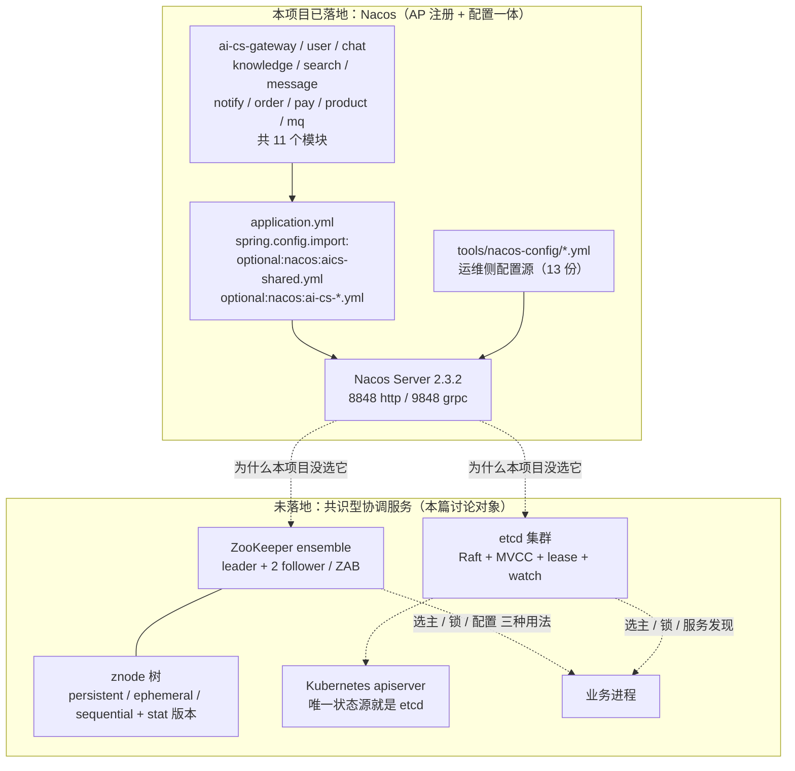
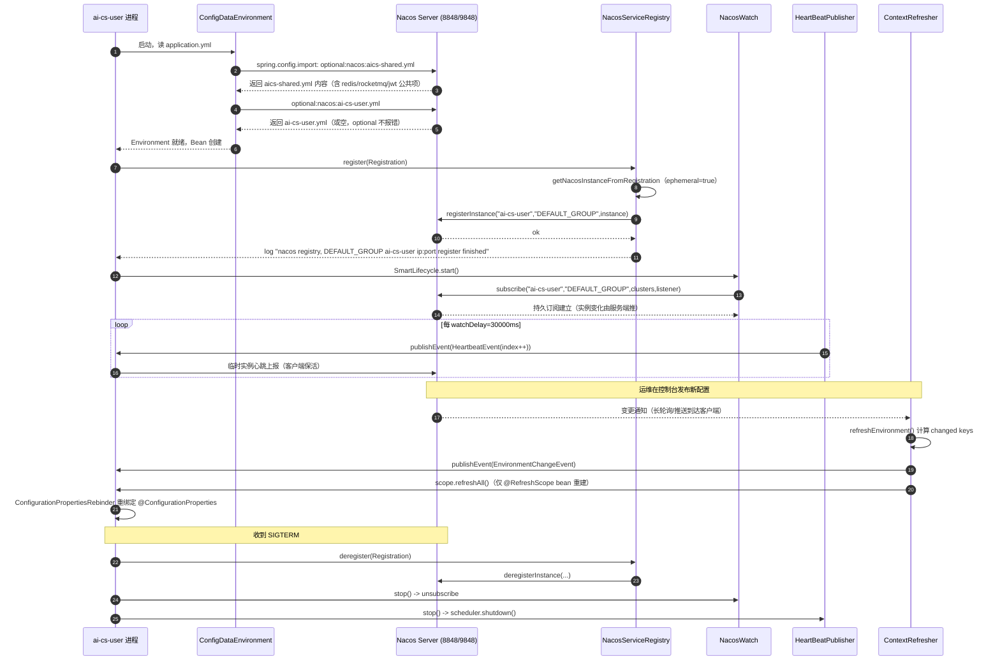

# ZooKeeper 与 etcd：你买的是"共识"这个原语，选主、锁、配置只是它的应用

> **一句话结论**：ZK/etcd 卖的产品只有一个——"一小块数据在多台机器上只有一份，且每次写必须过半数确认"；选主、分布式锁、配置中心都是这块数据的三种用法。而"过半数确认"翻过来的意思是：3 节点挂掉 2 台时，进程还活着、端口还通、日志还没有 ERROR，但**一个写都做不了**——这就是 CP 的真实代价，本篇把它算清楚。
> **阅读前置**：需要知道 Spring Cloud 怎么接注册中心与配置中心（[03-Nacos注册与配置中心.md](../02-Spring微服务/03-Nacos注册与配置中心.md)），读过 [07-Redisson分布式锁.md](./07-Redisson分布式锁.md) 里"锁只保证互斥、不保证业务正确"一节。不需要事先读 ZAB/Raft 论文。
> **证据基线**：Spring Boot 4.2.0 / Spring Cloud 2026.0.0 / Spring Cloud Alibaba 2025.1.0.0 / JDK 17；本项目仓内 Nacos 镜像 `nacos/nacos-server:v2.3.2`。⚠️ **ZooKeeper、etcd、Curator、ZAB、Raft 的本体源码一律未入库**（`24-源码分析/assets/source/` 的 908 份摘录里没有一份 ZK/etcd 文件），所以凡涉及它们内部机制的地方都标注"未入库，依据官方文档"；A 级摘录只用于对照**本项目真正在用的 Nacos 客户端**。预计阅读 60 分钟。

## 0. 先看现象

### 现象 1：ZK 集群挂了 2/3，注册中心"没报错但全废了"

运维把 3 节点 ZK 里的两台下线做缩容，第三台进程健康、2181 端口可连、`ruok` 也回，但所有服务的注册与配置写入开始失败。

```text
org.apache.zookeeper.KeeperException$ConnectionLossException: KeeperErrorCode = ConnectionLoss
```

> 说明：上面两行是 ZooKeeper 客户端在"连不上 quorum"时抛出的**异常类名 + KeeperErrorCode 常量名**（ZooKeeper 官方 Java API 文档中的公开类名，未入库，依据官方文档）。本机没有 ZK 实例（见 §6 实测），所以它不是你机器上的日志原文，而是一个"必然长得这样"的判据：**看到 `ConnectionLoss` 且集群节点数少于一半时，不要查客户端网络，要查 quorum**。

这个现象的迷惑性在于：进程存活、端口可连、单机日志干净。ZK 的"健康"和"可用"是两件事。

### 现象 2：配置中心改了配置，只有第一次生效

有人在 ZK 上写配置节点，第一版改动客户端立刻收到并生效；第二次改，客户端毫无反应，服务一直跑着旧配置，直到重启才"恢复"。

用 §6.4 的推演脚本（node 24，本机实跑）复现这个语义，输出是这样：

```text
=== A. watch 一次性：触发后不重新注册，第二次变更静默丢失 ===
[    0ms] client getData(/config/ai-cs-user.yml, watch=true) 注册成功
[   50ms] console 把配置改成 v2
[   50ms]            WATCH 触发 -> 观测到 v2，watch 被服务端销毁(armed=false)
[  100ms] console 再改成 v3
[  100ms]            no-delivery（watch 已被消费且未 re-arm）
[  150ms] client view=v2 / server truth=v3 -> MISSED-UPDATE
```

这不是 ZK 的 bug，是 ZK watch 的**契约**：watch 是一次性触发器，触发即消费。客户端 handler 里必须自己重新注册一次，忘了就永久失聪，而且**不会报错**——没有任何异常，只是安静地不再更新。

### 现象 3：抢到锁的进程什么都没做，锁却"自己走了"，然后两个人同时写

一个用临时节点（ephemeral znode）实现的分布式锁，持锁进程进了长达十几秒的 Full GC（或与 ZK 之间的网络抖了一下），GC 结束后它认为自己还持着锁继续写库，而此刻锁节点已经在 ZK 上被删掉、被另一个进程重新抢到：

```text
=== C. 会话超时：临时节点被删，锁自己没了，双写发生 ===
[    0ms] A create(/locks/order/create, EPHEMERAL) OK，sessionA 生效
[ 5000ms] A 进入 12s Full GC / 与 ensemble 网络中断，心跳未送达
[15000ms] server: sessionA 到期(协商 sessionTimeout=15000ms) -> 删除 /locks/order/create
[15010ms] B create(/locks/order/create, EPHEMERAL) OK -> holder=B
[17000ms] A GC 结束，进程内锁对象还在，A 自认为持锁，继续写订单
[17010ms] 结果：holder=B 且 A 同时在写 -> 同一时刻两个写入者
```

（同样是 §6.4 推演脚本的 stdout，不是线上日志；`EPHEMERAL`/session 到期删节点的语义依据 ZooKeeper 官方 Programmer's Guide，未入库。）

这类事故在 [07-Redisson分布式锁.md](./07-Redisson分布式锁.md) 里以 Redis 版本出现过一次，结论一模一样：**锁的持有凭据在服务端有租期，客户端却在自己的内存里以为永久持有**。

| 现象 | 你的第一反应 | 真正原因 |
| --- | --- | --- |
| 3 节点挂 2 台后写全部失败 | ZK 挂了 / 网络问题 | 剩下的 1 台凑不到 quorum=2，ZAB 拒绝一切写（§3.4） |
| 配置只更新一次就再也不更新 | 客户端缓存 / 推送失败 | watch 一次性语义，handler 没 re-arm（§3.3） |
| 抢到锁却"丢锁"，出现双写 | 代码忘了解锁 | 临时节点 = session 的投影，session 断了节点就没了（§3.2） |

这些现象指向同一件事：**ZK/etcd 交付的是"共识"这一个原语，而共识自带两个必须由调用方承担的副作用——可用性随 quorum 走、状态随 session/lease 走。** 选主、锁、配置中心只是把这块数据换个用法，用错不是"功能不对"，是"语义不对"。

## 1. 整体地图



> **读图说明**：上半区是仓里真实存在的东西——11 个模块的 `application.yml` 全都在 `spring.config.import` 里挂了两份 Nacos 配置，Nacos 服务端是 `docker-compose` 里那个 8848/9848 的容器。下半区（ZK/etcd）在本仓**一行都不存在**：`deploy/` 下没有 ZooKeeper 或 etcd 的任何清单，主源码 grep `ZooKeeper|Curator` 命中 0（§6 有实测）。三条虚线是本篇的主线——不是"ZK 是什么"，而是"ZK/etcd 那套语义在本项目里由谁承担、代价差在哪"。

| 组件 | 在本仓的位置 | 责任 | 调用方 |
| --- | --- | --- | --- |
| Nacos Server | `docker-compose.yml#L55-L84`（`aics-nacos`，8848+9848，standalone）；`deploy/k8s/nacos.yaml`（replicas 1） | 服务注册表 + 配置存储 + 配置推送 | 全部 11 个 Spring Boot 模块 |
| Spring Cloud Alibaba Nacos 客户端 | 各模块 `pom.xml` 中的 `nacos-discovery` / `nacos-config` starter | 注册实例、心跳上报、订阅实例列表、拉配置 | `NacosServiceRegistry` / `NacosWatch` / `NacosDiscoveryHeartBeatPublisher` |
| `spring.config.import` | 各模块 `application.yml` 的 `spring.config.import` | 启动即拉取 `aics-shared.yml` + 模块自有配置 | Spring Boot `ConfigDataEnvironment` |
| `@RefreshScope` / `@ConfigurationProperties` | `ai-cs-chat` / `ai-cs-gateway` 的配置类 | 配置变更后重新绑定字段 | `ContextRefresher` |
| ZooKeeper ensemble | **未落地（仓内 0 处）** | 若引入则负责选主/锁/配置 | 无 |
| etcd 集群 | **未落地（仓内 0 处）**；K8s 自建集群的 etcd 由集群自身托管，不在本仓 | 若引入则负责选主/锁/K8s 状态 | 无 |
| Curator / zkclient | **未落地**；只在 `ai-cs-order/eff-order.xml` 的 BOM 里被"可选声明"过（§7） | ZK 客户端封装（重试、一次性 watch 重注册、锁 recipe） | 无 |

## 2. 关键概念与关键类

先把术语钉死，后面不再解释。ZK/etcd 的"关键类"是**协议与数据模型**，不是某个 Java 类——它们没有一行代码在本仓，这一点必须先说清。

| 名称 | 位置 | 角色 | 关键方法/字段 |
| --- | --- | --- | --- |
| znode | ZK 数据模型（未入库，依据官方文档） | 树上一个节点，同时是"目录"和"文件"；1MB 上限 | `create/getData/setData/delete/exists` |
| stat 版本号 | znode 元数据（未入库） | `version`/`cversion`/`mzxid` 三个递增计数，是所有 CAS 的基础 | `setData(path, data, expectedVersion)` |
| 临时节点（EPHEMERAL） | ZK 节点类型（未入库） | 生命周期绑定 session，session 结束即删除；不能有子节点 | `CreateMode.EPHEMERAL` |
| 顺序节点（SEQUENTIAL） | ZK 节点类型（未入库） | 父节点下自动追加单调递增序号，抢锁排队靠它 | `CreateMode.EPHEMERAL_SEQUENTIAL` |
| session / 心跳 | ZK 会话（未入库） | 客户端与服务端协商 `sessionTimeout`，靠 tick 心跳续命；断连后进入"会话仍有效"状态 | `tickTime`、`minSessionTimeout=2*tickTime`、`maxSessionTimeout=20*tickTime` |
| watch（一次性） | ZK 通知机制（未入库） | 数据/子节点变化只通知一次，触发即销毁，需客户端 re-arm | `getData(path, watch=true)` |
| 羊群效应 | ZK 用法反模式（未入库） | 所有客户端 watch 同一个节点，一次变更唤醒全部 | —— |
| ZAB | ZK 原子广播协议（未入库） | leader 提案 + 过半数 follower ack 才 commit；leader 挂了靠 election 恢复 | `zxid`、epoch |
| quorum | 共识的通用概念 | 写成功所需的最小节点数 = ⌊n/2⌋+1 | 3 节点 → 2 |
| lease（租期） | etcd 概念（未入库，依据官方文档） | 给 key 绑定一个 TTL，客户端续租失败则 key 过期删除；等价于 ZK 临时节点 | `Grant/KeepAlive/Revoke` |
| revision / MVCC | etcd 存储模型（未入库） | 每次事务提交全局递增 revision；历史版本保留，可读旧值 | `WithRev(rev)` |
| compaction | etcd 存储回收（未入库） | 历史 revision 无限增长必须定期压缩，否则 etcd 磁盘必炸 | `etcdctl compact` |
| watch（etcd，流式） | etcd 通知机制（未入库） | 长连接流式推送，从任意 revision 续订，**不是一次性** | `WithRev/WithPrefix` |
| CP / AP | 分布式理论（CAP） | CP：分区时牺牲可用性保一致；AP：分区时牺牲一致保可用 | —— |
| 临时实例（ephemeral instance） | 本项目实际用法：Nacos | 客户端心跳维持，超时剔除；**默认 true** | `NacosDiscoveryProperties#L219` |
| namespace / group | 本项目实际用法：Nacos | 两层逻辑隔离；本项目 namespace 固定 `aics`，group 固定 `DEFAULT_GROUP` | 各模块 `application.yml` |
| `NacosServiceRegistry` | `24-源码分析/assets/source/NacosServiceRegistry.java.md` | 把 Spring 的 `Registration` 翻译成 Nacos `Instance` 并注册/注销 | `register()` [[源码:NacosServiceRegistry.java.md#L60-L89]] |
| `NacosDiscoveryProperties` | `NacosDiscoveryProperties.java.md` | 注册与心跳的全部默认值都在这里（`ephemeral`/`failFast`/`heartBeatTimeout`） | `getEphemeral()` [[源码:NacosDiscoveryProperties.java.md#L216-L219]] |
| `NacosWatch` | `NacosWatch.java.md` | 订阅自己服务的实例列表（**长订阅，不是一次性 watch**） | `start()` [[源码:NacosWatch.java.md#L75-L102]] |
| `NacosDiscoveryHeartBeatPublisher` | `NacosDiscoveryHeartBeatPublisher.java.md` | 30 秒一次发 Spring `HeartbeatEvent`（本地事件，不是发给 Nacos） | `publishHeartBeat()` [[源码:NacosDiscoveryHeartBeatPublisher.java.md#L99-L105]] |
| `ContextRefresher` | `ContextRefresher.java.md` | 配置变更后重建 Environment 并刷新 `@RefreshScope` bean | `refresh()` [[源码:ContextRefresher.java.md#L97-L101]] |
| `ConfigDataEnvironment` | `ConfigDataEnvironment.java.md` | 解析 `spring.config.import`，决定启动时先去哪儿拿配置 | `getInitialImportContributors()` [[源码:ConfigDataEnvironment.java.md#L189-L194]] |

## 3. 原理与证据逐段精读

### 3.1 znode 树与版本号 CAS：ZK 唯一真正原语的外形

**在干什么**。ZK 对外是一棵内存树，每个节点有路径、字节数据（≤1MB）和一个 `stat`。`stat` 里最关键的是三个单调递增的整数：`version`（数据版本）、`cversion`（子节点版本）、`mzxid`（最后修改的事务 id）。所有写操作都可以带上"我期望的版本"，版本不匹配就抛 `BadVersionException`——这就是 ZK 版的 compare-and-swap。

**为什么这么设计**。因为分布式协调真正需要的不是"存储"，而是"**读到 A 的人不会在别人已经改成 B 之后还以为自己是 A**"。版本号把"我读到的那一版"变成可校验的前提。ZK 的顺序节点更进一步：`create("/locks/order-", SEQUENTIAL)` 返回 `order-0000000012`，序号由服务端在同一个事务里生成，因此**序号就是全局排队票**。锁、选主、队列全靠这两样拼出来。

**换写法会怎样**。如果不用版本号而用"先读后写"，就是典型的读-改-写竞态：两个客户端都读到 `version=5`，都写回自己算的新值，后者覆盖前者且谁都不知道。如果不用顺序节点而用"随机名 + 全表扫描"，判断"我是不是最小"要额外协调，反而更慢更脆。

**常见坑**。

- 把 znode 当数据库用：单节点 1MB 上限、全量数据常驻内存，写放大到整个 ensemble。ZK 官方明确建议只存协调元数据；真放业务数据，集群内存会先炸。
- `version=-1` 表示"跳过版本检查"，很多封装默认传 -1，于是你以为在用 CAS，其实一直是裸写。
- 顺序节点的序号是**父节点维度**的，`cversion` 会在删除节点后继续涨，不会回退；不要用它做"当前有多少个锁等待者"的精确计数。

### 3.2 临时节点 + session 心跳：把"进程活着"外包给服务端

**在干什么**。客户端连上 ZK 时协商一个 `sessionTimeout`（ZK 官方文档给出约束：不小于 `2*tickTime`、不大于 `20*tickTime`，默认 `tickTime=2000ms`，即 4s~40s）。此后客户端按 tick 发心跳，服务端维持这个 session。session 一旦被判定过期，ZK **原子地**删除该 session 创建的所有 EPHEMERAL 节点，并唤醒这些节点上的 watch。

**为什么这么设计**。这是整个分布式协调里最省心的一招：进程正常退出、被 kill -9、被网络隔离、机器失联——对 ZK 而言都是"心跳停了"，处理方式统一为"删临时节点"。于是"谁持有锁""谁是主"这类状态不需要额外清理逻辑，**服务端替你做故障检测 + 状态回收**。

**换写法会怎样**。不用临时节点，改用持久节点 + 客户端主动删除，就必须自己解决"客户端没机会删怎么办"——要么加一个清理协程扫僵尸锁（引入超时判定，本质上还是租期），要么人工介入。etcd 对此的等价物是 **lease**：`Grant(TTL)` 拿一个租约 id，`Put(key, v, WithLease(id))`，客户端定时 `KeepAlive`，租约到期 key 自动消失。语义相同，机制从"session"换成了"显式租约 id"。

**常见坑**（这是本篇最关键的一节，事故高发区）。

- **GC 停顿 = 假死**：客户端进程没死但 12 秒没发心跳，ZK 判它过期并删锁，可进程恢复后仍以为自己持有锁。§0 现象 3 就是这个时间轴。缓解手段不是调大 `sessionTimeout`（调大只是把窗口拉长，且扩大故障恢复时间），而是**在临界区里做"租约校验"**：写库前先确认锁节点还在、`owner` 还是自己，或者用带 fencing token（单调递增票号，写库时带上，存储侧拒绝旧票号）的方案。
- **网络分区 ≠ 进程死亡**：ZK 官方对 session 的语义是"客户端可能无法区分自己是慢还是服务端认为它死了"，要由客户端自己 `ConnectionLoss` 后**放弃本地状态**（关掉连接、重建 session、重新抢锁）。很多事故的根因就是断连重连后继续用旧锁对象。
- **临时节点不能有子节点**：想用 `/locks/order` 做临时锁又要挂子节点排队，必须改成"目录用持久节点、排队项用临时顺序子节点"。
- **把 sessionTimeout 设成 40s 却不改业务超时**：ZK 侧看似更稳，但锁的失效率和"锁丢失后双写窗口"一起变大。

### 3.3 watch 的一次性语义与羊群效应

**在干什么**。`getData(path, watch=true)` / `exists(path, watch=true)` / `getChildren(path, watch=true)` 都是**注册一个一次性触发器**：目标变化时服务端向该客户端发一个事件，同时把注册项销毁。客户端要持续关注，必须在回调里重新注册（"re-arm"）。

**为什么这么设计**。服务端只保留"哪个 session 关心哪个路径"的最小注册表，事件发出即释放，避免客户端崩溃后留下永久监听；同时把"要不要继续看"的决定权交给客户端（可能这次事件之后它就不再关心了）。代价是**语义外包**：漏 re-arm 不报错、不漏日志，只是静默失聪。Curator 的 `PersistentWatcher`/`TreeCache` 存在的原因就是把这个坑封掉。

**换写法会怎样**。§0 现象 2 的 A/B 两段推演就是换写法的对照：A 段（handler 不 re-arm）第二次变更 `no-delivery`，客户端视图永远停在 `v2`；B 段（handler 末尾重新 `getData(watch=true)`）两次变更都追得上，最终 `consistent`。但 B 段仍留了一个隐藏窗口：**注册新 watch 与读取数据之间不是原子的**，如果变更恰好落在"事件已收到、新 watch 未注册"之间，仍会漏。Curator 的做法是"先注册 watch 再读数据"，用一次额外的读把窗口缩到最小，而不是消灭。

**羊群效应**。如果 500 个客户端都 `getChildren("/config/app")`，一次配置变更 = 500 次唤醒 + 500 次回读 + 500 次 re-arm，ZK 的 leader 在这一瞬间被打满。ZK 官方推荐的模式是 **watch 顺序节点的最小者**：每个客户端只 watch 比自己序号小的那个节点（`order-0000000011` watch `order-0000000010`），变更事件量从 O(n) 降到 O(1)，代价是拿到锁的顺序被严格串行化。

**常见坑**。

- 在 watch 回调里做重活（拉全量配置、打远程接口），把 leader 的推送线程拖死。
- 只 watch 数据不 watch 子节点：新加实例根本没通知，因为 `getData` 不感知子节点变化，要 `getChildren`。
- `exists(path, watch=true)` 对"节点还不存在"也能注册，但节点被创建后触发一次就没了；很多人误以为它像 inotify 一样持续监听。

### 3.4 ZAB 与过半写：CP 的代价到底出在哪一步

**在干什么**。ZK 只让 leader 接受写。一次 `setData` 的路径是：leader 生成新 `zxid` → 广播 proposal 给所有 follower → follower 落盘 ack → leader 收到**过半数 ack** 就 commit 并回客户端。3 节点集群 quorum=2：leader + 1 个 follower 就够；一旦挂 2 台，剩 1 台永远凑不到 2，所有写请求排队到超时，客户端看到 `ConnectionLossException`。

**为什么这么设计**。共识的代价是"任何决策都要让多数派知道"，换来的是"任意两台机器上看到的顺序一致、不会出现两个 leader 同时提交"。ZK 的选主本身也走这套投票（`LOOKING → LEADING/FOLLOWING`），所以 leader 挂掉期间集群会有一段**不接受写**的窗口（election + 数据同步），这才是"CP 系统上线抖动"的真实来源。

**换写法会怎样**。换成 AP 的注册中心（Eureka/Nacos 的临时实例模型），挂掉一半节点仍然能读能写、能注册能发现，代价是**可能读到已经死掉的实例，也可能两个分区各自认为自己是全量**。§0 现象 1 和这条是同一个硬币的两面：你要么"挂一半就不能写"，要么"挂一半还能写但数据可能是旧的"。etcd 的 Raft 同构：majority 才能提交，所以 3 节点 etcd 挂 2 台，K8s apiserver 的所有写操作（创建 Pod 都不行）会直接失败。

**常见坑**。

- **用偶数节点**：4 节点 quorum=3，容错能力与 3 节点相同但多一台成本；ZK 官方建议奇数。
- **跨机房对等部署**：3 节点分 3 个机房，任意两机房之间网络抖动就丢 quorum，比"2 机房 2:1 部署"更脆。ZK 的 `server.x` 与 `group` 机制允许你指定投票权重，但跨机房写延迟会直接放大写 RT。
- **以为"读"也过半**：ZK 的读默认由本地 follower 服务（可能读到稍旧数据），只有 `sync()` 之后的读才是强一致。这一点和 etcd 的"线性一致读 + 可选 `WithSerializable`"不同，别混用。
- **把"挂 2 台"误判成客户端问题**：判据是"集群成员数 vs quorum"，不是"能不能 telnet 通 2181"。

### 3.5 etcd 的 lease / revision / MVCC / watch：同一套语义的另一代实现

**在干什么**（未入库，依据 etcd 官方文档）。etcd 是一致性 KV：`Put/Get/Delete` + `Txn`（带 `If/Then/Else` 的事务，等价于 ZK 的版本 CAS），一致性由 Raft 保证。它把 ZK 的三个隐式机制显式化了：

| ZK 里的东西 | etcd 里的对应物 | 关键差别 |
| --- | --- | --- |
| 临时节点 + session 心跳 | **lease**：`Grant(TTL)` + `KeepAlive` + `Put(WithLease)` | 租期是**显式对象**，可以被多个 key 共享，也可以主动 `Revoke` 立即释放（ZK 做不到主动秒删临时节点） |
| stat.version 做 CAS | **`Txn` + `WithModRevision`/`WithVersion`** 条件 | 条件组合更丰富（可比 key 存在性 + 值 + 版本） |
| watch（一次性、per-path） | **watch 流**：`WithPrefix`/`WithRev(startRev)` | 流式、可续订、可按前缀、可从历史 revision 重放，**没有"漏 re-arm"这个坑** |
| 无 | **revision + MVCC** | 每次写全局递增 revision，历史版本保留，可读"3 分钟前的值" |
| 无 | **compaction** | 历史版本必须定期压缩，否则磁盘涨到炸；这是 etcd 独有运维负担 |

**为什么这么设计**。etcd 的诞生背景是 K8s 需要一个"能 watch 全量状态、能线性一致读、客户端不需要自己维护 session 状态"的存储。把 session 换成 lease、把一次性 watch 换成可续订的流、把版本号换成全局 revision，都是在**把容易用错的隐式语义改成显式 API**：客户端忘 re-arm 不会静默失聪，而是断流后按 `startRev` 续上（"断点续传"）。

**换写法会怎样**。用 etcd 做选主，标准做法是 `Txn(If: key 不存在或 lease 已过期, Then: Put(key, me, WithLease))`，配合 `Campaign`（concurrency 包封装）。相比 ZK 的"临时顺序节点排队"，etcd 的选主更"扁"，但**少了 ZK 那种天然的排队顺序**，需要自己引入优先级字段。反过来，watch 语义 etcd 明显更好用，ZK 那种"每次事件都要回读 + re-arm"的模式在 etcd 里变成一条流。

**常见坑**。

- **不设 compaction**：默认 `--auto-compaction-retention=0`（不自动压缩），历史版本无限增长，几个月后 etcd 报 `database space exceeded` 并进入只读告警状态。这是 etcd 运维第一大事故原因（官方文档 "Space quota" 一节）。
- **watch 用 `WithRev` 从 0 开始全量重放**：会把所有历史事件重放一遍，客户端直接 OOM。正确姿势是用上次收到的 `header.revision + 1`。
- **lease TTL 设得太短 + 网络抖动**：选主键频繁失效，触发反复切换；官方建议 TTL ≥ 10s 且 KeepAlive 周期取 TTL/3。
- **拿 etcd 存大 value**：默认 `--max-request-bytes=1.5MB`，且大 value 会放大 Raft 日志与快照。etcd 官方建议单 value ≤ 1.5MB、总量 ≤ 8GB（默认 quota）。

### 3.6 etcd 在 K8s 里的地位：它是"唯一的真相"，apiserver 只是缓存层

**在干什么**。K8s 的所有对象（Pod、Service、Deployment、Lease、ConfigMap…）最终都落在 etcd 里；`kube-apiserver` 本身**不持久化任何状态**，它把"写请求 → etcd 事务"、"watch 请求 → etcd watch 流"翻译一遍，再靠 informer 缓存对外提供读。`kube-controller-manager` 与 `kube-scheduler` 都只 watch apiserver，从不直连 etcd。

**为什么这么设计**。这样 K8s 的控制面可以横向扩展（apiserver 无状态，随便加副本），而"一致性的重活"只压给 etcd 一处。也因为如此，**etcd 是整个集群唯一的单点**：etcd 挂了，集群里已有 Pod 照跑（kubelet 还在），但你不能创建/更新/删除任何对象，`kubectl get` 也会卡住。

**换写法会怎样**。如果用 ZK 做 K8s 的存储（早期 Mesos + ZK 时代就是这种架构），你会立刻撞上 §3.3 的一次性 watch：成千上万个 informer 需要持续 watch，每次事件都要回读 + re-arm，服务端注册表撑不住。etcd 改成流式 watch + MVCC 增量同步，正是为这个场景设计的。本项目用的托管/自建 K8s 里，etcd 由集群自身管理（`deploy/k8s/` 下没有任何 etcd 清单，见 §1），业务侧看不到也不需要碰。

K8s 里"选主"也常被误认成 etcd 的功劳：`kube-controller-manager` 的高可用靠 **Lease 对象**（`coordination.k8s.io/v1`）做租约抢主，本质是"用 etcd 存一个带 TTL 的 key"。而 `kubelet` 的心跳同样是 Lease（`--node-status-update-frequency`），不是 etcd 的 lease——**名字像，机制不同**，别在面试里混答。

### 3.7 本项目怎么绕开这些：Nacos 用"心跳 + 轮询"而不是"watch"

**在干什么**。本项目 11 个模块全部走 Nacos（`ai-cs-user/pom.xml#L33`、`#L39` 分别引入 `nacos-discovery` 与 `nacos-config`）。注册路径在 A 级摘录里看得很清楚：

```java
// (src: NacosServiceRegistry.java.md#L170-L180)
private Instance getNacosInstanceFromRegistration(Registration registration) {
	Instance instance = new Instance();
	instance.setIp(registration.getHost());
	instance.setPort(registration.getPort());
	instance.setWeight(nacosDiscoveryProperties.getWeight());
	instance.setClusterName(nacosDiscoveryProperties.getClusterName());
	instance.setEnabled(nacosDiscoveryProperties.isInstanceEnabled());
	instance.setMetadata(registration.getMetadata());
	instance.setEphemeral(nacosDiscoveryProperties.isEphemeral());
	return instance;
}
```

`setEphemeral(...)` 的默认值是 `true`（[[源码:NacosDiscoveryProperties.java.md#L216-L219]]），也就是说**本项目默认用的就是"临时实例 + 客户端心跳"这套语义——和 ZK 临时节点同构，只是实现方从 ZK 换成了 Nacos**。意味着 §3.2 讲的那些坑（GC 假死、断连后旧状态）在本项目里同样存在，只是判定参数不同。

**为什么这么设计**。因为 Nacos 把"服务发现"和"配置管理"做成了同一套部署、同一个控制台，且临时实例模型下节点间不需要强一致——挂一台 Nacos 不会让注册中心整体不可写（这正是 §0 现象 1 的反面）。代价是：实例列表是**最终一致**的，某个消费者可能在心跳超时窗口内仍能拿到已死实例的地址。

**A 级证据能证明它"不是 watch"**：本项目的实例变更感知有两条路，两条都不是服务端推送 watch。

第一条是**长订阅 + 服务端推送（Nacos 自己的 push 通道）**：

```java
// (src: NacosWatch.java.md#L92-L99)
NamingService namingService = nacosServiceManager.getNamingService();
try {
	namingService.subscribe(properties.getService(), properties.getGroup(),
			Arrays.asList(properties.getClusterName()), eventListener);
}
catch (Exception e) {
	log.error("namingService subscribe failed, properties:{}", properties, e);
}
```

这里 `subscribe` 注册的是一个**持久**的 `EventListener`（`listenerMap` 里缓存、`stop()` 时才 `unsubscribe`），与 ZK 的一次性 watch 有本质区别：**漏 re-arm 这一类坑不存在**。

第二条是**本地心跳事件**，用来驱动本地的服务列表刷新：

```java
// (src: NacosDiscoveryHeartBeatPublisher.java.md#L99-L105)
/**
 * nacos doesn't support watch now , publish an event every 30 seconds.
 */
public void publishHeartBeat() {
	HeartbeatEvent event = new HeartbeatEvent(this, nacosHeartBeatIndex.getAndIncrement());
	this.publisher.publishEvent(event);
}
```

注意这段注释是**框架作者自己写的**——"nacos doesn't support watch now, publish an event every 30 seconds"，30 秒来自 `getWatchDelay()`（[[源码:NacosDiscoveryHeartBeatPublisher.java.md#L64-L70]]，`scheduleWithFixedDelay(..., Duration.ofMillis(watchDelay))`，`watchDelay` 默认 30000）。这条证据把"ZK watch vs Nacos 轮询"的取舍讲得比任何对比表都直白：**Nacos 客户端选了"定期问 + 长订阅兜底"，用最多 30s 的陈旧窗口换掉了一次性 watch 的语义陷阱。**

**换写法会怎样**。如果本项目改用 ZK 做注册中心（spring-cloud-starter-zookeeper-discovery），每个消费者都要对 `/services/ai-cs-user` 的**子节点**注册 watch 并自己 re-arm；一旦 handler 里忘了，就回到 §0 现象 2。若改用 etcd 做注册中心（需要自研或接第三方 starter），则要自己实现 lease 续租与 watch 续订，Spring Cloud 官方没有 etcd 的注册中心实现——这是本项目不选它的直接原因之一。

**常见坑**。

- 看到 `NacosWatch` 就以为"实例变更 30 秒才发现"：不对，`NacosWatch` 是持久订阅（推），30 秒那个是本地 `HeartbeatEvent`（用于本地缓存刷新与 `DiscoveryClient` 触发），两者的更新时效不同。
- `ephemeral=false`（永久实例）在 Nacos 里是另一套健康检查（服务端主动探测），把它和临时实例的"客户端上报"混用会出现"服务端认为健康、客户端已死"的分裂。
- `failFast=true`（默认，[[源码:NacosDiscoveryProperties.java.md#L228-L231]]）：启动时注册失败会直接抛异常终止启动；本地开发忘开 Nacos 就会看到 `nacos registry, xx register failed`（`NacosServiceRegistry#L80`）并启动失败——这是设计行为，不是 bug。

### 3.8 配置这一路：`spring.config.import` → `ContextRefresher` → `@RefreshScope`

**在干什么**。本项目的配置不是写在 jar 里，而是启动时从 Nacos 拉两份：

```yaml
# ai-cs-user/src/main/resources/application.yml#L15-L29
  cloud:
    nacos:
      discovery:
        server-addr: ${NACOS_ADDR:127.0.0.1:8848}
        namespace: aics
        group: DEFAULT_GROUP
      config:
        server-addr: ${NACOS_ADDR:127.0.0.1:8848}
        namespace: aics
        group: DEFAULT_GROUP
        file-extension: yml
  config:
    import:
      - optional:nacos:aics-shared.yml
      - optional:nacos:ai-cs-user.yml
```

`spring.config.import` 是 Spring Boot 的 Config Data API 入口（[[源码:ConfigDataEnvironment.java.md#L189-L194]]，`IMPORT_PROPERTY` 就是 `spring.config.import`）；`optional:` 前缀表示"Nacos 不可达时不要让服务启动失败"——这是本项目在开发环境敢直接用 `127.0.0.1:8848` 的原因，也是**生产环境必须警惕的一点**（配置中心挂了，服务会带着"缺配置的默认值"起来）。

变更生效这一路：

```java
// (src: ContextRefresher.java.md#L97-L109)
public synchronized Set<String> refresh() {
	Set<String> keys = refreshEnvironment();
	this.scope.refreshAll();
	return keys;
}

public synchronized Set<String> refreshEnvironment() {
	Map<String, Object> before = getCurrentEnvironmentProperties();
	updateEnvironment();
	Set<String> keys = changes(before, getCurrentEnvironmentProperties()).keySet();
	this.context.publishEvent(new EnvironmentChangeEvent(this.context, keys));
	return keys;
}
```

`refreshEnvironment()` 重建 Environment 并算出**变了哪些 key**，`scope.refreshAll()` 销毁 `@RefreshScope` bean 让下次访问重新创建。本项目里显式用 `@RefreshScope` 的只有两处（全仓 3 行命中）：`ai-cs-chat/src/main/java/com/aics/chat/modelrouter/ModelRouterProperties.java#L21`（配 `@ConfigurationProperties(prefix = "aics.model-router")` `#L22`）。网关的限流配置有意**不用** `@RefreshScope`，类注释里写明了原因：

> 选 `@ConfigurationProperties` 而非 `@Value` + `@RefreshScope`：Nacos 变更触发 `ContextRefresher` 后，spring-cloud-context 的 `ConfigurationPropertiesRebinder` 会自动重绑定所有 `@ConfigurationProperties` bean，无需给使用方加 `RefreshScope`。
> —— `ai-cs-gateway/src/main/java/com/aics/gateway/config/RateLimitProperties.java#L9-L17`（该 javadoc 原为中文，此处为节选转述）

**为什么这么设计**。`@ConfigurationProperties` + rebinder 是"重新绑定现有实例"，`@RefreshScope` 是"销毁并重建 bean"。前者不丢 bean 引用、不打断现有调用；后者更强但会让所有持有旧引用的地方在重建瞬间看到不同对象。**能重绑定就别用 RefreshScope**——这是本项目给出的取舍。

**换写法会怎样**。ZK 时代的做法是在配置节点上挂一次性 watch，事件来了自己 `refresh`；漏 re-arm 就漏更新（§0 现象 2）。Nacos 客户端把这件事收进 `ContextRefresher` 的触发链里，业务侧不需要写 watch 代码。再往前一代（Spring Cloud Config Server）是"客户端定时轮询 `/actuator/refresh`"或 Bus 广播。

**常见坑**。

- 改成 `@Value` 字段后忘了 `@RefreshScope`：Nacos 控制台显示"已发布"，服务仍是旧值——**改完配置不生效，先看这个类有没有刷新能力，而不是先怀疑配置中心**。
- `spring.config.import` 里写 `nacos:ai-cs-user.yml` 但不带 `optional:`：Nacos 不可达时服务启动直接失败（这是生产想要的，本地开发不是）。
- namespace 写错：`namespace: aics` 对应的是**namespace ID/名称**，控制台建的是"命名空间 ID"，两边不一致时会拉到空配置且不报错——本项目所有 11 个模块统一 `namespace: aics`，就是靠这条纪律避免。
- `file-extension: yml` 与配置中心里的 `aics-shared.yml` 必须匹配，写成 `.yaml` 或 `.properties` 会 404 式静默跳过。

### 3.9 一致性的账：为什么本项目愿意接受"配置不是强一致"

**在干什么**。把三种数据按一致性要求分级：

| 数据 | 本项目载体 | 一致性要求 | 挂掉时的行为 |
| --- | --- | --- | --- |
| 服务实例列表 | Nacos 临时实例 | 最终一致（秒级） | 短暂拿到死实例 → Feign/Resilience4j 重试兜底 |
| 业务配置（限流阈值、模型路由） | Nacos 配置 + 本地缓存 | 最终一致（秒级~30s） | 沿用旧值，不阻塞请求 |
| 分布式锁 / 选主 | Redisson（Redis）**不用 ZK** | 强一致 + 租期 | 见 07-Redisson 那篇的看门狗与 fencing 讨论 |
| 集群自身状态 | **未落地**（K8s 托管 etcd） | 线性一致 | 集群不可写 |

**为什么这么设计**。本项目是"AI 智能客服"，请求路径对延迟敏感、对"配置 200ms 后生效"不敏感。用 CP 的 ZK 承担配置与注册，意味着**ZK 一旦丢 quorum，全部 11 个服务既不能注册也不能拿配置**——而这两件事在 AP 模型下都可以"沿用旧值 + 后台重试"。所以选择把"必须强一致"的那一小块（订单幂等、库存扣减、支付状态）交给数据库唯一约束与 Redis 锁，把"可以最终一致"的那一大块交给 Nacos。

**换写法会怎样**。用 ZK 做配置中心，能得到"配置读一定是最新"的保证，但代价是：① 配置中心成为单点，P0 事故面积 = 全部服务；② 需要自建 3 节点 ensemble + 运维 ZK（JVM、GC、磁盘、election 抖动）；③ 客户端要自己处理一次性 watch（§3.3）。用 etcd 做配置中心，watch 语义更友好，但 Spring Cloud 没有官方 starter，团队要维护自研适配层。

**常见坑**。

- **把"配置不是强一致"当成"可以乱写"**：最终一致的窗口（本项目 `watchDelay` 默认 30s 体现在实例刷新，配置推送更快）意味着**紧急降级不要指望"改配置秒生效"**；真要立刻止血，得靠重启或灰度下线。
- **配置项跨服务共享时用 `aics-shared.yml` 却忘了它没有版本回滚纪律**：Nacos 有历史版本，但改共享配置等于同时影响 11 个服务，必须有变更评审。
- **把锁放进 Nacos**：Nacos 不是共识存储，没有 CAS/版本条件写，做锁只能"先读后写"，等于没有互斥。这点必须明确：**本项目不需要 ZK，但也不该用 Nacos 假装 ZK。**

## 4. 一次完整执行时序

以 `ai-cs-user` 启动 → 注册 → 收配置变更 → 优雅停机为主线（这是本项目真实存在的路径；ZK/etcd 版本仅作对照注释）。



> **读图说明**：编号 1-6 是"先有配置、后有 Bean"，这是 `spring.config.import` 相对旧 `bootstrap.yml` 的核心差别——配置在 Environment 准备阶段就位，而不是靠父上下文提前加载。7-11 是注册，注意第 9 步 `ephemeral=true` 决定了后续靠心跳保活；12-15 是实例订阅与 30 秒本地心跳循环（两者都在，别只看到其中一个就下结论）；16-20 是配置变更链路，终点是"重绑定/重建 bean"，**没有任何一步是业务代码在写 watch**；21-24 是优雅停机，先摘流量再断订阅，这个顺序决定了滚动发布时会不会有 502。

**哪一步失败报什么错**（判据表，均取自本项目代码里真实存在的日志模板或框架公开异常名）：

| 步骤 | 失败表现 | 关键字符串 / 判据 |
| --- | --- | --- |
| 3/5 拉配置 | 服务启动失败（无 `optional:` 时） | `ConfigDataResourceNotFoundException` / 日志出现 `nacos` + `config` 且随后 `APPLICATION FAILED TO START` |
| 3/5 拉配置 | 服务正常启动但用的是默认值（有 `optional:`） | 配置项为空 → 相关 `@ConfigurationProperties` 字段取默认值；**这是最危险的静默失败** |
| 9 注册实例 | 启动直接失败（`failFast=true` 默认） | `nacos registry, {} register failed...{}`（`NacosServiceRegistry.java#L80`） |
| 14 建立订阅 | 启动成功但实例列表不刷新 | `namingService subscribe failed, properties:{}`（`NacosWatch.java#L98`） |
| 17 刷新环境 | 配置已发布但字段没变 | 类上没有 `@RefreshScope` 且不是 `@ConfigurationProperties`（§3.8 的坑） |
| 22 注销 | 滚动发布出现短暂 502 | 停机顺序错：先断订阅/关容器再 `deregister`；本项目用 `server.shutdown: graceful` + `timeout-per-shutdown-phase: 30s`（各模块 `application.yml` 前 7 行）兜底 |
| 对照：ZK 写 | `ConnectionLossException` | quorum 不足（§3.4）；ZK 版本下"挂 2/3"就是这里 |
| 对照：etcd 写 | `etcdserver: request timed out` / `no leader` | Raft 无多数派；K8s 表现为 `kubectl` 卡住 |

## 5. 设计取舍

| 决策点 | ZK / etcd 路线 | Nacos 路线（本项目） | 本项目选择与代价 |
| --- | --- | --- | --- |
| 一致性模型 | CP：写必须过半，少数派不可写 | AP（临时实例），配置最终一致 | 选 Nacos：**接受"实例列表可能秒级陈旧"**，换"挂一台不影响可用性" |
| 故障检测 | session 心跳 / lease 续租，服务端判定 | 客户端心跳上报 + 服务端超时剔除（`heartBeatTimeout`/`ipDeleteTimeout`） | 机制同构，参数不同；GC 假死风险同样存在（§3.2） |
| 变更通知 | ZK 一次性 watch（要 re-arm）/ etcd 流式 watch | 长订阅 + 客户端 30s 心跳兜底 | 选 Nacos：**消灭"漏 re-arm"这类静默故障**，接受最长 30s 的刷新延迟 |
| 配置与注册 | 两个系统（ZK 一体但需自研 schema；etcd 需自研） | 一套服务、一个控制台、一个 namespace | 选 Nacos：运维面收敛，代价是"配置中心 = 注册中心 = 单点组件" |
| 强一致用例（锁/选主） | ZK 顺序临时节点 / etcd lease+Txn 是业界标准解 | 本项目用 Redisson 锁 + 数据库唯一约束 | **不用 ZK 也不用 Nacos 做锁**；代价是要自己处理租期与 fencing（详见 [07-Redisson分布式锁.md](./07-Redisson分布式锁.md)） |
| 运维成本 | ZK：JVM+GC+磁盘+election 抖动；etcd：compaction/quota/快照 | Nacos：单进程 + 外置 MySQL（本项目 `SPRING_DATASOURCE_PLATFORM: mysql`） | 选 Nacos：本地 `standalone` + derby 就能跑，生产 3 副本 + MySQL |
| 生态绑定 | etcd 是 K8s 唯一状态源，绕不开（但由集群托管） | Spring Cloud Alibaba 一等公民 | 本项目只"消费" etcd（通过 K8s），不运维它 |
| 客户端语言 | ZK：Java 强、其他语言弱；etcd：gRPC/HTTP，多语言好 | Java（Spring Cloud Alibaba）、Go、Python 均有 SDK | 本项目全 Java，无跨语言压力 |

**可扩展点清单**（真要做，改这些文件）：

1. 想把注册中心换成 ZK：删各模块 `pom.xml` 的 `nacos-discovery`，加 `spring-cloud-starter-zookeeper-discovery`；`application.yml` 里 `spring.cloud.zookeeper.connect-string` 替换 `spring.cloud.nacos.discovery.*`；`spring.config.import` 的 `nacos:` 前缀要换成 `zookeeper:`（Spring Cloud Zookeeper Config）或保留 Nacos 只做配置。**验收**：`zkCli.sh ls /services` 能看到 `/services/ai-cs-user/<uuid>`，杀掉进程后该节点在 `sessionTimeout` 内消失。
2. 想把配置中心换成 etcd：Spring Cloud 无官方 starter，需要自研 `PropertySourceLocator` + watch 续订线程；建议只做"启动拉取 + 长轮询"。**验收**：`etcdctl get --prefix /config/aics/` 能看到与 `tools/nacos-config/*.yml` 等价的键值，改值后 `@RefreshScope` bean 在 30s 内看到新值。
3. 想让配置变更有"版本审计 + 一键回滚"：Nacos 自带历史版本 + `tools/nacos-config/` 作为 Git 侧基线，需要加一条"发布前 diff 校验"脚本。**验收**：任一 `ai-cs-*.yml` 变更能在 Git 里看到 diff，且控制台历史版本能回滚到上一版。
4. 想给"必须强一致"的场景上真正的共识：优先复用 K8s Lease（`coordination.k8s.io/v1`）而不是自建 ZK；只有跨集群、跨云时才考虑 etcd。**验收**：抢主日志里能看到 `holderIdentity` 变更，且旧 holder 在租约到期后停止工作。

## 6. 踩坑与调试手法

### 6.1 七个真实坑（按事故概率排序）

1. **把 ZK 的"进程活着"当"锁还在"**：GC/网络抖动导致 session 过期，锁被删、别人抢到，自己还在写。判据是 `ConnectionLoss`/`SessionExpired` 之后业务是否主动放弃本地状态。缓解：fencing token 或临界区内校验 owner。
2. **watch 不 re-arm**：配置只更新一次。判据：手工再改一次配置，客户端无反应；用 `Curator TreeCache` 或检查 handler 尾部是否有重新注册。
3. **把共享配置塞进 `aics-shared.yml`**：一次改动波及 11 个服务。本项目 `tools/nacos-config/aics-shared.yml`（36 行）里放的是 `spring.ai.openai.api-key`、`spring.data.redis.host`、`rocketmq.name-server`、`aics.jwt.*` 这类**真·公共项**，这个边界必须守住。
4. **`optional:` 让配置中心故障变成静默降级**：11 个模块的 `spring.config.import` 全是 `optional:nacos:...`，Nacos 不可达时服务照常启动、拿着默认值跑。生产要监控"配置加载是否成功"，不能只看进程存活。
5. **namespace 拼错导致拉到空配置**：`namespace: aics` 是名称/ID 双关，控制台建的空间 ID 必须与之一致；不一致时 Nacos 返回空、Spring 认为是"没有这份配置"，不报错。
6. **etcd 不做 compaction**：历史 revision 涨满 quota，集群进入 `NOSPACE` 只读。判据：`etcdctl endpoint status` 的 `DB SIZE` 单调上涨 + 告警 `database space exceeded`。
7. **Nacos 单副本上生产**：`deploy/k8s/nacos.yaml` 里 `replicas: 1` 且注释写着"生产建议 3 副本集群，学习环境 1 个够"。这份清单是学习环境的，**照抄上线 = 把 11 个服务的注册与配置绑在一个 Pod 上**。
   另外一个细节：`tools/nacos-config/ai-cs-notify.yml` 存在（2 行），但 `ai-cs-notify/src/main/resources/application.yml#L21-L23` 的 `spring.config.import` **只 import 了 `aics-shared.yml`**，没 import `ai-cs-notify.yml`——即这份配置当前不会被 notify 服务加载。要么它是给别的环境用的，要么是一个遗留不一致，改动前先确认。

### 6.2 手法 1：先确认"我到底有没有中间件"，别急着分析日志

```pwsh
PS> foreach ($p in 2181,2379,2380,8848,9848) { $r = Get-NetTCPConnection -LocalPort $p -State Listen -ErrorAction SilentlyContinue; if ($r) { "$p LISTEN pid=$($r.OwningProcess)" } else { "$p no-listener" } }
2181 no-listener
2379 no-listener
2380 no-listener
8848 no-listener
9848 no-listener
```

```pwsh
PS> foreach ($x in 'docker','podman','etcdctl','zkCli.cmd') { $c = Get-Command $x -ErrorAction SilentlyContinue; if ($c) { "$x -> $($c.Source)" } else { "$x -> NOT FOUND" } }
docker -> NOT FOUND
podman -> NOT FOUND
etcdctl -> NOT FOUND
zkCli.cmd -> NOT FOUND
```

**怎么读**：2181=ZK、2379/2380=etcd（client/peer）、8848/9848=Nacos（http/grpc）。全 `no-listener` 说明本机没有这些服务在跑——所以本篇任何"连上去看"的操作**都未实测**，只给判读方法。同时 `docker` 都没装，`docker run zookeeper:3.9` 这类实验在本机做不了（旧稿里的 docker 实验段落属于"有环境时再做"，不是可复现证据）。

### 6.3 手法 2：用静态统计证明"本项目根本没用 ZK/etcd"

```pwsh
PS> Get-ChildItem -Recurse -File -Include *.java,*.yml,*.yaml,*.xml | Where-Object { $_.FullName -notmatch '\\target\\|\\node_modules\\|learning-docs|\\docs\\' } | Select-String -Pattern 'ZooKeeper|zookeeper|Curator|etcd' | Group-Object Path | Select-Object Count,Name
Count Name
----- ----
   17 D:\Projects\Persion\ai-customer-service\ai-cs-order\eff-order.xml
    4 D:\Projects\Persion\ai-customer-service\tools\seata\seata\conf\application.example.yml
    2 D:\Projects\Persion\ai-customer-service\tools\seata\seata\conf\application.yml
    1 D:\Projects\Persion\ai-customer-service\docker-compose.yml
```

**怎么读**：24 处命中里**没有一处是业务代码**。`ai-cs-order/eff-order.xml` 的 17 处全在 BOM 的 `<dependencyManagement>` 里（`spring-integration-zookeeper`、`spring-cloud-zookeeper-*` 的"可选版本声明"），`tools/seata` 的 6 处是注释里的注册中心可选项，`docker-compose.yml` 那 1 处在 Kafka KRaft 注释里。主源码 `*.java` 命中 **0**。结论：**本项目没有 ZK/etcd 依赖，本篇是"选型对照 + 为什么不需要"的论证，不是现状说明书。**

### 6.4 手法 3：把语义跑成时间轴（不需要任何中间件）

下面这个脚本只做时间轴推演，不连任何服务，用来把"一次性 watch""session 过期""过半写"变成可复现的 stdout。本机 `node -v` = v24.16.0，实跑输出见 §0。

```js
// zk-model.mjs —— 四个语义的时间轴模型，纯本地推演，node 24 实跑
const t = (ms, s) => console.log(`[${String(ms).padStart(5)}ms] ${s}`);
// A. watch 一次性：handler 不 re-arm
{ let v='v1', armed=true, view='(unobserved)';
  const fire=(ms)=>{ if(!armed){ t(ms,'           no-delivery（watch 已被消费且未 re-arm）'); return; }
    armed=false; view=v; t(ms,`           WATCH 触发 -> 观测到 ${v}，watch 被服务端销毁(armed=false)`); };
  t(0,'client getData(/config/ai-cs-user.yml, watch=true) 注册成功');
  v='v2'; t(50,'console 把配置改成 v2'); fire(50);
  v='v3'; t(100,'console 再改成 v3'); fire(100);
  t(150,`client view=${view} / server truth=${v} -> ${view===v?'consistent':'MISSED-UPDATE'}`); }
// C. 会话超时：临时节点被删，双写
{ let holder='A'; const n='/locks/order/create';
  t(0,`A create(${n}, EPHEMERAL) OK`);
  t(5000,'A 进入 12s Full GC，心跳未送达');
  t(15000,`server: sessionA 到期 -> 删除 ${n}`);
  holder='B'; t(15010,`B create(${n}, EPHEMERAL) OK -> holder=${holder}`);
  t(17000,'A GC 结束，自认为持锁，继续写订单'); }
// D. 过半写：3 节点挂 2 台
{ const n={leader:'up',f1:'up',f2:'up'};
  const w=(ms,label)=>{ const up=Object.values(n).filter(s=>s==='up').length;
    t(ms,`${label}: up=${up}/3 quorum=2 -> ${up>=2?'COMMIT':'ConnectionLoss (write rejected)'}`); };
  w(0,'初始写'); n.f1='down'; t(100,'kill f1'); w(120,'挂 1 台后写');
  n.f2='down'; t(200,'kill f2'); w(220,'挂 2 台后写'); }
```

**怎么读**：三段各自验证一条契约。A 段最后一行 `MISSED-UPDATE` 是"漏 re-arm"的机器可读结论；C 段 `holder=B` 那行说明"锁的所有权在服务端已经易主"；D 段 `up=1/3` 说明"节点活着但不可写"。把脚本里的 15000 改成你生产环境的 `sessionTimeout`，就能算出**最坏情况下双写窗口有多长**——这比拍脑袋调参数有用。

### 6.5 手法 4：配置到底生效了没有，看三处

| 查什么 | 怎么查 | 判据 |
| --- | --- | --- |
| 服务有没有连上 Nacos | 启动日志搜 `nacos registry` | 有 `register finished` 说明注册成功；有 `register failed` 看 `failFast` |
| 拉到了哪些配置 | Nacos 控制台「配置管理 → 配置列表」+ 服务启动日志里的 Config Data 导入行 | 名字必须是 `aics-shared.yml` + `ai-cs-<模块>.yml`，namespace 与 `aics` 一致 |
| 变更生效了没有 | 类上是否有 `@RefreshScope` 或 `@ConfigurationProperties`；`@ConfigurationProperties` 会由 `ConfigurationPropertiesRebinder` 重绑定 | 只有 `@Value` 字段且无 `@RefreshScope` = **必然不生效** |

本项目实测的配置规模（11 个模块全部对齐）：

```pwsh
PS> Get-ChildItem -Recurse -File -Filter application.yml | Where-Object { $_.FullName -match '\\ai-cs-[a-z]+\\src\\main\\resources\\' } | ForEach-Object { $c=Get-Content $_.FullName; "{0} nacos@L{1} imports@{2}" -f $_.FullName.Replace('D:\Projects\Persion\ai-customer-service\',''), ($c|Select-String 'nacos:'|Select-Object -First 1).LineNumber, (($c|Select-String 'optional:nacos:').LineNumber -join ',') }
ai-cs-chat\src\main\resources\application.yml      nacos@L16 imports@29,30
ai-cs-gateway\src\main\resources\application.yml   nacos@L17 imports@29,30
ai-cs-notify\src\main\resources\application.yml    nacos@L11 imports@23
ai-cs-user\src\main\resources\application.yml      nacos@L16 imports@28,29
...（共 11 个模块，全部 namespace=aics）
```

**怎么读**：`imports@` 只有一个行号的是 notify（只 import 了共享配置），其余都是两份。想看 namespace 是否统一，把 `nacos:` 处往下数 3 行即可；`bootstrap.yml` 在本仓 **0 份**（旧写法已彻底退役，见 §7）。

## 7. ⚠️ 版本差异

| 项 | 旧写法（旧稿/老项目常见） | 当前基线（本项目实际） | 变化点 | 迁移动作 |
| --- | --- | --- | --- | --- |
| ZK 版本 | 3.4.x（2017 年前后主流） | ZK 3.9 是当前线（**本项目未使用**） | 3.5 起内置 `dynamic reconfiguration`、TLS 与 admin server；3.6+ 移除旧 `zookeeper_admin_server` 参数语义 | 若引入，直接用 3.8/3.9，别再抄 3.4 的 `zoo.cfg` 模板 |
| etcd API | etcd v2（`/_keys` HTTP API、`etcdctl ls/get`） | etcd v3（gRPC + MVCC，`etcdctl put/get --prefix`） | v2 在 3.5 起默认关闭、3.6 移除；`etcdctl` 的 v2 命令全部失效 | 所有脚本改 `ETCDCTL_API=3` 语义（现在已是默认）；`ls` → `get --prefix --keys-only` |
| 客户端封装 | 裸 `ZooKeeper` API + 手写 re-arm | Curator 5.x 的 `TreeCache`/`PersistentWatcher`/`InterProcessMutex`（本项目未引入） | 一次性 watch 的坑由 Curator 封装；锁 recipe 用临时顺序节点 | 若引入，禁止裸 API；锁用 `InterProcessMutex`，缓存用 `CuratorCache` |
| 配置加载方式 | `bootstrap.yml` + `@EnableDiscoveryClient`（Spring Cloud Config 时代） | `spring.config.import: optional:nacos:...`（各模块 `application.yml#L15-L29`） | Spring Boot 2.4 起 Config Data API 取代 bootstrap 上下文；本项目 **`bootstrap.yml` 计数 = 0** | 别再新建 bootstrap 文件；配置项迁到 `spring.config.import` |
| Nacos 版本 | 旧稿写"Nacos 3.x"、CLAUDE.md 写"Nacos 2.3" | 仓内镜像 `nacos/nacos-server:v2.3.2`（`docker-compose.yml#L55-L84`、`deploy/k8s/nacos.yaml`） | 2.x 客户端需先连 8848 再偏移到 9848（gRPC）；3.x 端口与鉴权默认值有调整 | **以仓内 v2.3.2 为准**；升级 3.x 前先核对 `tools/nacos/conf/application.properties` 的鉴权项（当前 `nacos.core.auth.enabled=false`，且 token secret key 为空） |
| 注册中心默认健康检查 | Eureka 时代"客户端心跳 + 自我保护" | Nacos 临时实例心跳 + 服务端超时剔除；永久实例走服务端探测 | Nacos 的 `ephemeral` 决定走哪条路（本项目默认 `true`，`NacosDiscoveryProperties#L219`） | 想要"实例永久保留、手动下线"才设 `ephemeral: false`，同时接受服务端主动探测成本 |
| K8s 选主 | 早期方案自建 ZK 选主 | K8s 原生 `coordination.k8s.io/v1` Lease（controller-manager/kubelet 都用它） | 不再需要为选主额外部署 ZK | 有 K8s 优先用 Lease，别自建 ZK |
| 配置刷新 | `@Value` + `/actuator/refresh` 手动触发 | Nacos 推送 + `ContextRefresher` + `ConfigurationPropertiesRebinder` 自动重绑定 | `@ConfigurationProperties` 优于 `@RefreshScope`（网关 `RateLimitProperties` 类注释明确说明） | 新配置类一律 `@ConfigurationProperties`；确需重建 bean 才加 `@RefreshScope` |

## 8. 面试高频问与答

1. ZK 的 znode 有哪几种类型？临时节点和顺序节点分别解决什么问题？
2. 为什么 ZK 说"写必须过半"，而读却可以走本地 follower？这样读到的数据会不会不一致？
3. ZAB 和 Raft 的核心差别是什么？为什么 ZK 需要单独的 election 阶段而 Raft 是 term 一体化？
4. ZK 的 watch 为什么设计成一次性的？羊群效应是怎么产生的，怎么避免？
5. session 超时后临时节点被删，但客户端进程还活着并继续写——这类事故怎么防？
6. 3 节点 ZK 挂 2 台会发生什么？为什么"进程活着端口通"不等于"集群可用"？
7. etcd 的 lease、revision、watch 分别对应 ZK 的什么概念？哪些地方 etcd 做得更好？
8. etcd 为什么必须做 compaction？不做的后果是什么？
9. etcd 在 K8s 里扮演什么角色？etcd 挂了集群还能调度吗？
10. ZK、etcd、Nacos 在一致性模型、健康检查机制、配置推送方式上分别怎么选？
11. 本项目为什么用 Nacos 而不是 ZK？如果业务要求"配置强一致"，你会怎么改？
12. Nacos 的临时实例和永久实例有什么区别？`ephemeral=true` 时服务端怎么判定实例下线？
13. 为什么 Nacos 客户端要有一个 30 秒的 `HeartbeatEvent`？它和实例变更推送是一回事吗？
14. 用 Nacos 或 Redis 实现分布式锁与用 ZK 顺序节点实现，本质差别在哪？
15. `spring.config.import` 取代 `bootstrap.yml` 解决了什么问题？`optional:` 前缀的风险是什么？

## 9. 动手练习

1. **【语义复现】** 把 §6.4 的脚本改成"3 节点 → 5 节点"，观察 quorum 从 2 变 3 后"挂几台仍可写"。**验收**：输出中能明确看到 `up=3/5` 时 `COMMIT`、`up=2/5` 时拒绝，并写一句话解释 ⌊n/2⌋+1。
2. **【watch 语义】** 给脚本 A 段加一个"handler 里 re-arm"的对照分支，复现 §0 现象 2 的 `consistent` 结果。**验收**：同一脚本里两种策略的最终 `view` 不同，且能指出"注册与读取之间的窗口"在哪一行。
3. **【配置落地核查】** 用 §6.5 的命令统计本项目 11 个模块的 `namespace`/`import` 行，找出一处不一致（提示：notify）。**验收**：能列出 11 行输出，并解释 notify 只 import 一份配置的两种可能原因。
4. **【写一份 ZK 方案说明书】** 假设公司要求引入 ZK 做选主，写 1 页方案：节点类型选择、session 参数、fencing 方案、故障时业务行为。**验收**：必须包含"锁丢失后业务如何避免双写"这一节，且不能出现"用 watch 保证强一致"这种错话。
5. **【对比表自证】** 不看本篇 §5，自己写一张 ZK/etcd/Nacos 对比表（一致性/健康检查/推送/运维），再逐行对照。**验收**：至少 6 行，且每行的"代价"栏不能为空。
6. **【K8s 侧观察】** 在有集群的环境里 `kubectl get lease -n kube-system`，找到 controller-manager 的选主 Lease。**验收**：能读出 `holderIdentity` 与 `renewTime`，并解释为什么 K8s 用它而不部署 ZK（本机无 docker/K8s，此条需自备环境）。
7. **【配置中心强一致改造】** 给出一份"把 `aics-shared.yml` 迁到强一致存储"的最小改造清单。**验收**：列出要改的文件（含 `spring.config.import` 与 `pom.xml`）、要新增的组件、以及"为什么最终你可能不做"的结论。

## 小结

- ZK/etcd 的产品是**共识这一原语**：一份数据、多数派确认；选主/锁/配置是它的三种用法，不是三个产品。
- ZK 的四件套：**znode 树 + stat 版本（CAS）+ 临时节点（session 生命周期）+ 顺序节点（全局排队）**；etcd 把它们重写成 **lease + Txn + revision/MVCC + 流式 watch**。
- **一次性 watch 是语义契约不是 bug**：触发即销毁、必须 re-arm、漏了不报错；羊群效应要用"watch 前一个顺序节点"化解。
- **临时节点的生命周期等于 session**：GC 停顿、网络分区、客户端自认为还持锁，是分布式锁事故的三大来源；解决靠 fencing token 与临界区校验，不是靠调大 `sessionTimeout`。
- **CP 的代价具体是"挂掉多数派就不能写"**：3 节点挂 2 台，剩 1 台健康但 `ConnectionLoss`；etcd 同理，表现为 K8s apiserver 写全挂。
- **etcd 是 K8s 唯一状态源，但由集群托管**；K8s 的选主用 `coordination.k8s.io/v1` Lease，与 etcd 的 lease 同名不同物。
- **本项目用 Nacos（AP + 配置一体），明确不用 ZK/etcd**：主源码 ZK/etcd 命中 0，`deploy/` 无相关清单，11 个模块统一 `namespace: aics` + `spring.config.import` 两份配置；代价是"实例与配置都是最终一致"，最长 30s 陈旧窗口（`NacosDiscoveryHeartBeatPublisher` 的 30 秒事件）。
- **下一步可操作**：把 §6.4 脚本里的 `15000` 换成你环境的 `sessionTimeout`，算出真实双写窗口，并为临界区补一个 fencing/owner 校验——这是本篇唯一能直接降低线上事故率的动作。

## 自测题

**1. ZK 的临时节点（EPHEMERAL）什么时候被删除？为什么这把"故障检测"外包给了服务端？**

<details><summary>参考答案</summary>
临时节点绑定 session，session 过期（心跳停止超过协商的 sessionTimeout）时，服务端会原子删除该 session 创建的所有临时节点并触发相关 watch。因此客户端不需要自己上报"我下线了"，进程崩溃/被 kill/失联对 ZK 来说都是"心跳停了"。代价是客户端可能误判自己仍持锁。
</details>

**2. 为什么 ZK 的 watch 触发一次就失效？不 re-arm 会有什么后果？**

<details><summary>参考答案</summary>
ZK 只在服务端保留"哪个 session 关心哪个路径"的最小注册表，事件发出即销毁，避免客户端崩溃后残留永久监听。不 re-arm 时第二次变更不会有任何通知，也不会报错或打日志，客户端会一直用旧值——这就是"配置只更新一次"的根因。
</details>

**3. 3 节点 ZK 集群挂掉 2 台，剩下 1 台的状态是什么？客户端看到什么异常？**

<details><summary>参考答案</summary>
剩下那台的进程可能健康、2181 端口可连，但 quorum=2 而存活节点只有 1，ZAB 无法提交任何写提案，所以写请求全部超时失败，客户端抛 `KeeperErrorCode = ConnectionLoss`。这正是 CP 系统"可用性随多数派走"的具体表现。
</details>

**4. 羊群效应（herd effect）是怎么产生的？ZK 官方推荐怎么避免？**

<details><summary>参考答案</summary>
大量客户端都 watch 同一个节点（如配置根节点或锁父节点），一次变更会同时唤醒全部客户端，引发集中回读与 re-arm，把 leader 打满。推荐做法是只 watch"比自己序号小的那个节点"（顺序节点排队），把一次变更的唤醒量从 O(n) 降到 O(1)。
</details>

**5. etcd 的 lease 和 ZK 的临时节点是什么关系？etcd 多出了什么能力？**

<details><summary>参考答案</summary>
两者语义同构：都是"续不上期就自动删除关联的 key"。差别在 etcd 的租期是显式对象：可以 `Grant` 出 TTL、多个 key 共用同一个 lease、也可以主动 `Revoke` 立即释放（ZK 无法主动秒删临时节点）。选主/锁都建立在 lease + Txn 之上。
</details>

**6. etcd 为什么必须做 compaction？不做会怎样？**

<details><summary>参考答案</summary>
etcd 用 MVCC 保留历史 revision 以支持"从任意版本 watch"和读旧值，历史版本会无限累积。若长期不压缩，DB 体积涨到 quota（默认 8GB）后集群进入 `NOSPACE` 只读告警，所有写失败。因此要配 `--auto-compaction-retention` 并定期 `etcdctl compact`。
</details>

**7. ZK 的一次性 watch 与 etcd 的流式 watch，在"漏事件"风险上差在哪？**

<details><summary>参考答案</summary>
ZK 是逐次注册的一次性触发器，漏 re-arm 就永久失聪且无提示；etcd 的 watch 是一条可续订的流，断流后可用上次 `header.revision + 1` 作为 `startRev` 续上，还能按前缀批量监听。风险从"静默失聪"变成"需要正确维护 revision 水位"。
</details>

**8. etcd 挂了，K8s 集群里已经在跑的 Pod 会怎样？新建 Pod 呢？**

<details><summary>参考答案</summary>
已运行的 Pod 由 kubelet 本地维持，继续跑（容器不会因为 etcd 不可用而被杀）。但 apiserver 的所有读写都失败：无法创建/更新/删除任何对象，`kubectl get` 会卡住或超时，controller 与 scheduler 也停摆。这就是 etcd 是控制面唯一单点的含义。
</details>

**9. 本项目为什么不需要 ZooKeeper？请给出仓内可验证的证据。**

<details><summary>参考答案</summary>
因为本项目需要协调的三件事各有替代：服务注册与配置由 Nacos 一体承担（11 个模块各引 `nacos-discovery` + `nacos-config`，`application.yml` 用 `spring.config.import` 拉两份配置）；分布式锁用 Redisson（Redis）；强一致约束用数据库唯一键。证据：主源码 grep `ZooKeeper|Curator` 命中 0，`deploy/` 下没有 ZK/etcd 清单，24 处命中全在 BOM 声明、Seata 注释和 Kafka 注释里。
</details>

**10. Nacos 的 `ephemeral=true` 意味着什么？它和 ZK 临时节点的坑有什么共同点？**

<details><summary>参考答案</summary>
意味着该实例是"临时实例"，由客户端心跳上报维持，`heartBeatTimeout`/`ipDeleteTimeout` 超时后服务端剔除。它与 ZK 临时节点同构，因此同样有"客户端 GC 假死 → 服务端已判定下线 → 客户端自认为正常"的窗口，只是参数不同（`NacosDiscoveryProperties` 提供了 `heartBeatInterval`/`heartBeatTimeout`/`ipDeleteTimeout` 三个可调项）。
</details>

**11. `NacosWatch` 和 `NacosDiscoveryHeartBeatPublisher` 有什么区别？为什么说"实例变更不是 30 秒才发现"？**

<details><summary>参考答案</summary>
`NacosWatch` 通过 `namingService.subscribe(...)` 建立**持久**订阅，实例变化由服务端推送触发 listener，不是一次性 watch。`NacosDiscoveryHeartBeatPublisher` 则是每 `watchDelay`（默认 30000ms）在**本地**发一个 Spring `HeartbeatEvent`，用于驱动本地缓存刷新/其他监听者。所以 30 秒是本地心跳节奏，不是实例变更的时效。
</details>

**12. `spring.config.import` 里的 `optional:` 前缀，在生产环境的风险是什么？**

<details><summary>参考答案</summary>
`optional:` 让 Nacos 不可达时服务仍能启动，但会用字段默认值或空值跑——配置中心故障因此退化为"静默错配"，比启动失败更危险。本项目 11 个模块全部用了 `optional:`，所以必须额外监控"配置是否真正加载成功"，不能只看进程存活。
</details>

**13. 为什么本项目网关的限流配置类不用 `@RefreshScope`，而 chat 的模型路由配置用了？**

<details><summary>参考答案</summary>
`@ConfigurationProperties` 由 Spring Cloud 的 `ConfigurationPropertiesRebinder` 在 `ContextRefresher` 刷新后自动重绑定现有实例，不销毁 bean，适合"只换值不换对象"的配置（网关限流阈值的类注释明确写了这个理由）。`@RefreshScope` 是销毁并重建 bean（chat 的 `ModelRouterProperties` 用了它），适合需要重建整个对象状态（如模型列表 `validate()` 校验）的场景。
</details>

**14. 用 ZK 顺序节点实现分布式锁，和用 Redis（Redisson）实现，本质差别是什么？**

<details><summary>参考答案</summary>
ZK 版把"排队顺序"和"通知"都放进共识系统：序号由服务端在事务里生成，锁释放通过删除节点 + watch 前一个节点传播，不存在惊群，也不会因为"锁过期但持有者不知道"而静默双写（客户端能收到 `SessionExpired`）。Redis 版性能更高，但锁的租期与持有者状态是分离的，必须靠看门狗续期和 fencing/owner 校验兜底，见 07-Redisson 一篇。
</details>

**15. 如果业务真的要求"配置强一致 + 变更秒级生效"，你会怎么做？**

<details><summary>参考答案</summary>
先区分"读强一致"和"变更秒级"：前者可用 ZK/etcd 存配置并按版本 CAS 读；后者靠 etcd 流式 watch 或 ZK 的 Curator `CuratorCache`（自动 re-arm）才能做到。工程上更常见的折中是"保持 Nacos + 关键开关走重启/灰度"，并在方案文档里写清"最终一致的窗口有多大、窗口内出问题怎么止血"，而不是为了这个需求引入一套 CP 集群。
</details>
