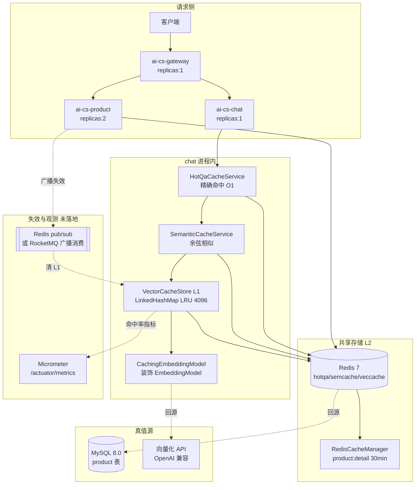
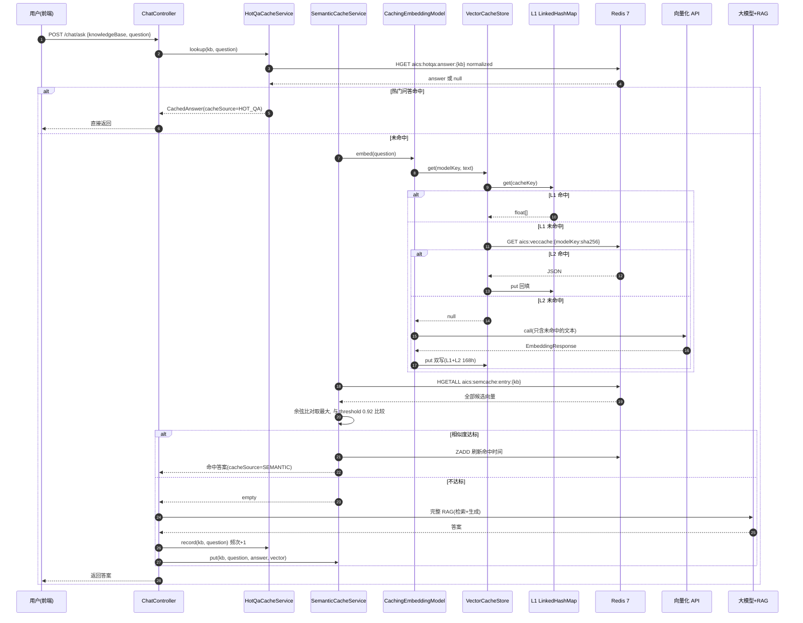

# Caffeine 本地缓存与两级缓存：把 QPS 提一个数量级，代价是"多实例看到的值可以不同"

> **一句话结论**：本地缓存（同一个 JVM 内部、不走网络的缓存）能把单次读从"1ms 级的网络往返"压缩到"100ns 级的堆内存访问"，代价是同一份数据在 N 个实例里有 N 份副本，而**让副本失效的通知永远是异步的** —— 所以"不一致窗口"必须被当成一个要显式设计的参数，而不是事后祈祷 TTL 短一点。
> **阅读前置**：读过 [01-Redis缓存实战.md](01-Redis缓存实战.md) 里的 Redis 缓存读写与 Spring Cache 注解；知道 `LinkedHashMap(initialCapacity, loadFactor, accessOrder=true)` 是 JDK 自带的 LRU 写法；了解什么是命中率（hit rate）。
> **证据基线**：Spring Boot 4.2.0 / Spring Framework 7.1.0 / Spring Cloud 2026.0.0 / SCA 2025.1.0.0 / Caffeine 3.3.1（本地 m2 实测）/ Spring Cloud Gateway 5.1.0 / JDK 17.0.19；`assets/source` 已入库 905 份源码摘录，其中缓存相关只有 MyBatis 与 Nacos 客户端几份，**Caffeine 本体源码未入库**，本篇关于 Caffeine 的 API 结论全部来自本机 `caffeine-3.3.1.jar` 的 `javap` 与真实运行，并逐条标注。预计阅读 45 分钟。

### 本篇的证据边界

先把"哪些是查到的、哪些是没查到的"摆出来，后面每一条结论都能对应回这张表。

| 类别 | 内容 | 本篇怎么用 |
| --- | --- | --- |
| ✅ A 级（已入库源码） | `LruCache.java.md`（MyBatis 3.6.0 的 LRU 装饰器）、`TransactionalCache.java.md`（MyBatis 二级缓存事务缓冲）、`ServiceCache.java.md`（SCA 2025.1.0.0 的 Nacos 服务列表本地缓存） | 讲 LRU 的标准写法、讲"先失效后提交"的窗口、讲"读路径回填式本地缓存" |
| ❌ 未入库（只能依据官方文档/本项目代码） | `com.github.benmanes.caffeine:caffeine` 全部源码（`BoundedLocalCache`、`FrequencySketch`、`TimerWheel` 等内部实现） | 只讲**可被 `javap`/运行结果证实**的行为，不引 Caffeine 源码行号 |
| ⚠️ 未落地（本篇是设计文档） | 多实例本地缓存失效广播、Caffeine 接入 Spring Cache、本地缓存命中率指标 | 明确标注【未落地】，并写清要改哪些文件、验收标准是什么 |
| ✅ 已落地（本项目真实代码） | `VectorCacheStore` 手写 L1（`LinkedHashMap` LRU）+ L2 Redis 两级缓存；`product:*` 走 `RedisCacheManager`；chat 三层问答缓存 | 逐处分析"这个 TTL 与失效策略造成多大的不一致窗口" |

**本机探测结果**（PowerShell 5.1.26100 / Windows；2026-11-27 勘）：`java 17.0.19 (Temurin)`、`javac 17.0.19`、`node v24.16.0`；`docker / redis-cli / mysql` **均未安装**（`Get-Command` 命中 0 条），因此本篇所有"连中间件才能看"的结论都只给判读方法、不伪造输出；能真跑的只有本地 Java/Node 静态与行为实验，以及从 `.m2` 里 `jar tf`/`javap` 读到的真实类结构。

---

## 0. 先看现象

### 现象一：改价后被一部分用户"看到旧价"，刷新几次又对了

商品服务是全仓**唯一**的多副本业务服务：

```yaml
# deploy/k8s/services/product-service.yaml:25
replicas: 2                   # 2 副本（唯一一个多副本的业务服务，可体验负载均衡）
```

两个 Pod 交替接流量。它现在的缓存全部放在 Redis（共享一份），所以本项目的窗口来自 TTL 而不是副本数：

```java
// ai-cs-product/src/main/java/com/aics/product/service/impl/ProductServiceImpl.java:118-L120
@Override
@CacheEvict(cacheNames = ProductCacheConfig.PRODUCT_DETAIL, key = "#id")
public ProductVO updateProduct(Long id, ProductUpdateDTO dto) {
```

```java
// ai-cs-product/src/main/java/com/aics/product/config/ProductCacheConfig.java:43-L44
.withCacheConfiguration(PRODUCT_DETAIL, base.entryTtl(Duration.ofMinutes(30)))
.withCacheConfiguration(PRODUCT_CATEGORIES, base.entryTtl(Duration.ofMinutes(10)));
```

`@CacheEvict` 只清扫**被它覆盖的那条写路径**。任何绕过它的写入，都会让旧值最多活 30 分钟。项目里已经出现"两份数据"的苗头：

```java
// ai-cs-product/src/main/java/com/aics/product/service/impl/ProductServiceImpl.java:135-L138
if (dto.getStock() != null) {
    product.setStock(dto.getStock());
    stringRedisTemplate.opsForValue().set("stock:" + id, String.valueOf(dto.getStock()));
}
```

库存同时写进了 `stock:{id}` 这个独立 key 和 `product:detail` 里的 `stock` 字段 —— 两个地方各自过期、各自被不同代码路径修改。**这已经是两级缓存的雏形，只不过两级都恰好落在 Redis 里。** 一旦按本文方案给商品详情加一层进程内 Caffeine，窗口不会变小，只会从"Redis 一份旧值"变成"每个 Pod 各有一份、各自过期的旧值"，最坏情况下用户连续刷新会看到价格来回跳。

### 现象二：chat 服务 Pod 被 OOMKilled，但缓存"看起来只有 4096 条"

chat 容器上限 1Gi：

```yaml
# deploy/k8s/services/ai-chat-service.yaml:98-L99
cpu: "1000m"
memory: "1Gi"
```

它的向量缓存 L1 用条数封顶，且**只按条数**：

```java
// ai-cs-chat/src/main/java/com/aics/chat/cache/VectorCacheStore.java:48-L54
private final Map<String, float[]> l1Cache = Collections.synchronizedMap(
        new LinkedHashMap<>(128, 0.75f, true) {
            @Override
            protected boolean removeEldestEntry(Map.Entry<String, float[]> eldest) {
                return size() > Math.max(1, properties.getVector().getL1MaxEntries());
            }
        });
```

`l1-max-entries: 4096`（`ai-cs-chat/src/main/resources/application.yml:181`）。"4096 条"听起来无害，但**条数不是字节数**：值的平均大小一变（换成本地 bge-m3、维度从 1024 涨到 4096、或者未来缓存的不再是 `float[]` 而是整篇文档的向量组），同样的 4096 条可以把堆吃掉一个数量级。本篇 §3.5 有一个真实实验证明：Caffeine 的 `maximumSize` 连"条数"都不是硬上限（100 条上限的缓存，实测常住到 925 条）。

### 现象三：Redis 里明明有新值，本地缓存就是不刷新

向量缓存的两级读路径写得清清楚楚 —— 但 L1 **没有 TTL**，也没有任何失效通道：

```java
// ai-cs-chat/src/main/java/com/aics/chat/cache/VectorCacheStore.java:59-L78
public float[] get(String modelKey, String text) {
    String key = cacheKey(modelKey, text);
    float[] cached = l1Cache.get(key);
    if (cached != null) {
        return cached;
    }
    try {
        String json = redisTemplate.opsForValue().get(KEY_PREFIX + key);
        if (json == null) {
            return null;
        }
        float[] vector = objectMapper.readValue(json, float[].class);
        l1Cache.put(key, vector);
        return vector;
    } catch (Exception e) {
        // Redis 不可用/数据损坏：降级为 L1-only，不阻断检索
        log.warn("向量缓存 L2 读取失败，降级 L1-only: err={}", e.getMessage());
        return null;
    }
}
```

于是"Redis 有值、本地不刷新"是**设计上就不可能被发现**的：L1 命中路径根本不查 Redis，`redis-cli GET` 出来的东西和 JVM 里那份没有任何联系。同理，写路径在 Redis 抖动时只留一行日志就继续：

```text
向量缓存 L2 写入失败（不影响业务）: err=<异常 message>
```

（原文出自 `ai-cs-chat/src/main/java/com/aics/chat/cache/VectorCacheStore.java:94`，格式串逐字一致。）

而 Redis 抖动时的读取降级日志是这个形状：

```text
向量缓存 L2 读取失败，降级 L1-only: err=<异常 message>
```

**这些现象指向同一件事：本地缓存把"值的权威副本"从一份变成了 N+1 份（N 个进程 + 1 份共享存储），而"让第 k 份失效"这件事不是原子的 —— 于是每一层缓存都必须回答一个问题：从"真值变了"到"所有读者都看到新值"，中间允许多长的窗口，谁来保证它不超时。** 这个问题不回答，本地缓存就不是优化，是把数据库的一致性搬到了内存里随机播放。

---

## 1. 整体地图



> **读图说明**：
> ① 实线是**已在代码里存在**的调用关系，虚线是**本篇建议但本项目尚未落地**的能力；判断依据是 `ai-cs-chat` 里只找得到 `VectorCacheStore` 的 L1 `Map` 与 Redis 读写，没有任何 `MessageListener`/`Cache` 失效订阅，也没有 Caffeine 依赖（`grep com.github.benmanes` 在全部 main 代码 **0 命中**）。
> ② 图里唯一的"一句话能说清的三级结构"在 chat：`HotQaCacheService`（精确 key → Redis Hash，O(1)）→ `SemanticCacheService`（Redis Hash 全量拉取 + 余弦比对）→ `VectorCacheStore`（L1 内存 + L2 Redis）。越往右越慢、越通用；这正是本地缓存该放的位置：**放最热、最小、最不怕旧的那一层**。

| 组件 | 位置 | 责任 | 典型调用方 | 落地面 |
| --- | --- | --- | --- | --- |
| `Caffeine` | 未入库；m2 `caffeine-3.3.1.jar` | 进程内缓存容器，W-TinyLFU 淘汰 | 需自己声明依赖 | 【未落地】全仓 main 代码 0 处 import |
| `VectorCacheStore` | `ai-cs-chat/src/main/java/com/aics/chat/cache/VectorCacheStore.java` | 向量两级缓存：L1 手写 LRU + L2 Redis 168h | `CachingEmbeddingModel` | 【已落地】 |
| `CachingEmbeddingModel` | `ai-cs-chat/src/main/java/com/aics/chat/cache/CachingEmbeddingModel.java` | 装饰器：只把 miss 的文本交给真模型 | `SpringAiConfig` 装配的 `EmbeddingModel` | 【已落地】 |
| `SemanticCacheService` | `ai-cs-chat/src/main/java/com/aics/chat/cache/SemanticCacheService.java` | 语义缓存（相似问题直出答案） | chat 问答链路 | 【已落地】 |
| `HotQaCacheService` | `ai-cs-chat/src/main/java/com/aics/chat/cache/HotQaCacheService.java` | 热门问答提升与精确命中 | chat 问答链路 | 【已落地】 |
| `RedisCacheManager` | `ai-cs-product/src/main/java/com/aics/product/config/ProductCacheConfig.java` | 声明式缓存，`product:detail` 30min | `ProductServiceImpl` | 【已落地】 |
| `CaffeineCacheManager` | `spring-context-support-7.1.0.jar` 内 `org/springframework/cache/caffeine/` | 把 Caffeine 接进 Spring Cache 抽象 | 需自己声明 caffeine 依赖 | 【未落地】 |
| `IdempotentAspect.expressionCache` | `ai-cs-common/src/main/java/com/aics/common/idempotent/IdempotentAspect.java:42` | 无上限 `ConcurrentHashMap` 缓存 SpEL 解析结果 | 幂等切面 | 【已落地】但无淘汰 |

---

## 2. 关键概念与关键类

先把名字对齐，后面每一节都只引用这张表里的词。

| 名称 | 位置 | 角色 | 关键方法/字段 |
| --- | --- | --- | --- |
| 本地缓存（in-process cache） | 概念 | 数据放在本 JVM 堆里，读不跨网络；代价是 N 副本 | 无统一 API，`Map`/Caffeine/Guava 都是它 |
| 两级缓存（L1/L2） | 概念 | L1 进程内 + L2 共享（Redis），miss 逐级回源 | 读：L1→L2→源；写：先源后失效 |
| 命中率 hitRate | 概念 | `hitCount/(hitCount+missCount)`，本地缓存唯一有效的验收指标 | `CacheStats.hitRate()` |
| `Caffeine` | 未入库 / `caffeine-3.3.1.jar` | 缓存容器与 Builder | `newBuilder()`、`maximumSize(long)`、`expireAfterWrite(Duration)`、`refreshAfterWrite(Duration)`、`recordStats()`、`build()`、`build(CacheLoader)`、`buildAsync()` |
| W-TinyLFU | 概念（Caffeine 默认淘汰策略） | 窗口区（新条目）+ SLRU 主区（保护/试用两段）+ 频率草图准入 | 由 `maximumSize` 隐式启用，无需配置 |
| Count-Min Sketch | 概念；`com/github/benmanes/caffeine/cache/FrequencySketch.class`（`jar tf` 实测存在） | 用固定内存近似统计"这个 key 最近访问了多少次" | 4bit 计数器 + 周期性减半（频率衰减） |
| SLRU | 概念 | 主区分 `protected`（受保护）与 `probation`（试用），命中一次才升级 | Caffeine 内部两段链表 |
| `CacheLoader` | `caffeine-3.3.1.jar` | loading / async 模式的"回源函数" | `load(K)`、`loadAll(Iterable)`、`reload(K,V)` |
| `CaffeineCacheManager` | `spring-context-support-7.1.0.jar`：`org/springframework/cache/caffeine/CaffeineCacheManager.class`（`jar tf` 实测） | Spring Cache 的 Caffeine 实现入口 | `setCaffeine(...)`、`setCacheSpecification(String)` |
| `CaffeineCache` | 同 jar：`org/springframework/cache/caffeine/CaffeineCache.class` | 单个 cache 名对应的实现；`sync=true` 走 `get(key, Callable)` | `get(Object, Callable)`、`putIfAbsent`、`evict` |
| `LruCache`（MyBatis） | [[源码:LruCache.java.md#L49-L62]] | 教科书 LRU：`LinkedHashMap(accessOrder=true)` + `removeEldestEntry` | `setSize(int)`、`getObject` 里 `keyMap.get(key)` 只为 touch |
| `TransactionalCache`（MyBatis） | [[源码:TransactionalCache.java.md#L64-L76]] | "先标记失效、提交后才写回"的事务缓冲，演示失效窗口怎么收窄 | `clearOnCommit`、`entriesToAddOnCommit` |
| `ServiceCache`（SCA Nacos） | [[源码:ServiceCache.java.md#L46-L67]] | 服务实例列表的本地缓存，只由 discovery 调用回填，**非实时** | `setInstances`、`getInstances` |
| `TimerWheel` | `caffeine-3.3.1.jar`（`jar tf` 实测存在） | 分层时间轮，负责"到点过期/到点刷新"的调度 | 内部类，外部不可见 |
| `CacheStats` | `caffeine-3.3.1.jar`：`cache/stats/CacheStats.class` | 命中/未命中/驱逐/加载耗时快照 | `hitRate()`、`evictionCount()`、`loadFailureCount()` |

两个"看得见摸得着"的事实先钉住，省得后面反复怀疑：

```text
$ javap -cp ~/.m2/.../caffeine-3.3.1.jar com.github.benmanes.caffeine.cache.Caffeine
  long maximumSize;
  long maximumWeight;
  long expireAfterWriteNanos;
  long expireAfterAccessNanos;
  long refreshAfterWriteNanos;
  com.github.benmanes.caffeine.cache.Weigher<? super K, ? super V> weigher;
  public com.github.benmanes.caffeine.cache.Caffeine<K, V> expireAfterWrite(java.time.Duration);
  public com.github.benmanes.caffeine.cache.Caffeine<K, V> expireAfterWrite(long, java.util.concurrent.TimeUnit);
  public <K1 extends K, V1 extends V> com.github.benmanes.caffeine.cache.Cache<K1, V1> build();
  public <K1 extends K, V1 extends V> com.github.benmanes.caffeine.cache.LoadingCache<K1, V1> build(CacheLoader<? super K1, V1>);
  public <K1 extends K, V1 extends V> com.github.benmanes.caffeine.cache.AsyncCache<K1, V1> buildAsync();
  public <K1 extends K, V1 extends V> com.github.benmanes.caffeine.cache.AsyncLoadingCache<K1, V1> buildAsync(AsyncCacheLoader<? super K1, V1>);
```

上面这段是 `javap` 输出的节选（本机实测，完整输出 40+ 行）。读法只有三条：**① 四个"旋钮"是四个独立字段**（`maximumSize`/`maximumWeight` 二选一，三种过期语义各一个 nanos 字段）；**② 每个时间旋钮都有 `Duration` 与 `(long, TimeUnit)` 两个重载**，两者等价，前者不容易写错单位；**③ `build()` 系列一共 6 个重载**，返回类型决定了你拿到的是 manual（`Cache`）、loading（`LoadingCache`）还是 async（`AsyncCache`/`AsyncLoadingCache`）—— 这正是 §3.3 三种加载方式的物理来源。

再钉第二个事实：Caffeine 的依赖并不在本项目的 classpath 上"自动有"。

```text
$ grep -rn "com.github.benmanes" ai-cs-*/src/main/java | wc -l
0
$ grep -A1 -n "<artifactId>spring-boot-starter-cache</artifactId>" ai-cs-product/pom.xml
33:        <artifactId>spring-boot-starter-cache</artifactId>
```

`spring-boot-starter-cache:4.2.0` 的 pom 只带两个子依赖 —— `spring-boot-starter` 与 `spring-boot-cache`，**不含 caffeine**（读 `~/.m2/.../spring-boot-starter-cache-4.2.0.pom` 实测）。Caffeine 的版本号只是被 Spring Boot BOM 统一管理着（`ai-cs-order/eff-order.xml:325-L328` 里能看到 `com.github.ben-manes.caffeine:caffeine:3.3.1`），而"被管理"不等于"被引入"。所以：**本项目要说"用了 Caffeine"，需要先在 pom 里显式加一行依赖，本篇后面凡涉及 Caffeine 的装配都按【未落地】处理。**

---

## 3. 原理与证据逐段精读

### 3.1 为什么本地缓存能差一个数量级：先把"快多少"算清楚

**在干什么**：把"读一个值"从"发一个网络包、等对方回包"变成"在本进程的堆里查一个哈希表"。这不是优化 10%，而是把成本的主项整个去掉。

| 读路径 | 典型耗时 | 量级来源 | 本项目证据 |
| --- | --- | --- | --- |
| 进程内 `HashMap.get` | ~50–100 ns | 一次指针跳转 + 一次 `equals` | `VectorCacheStore` L1（`LinkedHashMap`） |
| Caffeine `getIfPresent` 命中 | ~100–200 ns（未争用） | 哈希 + 环形缓冲/时间轮记账 | 本篇 §3.2 实测可跑，无需服务 |
| 同机房 Redis `GET` | ~0.2–1 ms | 1 次 RTT + 序列化 | `ai-cs-product` 的 `RedisCacheManager` |
| MySQL 主键查询 | ~1–10 ms | SQL 解析 + 缓冲池 + 网络 | `product` 表 |
| 一次完整 RAG | 0.5–5 s | 向量化 + 检索 + 大模型生成 | chat 链路 |

差距是 **3~5 个数量级**。所以"加一层本地缓存把 QPS 提一个数量级"在物理上是完全成立的 —— 前提是命中率够高，且你愿意接受副本。

**为什么这么设计**：缓存的价值 = `命中率 × 单次节省的时间 ÷ (1 − 写放大带来的额外开销)`。本地缓存的"单次节省时间"比 Redis 又大 1~2 个数量级，所以它对命中率的要求反而更低：命中率 30% 的本地缓存，可能比命中率 90% 的 Redis 缓存省下更多总时间。

**换写法会怎样**：只用 Redis 也能扛，但每个请求 1ms 的网络往返在 1 万 QPS 下就是 10 个 CPU 核在纯粹等 IO；把最热的那 5% 数据搬到进程内，网络往返直接掉 80%+。反过来，如果你的 QPS 只有 50，本地缓存带来的收益远小于它带来的"多副本不一致"风险 —— **本地缓存的性价比与 QPS 正相关，与一致性要求负相关**。

**常见坑**：
- 拿"命中率"当唯一指标，忽略"值的体积"。命中率 95% 但每条 1MB，等于把 Redis 的带宽问题换成了 JVM 的 GC 问题。
- 用 `System.nanoTime()` 差值当"本地缓存耗时"去看，会看到 0 ns —— 因为 JIT 把整个调用内联消除了。要测就测真实业务路径，别测空载体。

### 3.2 W-TinyLFU 为什么优于 LRU：三个真实实验

**在干什么**：LRU（Least Recently Used，最近最少使用）只记"谁最后被访问"，LFU（Least Frequently Used，最不经常使用）只记"谁被访问得最多"。Caffeine 的默认策略 W-TinyLFU（Window TinyLFU）把两者缝起来：**新条目先进一个小的窗口区（LRU 语义，保护新鲜度），要挤进主缓存时必须通过一个频率准入闸门（比"我"和"被淘汰候选"谁历史访问次数多），主区内部再分成受保护段/试用段（SLRU 语义）**。频率由 **Count-Min Sketch**（用固定大小的计数器矩阵近似统计次数，会略微高估、但内存恒定）记录，并周期性整体减半即"频率衰减"，避免昨天的爆款永久占位。

第一步：只用教科书 LRU 与精确 LFU 跑同一条访问序列，看差距有多大。

```javascript
// 节选：完整脚本 48 行，另含扫描流量注入与统计打印
function trace(period) {
  let x = 2463534242, keys = [], scanning = [];
  for (let i = 0; i < 200000; i++) {
    x ^= x << 13; x |= 0; x ^= x >>> 17; x ^= x << 5; x |= 0;
    const u = (x >>> 0) / 4294967296;
    const scan = period > 0 && i % period < 300;              // 插入一段 300 键冷数据扫描（只碰 700~999）
    keys.push(scan ? 700 + (i % 300) : Math.floor(1000 * Math.pow(u, 3)));
    scanning.push(scan);
  }
  return { keys, scanning };
}
function lru({ keys }) {                                       // LinkedHashMap(accessOrder=true) 的等价物
  const m = new Map(), hit = [];
  for (const k of keys) {
    if (m.has(k)) { m.delete(k); m.set(k, 1); hit.push(true); } // 命中 → 移到"最近使用"端
    else { hit.push(false); m.set(k, 1); if (m.size > 100) m.delete(m.keys().next().value); }
  }
  return hit;
}
function lfu({ keys }) {                                       // 精确 LFU：满了淘汰计数最小者
  const c = new Map(), hit = [];
  for (const k of keys) {
    if (c.has(k)) { c.set(k, c.get(k) + 1); hit.push(true); continue; }
    hit.push(false);
    if (c.size >= 100) {
      let mk = null, bc = Infinity;
      for (const [kk, v] of c) if (v < bc) { bc = v; mk = kk; }
      c.delete(mk);
    }
    c.set(k, 1);
  }
  return hit;
}
```

这段脚本的三个关键点，决定它能不能被信任：**① 随机数用 xorshift32 而不是 `Math.random()`**，种子写死，任何人重跑得到同一序列 —— 否则命中率数字无法复现；**② 访问分布是 `Math.floor(1000*u^3)`**，即"少数键极热、长尾极长"，这才是缓存真实面对的形状（均匀分布下 LRU/LFU 没有差别，实验会白做）；**③ 容量 100、键空间 1000、20 万次访问**，让缓存始终处在"装不下"的高压状态，差别才会暴露。

第二步：把同样的序列喂给真实的 `caffeine-3.3.1.jar`。

```java
// 节选：完整程序 89 行，另含 LRU/LFU 实现与不清理分支
static long[] caffeine(int[] keys, boolean[] sc, boolean maintain) {
    Cache<Integer, Integer> c = Caffeine.newBuilder().maximumSize(CAP).recordStats().build();
    long all = 0, hot = 0, peak = 0;
    for (int i = 0; i < keys.length; i++) {
        if (c.getIfPresent(keys[i]) != null) { all++; if (!sc[i]) hot++; } else c.put(keys[i], 1);
        if (maintain && i % INTERVAL == 0) c.cleanUp();
        peak = Math.max(peak, c.estimatedSize());
    }
    System.out.print("峰值常住=" + peak + " 驱逐=" + c.stats().evictionCount() + "  ");
    return new long[]{all, hot};
}
```

`maintain` 参数是这段代码的灵魂：`cleanUp()` 会**立刻**把超额条目驱逐掉，让"容量 100"变成硬上限；不调用它，Caffeine 就按自己的节奏延迟淘汰（§3.5 有实测数字）。所以下表分两个口径，**只有 `cleanUp` 那一行的数字是公平对比**。

| 负载形状 | LRU 全部/热点 | 精确 LFU 全部/热点 | **Caffeine 3.3.1 全部/热点** | Caffeine 峰值常住/驱逐次数 |
| --- | --- | --- | --- | --- |
| 纯热点（前 100 键占 46.6%） | 32.6% / 32.6% | 40.6% / 40.6% | **43.8% / 43.8%** | 100 / 112362 |
| 热点 + 6% 冷扫描 | 30.5% / 32.4% | 39.4% / 41.8% | **40.6% / 43.2%** | 100 / 118655 |
| 热点 + 30% 冷扫描 | 21.9% / 31.0% | 29.3% / 40.8% | **29.9% / 38.1%** | 100 / 140152 |
| 纯热点（不调 `cleanUp`） | — | — | 61.5% / 61.5%（**虚高**） | 990 / 76399 |

命令与判读：`java "-Dfile.encoding=UTF-8" -cp ".;<m2 路径>\caffeine-3.3.1.jar" HitRate 1`（参数 1 = 每次访问都 `cleanUp`）。读法三条：**① 同一条序列上，Caffeine 比 LRU 高 11.2 个百分点（43.8 vs 32.6）、比精确 LFU 还高 3.2 个百分点**；**② 扫描流量越重，LRU 掉得越快**（32.6→21.9），而 Caffeine 掉得平缓（43.8→29.9），因为频率闸门把"只来一次"的扫描数据挡在门外；**③ 不 `cleanUp` 时命中率虚高到 61.5%，此时峰值常住 990 条 = 设定上限的 9.9 倍** —— 这不是性能好，是"你压根没在按 100 条缓存"，堆会被悄悄吃掉。

**为什么这么设计**：LRU 有一个众所周知的死穴 —— 一次批量扫描（导数据、爬虫、后台报表遍历全表）会把整个缓存冲干净，之后热点数据全部 miss，称为 cache pollution（缓存污染）。LFU 能挡住扫描，但又有"历史暴热"问题：某个 key 昨天被访问一亿次，今天已经没人要，它仍然赖着不走。W-TinyLFU 的三段结构正是各自对症：窗口区保住"新东西有机会进来"，频率闸门挡住"只来一次的扫描"，衰减机制让"昨天的热度"逐步贬值。

**换写法会怎样**：
- 用 Guava `CacheBuilder`（或手写 `LinkedHashMap`）：只有 LRU 语义，上表第一列就是你的天花板，扫描流量下直接腰斩。
- 用纯 LFU：热点请求命中率更高（40.8% vs 38.1%），但需要为每个 key 维护精确计数、且新 key 永远挤不进来（新上架的商品永远缓存不上）。Caffeine 的 sketch 用 4bit 近似计数换来了"内存恒定 + 天然支持衰减"。
- 用 `softValues()`：看着"内存不足时自动回收"很美，实则把淘汰权交给 GC，命中率不可预测，且 `SoftReference` 在 JDK 里已被证明拖慢 GC —— **生产别用**。

**常见坑**：本项目缓存里 `VectorCacheStore` 的 L1 就是手写 LRU（容量只有 4096 条），恰好对应上表最差的一列。它的键是 `模型名:sha256(文本)` 的哈希串，几乎不存在"批量扫描"式的访问模式，所以 LRU 的实际损失远小于上表 —— **这也是"知道算法劣势、也知道自己的访问模式避开了它"的正当理由**。判断标准不是"别人用什么"，而是"我的访问序列长什么样"。

### 3.3 三种加载方式：manual / loading / async

**在干什么**：同一个缓存，对"值不存在时谁去取"有三种安排，返回的 Java 类型就不同（这是 `javap` 里 6 个 `build` 重载的直接后果）。

| 方式 | 构建方式 | 返回类型 | 谁来加载 | 并发 miss 时 |
| --- | --- | --- | --- | --- |
| manual（手动） | `Caffeine.newBuilder()...build()` | `Cache<K,V>` | 调用方自己 `getIfPresent` + `put` | 每个线程各自回源，**N 个线程 N 次回源** |
| loading（同步加载） | `.build(key -> load(key))` | `LoadingCache<K,V>` | 缓存内部调 `CacheLoader.load` | 同一 key 只有一个线程回源，其余阻塞等结果 |
| async（异步加载） | `.buildAsync((k, executor) -> future)` | `AsyncCache` / `AsyncLoadingCache` | 由 `AsyncCacheLoader` 返回 `CompletableFuture` | 同一 key 共享同一个 future，其余线程不占线程 |

**为什么这么设计**：区分这三种不是 API 洁癖，而是回答"回源这件事贵不贵、能不能忍阻塞"。回源是 100ns 的本地计算 → manual 足够；回源是 5ms 的 DB 查询 → loading 的"单飞"（只让一个线程查，其他等）能防住击穿；回源是 500ms 的大模型调用 → async 才不浪费线程池。

**换写法会怎样**：用 manual + 高并发，就是一个"缓存击穿放大镜"：某个热点 key 刚过期，1 秒内 200 个请求同时 miss，全部打到 DB，DB 瞬间被打穿 —— 这是缓存最经典的翻车方式。用 loading 就自动变成 1 次回源；代价是**加载慢时会长时间占住调用线程**，并且 `CacheLoader` 抛异常时 `get` 会把异常原样抛给调用方（这一点常被忽略）。

**常见坑**：
- `CacheLoader.load` 返回 `null` 不会缓存，每次都会重新加载 —— 用"null 表示不存在"的模型时，等于没缓存（要缓存"不存在"这个事实，得包一层 `Optional`）。
- loading 模式下 `load` 内部**不能再调 `get(key)`**，会死锁（同一 key 的加载正在等待自己）。
- async 模式拿到的 future 若在回调里再抛异常，异常会被包进 `CompletionException`，日志里看到的堆栈和真实原因隔了一层。

### 3.4 三种时间语义：`expireAfterWrite` / `expireAfterAccess` / `refreshAfterWrite`

**在干什么**：三个名字极像、行为完全不同。这是本篇最容易配错的地方，直接决定"过期那一刻用户是否感受到卡顿"。

| 旋钮 | 计时起点 | 到点后发生什么 | 谁来承担这次回源 | 结果 |
| --- | --- | --- | --- | --- |
| `expireAfterWrite(10m)` | 条目写入/替换那一刻 | 条目**物理移除**，下次读必然 miss | 下一个读到的用户 | 用户看到延迟（可能几秒） |
| `expireAfterAccess(10m)` | 最后一次**读或写**那一刻 | 同上，但"只要有人读就续命" | 下一个读到的用户 | 热点永远不过期 → 长期脏数据 |
| `refreshAfterWrite(10m)` | 写入那一刻（不因读而延后） | 条目**仍在**，下一次读先返回旧值，同时在后台触发 `reload` | 后台线程（异步） | 用户**不卡**，但这一次读到的是旧值 |

**为什么这么设计**：`expire*` 关心的是"数据有多旧就不能再用"，`refresh*` 关心的是"怎么在不让人等的前提下把数据变新"。`refreshAfterWrite` 实际上是一份**用一致性换延迟**的合同：允许返回"最多 10 分钟旧 + 一次刷新延迟"的值，来换掉"过期瞬间的抖动"。Caffeine 只有在配了 `CacheLoader`（loading/async）时才允许 `refreshAfterWrite` —— 没有回源函数，它无从刷新。

"读即续命"这件事在 JDK 里早就有标准写法，MyBatis 的 LRU 装饰器就是一个可读的样本：`accessOrder=true` 的 `LinkedHashMap` 负责排序，`removeEldestEntry` 负责淘汰，而 `getObject` 里那句"只为 touch 一下"的调用是整个 LRU 的灵魂。

```java
  public void setSize(final int size) {
    keyMap = new LinkedHashMap<Object, Object>(size, .75F, true) {
      private static final long serialVersionUID = 4267176411845948333L;

      @Override
      protected boolean removeEldestEntry(Map.Entry<Object, Object> eldest) {
        boolean tooBig = size() > size;
        if (tooBig) {
          eldestKey = eldest.getKey();
        }
        return tooBig;
      }
    };
  }
```

(src: LruCache.java.md#L49-L62)

这段代码值得逐行读：`setSize` 不是"最多放 size 个"的声明，而是**构造一个容量刚好等于上限的 `LinkedHashMap`，再用匿名子类把"溢出就淘汰"钩住**；`eldestKey` 被记下来，是为了随后从底层 `Cache` 里真正删掉那条（只是从 `keyMap` 里移除并不清 delegate）。后面 `getObject` 里的 `keyMap.get(key); // touch`（[[源码:LruCache.java.md#L70-L74]]）如果被"优化掉"，代码照样编译、照样能取到值，**但 LRU 立刻退化成 FIFO** —— 这类"看起来多余的语句"千万别动。这也解释了为什么手写 LRU 容易出错：它的正确性依赖一个副作用，而副作用最容易被重构掉。

**换写法会怎样**：本地缓存场景里，如果单纯用 `expireAfterWrite(30m)` 去对齐 Redis 的 30 分钟 TTL，会出现"每隔 30 分钟一个 Pod 集中回源"的锯齿（多个实例同时过期，Redis 或 DB 上突然出现一波脉冲）。改成 `expireAfterWrite(30m) + refreshAfterWrite(1m)`，则每秒只有极少数条目在后台刷新，DB 压力被摊平 —— 这也是**本地缓存对外部依赖最大的善意**。

**常见坑**：
- `expireAfterAccess` 用在"用户会话"上感觉合理，用在"商品价格"上是灾难：只要有人不停读，这条价格永远不会碰数据库，**多久都是它**。
- `refreshAfterWrite` 的刷新是**懒触发**的：10 分钟到了但一直没人读，就永远不会刷新；一旦来人读，第一次读到的是旧值。默认刷新是**单线程同步**执行 `reload` 的，如果 `reload` 很慢，会占用执行线程（可通过 `Caffeine.executor(...)` 或让 `reload` 返回 `CompletableFuture` 改成异步）。
- `refreshAfterWrite` 与 `expireAfterWrite` 同时配置时，先到期的那个说了算；很多人配了 refresh 却发现"还是会卡"，因为 expire 先触发了。
- 时钟一致性：Caffeine 默认用 `System.nanoTime()`，测试里想控制过期必须 `.ticker(Ticker)` 注入假时钟，否则 `Thread.sleep` 会让单测慢得离谱。

### 3.5 `maximumSize` 与 `weigher`：条数不是字节，而且不是硬上限

**在干什么**：两条完全不同的限容路线。`maximumSize(N)` 限**条数**；`maximumWeight(W)` + `weigher((k,v) -> 权重)` 限**你定义的权重**（一般是字节数）。二者只能用一个（同时配会构建失败，这是 `javap` 里两个字段互斥的体现）。

**为什么这么设计**：条数便宜 —— 一次自增即可；权重贵 —— 每次写入要调用你的 `weigher`，算错就爆内存。Caffeine 选择"两条都提供，你来承担计算责任"，因为只有你知道值多大。

**真实证据：`maximumSize` 是软的**。下面这段输出是用 `maximumSize(100)` 的缓存连续多轮各写 1000 条，每轮打印 `estimatedSize()`（估算常住条数）与 `evictionCount()`：

```text
轮次 1：estimatedSize=100   evictionCount=900
轮次 2：estimatedSize=169   evictionCount=1800
轮次 3：estimatedSize=1000  evictionCount=1800
轮次 4：estimatedSize=979   evictionCount=1823
轮次 5：estimatedSize=632   evictionCount=2240
```

判读方法：**`estimatedSize` 会跑到上限的 10 倍**，因为 Caffeine 的淘汰发生在"读/写时的少量采样"与"内部维护任务"里，不做全量扫描。`evictionCount` 也不是逐条精确。含义很直接：**`maximumSize` 是"稳态上限"，不是"瞬时上限"** —— 你要用它防 OOM，就必须给堆留够余量（本篇给的安全线：本地缓存总量 ≤ 堆的 10%~20%），或者干脆改用 `maximumWeight` 按字节卡死。

**换写法会怎样**：改 `maximumWeight(64 * 1024 * 1024).weigher((k, v) -> 32 + k.length() * 2 + v.length * 4)` 之类的权重函数，能真的把内存卡在 64MB 附近。代价是每次写入多一次函数调用（几十 ns，可忽略），且**你必须保证权重函数算的确实是堆占用** —— 常见错误是只算 `v.length*4`，忘了 key 字符串、忘了对象头、忘了值对象本身还有别的字段。

**常见坑**：`weigher` 返回 0 或负数会导致构建期异常；返回超大值会让单条就把缓存清空；`weigher` 里做了 IO/加锁会直接拖垮写入路径。

### 3.6 统计与命中率观测：没有 `recordStats()` 就没有本地缓存

**在干什么**：Caffeine 默认**不统计**（`DisabledStatsCounter`，`jar tf` 能看到这个类），要显式 `.recordStats()` 才换成 `ConcurrentStatsCounter`。统计项有命中、未命中、驱逐、加载成功/失败、加载总耗时。

**为什么这么设计**：统计本身是 CAS 竞争热点，默认关掉是性能取向。但对本地缓存来说，"命中率"是唯一能证明它有用的指标 —— **没开统计的本地缓存，等于一个没人敢改、也不知道有没有用的黑盒**。

三种可观测手段，本项目各自的落地面：

| 手段 | 怎么用 | 本项目状态 |
| --- | --- | --- |
| 进程内自建统计 | 在缓存包装类里维护 `AtomicLong hits/misses`，暴露到自定义端点 | 部分【已落地】：`CacheStatsController` 的 `GET /chat/cache/stats`（`ai-cs-chat/src/main/java/com/aics/chat/controller/CacheStatsController.java:25`、L36），但它统计的是 Redis 侧条目数，**不是 L1 命中率** |
| Micrometer 自动绑定 | `spring-boot-cache-4.2.0.jar` 里有 `metrics/CaffeineCacheMeterBinderProvider.class`，`recordStats()` + `CacheMetrics` 自动出 `cache.gets{result="hit"}` 等指标 | 【未落地】：需接 Caffeine 且开 `management.metrics` |
| 自己打点日志 | 命中/miss 各打一行 info（会刷屏，只适合短期排障） | 未使用 |

`CacheStatsController` 真实的返回形状（节选自该类的字段）：`semantic{enabled, threshold, maxEntries, entries}` 与 `hotQa{enabled, promoteThreshold, top}`。注意它拼 Redis 命名空间的方式：

```java
// ai-cs-chat/src/main/java/com/aics/chat/controller/CacheStatsController.java:40-L42
String namespace = StringUtils.hasText(knowledgeBase)
        ? knowledgeBase + ":user:" + (userId != null ? userId : "anonymous")
        : "anonymous";
```

这个细节很值得停一下：**统计端点用的命名空间规则，必须与写缓存时的规则逐字一致**，否则你打开面板看到"0 条"，会误判成缓存没生效 —— 实际上只是查错了 key 前缀。排查本地/分布式缓存"看不见"时，第一个要核对的永远是"键怎么拼的"。

**常见坑**：`recordStats()` 会引入可观测的额外开销（高并发下几个百分点），压测时开着它测出来的 QPS 不是最终值；`estimatedSize()` 是采样估算，**用它算命中率分母会得到荒谬结果**（§3.5 已证明它能超上限 10 倍）。

### 3.7 Spring Cache 集成：`CaffeineCacheManager`、`sync`、null 值

**在干什么**：把 Caffeine 藏到 Spring 的 `Cache` 抽象后面，业务代码只写 `@Cacheable`，不感知实现。入口类在 `spring-context-support-7.1.0.jar` 里（`jar tf` 实测）：`org/springframework/cache/caffeine/CaffeineCacheManager.class` 与 `CaffeineCache.class`。

**为什么这么设计**：Spring Cache 是"注解 → `CacheManager` → `Cache`"的三段式，换实现只换 `CacheManager` 的装配。本项目已经在用这个机制，只不过实现是 Redis：

```java
// ai-cs-product/src/main/java/com/aics/product/config/ProductCacheConfig.java:23-L37
@Configuration
@EnableCaching
public class ProductCacheConfig {

    public static final String PRODUCT_DETAIL = "product:detail";
    public static final String PRODUCT_CATEGORIES = "product:categories";

    @Bean
    public RedisCacheConfiguration productDefaultCacheConfiguration() {
        return RedisCacheConfiguration.defaultCacheConfig()
                .disableCachingNullValues()
                .serializeValuesWith(RedisSerializationContext.SerializationPair
                        .fromSerializer(new GenericJackson2JsonRedisSerializer()))
                .entryTtl(Duration.ofMinutes(20));
    }
```

**这段配置里的三个决定，每一个都直接决定不一致窗口：** `entryTtl(20min)` 是"没有任何人写时，脏值最多活 20 分钟"；customizer 里 `product:detail` 被改成 30 分钟、`product:categories` 10 分钟（L43-L44），所以详情的窗口是 30 分钟；`disableCachingNullValues()` 让"缓存 null"变成运行时异常而不是缓存空值 —— 后者本可以防穿透，但会让"商品被删了"这件事被缓存住。

关于 `sync`：

```java
// ai-cs-product/src/main/java/com/aics/product/service/impl/ProductServiceImpl.java:108-L110
@Override
@Cacheable(cacheNames = ProductCacheConfig.PRODUCT_DETAIL, key = "#id", sync = true)
public ProductVO getProductDetail(Long id) {
```

`sync = true` 对应 `Cache.get(key, Callable)`，在 Caffeine 实现里就是"同一 key 只让一个线程回源"（`javap CaffeineCache` 能看到 `public <T> T get(Object, java.util.concurrent.Callable<T>)`）。它治的是击穿，**不是一致性** —— 很多人以为加 `sync` 就更"一致"，其实它只影响并发回源次数。另外 `sync = true` 与 `unless`、`condition` 等属性互斥（`sync` 语义上不能事后反悔），配错会在启动时就抛错。

**换写法会怎样**：本项目若把商品详情改成"Redis + Caffeine 两级"，最省事的做法是**保留 `RedisCacheManager` 不动，另开一个 Caffeine 缓存层放在它前面**（手写 `Cache` 实现或用一个薄装饰器）。若直接换成 `CaffeineCacheManager`，会瞬间丢掉"多实例共享"这个性质：两个 Pod 各自缓存，`@CacheEvict` 只清自己那台 —— 这是从"Redis 单层"退化到"本地单层"的经典事故，**千万不要把 `RedisCacheManager` 直接换掉，只能叠。**

**常见坑**：
- 换 `CaffeineCacheManager` 后忘了它默认 `cacheNames` 为空，遇到未声明的 cache 名会抛 `Cannot find cache named ...`（要么 `setCacheNames`，要么开 `setAllowNullValues` 之外的动态创建）。
- `sync = true` 时代理走的是 `Cache.get(key, Callable)`，**异常不会被吞**，与 `sync = false` 下"缓存异常自动降级"的行为不同。
- null 值：`CaffeineCache` 默认允许 null，Redis 模板默认不允许 —— 同一份业务代码在两种实现下行为不同，这是跨层缓存最隐蔽的坑。

### 3.8 两级缓存的读路径与回源：本项目已落地的那一份

**在干什么**：`VectorCacheStore` 是全仓唯一真正实现了"L1 进程内 + L2 Redis"的类。它回答了一个现实问题：向量化（调外部大模型）非常贵，同一段文本会被反复向量化，所以把向量按 `模型名:sha256(文本)` 缓存起来。

```java
// ai-cs-chat/src/main/java/com/aics/chat/cache/VectorCacheStore.java:59-L78
public float[] get(String modelKey, String text) {
    String key = cacheKey(modelKey, text);
    float[] cached = l1Cache.get(key);
    if (cached != null) {
        return cached;
    }
    try {
        String json = redisTemplate.opsForValue().get(KEY_PREFIX + key);
        if (json == null) {
            return null;
        }
        float[] vector = objectMapper.readValue(json, float[].class);
        l1Cache.put(key, vector);
        return vector;
    } catch (Exception e) {
        log.warn("向量缓存 L2 读取失败，降级 L1-only: err={}", e.getMessage());
        return null;
    }
}
```

**为什么这么设计**：这是"读回填"（read-through fill）而不是"写预加载"（write-through preload）。因为**向量是不可变的** —— 同一段文本 + 同一个模型，永远得到同一个向量 —— 所以它天然免疫本篇最头疼的问题：

| 缓存内容类型 | 会不会变 | 需要失效通知吗 | 不一致窗口 |
| --- | --- | --- | --- |
| 文本 → 向量 | 不会（除换模型） | 不需要，只靠 TTL 回收 | 0（换模型由 key 命名空间隔离） |
| 商品价格/库存 | 会 | 需要 | 30 分钟（见 §3.7） |
| 用户会话 | 会 | 需要 | TTL 长度 |

`SpringAiConfig` 里那句注释正是这个设计的声明：

```java
// ai-cs-chat/src/main/java/com/aics/chat/config/SpringAiConfig.java:202-L203
// 缓存键以模型名做命名空间：换模型后向量空间不同，旧缓存必须失效
return new CachingEmbeddingModel(raw, cacheStore, embeddingModel);
```

**"版本号进 key"是最便宜的一致性方案**：不清理旧数据，直接让旧 key 永不命中（让 TTL 收尸）。成本是"旧数据的回收延迟"，收益是"完全不需要失效广播"。凡是能这样做的（模型版本、配置版本、schema 版本），都应该这么做。

**换写法会怎样**：如果 L1 加上 TTL（比如 10 分钟），能防止"实例长期不回 L2"的偏差，但会引入周期性的 L2 回源脉冲；如果给 L1 加 pub/sub 失效，则要引入一条新的网络依赖 —— 对"不可变数据"来说这两种都是纯浪费。**先判断数据可不可变，再选失效方案，别倒过来。**

**常见坑**：L1 用 `Collections.synchronizedMap` 包着 `LinkedHashMap`，**并发度只有 1**（全部读都抢同一把锁）。它在 chat 里的实测影响不大（每次 Redis 往返都 1ms，锁竞争几十 ns 看不见），但如果 L1 命中率真的上去、单机几万 QPS，这把全局锁会成为下一个瓶颈 —— 这是"Caffeine 能带来的真实收益"的另一个角度：**它不是更快查表，而是可扩展地查表**。

### 3.9 多实例失效四方案与一致性窗口对比

这是本篇的主题句：**本地缓存的不一致窗口必须被显式设计，而不是被 TTL 掩盖。**

| 方案 | 机制 | 一致性窗口 | 额外依赖 | 实现成本 | 适合的数据 |
| --- | --- | --- | --- | --- | --- |
| ① 短 TTL | 不通知，等它自然过期 | = TTL（**你能容忍多久就是多久**） | 无 | 极低 | 变化慢、读多写少（分类树、字典） |
| ② Redis pub/sub 广播 | 写入方 `PUBLISH cache:invalid {key}`，各实例订阅后 `invalidate(key)` | 广播延迟，**同机房 ms 级**；订阅端断开期间=丢失，退化为 TTL | Redis（已具备） | 低 | 变化频繁、容忍 ms~s 级 |
| ③ 版本号 / 逻辑过期 | key 里带版本，或值里带 `version` + 全局当前版本；读到旧版本就回源 | 读时校验 → 窗口 ≈ 0（强于前两者） | 版本存储（Redis 一个 key） | 中 | 强一点的一致性要求（价格、上下架） |
| ④ MQ 事件广播 | 写入方发 RocketMQ 消息，各实例按 **BROADCASTING**（广播）模式消费后清本地 | 投递延迟 **十~百 ms**，且**可靠**（可重投） | RocketMQ（已具备） | 中 | 关键配置、需要审计与重放 |

四条方案的性质对症下药：**① 是把风险换成时间**（配置简单、可靠，但窗口等于 TTL，最危险的是"有人以为它会失效"）；**② 是把时间换成可用性**（快，但 pub/sub 是"至多一次"，实例重启/网络抖动期间的失效消息永久丢失，必须有 TTL 兜底）；**③ 是把一致性换成一次额外读**（每次读要么多查一次 Redis 版本号，要么在值里带版本；它能做到"读到旧值前先知道它旧了"）；**④ 是把延迟换成可靠**（消息持久化 + 重投 + 可回放，代价是更长延迟与运维面）。

本项目现状，逐条对照（这是"落地面"最需要看清的一节）：

| 方案 | 本项目状态 | 证据 |
| --- | --- | --- |
| ① 短 TTL | **已落地** | `product:detail` 30min、`product:categories` 10min（`ProductCacheConfig.java:43-L44`）；chat 的 `ttl-hours:168`（`application.yml:181`、L187）与 `24`（L192） |
| ② pub/sub 广播 | **未落地** | 全仓无 `MessageListener`/`RedisMessageListenerContainer` 用于缓存失效；`VectorCacheStore` 的 L1 无任何清空入口 |
| ③ 版本号 | **部分落地（最值得讲的证据）** | `SpringAiConfig.java:202-L203`：缓存键前缀用模型名做命名空间，换模型=换命名空间=旧缓存自然失效 |
| ④ MQ 广播 | **未落地** | `ai-cs-message` 有 RocketMQ 生产/消费，但没有缓存失效主题；未见 `MessageModel.BROADCASTING` 用法 |

**为什么本项目现在"没出事"**：`deploy/k8s/services/` 下除 product 外全部 `replicas: 1`，而带 L1 本地缓存的恰恰是单副本的 chat —— **副本数 1 时，本地缓存的一致性问题在物理上不存在**。这是一个典型的"技术债被部署形态掩盖"：代码是对的，坑是留着的。一旦 chat 扩容到 2 个 Pod，`VectorCacheStore` 的 L1 不会有任何问题（向量不可变），但**任何未来加在 chat 里的可变数据本地缓存都会立刻暴露**。

**若要落地方案 ②/③（本篇给的最小改造清单）**：
1. 在 `ai-cs-chat`（或抽到 `ai-cs-common`）新增 `LocalCacheInvalidator`：`RedisMessageListenerContainer` + `MessageListener`，收到 `{cacheName}:{key}` 后调用本地 Caffeine 的 `invalidate(key)`；
2. 在 `ProductCacheConfig` 同级新增 `LocalCacheConfig`（**不要改动 Redis 那套**），Caffeine `maximumWeight` 按 §3.10 公式定，`expireAfterWrite` 设为"可容忍窗口的上限"并配 `refreshAfterWrite`；
3. 写路径统一走"更新 DB → 清 Redis → `PUBLISH` 广播"，顺序不可反（先广播后落库，读方会立刻用旧库值回填）；
4. 验收：起 2 个实例，脚本改价后 200ms 内两边 `GET /actuator/...`（或业务接口）都返回新值；断开订阅方后窗口回落到 TTL，且日志出现降级告警。

### 3.10 堆内存估算公式与 OOM 风险

**在干什么**：算清楚"我这层本地缓存最多吃多少堆"，而不是拍一个条数就上线。

估算公式（够用版）：

```text
单条占用 ≈ C_key + C_entry + C_value
  C_key   = 40 + 2 × 键字符数            // String 对象头 16 + 数组头/字段，非压缩字符串下按 1 字节/字符
  C_entry = 48~64                       // Caffeine 结点 + 哈希表槽位 + sketch 摊到每条的开销
  C_value = 16 + 4 × 维度               // float[]：16 字节数组头 + 每个 float 4 字节
            或 40 + 2 × 字符数          // String 值
总占用 ≈ N × 单条占用 × 1.3            // 30% 余量给未被淘汰的瞬时超额（§3.5 实测能到上限 10 倍，取保守值）
安全线：总占用 ≤ 堆上限 × 0.15
```

把本项目的真实数字代进去，得到一个**反直觉但重要**的结论：

| 缓存 | N（上限） | 单条 | 合计 | 占 1Gi 堆的比例 |
| --- | --- | --- | --- | --- |
| `VectorCacheStore` L1（1024 维 `float[]`） | 4096 | 40+(模型名+64 hex 字符) ≈ 250B key + 4112B 值 ≈ 4.4KB | **≈ 18 MB** | ~1.8% |
| 同上，换 4096 维模型 | 4096 | ≈ 16.4KB | **≈ 67 MB** | ~6.5% |
| 同上，若误缓存"整篇文档的所有 chunk 向量" | 4096 | 单值可达数十 KB | 数百 MB | **危险** |
| 假设有人给商品详情加本地缓存 | 100000 条 × 5KB | 5KB | **500 MB** | **必 OOM** |

**所以结论要说得准**：chat 现在的 L1 不是 OOM 凶手（18MB），**它只是"离 OOM 还差一次维度升级"**；而"按条数配置 + 值会变大 + 多实例各一份"这三件事凑齐，OOM 就成了必然。容器 1Gi 上限下，JVM 堆顶多 700MB 左右（还要留给元空间、线程栈、直接内存），本地缓存的安全上限是 **100MB 量级**。

**换写法会怎样**：用 `maximumWeight` + 真实字节 weigher，上面第三、四行就不会发生；用 `softValues()`/`weakValues()` 则把决定权交给 GC，会出现"GC 压力越大 → 缓存越少 → 回源越多 → 更慢"的负反馈螺旋。

**常见坑**：
- 只算"值"，忘了 key。`sha256` 的十六进制串是 64 字符 = 一个 key 就 150+ 字节，键空间大时 key 本身能占一半内存。
- 忽略序列化副本：L2 是 JSON 字符串（本项目 `objectMapper.readValue(json, float[].class)`），反序列化过程中**同一份数据在堆里短暂存在 2~3 份**（JSON 字符串 + 解析中间态 + 目标数组），大批量回填时会看到锯齿状 GC。
- 忽略副本数：单机 18MB × 8 个 Pod = 144MB 集群总占用 —— 本地缓存的"省"和"费"要按集群口径算。

### 3.11 本地缓存不该放什么

| 类别 | 为什么不能放 | 本项目相关 | 该放哪 |
| --- | --- | --- | --- |
| 大对象（千字文档、图片 base64、整篇 PDF） | 单条就能吃掉几十 MB，`maximumSize` 按条数限不住 | chat 若缓存"整段文档向量组"就有风险 | Redis / 对象存储 MinIO |
| 强一致数据（库存、余额、订单状态、优惠券余量） | 窗口期内的超卖/重复核销是资损，不是体验问题 | `ProductServiceImpl` 的 `stock:{id}`（L135-L138） | DB 行锁 / Redis 原子操作，**绝不本地缓存** |
| 高基数低命中（按 userId、sessionId 的明细） | 键空间 = 用户数，命中率极低，纯占内存 | `IdempotentAspect.expressionCache`（无上限，但键数量=注解数量，安全） | 不缓存 / 短 TTL 分布式缓存 |
| 无失效通道的可变数据 | 只能靠 TTL，窗口 = TTL | 未来给商品加 L1 时必须先上 §3.9 ②/③ | Redis + 广播失效 |
| 加密/敏感字段（token、身份证） | 进程内拷屏/heap dump 泄露面大 | 未见此类缓存 | 不缓存 |

一句可执行的判断：**"这个值如果错了 10 分钟，会不会有人赔钱或者投诉？"** —— 会，就别放本地缓存；不会，就可以放，并把这个 10 分钟写进文档和注释。

---

## 4. 一次完整执行时序

以 chat 的一次提问为线，把三层缓存、回源、写回、降级全串起来（这张图描述的是**已落地代码**的真实顺序，`autonumber` 便于后文按序号引用）。



> **读图说明**：
> ① 图上有**三个短路点**（步骤 4-5 热门问答、步骤 20-21 语义缓存、步骤 13 L1 命中），每短路一个就省掉后面全部开销；这也是为什么 chat 要把"精确命中"放在最前面 —— 它是 O(1) 的哈希查，比"拉全量向量再算余弦"便宜几个数量级。
> ② **只有步骤 16 是真正的"外部慢调用"**（向量化 API），`CachingEmbeddingModel` 的价值就在这里：它把一次请求里所有未命中的文本**攒成一批**再调（`CachingEmbeddingModel.java:64` `delegate.call(new EmbeddingRequest(missTexts, ...))`），而不是逐条调。
> ③ 步骤 18 的双写是"先 L1 后 L2"还是"先 L2 后 L1"在代码里不影响正确性，但**失败语义不同**：L2 写失败只打 warn（`VectorCacheStore.java:94`），L1 里那份仍然有效 —— 这是"降级为单机缓存"的合理选择。

哪一步失败会报什么错（按序号对号入座，日志格式串逐字来自源码）：

| 失败步骤 | 现象 | 日志/异常 | 用户感知 |
| --- | --- | --- | --- |
| 3（HGET 热门问答） | 抛异常被捕获 | `热门问答缓存读取失败（不影响业务）: kb=..., err=...`（`HotQaCacheService.java:77`） | 无，继续走语义缓存 |
| 9（L2 读向量） | Redis 超时/JSON 损坏 | `向量缓存 L2 读取失败，降级 L1-only: err=...`（`VectorCacheStore.java:75`） | 变慢（本次直接走外部 API） |
| 16（向量化 API） | 401/超时/限流 | `EmbeddingResponse` 调用异常向上冒泡 | 500，前端提示"服务繁忙" |
| 18（L2 写向量） | Redis 写失败 | `向量缓存 L2 写入失败（不影响业务）: err=...`（`VectorCacheStore.java:94`） | 无（下次还要再算一次） |
| 19（HGETALL 语义缓存） | Redis 慢查询 | `语义缓存读取失败（不影响业务）: kb=..., err=...`（`SemanticCacheService.java:103`） | 无，走完整 RAG（更慢、更贵） |
| 24（记录频次） | ZSet 写失败 | `热门问答频次记录失败（不影响业务）: kb=..., err=...`（`HotQaCacheService.java:104`） | 无（该问题永远不会被提升为热门） |

这张表的形态本身就是结论：**六条失败分支里五条是 warn + 继续**。缓存是"可选的加速器"，任何缓存故障都不该让主流程失败 —— 但要命的是，**这些降级在指标上是不可见的**：你只知道"今天变慢了"，不知道是 L1 命中率掉了、还是 L2 一直超时。

---

## 5. 设计取舍

| 决策点 | 选 A 的理由 | 选 B 的理由 | 本项目的选择与理由 |
| --- | --- | --- | --- |
| 本地缓存 vs 只用 Redis | 快 1~2 个数量级，省网络与 Redis 连接数 | 单副本、天然一致、运维简单 | chat 用（向量不可变），product **不用**（价格/库存要一致） |
| 手写 `LinkedHashMap` vs Caffeine | 零依赖、代码 5 行、可控 | W-TinyLFU、并发分段、统计、异步加载、时间轮 | chat 用**手写**（键模式简单、单向增长、单副本）；新代码建议 Caffeine |
| `maximumSize` vs `maximumWeight` | 便宜、永不超时 | 真正能卡住内存，适值大小不均 | 现有代码用 size（§3.10 已算出 18MB 可接受）；**若值可能变大，必须换 weight** |
| `expireAfterWrite` vs `refreshAfterWrite` | 语义直白，过期即走真值 | 用户不卡，回源被摊平 | 建议 `expireAfterWrite(上限) + refreshAfterWrite(短)` 组合；本项目尚未落地 |
| 失效通知：短 TTL vs 广播 vs 版本号 vs MQ | TTL 零成本；广播 ms 级；版本号最准；MQ 最可靠 | 成本依次升高 | 现状：**TTL + 版本号（命名空间）**；缺口：广播与 MQ 未落地 |
| 一致性 vs 可用性（降级） | 缓存失败即降级，业务不中断 | 强一致意味着缓存故障=业务故障 | 全部选降级（六条 warn 分支），代价是"不可见的不一致" |

**可扩展点清单**（按性价比排序，前两条建议优先做）：

1. **在 `ai-cs-chat` 引入 Caffeine 替换手写 LRU**：`VectorCacheStore` 的 L1 换成 `Caffeine.newBuilder().maximumWeight(...).weigher(按 float[] 长度算字节).recordStats().build()`，返回值改为 `Cache<String, float[]>`。收益：并发度从"一把锁"变成分段、内存按字节卡死、顺手拿到命中率。验收：`estimatedSize` 峰值不超 `maximumWeight/单条`，`stats().hitRate()` 可在 `/actuator/metrics` 看到。
2. **给 L1 加失效广播骨架**（即使现在单副本）：`RedisMessageListenerContainer` + `invalidate(key)`，通道名 `aics:cache:invalid`。收益：把"未来扩容才会炸的坑"提前变成代码。验收：两实例改价后 200ms 内一致（§3.9 落地清单）。
3. **命中率指标接到 Micrometer**：`recordStats()` + `spring-boot-cache` 的 `CaffeineCacheMeterBinderProvider`（该类已在 `spring-boot-cache-4.2.0.jar` 里），指标名 `cache.gets{result=hit|miss}`。
4. **`CacheStatsController` 增加 L1 视角**：现在只报 Redis 条目数（`/chat/cache/stats`），补上 `l1Size/l1HitRate/l1Evictions`。
5. **商品详情的"逻辑过期"**：值里带 `cachedAt`，读到时若超过 `logicalTtl`（比如 60s）就先返回旧值并异步刷新 —— 这是 `refreshAfterWrite` 的业务版实现，能在不加广播的前提下把"30 分钟硬窗口"降到"60 秒软窗口"。

---

## 6. 踩坑与调试手法

下面 7 条全部来自"本地缓存相关的真实症状 + 可执行的定位动作"，标注【真调试手法】的是能立刻敲的命令（本机已实测的命令附真实输出）。

### 6.1 改价后部分用户看到旧价：`@CacheEvict` 覆盖不到的写路径

**现象**：运营改价成功，A 用户刷新看到新价，B 用户刷新还是老价，等几分钟后自然好了。
**根因**：缓存失效是**写路径的责任**，而写路径往往不止一条。本项目 `updateProduct` 有 `@CacheEvict`（`ProductServiceImpl.java:118-L120`），但库存/价格还散落在别处：`ProductServiceImpl.java:135-L138` 同时写了 `product.setStock(...)` 与 `stock:{id}` 这个独立 Redis key。任何"跳过 Service 直接 `updateById`"的代码、SQL 脚本修数、定时任务同步库存，都不会触发 `@CacheEvict`，旧值就活到 30 分钟 TTL 到期。

【真调试手法】**把"写数据的地方"和"清缓存的地方"列在一起对齐**：

```powershell
Select-String -Path "ai-cs-product\src\main\java\com\aics\product\service\impl\*.java" -Pattern "@CacheEvict|@CachePut|@Cacheable|updateById|\.setPrice\(|\.setStock\(" |
  ForEach-Object { "$($_.LineNumber): $($_.Line.Trim())" }
```

判读：如果出现 `updateById`/`setPrice` 的行号附近**没有** `@CacheEvict`，那条路径就是泄漏点。实战中还要把 `deploy/mysql/init/*.sql` 里的修数脚本、定时任务（`@Scheduled`）一并纳入这份清单。

### 6.2 Pod 被 OOMKilled：先看堆里到底是谁在占地方

**现象**：chat 容器 `memory: 1Gi` 上限，跑一段时间被杀，`kubectl describe pod` 显示 `Last State: Terminated, Reason: OOMKilled`。
**根因**：本地缓存按条数限容，值的体积变大后条数不再代表字节（§3.10）。

【真调试手法】**按类统计存活对象**（JDK 17 自带 `jcmd`，无需额外工具；本项目本机无运行中的服务，故此处给命令与判读法，未实测）：

```powershell
jcmd <pid> GC.class_histogram | Select-String -Pattern "float\[\]|\[F|LinkedHashMap|Caffeine" -Context 0,1
jcmd <pid> GC.heap_info
```

判读三条：**① `[F`（即 `float[]`）的 `#instances` 若接近 4096 且 `#bytes` 与 §3.10 的估算吻合 → 就是 L1 向量缓存**；**② 若 `[F` 数量远超 4096 → 说明"容量上限没生效"（见 6.4）；③ 若 `#bytes` 不大但堆仍然满 → 锅不在缓存，去查 `char[]`/`byte[]`（JSON 字符串、响应体）。** 抓完整快照用 `jcmd <pid> GC.heap_dump /tmp/chat.hprof`，再用 MAT 看 dominator tree。

### 6.3 "Redis 有值，本地缓存不刷新"

**现象**：`redis-cli GET aics:veccache:...` 明明有值，服务行为却像没缓存/像用了旧值。
**根因**：**L1 命中路径根本不查 L2**（`VectorCacheStore.java:59-L78`：`l1Cache.get` 命中就 return），所以"Redis 里是什么"与"进程里是什么"没有因果关系；L1 又没有 TTL，所以它可能永远不回 L2。

【真调试手法】**用日志判断当前走的是哪条路**（本项目所有降级都带固定中文关键词，直接统计频次即可）：

```powershell
(Select-String -Path "ai-cs-chat\src\main\java\com\aics\chat\cache\*.java" -Pattern "log\.warn").Count
```

真实输出 `6` —— 说明 `cache` 包里有 6 处"降级但不报错"的分支。线上对应地 `grep`：

```text
grep -c "降级 L1-only" app.log
grep -c "不影响业务" app.log
```

判读：**这两个计数只要持续增长，就说明你的缓存层正在大面积降级，而业务完全无感** —— 此时"命中率"一定与设计值不符。要判断 L1 与 L2 谁在起作用，得给 L1 补统计（`recordStats()` + 端点），这是本项目当前最大的可观测性缺口。

### 6.4 `maximumSize` 明明配了 100，常住却是 900 多

**现象**：盯着 `estimatedSize()` 看，它在上限的 2~10 倍之间游走，`evictionCount` 也不连续。
**根因**：Caffeine 的淘汰是**延迟的**（读/写时少量采样 + 内部维护），不做全量扫描。§3.5 已给出真实数据：`maximumSize(100)`、不调 `cleanUp()`、峰值常住 990 / 778 / 937；调 `cleanUp()` 才是 100。

判读与处置：**① 先确认这 10 倍超额在你的内存预算内**（§3.10 的 `×1.3` 余量其实偏乐观，按 ×2 留更稳）；**② 值大或敏感就用 `maximumWeight`**；**③ 不要为了"精确"在生产里每次读都 `cleanUp()`** —— 那会把批量淘汰的成本摊到每个请求上（§3.2 的实验里 `INTERVAL=1` 与 `INTERVAL=100` 的命中率差 1~2 个百分点，但前者每请求都做维护）。

### 6.5 配了 `refreshAfterWrite` 却还是卡顿

**现象**：以为"后台刷新不阻塞用户"，结果每次到点第一波请求还是慢。
**根因**：三条常见原因叠加 —— ① **同时配了 `expireAfterWrite` 且它更短**，条目被物理移除，走的是"同步回源"而不是"刷新"；② `reload` 本身很慢且默认在加载线程里同步执行；③ 刷新是**懒**的，到点没人读就不刷新，所以永远有"第一个人吃到旧值 + 等一次刷新"的固定成本。

处置：`refreshAfterWrite(1m)` 必须 **小于** `expireAfterWrite(30m)`；`reload` 返回 `CompletableFuture` 走异步；把"第一次读到旧值"当成设计的一部分写进注释（这就是那个"可接受窗口"）。

### 6.6 `sync = true` 加了却没解决"重复回源"

**现象**：很多人以为 `sync = true` 能让"缓存当机时也正常"，或者以为它管一致性。
**根因**：`sync = true` 只映射到 `Cache.get(key, Callable)`（`javap` 实测 `CaffeineCache` 有 `public <T> T get(Object, java.util.concurrent.Callable<T>)`），作用是**同一 key 并发 miss 时只让一个线程回源**；它与 `unless`/`condition` 互斥，且异常不再被缓存抽象静默降级。

处置：一致性靠 TTL + 失效通知，击穿靠 `sync`，两者不要互相替代；`sync = true` 的 cache 名务必用 `RedisCacheManager` 之外也能工作的实现（否则 `get(key, Callable)` 在分布式实现里可能退化为"没有分布式锁的伪同步"）。

### 6.7 以为 Boot 自带 Caffeine，结果类找不到

**现象**：写了 `Caffeine.newBuilder()`，编译报 `程序包 com.github.benmanes.caffeine.cache 不存在`。
**根因**：`spring-boot-starter-cache:4.2.0` 的 pom 只带 `spring-boot-starter` + `spring-boot-cache`，**不含 caffeine**；Caffeine 只是被 BOM 管着版本（`ai-cs-order/eff-order.xml:325-L328` 能看到 `3.3.1`），"被管理"≠"被引入"。

【真调试手法】**不跑全量构建，直接看测试期 classpath 里有没有这个 jar**（surefire 报告里带完整 `java.class.path`）：

```powershell
foreach ($m in @("ai-cs-chat","ai-cs-product","ai-cs-order","ai-cs-gateway")) {
  $f = Get-ChildItem "$m\target\surefire-reports\TEST-*.xml" -ErrorAction SilentlyContinue | Select-Object -First 1
  if ($f) { "$m : caffeine 命中 " + (Select-String -Path $f.FullName -Pattern "caffeine" -AllMatches | Measure-Object).Count }
  else { "$m : 无 surefire 报告" }
}
```

真实输出（本机实测）：

```text
ai-cs-chat : caffeine 命中 0
ai-cs-product : caffeine 命中 2
ai-cs-order : caffeine 命中 2
ai-cs-gateway : caffeine 命中 0
```

判读：**命中 0 = 该模块运行时 classpath 上没有 caffeine**（可能是没写依赖，也可能只是"没跑过测试所以没有报告"，两种情况都要继续核实）；命中 2 = jar 出现在 classpath 里（通常来自传递依赖，未必是你显式声明的，升级时可能突然消失）。**结论：要"用 Caffeine"，必须在 `pom.xml` 里显式写一行依赖，并锁版本。**

---

## 7. ⚠️ 版本差异

| 项 | 旧写法 | 当前基线（本篇实测） | 变化点 | 迁移动作 |
| --- | --- | --- | --- | --- |
| Spring Cache 的 Redis 定制器包名 | `org.springframework.boot.autoconfigure.cache.RedisCacheManagerBuilderCustomizer` | `org.springframework.boot.cache.autoconfigure.RedisCacheManagerBuilderCustomizer`（`ProductCacheConfig.java:3` 实测 import） | Boot 4 把 cache 自动配置拆到独立模块 `spring-boot-cache`，包路径随之变化 | 升级 Boot 4 时凡 `import ...boot.autoconfigure.cache.*` 一律改为 `...boot.cache.autoconfigure.*` |
| `spring-boot-starter-cache` 的内容 | 历史上会随实现一起带依赖 | 只带 `spring-boot-starter` + `spring-boot-cache`（读 `~/.m2` 的 4.2.0 pom 实测） | 缓存抽象与"缓存实现"彻底分离 | 想用 Caffeine 必须显式加 `com.github.ben-manes.caffeine:caffeine` |
| Caffeine 版本 | 2.x（JDK 8 时代） | `3.3.1`（BOM 管理；`ai-cs-order/eff-order.xml:325-L328`） | 3.x 起最低 JDK 提升到 11，且不再附带 Guava 兼容层（依据官方 release notes，未入库） | 从 2.x 升级：检查是否用了 `CaffeinatedGuava`；本项目 JDK 17 无压力 |
| 异步缓存 API | 只有 `Cache.get(key, Callable)` | `CaffeineCache` 另有 `retrieve(Object)` / `retrieve(Object, Supplier<CompletableFuture<T>>)`（`javap` 实测） | Spring 侧补上了"异步回源"的统一入口 | 想要非阻塞回源，别自己包 `CompletableFuture`，优先用 `retrieve` |
| `spring.cache.caffeine.spec` | 只能靠 spec 字符串 | `CacheProperties$Caffeine` 只有 `spec` 与 `cacheMode` 两个属性（`javap` 实测） | 配置面收敛到"一行 spec + 一个模式" | 复杂配置（weigher/expiry）用 `@Bean CaffeineCacheManager` 编程式声明，别硬塞进 spec |
| `@Cacheable(sync = true)` | 自 Spring 4.3 引入 | 仍有效，且有更多互斥约束 | 与 `unless`/`condition` 冲突时启动期报错更明确 | 有 `unless` 就别加 `sync`，改用手写加载 |
| Redis 缓存配置 DSL | `RedisCacheConfiguration.defaultCacheConfig()` 链式 | 同一套 API 仍在（`ProductCacheConfig.java:30-L37`） | 无破坏性变化，但序列化器默认值随版本演进 | 显式指定 `GenericJackson2JsonRedisSerializer`，别依赖默认 |
| 消息广播消费（若走 MQ 方案） | — | RocketMQ 5.1 支持 `MessageModel.BROADCASTING` 广播消费（依据官方文档，未入库） | 5.x 客户端 API 有调整（`ClientServiceProvider` 体系） | 落地 §3.9 方案④ 时先确认消费组用广播模式，否则只有一个实例收到失效消息 |

---

## 8. 面试高频问与答

1. 本地缓存和分布式缓存（Redis）的本质差别是什么？为什么本地缓存能快 2~3 个数量级？
2. 多实例部署时，本地缓存会造成什么一致性问题？这个"窗口"由哪些因素决定，怎么度量？
3. W-TinyLFU 是怎么工作的？窗口区、频率闸门、SLRU 主区各自解决什么问题？
4. LRU 在什么访问模式下会崩？为什么 LFU 能挡住扫描流量，又有什么新问题？
5. Count-Min Sketch 为什么用近似计数？"频率衰减"解决的是什么场景？
6. Caffeine 的 manual / loading / async 三种加载方式分别适合什么回源代价？`CacheLoader` 抛异常或返回 null 会怎样？
7. `expireAfterWrite`、`expireAfterAccess`、`refreshAfterWrite` 三者的语义差异是什么？生产里怎么组合？
8. `maximumSize` 和 `maximumWeight` 该怎么选？`maximumSize` 为什么不是硬上限？
9. 两级缓存（Caffeine + Redis）的读路径、写路径分别该怎么设计？为什么通常是"先更新 DB、再删缓存"而不是"先删缓存"？
10. 多实例本地缓存的失效，有哪几种方案？各自的一致性窗口、可靠性和成本如何取舍？
11. 为什么"把版本号放进 key"能替代失效广播？它牺牲了什么？
12. 怎么估算本地缓存会占多少堆？给一个 1024 维向量缓存 4096 条的例子。
13. 哪些数据绝对不该放进本地缓存？为什么库存/余额属于这一类？
14. Spring Cache 的 `sync = true` 到底解决了什么问题？它和分布式锁是什么关系？
15. 本地缓存命中率怎么观测？为什么"没开 `recordStats()`"等于没有本地缓存？
16. 缓存击穿、缓存穿透、缓存雪崩，在"本地 + 分布式"两级结构里分别该怎么防？多一层是否会让雪崩更难处理？

---

## 9. 动手练习

**练习 1（必做，纯本地，可复现）**：把 §3.2 的脚本跑起来，然后改三个参数各跑一次，画出自己的表。
命令：`node lru-lfu.mjs`；改动点：容量 `100 → 20`、分布指数 `Math.pow(u, 3) → Math.pow(u, 1)`（趋近均匀）、扫描比例 `300 → 900`。
**验收标准**：能解释"分布变均匀后 LRU 与 LFU 差距缩小"的原因；能说出扫描比例增大时哪一列掉得最快。

**练习 2（真实依赖，需 m2 里已有 jar）**：用 `caffeine-3.3.1.jar` 复现 §3.5 的"`maximumSize` 是软上限"，并加一个 `cleanUp()` 分支做对照。
命令：`javac -cp "$jar" Diag2.java` + `java "-Dfile.encoding=UTF-8" -cp ".;$jar" Diag2`（Windows 下 `-D` 必须加引号）。
**验收标准**：输出里 `estimatedSize` 出现超过上限 5 倍的值；加 `cleanUp()` 后峰值恒等于上限；能用一句话说明"为什么生产不该每个请求都 `cleanUp()`"。

**练习 3（读本项目代码）**：画出 `VectorCacheStore.get()` 的完整控制流（含异常分支），并标注每个分支的日志关键词。
**验收标准**：在不看源码的情况下能说出"Redis 挂掉时这个方法的返回值、日志内容、对上层的影响"；能指出 L1 命中时哪一行被跳过。

**练习 4（设计）**：给 `product:detail` 增加一层本地缓存，要求"改价后所有实例 200ms 内一致"。
**验收标准**：产出物包含 ① Caffeine bean 的 `maximumWeight` 与 weigher 计算过程（给出 MB 数）；② pub/sub 通道名与消息格式；③ 写路径顺序（DB → Redis 删除 → PUBLISH）；④ 至少 3 条降级路径（订阅断开、Redis 不可用、消息解析失败）与它们的日志关键词。

**练习 5（可观测性）**：给 `CacheStatsController` 加一个 L1 视角：返回 `l1Size`、`l1HitRate`、`l1Evictions`。
**验收标准**：`GET /chat/cache/stats?knowledgeBase=x` 返回里出现这三个字段；压测 100 次同类问题后 `l1HitRate` 明显上升；`recordStats()` 未开启时有明确提示而不是抛 NPE。

**练习 6（口径辨析，容易做错）**：把 §3.10 的公式代进"给 chat 缓存整篇文档的 chunk 向量"的场景，算出一个 700MB 堆下最多能放多少条（每条 512 维、每篇文档 20 个 chunk、文档正文 8KB 一起缓存）。
**验收标准**：算出条数量级并说明"为什么这个设计即使不 OOM 也不划算"（提示：命中率 vs 内存的单价比）。

---

## 小结

- 本地缓存的收益是**延迟阶梯上的 2~3 个数量级**，成本是**值的副本从 1 份变成 N 份**；这两件事是同一枚硬币，不能只取其一。
- 不一致窗口不是一个 bug，而是一个**必须写下来的参数**：`TTL`、广播延迟、版本校验、MQ 投递，四条方案对应四种窗口与四种成本（§3.9 的表就是选型依据）。
- **先判断数据可不可变，再选失效方案。** 本项目最漂亮的一处设计就是 `VectorCacheStore`：向量不可变 → 只需 TTL 回收 + 模型名做命名空间（`SpringAiConfig.java:202-L203`），完全不需要失效广播。
- W-TinyLFU 的价值不在"更聪明的哈希"，而在**用频率闸门挡住扫描流量 + 用衰减机制忘掉昨天的爆款**；同一条序列上它比 LRU 高 11 个百分点，比精确 LFU 还高 3 个（§3.2 实测）。
- `maximumSize` 是**稳态上限而非瞬时上限**（实测能超 10 倍），要真的防 OOM 就得用 `maximumWeight` 按字节卡死，并把本地缓存总量压在堆的 15% 以内。
- 五个过期/刷新旋钮的差别，最终都归结为"**过期那一瞬间由谁掏钱**"：用户掏（`expire*`）、后台掏（`refresh*`）、还是根本没人掏（`expireAfterAccess` 的热点永不回源）。
- 本项目当前**没有引入 Caffeine**（main 代码 0 处 import，`spring-boot-starter-cache` 也不带它）；"本地缓存"这件事是用 `LinkedHashMap` 手写的，一致性风险被 `replicas: 1` 的部署形态暂时掩盖。
- **本篇最可操作的一条**：给任何本地缓存上线前，先在文档里写两行 —— "可容忍窗口 = ___ 秒" 和 "窗口到期由谁保证"；写不出来，就别上本地缓存。

---

## 自测题

**1. 为什么本地缓存能把 QPS 提一个数量级？这个结论的前提是什么？**
<details><summary>参考答案</summary>因为它把一次读从"网络往返 + 序列化"（Redis ~1ms、DB ~5ms）降为"堆内哈希查表"（~100ns），差 3~5 个数量级。前提是命中率足够高，否则每次都 miss 反而多一层判断开销；同时要接受"N 个实例 N 份副本"的一致性代价。</details>

**2. 两台实例、TTL 30 分钟、无失效广播，用户最坏会看到多旧的商品价格？为什么？**
<details><summary>参考答案</summary>最坏 30 分钟。每台实例各有一份本地值，各自从写入时刻起计时 30 分钟；写入方没有通知，另一台只能等自己那份过期。若写入方那台被 `@CacheEvict` 清了，两台会呈现出"刷新几次又对了"的随机观感。</details>

**3. W-TinyLFU 的三个组成部分各自解决什么问题？**
<details><summary>参考答案</summary>窗口区（小的 LRU）保证新条目有机会进来，避免 LFU 的"新 key 永远进不来"；频率闸门（Count-Min Sketch 比较候选与被淘汰者的历史访问次数）挡住只来一次的扫描流量；SLRU 主区把常驻条目分保护/试用两段，让真正的高频项不容易被挤掉。频率衰减则让过去的爆款逐步贬值。</details>

**4. 为什么在"热点 + 批量扫描"下 LRU 会崩，LFU 却稳？本篇实测差多少？**
<details><summary>参考答案</summary>LRU 只看"最近是否被访问"，扫描流量把每个 key 都碰一次，等于把整个缓存换成了冷数据，热点全被冲掉；LFU 有历史计数，扫描项的计数为 1，挤不掉热点。实测 30% 扫描下 LRU 21.9% / LFU 29.3% / Caffeine 29.9%，热点请求命中率 LRU 31.0% / LFU 40.8%。</details>

**5. `expireAfterWrite` 和 `refreshAfterWrite` 在"过期那一刻"的行为差别是什么？**
<details><summary>参考答案</summary>`expireAfterWrite` 到点把条目物理移除，下一个读必然 miss 并同步回源，用户承担延迟；`refreshAfterWrite` 到点条目还在，下一次读先返回旧值，同时在后台触发 `reload`，用户不卡但这次读到旧值，而且刷新是懒触发的（没人读就永远不刷）。</details>

**6. 配了 `refreshAfterWrite(1m)` 却仍然卡顿，最可能的原因？**
<details><summary>参考答案</summary>同时配了更短的 `expireAfterWrite`，条目先被物理移除，于是走同步回源；或者 `reload` 内部很慢且在加载线程同步执行；或者误以为"到点就会有新值"，忽略了懒触发带来的"第一个人吃旧值"的固定成本。</details>

**7. 为什么说 `maximumSize` 不是硬上限？本篇的实测数字是多少？**
<details><summary>参考答案</summary>Caffeine 的淘汰发生在读写时的少量采样与内部维护中，不做全量扫描，所以存在"超额尚未被清理"的窗口。实测 `maximumSize(100)` 且不调 `cleanUp()` 时峰值常住达 990/778/937 条，是上限的 8~10 倍；每访问一次 `cleanUp()` 才是稳定 100 条。</details>

**8. `maximumSize` 与 `maximumWeight` 怎么选？给出本项目的一个具体判断。**
<details><summary>参考答案</summary>值大小稳定、只想控条数时用 size；值大小差异大或可能变大时用 weight（配 weigher 算字节）。`VectorCacheStore` 现在是 size=4096：1024 维下约 18MB（堆的 1.8%）可接受，但换成 4096 维就涨到 ~67MB，换成"整篇文档向量组"就危险，所以要么改用 weight，要么把"维度上限"写进约束。</details>

**9. 两级缓存的读路径怎么走？为什么写路径通常"先更新 DB 再删缓存"？**
<details><summary>参考答案</summary>读：L1 → L2（Redis）→ 真值源，L2 命中后回填 L1。写：先改 DB，再删缓存。反序会在"删除后、落库前"的间隙被其他线程读到旧 DB 值并回填缓存，形成长期脏值；先落库再删，最坏只是"删除前的一小段时间读到旧值"，且下一次读会重建正确值。</details>

**10. 四种多实例失效方案，各自的一致性窗口与代价？**
<details><summary>参考答案</summary>① 短 TTL：窗口=TTL，零依赖但窗口最大且最容易被误认为"会失效"；② Redis pub/sub：窗口 ms 级，但"至多一次"，订阅方断连期间的失效消息永久丢失，必须有 TTL 兜底；③ 版本号：读时校验，窗口≈0，代价是每次读多一次版本查询或值里多带版本字段；④ MQ 广播：窗口十~百 ms 且可靠可重投，代价是更长延迟与运维面。</details>

**11. "把版本号放进 key"为什么能替代失效广播？它牺牲了什么？**
<details><summary>参考答案</summary>版本变了旧 key 就永远不命中，效果等价于"全量失效"，但不需要任何通知通道；牺牲的是旧数据的回收延迟（只能等 TTL 自然过期，占用存储），以及"版本号本身必须准"这个新依赖。本项目用它处理模型切换（`SpringAiConfig.java:202-L203` 以模型名做命名空间）。</details>

**12. 本地缓存打满堆的三个必要条件是什么？怎么防？**
<details><summary>参考答案</summary>按条数限容 + 值体积变大 + 每实例各一份。防法：用 `maximumWeight` 按字节卡死；把本地缓存总量压在堆的 15% 以内；上线前用 §3.10 的公式算一遍并写进配置注释；观察 `estimatedSize` 峰值与 `jcmd GC.class_histogram` 的 `[F` 占用。</details>

**13. 哪些数据绝对不该放进本地缓存？举三个类别并说明理由。**
<details><summary>参考答案</summary>强一致数据（库存/余额/订单状态，窗口期内是资损）、大对象（单条几十 MB，条数上限管不住）、高基数低命中数据（按 userId 的明细，键空间等于用户数，纯占内存）。另外敏感字段也不该进进程内缓存，heap dump 会泄。</details>

**14. `sync = true` 解决了什么？没解决什么？**
<details><summary>参考答案</summary>它映射到 `Cache.get(key, Callable)`，让同一 key 的并发 miss 只回源一次（防击穿）。它不解决一致性（旧值仍是旧值），不是分布式锁，而且与 `unless`/`condition` 互斥、异常不再被静默降级。</details>

**15. 为什么说"没开 `recordStats()` 的本地缓存等于没有"？目前本项目缺什么？**
<details><summary>参考答案</summary>Caffeine 默认用 `DisabledStatsCounter`，不记录命中/未命中/驱逐，你无法判断缓存是否有效、是否该调容量。本项目 `CacheStatsController` 只暴露 Redis 侧条目数（`GET /chat/cache/stats`），**没有 L1 命中率**，而 L1 又恰好是唯一有本地缓存的地方 —— 这是当前最大的可观测性缺口。</details>

**16. 为什么"Redis 有值、本地不刷新"这个现象在本项目里几乎无法通过外部观察发现？**
<details><summary>参考答案</summary>因为 L1 命中路径不查 L2（`VectorCacheStore.java:59-L78` 命中即 return），Redis 里是什么与进程内是什么没有因果关系；L1 没有 TTL、也没有任何清空入口，所有降级都只打 warn（`cache` 包内 6 处 warn），业务与指标都无感。</details>

**17. 如果给 chat 扩容到 3 个 Pod，现有代码会出什么问题？**
<details><summary>参考答案</summary>`VectorCacheStore` 的 L1 缓存的是"文本→向量"，向量不可变，多副本最多是"各算一遍再各自缓存"，不会出现值不一致，所以这一处不会坏。真正会暴露的是：① L1 各实例命中率不同、外部依赖流量不均；② 未来任何加进 chat 的可变数据本地缓存都会立刻出现多副本不一致，因为没有任何失效通道。</details>

**18. `CacheLoader.load` 返回 null 会发生什么？怎么缓存"不存在"这个事实？**
<details><summary>参考答案</summary>返回 null 时 Caffeine 不会缓存该次结果，下次读仍会调用 load，等于这个 key 永远不缓存（对"查不到就天天查"的穿透场景没有帮助）。要缓存"不存在"，把值包成 `Optional`（或自定义 `NOT_FOUND` 哨兵值），并给它配比正常值更短的 TTL。</details>


