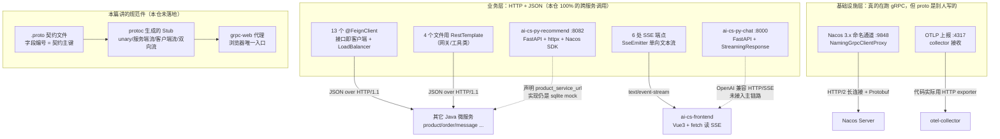
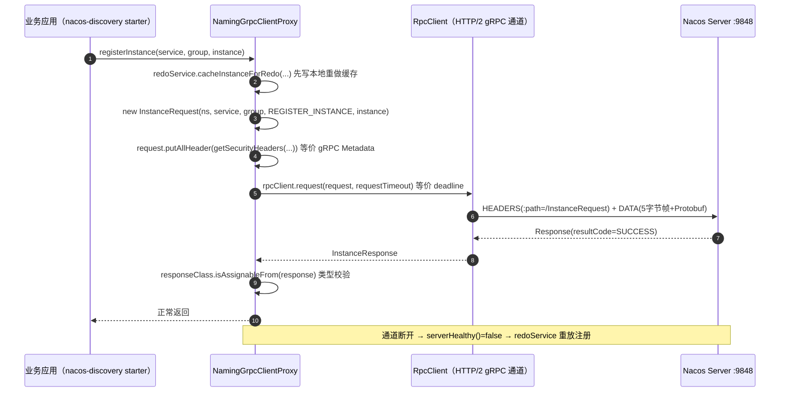

# gRPC 与 Protobuf 跨语言调用：用 IDL 换契约，代价是"变更与调试都比 JSON 贵"

> **一句话结论**：gRPC 的性能红利几乎全部来自**传输层（HTTP/2 多路复用 + HPACK）与编码层（Protobuf 二进制 + 字段编号）**，而它的成本几乎全部落在**契约层（字段编号不可变、要写 IDL、要代码生成）与调试层（要 grpcurl/反射/grpc-web）**；本项目真实跑着的 gRPC 只有两处——Nacos 3.x 的命名通道（9848）和 OTLP 上报（4317）——**这两处的 .proto 都是别人替你写好的**，业务代码 0 个 `.proto`、0 条 grpc 依赖，跨语言调用一律 HTTP+JSON。所以本篇的定位是"原理讲透 + 收益核算 + 什么时候才值得上"，不是"我们去改造它"。
> **阅读前置**：读得懂 Spring MVC 的 `@PostMapping` 与 Feign 的"接口即客户端"；知道 SSE 是"一个 HTTP 响应里持续写 `data:` 行"（见 [05-SSE与WebSocket实时通信](05-SSE与WebSocket实时通信.md)）；对 HTTP/2 的多路复用、头部压缩有概念级印象（见 [05-HTTP与TLS](../15-计算机基础/05-HTTP与TLS.md)）即可，不需要装 protoc、不需要写过 IDL。
> **证据基线**：gRPC / Protobuf 本体源码（grpc-java、protobuf-java、protoc）**未入库**，凡涉及它们内部行为的判断一律标注"依据官方文档 + 本仓代码/配置"；A 级摘录只有 `NamingGrpcClientProxy.java.md`（Nacos 3.x 客户端的 gRPC 命名通道，已入 `24-源码分析/assets/source/`）一处，但它恰好是本仓"真实跑 gRPC"的直接证据；其余是 B 级（本仓 Java/Python/部署文件，行号已逐行核对）与 C 级（本机 pwsh/node/jar 静态统计，输出为真实运行结果）。预计阅读 55~70 分钟。

**本篇的证据边界，先说清楚再开始**：

| 类别 | 本仓状态 | 本篇怎么处理 |
|---|---|---|
| `NamingGrpcClientProxy`（Nacos 3.x gRPC 命名通道） | 已入 `assets/source/NamingGrpcClientProxy.java.md`（`nacos-client:3.3.0`，610 行） | 唯一 A 级摘录，用来讲"真实 gRPC 调用的四要素：Request 对象 / Metadata 头 / deadline / 状态码判定" |
| Protobuf 编码规则（varint、wire type、字段编号） | 规范**未入库** | 依据 Protobuf 官方文档的 *Encoding* 章节说明；**字节数用本机 node 手写编码器实测**（C 级，可复现），不引源码行号 |
| grpc-java 的 `ManagedChannel` / `ClientCalls` / `ServerCalls` | **未入库** | 只讲行为契约（谁负责 framing、谁负责 deadline、谁负责状态码映射），不引行号 |
| 业务侧 `.proto`、代码生成、gRPC 服务端 | **本项目未落地**（全仓 0 个 `.proto`、13 个 pom 里 0 处 grpc/protobuf） | 明确标注"未落地，属选型/设计文档"，并写清若要落地需要改哪些文件、验收标准 |
| Nacos / OTLP 的 gRPC 端口（9848 / 4317） | 已落地（`deploy/k8s/nacos.yaml`、`deploy/observability/otel-collector.yaml`） | B 级证据，用来证明"你在生产跑 gRPC，只是没写业务 proto" |
| Python 服务（`ai-cs-py-chat` / `ai-cs-py-recommend`） | 真实存在，但**没有被 Java 主链路调用** | 如实对照它们为什么是 HTTP+JSON，纠正旧稿"py-chat 是 Java 的跨语言边界"这一不成立的表述 |
| grpc-web / 浏览器直连 | **本项目未落地** | 只给方案与代价，不假装已有 |

本机探测结果（pwsh 7 + node 24，2026-11-27 勘）：`protoc`、`grpcurl`、`docker` 三个命令**均不存在**（`Get-Command` 返回 False）。因此本篇里所有 `protoc`、`grpcurl`、`grpc_cli` 命令都是**未实测**的判读方法，我会写明"预期输出长什么样、怎么读"；真正的硬证据是三块本机实测输出：① 项目文件静态统计（`.proto` 计数、`@FeignClient` 计数、含 grpc 字样的文件清单）；② node 手写 varint/TLV 编码器算出的 **JSON vs Protobuf 字节数**；③ `jar tf` 对 m2 里 `grpc-core-1.84.1.jar` 与 `nacos-client-3.1.1.jar` 的类清单统计。

## 0. 先看现象

### 现象 1：同一份"会话"在三种语言里有三种写法，字段一对不上就读到空值

本项目的对话接口在 Java 侧长这样（`ai-cs-chat/src/main/java/com/aics/chat/controller/ChatController.java#L167-L173`）：

```java
    @PostMapping(value = "/stream/sse", produces = MediaType.TEXT_EVENT_STREAM_VALUE)
    public SseEmitter chatStreamSse(@RequestParam("sessionId") @NotBlank(message = "会话ID不能为空") String sessionId,
                                    @RequestParam("message") @NotBlank(message = "消息内容不能为空") String message,
                                    @RequestParam(value = "knowledgeBase", required = false) String knowledgeBase,
                                    @RequestParam(value = "hybrid", defaultValue = "false") boolean hybrid,
                                    @RequestParam(value = "rewrite", defaultValue = "false") boolean rewrite,
                                    @RequestHeader(value = "X-User-Id", required = false) Long userId) {
```

同一个语义在 Python 服务里必须用 snake_case 表达，于是写成了"一个字段两个名字"（`ai-cs-py-chat/app/schemas/chat.py#L3-L4` 与 `#L18-L25`）：

```python
"""对话接口的请求/响应模型。

JSON 契约对前端/Java 友好:camelCase(sessionId);Python 侧保持 snake_case,
populate_by_name=True 使两种命名都能接收,FastAPI 默认按别名序列化响应。
"""
class ChatRequest(BaseModel):
    """对话请求:当前消息 + 可选多轮历史。"""

    model_config = ConfigDict(populate_by_name=True)

    message: str = Field(..., min_length=1, description="用户当前输入")
    session_id: str | None = Field(None, alias="sessionId", description="会话 ID,由前端生成")
    history: list[ChatMessage] = Field(default_factory=list, description="历史消息,不含当前 message")
```

这段注释本身就是在交代一个痛处：**JSON 世界里，字段名就是契约**，所以跨语言必须靠 `alias` + `populate_by_name` 这种"双方都记得写"的约定来对齐。约定漏一处不会报错——`session_id` 会安静地变成 `None`，然后会话被当成新会话。Protobuf 走的是另一条路：**编码里根本没有字段名，只有字段编号**，命名之争在编码层就消失了；代价是编号变成了不可变的契约（§3.2）。

### 现象 2：流式接口在浏览器里只能走 SSE，换成 gRPC 流式当场卡死

本仓所有"逐字输出"的能力都是 SSE，且都写在 Java 侧：

```java
// ai-cs-chat/src/main/java/com/aics/chat/agent/AgentController.java#L116-L140
    /** 流式编排 SSE 超时：需覆盖编排总超时（AgentProperties.totalTimeoutMs）+ LLM 生成耗时 */
    private static final long AGENT_STREAM_TIMEOUT = 120_000L;
    ...
    @PostMapping(value = "/stream/sse", produces = MediaType.TEXT_EVENT_STREAM_VALUE)
    public SseEmitter agentStream(@RequestHeader(value = "X-User-Id", required = false) Long userId,
                                  @Valid @RequestBody AgentRequestDTO request) {
        Long uid = resolveUserId(userId);
        SseEmitter emitter = new SseEmitter(AGENT_STREAM_TIMEOUT);
        // 立即返回 emitter，编排提交工作线程异步执行——步骤事件随编排进度实时推送，
        // 若在控制器线程同步执行，响应未提交前 send() 会失败
        CompletableFuture.runAsync(() -> runAgentTurn(emitter, uid, request));
        return emitter;
    }
```

Python 侧同样是 SSE，分帧格式手写在路由里（`ai-cs-py-chat/app/api/chat.py#L27-L52`）：

```python
@router.post("/chat/stream")
async def chat_stream(req: ChatRequest) -> StreamingResponse:
    """流式对话:SSE 输出。"""
    async def event_gen():
        try:
            async for delta in chat_service.get_chat_service().stream(req):
                yield f"data: {json.dumps({'delta': delta}, ensure_ascii=False)}\n\n"
        except Exception as exc:
            # 流中途出错也以 SSE 事件告知前端,保证 [DONE] 收尾
            logger.exception("流式对话出错")
            yield f"data: {json.dumps({'error': str(exc)}, ensure_ascii=False)}\n\n"
        yield "data: [DONE]\n\n"

    return StreamingResponse(
        event_gen(),
        media_type="text/event-stream",
        headers={"Cache-Control": "no-cache", "X-Accel-Buffering": "no"},
    )
```

两端的共同点是：**流是文本、单向、跑在 HTTP/1.1 上**。前端因此能直接用 `fetch` 读 `data:` 行（`ai-cs-frontend/src/views/ChatView.vue#L181` 的注释写着"请求变成同源相对路径 /api/chat/...，由 Nginx 反代到网关，免 CORS"）。如果哪天把这条链路改成 gRPC server-streaming，浏览器第一关就过不去：`EventSource` 只会说 HTTP，不会说 HTTP/2 的 gRPC 帧——必须先架一层 grpc-web 代理把二进制流转成 `text/plain` 的 base64 帧（§3.5）。这是"gRPC 流式在服务端很优雅、在浏览器里很别扭"的真实断层。

### 现象 3：跨语言调试要来回翻契约文件，端口和包名还专门坑人

只看配置文件就知道 gRPC 的运维面比 HTTP 多一层（`deploy/k8s/nacos.yaml#L25-L27`）：

```yaml
      - port: 9848                # 9848：gRPC 端口（Nacos 2.x 客户端实际走这个）
        targetPort: 9848          # 客户端会先连 8848 再自动偏移到 8848+1000=9848
        name: grpc
```

也就是说：**HTTP 的 8848 通了，不代表服务注册能用**——真正跑业务的是 9848 上的 gRPC 通道；K8s Service 少开这个端口，表现是"控制台能打开、服务列表空的"。同类的还有 `deploy/observability/otel-collector.yaml#L5-L6`：

```yaml
  grpc:
    endpoint: 0.0.0.0:4317
```

更隐蔽的是"契约文档和实现不一致"这种现场（`ai-cs-chat/src/main/java/com/aics/chat/observability/ObservationConfig.java#L75-L83`）：

```java
        // 学习点：OpenTelemetry SDK 的标准装配——OtlpHttpSpanExporter 负责把 SpanData
        // 序列化为 OTLP/gRPC 或 HTTP/protobuf 发往后端；BatchSpanProcessor 是"批量导出器"：
        // 攒够一批或到时间窗才导出，避免每次 span 都发一次 HTTP 请求的高开销
        OtlpHttpSpanExporter exporter = OtlpHttpSpanExporter.builder()
                .setEndpoint(endpoint)
                .build();
        SdkTracerProvider tracerProvider = SdkTracerProvider.builder()
                .addSpanProcessor(BatchSpanProcessor.builder(exporter).build())
                .build();
```

注释里写着"OTLP/gRPC 或 HTTP/protobuf"，实现用的是 **HTTP exporter**（`OtlpHttpSpanExporter`），而 collector 同时开了 4317(gRPC) 与 HTTP 端口。这类"协议二选一但文档只写了一种"的歧义，在 gRPC 场景里会被放大：gRPC 的调用点通常不体现在 URL 上，只体现在"端口 + 通道类型 + Stub 类名"里，你不翻代码根本看不出它走的是哪种协议。

而这些现象指向同一件事：**gRPC 把"调用"从文本协议变成了"契约 + 通道 + 二进制帧"的三元组，性能账记在传输层，复杂度账记在契约层；本项目之所以只在基础设施里用 gRPC、业务里全用 HTTP+JSON，是因为业务侧的收益（省几十字节、省几百字节头）远小于代价（IDL 维护、网关改造、浏览器断层、调试工具链）。**

## 1. 整体地图



> **读图说明**：
> 1. 上图分三层，**颜色/位置就是结论**：业务层（上）全是 HTTP+JSON，基础设施层（中）才是真 gRPC，规范件（右下）是本仓没有的东西。
> 2. 实线箭头是"今天真的在跑的链路"，虚线箭头是"存在但没接通"：`ai-cs-py-chat` 没有被任何 Java 代码调用（全仓 13 个 `@FeignClient` 里没有指向 Python 服务的），`ai-cs-py-recommend` 虽然声明了下游 `product_service_url`，仓库内实现仍是内存 sqlite（§3.9 有行号）。
> 3. `NACOS` 节点是本篇唯一的 A 级证据来源：Nacos 3.x 客户端用 `ConnectionType.GRPC` 建通道，`Request` 对象 + `Metadata` 头 + `requestTimeout` 三件套都在 `NamingGrpcClientProxy` 里能读到（§4 会逐行拆）。
> 4. `OTLP` 节点特意标了"代码实际用 HTTP exporter"——因为它正是"配置文件写 gRPC、代码走 HTTP"的真实歧义样本（现象 3）。
> 5. 右下角 `PROTO → STUB → GWEB` 是从"写 .proto"到"浏览器能用"的三步，缺任何一步都会断在浏览器或网关上；这也是本仓不改用 gRPC 的主要成本来源。

**组件、责任与调用方**（"是否真实存在"一栏是本篇的诚实性锚点）：

| 组件 | 责任 | 调用方 | 真实存在？ | 证据级别 / 失效方式 |
|---|---|---|---|---|
| `@FeignClient`（13 个） | 声明式 HTTP 客户端，接口即契约（方法签名→URL + JSON 体） | 各业务服务互相调用 | ✅ | B 级；下游雪崩时表现是 `ResourceAccessException` + 熔断 |
| `RestTemplate`（4 个文件） | 过程式 HTTP 调用 | 网关、若干工具类 | ✅ | B 级；无接口约束，改字段靠人肉 |
| `SseEmitter`（6 处端点） | 服务端单向文本流，等价于 gRPC 的服务端流 | 浏览器 | ✅ | B 级；超时/客户端断开易泄漏连接 |
| `ai-cs-py-chat`（:8000） | FastAPI 教学服务，OpenAI 兼容 HTTP/SSE | **无 Java 调用方** | ✅ 存在但未接线 | B 级；独立跑，`app_port=8000` |
| `ai-cs-py-recommend`（:8082） | FastAPI 推荐服务，注册到 Nacos，带 Redis 缓存 | 无 Java 调用方 | ✅ 存在但未接线 | B 级；下游声明 `product_service_url` 但用 sqlite mock |
| `NamingGrpcClientProxy` | Nacos 3.x 客户端的 gRPC 命名通道（注册/注销/订阅/查询） | spring-cloud-alibaba-nacos-discovery | ✅ 每个服务启动都在用 | **A 级**；通道断开→`serverHealthy()==false`，靠 redoService 重放 |
| OTLP collector（:4317） | 接收链路数据（gRPC 或 HTTP 两种入口） | ai-cs-chat / gateway 的 OTel 导出器 | ✅ 部署有，代码走 HTTP exporter | B 级；上报失败只丢 span，不影响业务 |
| 业务 `.proto` / gRPC 服务端 / grpc-web | 契约 + Stub + 浏览器桥 | —— | ❌ **未落地** | 本篇给落地方案，不假装已有 |

## 2. 关键概念与关键类

### 2.1 术语表（首现即解释，后面直接用）

| 术语 | 一句话解释 | 与本仓的对应物 |
|---|---|---|
| **IDL**（Interface Definition Language） | 只描述"接口长什么样"、不写实现的契约语言；gRPC 的 IDL 是 `.proto` | Java 侧等价物是 `FeignClient` 接口 + DTO；Python 侧是 pydantic 模型 + `APIRouter` |
| **varint** | 变长整数编码：每字节最高位是"还有后续字节"标志，小数字只占 1 字节 | 无（JSON 里整数是十进制文本） |
| **tag / TLV** | 每个字段编码成 `tag + 长度/值`；tag = `字段编号<<3 \| wire type` | 相当于 JSON 里"字段名 + 值"，但字段名被压成 1 个数字 |
| **wire type** | 值在字节流里的形态：0=varint、1=64位、2=长度前缀、5=32位 | 决定"不认识这个字段时该跳过几字节" |
| **字段编号（field number）** | `.proto` 里 `int64 user_id = 1;` 的那个 `1`，**它才是编码里的契约主键** | 相当于 JSON 的字段名，但改名无害、改号致命 |
| **stub（桩）** | 由 `.proto` 生成的双端代码：客户端像调本地方法，服务端像实现接口 | 相当于 Feign 的动态代理（`FeignClientFactoryBean`） |
| **多路复用（multiplexing）** | 一条 TCP 连接上并发多条独立"流"（stream id 区分），互不阻塞 | HTTP/1.1 无；本仓网关虽用 Reactor Netty，但对外未开 h2（§3.4） |
| **HPACK** | HTTP/2 的头部压缩：静态表 + 动态表 + 霍夫曼编码，重复头只发索引 | HTTP/1.1 每条请求重发全文本头 |
| **deadline / 截止时间** | 一个**绝对时间点**（不是时长），随调用链传播，超时后整个 RPC 立刻 `CANCELLED` | Feign/Resilience4j 是"每段各配一个时长"（§3.6 有三层实例） |
| **Metadata** | gRPC 的"HTTP 头"：`key: value` 文本，用来传身份、链路 ID、租户 | 本仓的 `X-User-Id` 头、Seata 的 `TX_XID` |
| **状态码（status code）** | gRPC 的 16 个语义化码（`OK`/`UNAVAILABLE`/`DEADLINE_EXCEEDED`/`RESOURCE_EXHAUSTED`…） | HTTP 状态码 200/404/429/503 |
| **反射（server reflection）** | 服务端把自己的 `.proto` 描述符暴露出来，客户端不必持有 proto 文件即可调用 | 相当于 Springdoc/Swagger UI 暴露 OpenAPI |
| **grpc-web** | 让浏览器通过 HTTP/1.1（或 h2）与 gRPC 服务通信的代理协议 | 本仓用 SSE 替掉了这一层 |

### 2.2 关键类与关键文件

| 名称 | 位置 | 角色 | 关键方法/字段 |
|---|---|---|---|
| `NamingGrpcClientProxy` | `assets/source/NamingGrpcClientProxy.java.md`（Nacos `nacos-client:3.3.0`） | Nacos 命名服务的 gRPC 客户端代理，本仓**唯一**真实 gRPC 调用点 | 构造器 `#L104-L128`（建通道）、`requestToServer` `#L510-L551`（元数据+deadline+状态码）、`doBatchRegisterService` `#L261-L269` |
| `RpcClientFactory.createClient` | 同上 `#L121` | 按 `ConnectionType.GRPC` 创建长连接通道 | `createClient(uuid, ConnectionType.GRPC, grpcClientConfig)` |
| `InstanceRequest` / `BatchInstanceRequest` | 同上 `#L281-L285` / `#L264-L267` | 每类操作一个"请求 message 类"，响应也有对应类 | 请求类 + 期望响应类成对出现，正是 gRPC unary 调用形状 |
| `SseEmitter` | `ai-cs-chat` 6 处端点 | 服务端流的 HTTP 版（`text/event-stream`） | `ChatServiceImpl.java#L156` 的 5 分钟超时、`AgentController.java#L117` 的 120 秒超时 |
| `FeignClientFactoryBean` | `assets/source/FeignClientFactoryBean.java.md` | 把 `@FeignClient` 接口变成 HTTP 调用代理——"接口即客户端"的另一种实现 | 与 protoc 生成 Stub 对照：一个是运行时代理，一个是编译期生成 |
| `MappingJackson2HttpMessageConverter` | `assets/source/MappingJackson2HttpMessageConverter.java.md` | 本仓 JSON 编解码的落点 | 对应 gRPC 的 `ProtobufMarshaller`（未入库） |
| `OtlpHttpSpanExporter` | `ai-cs-chat/src/main/java/com/aics/chat/observability/ObservationConfig.java#L78` | 链路导出器：**名字里就是 HTTP** | 与 `grpc:` 4317 端口形成"配置 vs 实现"的歧义样本 |
| `AgentProperties.totalTimeoutMs` | `ai-cs-chat/src/main/java/com/aics/chat/agent/AgentProperties.java#L28` | 自研的"总预算"超时（默认 60000ms） | 没有 deadline 传播时，人肉造出来的替代品 |
| `APIRouter` / `StreamingResponse` | `ai-cs-py-chat/app/api/chat.py#L12` / `#L48-L52` | Python 侧的路由与流式响应 | `media_type="text/event-stream"` |

## 3. 原理与证据逐段精读

> 每一小节都按固定四层走：**在干什么 → 为什么这么设计 → 换成别的写法会怎样 → 常见坑**。凡"字节数/占比"类数字，均为本机实测（C 级），命令与输出在 3.1 与 3.4 给出。

### 3.1 一条消息是怎么变成 103 字节的：tag + wire type + varint

**在干什么。** Protobuf 把一条消息压成一串 `TLV` 三段式：`tag`（字段编号 + wire type 合成一个 varint）、`length`（只有 wire type=2 才有）、`value`。本机用 node 手写了一个最小编码器，对一份真实形状的对话请求（`user_id=1001, session_id="sess-20261127-a1b2c3d4", message="我的订单一直没发货，帮我查一下物流到哪了", knowledge_base="kb_product", top_k=5`）实测：

```text
$ node pb-size.mjs        # 手写 varint/TLV 编码器，按 .proto 字段号逐字段打包
请求  JSON 字节 = 167  Protobuf 字节 = 103  帧后 = 108  压缩比(JSON/PB) = 1.62
响应  JSON 字节 = 333  Protobuf 字节 = 173  帧后 = 178  压缩比(JSON/PB) = 1.92
请求 Protobuf 十六进制 = 08e9071216736573732d32303236313132372d6131623263 ...
```

把头 6 个字节拆开读（这就是"读懂二进制"的最小练习）：

```text
08          tag = (field 1 << 3) | 0(varint) → user_id
e9 07       varint 1001：0xE9=1110_1001 还有后续，0x07 收尾 → 1001
12          tag = (field 2 << 3) | 2(长度前缀) → session_id
16          长度 = 0x16 = 22（正好是 "sess-20261127-a1b2c3d4" 的字符数）
73 65 73 73 ...   "sess" 的 ASCII
```

**为什么这么设计。** 三个决定都是为了"省"和"稳"：
- **省字段名**：JSON 里 `"session_id"` 这 12 个字节每条消息都要发一次，Protobuf 里它消失，只剩 `0x12` 一个字节——本机实测请求从 167→103（1.62×），响应里因为重复了 3 个商品对象，比例升到 1.92×。
- **省整数**：varint 让小整数只占 1 字节（`top_k=5` → `28 05`）；实测 `1001` 只占 2 字节，而固定 32 位编码要 4 字节。
- **稳解析**：wire type 让"不认识这个字段"的一方知道该跳过多少字节——这是向后兼容的物理基础（§3.2）。

**换成别的写法会怎样。** 三条路各有代价：JSON 明文（本仓现状，可读、可 curl、浏览器直读，体积多 60%~90%）；XML（再翻一倍且解析更慢）；固定宽度二进制（如某些老 RPC 的 `int32` 定长编码，大数省、小数亏，且没法和"新增字段"共存）。真正决定 gRPC 体积优势的不是"二进制"三个字，而是**"字段名不进报文 + varint + 默认值不传输"**这三条叠加。

**常见坑。**
- **负数用 `int32` 会变成 10 字节**：varint 对负数是按补码当无符号编码的，所以 `-1` 要占 10 字节；要传负数必须用 `sint32/sint64`（zigzag 编码）。
- **`string` 与 `bytes` 的 wire type 都是 2**：把字段从 `string` 改成 `bytes`，双方都不会报错，但会读出乱码——这是"类型改了还能解析"的假安全。
- **长度跨 128 时帧长突变**：长度前缀本身是 varint，字符串从 127 涨到 128 字节，长度字段就从 1 字节变 2 字节。任何"按固定偏移切包"的土办法都会崩。
- **别拿这个编码器当实现**：本机代码只是教学用（无 packed repeated、无嵌套消息边界校验）。生产必须用 protoc 生成，别手写编解码。

### 3.2 字段编号是契约：为什么"改字段名没事、改编号要命"

**在干什么。** `.proto` 里每个字段的编号会被写进 tag；接收方拿到字节流后，**只按编号查自己的定义**，字段名叫什么都不参与解析。所以：
- 改字段名（`session_id` → `conversationId`）：只要编号不变，两端照常通信，只是代码里换个名字。
- 改字段编号（`= 2` 改成 `= 5`）：发送方写进 tag 的是 5，接收方按编号 5 找字段——找不到就**当未知字段跳过**；而它原本期望的编号 2 从此收不到数据 → **读到默认值**（`0`/`""`/`false`），**不报错**。
- 删字段后再复用同一个编号给新类型：老客户端会把新字段的值按老语义解析，产生"看起来合法、其实错位"的脏数据。

**为什么这么设计。** 因为跨语言、跨版本、跨进程的兼容性，只能靠"编号稳定 + 未知字段可跳过"这一条最小公理。JSON 世界没有这个机制：删字段、改字段名都靠双方同时上线；Protobuf 把"同时上线"这件不可能的事换成了"编号永不变"这件可工程化的事。官方文档给出的兼容规则就三条：**加字段随便加（用新编号）；删字段用 `reserved` 占位封号；编号永不复用、类型不要改。**

**换成别的写法会怎样。** JSON + 严格校验（本仓 pydantic 的 `Field(...)` 必填 + `min_length`，`ai-cs-py-chat/app/schemas/chat.py#L23-L25`）能在**入口**把"缺字段"变成 400，这其实是另一条防线：字段名错了立刻炸，不会静默。Protobuf 相反——**结构错会立刻炸（wire type 不匹配），语义错会静默**（编号对但含义变了）。这两条防线的故障模式完全不同，所以"哪种更好"取决于你更怕"炸"还是更怕"静默脏数据"。

**常见坑。**
- **`reserved` 忘加**：删掉的编号一年后被新人复用，事故只在那批老客户端上线时才爆，且必现难查。删字段时连着写 `reserved 3, 7;` 和 `reserved "old_name";`。
- **proto3 早期没有字段存在性**：默认值不传输，于是"显式传 0"和"没传"在 3.15 之前的 proto3 里**无法区分**；要做 PATCH 语义必须用 `optional`（3.15+）或 `google.protobuf.Int32Value` 包装类型。对照本仓 pydantic：`session_id: str | None = None` 天然区分 `null` 与缺省，这是 JSON 在一件事上确实更强的地方。
- **枚举必须以 0 开头且当默认值**：枚举第 0 项会成为"没传"时的值，所以别把 `0` 定义成 `UNKNOWN_ACTIVE`。
- **类型"看起来兼容"的陷阱**：`int32`↔`int64`↔`bool` 同为 wire type 0，可以互读但会截断/错义；`fixed32`↔`float` 同为 5。这类改动**不会报错**，是 gRPC 线上最难查的一类问题。

### 3.3 proto3 语法要点与代码生成流程（含本仓现状）

**在干什么。** 一份 `.proto` 同时是"接口定义 + 数据结构定义"，`protoc` 把它分别编译成各语言的类型与 Stub。语法核心其实只有七件事：

| 语法 | 作用 | 一句话要点 |
|---|---|---|
| `syntax = "proto3";` | 声明版本 | proto2 与 proto3 语义差别大（是否存在性、required），新项目一律 proto3 |
| `package aics.chat.v1;` | 逻辑命名空间 | 里面要带版本号，出 v2 时新旧并存 |
| `service X { rpc M (Req) returns (Resp); }` | 定义服务与方法 | `returns (stream Resp)` = 服务端流；`rpc M (stream Req)` = 客户端流；两边都 `stream` = 双向流 |
| `message M { int64 user_id = 1; }` | 定义消息 | **编号 1~15 只占 1 字节 tag，16~2047 占 2 字节**——热字段用小号 |
| `repeated` / `map<K,V>` / `oneof` | 数组 / 字典 / 互斥联合 | `oneof` 是 gRPC 里表达"多种可选负载"的惯用法，天然防"同时填两个" |
| `optional`（proto3，3.15+） | 恢复字段存在性 | 需要"区分未设置"的字段必须加，否则违反直觉 |
| `reserved` | 封号/封名 | 删字段时必写（§3.2） |

生成流程（三段式，本机 `protoc` 不存在，**未实测**，只给判读方法）：

```bash
# 1) Java 类型 + gRPC Stub（两件事由两个插件分工）
protoc -I src/main/proto --java_out=target/generated-sources \
       --grpc-java_out=target/generated-sources chat.proto
# 2) Python 类型 + gRPC Stub（同理）
python -m grpc_tools.protoc -I. --python_out=. --grpc_python_out=. chat.proto
# 3) Maven 工程里不要手敲命令，用 protobuf-maven-plugin 绑到 generate-sources 阶段
```

预期产物（怎么读）：Java 侧会生成 `ChatProto.ChatRequest`（不可变消息 + Builder）、`ChatServiceGrpc`（内含 `newBlockingStub` / `newStub`（异步）/ `newFutureStub` 与 `StreamObserver` 形式的流式方法）；Python 侧生成 `chat_pb2.py`（消息类）与 `chat_pb2_grpc.py`（Servicer 基类 + Stub）。

**本仓现状（C 级实测，这条最重要）**：

```text
$ (Get-ChildItem -Recurse -Include *.proto).Count      → 0
$ pom.xml 总数 → 13 ；其中含 grpc|protobuf 字样 → 0
```

也就是说：**没有 IDL 目录、没有 protoc 插件、没有任何 grpc 依赖声明**。本篇不是"改造文档"，是"选型与设计文档"。

**为什么这么设计（指"用代码生成代替手写"）。** 契约先行把"双方对齐"从运行时提前到编译时：字段改了，另一端编译出来的类型就对不上，IDE 立刻报错——这是 gRPC 相对 REST 最实在的收益，比"快 1.6 倍"更值钱。

**换成别的写法会怎样。** 本仓的做法是"运行时代理 + 手写 DTO"：`@FeignClient(name = "ai-cs-product")` 接口 + `Result<List<ProductRecommendVO>>` 返回类型（`ai-cs-chat/src/main/java/com/aics/chat/feign/ProductRecommendFeignClient.java#L15-L34`）。这种写法的优点是零构建改造、零新工具；缺点是**契约错配只在运行时暴露**，且没有跨语言约束——Java 改了字段名，Python 那边靠 `alias` 兜，兜不住就静默变 `None`（现象 1）。

**常见坑。**
- **protoc 版本与 `protobuf-java` 运行时版本必须匹配**：本机 m2 里 `com/google/protobuf/protobuf-java` 同时躺着 **3.20.1 / 3.21.9 / 4.36.2** 三个版本（C 级实测），这正是"传递依赖拉进来的版本和你编译用的 protoc 不一致"的典型现场；症状是运行时 `NoSuchMethodError` 或半包解析失败。解法是在 pom 里 `<protobuf.version>` 统一 + `dependencyManagement` 锁死。
- **`java_package` / `java_outer_classname` 改名 = 破坏兼容**：不只是二进制不兼容，Java 源码里的 import 也全碎；这两个只应新建包名时改。
- **生成的代码不要手改、也不要让 IDE 索引到 `target/`**：否则"改了没生效"会浪费你半小时。
- **别把 `.proto` 放在 `src/main/resources`**：它不该进 jar，应该作为独立契约模块（或 `api` 模块）随产物发布。

### 3.4 为什么 gRPC 快：HTTP/2 多路复用 + HPACK + 二进制帧

**在干什么。** gRPC 的传输部分完全交给 HTTP/2：一次 RPC = 一个 stream（`HEADERS` 帧带 `:method=POST`、`:path=/aics.chat.v1.ChatService/Ask`、`content-type: application/grpc`、`te: trailers`）；消息体 = `5 字节前缀（1 字节压缩标志 + 4 字节长度）+ Protobuf 字节`；结束状态放在 `trailers` 里。多条 RPC 复用**同一条 TCP 连接**，靠 stream id 区分。

**为什么这么设计。**
- **多路复用解队头阻塞**：HTTP/1.1 同连接上请求串行（前一个响应没回来，后面排队）；gRPC 一连接上百条流并行，连接数不再随并发线性增长（这是微服务"连接数爆炸"的直接解药）。
- **HPACK 压头**：同一个 Stub 反复调用时，`:path`、`content-type`、`authorization`、`grpc-timeout` 这些头几乎不变，第一次发全量、之后只发 1~2 字节的索引。JSON over HTTP/1.1 每条请求都要重发几百字节文本头。
- **二进制帧**：不需要文本扫描，解析成本低、便于多路复用交错（一个 TCP 包里可以夹着多条流的帧）。

**换成别的写法会怎样。** 本仓现状是 HTTP/1.1 + JSON：即便用了连接池与 keep-alive，头部仍要重发、请求仍要串行（同连接）；想靠"多开连接"换并发，就要付出连接数与 fd 的代价。要提醒的是：**HTTP/2 不是 gRPC 的专利**——REST 也能跑 h2，只是绝大多数 Spring 部署没开。

**本仓的实测现状（这条决定了"我们其实没吃到 gRPC 的性能红利"）**：

```text
$ grep -c http2 ai-cs-gateway/src/main/resources/application.yml   → 0 命中
（网关 pom 里是 spring-cloud-starter-gateway-server-webflux + reactor-netty）
```

即：网关虽然跑在 Reactor Netty（能力上支持 h2），但**没有开启 HTTP/2 相关配置**，对外实际仍是 HTTP/1.1；真正跑 HTTP/2 长连接的只有 Nacos 客户端那条 gRPC 通道（A 级：`#L121` 用 `ConnectionType.GRPC` 建 `RpcClient`）。

**常见坑。**
- **长连接 + L4 负载均衡 = 均衡失效**：一条 h2 连接会把所有请求都打到同一台实例。要配客户端侧负载均衡（gRPC 的 `round_robin`/`pick_first`）或 L7 代理；K8s 里常见做法是 headless service + 客户端解析。
- **`MAX_CONCURRENT_STREAMS` 是硬上限**：服务端 `SETTINGS` 里给多少，一条连接就只能并行多少条流（具体值由实现和配置决定，别背数字）；超了不是报错而是**排队**，表现为"QPS 上不去、延迟却很稳"。
- **中间设备会打断 h2**：老 Nginx（未开 `http2`）、部分云 LB、企业防火墙可能降级或断开长连接；`grpc` 在明文（h2c）与 TLS（h2）之间的选择也常踩坑（`--plaintext` vs `--insecure`）。
- **别把"二进制 = 快"当成主因**：实测 1.62×/1.92× 的收益在 CPU 与网络上只值几毫秒；**真正省时间的是"少建连接 + 少一次序列化峰值"**，别把小包场景的收益吹大。

### 3.5 四种调用模式，以及与 SSE / WebSocket 的对照

**在干什么。** gRPC 由 `stream` 关键字决定四种形态，语义差异只在"谁能发多条"：

| 模式 | 方向 | 等价 HTTP 形态 | 本仓对应物 | 浏览器直连 |
|---|---|---|---|---|
| Unary（一元） | 一请求一响应 | `POST /api/x` | 13 个 `@FeignClient`、所有 `@PostMapping` | ❌ 需 grpc-web |
| Server-streaming（服务端流） | 一请求，N 个响应 | **SSE / `text/event-stream`** | `ChatController#L167`、`AgentController#L130`、py-chat `/chat/stream` | ❌ 需 grpc-web |
| Client-streaming（客户端流） | N 个请求，一响应 | 分片上传 + 最后聚合 | 无（本仓用 `MultipartFile` 一次传） | ❌ |
| Bidirectional（双向流） | 双向随时互发 | **WebSocket** | 无（`ai-cs-notify` 用 WebSocket 推通知，但不是 RPC） | ❌（需 WebTransport/gRPC-Web） |

**为什么这么设计。** 把"流"下沉到协议层，就不用每种业务自己发明"长轮询 / chunked / WebSocket 自定义帧"。对比本仓 SSE 的实现，能清楚看到 gRPC 替你省了什么：

```java
// ai-cs-chat/src/main/java/com/aics/chat/service/impl/ChatServiceImpl.java#L156
    private static final long SSE_EMITTER_TIMEOUT = 5 * 60 * 1000L;   // 5 分钟
// ai-cs-chat/src/main/java/com/aics/chat/agent/AgentController.java#L117
    private static final long AGENT_STREAM_TIMEOUT = 120_000L;        // 2 分钟
```

两个超时值写在两个类里，且**语义上互相依赖**（Agent 的总预算 60s 必须小于流超时 120s，否则编排还没结束连接就被掐）。gRPC 里这件事由 deadline 一处表达（§3.6），不需要人肉维持"两个常量的大小关系"。

**换成别的写法会怎样（三条路的真实分工）。**
- **SSE**：文本、单向、浏览器原生可读、可穿普通 HTTP 代理，但**只有服务端→客户端一个方向**，且必须自己维护心跳与超时；跨语言也天然友好（Python 手写 `data:` 行即可，见 `ai-cs-py-chat/app/api/chat.py#L41`）。
- **WebSocket**：双向、二进制/文本都行，但你要自己定义帧格式——**这等于自己发明一套没有 IDL 的"协议"**，正是 gRPC 想消灭的东西。
- **gRPC 流**：类型安全、双向、有 deadline/元数据/状态码，但**浏览器不能直连**，必须加 grpc-web 代理（把消息转成 base64 的 `application/grpc-web+proto` 帧，或走 h2 的 grpc-web）。

**常见坑。**
- **以为"服务端流 = SSE"就顺手换**：SSE 的事件是文本行，gRPC 的每条消息是二进制帧；前端那套"按空行分帧、取 `data:` 行"的解析器（py-chat 的格式约定就是这么写的）完全不能复用。
- **背压方向搞反**：SSE 没有应用层背压（客户端慢，服务端 `send()` 阻塞或丢），gRPC 有 h2 流控窗口但需要你在 `ServerCallStreamObserver` 上处理 `isReady()`；本仓 Agent 侧用 `CompletableFuture.runAsync` 直接推，靠超时兜底，换成 gRPC 就必须补背压逻辑。
- **双向流 + 网关**：很多网关对"半关闭"和 `DATA` 帧交错支持不完整，测试一定要覆盖"客户端先关、服务端后关"的顺序。

### 3.6 超时、deadline 与 Metadata：本仓是怎么"用人工预算模拟 deadline"的

**在干什么。** gRPC 的超时不是"设个 readTimeout"，而是一个**绝对截止时间点**：客户端在 `HEADERS` 里带 `grpc-timeout: 3000m`，服务端从 `Context` 里读出剩余预算，子调用应当用"剩余预算"而不是自己的默认值。超时后，服务端可以主动 `CANCELLED`（语义码 `DEADLINE_EXCEEDED`），客户端立刻拿到失败，**不会出现"上游已经放弃、下游还在算"的浪费**。A 级证据（`NamingGrpcClientProxy.java.md#L527-L528`）：

```java
// [[源码:NamingGrpcClientProxy.java.md#L527-L528]]
            response = requestTimeout < 0 ? rpcClient.request(request)
                : rpcClient.request(request, requestTimeout);
```

`requestTimeout` 来自配置 `NAMING_REQUEST_TIMEOUT`，默认 `-1`（不设超时，见 `#L112-L113`）——注意这正是"gRPC 只是给了机制，用不用是你的事"：Nacos 默认不设 deadline，因为注册是一次性幂等操作，宁可等。

**Metadata 就是 gRPC 的 HTTP 头**，A 级证据在同一方法里（`#L514-L518`）：

```java
// [[源码:NamingGrpcClientProxy.java.md#L514-L518]]
            if (request instanceof AbstractNamingRequest) {
                request.putAllHeader(
                    getSecurityHeaders(((AbstractNamingRequest) request).getNamespace(),
                        ((AbstractNamingRequest) request).getGroupName(),
                        ((AbstractNamingRequest) request).getServiceName()));
            }
```

`putAllHeader(...)` 把命名空间/分组/服务名/安全令牌放进请求头——和本仓用 `@RequestHeader("X-User-Id")` 透传身份（`ChatController.java#L173`）是完全一样的思路，只是 gRPC 里它有个专名叫 Metadata。

**为什么这么设计。** 分布式系统里的"超时"本质是**预算（budget）**而非"每段独立的闹钟"：用户等 3 秒，网关给服务 2.5 秒，服务给下游 2 秒……每段都独立配时长，最坏情况是层层相加，用户早就走了链路还在跑（浪费 CPU、占线程、写脏数据）。deadline 传播把"总预算"变成一个数向下传。

**本仓没有 deadline，于是人肉造了一个**——这是本节最有价值的部分，三层超时分别写在三个地方：

```yaml
# ai-cs-chat/src/main/resources/application.yml#L74-L87
resilience4j:
  timelimiter:
    instances:
      chatService:      { timeout-duration: 30s }
      sseChatService:   { timeout-duration: 60s }   # 首次 token 到达限制
      visionService:     { timeout-duration: 5s }
```

```java
// ai-cs-chat/src/main/java/com/aics/chat/agent/AgentProperties.java#L28
    private long totalTimeoutMs = 60000;
// ai-cs-chat/src/main/java/com/aics/chat/agent/workflow/AfterSaleAgentService.java#L263-L266
        // 总超时检查：超时则失败中止
        if (isTotalTimeout(ctx)) {
            return failWith(ctx, "AGENT_TIMEOUT", "执行超时（" + properties.getTotalTimeoutMs() + "ms），已中止");
        }
```

也就是说：`AgentProperties.totalTimeoutMs=60s`（编排总预算）+ `AGENT_STREAM_TIMEOUT=120s`（SSE 连接上限）+ `sseChatService=60s`（首 token 限制）+ `SSE_EMITTER_TIMEOUT=300s`（普通对话流上限）**四层各自独立维护**，彼此的正确性靠注释里那句"需覆盖编排总超时 + LLM 生成耗时"来提醒。这就是"没有 deadline 传播"的代价：**预算关系只活在人的脑子里**。A 级里的 `requestTimeout` 一旦设置就会沿通道生效，而本仓的四层超时靠框架各自实现，做不到跨进程传递。

**换成别的写法会怎样。** 如果这段编排跑在 gRPC 上，你只需在入口处 `stub.withDeadlineAfter(3, SECONDS)`，下游每个服务读 `Context.current().getDeadline()` 算剩余，全部自动收敛——不需要 `AgentProperties` 这个字段，也不需要两条注释来维持常量关系。

**常见坑。**
- **deadline 当"重试窗口"用**：设 1s 超时 + 3 次重试 = 最坏 3s+退避，比不设更糟；deadline 要和重试预算合起来算。
- **Metadata key 只能是小写 ASCII**：大写 key 会被拒；大 value 会撞 `MAX_HEADER_LIST_SIZE`，别把 JWT 里的长 claim 数组塞进去。
- **超时后不做幂等清理**：服务端已被 `CANCELLED`，但数据库事务/外部写操作可能还在跑——本仓用"确认凭证 + 幂等状态机"防这个（`AfterSaleAgentService` 的终态判断），这个习惯在 gRPC 下同样必需。
- **别只信客户端超时**：客户端断开 ≠ 服务端停止；gRPC 的 `CANCELLED` 是"通知"，服务端要显式检查 `Context.isCancelled()` 才真省资源。

### 3.7 错误码与重试：16 个语义码 vs HTTP 状态码

**在干什么。** gRPC 把错误收敛成 16 个状态码（`OK`、`CANCELLED`、`UNKNOWN`、`INVALID_ARGUMENT`、`DEADLINE_EXCEEDED`、`NOT_FOUND`、`ALREADY_EXISTS`、`PERMISSION_DENIED`、`RESOURCE_EXHAUSTED`、`FAILED_PRECONDITION`、`ABORTED`、`OUT_OF_RANGE`、`UNIMPLEMENTED`、`INTERNAL`、`UNAVAILABLE`、`UNAUTHENTICATED`），并允许附带 `google.rpc.Status` 的结构化详情；重试策略（`retryPolicy`：`maxAttempts` / `initialBackoff` / `retryableStatusCodes`）可以写在服务配置里，由客户端（或服务端下发）执行。

| 场景 | gRPC 状态码 | HTTP 对照 | 本仓的真实对应物 |
|---|---|---|---|
| 通道/服务不可用 | `UNAVAILABLE` | 503 | `ResourceAccessException`（yml 重试白名单里就有它） |
| 超时 | `DEADLINE_EXCEEDED` | 504 | `SocketTimeoutException` / `TimeoutException` |
| 限流/配额耗尽 | `RESOURCE_EXHAUSTED` | 429 | Sentinel/网关限流的 429 |
| 参数不合法 | `INVALID_ARGUMENT` | 400 | `@Valid` 校验失败 |
| 未实现/版本不匹配 | `UNIMPLEMENTED` | 404/501 | 无（这是 gRPC 独有的一类：客户端知道方法、服务端不认识） |
| 认证失败 | `UNAUTHENTICATED` | 401 | 网关 JWT 校验 |

**为什么这么设计。** HTTP 状态码是"传输 + 资源语义"的混合体（404 既能表示"路由没有"也能表示"数据没有"），不可重试/可重试的边界模糊；gRPC 的码表天然带"可重试性"标签：`UNAVAILABLE` 可重试、`INVALID_ARGUMENT` 绝不可重试。

**本仓的等价实践**（说明"思想早就有了，只是换了个实现"）：

```yaml
# ai-cs-chat/src/main/resources/application.yml#L88-L102
  retry:
    instances:
      chatService:
        max-attempts: 3
        wait-duration: 1s
        multiplier: 2
        retry-exceptions:
          - java.net.SocketTimeoutException
          - java.net.ConnectException
          - org.springframework.web.client.ResourceAccessException
          - java.util.concurrent.TimeoutException
        ignore-exceptions:
          - com.aics.common.exception.BusinessException
          - java.lang.IllegalArgumentException
```

`retry-exceptions` 白名单 = gRPC 的 `retryableStatusCodes`；`ignore-exceptions` = "业务异常不许重试"。Python 侧同样用状态码做分类（`ai-cs-py-recommend/app/api/recommend.py#L62-L75`）：业务 `ValueError` → 404 且 `detail=str(e)`，未预期异常 → 500 且**不泄露内部细节**（`detail="服务暂时不可用，请稍后再试"`）。

**换成别的写法会怎样。** 若把所有 5xx 都重试：本仓的"下单/售后写操作"会被重复执行——所以项目才做了"确认凭证 + 幂等终态"（`AfterSaleAgentService#L260-L262` 里 `if (ctx.isTerminal()) return buildResult(ctx);` 就是幂等兜底）。gRPC 的 retryPolicy 也只能在你声明"这个方法可重试"时才安全。

**常见坑。**
- **`DEADLINE_EXCEEDED` 自动重试 = 超时放大**：默认重试策略千万别无脑包含它。
- **把"服务端已开始处理"的失败当可重试**：写操作必须配幂等键（本仓的 `X-Request-Id`/确认 token 思路）。
- **错误详情塞进 `message`**：gRPC 有 `status details`（Any 打包的结构化信息），塞纯文本会让客户端只能靠字符串匹配。
- **忽略 `UNIMPLEMENTED`**：它常是"客户端 proto 比服务端新"的信号，重试一万次也没用，应直接报给发布系统。

### 3.8 健康检查与反射：gRPC 的"探活"和"接口自助查询"

**在干什么。**
- **健康检查**：gRPC 定义了标准服务 `grpc.health.v1.Health`（`Check` 一元 + `Watch` 流式），语义上分"服务级"和"整体级"；K8s 探针要么用 `grpc_health_probe`，要么用实现了该协议的原生探针。
- **反射（reflection）**：服务端注册 `grpc.reflection.v1.ServerReflection` 后，客户端可以**不持有 `.proto`** 就列出服务、方法、消息结构——`grpcurl` 的"不传 `-proto` 也能调"就靠它。没有反射时，你调接口必须先翻到那份 proto 文件（这就是现象 3 的痛点）。

**A 级证据：gRPC 通道的"健康"是什么粒度**（`NamingGrpcClientProxy.java.md#L483-L486`）：

```java
// [[源码:NamingGrpcClientProxy.java.md#L483-L486]]
    @Override
    public boolean serverHealthy() {
        return rpcClient.isRunning();
    }
```

这是**连接级健康**：通道还活着就返回 `true`。它和本仓应用级的 `/health` 端点不是一个层次——`AgentController.java#L110-L113` 的 `health()` 返回 `Result.success(Map.of("status", "UP"))`，py-chat 的 `/health` 返回 `{"status": "up"}`（`ai-cs-py-chat/app/api/chat.py#L15-L18`），这两个都是**应用自己的自我报告**（进程活着、路由能进），并不校验下游依赖。

**为什么这么设计。** 三层健康各有用途：TCP 通（负载均衡摘除用）、应用能答（进程/线程池没卡死）、业务可服务（依赖齐全）。gRPC 把第一层做成协议内的 `Check`，天然适合探针；HTTP 世界只能约定 `GET /health`（本仓就是这种约定）。

**换成别的写法会怎样。** 只用 TCP 探活 → 假活（端口开着、服务端 gRPC 服务没注册 → 客户端拿到 `UNIMPLEMENTED`，但探针一直绿）；只用 `/health` 200 → 依赖全挂也还是 200（本仓的 `/health` 就是纯静态返回，属于"层 2 探针"，不要指望它发现 Redis 挂了）。

**常见坑。**
- **`Watch` 流式健康检查与"连接级/服务级"混淆**：`Check` 返回 `SERVING` 只代表你问的那个 service 名字健康，问错了名字会得到 `NOT_FOUND`。
- **反射是"运维便利"也是"信息暴露"**：生产开反射等于暴露全部接口清单，通常只在内网/调试环境开。
- **没反射时 grpcurl 的报错很容易误判**：表现为"unknown service / failed to resolve symbol"，不是服务没起来，而是你没给 `-proto`。

### 3.9 Python 侧为什么仍是 HTTP+JSON：如实对照与本仓的真实边界

**在干什么。** 项目里两个 Python 服务各自独立，都是 FastAPI + JSON：

| 服务 | 端口 | 契约定义方式 | 流式 | 跨语言调用真相 |
|---|---|---|---|---|
| `ai-cs-py-chat` | 8000（`ai-cs-py-chat/app/config.py#L24-L25`） | pydantic 模型 + `alias` 兼容 camelCase（`app/schemas/chat.py#L18-L35`） | SSE（`/chat/stream`，`app/api/chat.py#L27-L52`） | **没有被任何 Java 代码调用**；它是"OpenAI 兼容协议"的教学实现（`app/main.py` 里 `description="简单 AI 对话服务(OpenAI 兼容协议,默认 DeepSeek)"`），Java 侧真正的 LLM 调用走 Spring AI 的 `spring-ai-starter-model-openai` + `openai-java-client-okhttp` |
| `ai-cs-py-recommend` | 8082（`ai-cs-py-recommend/app/config.py#L30-L31`） | pydantic 模型 + 路径/查询/体参数（`app/api/recommend.py#L32-L45`、`#L78-L82`） | 无 | 注册到 Nacos（`service_name="ai-cs-py-recommend"`），声明了下游 `product_service_url="http://localhost:8085"`、`order_service_url="http://localhost:8086"`（`app/config.py#L45-L46`）——**但仓库内实现仍是内存 sqlite mock**（`app/repositories/product_repo.py#L29-L36` 用 `sqlite3.connect(":memory:")` 自建表） |

**为什么这么设计（这是理性选择，不是"没做完"）。**
1. **LLM 生态是 HTTP+JSON 的天下**：OpenAI 兼容协议本身就是 REST + SSE，Spring AI 的 OpenAI 客户端把"HTTP+JSON+SSE"封成了 `ChatClient`；在这条链路上插 gRPC 等于给两侧都加适配层。
2. **Python 侧的 gRPC 收益更低**：`ai-cs-py-recommend` 的价值在"Python 数据结构/算法生态"，它的调用量小、消息体小（一次几十个商品），实测级别的体积差（1.6×~1.9×）换算成毫秒是噪声。
3. **调试成本才是大头**：Python 侧用 `httpx`（`requirements.txt` 注释写着"HTTP 客户端（对标 Feign / RestTemplate）"）发请求，出问题 `curl` 一下就能复现；换 gRPC 得装 `grpcio-tools`、生成桩、装 `grpcurl`、开反射——本项目两个 Python 服务的 `requirements.txt` 里**都没有 `grpcio`/`protobuf`**（B 级核对）。
4. **Nacos 注册用的是 SDK 的 HTTP 接口**：`nacos-sdk-python==0.1.9` 走的是 Nacos 的 HTTP OpenAPI，不碰 9848 的 gRPC 通道——这也解释了为什么 Python 服务能注册成功但与 Java 客户端的协议栈完全无关。

**换成 gRPC 会怎样（收益核算，按本篇实测数据算）。** 以 `POST /api/recommend/` 的一次响应为例：3 个商品的 JSON 是 333 字节、Protobuf 是 173 字节（§3.1 实测，同形状数据），单次省 160 字节。按 100 QPS 算，一天省约 1.4 GB 出网流量——**看起来不小，但本项目这个接口的实际 QPS 是个位数**（它是教学/演示级服务），省下的带宽约等于零；而代价是：新增 `grpcio` + `grpcio-tools` 依赖与构建步骤、两套序列化并存、前端/Java 侧要多维护一份 proto、`curl` 调试失效。**结论：不划算。** 唯一真正能改变结论的场景是"消息体很大（>10 KB）且调用量很大（>1k QPS）"——那时候省的不是流量，是带宽成本和 P99 延迟。

**常见坑。**
- **以为 Python 侧的 snake_case/camelCase 双写是"临时方案"**：它其实是 JSON 契约的常规做法（`populate_by_name=True` + `alias`），换成 gRPC 才会消失——但消失的代价是编码不可读。
- **把 `product_service_url` 当成"已经跨语言调 Java"**：配置项存在 ≠ 调用链存在，仓库内是 sqlite mock；这类"配置先行、实现未接"的状态最容易在写文档时被写成"已实现"。
- **Python 服务的 `/health` 与 Nacos 注册是两条独立的道**：注册成功不代表业务可用，反之亦然。

## 4. 一次完整执行时序

取本仓**唯一真实**的 gRPC 调用路径：Spring Cloud Alibaba 应用启动时，Nacos 客户端通过 9848 的 gRPC 通道注册实例。所有步骤都能在 A 级摘录里找到对应代码。



> **读图说明**：
> 1. 第 3 步的 `redoService.cacheInstanceForRedo(...)` 是"先记账后发请求"（`[[源码:NamingGrpcClientProxy.java.md#L173-L178]]`）：万一 gRPC 调用失败，本地还有一份待重放记录——这是"gRPC 长连接会断，业务要能自愈"的通用写法。
> 2. 第 4 步的 `InstanceRequest` 演示了 gRPC 的核心抽象：**每类操作一个请求 message 类，配一个期望响应类型**（`[[源码:NamingGrpcClientProxy.java.md#L279-L285]]` 传 `Response.class`，`[[源码:NamingGrpcClientProxy.java.md#L261-L269]]` 传 `BatchInstanceResponse.class`）。你写 proto 时 `rpc Register(InstanceRequest) returns (InstanceResponse)` 就是这个形状。
> 3. 第 6 步的 Metadata 与第 7 步的 deadline 是 gRPC 的两条"带外通道"：身份和预算都走头，不走消息体。
> 4. 第 9~10 步是**双重校验**：先看 `resultCode` 是否 `SUCCESS`（协议层成败），再看响应类型是否匹配（契约层成败）。很多自研 RPC 只做前者，导致"类型不对也能反序列化出半包"。
> 5. 末尾的 Note 是这套设计能活下来的原因：`serverHealthy()` 只反映**通道**是否活着（`#L483-L486`），真正的自愈靠 redoService，而不是靠健康检查。

**哪一步失败会报什么错**（前四条均可在 A 级摘录里逐行对上）：

| 失败点 | 触发条件 | 客户端可见结果 | 证据 |
|---|---|---|---|
| 建通道（`:9848`）不通 | K8s Service 未暴露 9848 / 防火墙拦截 | 通道不可用，注册与订阅全失败，客户端反复重连；`serverHealthy()` 返回 `false` | B 级端口配置 `deploy/k8s/nacos.yaml#L25-L27`；A 级 `#L483-L486` |
| 鉴权头过期 | token 失效、`errorCode` 为无权限 | 先 `reLogin()` 刷新 token，再抛 `NacosException(errorCode, message)` | A 级 `#L529-L534` |
| deadline 到 | 显式配了 `NAMING_REQUEST_TIMEOUT` 且服务端慢 | 通道层超时异常，被包成 `NacosException(SERVER_ERROR, "Request nacos server failed: ", e)` | A 级 `#L527-L528`、`#L546-L550`（真实格式串） |
| 响应类型不符 | 服务端返回了别的 message 类型 | 日志 `Server return unexpected response '{}', expected response should be '{}'`，随后 `NacosException(SERVER_ERROR, "Server return invalid response")` | A 级 `#L539-L542`（真实格式串，可直接 grep） |
| 未知请求类型 | 传了不属于命名空间的 Request 实现 | `NacosException(400, "unknown naming request type")` | A 级 `#L523-L525` |

## 5. 设计取舍

**四条技术路线的对照**（"本仓选择"一栏是本篇的立场，依据是前面的实测）：

| 维度 | gRPC + Protobuf | REST + JSON（本仓现状） | SSE | WebSocket |
|---|---|---|---|---|
| 契约形态 | IDL 文件（编译期强校验） | 手写 DTO + 文档（运行期才发现错配） | 无契约，靠约定 `data:` 格式 | 无契约，自定义帧 |
| 体积/带宽 | 实测省 38%~48%（§3.1） | 基准 | 文本，最费 | 二进制可省，但要自己编码 |
| 传输 | HTTP/2 必需（多路复用 + HPACK） | HTTP/1.1 足够 | HTTP/1.1 足够 | 需协议升级 |
| 可调试性 | 差（要 grpcurl/反射/proto 文件） | **最好**（curl + 看 JSON） | 好（curl 能看事件流） | 中（需 ws 客户端） |
| 浏览器支持 | **不能直连**（需 grpc-web 代理） | 原生 | 原生（`fetch`/`EventSource`） | 原生 |
| 网关/代理兼容 | 需 L7 支持 h2 与 trailers | 全兼容 | 需关缓冲（本仓 py-chat 已设 `X-Accel-Buffering: no`） | 需 Upgrade 透传 |
| 流式语义 | 四种模式齐全 | 只能靠 SSE/chunked | 仅服务端→客户端 | 双向 |
| 本仓选择 | **只在基础设施层用**（Nacos 9848、OTLP 4317），业务层不用 | ✅ 13 个 Feign + 4 处 RestTemplate | ✅ 6 处端点 | ✅ 仅通知推送 |

**为什么本仓没选 gRPC（三条硬理由，每条都能落到文件）。**
1. **收益不成立**：业务消息是小对象（实测 167→103 字节），QPS 个位数到几十，省下的带宽/CPU 无法覆盖改造与维护成本。
2. **浏览器断层要额外一层**：把 `/chat/stream/sse` 改成 gRPC 流式，前端必须接 grpc-web（`ai-cs-frontend` 现在直接用 `fetch` 读 SSE，`src/views/ChatView.vue#L181`），等于为一个"体验不变"的目标改三端。
3. **网关与可观测链路都要重做**：`ai-cs-gateway` 是 `spring-cloud-starter-gateway-server-webflux`，路由断言/过滤器链都是 HTTP 语义（见 [01-route-路由断言与过滤器链](../24-源码分析/04-SpringCloud/04-网关Gateway/01-route-路由断言与过滤器链.md)），加 gRPC 路由要另配 `grpc` 路由与反射/健康检查。

**可扩展点清单：如果真要在本仓落地 gRPC，最小改动集（未落地，属设计）**

| # | 改什么 | 具体文件/动作 | 验收标准 |
|---|---|---|---|
| 1 | 建契约模块 | 新增 `ai-cs-proto/`（或 `ai-cs-common-api`）放 `src/main/proto/*.proto`，`pom.xml` 加 `protobuf-maven-plugin` + `os-maven-plugin`，版本与 `protobuf-java` 对齐 | `mvn -pl ai-cs-proto generate-sources` 能生成 Stub；全仓 `*.proto` 计数从 0 变正 |
| 2 | 选第一个试点接口 | 只选**内部、无浏览器、消息体大**的一条：例如 `ai-cs-chat → ai-cs-knowledge` 的向量召回（返回大数组），保留原 REST 端点双写 | 新旧两条路返回内容比对一致（同一请求 grep 日志 `vector recall` 结果） |
| 3 | 服务端 | 新增 gRPC 服务实现类 + 端口（如 9090），`deploy/k8s/*.yaml` 增加同名端口，`grpc.health.v1` 实现 | `grpc_health_probe -addr=:9090` 返回 SERVING（本机无该工具，未实测） |
| 4 | 客户端 | 用生成 Stub + `withDeadlineAfter(...)`，把 `AgentProperties.totalTimeoutMs` 改成"入口算一次、下游读剩余" | 把总超时从 60s 改到 20s，下游日志里的剩余预算自动变小（不再需要改两处常量） |
| 5 | 网关 | 若必须对外暴露：加 grpc-web 代理（Envoy 或 nginx `grpc_pass`）+ h2 配置 | 浏览器 DevTools 里能看到 `application/grpc-web+proto` 请求，且 SSE 端点仍可用 |
| 6 | 可观测 | gRPC 侧补 metadata 透传 `traceparent`，collector 确认能收 | trace 里跨 gRPC 的 span 是同一 traceId 的子节点 |

## 6. 踩坑与调试手法

| # | 现象 | 根因 | 验证手段（命令/关键字/端点） | 解法 |
|---|---|---|---|---|
| 1 | 控制台能打开，但服务列表是空的；实例注册不上 | 只暴露了 8848，没暴露 **9848（gRPC）** | `deploy/k8s/nacos.yaml#L25-L27` 对照 Service `ports`；在 Pod 内 `Test-NetConnection nacos 9848`（未实测，本机无集群） | Service 补 9848，`targetPort` 与容器端口一致；容器也需 `containerPort: 9848`（同文件 `#L55-L56`） |
| 2 | 用 grep 搜 `grpc` 找不到 Nacos 的 gRPC 代码，误判"没用 gRPC" | Nacos 包名把 grpc 拼成了 **`gprc`**（`com.alibaba.nacos.client.naming.remote.gprc`） | `jar tf nacos-client-3.1.1.jar \| Select-String gprc` → 实测 13 个类，含 `NamingGrpcClientProxy.class` | 搜代码时同时搜 `grpc` 与 `gprc`；看 A 级摘录的 `package` 行即知 |
| 3 | 配置文件写 gRPC，链路数据却走了另一个协议 | 代码里用的是 `OtlpHttpSpanExporter`（HTTP），注释却写"OTLP/gRPC 或 HTTP/protobuf" | 打开 `ObservationConfig.java#L75-L83` 看 exporter 类名；再看 collector 同时监听两个入口（`otel-collector.yaml#L5-L12`） | 二者择一写死在配置里：要么换 `OtlpGrpcSpanExporter`，要么把注释与端口改对；排查时以**类名**为准，不以注释为准 |
| 4 | proto 改了字段编号，线上"没报错但字段是 0/空" | 编号是编码主键，旧字段变成未知字段被跳过（§3.2） | 抓包/日志打印原始字节，按 tag 解：`0x08`=field1 varint、`0x12`=field2 长度前缀；对照 `.proto` 版本确认编号 | 立刻回滚编号；删字段用 `reserved` 封号；变更走"加新字段 + 双写一段"再下线 |
| 5 | 前端接不上流式接口，`EventSource` 一直 pending 后超时 | gRPC 流式不能直连浏览器 | DevTools → Network 看响应 `content-type`：`text/event-stream` 才是 SSE，`application/grpc*` 浏览器根本不会渲染 | 前端继续走 SSE；要给浏览器用 gRPC 就上 grpc-web 代理（§5 扩展点 5） |
| 6 | 流式连接被掐断，但后端日志显示"编排还在跑" | 四层超时人肉维护，改一处漏一处（`AgentProperties.totalTimeoutMs=60000` vs `AGENT_STREAM_TIMEOUT=120_000`） | 改小总预算复跑：日志里应出现 `执行超时（60000ms），已中止`（真实格式串，`AfterSaleAgentService.java#L265`）；同时看 SSE 是否提前断 | 把"预算关系"写成一个入口常量或改用 deadline 语义（§3.6）；单元测试断言 `SSE 超时 > 总预算` |
| 7 | 编出来的 Stub 运行时报 `NoSuchMethodError` / 半包解析失败 | protoc 版本与 `protobuf-java` 运行时不一致 | 实测本机 m2 同时存在 `protobuf-java` 3.20.1/3.21.9/4.36.2：`Get-ChildItem $env:USERPROFILE\.m2\repository\com\google\protobuf\protobuf-java -Directory` | `dependencyManagement` 锁死单一版本；`protobuf-maven-plugin` 的 `protocArtifact` 与之一致 |

**两条真调试手法（用真实命令，输出是本机实测）。**

**手法 A：先分清"哪个 grpc 是我自己的、哪个是别人带进来的"。** 项目里出现 `grpc` 字样，不代表你引入了 gRPC：

```powershell
# 1) 全仓搜 grpc 字样（排除构建产物与虚拟环境）
Get-ChildItem -Recurse -Include *.java,*.yml,*.yaml,*.xml,*.py,*.ts,*.vue,*.js |
  Where-Object { $_.FullName -notmatch "\\target\\|\\.venv\\|node_modules|\\.git\\" } |
  Select-String -Pattern "grpc" -List | ForEach-Object { $_.Path }
# 实测输出（7 个文件，全是端口/日志配置，无一处业务代码）
# ai-cs-chat\src\main\java\com\aics\chat\observability\ObservationConfig.java  ← 注释里的 OTLP/gRPC
# ai-cs-order\eff-order.xml                             ← 交易中间件的配置
# deploy\docker-compose\docker-compose-observability.yml ← "4317" 注释
# deploy\k8s\nacos.yaml                                 ← 9848 端口
# deploy\observability\otel-collector.yaml              ← grpc: 0.0.0.0:4317
# deploy\observability\tempo.yaml / tools\rocketmq\conf\rmq.client.logback.xml

# 2) 再看是不是有 IDL 和依赖（实测：0 个 .proto、13 个 pom 里 0 处 grpc）
(Get-ChildItem -Recurse -Include *.proto -File).Count

# 3) 最后看运行时类从哪来（实测：m2 里有 grpc-core 1.50.0 与 1.84.1，属传递依赖）
Get-ChildItem "$env:USERPROFILE\.m2\repository\io\grpc" -Directory | Select-Object -ExpandProperty Name
# grpc-api  grpc-bom  grpc-context  grpc-core  grpc-netty-shaded  grpc-stub  grpc-util
```

**怎么读**：三步的判定顺序是"源码→构建→依赖"。若第 1 步命中的全是部署配置，第 2 步是 0，那么"本项目业务层没用 gRPC"就是结论，m2 里的 jar 只是 Nacos 客户端/OTel 之类带进来的传递依赖——**不要因为 classpath 里有 `grpc-core` 就以为项目用了 gRPC**。

**手法 B：用 `jar tf` 量出"gRPC 的体积与类面"，而不是凭感觉说它重。**

```powershell
$jar = "$env:USERPROFILE\.m2\repository\io\grpc\grpc-core\1.84.1\grpc-core-1.84.1.jar"
$entries = & jar tf $jar
"条目总数: $($entries.Count)"; "其中 class: $(($entries | Where-Object {$_ -like '*.class'}).Count)"
# 实测：条目总数 503，其中 class 495
$n = & jar tf "$env:USERPROFILE\.m2\repository\com\alibaba\nacos\nacos-client\3.1.1\nacos-client-3.1.1.jar"
"nacos-client 条目: $($n.Count)；gprc 相关类: $(($n | Where-Object {$_ -like '*gprc*'}).Count)"
# 实测：条目 5560；gprc 相关类 13（含 NamingGrpcClientProxy.class）
```

**怎么读**：`grpc-core` 一个 jar 就 495 个类，说明 gRPC 是"带传输层 + 编解码 + 拦截器"的完整栈，不是几百行的轻客户端——**这就是"引入 gRPC"的隐性成本：依赖体积、类加载、版本对齐面都会变大**。`nacos-client` 里只有 13 个 `gprc` 类，说明 Nacos 只是**用**gRPC（拿它的通道做长连接），并没有把 gRPC 当业务协议暴露给用户——这正是本仓的用法。

## 7. ⚠️ 版本差异

| 主题 | 旧写法（容易踩坑的认知/代码） | 当前基线（本项目/生态） | 变化点 | 迁移动作 |
|---|---|---|---|---|
| rpc 客户端底座 | Spring Boot 2.x 时代用 `net.devh:grpc-spring-boot-starter`（社区版，已进入维护收尾状态） | Spring 官方的 **Spring gRPC** 项目（`org.springframework.grpc:spring-grpc-spring-boot-starter`）提供 `@GrpcService`/`@GrpcClient` 风格集成；但**不在 Spring Boot 4.2.0 的依赖管理里** | 官方把约定式集成收编，别再用第三方 starter 的注解 | 若用，需自行在 `pom.xml` 引 starter 并显式给版本；本机 m2 里**没有** `org/springframework/grpc` 目录（实测），说明本项目未引入 |
| Nacos 客户端协议 | Nacos 1.x：客户端与服务端全靠 HTTP 长轮询 | Nacos 2.x 起引入 **gRPC 长连接（8848 后自动偏移 +1000 = 9848）**，3.x 继续沿用；A 级摘录来自 `nacos-client:3.3.0` | 注册/订阅从"HTTP 轮询"变"gRPC 流式推送"，实时性与开销都变好 | 升级时**必须同时开放 9848**（`deploy/k8s/nacos.yaml#L25-L27`），否则注册静默失败；这与 [02-注册中心Nacos](../24-源码分析/04-SpringCloud/02-注册中心Nacos/01-nacos-服务注册与发现源码.md) 的发现流程直接相关 |
| proto3 字段存在性 | proto3 早期版本：默认值不传输，"没传"与"传 0"不可区分 | **`optional` 从 protobuf 3.15 起在 proto3 中正式支持**（回归字段存在性）；更新的基线是 **editions（2023 版）**，逐步取代 `syntax` 声明 | 需要 PATCH 语义的字段必须写 `optional` 或 `google.protobuf.*Value` 包装 | 生成器与运行时都要升到支持 `optional` 的版本（本项目未用，仅储备） |
| protobuf 运行时版本 | 全项目跟着 Nacos/OTel 的传递依赖走 | 本机 m2 同时存在 **3.20.1 / 3.21.9 / 4.36.2**（实测） | 4.x 的运行时与 3.x 生成代码存在兼容边界 | 一旦真引入 `.proto`，在父 `pom.xml#L29-L43` 的 `<properties>` 里加 `<protobuf.version>` 并 `dependencyManagement` 锁死 |
| Java 基线 | gRPC-Java 老版本对 JDK 8 兼容 | gRPC-Java 近版本要求 **JDK 8+ 但推荐 11+**；本项目 `java.version=17`（`pom.xml#L30-L32`），无兼容风险 | 版本要求上移 | 无需动作；但注意 `grpc-netty-shaded` 与 Reactor Netty（网关）**是两套 Netty**，别指望共享事件循环 |
| 传输协议开关 | 以为"用了 Spring Boot 就有 HTTP/2" | Spring Boot **默认不开启 HTTP/2**（需 `server.http2.enabled=true` 或 `spring.webflux.http2` 相关配置）；本项目网关无任何 http2 配置（实测 grep 0 命中） | 默认值不变：必须显式开 | 要吃到多路复用红利，先在网关/服务端开 h2 并验证 `curl --http2`；但**真正跑 gRPC 时不需要你开 h2**（gRPC 自己协商） |
| 流式替代方案 | 只知 SSE / WebSocket | 浏览器侧还有 **WebTransport**（基于 HTTP/3）可用；gRPC 侧有 grpc-web 与 Connect 协议 | 选项变多，选择成本变高 | 本仓继续用 SSE（`text/event-stream`）即可，理由是浏览器原生 + 网关零改造 |
| 旧稿的一处错误结论 | "本仓唯一跨语言边界是 py-chat，靠 HTTP+JSON 与 Java 通信" | **不成立**：全仓 13 个 `@FeignClient` 无一指向 Python 服务，`ai-cs-py-chat` 无 Java 调用方 | 认知纠偏（见 §3.9） | 读旧笔记时以此篇为准：真实边界是"Java 服务之间 HTTP+JSON"+"基础设施用 gRPC" |

## 8. 面试高频问与答

> 只列问题，答案按 §3 各小节的四层结构自己组织；能讲到"为什么这么设计 + 换写法会怎样"就算过关。

1. Protobuf 为什么比 JSON 小？请分别从"字段名、整数编码、默认值"三个角度解释。
2. 什么是 varint？为什么 `int32` 传负数会占 10 个字节？应该用什么类型？
3. tag 是怎么算出来的？wire type 有哪几种，各自后面跟什么样的数据？
4. 为什么说"字段编号是契约"？改名、改编号、删字段分别会发生什么？
5. proto3 的"字段存在性"问题是什么？`optional` 关键字解决的是什么？
6. `reserved` 解决什么问题？不加会出什么事故？
7. gRPC 为什么快？如果只让你说一条最主要的原因，你说哪条？
8. HTTP/2 的多路复用解决了什么问题？它给 gRPC 带来了哪些新麻烦？
9. HPACK 压缩的是哪部分？为什么它对 gRPC 特别有效？
10. gRPC 的四种调用模式分别对应什么业务场景？服务端流与 SSE 的差异在哪？
11. deadline 与普通超时的本质区别是什么？为什么说"每段各配超时"会累积？
12. Metadata 是什么？它和 HTTP Header 的关系？
13. gRPC 状态码里哪些是可重试的？为什么不能无限重试 `DEADLINE_EXCEEDED`？
14. gRPC 的健康检查有哪几个粒度？只做 TCP 探活会漏掉什么？
15. 服务端反射（reflection）是干什么的？生产环境该不该开？
16. 浏览器为什么不能直接调 gRPC？grpc-web 做了什么转换？
17. gRPC 长连接在 K8s 下会遇到什么负载均衡问题？怎么解？
18. 什么情况下你会坚决不用 gRPC、继续 REST+JSON？请给出判断依据而不是口号。

## 9. 动手练习

> 全部可离线完成。标了"未实测"的命令本机缺工具，只练"读懂输出"。

1. **手算字节数**：不看本篇代码，自己写 10 行脚本，把 `{user_id:1001, session_id:"sess-20261127-a1b2c3d4", message:"..."}` 按 `user_id=1,session_id=2,message=3` 编码成字节，算出总字节数。
   **验收标准**：得到 `08 e9 07 12 16 ...` 开头；请求总长 103 字节；能解释 `0x16` 为什么是 22。
2. **做一次"改编号"事故复现（纯手工，不装 protoc）**：把上面编码里的 `session_id` 的 tag 从 `0x12`（字段 2）改成 `0x1a`（字段 3），再按"字段 2 = session_id"的解码表去解。
   **验收标准**：能写出"字段 2 解出默认值空串、字段 3 变成未知字段被跳过"，并说明为什么没有任何报错。
3. **数一遍本仓的调用形态**：用 pwsh 统计 `@FeignClient`、`RestTemplate`、`SseEmitter` 的文件数，并列出所有 `.proto` 文件。
   **验收标准**：得到 13 / 4 / 7 / 0；能解释为什么 `SseEmitter` 是 7 个文件但端点是 6 处（接口 + 实现类都命中了）。
4. **跑通本篇手法 A**：执行 §6 手法 A 的三步命令，把输出抄下来，判断"本项目业务层有没有用 gRPC"。
   **验收标准**：命中 7 个文件且全是部署/注释；结论明确写"业务层 0 个 proto、gRPC 只出现在基础设施"。
5. **用 `jar tf` 量化依赖体积**：统计 `grpc-core` 的类数，再统计 `nacos-client` 里 `gprc` 相关类数。
   **验收标准**：得到 495 与 13；能说出这两个数字分别证明了什么（前者=栈很重，后者=只当通道用）。
6. **把 SSE 端点翻译成 proto**：为 `ChatController#L167` 的 `/chat/stream/sse` 写一份 `chat.proto`（含 `Ask`、`AskStream` 两个 rpc 和三个 message），字段编号自己定并写 `reserved` 示例。
   **验收标准**：`syntax = "proto3"`、`package` 带版本号、`returns (stream ChatChunk)` 正确、热字段用 1~15、至少一处 `reserved`；能口述前端要接它还需要哪一层。
7. **核算一次"要不要上 gRPC"**：拿 `ai-cs-py-recommend` 的推荐响应（3 个商品）估算：JSON 333 字节 vs Protobuf 173 字节，若 QPS=100 一天省多少流量？若 QPS=5 呢？
   **验收标准**：算出约 1.4 GB/天（QPS=100）与约 70 MB/天（QPS=5），并给出"QPS 小时不值得改"的结论与理由。

## 小结

- **gRPC 的本质是三件事的组合**：Protobuf（编码）+ HTTP/2（传输）+ IDL/Stub（契约与代码生成）；去掉任何一件，它就不是 gRPC 了。
- **字段编号是整套机制的物理基础**：名称不进报文所以省字节，也因此编号一旦发布就是合同——改名无害、改号致命、删字段必须 `reserved`。
- **它省的是带宽和连接数，不省"人"**：本机实测同形状请求 167→103 字节（1.62×）、响应 333→173（1.92×），换算成延迟是毫秒级噪声；真正值钱的是"编译期契约校验"与"一条连接跑并发流"。
- **它的代价集中在我们最容易低估的两处**：调试（grpcurl/反射/proto 文件）与浏览器（必须 grpc-web 代理）。这也是本仓把 gRPC 限制在基础设施层的原因。
- **deadline 是 gRPC 最被低估的能力**：它把"超时预算"从"每个服务各配一个时长"变成"一条链上同一个月亮"；本仓用 `AgentProperties.totalTimeoutMs=60000` + `AGENT_STREAM_TIMEOUT=120_000` + Resilience4j 三层 timelimiter 人肉模拟了它，代价是常量之间的关系只活在注释里。
- **本项目的真实边界要记清**：业务层 13 个 Feign + 4 处 RestTemplate + 6 处 SSE，**没有** Java 调 Python；真跑 gRPC 的地方是 Nacos 9848 与 OTLP 4317，业务 `.proto` 为 0。
- **判断口径**：**对外 API 永远 REST/SSE（生态、调试、浏览器友好）；内部高密度、大报文、跨语言的链路才值得 gRPC**；本项目当前的量级不构成瓶颈——所以"不上 gRPC"是决策，不是欠账。
- 下一步动作：下次有人提议"内部改 gRPC"时，先让他用 §5 的六项落地清单 + §9 练习 7 的流量核算过一遍；过不了就别改。

## 自测题

**1. Protobuf 编码里"字段名"去哪了？为什么能省下这部分字节？**
<details><summary>参考答案</summary>字段名完全不进报文，只有字段编号组成的 tag。发送方和接收方各自持有同一份 `.proto`，靠编号对齐语义；本机实测同一份请求 JSON 167 字节、Protobuf 103 字节，差额主要就是重复的字段名与标点。代价是编号必须稳定，改名无害、改号等于换字段。</details>

**2. `08 e9 07` 这三个字节表示什么？**
<details><summary>参考答案</summary>`0x08` 是 tag：字段号 1、wire type 0（varint），即 `user_id`；`e9 07` 是 1001 的 varint 编码——首字节最高位为 1 表示"还有后续字节"，第二个字节 `0x07` 收尾。合起来 `(0x07 << 7) | 0x69 = 1001`。</details>

**3. 把 `int32 age = 3` 改成 `sint32 age = 3`，线上会怎样？**
<details><summary>参考答案</summary>两者 wire type 都是 0（varint），解析不会报错，但负数编码方式不同：`int32` 的负数按补码当无符号编码会占 10 字节，`sint32` 用 zigzag 压缩。新旧端混跑时负数会解析成完全不同的值，属于"能解析但语义错"的静默事故，必须双写过渡。</details>

**4. 为什么删字段要写 `reserved`？不写会出什么事？**
<details><summary>参考答案</summary>`reserved 3;` 把编号 3 封号，防止后来的人复用。若不加，一旦有人把新字段放到编号 3，老客户端会按旧语义解析新数据，产生"看起来合法其实错位"的脏数据，且只在那批老客户端上线时暴露，极难定位。</details>

**5. proto3 里"没传"和"传了 0"为什么曾无法区分？怎么解决？**
<details><summary>参考答案</summary>proto3 默认值不传输，标量字段为 0/""/false 时直接省略，接收方无法判断是"没设置"还是"显式设成默认值"。解法是加 `optional`（protobuf 3.15 起支持，恢复字段存在性）或使用 `google.protobuf.Int32Value` 之类的包装类型。本仓 JSON 侧靠 pydantic 的 `str | None = None` 天然区分。</details>

**6. gRPC 只让你说一条"为什么快"的理由，你说哪条？**
<details><summary>参考答案</summary>一条 TCP 连接上的 HTTP/2 多路复用：并发流不再需要多开连接，也不会像 HTTP/1.1 那样在同一连接上排队。体积优势（实测 1.6~1.9×）在毫秒级延迟里只值很少一点，真正减少的是建连开销与连接数。</details>

**7. HPACK 主要压缩什么？对 gRPC 为什么特别有效？**
<details><summary>参考答案</summary>压缩 HTTP/2 头部：静态表 + 动态表 + 霍夫曼编码，重复出现的头只需发索引。gRPC 的调用路径（`:path` 里的服务/方法名）、`content-type: application/grpc`、`authorization`、`grpc-timeout` 在同一条连接上高度重复，因此压缩收益很大。</details>

**8. `deadline` 和常见的"读超时"有什么本质区别？**
<details><summary>参考答案</summary>deadline 是一个绝对时间点，并随调用链传播：下游读到的是"还剩多少预算"，超时后整个 RPC 立刻被取消。读超时是每一段各自的时长，多层相加会让用户早走了链路还在跑。本仓因为没有 deadline，才需要在 `AgentProperties`、`AGENT_STREAM_TIMEOUT`、Resilience4j 三处手工维持预算关系。</details>

**9. gRPC 服务端流与 SSE 的差别在哪？为什么本仓选 SSE？**
<details><summary>参考答案</summary>语义相近（一请求多响应），但 SSE 是文本行协议、浏览器原生可读、穿普通 HTTP 代理；gRPC 流是 HTTP/2 上的二进制帧，浏览器不能直连，必须加 grpc-web 代理。本仓前端直接用 `fetch` 读 `/chat/stream/sse`，换 gRPC 等于三端同时改造，收益是毫秒级噪声，所以不值得。</details>

**10. 哪些 gRPC 状态码可以重试？为什么 `DEADLINE_EXCEEDED` 要谨慎？**
<details><summary>参考答案</summary>`UNAVAILABLE` 这类"通道/实例暂时不可用"可重试，`INVALID_ARGUMENT`、`PERMISSION_DENIED`、`UNIMPLEMENTED` 绝不能重试。`DEADLINE_EXCEEDED` 重试会把等待时间成倍放大（每次重试都在已经用尽的预算上再加一轮），通常只在上游预算充足且操作幂等时才允许。</details>

**11. 健康检查为什么要分"连接级/应用级/业务级"三层？**
<details><summary>参考答案</summary>三层故障模式不同：连接通但服务未注册（gRPC 会回 `UNIMPLEMENTED`）、进程活着但线程池卡死、应用能答但依赖挂了。本仓 `NamingGrpcClientProxy.serverHealthy()` 只反映 gRPC 通道是否在跑，而 `AgentController.health()` 只是静态返回 `status=UP`，两者都不能替代真正的业务健康。</details>

**12. 服务端反射是干什么的？生产上为什么常常关掉？**
<details><summary>参考答案</summary>反射让客户端不持有 `.proto` 就能查询服务与消息结构，`grpcurl` 不传 `-proto` 也能调接口。生产关掉是因为它等于把完整接口清单暴露给任何能连上端口的人，通常只在内网或调试环境开启。</details>

**13. 本项目业务代码为什么一个 `.proto` 都没有？这是欠账吗？**
<details><summary>参考答案</summary>不是欠账，是决策：实测全仓 0 个 `.proto`、13 个 pom 里 0 处 grpc/protobuf，业务消息小、QPS 低，省下的字节无关痛痒，而代价是 IDL 维护、网关改造、浏览器断层与调试工具链。真跑 gRPC 的是 Nacos 9848 与 OTLP 4317，proto 由框架自带。</details>

**14. 旧稿说"py-chat 是 Java 与 Python 之间唯一的跨语言边界"，错在哪？**
<details><summary>参考答案</summary>错在"边界"不存在：全仓 13 个 `@FeignClient` 没有指向 Python 服务，`ai-cs-py-chat`（8000）与 `ai-cs-py-recommend`（8082）都没有 Java 调用方；`ai-cs-py-recommend` 虽然声明了 `product_service_url`，仓库内实现仍是内存 sqlite mock。真实情况是"Java 服务之间 HTTP+JSON"+"基础设施用 gRPC"，Python 服务是独立的教学/演示进程。</details>

**15. 如果明天就要在本仓落地 gRPC，第一步做什么、验收是什么？**
<details><summary>参考答案</summary>第一步建契约模块（新增 `ai-cs-proto`，放 `src/main/proto`，pom 加 `protobuf-maven-plugin` 并锁 protobuf 版本），验收是 `generate-sources` 能生成 Stub 且全仓 `.proto` 计数从 0 变正。第二步只挑一条内部、无浏览器、报文大的链路试点（如向量召回），保留原 REST 端点双写并比对结果一致。</details>
