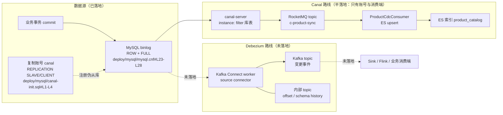
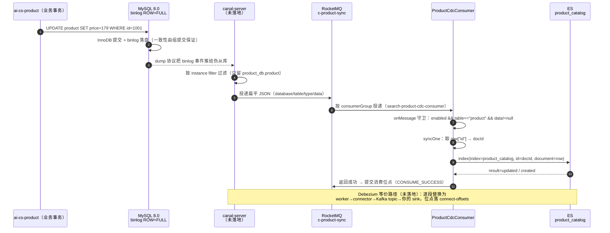
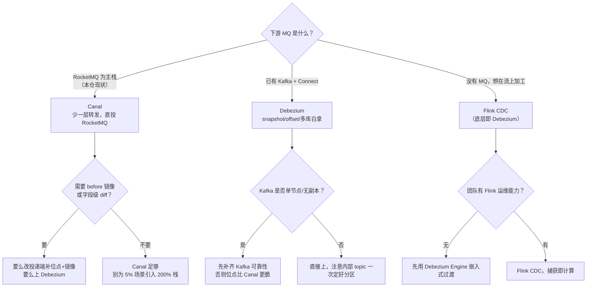

# Debezium 与 Canal 的 CDC 对比：同样是读 binlog，"轻量专用工具"和"平台化组件"差在哪

> **一句话结论**：Canal 和 Debezium 都能把 MySQL binlog 变成变更事件，真正的分水岭是**位点、快照、schema 演化这三件事由谁负责**——Debezium 把三者都塞进 Kafka 生态（offset topic / schema history topic / Connect worker），所以你已有的 Kafka 基建越多它越便宜；本项目只有可选的 RocketMQ 主栈，Canal 少一层，但代价是位点与 schema 全靠自己维护，而且本仓**只落了半套**（复制账号 + 消费端），Canal 服务端与 Debezium 都没有落地。
> **阅读前置**：必读 [11-CanalCDC商品索引同步](11-CanalCDC商品索引同步.md)（本篇只做对比，不重复实现细节）；建议先看 [03-数据库与ORM/06-事务进阶-MVCC实现与三大日志](../03-数据库与ORM/06-事务进阶-MVCC实现与三大日志.md)（binlog 三格式）与 [12-Kafka与RocketMQ双栈切换](12-Kafka与RocketMQ双栈切换.md)（本项目 Kafka 侧到底有多少基建）。
> **证据基线**：A 级 3 处 Spring 事务源码摘录（`24-源码分析/assets/source`，Debezium/Canal 本体源码未入库）；B 级 11 处本项目真实文件（`deploy/mysql/*.cnf`、`canal-init.sql`、`k8s/mysql.yaml`、`ai-cs-search/cdc/*.java`、`ai-cs-mq/src/main/resources/application-kafka.yml`、`eff-order.xml`）；C 级 4 组本机静态统计（deploy 关键词命中、m2 依赖探测、端口探测、本机工具可用性）。预计阅读 35 分钟。

---

## 0. 先看现象

### 现象 1：改完表结构，同步任务不报错，但索引再也不更新了

商品表加了一个字段、或者有人把表名从 `product` 改成 `product_spu`，日志里什么都没发生——因为入口处这段判断是**静默 return**：

```java
// 入口守卫：任一条不满足就直接返回，一行日志都不打
if (!enabled || event == null || !"product".equalsIgnoreCase(event.getTable())
        || event.getData() == null) {
    return;
}
```

```text
(ai-cs-search/src/main/java/com/aics/search/cdc/ProductCdcConsumer.java#L34-L37)
```

配置侧同样静默：`ai-cs-search/src/main/resources/application.yml#L54-L58` 写着

```yaml
# ===== Canal CDC 商品同步（默认关闭，Canal 基础设施部署后开启） =====
aics:
  cdc:
    product:
      enabled: ${CANAL_PRODUCT_CDC_ENABLED:false}
```

也就是说：**开关默认 false、表名不匹配就 return、成功路径只打 `log.debug`**，三层静默叠在一起，表现就是"任务活着，数据不动"。真正会留下痕迹的只有异常路径：

```java
} catch (Exception e) {
    // 抛出使 RocketMQ 重试；ES 暂时不可用不允许静默丢消息
    throw new IllegalStateException("CDC 商品索引同步失败: id=" + docId, e);
}
```

```text
(ai-cs-search/src/main/java/com/aics/search/cdc/ProductCdcConsumer.java#L61-L64)
```

`id=1001` 正好是 `deploy/mysql/product-init.sql#L53-L56` 里的初始商品数据，所以线上真实堆栈大概率长这样：

```text
java.lang.IllegalStateException: CDC 商品索引同步失败: id=1001
    at com.aics.search.cdc.ProductCdcConsumer.syncOne(ProductCdcConsumer.java:63)
    at com.aics.search.cdc.ProductCdcConsumer.onMessage(ProductCdcConsumer.java:39)
```

RocketMQ 重试 16 次后进 `%DLQ%search-product-cdc-consumer`（RocketMQ 默认死信命名 `<%DLQ%><consumerGroup>`），而本仓没有任何 DLQ 消费方，于是"进了死信 = 石沉大海"。

### 现象 2：CDC 容器重建一次，重放了 3 天的变更

排查时最典型的一句话是："我们只是重启了一下 canal，为什么 ES 里 3 天前的商品又被写了一遍？"原因不在 Canal 有 bug，而在**位点存在哪**：Canal 的位点三档（内存 / 本地文件 / ZooKeeper），容器重建时如果位点目录没挂盘，就退回 instance 配置里的起始位点，而 `deploy/mysql/mysql.cnf#L28` 的 `expire-logs-days=7` 意味着 binlog 还在，于是"能读多老就读多老"——3 天正好在 7 天窗口内。

可观察到的间接证据是下游对账数字被放大，而 ES 侧看起来"没错"（因为 `_id` 固定，重复 upsert 幂等，见 `ProductCdcConsumer.java#L59`）。这正是 CDC 最危险的失败形态：**重复不报错、丢失不报错、只有对账报错**。

### 现象 3：adapter 和业务消费者各写一份，最后没人知道以谁为准

Canal 官方有个 `client-adapter`，能把 binlog 直接写进 ES，不用写一行 Java；本项目却自研了一个 4 字段事件 DTO 加一个 RocketMQ 消费者：

```java
// "Canal RocketMQ adapter 的通用 JSON 事件封装（兼容 INSERT/UPDATE/DELETE）"
@Data
public class CanalChangeEvent {
    private String database;
    private String table;
    private String type;
    private List<Map<String, Object>> data;
}
```

```text
(ai-cs-search/src/main/java/com/aics/search/cdc/CanalChangeEvent.java#L9-L15)
```

于是同一件事有两套"应该这样做"：adapter 内置映射（配置驱动）vs 自研消费者（代码驱动）。旧稿和文档里两种说法并存，运维交接时谁都不敢改——这类"双份真相"最终一定退化成"两份都不维护"。

这些现象指向同一件事：**CDC 的难点从来不是"把变更读出来"，而是位点、schema、投递语义这三件事由谁负责——恰好是 Canal 与 Debezium 设计哲学分叉的地方。**

---

## 1. 整体地图



> **读图说明**：
> 1. 上半部是**已落地事实**：`deploy/mysql/mysql.cnf#L23-L28` 已经开好 binlog（ROW + FULL），`deploy/mysql/canal-init.sql#L1-L4` 已经建好复制账号——这是 CDC 的两个硬前提，本仓确实完成了。
> 2. 中段"半落地"：`c-product-sync` 这个 topic 名与 `ProductCdcConsumer` 是真实存在的（`ProductCdcConsumer.java#L23` 的 `@RocketMQMessageListener(topic = "c-product-sync", ...)`），但**生产端没有**——`deploy/docker-compose/docker-compose-all.yml` 的 14 个 service 里没有 canal，全仓也没有 canal 配置文件（见 §6 的 C 级统计）。
> 3. 下段虚线是 Debezium 路线：它读的是**同一个 binlog**，差别只是"谁来订阅、位点记在哪"。它多出两个概念——Kafka Connect worker（运行器）与内部 topic（`offset` / `schema history`）。
> 4. 两条路线在"ES 写入"之后完全汇合：**消费端的幂等、乱序、对账三件事，换工具一件都不会少**。

| 组件 | 责任 | 调用方 / 上游 | 本项目状态 |
|---|---|---|---|
| MySQL binlog（ROW+FULL） | 记录每个已提交事务的行级前后镜像 | InnoDB 提交路径 | ✅ 已配（`deploy/mysql/mysql.cnf#L23-L28`） |
| 复制账号 `canal@%` | 让订阅方以"伪从库"身份拉 binlog，只读不写 | canal-server / Debezium | ✅ 已建（`deploy/mysql/canal-init.sql#L1-L4`） |
| canal-server | 伪装 slave、按 instance 过滤库表、把变更转成事件 | 配置中心 / 运维 | ❌ 未落地（compose 无 canal，全仓无 canal 配置） |
| canal instance | 一个 destination = 一组 filter + 一份位点 + 一条 dump 连接 | canal-server | ❌ 未落地 |
| Canal client / adapter | 拉事件（客户端模式）或内置转换直写目标端 | canal-server | ⚠️ 只用了"事件投 MQ"这一形态，自研消费端 |
| RocketMQ `c-product-sync` | 事件缓冲、重试、死信 | canal-server（缺） | ⚠️ 消费端存在，生产端缺失 |
| `ProductCdcConsumer` | 幂等 upsert / delete 到 ES | RocketMQ | ✅ 已实现（默认开关关闭） |
| ES `product_catalog` | 搜索侧读模型 | `ai-cs-search` | ✅ 已实现 |
| Kafka Connect worker | 运行 source connector、分配 task、提交 offset | 运维 REST/CLI | ❌ 未落地（`deploy` 下 kafka 命中 0） |
| Debezium MySQL connector | 快照 + binlog 流式读取，产出 envelope 事件 | Connect worker | ❌ 未落地（m2 无 `io/debezium`） |
| `connect-offsets` / schema history topic | 位点与表结构历史，断点续传的依据 | Connect worker | ❌ 未落地 |

---

## 2. 关键概念与关键类

| 名称 | 位置 | 角色 | 关键方法 / 关键配置 |
|---|---|---|---|
| binlog（二进制日志） | MySQL 服务端 | 已提交事务的行级变更流水，CDC 的唯一权威数据源 | `log-bin`、`binlog-format=ROW`（`deploy/mysql/mysql.cnf#L25-L26`） |
| row image | MySQL 服务端 | 一行变更里带多少列镜像：FULL=全列、MINIMAL=只带主键与变更列 | `binlog-row-image=FULL`（`deploy/mysql/mysql.cnf#L27`；不写时默认也是 FULL） |
| GTID | MySQL 服务端 | 全局事务编号，替代"文件名+偏移"的位点表达 | 本仓无任何 gtid 配置（§6 C 级统计命中 0） |
| 位点（position） | 订阅方 | "我读到 `mysql-bin.000001` 的哪个偏移了"，决定重放边界 | Canal：`meta.dat` / zk；Debezium：`connect-offsets` topic |
| instance | canal-server | 采集单元：一组 filter + 一份位点 + 一条 dump 连接 | `canal.instance.filter.regex`、`canal.instance.mysql.slaveId` |
| adapter | canal client-adapter | 配置驱动的事件转换器（ES/RDB 等），免写代码 | 本仓未使用（走自研消费者） |
| source connector | Kafka Connect | Debezium 的插件形态，被 worker 调度 | `connector.class=io.debezium.connector.mysql.MySqlConnector` |
| Connect worker | Kafka Connect | 进程/集群，负责起 task、提交 offset、暴露 REST | 默认 REST 端口 8083（官方默认值，本仓未部署） |
| offset storage | Kafka Connect | 位点落 Kafka topic（分布式）或本地文件（standalone） | `offset.storage.topic`、`offset.flush.interval.ms` |
| schema history | Debezium | 把每次 DDL 记在 topic 里，重启后还原"当时的表结构" | `schema.history.internal.kafka.topic`（2.x+ 命名） |
| envelope | Debezium | 事件结构 `before/after/source/op/ts_ms` | `op` ∈ c/u/d/r，`source.pos` 给位点 |
| `ProductCdcConsumer` | `ai-cs-search/src/main/java/com/aics/search/cdc/ProductCdcConsumer.java#L23-L65` | 本项目唯一的 CDC 消费端 | `onMessage`(#L33)、`syncOne`(#L43) |
| `CanalChangeEvent` | `ai-cs-search/src/main/java/com/aics/search/cdc/CanalChangeEvent.java#L9-L15` | 本项目采用的事件格式（4 字段扁平 JSON） | Lombok `@Data`，无位点/无时间戳 |
| `MessageBrokerType` | `ai-cs-common/src/main/java/com/aics/common/mq/MessageBrokerType.java#L9-L15` | 双栈开关枚举，注释里点名了 Kafka 的 Connect/Flink 生态 | `ROCKETMQ` / `KAFKA` |

---

## 3. 原理与证据逐段精读

### 3.1 时间原点：只有"已提交"的事务才会进 binlog

**在干什么。** 一条业务 `UPDATE` 走完 Spring 事务提交，"行变更进入 binlog"这个动作发生在 JDBC 驱动的 `commit()` 里，而不是在业务代码返回时：

```java
// Spring 的 JDBC 事务提交：con.commit() 才是 binlog 落盘的那一刻
@Override
protected void doCommit(DefaultTransactionStatus status) {
    DataSourceTransactionObject txObject = (DataSourceTransactionObject) status.getTransaction();
    Connection con = txObject.getConnectionHolder().getConnection();
    if (status.isDebug()) {
        logger.debug("Committing JDBC transaction on Connection [" + con + "]");
    }
    try {
        con.commit();
    }
    catch (SQLException ex) {
        throw translateException("JDBC commit", ex);
    }
}
```

```text
(src: DataSourceTransactionManager.java.md#L336-L348)
```

而"提交成功之后才回调应用代码"这件事，在 `AbstractPlatformTransactionManager` 里写得很直白——`triggerBeforeCommit` 在前，`triggerAfterCommit` 在后：

```java
private void processCommit(DefaultTransactionStatus status) throws TransactionException {
    try {
        boolean beforeCompletionInvoked = false;
        boolean commitListenerInvoked = false;

        try {
            boolean unexpectedRollback = false;
            prepareForCommit(status);
            triggerBeforeCommit(status);
            triggerBeforeCompletion(status);
            beforeCompletionInvoked = true;
            // ... 省略：保存点释放 / doCommit 真正提交 ...
```

```text
(src: AbstractPlatformTransactionManager.java.md#L766-L777)
```

```text
触发顺序（同一份摘录后续行）：L835 triggerAfterCommit(status) —— 提交成功之后才回调。
```

再看 `afterCommit` 的官方注释，它就差把"这是给发确认消息用的，但没有原子性"写在脸上：

```java
/**
 * Invoked after transaction commit. Can perform further operations right
 * <i>after</i> the main transaction has <i>successfully</i> committed.
 * <p>Can, for example, commit further operations that are supposed to follow on a successful
 * commit of the main transaction, like confirmation messages or emails.
 * ...
 * Hence: <b>Use {@code PROPAGATION_REQUIRES_NEW} for any
 * transactional operation that is called from here.</b>
 */
default void afterCommit() {
}
```

```text
(src: TransactionSynchronization.java.md#L150-L166)
```

**为什么这么设计。** MySQL 在内部保证"InnoDB 提交"与"binlog 落盘"的一致性（组提交 + 两阶段），因此 **binlog 是"已提交事实"的唯一权威流水**。订阅 binlog，等于订阅一条不会因为你进程崩、GC 卡、网络抖动而丢的事实流；而 `afterCommit` 只是进程内回调，回调前崩溃 = 消息永久丢失。

**换写法会怎样。** 不用 CDC、改用"业务代码 afterCommit 里发 RocketMQ"（即本项目 [08-RocketMQ事务消息与死信队列](08-RocketMQ事务消息与死信队列.md) 覆盖的路线）：要自己处理"本地事务成功但发消息失败"（要么事务消息 + 回查，要么本地消息表 + 定时补发）。CDC 把这段复杂度下推给了数据库，代价是多一个中间件、多毫秒级延迟、多一套运维。

**常见坑。**
- 以为 `afterCommit` 里抛异常会回滚——不会，数据已提交，异常只会上抛污染调用方（javadoc 明确 `propagated to the caller`）。
- 在 `afterCommit` 里用默认传播级别访问数据库，会"参与原事务但不再提交"——javadoc 明确要求用 `PROPAGATION_REQUIRES_NEW`。
- 以为 CDC 能读到未提交数据。读不到，这是特性不是缺陷：它保证下游永远看不到脏读。

### 3.2 binlog 三格式与 row image：本仓三份配置存在漂移

**在干什么。** `binlog-format` 决定 binlog 里存什么：`STATEMENT` 存 SQL 文本（`NOW()`、`UUID()` 之类函数不可重放）、`ROW` 存每一行的前后镜像、`MIXED` 由服务端自动挑。CDC 要求 `ROW`，因为只有行镜像能还原"到底哪一列从什么变成什么"。

本仓三处 binlog 配置，逐个看：

| 文件 | 关键行 | 有 ROW？ | 有 `binlog-row-image=FULL`？ |
|---|---|---|---|
| `deploy/mysql/mysql.cnf` | L23-L28 | ✅ L26 `binlog-format=ROW` | ✅ L27 显式写了 |
| `deploy/mysql/master.cnf` | L7-L11 | ✅ L8 | ❌ 没写（默认仍是 FULL） |
| `deploy/k8s/mysql.yaml` | L28-L38 | ✅ L32 | ❌ 没写（默认仍是 FULL） |

```text
三处一致的只有：server-id、log-bin、ROW、expire-logs-days=7
三处不一致的：mysql.cnf 显式声明 FULL 与注释"# Binlog CDC（Canal 必需：ROW 记录每行变化，FULL 保留完整前后镜像）"，
             master.cnf / k8s 只写了 log-bin 与 binlog-format。
```

**为什么这么设计。** `binlog_row_image` 的默认值就是 `FULL`，所以"没写"不等于"没开"。但**契约不能靠默认值**：一旦有人为了压缩 binlog 体积全局改成 `MINIMAL`，UPDATE 事件里就只带主键和变更列，`before` 镜像残缺——Debezium 的 `before` 会变成一堆空值，Canal 侧则表现为"消费端拿到不完整的行"。这类问题上线前完全看不出，只在做字段级 diff 或审计回放时爆。

**换写法会怎样。** 若选 `MINIMAL` 省空间：binlog 体积能降（大字段表尤其明显），但你就失去了"用 CDC 做审计/回滚/全列对账"的能力，只剩"按主键同步整行"这一种用法——而"同步整行"其实只需要 `after`，你大可在消费端靠 SELECT 补齐，代价是每条事件一次回查。

**常见坑。** `expire-logs-days=7` 是**重放窗口的硬上限**：停机超过 7 天，位点必然失效（MySQL 报 1236，见 §6.5），只能重做全量。三份配置都写了 7，说明这是有意为之的取舍，但要写进运维手册。

### 3.3 复制账号：CDC 的"准入门票"其实只有四个权限

**在干什么。** 整个仓库里 CDC 相关的配置只有 4 行 SQL，就是账号：

```sql
-- Canal CDC 复制账号（仅用于读取 MySQL binlog，不授予业务 DML 权限）
CREATE USER IF NOT EXISTS 'canal'@'%' IDENTIFIED BY 'canal';
GRANT SELECT, REPLICATION SLAVE, REPLICATION CLIENT ON *.* TO 'canal'@'%';
FLUSH PRIVILEGES;
```

```text
(deploy/mysql/canal-init.sql#L1-L4)
```

逐个权限为什么必须：

- `REPLICATION SLAVE`：让订阅方能"注册成一个从库"并发 dump 请求——没有它，连接 MySQL 时直接 `ERROR 1227 (42000): Access denied`（MySQL 官方错误码文本，本机无 MySQL 未实测）。
- `REPLICATION CLIENT`：允许 `SHOW MASTER STATUS` / `SHOW BINARY LOGS`（找位点、列 binlog 文件）。**它是全局权限，不能授到库级**。
- `SELECT`：Debezium 的**快照阶段**要真读表数据；Canal 只要增量时可以不要，但本项目给了。
- `FLUSH PRIVILEGES`：让 GRANT 立即生效（MySQL 8.0 里 `GRANT` 本身即时生效，这行是历史习惯，无害）。

**为什么这么设计。** 注释里那句"不授予业务 DML 权限"是核心：CDC 账号是一个**只读 + 复制**的身份，一旦被泄露，攻击者能读全库（`ON *.*`）但不能写。这是 CDC 与"业务账号"必须分离的原因。

**换写法会怎样。** 直接复用业务账号（root 或 `ai_cs`）：短期最省事，长期是严重越权——业务账号有写权限，而 CDC 侧一旦被注入（例如恶意 connector 配置）就能改数据。反过来，如果把 `SELECT` 收窄到 `product_db.*`，Debezium 的多库采集会失败，Canal 的跨库 instance 也会失败；**权限范围必须和 filter 范围对齐**。

**常见坑。** ① 口令是明文的 `canal/canal`（L2），生产必须换并走密钥管理；② `'canal'@'%'` 允许任意来源 IP；③ **若切到 Debezium，这个账号不够用**——一致性快照还需要 `RELOAD`（`FTWRL`/`LOCK INSTANCE FOR BACKUP`），5.7 及更早还需要 `LOCK TABLES`。所以"换工具要改的第一件事"就是重签权限（见 §5.3 迁移清单）。

### 3.4 Canal 的四层：server / instance / client / adapter

**在干什么。** Canal 本体（未入库，依据官方文档与 [11-CanalCDC商品索引同步](11-CanalCDC商品索引同步.md)）分为四层：

1. **server**：一个 JVM 进程，管理多个 instance，暴露管理/指标端口（官方默认 11111 / 11112）。
2. **instance**：采集单元。一个 instance = 一个 destination 名 + 一组 `filter.regex`（库.表）+ 一份位点 + 一条到 MySQL 的 dump 连接 + 一个 `mysql.slaveId`。
3. **client**：Java 客户端（`SimpleCanalConnector`）主动拉取；本项目不用这一层，改用"事件投 MQ"。
4. **adapter**：官方 `client-adapter`，内置 client + 转换器，配置驱动地直写 ES/HBase/RDB。

**为什么这么设计。** 拆 instance 的目的是**隔离**：位点、过滤、故障域都在 instance 内。商品同步卡住不该影响订单同步；某个 instance 需要重做全量也不该让别人一起重放。server 与 instance 分离，则让"一个进程托管 N 个采集任务"成为可能，运维面比"每表一个进程"小得多。

**换写法会怎样。** 若不用 adapter 直接投 MQ（本项目路线），转换责任就落到消费端：于是有了 4 字段的 `CanalChangeEvent`（`CanalChangeEvent.java#L11-L14`）。好处是格式由你定、可以塞业务字段；坏处是**位点语义、DDL 语义、before 镜像全丢了**，消费端只能做"覆盖写"。若用 adapter 直写 ES，好处是零代码，坏处是映射规则藏在 adapter 配置文件里，本仓没有任何这类文件（§6 C 级：deploy 下 canal 命中 4 行，无 adapter 配置）。

**常见坑。** ① `canal.instance.mysql.slaveId` 必须与 MySQL 上所有真实从库的 `server-id` 不冲突——本仓 `deploy/mysql/slave.cnf#L4` 是 `server-id=2`，Canal 默认 slaveId 是 1234，只要没人改成 2 就安全，但这是"靠默认值不冲突"的隐患。② instance 的 filter 只到**库表级**，列级过滤做不到，所以加列会穿透（[11](11-CanalCDC商品索引同步.md) 现象 3）。③ 停 instance 时位点是否落盘取决于存储模式，见 §3.6。

### 3.5 Debezium 的落点：Kafka Connect worker 里的一个 source connector

**在干什么。** Debezium 本体未入库，依据官方文档，它的运行形态是**插件**：`MySqlConnector` 是一个 Kafka Connect **source connector**，被 Connect worker 加载、切成 task 执行，产出写到 Kafka topic。启动时先做 snapshot（按主键分块扫表），再切 binlog 流式读取。

它把三个"状态"外置到了 Kafka：

| 状态 | 存哪 | 丢了会怎样 |
|---|---|---|
| 位点（读到哪个 binlog 位置） | `connect-offsets` topic（分布式）/ 本地文件（standalone） | 退回上次 flush 的位置，重放一段 |
| 表结构历史（每次 DDL） | schema history topic（2.x+ 配置名为 `schema.history.internal.kafka.topic`） | 无法还原"事件产生时的表结构"，重启可能解析错列 |
| connector 配置 | `connect-configs` topic | connector 定义丢失，需要重新 POST |

**为什么这么设计。** Connect 框架的假设是"worker 无状态、状态在 Kafka"，所以 worker 挂掉随便换一台起来继续跑；这也是它能水平扩展、能通过 REST 管理几十个 connector 的原因。代价是你必须先有 Kafka——**而本项目的 Kafka 是"可选双栈"**：根目录 `docker-compose.yml`（仓库根，非 deploy 目录）把 Kafka 放在 `profile=kafka` 下，用 `apache/kafka:3.7.1` 单节点 KRaft，且注释明确"没有这个卷：Kafka 重启后消息与 offset 全部丢失"。

**换写法会怎样。** 不想上 Connect，还有 **Debezium Engine**（嵌入式，进程内跑 connector，位点落本地文件）——那就退化成"一个 Java 进程 + 本地位点文件"，运维模型反而更像 Canal。很多团队的真实选择就是这个折中：**要 envelope 格式和快照能力，但不要 Connect 集群**。

**常见坑。** ① 内部 topic 的分区数与清理策略要一次定好（offset/config 系必须 compact），改分区会导致位点错乱；② connector 名一旦创建就代表一个持久身份，改参数应该 `PUT /connectors/<name>/config`，删了重建会**重新 snapshot**；③ 本仓目前连 Kafka Connect 镜像都没有（§6 C 级：`deploy` 下 kafka 命中 0，m2 无 `org/apache/kafka/connect`），所以这一整段是**设计推演，不是现状**。

### 3.6 位点：谁记住"我读到哪了"

**在干什么。** 位点是 CDC 的命门，两个产品的答案完全不同：

| | Canal | Debezium |
|---|---|---|
| 默认存储 | 内存（重启即丢，退回配置的起始位点） | Kafka `connect-offsets` topic |
| 可选存储 | 本地文件（`conf/<destination>/meta.dat`）、ZooKeeper | 本地文件（standalone 模式） |
| 落盘时机 | 按 ack / 定时持久化 | `offset.flush.interval.ms`（默认 60s 量级） |
| 崩溃后重复窗口 | 取决于最后一次持久化点 | 最多约一个 flush 间隔 |
| 位点表达 | binlog 文件名 + offset（1.1.x 起支持 GTID） | binlog 文件+offset，或 GTID，附 `source.ts_ms` |

**为什么这么设计。** Canal 面向"单机轻量工具"，位点存本地文件足够，且默认内存模式对"我只想试一下"最友好；Debezium 面向"分布式平台组件"，位点必须在 Kafka 里才能让任意 worker 接手。**这两个选择直接决定了你的运维负担落在哪**：Canal 你得自己保证 `meta.dat` 所在目录挂盘、备份、迁移；Debezium 你得保证 Kafka 与内部 topic 活着。

**换写法会怎样。** 本项目若硬上 Debezium 而 Kafka 只有单节点（`KAFKA_OFFSETS_TOPIC_REPLICATION_FACTOR: 1`，根 compose），则 offset topic 单副本——Kafka 一挂，位点与消息一起丢，等于把 Canal 的"内存位点"问题放大成"集群级"问题。也就是说：**Debezium 的位点可靠性上限，等于你 Kafka 的可靠性**。

**常见坑。** ① 把 `offset.flush.interval.ms` 调大图性能，崩一次就重放更久（现象 2 的同构问题）；② Canal 用内存位点 + 容器重建 = 从头/从配置位点重放（现象 2 的成因）；③ 本仓**没有 GTID**（§6 C 级：deploy 下 `gtid` 命中 0），意味着位点只能靠"文件名+偏移"，主库做过 failover/切换后位点可能对不上，需要重新对齐。

### 3.7 消息格式：Canal 的扁平 JSON vs Debezium 的 envelope

**在干什么。** 对比两种事件长什么样（下面两段是**结构示意**，不是运行输出）：

```json
{
  "database": "product_db",
  "table": "product",
  "type": "UPDATE",
  "data": [{ "id": 1001, "name": "无线蓝牙耳机", "price": 199.00, "stock": 100 }]
}
```

这是本项目实际采用的格式（字段来自 `CanalChangeEvent.java#L11-L14`）。而 Debezium 的 envelope：

```json
{
  "before": { "id": 1001, "price": 199.00, "stock": 100 },
  "after":  { "id": 1001, "price": 179.00, "stock": 98 },
  "source": { "db": "product_db", "table": "product", "pos": 154, "file": "mysql-bin.000007", "ts_ms": 1730000000000 },
  "op": "u",
  "ts_ms": 1730000000123
}
```

**为什么这么设计。** 扁平格式假设消费端只有一个诉求："把这一行同步到目标端"。envelope 假设消费端会问更多问题：这一列改前是什么（审计/回滚）、这条事件的位点是什么（去重/重放对齐）、这是快照读还是增量（`op=r` vs `u`）、事务边界在哪（`transaction` 块）。**envelope 更贵也更值**，贵在体积与解析复杂度，值在它让"位点级去重"和"字段级 diff"成为可能。

**换写法会怎样。** 想给 Canal 补这些能力，只有两条路：① 换成 adapter 的自定义格式或自己改 Canal 投递端；② 在消费端补——本项目若要补，最小改动是给 `CanalChangeEvent` 增加 `executeTime`、`binlogFile`、`binlogPos`，并在投递端填充（这是 §9 练习 2）。

**常见坑。** ① 把 `data` 是数组理解成"支持批量"：它确实可能一次带多行，但 DELETE 时 `data` 里是**旧值**，且没有 `before/after` 区分，语义全靠 `type` 字符串；② `type` 用自定义大写枚举（`"UPDATE"`），消费端判断逻辑就散落各处——本项目 `ProductCdcConsumer.java#L51` 同时判断 `"DELETE".equalsIgnoreCase(type)` 和 `deleted=1`，逻辑删除实际走的是 upsert 分支（这是**对的**，但只对了一半：ES 里会留一条 `deleted=1` 的文档，而不是删掉它）。

### 3.8 schema 变更：Debezium 的 schema history topic vs Canal 的手工适配

**在干什么。** 加一列、改类型、删一列，两个产品的处理方式：

- **Debezium**：DDL 被当作事件记进 schema history topic，同时（`include.schema.changes=true` 时）可作为 schema change 事件投给下游。重启或新增 task 时，它先重放 schema history 到"当前位点"，从而知道"这条 binlog 事件产生时表有几列"。
- **Canal**：没有 schema history 概念。它以"当前表结构"解析 binlog，加列后新字段就出现在事件里、删列后旧字段消失。要感知 DDL 只能自己订阅 DDL（Canal 支持投递 DDL 语句，需要显式开启）或对比表结构。

**为什么这么设计。** Debezium 的状态外置哲学在这里最彻底：表结构也是状态，也放 Kafka。Canal 的取舍是"我就做管道，schema 是你的事"。

**换写法会怎样。** 没有 schema history 的后果在**延迟消费**时最明显：如果事件在 topic 里堆了 6 小时才被消费，而期间表结构变了两次，消费端要么按新结构解析旧事件（字段错位），要么放弃。本项目靠"消费端用 `Map<String,Object>` 而不是强类型 DTO"绕过了编译期问题（`ProductCdcConsumer.java#L38-L40`），但绕不过 ES 侧：

```text
新增列 → ES 索引 dynamic mapping 不认识该字段
       ├─ mapping 为 strict  → strict_dynamic_mapping_exception，写入失败，进 DLQ
       └─ mapping 为 dynamic  → 自动建字段（默认 text + keyword，无 ngram 分词）→ 中文搜索搜不到
```

**常见坑。** ① 加列后**没有任何告警**（本项目成功路径只有 `log.debug`）；② 删列后 ES 里旧字段永远残留，`_source` 有、mapping 有、查询还能命中，形成"幽灵字段"；③ 字段改名 = 删列 + 加列，检索相关性会突然断崖，必须重建索引。落地动作见 §5.3。

### 3.9 全量与增量衔接：snapshot 是白送的，导出脚本要自己写

**在干什么。** CDC 上线第一天必须有一次全量，然后才是增量，而且两者要在同一个位点上"焊接"：

- **Debezium**：`snapshot.mode=initial` 首次启动自动做一致性快照（8.0 上可用 `LOCK INSTANCE FOR BACKUP` 或 `snapshot.locking.mode=none` 追求低锁），记录快照起止位点后无缝切 binlog；后续还能用 `incremental` snapshot + signal 表按需补快照。
- **Canal**：只有增量。全量必须自己导一遍，并且**保证导出与位点对齐**：先记下位点 t0 → 用一致性读导出 → 导完从 t0 回放 → 靠消费端幂等吸收重复。

本项目的现状要如实说：仓库里唯一的 ES 全量脚本是 `deploy/scripts/sync-kb-to-es.py`（136 行），它的目标是**知识库文档 `kb_document` → ES `knowledge` 索引**（支持 `--recreate` 重建 ngram 分词、`--gateway` 走网关 API、`--es` 指 ES 地址），**不是商品**。所以：

- 知识库：全量有脚本，增量走另一条链路；
- 商品：**没有全量重建脚本**，`c-product-sync` 也没有生产端 —— 明确标注"未落地"。

**为什么这么设计。** Debezium 把"全量"当成 connector 的第一次运行，因为它的位点模型天然支持"快照位点 = 增量起点"；Canal 把全量留给你，因为它不知道你要把数据变成什么形状（ES 索引？数仓表？）。这不是能力差距，是**责任边界**不同。

**换写法会怎样。** 自己写"先导后切"最容易犯的错是顺序颠倒：先开增量再导全量，则导出期间的新变更会被导出结果覆盖（旧值盖新值），只能靠对账发现。正确顺序只有一条：`记位点 → 导快照 → 从位点回放 → 幂等吸收重复`。

**常见坑。** ① 用 `mysqldump --single-transaction` 拿到的是导出时刻快照，但你不知道对应哪个 binlog 位点——必须同会话里先 `SHOW MASTER STATUS`（8.0）读位点；② 全量期间不停写，导出+写入可能差出几万行，回放时靠 upsert 覆盖，但**删除事件在快照里是"不存在"**，若删除发生在导出之后、回放之前，删除事件仍会回放，这是安全的；反之若删除发生在导出之前，快照里本就没有它，也安全。

### 3.10 多库 / 多表 / 分库分表：真正的难点在下游合并

**在干什么。** 三个粒度的支持度差异：

| 粒度 | Canal | Debezium |
|---|---|---|
| 单表 | 一个 instance + filter `db\.tbl` | 一个 connector + `table.include.list` |
| 单库多表 | filter 正则 `db\..*` | `table.include.list=db.*` |
| 多库 | filter 用逗号列出多个库 | `database.include.list=db1,db2`（一个 connector 可覆盖） |
| 分库分表 | 每个 instance 一份位点，需在 filter 里列全部分片 | 一个 connector 列全部分片（正则） |
| 跨数据库类型 | 基本只覆盖 MySQL 系 | MySQL/PostgreSQL/MongoDB/Oracle/SQLServer 全家族 |

本项目有多少库表要覆盖？`deploy/mysql/slave.cnf#L15-L18` 的复制白名单给了线索：`user_db`、`knowledge_db`、`chat_db`、`nacos_config`。而商品在 `product_db`（`deploy/mysql/product-init.sql#L6`），还有 `order_db`、`pay_db` 等业务库——**它们都不在从库白名单里**。

这不只是主从复制的小瑕疵，它直接决定 CDC 能不能"挂从库"：很多团队为了让 Canal 不压主库，把采集源指向从库；本仓这么配的话，`product_db` 的变更**根本不会出现在从库上**，Canal 会"成功连上但永远等不到事件"。

分库分表的真实形状也在仓库里：

```sql
-- 分片规则：取用户ID后四位，库 = 后四位 % 2，表 = 后四位 % 4
-- 与 ai-cs-user 的 UserIdLast4ModShardingAlgorithm 保持一致
INSERT INTO user_db_0.sys_user_0 SELECT * FROM user_db.sys_user_migrated WHERE CAST(RIGHT(id, 4) AS UNSIGNED) % 2 = 0 AND CAST(RIGHT(id, 4) AS UNSIGNED) % 4 = 0;
-- ... 共 8 条，覆盖 user_db_0/user_db_1 × sys_user_0..3
```

```text
(deploy/mysql/user-sharding-migrate.sql#L7-L28，校验语句在 #L30-L39)
```

CDC 视角下：这 8 张分片表的事件是**同一条业务记录的碎片**，事件的库表名是 `user_db_1.sys_user_2` 这种物理名，没有任何"这是用户 1234"的业务语义。所以无论 Canal 还是 Debezium，都要在消费端按分片键聚合——**工具只解决"投递"，不解决"归并"**。

**为什么这么设计。** Canal 的 instance 与 filter 是"运维友好"的粒度（改配置即可增删表）；Debezium 的 include list 是"正则友好"的粒度（一个 connector 一把梭）。前者便于按业务隔离位点，后者便于统一 schema 管理。

**换写法会怎样。** 若分片从 2 库 4 表扩到 4 库 8 表：Canal 侧要新增 instance/filter（且每份位点单独备份）；Debezium 侧改一行正则。这是**在"位点隔离"与"配置简洁"之间的取舍**，不是优劣。

**常见坑。** ① 分片库名带数字后缀（`user_db_0`），从库 `replicate-do-db` 白名单必须逐个写，写漏一个就少一个分片；② 分片表的自增主键在不同分片可能相同，只靠 `id` 做 ES 文档主键会互相覆盖——本项目商品表没分片，所以 `_id=product.id` 安全（`ProductCdcConsumer.java#L49`），但**用户表若做 CDC 到 ES，主键必须加库/表前缀**。

### 3.11 故障恢复与重放：幂等只该吞"目标不存在"，不该吞"目标不可达"

**在干什么。** 两个工具的投递语义都是 **at-least-once**（Debezium 官方明确不是 exactly-once；Canal 的 ack + 位点持久化同理），所以端到端的正确性由消费端兜：

| 手段 | 本项目做法 | 代码位置 |
|---|---|---|
| 幂等（重复无害） | ES 文档 `_id` 固定为业务主键，重复 upsert 覆盖 | `ProductCdcConsumer.java#L49`、`#L59` |
| delete 幂等 | 删不存在的文档时吞异常 | `ProductCdcConsumer.java#L52-L56` |
| 重试 | 异常上抛，交给 RocketMQ 重投 | `ProductCdcConsumer.java#L61-L64` |
| 死信 | `%DLQ%search-product-cdc-consumer`（无消费方） | 见 §0 现象 1 |
| 对账 | **未落地** | — |

看起来齐了，但代码里藏着一条真正的杀手：

```java
try {
    elasticsearchClient.delete(d -> d.index(INDEX).id(docId));
} catch (Exception ignored) {
    // 重复 delete/doc 不存在保持幂等
}
```

```text
(ai-cs-search/src/main/java/com/aics/search/cdc/ProductCdcConsumer.java#L52-L56)
```

`catch (Exception ignored)` 的本意是"文档不存在 → 幂等"，但 `Exception` 把所有东西都吞了：ES 集群 503、连接超时、索引被删重建……全部被当成"幂等成功"。后果比丢一条消息严重得多——**位点已经推进，消息被 ack，数据永久缺失，只有对账能发现**。

**为什么这么设计。** at-least-once 的代价是"必须幂等"，工程上最省事的幂等写法就是"吞掉目标端的 not-found"。问题在于 `ElasticsearchException` 的类型分得很细，而 `Exception` 太宽。

**换写法会怎样。** 正确写法只吞 404：

```java
try {
    elasticsearchClient.delete(d -> d.index(INDEX).id(docId));
} catch (ElasticsearchException e) {
    if (e.status() != 404) {
        throw new IllegalStateException("CDC 商品删除失败: id=" + docId, e);
    }
    // 404 = 文档本来就不存在，幂等
}
```

**常见坑。** ① "幂等"被当成"什么错都能吞"；② 死信队列没有消费方 = 静默丢失；③ 重放对下游的要求（幂等）和重放对上游的要求（位点可回溯）是两件事，只做一半就会"重放一次脏一片"。

---

## 4. 一次完整执行时序



> **读图说明**：
> 1. 第 2 步是整条链路的**时间原点**：事件在 `commit()` 那一刻产生（§3.1 的 A 级证据）。第 1 步之前无论业务代码做什么，下游都看不到。
> 2. 第 3~5 步是"半落地"缺口所在：`canal-server` 在本仓不存在，所以第 6 步以后永远等不到消息。图上把它画出来是为了让你看清"缺的是哪一段"，而不是声称它存在。
> 3. 第 9 步是**幂等的落点**：`_id` 固定，重复事件覆盖写，所以重放 3 天数据不会"写脏"，只会"重复写"（现象 2）。
> 4. 第 11 步是"重试语义的边界"：只有异常上抛（`ProductCdcConsumer.java#L61-L64`）才会触发 RocketMQ 重投；被 `catch (Exception ignored)` 吞掉的（`#L52-L56`）不会重投。
> 5. Debezium 路径的替换点在 2~5 步之间：`dump 协议 → Connect worker 的 binlog client`，投递目标从 RocketMQ 变 Kafka，**第 8~11 步一模一样**——这就是"换工具不改消费端三板斧"的图形化解释。

**哪一步失败会报什么错 / 长什么样：**

| 步 | 失败形态 | 可观察到的现象（原文） |
|---|---|---|
| 1 | 事务未提交/回滚 | 没有任何 binlog 事件，下游完全无感知（正常行为） |
| 2 | binlog 未开或格式不是 ROW | Canal/Debezium 启动即失败或事件缺少行数据；先查 `binlog-format`（`deploy/mysql/mysql.cnf#L26`） |
| 3 | 账号无 `REPLICATION SLAVE` | 订阅方连 MySQL 报 `ERROR 1227 (42000): Access denied`（MySQL 官方错误码文本，本机无 MySQL 未实测） |
| 3 | binlog 已被清理（超 7 天） | MySQL 报 1236 `Could not find first log file name in binary log index file`（官方错误码文本，未实测）→ 只能重做全量 |
| 4 | filter 写错/表名改过 | **零报错**：事件被过滤掉，与"没有变更"无法区分（现象 1 的静默面） |
| 5 | canal-server 未部署 | MQ 侧永远没有消息；本仓无健康检查，只能靠 ES 数据变旧/对账发现 |
| 6 | topic 不存在 | RocketMQ 生产端报 topic 不存在；本仓 `c-product-sync` 依赖手工预建 |
| 7 | 开关关闭 | `aics.cdc.product.enabled=false` → 直接 return，**一行日志都没有**（`#L29-L37`） |
| 8 | 行无主键 | `忽略无主键 CDC 商品事件: {...}`（WARN，`#L46`），该行被跳过 |
| 9 | ES mapping 冲突（加列） | `strict_dynamic_mapping_exception` 写入失败 → 走步 11 的重试 |
| 9 | ES 集群不可用（DELETE 分支） | 被 `catch (Exception ignored)` 吞掉 → 消息 ack，数据缺失（最危险） |
| 11 | 重试耗尽 | 进 `%DLQ%search-product-cdc-consumer`，无消费方 → 静默丢失 |

---

## 5. 设计取舍

### 5.1 维度对照表

| 维度 | Canal | Debezium | 本项目的现实含义 |
|---|---|---|---|
| 架构形态 | 独立 server + instance（伪 slave） | Kafka Connect worker 里的 source connector | 前者多一个进程，后者多一整个 Kafka 生态 |
| 依赖什么 | 只要能连 MySQL | 必须有 Kafka + Connect | 本仓 Kafka 是 `profile=kafka` 可选（`apache/kafka:3.7.1` 单节点），Connect 完全没有 |
| 投递目标 | RocketMQ / Kafka / TCP 自定义 | Kafka（再由 Sink 二跳） | 主栈是 RocketMQ → Canal 少一层 |
| 全量初始化 | ❌ 自建（导出脚本 + 位点对齐） | ✅ 内建 snapshot（initial / incremental） | 本仓只有知识库全量脚本（`deploy/scripts/sync-kb-to-es.py`），商品无 |
| 位点持久化 | 内存 / 本地 `meta.dat` / ZooKeeper | Kafka `connect-offsets` topic | 本仓无 zk、无 gtid → 位点最脆弱的一档 |
| 投递语义 | at-least-once | at-least-once | 都得靠消费端幂等（§3.11） |
| 事件格式 | 扁平 JSON（4 字段） | envelope（before/after/source/op/ts_ms） | 本仓连 `executeTime` 都没有 |
| schema 变更 | 手工适配，无历史 | schema history topic + 可选 DDL 事件 | 本仓零 schema 治理 |
| 多数据源 | 基本 MySQL 系 | MySQL/PG/Mongo/Oracle/SQLServer | 本仓有 MongoDB（[10-MongoDB对话审计归档](10-MongoDB对话审计归档.md)），但审计不走 CDC |
| 多表/多库 | filter 正则，一个 instance 一份位点 | include list，一个 connector 可跨库 | 分片表 8 张，两边都要消费端归并 |
| 监控 | 基础指标 + 位点差（需自建） | Connect REST + JMX 指标丰富 | 本仓两侧都没接监控 |
| 上手成本 | 低（中文资料多、概念少） | 中（要先懂 Connect 模型） | 团队现状决定 |
| 组件数量 | 1 个 server（+ 可选 adapter） | Kafka + Connect 集群 + 3 个内部 topic | 运维面差距 3~5 倍 |
| 与 Spring 生态 | 无耦合 | `spring-integration-debezium` 在 BOM 里（`ai-cs-order/eff-order.xml#L9164`），但未依赖 | 升级版本时白送，不引入运维面 |

### 5.2 选型决策树



> **读图说明**：
> 1. 根节点只有一个问题——**下游 MQ 是什么**。这不是技术崇拜，是本项目的既有约束：主栈 RocketMQ，Kafka 只是可选双栈（`MessageBrokerType` 的 `KAFKA` 注释就写着"生态（Connect/Flink）"，说明代码作者已经意识到这个差异点）。
> 2. 左支 `Canal` 后面还有一个分支问"要不要 before 镜像/字段级 diff"——这正是 §3.7 的取舍点，也是本项目目前的能力缺口（4 字段 DTO）。
> 3. 右支 `Debezium` 后面追问 Kafka 是否单节点：本仓根 `docker-compose.yml` 的 Kafka 是单节点 KRaft 且 `KAFKA_OFFSETS_TOPIC_REPLICATION_FACTOR: 1`，**这种形态下 Debezium 的位点可靠性反而不如 Canal 的本地文件**。
> 4. 底层统一认知：Flink CDC 的 MySQL 连接器就是基于 Debezium，所以"上 Flink"并不等于"绕开 Debezium 的坑"。

### 5.3 本项目若要落地，改哪些文件 + 验收标准

**A. Canal 侧补齐（把"半套"补成一套）**

| 动作 | 文件 | 验收标准 |
|---|---|---|
| 新增 canal-server 到编排 | `deploy/docker-compose/docker-compose-all.yml`（当前 14 个 service 无 canal） | `docker compose config` 通过，canal 容器健康检查绿 |
| 新增 canal 配置（instance filter + 位点目录挂盘） | 新建 `deploy/canal/conf/` 下的 server 配置与 instance 配置 | filter 精确到 `product_db\.product`；位点目录映射到宿主机卷 |
| 位点可回溯 | 同上的 `canal.meta` 目录 + 备份脚本 | 重启 canal 容器后 `SHOW` 位点不回退，ES 文档数与 MySQL 一致 |
| 生产端投递 | canal 的 RocketMQ 投递配置（或自研投递端） | `c-product-sync` 有消息；DLQ 有消费方 |
| 开关打开 | `ai-cs-search/src/main/resources/application.yml#L54-L58`（`CANAL_PRODUCT_CDC_ENABLED:false` → true） | 打开后无重复写、无漏写 |
| schema 变更治理 | 新增 DDL 巡检脚本 + 消费端未知字段 WARN | 加列 5 分钟内告警，而非静默 |

**B. Debezium 侧从零落地（成本清单）**

| 动作 | 文件 | 验收标准 |
|---|---|---|
| Kafka Connect 服务 | 编排新增 connect（镜像 + 插件目录 + 8083） | `GET /connectors` 返回 200 |
| 内部 topic | 预建 `connect-offsets`/`connect-configs`/`connect-status`（compact） | `kafka-topics.sh --describe` 分区/清理策略正确 |
| 账号权限扩权 | `deploy/mysql/canal-init.sql#L3` 增加 `RELOAD`（快照需要） | 一致性快照能启动，无权限报错 |
| connector 配置托管 | 新建 connector 配置（放 `deploy/connect/` 目录，用 REST `PUT` 下发） | `PUT /connectors/...` 成功，events 出现在 Kafka |
| 消费端 | 新增 Kafka → ES 的 sink（现有 `ProductCdcConsumer` 是 RocketMQ 版，不能复用） | 端到端延迟与幂等测试通过 |
| 位点校验 | 重启 worker 验证不 re-snapshot | offset topic 里有提交记录 |

**明确标注未落地的结论**：本仓**没有** Canal 服务端、**没有** canal 配置文件、**没有** Kafka Connect、**没有** Debezium 依赖、**没有**商品全量重建脚本、**没有** CDC 对账任务、**没有** `c-product-sync` 的生产端。已落地的只有：binlog 三参数（`mysql.cnf#L23-L28`）、复制账号（`canal-init.sql#L1-L4`）、消费端幂等 upsert（`ProductCdcConsumer.java#L23-L65`）与默认关闭的开关（`application.yml#L54-L58`）。

---

## 6. 踩坑与调试手法

### 6.1 坑：三层静默叠加，任务"活着但不动"

`enabled=false`（默认）→ 守卫 return；表名不匹配 → 守卫 return；成功 → `log.debug`。三层都无 INFO 日志。排查顺序固定：先看开关值，再看事件表的取值，再看是否 debug 级别。

```bash
# 1) 配置到底开的什么（Nacos 侧同名 key 优先级更高）
Select-String -Path ai-cs-search\src\main\resources\application.yml -Pattern "cdc" -Context 2,3
# 2) 运行期实际值（Nacos 有 override 时以它为准）
curl -s "http://127.0.0.1:8848/nacos/v1/cs/configs?dataId=ai-cs-search.yml&group=DEFAULT_GROUP" | Select-String "cdc"
```

判读：第二步返回的 `enabled` 才是真相；若 Nacos 里没有这个 key，才看本地 yml。

### 6.2 【调试手法】一条命令确认"服务端到底有没有部署"（C 级真实输出）

不要问人、不要翻文档，直接对 `deploy` 做关键词统计——CDC 三个关键词的分布就说明了一切：

```powershell
cd D:\Projects\Persion\ai-customer-service
foreach($k in @('binlog','canal','debezium','kafka')){
  $hits = Get-ChildItem deploy -Recurse -File |
          Where-Object {$_.Extension -match '^\.(cnf|sql|yml|yaml|conf|properties|py|ps1|sh|json)$'} |
          Select-String -Pattern $k -ErrorAction SilentlyContinue
  "{0,-10} hits={1,-4} files={2}" -f $k, $hits.Count, (($hits.Path | Sort-Object -Unique) | Measure-Object).Count
}
```

本机真实输出（2024 版仓库现状）：

```text
binlog     hits=18   files=4
canal      hits=4    files=2
debezium   hits=0    files=0
kafka      hits=0    files=0
```

判读：`canal` 只有 4 行、2 个文件（`deploy/mysql/canal-init.sql` 的 3 行 + `deploy/mysql/mysql.cnf#L23` 的注释），全部是**账号与注释**，没有一行是服务端配置；`debezium`、`kafka` 在 deploy 下是零。结论：Canal 半落地、Debezium 未落地——这是**用统计代替信任**的范式。

### 6.3 【调试手法】一条命令确认"依赖到底有没有引入"（C 级真实输出）

"BOM 里管着版本"和"项目真的依赖"是两件事，去本地 Maven 仓库看 jar 是否存在最直接：

```powershell
$m2 = "$env:USERPROFILE\.m2\repository"
"io\debezium                -> $(Test-Path "$m2\io\debezium")"
"com\alibaba\otter          -> $(Test-Path "$m2\com\alibaba\otter")"
"org\apache\kafka 下的目录  -> $((Get-ChildItem "$m2\org\apache\kafka" -Directory).Name -join ', ')"
"spring-integration-debezium 的 jar 数 -> $((Get-ChildItem "$m2\org\springframework\integration\spring-integration-debezium" -Recurse -Filter *.jar -ErrorAction SilentlyContinue).Count)"
```

本机真实输出：

```text
io\debezium                -> False
com\alibaba\otter          -> False
org\apache\kafka 下的目录  -> kafka-clients
spring-integration-debezium 的 jar 数 -> 0
```

判读：`kafka-clients` 在（因为 `ai-cs-mq` 真要发消息）、`kafka/connect` 不在、`io/debezium` 不在、`com/alibaba/otter`（Canal 的 groupId）不在。**"BOM 里出现 Debezium 7.2.0" 只是 spring-integration 的依赖管理工作**（`ai-cs-order/eff-order.xml#L9164` 位于 `<dependencyManagement>` 段），不代表项目用了它。

### 6.4 坑：位点失效的三种成因，只有一种会报错

| 成因 | 是否报错 | 识别方法 |
|---|---|---|
| binlog 被清理（超 `expire-logs-days=7`） | ✅ MySQL 1236 | `SHOW BINARY LOGS` 看最早文件是否还包含位点文件 |
| 位点文件丢失/容器未挂盘 | ❌ 通常静默重放 | 抓 ES 写入量，看是否周期性突增 |
| 主库切换后位点对不上（无 GTID） | ⚠️ 时好时坏 | 对比 `SHOW MASTER STATUS` 的文件名是否还存在于位点记录中 |

```sql
-- 8.0（8.4 起改名为 SHOW BINARY LOG STATUS）
SHOW MASTER STATUS;
SHOW BINARY LOGS;                      -- 最早的那个文件名，就是你重放窗口的下界
SELECT @@binlog_format, @@binlog_row_image, @@gtid_mode;
```

本机无 MySQL（`docker`、`mysql` 命令均不存在，3306 端口监听数 0），以上命令**未实测**，只给判读方法：`@@gtid_mode=OFF` 时位点是纯"文件名+偏移"，failover 后必须重新对齐。

### 6.5 坑：把 Canal 指向从库，但从库根本没复制那些库

`deploy/mysql/slave.cnf#L15-L18` 的白名单是 `user_db`、`knowledge_db`、`chat_db`、`nacos_config`——**没有 `product_db`**，也没有分片库 `user_db_0`/`user_db_1`。很多团队为了减轻主库压力会把 CDC 挂从库，这时会出现最迷惑的现象：连接成功、位点正常推进、**就是没有商品事件**。

识别方法：在从库上直接 `SELECT COUNT(*) FROM product_db.product` —— 库不存在或表为空就是它。修法二选一：补白名单（重启从库）或把 CDC 指向主库（多加一份 dump 压力）。

### 6.6 坑：三份 binlog 配置漂移，只有一份写了 FULL

`deploy/mysql/mysql.cnf#L27` 显式 `binlog-row-image=FULL`，`deploy/mysql/master.cnf`（L7-L11）与 `deploy/k8s/mysql.yaml`（L28-L38）都没写。当前**结果相同**（默认即 FULL），但这是"契约靠默认值"的隐患：任何人为了省空间改成 MINIMAL，只有一个环境会出事——恰恰是没写明的那两个。

一条命令横向比对：

```powershell
Get-ChildItem deploy -Recurse -Include *.cnf,*.yaml |
  Select-String -Pattern 'binlog-format|binlog-row-image|log-bin|expire-logs-days' |
  Group-Object Path | ForEach-Object { "{0}`n  {1}" -f $_.Name, (($_.Group.Line -join ' | ')) }
```

### 6.7 【调试手法】判断"是 CDC 没投递"还是"消费端没写"

链路长的时候最怕定不了位。三处计数器按顺序打：

```bash
# ① 源头有没有变更（MySQL 侧，需真实库）
mysql -ucanal -pcanal -e "SHOW BINARY LOGS;"            # 位点文件在不在
mysql -ucanal -pcanal -e "SHOW MASTER STATUS;"          # 当前写到位点
# ② 中间有没有消息（RocketMQ 控制台或 mqadmin，需真实集群）
mqadmin consumerProgress -n 127.0.0.1:9876 -g search-product-cdc-consumer
# ③ 目标有没有数据（ES）
curl -s "http://127.0.0.1:9200/product_catalog/_count"
curl -s "http://127.0.0.1:9200/_cat/indices/product_catalog?v"
```

判读表：

| ① 有变更 | ② 有消息 | ③ 有文档 | 结论 |
|---|---|---|---|
| ✅ | ✅ | ❌ | 消费端问题（查守卫、查异常是否被吞） |
| ✅ | ❌ | ❌ | 投递端问题（canal 未部署/实例未启动/filter 不匹配） |
| ❌ | — | — | 上游问题（binlog 未开、事务未提交、账号权限） |

本机无 RocketMQ/ES 运行实例（9092/9200/9876 监听数均为 0），以上为**未实测的判读方法**，命令与端口来自本仓编排（`deploy/docker-compose/docker-compose-all.yml` 的 rocketmq-namesrv 9876、elasticsearch 9200）。

---

## 7. ⚠️ 版本差异

| 维度 | 旧写法 / 旧版本 | 当前基线 | 变化点 | 迁移动作 |
|---|---|---|---|---|
| binlog 位点查询 | `SHOW MASTER STATUS` | MySQL 8.0 仍是它；8.4 起改名为 `SHOW BINARY LOG STATUS` | 语句重命名，`SHOW MASTER STATUS` 在 8.4 被弃用 | 巡检脚本里两处都写，或按版本分支 |
| binlog 订阅位点表达 | 文件名 + 偏移 | 可用 GTID 表达（`gtid_mode=ON`） | GTID 让 failover 后位点仍有效 | 本仓无 gtid 配置（命中 0），要启用需重启 + 重建复制关系 |
| Canal 位点持久化 | 内存 / 文件 | 文件（`meta.dat`）+ ZooKeeper；1.1.x 支持 GTID 订阅 | 集群化才必须 zk | 单机部署务必把 `conf/<destination>` 目录挂卷 |
| Canal 版本 | 1.1.4 及更早 | 1.1.7/1.1.8（bugfix + ES7/8 适配） | 高版本对 MySQL 8.0 与 ES 8 兼容更好 | 镜像 tag 固定到具体版本，不要用 latest |
| Debezium 配置命名 | `database.history.*`（1.x） | `schema.history.internal.*`（2.x/3.x） | 历史记录的实现与配置全换名 | 从 1.x 升级必须先读 release note，旧配置会静默失效 |
| Debezium 运行时基线 | 1.x 支持 Java 8 | 2.x 需 Java 11+，3.x 需 Java 17 | 与本仓 JDK 17 基线一致（唯一"顺手"的地方） | 升级 Boot 4.2 时同步评估 connector 版本 |
| Kafka 运行模式 | ZK 模式（2.x） | KRaft（3.3 生产可用，4.0 起唯一模式） | 本仓根 `docker-compose.yml` 用 `apache/kafka:3.7.1` + KRaft 单节点 | 上 Connect 时同样选 KRaft 兼容版镜像 |
| Spring 侧依赖 | 手写 `KafkaConnect` 客户端 | `spring-integration-debezium:7.2.0` 随 BOM 管理（`ai-cs-order/eff-order.xml#L9164`） | 仅在 `<dependencyManagement>`，项目未依赖 | 真要用时加依赖即可，版本不用自己定 |
| ES 映射 | ES 6 有 mapping types | ES 8 移除 types；strict mapping 抛 `strict_dynamic_mapping_exception` | 加列必须同步改 mapping | 索引模板纳入版本管理（本仓未做） |
| RocketMQ 死信命名 | `%DLQ%<group>` 固定 | 5.x 保持同一约定 | 无变化，但**必须有人消费** | 增加 DLQ 消费方 + 告警 |

---

## 8. 面试高频问与答

1. Canal 和 Debezium 都在读 binlog，本质区别是什么？
2. 为什么 CDC 事件一定对应"已提交的事务"？这和 Spring 的 `afterCommit` 有什么本质差别？
3. `binlog-format` 为什么必须是 ROW？STATEMENT 格式下 CDC 会出什么问题？
4. `binlog_row_image=FULL/MINIMAL/NOBLOB` 分别影响什么？不写这个参数会怎样？
5. Canal 的 server / instance / client / adapter 各自解决什么问题？为什么 instance 要按业务拆？
6. Debezium 为什么必须依赖 Kafka Connect？不用 Connect 还有什么形态？
7. Debezium 的 offset 存在哪？`offset.flush.interval.ms` 调大会导致什么？
8. schema history topic 解决什么问题？没有它会怎样？
9. Canal 的位点存在哪三种地方？容器重启后重放 3 天数据是怎么发生的？
10. 两者宣称 at-least-once，端到端 exactly-once 要靠什么补齐？
11. Debezium 的 envelope 里 `before`/`after`/`op`/`source` 各有什么用？Canal 的扁平格式缺了什么导致你不能做字段级 diff？
12. 分库分表（2 库 × 4 表）场景下，Canal 和 Debezium 的配置各长什么样？下游要怎么归并？
13. 为什么"换了捕获工具，消费端的幂等/乱序/对账一件都不会少"？
14. 上游表结构变更（加列/改类型/改名）时，两套方案的应对流程分别是什么？
15. 这个项目为什么最终选 Canal 而不是 Debezium？如果团队明天说"我们上了 Kafka + Connect"，你会怎么改结论？

---

## 9. 动手练习

### 练习 1：用统计证明"服务端有没有部署"

复现 §6.2 的 pwsh 统计，把 4 个关键词的命中数写成一张表，并解释 `canal=4` 的 4 行分别是什么。

**验收标准**：输出必须包含 `canal hits=4 files=2`、`debezium hits=0`，并逐行指出这 4 行都在 `deploy/mysql/canal-init.sql`（3 行）与 `deploy/mysql/mysql.cnf#L23`（1 行注释）。

### 练习 2：给 `CanalChangeEvent` 补位点字段

在 `ai-cs-search/src/main/java/com/aics/search/cdc/CanalChangeEvent.java` 增加 `executeTime`（Long）与 `binlogFile`/`binlogPos`（String/Long），并在 `ProductCdcConsumer` 里用 `executeTime` 做"旧事件丢弃"（小于已处理水位就 return）。

**验收标准**：编译通过；有一个单测证明"乱序到达时旧 executeTime 被丢弃"；`syncOne` 的幂等路径不受影响。

### 练习 3：把"吞所有异常"改成"只吞 404"

把 `ProductCdcConsumer.java#L52-L56` 的 `catch (Exception ignored)` 收窄为只忽略 404，其余上抛。

**验收标准**：单测覆盖三种情况——404 忽略、503 抛出 `IllegalStateException`、普通运行时异常抛出；并且注释里写清"为什么幂等只该吞 not-found"。

### 练习 4：走一遍决策树并给结论

给定三个场景，各写出选型、理由与最大风险：(a) 本仓现状；(b) 已有 3 节点 Kafka + Connect 集群；(c) 需要做实时风控（流上再加工）。

**验收标准**：三个结论分别落在 Canal / Debezium / Flink CDC，且每个都写出"为什么不用另一条"；对 (b) 必须提到"Kafka 单节点时位点可靠性反而不如 Canal"。

### 练习 5：设计商品全量重建方案

写一份"商品 ES 索引全量重建 + 位点对齐"的步骤文档（不用写代码），必须包含：记录位点、导出方式、切增量、对账 SQL。

**验收标准**：步骤顺序正确（记位点 → 一致性导出 → 从位点回放 → 幂等吸收重复）；对账给出 MySQL `COUNT(*)` 与 ES `_count` 两条真实可执行语句；明确写"本仓目前没有该脚本，`deploy/scripts/sync-kb-to-es.py` 只服务知识库"。

### 练习 6：用 `javap` 验证 m2 里到底有没有 connector

先用 §6.3 的命令确认 `io/debezium` 不存在；然后对已存在的 `kafka-clients` jar 做一次 `javap` 静态核对（例如列出 `org.apache.kafka.clients.producer.KafkaProducer` 的方法签名），说明"连 client 都在，但 connect/debezium 一个都没有"。

**验收标准**：`Test-Path` 输出 `False`；`javap` 输出包含 `KafkaProducer` 的 `send` 方法签名；结论一段话说明"依赖面 = 会发消息，但不会做 CDC"。

---

## 小结

- **CDC 的时间原点是 `commit()`**：事件只反映已提交事务，这是它优于"业务代码 afterCommit 发消息"的根因（A 级证据三条）。
- **两个产品的差异不在"能不能读 binlog"，而在状态外置到哪**：Canal 放本地（`meta.dat`/内存），Debezium 放 Kafka（offset topic / schema history topic）。
- **Debezium 的成本等于你 Kafka 生态的成熟度**：有 Connect 集群，snapshot/offset/多库都是白拿；只有单节点 Kafka，它的位点可靠性反而不如 Canal 的本地文件。
- **格式决定能力上限**：4 字段扁平 JSON 只能做"整行覆盖写"；envelope 的 `before/after/source/op` 才支撑字段级 diff、位点去重、审计回滚。
- **schema 变更是两家的分水岭**：Debezium 有 schema history，Canal 靠你手工适配；本仓连"加列告警"都没有。
- **投递语义永远是 at-least-once**：换工具不改变"幂等 / 乱序 / 对账"三板斧，只改变谁帮你做前半段。
- **本仓的真实状态是"半套 Canal + 零 Debezium"**：已落地 binlog 三参数（`deploy/mysql/mysql.cnf#L23-L28`）、复制账号（`deploy/mysql/canal-init.sql#L1-L4`）、消费端幂等（`ProductCdcConsumer.java#L23-L65`）；缺 canal-server、投递端、全量脚本、schema 治理、对账与 DLQ 消费方。
- **可操作归纳**：下次要动 CDC，先跑 §6.2 那条 pwsh 统计把"现状"钉死，再按 §5.3 的表格只补缺的那一块——不要在没验证服务端是否存在的情况下讨论"要不要换 Debezium"。

---

## 自测题

1. Canal 与 Debezium 的位点分别存在哪里？各有什么可靠性前提？

<details><summary>参考答案</summary>Canal 默认存内存，可选本地文件 `meta.dat` 或 ZooKeeper；Debezium 存 Kafka 的 `connect-offsets` topic（standalone 可存本地文件）。前者的前提是位点目录挂盘可备份，后者的前提是 Kafka 与内部 topic 本身可靠（单节点单副本时更脆）。</details>

2. 为什么 `binlog_row_image` 不写也"能用"，但工程上仍应显式写？

<details><summary>参考答案</summary>该参数默认值就是 FULL，所以不写不等于没开；但契约靠默认值意味着有人全局改 MINIMAL 时只有"没写明"的那份配置会悄悄变化，事件里 before 镜像残缺。本仓只有 `mysql.cnf` 显式写了 FULL，`master.cnf` 与 `k8s/mysql.yaml` 没写，属于配置漂移。</details>

3. `REPLICATION CLIENT` 与 `REPLICATION SLAVE` 分别用来做什么？为什么它们不能授到库级？

<details><summary>参考答案</summary>SLAVE 让订阅方注册成伪从库并请求 binlog dump；CLIENT 允许 `SHOW MASTER STATUS`、`SHOW BINARY LOGS` 这类全局元信息查询。两者都是 MySQL 的全局权限，没有库级语义，所以 `canal-init.sql` 只能写 `ON *.*`，同时用"不给 DML"来限制风险。</details>

4. 从 Canal 切到 Debezium，复制账号为什么要改？

<details><summary>参考答案</summary>Debezium 的一致性快照需要 `RELOAD`（用于 FTWRL / `LOCK INSTANCE FOR BACKUP`），5.7 及更早还需要 `LOCK TABLES`；而现有账号只有 SELECT + REPLICATION SLAVE/CLIENT。这是迁移动作清单里"第一件要改的事"。</details>

5. schema history topic 解决什么问题？没有它会出现什么故障？

<details><summary>参考答案</summary>它记录每次 DDL 及对应位点，使 connector 重启或新增 task 时能还原"事件产生时的表结构"。没有它，延迟消费或重启后可能用新结构解析旧事件，造成字段错位/解析失败。</details>

6. Canal 的 instance 为什么要按业务拆分，而不是全局一个？

<details><summary>参考答案</summary>instance 是位点、filter、dump 连接与故障域的单位。拆开后一个业务卡住或需要重做全量，不会让其他业务一起重放；同时 filter 更精确，减少无用事件。</details>

7. 为什么"重放 3 天数据"在 ES 侧看起来没出错，却仍然是事故？

<details><summary>参考答案</summary>因为文档 `_id` 固定为业务主键，重复 upsert 是幂等的，读模型最终一致。但下游对账、审计、埋点、计费类统计会被重复放大，这类错误只在数字层面暴露，不影响单条查询。</details>

8. `catch (Exception ignored)` 与"幂等"是什么关系？正确写法是什么？

<details><summary>参考答案</summary>幂等只应忽略"目标不存在"这种确定性结果（404），不能吞掉"目标不可达"（503/超时）。本项目 `ProductCdcConsumer.java#L52-L56` 吞了所有异常，导致 ES 故障被当成成功、位点继续推进、数据永久缺失。正确写法是只捕获 `ElasticsearchException` 且 `status()==404` 时忽略，其余上抛触发重试。</details>

9. Debezium 的 envelope 比 Canal 的扁平 JSON 多给了什么能力？

<details><summary>参考答案</summary>`before` 提供改前镜像（审计/回滚/字段级 diff）；`source` 提供库表、binlog 文件与位点、`ts_ms`（去重与重放对齐）；`op` 区分 c/u/d/r（含快照读）；`transaction` 给出事务边界。扁平的 4 字段只有"当前行 + 类型字符串"。</details>

10. 分库分表（2 库 × 4 表）时，CDC 端最容易踩的坑是什么？

<details><summary>参考答案</summary>两端配置只是第一步（Canal 要 filter 覆盖 8 张表、每个 instance 一份位点；Debezium 用 include list 正则），真正的坑在下游：事件带的是物理库表名，没有业务主键语义，必须按分片键聚合；另外分片库名带数字后缀（`user_db_0`），从库 `replicate-do-db` 白名单容易漏写。</details>

11. 本项目为什么"选 Canal 更划算"？如果团队已经上了 Kafka + Connect，结论会怎么变？

<details><summary>参考答案</summary>本项目主栈是 RocketMQ，Kafka 只是 `profile=kafka` 的可选双栈且无 Connect，用 Canal 可以直投 `c-product-sync`，少一整个生态；若已有可靠的 Kafka + Connect 集群，Debezium 的 snapshot、offset 管理、多库支持与 envelope 格式都是白拿，结论应改为 Debezium（消费端仍需自研 sink）。</details>

12. 判断"CDC 没投递"还是"消费端没写"的排查顺序是什么？

<details><summary>参考答案</summary>按链路三段打点：先确认 MySQL 侧 binlog 有位点与写入（`SHOW MASTER STATUS`/`SHOW BINARY LOGS`），再看 MQ 侧消费进度（`mqadmin consumerProgress -g search-product-cdc-consumer`），最后看 ES 索引计数（`_count`）。上游有变更而 MQ 无消息 → 投递端问题；MQ 有消息而 ES 无数据 → 消费端问题（守卫/被吞的异常）。</details>

13. 为什么说"换捕获工具不改变消费端三板斧"？

<details><summary>参考答案</summary>因为两个工具的投递语义都是 at-least-once，重复与乱序必然存在。幂等（固定 `_id` 覆盖写）、乱序处理（按位点/时间戳丢弃旧事件）、对账（定时比对源与目标计数）都在消费端，与"谁把 binlog 读出来"无关。</details>

14. 上一节提到的"半套 Canal"具体缺哪几块？各自的验收标准是什么？

<details><summary>参考答案</summary>缺 canal-server 与 instance 配置、位点目录挂盘、RocketMQ 投递端、商品全量重建脚本、schema 变更告警、对账任务与 DLQ 消费方。验收标准分别是：容器健康 + filter 精确、重启后位点不回退、`c-product-sync` 有消息、全量后源目标计数一致、加列 5 分钟内告警、DLQ 有消费方且告警。</details>

---

## 延伸阅读

- [11-CanalCDC商品索引同步](11-CanalCDC商品索引同步.md)：本仓 Canal 链路的逐行解读（本篇只做对比，实现细节在那里）。
- [12-Kafka与RocketMQ双栈切换](12-Kafka与RocketMQ双栈切换.md)：本项目 Kafka 侧到底有多少基建、`acks=all` 与幂等生产者怎么配。
- [16-ZooKeeper与etcd分布式协调](16-ZooKeeper与etcd分布式协调.md)：Canal 集群位点依赖的协调组件，本项目为什么没有引入。
- [03-数据库与ORM/06-事务进阶-MVCC实现与三大日志](../03-数据库与ORM/06-事务进阶-MVCC实现与三大日志.md)：binlog/redo/undo 三日志与两阶段提交，本篇 §3.1 的前置知识。
- [14-数据工程与OLAP](../14-数据工程与OLAP/README.md)：CDC 作为"实时链路第一段"在数据工程里的位置。
- [24-源码分析 / SpringCloud 分册](../24-源码分析/04-SpringCloud/README.md)：本篇 A 级证据所采用的"源码摘录 + 行号锚点"写法范例。
