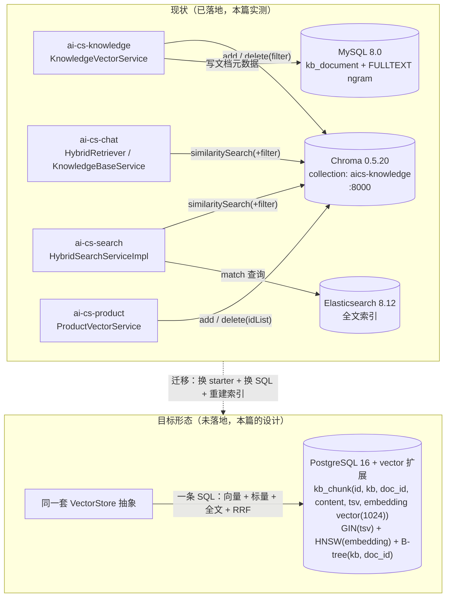
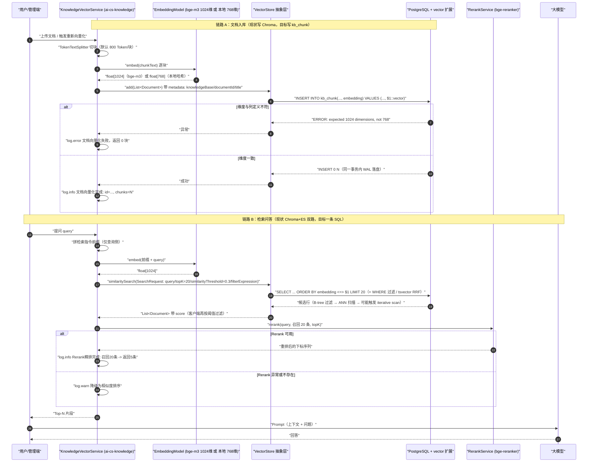

# PostgreSQL 与 pgvector：让向量检索省掉一个新中间件，代价是全盘接手 PG 的运维体系

> **一句话结论**：pgvector 的天赋是"向量只是表里的一列"——事务、备份、权限、JOIN、过滤条件全都白送；它的账单是"你必须接受 PG 的多版本存储（VACUUM）、扩展升级节奏（`CREATE EXTENSION` 绑大版本）和索引构建时间"。本仓当前用 Chroma（`chromadb/chroma:0.5.20`）做向量库，pgvector **未落地**，本篇是选型与迁移设计文档。
>
> **阅读前置**：知道 MySQL 的 B+ 树索引、事务隔离级别与"回表"；知道 RAG 的"切块 → Embedding → 相似度检索"三段式（否则先看 [05-向量数据库/01](../05-AI集成/05-向量数据库/01-向量与相似度-把文字变成坐标.md)）；用过 `EXPLAIN`。不要求用过 PostgreSQL。
>
> **证据基线**：Spring Boot 4.2.0 / Spring Framework 7.1.0 / Spring AI 2.1.0 / JDK 17 / MySQL 8.0 / Redis 7 / ES 8.12 / Chroma 0.5.20（本仓实际）。**PostgreSQL 与 pgvector 的源码均未入库**（`24-源码分析/assets/source` 的 905 个摘录里没有任何 postgres/pg 命中），因此 PG/pgvector 侧的机制结论依据官方文档并逐条注明出处，**不伪造源码行号**。预计阅读 55~70 分钟。

**本篇的证据边界，先说清楚再开场**

| 类别 | 本仓状态 | 本篇怎么处理 |
| --- | --- | --- |
| Spring AI 的 `VectorStore` / `SearchRequest` 抽象 | **已入库** 4 个摘录（`VectorStore.java.md`、`SearchRequest.java.md`、`AbstractVectorStoreBuilder.java.md`、`VectorStoreDocumentRetriever.java.md`） | A 级，直接引 `[[源码:…#L起-L止]]` |
| PostgreSQL 本体（heap/btree/autovacuum） | **未入库** | 依据 PostgreSQL 16 官方手册，正文标"官方文档"，不给行号 |
| pgvector 扩展（ivfflat/hnsw/vector 类型） | **未入库** | 依据 pgvector 官方 README 的 *Indexing* / *Querying* / *Operators* 章节，标版本（0.7/0.8） |
| 本仓向量库配置与调用链 | **已落地**（Chroma） | B 级，路径 + 行号，全部当场 `read` 核对过 |
| pgvector 依赖 / 容器 / 建表 SQL | **未落地**：全仓 `src/main` 里 `pgvector` 只出现 **2 次**，都是 Javadoc 注释 | 章节 5 与章节 9 给出"若要落地改哪些文件"清单 |
| 本机可复现实验 | 无 docker / psql / pg_ctl / postgres | C 级只做**静态算术**与**真实文件统计**，命令与真实输出一并贴出 |

本机探测结果（pwsh 7，2026-11-27 勘）：

```text
=== 本机中间件二进制探测 ===
MISSING docker
MISSING psql
MISSING pg_ctl
MISSING postgres
MISSING redis-cli
MISSING mysql
FOUND  node -> C:\Program Files\nodejs\node.exe
```

**怎么读这段**：本机没有任何 PG 客户端，也没有容器运行时。所以本篇**没有一条 SQL 是本机跑出来的**——凡涉及 `CREATE INDEX`、`EXPLAIN`、报错文本的地方，一律标注"官方文档/explanations，未实测"；而"本仓有多少处过滤表达式""几个服务共用一个集合""维度常量是多少"这类问题，全部用 grep 与 node 实测，输出照贴。这是本篇的诚实边界，也请你在读其他文档时用同一把尺子量。

---

## 0. 先看现象

### 现象 1：向量库一挂，RAG 静默降级，用户只看到"答非所问"

`ai-cs-chat` 的混合检索器里，向量检索失败不是抛异常，而是**记一条 warn 然后返回空列表**：

```java
// ai-cs-chat/src/main/java/com/aics/chat/rag/retrieve/HybridRetriever.java#L287-L306
SearchRequest request = SearchRequest.builder()
        .query(query)
        .topK(topK)
        .filterExpression("knowledgeBase == '" + knowledgeBase + "'")
        .build();
try {
    return vectorStore.similaritySearch(request);
} catch (Exception e) {
    log.warn("向量检索失败: kb={}, query={}, err={}", knowledgeBase, query, e.getMessage());
    return List.of();
}
```

日志里你会依次看到（格式串为源码原文）：

```text
WARN  ... HybridRetriever : 向量检索失败: kb=knowledge, query=怎么退货, err=Connection refused
WARN  ... HybridRetriever : 混合检索失败，降级纯向量: kb=knowledge, query=怎么退货, err=...
INFO  ... KnowledgeBaseService : 知识库[knowledge]宽召回完成: 命中0条
```

最后大模型在**零上下文**下回答，用户体感是"这机器人变笨了"。这就是"向量库是独立中间件"的第一个代价：**多一个必须活着的进程**，而且它的坏死对业务是软失败——不报错、不告警、只变笨。

### 现象 2：同一段知识，关键词搜得到，语义搜不到（或反过来）

本仓的知识内容**同时被三套索引接管**，而且互不隶属：

```text
deploy/mysql/init.sql#L239-L259   kb_document.content LONGTEXT
                                  + FULLTEXT KEY ft_title_content (title, content) WITH PARSER ngram
docker-compose.yml#L86-L96        elasticsearch:8.12.0（全文检索，ai-cs-search 在用）
docker-compose.yml#L194-L209      chromadb/chroma:0.5.20（向量检索，三个服务在用）
```

`kb_document` 还有 `status TINYINT 0-待处理 1-已索引 2-索引失败`（`deploy/mysql/init.sql#L248`）——这个状态字就是为了"MySQL 写成功了但向量库写失败了"而存在的。三套索引、三种失败态、三次重试机会，一致性全靠业务代码兜。用户看到的就是"搜『退货』能搜到，搜『不想要了想退掉』搜不到"。

### 现象 3：想在检索结果上再加一个条件，得去改代码

业务同事问："能不能只在这个知识库、且只在这些文档类型里做语义检索？" 你去看代码，发现过滤条件是**拼进字符串**的：

```java
// ai-cs-knowledge/src/main/java/com/aics/knowledge/service/KnowledgeVectorService.java#L103-L116（节选）
public void deleteByDocumentId(Long documentId) {
    vectorStore.delete("documentId == '" + documentId + "'");
    log.info("按 documentId 删除向量: documentId={}", documentId);
}
```

`"documentId == '" + documentId + "'"` —— 这是一门**只属于 Chroma 的过滤方言**（Spring AI 统一转写的 DSL），字符串拼接、`Long` 却带着引号当字符串比、`==` 不是 Java 的 `==`。想在 PG 里表达同一个意思，你要写的是 `metadata->>'documentId' = '123'` 或干脆把 `document_id` 建成真列。SQL 与非 SQL 的差别，在这里第一次变成"改代码 vs 改 SQL"的差别。

这些现象指向同一件事：**本仓的"向量能力"被拆散在 Chroma + MySQL + Elasticsearch 三个组件里，谁也不能替谁干活；pgvector 的意义就是把"向量 + 元数据 + 标量条件 + 全文检索"收进同一个事务域里用一条 SQL 表达——但收进去之后，维度、索引类型、索引参数这些原本能糊过去的参数，全部变成建表/建索引那一刻必须定死的硬约束。**

---

## 1. 整体地图



> **读图说明**：
> 1. 上半部分（NOW）全部是**本仓真实存在的组件**，箭头上的文字是实际调用的 API 名：注意 `add`、`delete(idList)`、`delete(filter)`、`similaritySearch(filterExpression)` 四种形态并存，这是后面章节反复回来的地方。
> 2. Chroma 被**四个服务**共用，集合名固定为 `aics-knowledge`（`ai-cs-chat` / `ai-cs-knowledge` / `ai-cs-search` 三份 yml 都写死了这个名字），所以它其实是"一个隐式的共享数据库"，而不是某个服务的私有缓存。
> 3. 下半部分（TGT）是虚线目标：一张 `kb_chunk` 表同时装 chunk 正文、知识库标识、全文列 `tsv` 和向量列 `embedding`，右侧三行是三个索引——**这才是 pgvector 真正的收益：一次查询里同时用上向量索引、B-tree 过滤和 GIN 全文索引**。
> 4. 虚线箭头上的"迁移"三个字是本篇的立场：这不是加一个依赖，是搬一次家。

| 组件 / 类 | 责任 | 调用方 | 是否权威源 | 失效方式 |
| --- | --- | --- | --- | --- |
| `VectorStore`（Spring AI 接口） | 向量库统一抽象：`add` / `delete` / `similaritySearch` | 四个业务服务 | 是（唯一抽象层） | 抽象泄漏即业务改代码 |
| `ChromaVectorStore` | Chroma 具体实现（HTTP，Spring AI 2.1 实现 `InitializingBean`） | `VectorStoreConfig` | 是（当前唯一实现） | 连不上则启动慢/降级 |
| `VectorStoreConfig` | 用 `ProxyFactory` + `LazyInitTargetSource` 延迟创建 Chroma Bean | Spring 容器 | 是（唯一的装配点） | 代理绕过 `@Lazy` 会失效 |
| `KnowledgeVectorService` | 切块 + 写 metadata + `add` + 按 `documentId` 删 | 知识库管理流程 | 否（业务封装） | 抛异常只记 error，`status` 停在 0 |
| `HashEmbeddingModel` | 本地兜底 Embedding，**768 维**，L2 归一化 | `EmbeddingAutoConfig`（默认 provider） | 是（默认向量源） | 维度与生产模型不一致 |
| `OpenAiEmbeddingModel`（硅基流动 bge-m3） | 生产 Embedding，**1024 维** | `SpringAiConfig` / `OpenAiEmbeddingConfig` | 是（生产向量源） | 超时/额度耗尽 → 向量化失败 |
| Chroma 容器 | 向量 + chunk 正文的真实存储 | 四个服务 | 是（正文只此一份） | 宕机 → 现象 1 |
| `kb_document`（MySQL） | 文档级元数据 + `status` + **FULLTEXT ngram** | knowledge 服务 | 否（与 Chroma 各存一半） | 与向量库不一致 |
| Elasticsearch | 全文检索（`ai-cs-search` 双路之一） | `ai-cs-search` | 否（与 MySQL FULLTEXT 重复） | 降级为纯向量 |

---

## 2. 关键概念与关键类

| 名称 | 位置 | 角色 | 关键方法 / 参数 |
| --- | --- | --- | --- |
| `VectorStore` | A 级：`[[源码:VectorStore.java.md#L40-L128]]` | 向量库抽象接口，继承 `DocumentWriter` + `VectorStoreRetriever` | `add(List<Document>)`、`delete(List<String> idList)`、`delete(Filter.Expression)`、`delete(String)`、`similaritySearch(SearchRequest)`、`getNativeClient()` |
| `SearchRequest` | A 级：`[[源码:SearchRequest.java.md#L44-L60]]` | 检索请求值对象 | `topK`（默认 4）、`similarityThreshold`（默认 0.0）、`filterExpression` |
| `Document` | A 级：`[[源码:Document.java.md]]` | 文本 + metadata + 分数 | `getId()`、`getText()`、`getMetadata()`、`getScore()` |
| `ChromaVectorStore` | `ai-cs-chat/src/main/java/com/aics/chat/config/VectorStoreConfig.java#L73-L90` | Chroma 实现，本仓唯一的 `VectorStore` 真身 | builder：`collectionName` / `tenantName` / `initializeSchema` / `batchingStrategy` |
| `VectorStoreConfig` | `ai-cs-chat/src/main/java/com/aics/chat/config/VectorStoreConfig.java#L58-L71` | 延迟代理装配（绕开启动期连 Chroma） | `ProxyFactory` + `LazyInitTargetSource` |
| `HashEmbeddingModel` | `ai-cs-common/src/main/java/com/aics/common/ai/embedding/HashEmbeddingModel.java#L31` | 零依赖兜底向量化，**768 维** | `embed(String)`、双哈希特征累加、`normalize` |
| `vector(n)` 类型 | PG 扩展 `pgvector` 提供（**未入库**） | 定长 float32 数组列类型，维度写死在列定义里 | `vector(1024)`、`halfvec(n)`、`sparsevec(n)`、`bit(n)` |
| 距离算子 | pgvector（**未入库**，官方 README *Operators*） | 三种排序依据 | `<->` L2、`<#>` 负内积、`<=>` 余弦距离 |
| `ivfflat` / `hnsw` | pgvector 提供的两种**索引访问方法** | ANN 索引，走 `CREATE INDEX ... USING` | `lists` / `probes`；`m` / `ef_construction` / `ef_search` |
| `xmin` / `xmax` | PostgreSQL 堆表隐藏系统列（官方手册） | MVCC 的版本标记：谁创建、谁删除 | 可见性判断、`VACUUM` 回收依据 |
| `GIN` / `GiST` / `BRIN` / 部分索引 | PostgreSQL 索引访问方法（官方手册） | 倒排索引（jsonb/数组/tsvector）、通用搜索树、块范围、条件索引 | `CREATE INDEX ... USING gin(...) WHERE deleted = false` |
| `tsvector` / `tsquery` | PostgreSQL 内置全文检索类型 | 词位向量 + 查询，`ts_rank` 打分 | `to_tsvector('simple', content)`、`plainto_tsquery` |
| `CREATE EXTENSION` | PostgreSQL 扩展机制 | 把新类型、新索引方法、新函数装进同一套 catalog | `CREATE EXTENSION vector;` |

---

## 3. 原理与证据逐段精读

### 3.1 MVCC 的两条路线：PG 把多版本留在表里，MySQL 把旧版本挪到 undo

**在干什么**：PostgreSQL 的堆表（heap）里，**同一个逻辑行可以有多个物理元组**。每行带两个隐藏列：`xmin` = 创建它的事务号，`xmax` = 删除/更新它的事务号（初始为 0）。一个事务能不能看见这行，取决于"快照 + `xmin`/`xmax`"的可见性判断。`UPDATE` 在 PG 里不是原地改，而是**写一条新元组 + 把老元组的 `xmax` 置为本事务号**。老元组变成"死元组"，仍然占着页面，直到 `VACUUM` 把它们回收、空间才能复用。InnoDB 走的是另一条路：行内只有最新版本，旧版本在 undo log 里，由 `purge` 线程异步清理，读旧版本时沿 `DB_ROLL_PTR` 回溯。

**为什么这么设计**：PG 的选择是"读不加锁、写不阻塞读"的极致版——回滚几乎是免费的（把 `xmax` 撤掉），而且不用维护一条独立 undo 链，复制和崩溃恢复都更简单（redo 只有 WAL 一种）。代价是把"清理旧版本"这个脏活从写入路径推到了后台维护（autovacuum）。InnoDB 的选择是把垃圾挪出主表以保持主表紧凑，代价是 undo 表空间会膨胀、`History list length` 会成为必看指标——两者是同一问题的两种解法，谁也没有更便宜，只是把账单寄给了不同的人。

| 维度 | PostgreSQL | MySQL / InnoDB |
| --- | --- | --- |
| 旧版本存放位置 | 堆表内（同表多物理元组） | undo log（表外） |
| 版本标记 | 隐藏列 `xmin` / `xmax` | 隐藏列 `DB_TRX_ID` / `DB_ROLL_PTR` |
| 回收机制 | `VACUUM` / autovacuum（含 `VACUUM FULL` 重写表） | `purge` 线程 |
| 长事务后果 | 阻止回收 → 表膨胀（bloat）+ 事务号回卷风险 | 阻止 purge → undo 膨胀 + history list 增长 |
| 空间能否立刻复用 | 能复用但**不还给操作系统**（除非 `VACUUM FULL`） | undo 截断后归还 |
| 典型运维指标 | 表膨胀率、`n_dead_tup`、最老事务年龄 | `History list length`、undo 表空间大小 |

**换成别的写法会怎样**：如果 PG 改成 InnoDB 式的原地更新 + undo，那么现在所有依赖"多版本共存"的能力（长时间只读事务做报表、逻辑复制的旧快照、`pg_dump` 期间的一致性读）都要重写。反过来，如果你在 PG 里用"只追加不可变表 + 应用层挑版本"来绕开 MVCC，你就得自己处理并发可见性与清理，工作量比 `VACUUM` 大得多。

**常见坑（也是本主题专属的坑）**：**向量列让膨胀变贵了**。1024 维 float32 一个向量就是 4 KB，一次"重新向量化"就是把 4 KB 的旧元组变成死元组再写 4 KB 新元组。十万 chunk 全量重算一次，瞬间产生约 400 MB 死元组——`VACUUM` 会把这些死元组从索引里剔掉，但**HNSW 索引上被删的节点是"惰性删除"，不重建不回收空间**，于是你会同时观察到"表膨胀"和"索引里塞满死条目、召回和延迟一起变差"。这就是"pgvector 便宜"这件事的具体账单：它把向量存储纳入了 PG 的 MVCC，你必须按 PG 的规矩做维护。

> 想看 MySQL 这边的完整机制，见 [03-数据库与ORM/06-事务进阶-MVCC实现与三大日志.md](../03-数据库与ORM/06-事务进阶-MVCC实现与三大日志.md)；pgvector 场景下的维护动作见本篇 3.9。

### 3.2 类型系统与扩展机制：pgvector 不是一个数据库，是一个 `CREATE EXTENSION`

**在干什么**：PG 的扩展（extension）机制允许第三方以"一个 `.control` 文件 + 一组 SQL 脚本 + 可选的 C 函数"的形式，往数据库里安装**新数据类型、新操作符、新索引访问方法、新函数**，装完就和内置能力平起平坐：能被 `pg_dump` 备份、受 GRANT 权限管理、进 WAL、参与事务、被 planner 识别。pgvector 就是这样一个扩展，它新增了 `vector` / `halfvec` / `sparsevec` / `bit` 四种类型、`<->` 等四个距离算子、`ivfflat` 与 `hnsw` 两种 index access method。装它只需要一句：

```sql
CREATE EXTENSION IF NOT EXISTS vector;
```

**为什么这是 PG 的核心竞争力**：因为它把"加一种数据模型"的成本从"引入一个中间件"降到"装一个扩展"。本仓当前为了做向量检索，引入了 Chroma（一个新进程 + 新端口 + 新备份策略 + 新监控 + 新故障态）；同样的能力在 PG 里是 `CREATE EXTENSION vector` 加一个 `vector(1024)` 列。这不是理论优势——PostGIS（地理）、TimescaleDB（时序）、Citus（分片）、pg_trgm（模糊匹配）都是同一种机制长出来的，这就是"PG 的生态不是插件市场，而是内核的一部分"。

**换成别的写法会怎样**：如果放弃扩展机制，只剩两条路——① 把向量存成 `bytea` / `text`，在应用层算距离：能存不能索引，十万条以上直接不可用；② 用 `bytea` + 自己写 C 函数在库里算：等于自己维护一个 pgvector 分支。两条路都比"装扩展"贵。

**常见坑**：

- **扩展绑大版本**。`pg_dump` 的备份里包含 `CREATE EXTENSION`，但扩展的共享库文件不在备份里；从 PG 15 升到 16 时，你要在新实例上先装好 pgvector 的二进制，再做 `pg_upgrade`。**索引是不随 `pg_upgrade` 复制的，必须重建**——`hnsw` / `ivfflat` 索引重建在百万级向量上是小时级操作，这是迁移窗口的真正来源。
- **`CREATE EXTENSION` 需要超级用户**（或预置 `trusted = true`）。托管 PG（RDS 等都提供 pgvector）没问题，自建库常常卡在"业务账号没有权限装扩展"。
- 正文里提到"PG 有 jsonb"不等于"向量列能装进 jsonb 并建索引"——`jsonb` 上的 GIN 索引可以过滤，但**不能做近邻排序**，两者是两件事。

### 3.3 索引家族与部分索引：pgvector 的 hnsw 只是"又一种 access method"

**在干什么**：PG 的 `CREATE INDEX ... USING <method>` 里 `<method>` 是可插拔的。常用五种：

| 访问方法 | 擅长 | 本主题里的用途 |
| --- | --- | --- |
| B-tree | 等值、范围、排序（`ORDER BY`） | `(knowledge_base, document_id)`、`created_at` |
| GIN | 倒排：`jsonb` 包含查询、数组、**`tsvector` 全文** | `tsv` 关键词检索、`metadata @> '{"k":"v"}'` 过滤 |
| GiST | 几何/范围/最近邻（KNN） | 地理与区间，本主题不用 |
| BRIN | 物理有序超大表的块级摘要（极小） | 时序追加表，本主题不用 |
| Hash | 纯等值 | 少用 |
| **ivfflat / hnsw** | **向量近邻**（pgvector 提供） | `embedding` 列 |

再叠加**部分索引（partial index）**：`CREATE INDEX ... WHERE deleted = false` 只索引满足条件的行。它在向量场景里非常实用——软删除的行不必进 ANN 索引，索引体积直接按"有效行比例"缩小。

**为什么这么设计**：把"怎么找"和"找什么"分开。planner 只关心"这个 `WHERE`/`ORDER BY` 有没有可用的 access method"，于是加一种新数据模型（向量）不需要改 planner，只需要注册一种新索引方法。这也是为什么 pgvector 的索引能和其他索引在**同一条 SQL 里**协同：`WHERE knowledge_base = $1` 走 B-tree、`ORDER BY embedding <=> $2 LIMIT 10` 走 HNSW、`tsv @@ q` 走 GIN，planner 自己决定顺序。

**换成别的写法会怎样**：如果没有可插拔索引，向量检索只能退化成顺序扫描（精确但 O(N·d)，见 3.4 的算术）；如果不用部分索引，把软删除行也塞进 HNSW，索引里可能有一半是永不会被返回的条目——你付了内存却买到噪音。

**常见坑**：

- **部分索引的 `WHERE` 必须能被查询条件蕴含**，否则 planner 不用它。写了 `WHERE deleted = false` 却在 SQL 里忘了带 `deleted = false`，索引就白建了（`EXPLAIN` 里显示 `Seq Scan`）。
- **表达式/函数索引要匹配表达式**：建了 `CREATE INDEX ON t ((metadata->>'docId'))`，查询写 `metadata->>'docId' = $1` 才命中；写成 `metadata->>'docid'` 就废。
- ANN 索引**不支持"任意条件的高效过滤"**：B-tree 过滤会在 ANN 扫描后应用，符合条件的行不够时返回行数会少于 `LIMIT`（pgvector 0.8 才引入 iterative index scan 缓解，见 3.7）。

### 3.4 三条检索路径：暴力扫描 / IVFFlat / HNSW

**在干什么**：pgvector 给你三种"怎么找最近邻"的选择，本质是"精度换速度"的三档。

**① 不建索引 —— 精确暴力扫描（exact scan）**。`ORDER BY embedding <=> $1 LIMIT 10` 逐个算距离，recall = 100%，延迟与行数线性相关。十万行以内、或者你在做"离线召回评估"的对照组，这就是正确答案。

**② IVFFlat —— 先聚类再扫桶（inverted file）**。建索引时用 k-means 把向量聚成 `lists` 个簇（每个簇一个"倒排列表"），查询时**只扫离查询向量最近的 `probes` 个簇**里的向量。三个关键事实：建索引**需要表里已经有数据**（没数据聚类无从谈起）；`lists` 官方建议"1M 行以下用 `rows/1000`，1M 行以上用 `sqrt(rows)`"；`probes` 默认为 1，调大→召回↑延迟↑，`probes = lists` 就退化为暴力扫描。

**③ HNSW —— 分层小世界图**。每个向量是图上一个节点，分层建边，查询从上层粗粒度下沉到下层细粒度。三个参数：`m`（每层最大连接数，默认 16）、`ef_construction`（建索引时的候选集大小，默认 64）、以及查询期的 `ef_search`（默认 40）。HNSW 的召回和延迟都优于 IVFFlat，代价是建索引更慢、索引更大、且**索引必须能驻留内存**（否则每次查询都在换页）。

本仓当前的容量量级可以用 node 现算（真实输出，2026-11-27）：

```text
--- dims=1024  float32/向量=4096 B=4.0 KB
    N=   10000  纯向量堆=  39.29 MB   HNSW(m=16)邻接指针≈  1.83 MB   合计≈41.12 MB
    N=  100000  纯向量堆= 392.91 MB   HNSW(m=16)邻接指针≈ 18.31 MB   合计≈411.22 MB
    N= 1000000  纯向量堆=3929.14 MB   HNSW(m=16)邻接指针≈183.11 MB   合计≈4.02 GB

=== IVFFlat lists 建议（rows/1000 @ <1M, sqrt(rows) @ >=1M）===
rows=    10000  lists=    10  建议 probes≈sqrt(lists)=3  (每 list 平均 1000.0 条)
rows=   100000  lists=   100  建议 probes≈sqrt(lists)=10  (每 list 平均 1000.0 条)
rows=  1000000  lists=  1000  建议 probes≈sqrt(lists)=32  (每 list 平均 1000.0 条)

=== 暴力扫描距离计算量（每查询）===
N=100000 dims=1024 -> 205 MFLOP/查询
N=1000000 dims=1024 -> 2048 MFLOP/查询
```

**怎么读这段**：① 4 KB/向量是"1024 维 × 4 字节"的硬算术，任何向量库都绕不过；十万 chunk ≈ 400 MB 纯向量，这个规模 PG 一列就装得下，还不值得上 Milvus。② HNSW 邻接指针按 `m=16` 的 192 B/向量估算，**这是下限**——pgvector 的 HNSW 索引元组里还要再存一份向量本体用于遍历，所以真实索引体积接近"向量堆的大小"，总量要按"约 2 倍"预留。③ `lists`/`probes` 那一段是官方建议值的算术落地：十万行就是 100 个桶、每桶约 1000 条、`probes=10` 只扫 1/10 的数据，这就是"用 1% 的召回损失换 10 倍延迟"的定价方式。

**换成别的写法会怎样**：不建索引 → 百万级每查询 2 GFLOP，纯 CPU 就吃满一个核，P99 直接崩；用 IVFFlat 但把 `probes` 设成默认 1 → 只扫 1/100 的数据，**召回率可能掉到 50% 以下**（这是本篇第 0 节"建完索引召回变差"，见 6.4）；上 HNSW 但 `shared_buffers` 只有 128 MB → 索引在磁盘与内存之间反复换页，延迟抖动堪比冷启动。

**常见坑**：

- **IVFFlat 建索引前必须有数据，而且数据分布要稳定**。先建空索引再灌数据 = 聚类基于空集，等于没建。
- **`probes` 是会话级参数**（`SET ivfflat.probes = 10;` 或 `SET LOCAL`），不会跟着索引走。应用连接池里忘记设，每个连接都退回默认值。
- **HNSW 的 `ef_search` 同理**（`SET hnsw.ef_search = 100;`），且必须 ≥ `LIMIT` 才有意义。
- 建索引要内存：`maintenance_work_mem` 太小会让建 HNSW 索引变成"边建边落盘"，小时级变天级。官方文档明确建议调大它。

### 3.5 距离算子与归一化：`<->` / `<#>` / `<=>`，以及 opclass 必须与算子配对

**在干什么**：pgvector 定义了四个算子（官方 README *Operators*）：

| 算子 | 含义 | 排序方向 | 对应 opclass |
| --- | --- | --- | --- |
| `<->` | L2 欧氏距离 | 升序（越小越近） | `vector_l2_ops` |
| `<#>` | **负**内积（取负是为了统一升序排序） | 升序 | `vector_ip_ops` |
| `<=>` | 余弦距离 = `1 - cosine_similarity` | 升序 | `vector_cosine_ops` |
| `<+>` | L1 曼哈顿距离（0.7+） | 升序 | `vector_l1_ops` |

关键在于：**索引的 opclass 和查询用的算子必须配对**。用 `vector_cosine_ops` 建索引，却写 `ORDER BY embedding <-> $1`，planner 无法把该索引用到这个排序上——它不会报错，只会**悄悄退化成 `Seq Scan`**，性能从毫秒掉到秒级，而结果"看起来是对的"。

**为什么这么设计**：三种距离的"最近邻"在数学上不是同一个集合，索引结构（IVFFlat 的聚类、HNSW 的建边）必须按特定度量构建才成立。分开 opclass 是忠实的做法：让数据库知道"这个索引是为余弦建的"。

**归一化在这里是决定性的**。如果所有向量都做过 L2 归一化（`||v|| = 1`），那么：

```text
cosine_distance(a,b) = 1 - a·b
l2_distance(a,b)²   = 2 - 2·a·b
```

两者都是 `a·b` 的**单调递减函数**——也就是说，对归一化向量，按 `<->`、`<#>`、`<=>` 排序得到的是**同一个顺序**。这不是理论彩蛋，本仓的兜底 Embedding 就是这么做的：

```java
// ai-cs-common/src/main/java/com/aics/common/ai/embedding/HashEmbeddingModel.java#L107-L119（节选）
private static void normalize(float[] v) {
    double sum = 0;
    for (float x : v) { sum += x * x; }
    double norm = Math.sqrt(sum);
    if (norm == 0) { return; }
    for (int i = 0; i < v.length; i++) { v[i] = (float) (v[i] / norm); }
}
```

**换成别的写法会怎样**：如果向量不归一化还混用三种算子，你会得到三套不同的召回结果——线上用余弦、离线评估用内积，评估指标就再也对不上线上了。反过来，如果统一归一化，你可以按"哪个 opclass 算得快"来选（内积少一次开方），排序结果不变。**但在 PG 里请只选一个并写进规范**：换 opclass 意味着重建索引。

**常见坑**：

- **算子与 opclass 不匹配 → 索引静默失效**（上面说的 `Seq Scan`）。唯一可靠的检查手段是 `EXPLAIN (ANALYZE, BUFFERS)`，看执行计划里出现的是 `Index Scan using ...` 还是 `Seq Scan`。
- **归一化只在写入侧做、查询侧忘了** → 距离整体偏移，排序还是对的（单调性保住），但**阈值判断全错**：本仓 `similarityThreshold(0.3)` 这类绝对阈值会突然把结果全过滤掉。
- **`<#>` 返回负数**，如果直接当相似度展示给用户，会出现"相似度 -0.87"这种数字。取负、或改用 `1 - (a <=> b)`。

### 3.6 维度上限：`vector` 能存 16000 维，但**能建索引的只有 2000 维**

**在干什么**：pgvector 的 `vector` 类型存储上限是 16000 维，但**索引**有更严的限制：`vector` 索引最多 2000 维、`halfvec`（半精度，2 字节/维）最多 4000 维、`bit` 最多 64000 维（官方 README *Indexing*）。原因很朴素：索引行不能 TOAST，一页 8 KB，索引行大小受限，2000 × 4 B = 8000 B 已经顶到天花板。

这意味着：**768 维、1024 维、1536 维都能直接建索引；3072 维（如 `text-embedding-3-large` 原生长度）建不了**，必须选一条路——降维（`text-embedding-3-*` 支持 `dimensions` 参数）、`halfvec(3072)`、或者 `bit` 二值化。

**本仓的现实是"两套维度并存"**：

| provider | 实现 | 维度 | 证据 |
| --- | --- | --- | --- |
| `local`（默认，`matchIfMissing = true`） | `HashEmbeddingModel` | **768** | `ai-cs-common/src/main/java/com/aics/common/ai/embedding/HashEmbeddingModel.java#L31` |
| `openai` | 硅基流动 `BAAI/bge-m3` | **1024** | `ai-cs-chat/src/main/java/com/aics/chat/config/SpringAiConfig.java#L70`、`tools/nacos-config/aics-shared.yml#L24` |

**为什么这么设计**：768 维是"零依赖兜底"的产物——`HashEmbeddingModel` 用双哈希把 token 映射到 768 个桶上，不需要任何外部服务；1024 维是 bge-m3 的真实输出维度。两者在 Chroma 里**可以共存**（Chroma 的 collection 维度是运行时推断/宽松的），但在 pgvector 里**不可能共存**——`embedding vector(1024)` 是建表时写死的，插一条 768 维的向量会被直接拒绝（`vector` 类型的输入函数按列维度校验；报错形态为 `ERROR: expected 1024 dimensions, not 768`，**本机无 PG 未实测，依据官方 README 的类型定义与错误消息**）。

**换成别的写法会怎样**：如果想"兼容任意维度"，只能把列建成 `vector`（不指定 n）——那么**索引无法创建**，等于放弃 ANN；或者一个维度一张表，复杂度和运维成本都不可接受。所以正确做法是：**维度跟随 Embedding provider 定死，写进配置与建表脚本，并在启动时校验**。

**常见坑**：

- **切换 provider 不重建表** = 上线即 500。切 `bge-m3` 那天必须：新表/新集合 + 全量重算 + 切换别名，不能原地切换。
- **bge-m3 的查询指令前缀只加在查询侧**。本仓 `searchRaw` 给查询加了 `"为这个句子生成表示以用于检索相关文章："` 前缀（`ai-cs-chat/src/main/java/com/aics/chat/service/KnowledgeBaseService.java#L268`），但入库侧 `vectorize()` 没有加（`ai-cs-knowledge/src/main/java/com/aics/knowledge/service/KnowledgeVectorService.java#L69-L92`）。这是 bge 系列的推荐用法（查询加指令、文档不加），但它意味着**离线评估必须走同一个 `searchRaw`**，否则你会得出"向量库里存的向量是错的"这种错误结论。
- **`halfvec` 不是免费午餐**：省一半存储和 IO，但精度损失会体现在边界 case 的排序抖动上，必须用离线召回率验证。

### 3.7 混合检索：本仓要两个组件 + 一份 RRF 代码，pgvector 只要一条 SQL

**在干什么**：本仓的"混合检索"是这么实现的——`ai-cs-search` 同时打两条腿：ES 做全文，Chroma 做向量，任一失败就降级：

```java
// ai-cs-search/src/main/java/com/aics/search/hybrid/HybridSearchServiceImpl.java#L119-L153（节选）
SearchRequest request = SearchRequest.builder()
        .query(query)
        .topK(RETRIEVE_TOP_K)
        .filterExpression("knowledgeBase == '" + knowledgeBase + "'")
        .build();
List<Document> docs = vectorStore.similaritySearch(request);
log.info("向量检索完成: knowledgeBase={}, 命中={}", knowledgeBase, docs.size());
```

两条腿的结果用 RRF（Reciprocal Rank Fusion，`score(doc) = Σ 1/(k + rank_i)`，`k` 常取 60）融合。在 pgvector 里，这件事塌缩成**一条 SQL**——向量排序、标量过滤、全文打分、名次计算、RRF 求和全在一个执行计划里：

```sql
-- 目标形态：一张 kb_chunk 表同时承载向量 + 元数据 + 全文（本仓未落地，未实测）
WITH q AS (
  SELECT $1::vector(1024) AS v, plainto_tsquery('simple', $2) AS tsq
), cand AS (
  SELECT id, content,
         ROW_NUMBER() OVER (ORDER BY embedding <=> q.v)               AS vec_rank,
         ROW_NUMBER() OVER (ORDER BY ts_rank(tsv, q.tsq) DESC)        AS kw_rank
  FROM kb_chunk, q
  WHERE knowledge_base = $3 AND deleted = false        -- B-tree 过滤，走部分索引
  LIMIT 200                                            -- 两路候选各取 200
)
SELECT id, content,
       SUM(1.0 / (60 + r)) AS rrf_score
FROM cand, LATERAL (VALUES (vec_rank), (kw_rank)) AS t(r)
GROUP BY id, content
ORDER BY rrf_score DESC
LIMIT 10;
```

（生产写法通常是两个 CTE 各取 top-200 再 `UNION ALL` 合并算 RRF，这里为了短用了 `LATERAL`；两种都在一条 SQL 内完成。）

**为什么这么设计**：向量检索擅长"意思对上了"，全文检索擅长"专有名词、型号、单号必须精确命中"。RRF 不比较两者的分数绝对值（它们不可比），只比较**名次**，所以不需要调权重。pgvector 的价值是：**名次、过滤、融合全在数据库里做，不用把两批结果搬到 JVM 里再算。**

**换成别的写法会怎样**：像本仓现在这样分两个组件做——能跑，而且 ES 的全文质量（ngram/IK 分词、相关性打分）确实比 PG 的 `tsvector` 强，中文场景尤其明显。代价是：两条腿的一致性（`SearchServiceImpl` 里 add 要双写、delete 要双删，见 `ai-cs-search/src/main/java/com/aics/search/service/impl/SearchServiceImpl.java#L125-L138`）、两套运维、两个故障域，以及**没法做"过滤后再融合"这类查询**（过滤只能在各自组件里各写一遍）。

**常见坑**：

- **带 `WHERE` 的 ANN 查询会"少返回"**。HNSW/IVFFlat 是"先近似找最近邻，再应用过滤"，如果过滤选择性很强（比如只取 1% 的知识库），扫到的候选可能全被过滤掉，`LIMIT 10` 只返回 2 行甚至 0 行——这是 pgvector 用户最常见的"召回率骤降"投诉。**pgvector 0.8.0 为此引入了 iterative index scan**（`SET hnsw.iterative_scan = relaxed_order;` 以及 `hnsw.max_scan_tuples`），在此之前唯一解法是把过滤列冗余进索引或改查询形态。这一点在 6.4 会再出现。
- **`ts_rank` 与 `es score` 不可比**，别把 PG 的 `ts_rank` 数值和 ES 的 `_score` 混着做加权求和。
- 中文全文检索在 PG 里需要额外分词方案（`zhparser` / `pg_jieba` 扩展），`simple` 配置只做小写化+按空白切分，对中文几乎等于不分词。本仓现在用 MySQL 的 `WITH PARSER ngram`（`deploy/mysql/init.sql#L258`）与 ES，正说明中文全文不是 PG 的强项。

### 3.8 Spring AI 的抽象怎么落到 PG：可移植的是接口，不可移植的是过滤方言

**在干什么**：本仓四个服务都只依赖 `VectorStore` 接口，理论上换实现不该改业务代码。抽象长这样（A 级，源码摘录）：

```java
// [[源码:VectorStore.java.md#L40-L110]]
public interface VectorStore extends DocumentWriter, VectorStoreRetriever {
    void add(List<Document> documents);                       // L51
    default void upsert(List<EmbeddedDocument> entries) {      // L80-L82
        throw new UnsupportedOperationException(getName() + " does not support upsert");
    }
    void delete(List<String> idList);                          // L88
    void delete(Filter.Expression filterExpression);           // L95
    default void delete(String filterExpression) {             // L105-L110
        SearchRequest searchRequest = SearchRequest.builder().filterExpression(filterExpression).build();
        Filter.Expression textExpression = searchRequest.getFilterExpression();
        Assert.notNull(textExpression, "Filter expression must not be null");
        this.delete(textExpression);
    }
}
```

字符串版的 `delete` 只是个**语法糖**：它把字符串丢给 `FilterExpressionTextParser` 解析成 `Filter.Expression`，再调真正的方法（`[[源码:SearchRequest.java.md#L286-L290]]`）。而 `SearchRequest` 里藏着两个必须先知道的默认值：

```java
// [[源码:SearchRequest.java.md#L44-L60]]
public static final double SIMILARITY_THRESHOLD_ACCEPT_ALL = 0.0;   // L44
public static final int DEFAULT_TOP_K = 4;                          // L49
// ...
private double similarityThreshold = SIMILARITY_THRESHOLD_ACCEPT_ALL;  // L58
private Filter.@Nullable Expression filterExpression;                  // L60
```

**为什么这么设计**：接口统一，具体的过滤能力由各实现自己支持。官方在 `filterExpression(String)` 的注释里写得很清楚——这套"类 SQL 的声明式过滤语法"的可移植性，前提是"**目标向量库支持 filter search**"（`[[源码:SearchRequest.java.md#L277-L282]]`）。换句话说：**接口是契约，过滤是可选能力**。

**换成别的写法会怎样**：本仓 `VectorStoreConfig` 的 Javadoc 写着"换 Elasticsearch / Milvus / Qdrant / Redis / PGVector，业务代码一行不改"（`ai-cs-chat/src/main/java/com/aics/chat/config/VectorStoreConfig.java#L38-L45`）。这句话**只对接口成立，对过滤不成立**：全仓 `filterExpression(` 有 **5 处**硬编码的 DSL（C 级统计见 6.6），加上 2 处 `delete("... == '...'")`，换 pgvector 时全都要重新验证语义——Chroma 的 metadata 是"任意 JSON 键值、`==` 宽松比较"，PG 里会落成 `jsonb` 上的 `->>` 与类型转换，`documentId == '123'`（Long 却加引号）这类写法首当其冲。**这就是本篇最想让你记住的一条：换向量库的账单不在接口层，在过滤表达式的语义层。**

**常见坑**：

- **`similarityThreshold` 是客户端后处理，不是数据库过滤**。官方注释原文：`Note that this is a post-processing step performed on the client not the server side.`（`[[源码:SearchRequest.java.md#L164-L171]]`）。后果：你请求 `topK=5` 且阈值 0.5，服务端只返回 5 条，客户端再过滤——**如果这 5 条都不达标，你就得到空结果，而库里明明有第 6~100 条达标的记录**。本仓的解法是"宽召回 + 精排"：先用 `recallTopK` 与低阈值 `0.3` 召回，再 Rerank（`ai-cs-chat/src/main/java/com/aics/chat/service/KnowledgeBaseService.java#L202-L233`）。这个坑在 pgvector 上会变严重，因为你可以（也应该）把阈值下推到 SQL 里用 `WHERE 1 - (embedding <=> $1) > 0.3` 表达，但那会和 ANN 索引的 `LIMIT` 语义打架（见 3.7）。
- **`DEFAULT_TOP_K = 4`**：任何忘记设 `topK` 的调用都只拿 4 条。本仓自己设了 5/20，别被默认值坑。
- **`upsert` 默认抛 `UnsupportedOperationException`**（2.1 新增，`[[源码:VectorStore.java.md#L80-L82]]`）：想靠 `upsert` 做幂等覆盖，得先确认当前实现在不支持名单里。本仓用的是"文档 id = 商品 id"的覆盖语义（`ai-cs-product/src/main/java/com/aics/product/service/impl/ProductVectorService.java#L57-L62`），依赖的是 `add` 的同 id 覆盖而非 `upsert`。

### 3.9 运维面：接手 pgvector 就是接手 VACUUM、索引构建和备份

**在干什么**：把向量搬进 PG 之后，日常要盯的东西变成 PG 的那一套：

| 运维动作 | 为什么在向量场景里格外重要 |
| --- | --- |
| `VACUUM (ANALYZE)` | 重向量化会产生大量死元组（3.1）；不回收则表膨胀、`pg_stat_user_tables.n_dead_tup` 飙升 |
| `REINDEX` / 重建 ANN 索引 | HNSW 与 IVFFlat 上的删除是惰性的，长期更新后索引里塞满死条目 |
| `maintenance_work_mem` | 建 HNSW 索引的内存来源，太小则构建时间数量级恶化 |
| `shared_buffers` | HNSW 索引要驻留内存，否则查询期换页抖动 |
| `pg_dump` / PITR | 向量列会被一起备份——好处是"向量和元数据同一份备份"，代价是备份体积按 GB 起 |
| 大版本升级 | 扩展二进制要随实例升级，索引必须重建（3.2） |

**为什么这么设计**：因为 pgvector 没有"自己的一套存储"，它复用 PG 的堆、WAL、MVCC、autovacuum。**"省一个中间件"与"多一类运维负担"是同一枚硬币**：你不再需要运维 Chroma 的容器与心跳，但你必须会读 `pg_stat_user_tables` 和 `EXPLAIN (ANALYZE, BUFFERS)`。

**换成别的写法会怎样**：用 Milvus/Qdrant 时，这些活被产品化成了"collection 的 compact / 索引重建 API"，你不用懂 MVCC，但你要懂它们的运维拓扑（Milvus 还要 etcd + 对象存储 + 消息队列）。用 Chroma 单机时，这些活基本不存在——因为**它压根没打算处理"百万级 + 频繁更新"**，本仓 `deploy/k8s/chroma.yaml#L33` 就是 `replicas: 1`、`storageClassName: local-path`、`storage: 10Gi`，注释写的是"单副本，学习环境"。

**常见坑**：

- **以为 `DELETE` 就释放了空间**：PG 里删除只是标 `xmax`，表文件不会变小；`VACUUM FULL` 会重写表并**期间持排他锁**——向量表重写意味着几十 GB 的 IO 与分钟级不可写。
- **`autovacuum` 默认参数对大表不够用**：默认 `autovacuum_vacuum_scale_factor = 0.2`，意味着表要膨胀 20% 才触发；向量表的 20% 可能就是几 GB。要么调参，要么显式 `VACUUM`。
- **忘了 `ANALYZE`**：planner 没见过向量列的统计信息，可能选错执行计划（比如放弃 ANN 索引去做全表排序）。

---

## 4. 一次完整执行时序

下图把"文档入库"和"用户提问"两条链路放在一起，落在**目标形态（PG + pgvector）**上画，并标注本仓现状里每一步对应的组件。



> **读图说明**：
> 1. 两条链路共用同一个 `EmbeddingModel` 与同一个 `VectorStore` Bean——**这就是"入库与查询必须在同一个向量空间"的物理含义**（`ai-cs-knowledge/src/main/java/com/aics/knowledge/service/KnowledgeVectorService.java#L41-L43` 的 Javadoc 明确写了这一点）。
> 2. 第 8~11 步的 `alt` 分支是全篇最贵的分支：维度不匹配时 PG 会**直接拒绝写入**（不同于 Chroma 的宽松），而业务层的处理是"记 error 返回 0 块"——文档 `status` 会停在 0/2，用户在知识库里看到"已上传但检索不到"。
> 3. 第 16 步的 `topK=20` + 阈值 `0.3` 是**宽召回**参数，第 20 步的 Rerank 才是精排；这两个数字不要混——`topK` 在 pgvector 里会变成 SQL 的 `LIMIT`，而阈值只是客户端后处理（`[[源码:SearchRequest.java.md#L164-L171]]`）。
> 4. 第 18 步括号里"可能触发 iterative scan"是 pgvector 0.8 才有的行为：带 `WHERE` 过滤的 ANN 查询发现候选不足时会扩大扫描范围，早于此版本就是"少返回"（见 3.7 与 6.4）。

**各步骤失败时的表现**

| 失败在哪一步 | 触发条件 | 用户看到什么 | 证据 |
| --- | --- | --- | --- |
| 第 3 步切块 | 文档内容为空 | 返回 0 块，无异常 | `KnowledgeVectorService.java#L69-L77` |
| 第 4 步 Embedding | bge-m3 超时/额度耗尽 | `log.error 文档向量化失败`，`status` 停在待处理 | `ai-cs-knowledge/src/main/java/com/aics/knowledge/service/KnowledgeVectorService.java#L88-L91` |
| 第 9 步写入 | 维度与 `vector(n)` 不符 | 插入报错，向量化失败 | pgvector 类型校验（未入库，官方 README） |
| 第 9 步写入 | 索引缺失/磁盘满 | 长事务、写入变慢，甚至 WAL 堆积 | 无本仓证据，标"未实测" |
| 第 17 步检索 | 向量库不可达 | `向量检索失败` → `混合检索失败，降级纯向量` → 命中 0 条 | `HybridRetriever.java#L302-L306`、`#L210` |
| 第 18 步检索 | 过滤选择性太强 + ANN 扫描不足 | 命中条数远少于 `topK`（半空列表） | pgvector 0.8 迭代扫描公告（未实测） |
| 第 19 步阈值过滤 | `topK` 太小 + 阈值过高 | 结果被客户端全部过滤成 0 条 | `[[源码:SearchRequest.java.md#L164-L171]]` |
| 第 21 步 Rerank | 精排服务超时 | 静默降级为相似度排序，质量下降但不报错 | `KnowledgeBaseService.java#L251-L258` |

---

## 5. 设计取舍

### 5.1 本仓已经做出的判断

| 关键决策 | 本仓选择 | 换来的好处 | 付出的代价 | 何时该改 |
| --- | --- | --- | --- | --- |
| 向量库本体 | **Chroma 0.5.20 单进程** | 零建模成本、HTTP 简单、`docker compose up` 即用 | 单副本、无 SQL、无事务、备份要自己做 | 数据量 > 100 万 chunk 或需要多租户强隔离 |
| 业务元数据 vs 向量 | **拆两处**：`kb_document` 在 MySQL，向量与 chunk 正文在 Chroma | 业务库不被向量污染；Chroma 可独立重建 | 双写、双删、`status` 字段兜一致性 | 想要"一条 SQL 里向量+元数据+全文" |
| 全文检索 | **ES + MySQL FULLTEXT(ngram) + Chroma 三处并存** | 每条路都可独立降级 | 三份索引、三种失败态 | 收敛到一处（PG 或 ES 二选一） |
| Embedding | 默认本地 768 维哈希，生产切 bge-m3 1024 维 | 无网无 key 也能跑通全链路 | **两套维度**，换向量库时必须先定维度 | 上 pgvector 前必须锁定单一 provider |
| 检索编排 | 宽召回（20 条/阈值 0.3）+ Rerank 精排 + 失败降级 | 召回率与质量兼顾，故障不扩散 | 多一跳 RTT，参数两组要一起调 | 把阈值下推到 SQL 时需重新评估 |
| 过滤条件 | 交给向量库的字符串 DSL | 无需为每种条件写 SQL | **5 处硬编码**，换库即返工 | 迁 pgvector 时改为真列 + 参数化 SQL |

### 5.2 三套候选方案横向对比

| 维度 | Chroma（本仓现状） | PostgreSQL + pgvector（未落地） | Milvus / Qdrant（专用向量库） |
| --- | --- | --- | --- |
| 部署形态 | 单容器（`chromadb/chroma:0.5.20`，`deploy/k8s/chroma.yaml` 单副本 StatefulSet） | 复用现有 PG 实例 + 一个扩展 | Milvus 需 etcd + 对象存储 + 消息队列；Qdrant 单机可跑、集群需额外组件 |
| 与元数据的关系 | 分离（metadata 是 JSON 字典） | **同表同事务**，可 JOIN 业务表 | 分离（payload/标量字段） |
| 过滤能力 | metadata DSL（`==`/`!=`/`in`） | SQL：`WHERE` + B-tree + GIN + 部分索引 + JOIN | payload filter，功能强但语义各不同 |
| 全文检索 | 无（`.where_document` 只是子串匹配） | `tsvector` + GIN（中文需 `zhparser` 等扩展） | Qdrant 有 sparse vector；Milvus 有 BM25 类能力 |
| 向量规模舒适区 | 十万级（单机） | 百万~千万级（受单机 PG 限制） | 亿级（分布式） |
| ANN 索引 | HNSW（默认） | IVFFlat / HNSW，参数需手工调 | HNSW / IVF / DiskANN 等，产品化 |
| 事务与备份 | 无事务；备份靠卷快照 | **WAL + PITR + `pg_dump`**，和业务库同一套 | 各自一套工具链 |
| 运维成本 | 低（但"低"是"不管"的意思） | 中：会 PG 就会它，但必须会 VACUUM/EXPLAIN | 高：分布式拓扑、版本升级、资源规划 |
| 迁移成本（从本仓出发） | 0（现状） | **改 3 个 pom + 3 份 yml + `VectorStoreConfig` + 5 处过滤 + 建表脚本** | 改 pom + yml + 过滤 + 数据双写迁移 |
| 主要风险 | 单点、无 HA、查询能力弱 | 索引构建窗口长、`VACUUM` 维护、维度写死、扩展升级 | 过度设计、组件多、团队学习曲线 |

### 5.3 可扩展点清单（如果要落地 pgvector）

1. **依赖**：`ai-cs-chat/pom.xml`、`ai-cs-knowledge/pom.xml`、`ai-cs-search/pom.xml` 三处增加 `spring-ai-starter-vector-store-pgvector`（该坐标由 Spring AI 2.1.0 的 BOM 统一管理，版本号不用写）。
2. **数据源**：`ai-cs-chat/src/main/resources/application.yml#L12-L15` 目前**排除**了 `DataSourceAutoConfiguration`——chat 服务从不碰 JDBC。换 pgvector 必须给它配数据源、连接池与（可选的）事务管理器，这是最容易被低估的一步。
3. **配置**：三份 `application.yml` 把 `spring.ai.vectorstore.chroma.*` 换成 `spring.ai.vectorstore.pgvector.*`，**必须显式配置 `dimensions`**（与当前 provider 一致：768 或 1024）、`index-type`（`HNSW` / `IVFFLAT` / `NONE`）、`distance-type`（`COSINE_DISTANCE` / `EUCLIDEAN_DISTANCE` / `NEGATIVE_INNER_PRODUCT`）、`table-name`、`schema-name`。这些默认值以 Spring AI 2.1 的属性文档为准——本仓未引入该 starter，无法用 `javap` 核对默认值。
4. **装配**：`ai-cs-chat/src/main/java/com/aics/chat/config/VectorStoreConfig.java#L73-L90` 的 `ChromaVectorStore.builder(...)` 换成 PG 的 builder；`#L58-L71` 那段 `ProxyFactory` 延迟代理是为绕开 Chroma 的启动期远端探测，换实现后要重新判断是否还需要（PG 的 `JdbcTemplate` 是懒连接，通常不需要）。
5. **建表**：新增一份 pgvector 初始化脚本（本仓 `deploy/` 下现有 `mysql`、`redis`、`k8s`、`observability` 等目录，**没有专门放 SQL 的位置**，可考虑与 `deploy/mysql/init.sql` 同级新建，或放进 k8s 的初始化 Job）。也可以直接用 Spring AI 的 `initialize-schema: true` 自动建表，但它**建不出 GIN 全文索引和部分索引**，只能建向量列与向量索引——所以生产上仍需一份手写 DDL。
6. **过滤条件**：5 处 `filterExpression` 逐条改写并验证语义（`documentId == '123'` → 真列 `document_id = 123`），2 处 `delete("... == '...'")` 优先改成 `delete(idList)`。
7. **容器**：`docker-compose.yml#L194-L209` 的 `chroma` 服务替换为 `pgvector/pgvector:pg16`（与 `mysql` 服务并列，`deploy/k8s/chroma.yaml` 同理替换）。

---

## 6. 踩坑与调试手法

### 6.1 坑：三个服务共用一个集合，但只有一个服务的 `initialize-schema` 是 `true`

C 级统计（真实输出）：

```text
--- chroma initialize-schema across modules ---
ai-cs-chat\src\main\resources\application.yml#L48: initialize-schema: false
ai-cs-knowledge\src\main\resources\application.yml#L30: initialize-schema: false
ai-cs-search\src\main\resources\application.yml#L42: initialize-schema: true
```

三个服务都写死 `collection-name: aics-knowledge`（chat L50 / knowledge L32 / search L43），却只有 `ai-cs-search` 会建集合。**后果**：如果先启动 chat 与 knowledge、再启动 search，前两者的 `@Lazy` 代理会在首次检索时打到一个不存在的集合上；反之如果先启动 search 建好集合，一切正常——**启动顺序成了隐式契约**。迁到 pgvector 后这条会更硬：`CREATE TABLE kb_chunk (embedding vector(1024))` 建一次就定死维度，谁先建表谁定标准。

**修法**：把建表收敛到一个显式步骤（初始化脚本 or 单独的 migration），所有服务 `initialize-schema: false`。

### 6.2 坑：两套 Embedding 维度并存，切换那天全量向量作废

`local` 档是 768 维（`ai-cs-common/src/main/java/com/aics/common/ai/embedding/HashEmbeddingModel.java#L31`），`openai` 档是 1024 维（`ai-cs-chat/src/main/java/com/aics/chat/config/SpringAiConfig.java#L70`），开关在 `aics.ai.embedding.provider`（`ai-cs-common/src/main/java/com/aics/common/ai/embedding/EmbeddingAutoConfig.java#L15`，默认 `local`）。在 Chroma 上这能"跑"，因为集合维度不强制；在 pgvector 上会**直接写不进去**。更隐蔽的是：即使维度相同，**换了模型就等于换了坐标系**，老向量和新查询向量之间的距离毫无意义——所以迁移动作永远是"新表 + 全量重算 + 切别名"，没有原地切换。

### 6.3 坑：过滤 DSL 已经泄漏进业务代码

C 级统计（真实输出，`src/main` 下 521 个 `.java` 文件）：

```text
--- filterExpression call sites (main, non-test) ---
5
--- vectorStore.delete call sites (main) ---
KnowledgeVectorService.java#109
ProductVectorService.java#70
SearchServiceImpl.java#129
--- pgvector mentions in main java ---
2
```

5 处 `filterExpression` 分布在 `HybridRetriever.java#L292`、`KnowledgeBaseService.java#L273`、`KnowledgeGapDetector.java#L74`、`HybridSearchServiceImpl.java#L128`、`SearchServiceImpl.java#L57`；3 处 `delete` 里只有 `ProductVectorService.java#L70` 是**按 id 删**（`vectorStore.delete(List.of(String.valueOf(productId)))`），另外两处是按 filter 字符串删。**"按 id 删"是唯一跨实现语义稳定的删除方式**，迁移时应优先把 filter 删除改造成 id 删除。而 `pgvector` 在 521 个文件里只出现 2 次、且都是注释——**这就是"未落地"的量化证据**。

### 6.4 坑：IVFFlat 建完索引，召回率骤降

这是本篇最经典的现场。三个独立原因，症状都是"召回变差"：

1. **`probes` 用了默认值**。默认 `probes = 1`，十万行 / 100 个 list 时只扫 1% 的数据，召回可能腰斩。修：`SET ivfflat.probes = 10;`（或按 `sqrt(lists)`）。
2. **带 `WHERE` 过滤后候选不足**。ANN 先找近邻再过滤，过滤掉的就没了。修：pgvector ≥ 0.8 用 `SET hnsw.iterative_scan = relaxed_order;`，或把高选择性过滤列冗余成部分索引，或做"两阶段"（先在子集里暴力扫）。
3. **索引在老数据上建的，之后又灌了大量新数据**。IVFFlat 的聚类不会自动更新，分布漂移后桶就不均匀了。修：定期 `REINDEX`。

**判断顺序**：先 `EXPLAIN (ANALYZE, BUFFERS)` 确认索引真的被用了（没被用就不是索引参数问题，是 opclass/算子不匹配，见 3.5）→ 再临时 `SET enable_indexscan = off;` 跑一次暴力扫描做**对照组**，两次结果集的差异就是"索引引入的召回损失"→ 然后调 `probes` / `ef_search` 看差距是否收敛。

### 6.5 【调试手法】用日志关键字定位"到底是哪条腿断了"

本仓所有检索链路的失败都是**软失败 + 格式串日志**，所以调试第一步永远是抓关键字。下表是源码原文（可直接 `grep` 配置文件/日志文件）：

| 日志关键字（源码原文） | 出处 | 说明什么 |
| --- | --- | --- |
| `向量检索失败: kb=` | `ai-cs-chat/src/main/java/com/aics/chat/rag/retrieve/HybridRetriever.java#L303` | 向量库不可达/查询异常，已返回空列表 |
| `混合检索失败，降级纯向量` | `HybridRetriever.java#L210` | Feign 调 `ai-cs-search` 失败，退回单路 |
| `知识库[{}]宽召回完成: 命中{}条` | `KnowledgeBaseService.java#L277` | 宽召回条数；若为 0 则问题在召回不在精排 |
| `知识库[{}]Rerank精排完成: 召回{}条 -> 返回{}条` | `KnowledgeBaseService.java#L248` | 精排生效，两个数字的差是精排砍掉的比例 |
| `Rerank调用异常，降级为相似度排序` | `KnowledgeBaseService.java#L252` | 精排服务挂了，质量下降但业务不报错 |
| `文档向量化完成: id={}, title={}, chunks={}` | `KnowledgeVectorService.java#L86` | 入库成功，`chunks` 是切块数 |
| `文档向量化失败: id={}, err={}` | `KnowledgeVectorService.java#L89` | 入库失败（维度/网络/集合不存在） |
| `按 documentId 删除向量: documentId={}` | `KnowledgeVectorService.java#L110` | 按 filter 删除的路径 |
| `向量检索完成: knowledgeBase={}, 命中={}` | `ai-cs-search/src/main/java/com/aics/search/hybrid/HybridSearchServiceImpl.java#L147` | RRF 的向量腿命中数 |
| `ES 检索完成: knowledgeBase={}, 命中={}` | `HybridSearchServiceImpl.java#L111` | RRF 的关键词腿命中数 |

**判读方法**：如果"向量腿命中 0、ES 腿命中 20"，问题在向量侧（库挂了/维度错/过滤太严）；如果两条腿都 0，问题在数据侧（根本没入库，看 `status` 字段）；如果召回 20 但返回 5，是精排正常工作，不要去查向量库。

### 6.6 【调试手法】三类静态统计，30 秒内摸清"迁移面有多大"

不需要启动任何服务，pwsh + node 就够（以下命令均在仓库根执行，实测耗时 < 1 秒）：

```powershell
# 1) 统计过滤 DSL 的泄漏面（决定换库要改几处代码）
Get-ChildItem -Recurse -Include *.java -File |
  Where-Object { $_.FullName -match '\\src\\main\\' } |
  Select-String -Pattern 'filterExpression\(' | Measure-Object | Select-Object -ExpandProperty Count

# 2) 找出所有删除调用（按 id 删 vs 按 filter 删，后者是迁移风险点）
Get-ChildItem -Recurse -Include *.java -File |
  Where-Object { $_.FullName -match '\\src\\main\\' } |
  Select-String -Pattern 'vectorStore\.delete\(' | ForEach-Object { "$($_.Filename)#$($_.LineNumber)" }

# 3) 确认"到底有没有落地"（0 命中 = 只有文档里的设想）
Get-ChildItem -Recurse -Include *.java -File |
  Where-Object { $_.FullName -match '\\src\\main\\' } |
  Select-String -Pattern 'pgvector|PGVector' | Measure-Object | Select-Object -ExpandProperty Count
```

**为什么这三条比读代码快**：第 1 条给出"接口抽象是否真的可移植"的量化答案；第 3 条是判"某技术是否落地"的唯一可靠手段——**别信 Javadoc 里写的"支持 PGVector"，要数依赖和配置**。同理，判断"集合有几个"要 `grep collection-name`，判断"维度是多少"要 `grep DIMENSIONS`，不要凭记忆。

### 6.7 坑：`similarityThreshold` 在客户端，`LIMIT` 在服务端——两者会打架

把官方注释再贴一次：阈值过滤是 `post-processing step performed on the client not the server side`（`[[源码:SearchRequest.java.md#L164-L171]]`）。于是"`topK=5` + 阈值 0.5"= 服务端只取最近 5 条，客户端再筛，**筛完可能是 0 条**。迁到 pgvector 时人会很自然地想"我把阈值写成 SQL 的 `WHERE` 不就好了"——但 `WHERE ... ORDER BY <=> ... LIMIT` 会让 ANN 索引先按距离取候选再过滤，等于把客户端的问题搬到了服务端，结果一样会"少返回"。正确姿势是**宽召回 + 精排**（本仓已经是这个形态），或者用 0.8 的迭代扫描。

### 6.8 坑：单副本 + `local-path` 存储 + 单容器 = 数据只有一份

`deploy/k8s/chroma.yaml#L33` 是 `replicas: 1`（注释："单副本，学习环境"），`#L74` 用 `storageClassName: local-path`，`#L77` `storage: 10Gi`；`docker-compose.yml#L200-L201` 挂的是 `chroma-data:/chroma/chroma` 命名卷。这意味着：**换集群 = 数据丢失，卷损坏 = 知识库只剩 MySQL 里的文档原文（chunk 正文和向量都在 Chroma）**。这正是 pgvector 最实在的收益之一——向量进了 PG，备份、PITR、只读副本全都免费继承。

> Chroma 容器本身怎么起、健康检查怎么读，见 [09-AI与治理中间件部署.md](./09-AI与治理中间件部署.md)；商品侧向量索引的写入链路见 [11-CanalCDC商品索引同步.md](./11-CanalCDC商品索引同步.md)。

---

## 7. ⚠️ 版本差异

| 旧写法 / 旧认知 | 当前基线（本仓实际） | 变化点 | 迁移动作 |
| --- | --- | --- | --- |
| "本项目已用 pgvector" / "VectorStore 支持 PGVector 说明我们接了 PG" | 全仓 `src/main` 里 `pgvector` 仅 **2 处 Javadoc**（`SpringAiConfig.java#L38`、`VectorStoreConfig.java#L40`）；无依赖、无配置、无容器 | 0 落地 | 想用就先按 5.3 改 7 处文件，别在文档里写成"已实现" |
| "换向量库业务代码一行不改"（`VectorStoreConfig.java#L44` 原文） | 5 处 `filterExpression` + 2 处 filter 删除硬编码了 Chroma 方言 | 抽象可移植，**过滤语义不可移植** | 迁移时把这 7 处列为必改清单 |
| `vector` 类型"上限 2000 维" | 存储上限 **16000 维**；**索引**上限 2000 维（`vector`）/4000 维（`halfvec`）/64000 维（`bit`） | 旧稿把两个上限混成一个 | 3072 维模型必须用 `halfvec` 或降维，不能指望"加大上限" |
| 旧认知：pgvector 只能暴力扫描或 IVFFlat | pgvector 同时提供 `ivfflat` 与 `hnsw` 两种 access method；0.8 起还有迭代扫描（`hnsw.iterative_scan`） | 带过滤的 ANN 从"少返回"变成"可调" | 用 0.8+ 并在会话里显式设 `iterative_scan` |
| `SearchRequest` 的 `topK` 可以是任意值 | `DEFAULT_TOP_K = 4`（`[[源码:SearchRequest.java.md#L49]]`），默认阈值 `0.0`（`#L44`/`#L58`） | Spring AI 2.1 的默认值 | 每个调用点显式设 `topK` 与阈值，别依赖默认 |
| `VectorStore` 只有 `add`/`delete`/`search` | 2.1 新增 `default void upsert(...)`，默认抛 `UnsupportedOperationException`（`[[源码:VectorStore.java.md#L80-L82]]`） | 幂等覆盖从"自行约定"变成"可能不支持" | 用 id 覆盖语义前先确认实现是否支持 `upsert` |
| Chroma 健康检查 `GET /api/v1/heartbeat` | 本仓 `docker-compose.yml#L203` 与 `deploy/k8s/chroma.yaml#L53` 都用 `/api/v1/heartbeat`，镜像锁 `0.5.20` | Chroma 0.5.x 的 v1 接口；后续大版本已迁到 v2 API | 升镜像时先改健康检查路径，否则容器永远 `unhealthy` |
| "Chroma 是原型级玩具" | 本仓实际是 `chromadb/chroma:0.5.20` + k8s 单副本 StatefulSet + 10Gi `local-path` | 用于学习/单机验证是够的，HA 与容量都不具备 | 上生产必须换（pgvector 或专用向量库） |
| MySQL 全文 = `LIKE '%kw%'` | 本仓 `kb_document` 已有 `FULLTEXT KEY ft_title_content ... WITH PARSER ngram`（`deploy/mysql/init.sql#L258`） | 中文全文在 MySQL 侧靠 ngram 分词 | 迁 PG 要补 `zhparser`/`pg_jieba`，别以为 `tsvector` 开箱支持中文 |

---

## 8. 面试高频问与答

1. PostgreSQL 的 MVCC 和 InnoDB 的 MVCC 在实现上最本质的差别是什么？为什么 PG 需要 VACUUM 而 MySQL 需要 purge？
2. `xmin` / `xmax` 分别代表什么？一次 `UPDATE` 在 PG 的堆表里实际发生了什么？
3. 为什么 PG 的长事务会导致表膨胀甚至事务号回卷？MySQL 的长事务又会导致什么？
4. 什么是 HOT update 和 `fillfactor`？它们和"减少索引膨胀"是什么关系？
5. PG 的扩展机制是怎么工作的？为什么说它是 PG 的核心竞争力？`CREATE EXTENSION` 装进去的东西和内置能力有什么区别？
6. `GIN` / `GiST` / `BRIN` 分别适合什么场景？`jsonb` 上的 GIN 索引能做近邻排序吗？
7. 部分索引（partial index）为什么能显著缩小向量索引的体积？什么情况下 planner 不会用它？
8. pgvector 的 IVFFlat 和 HNSW 各自的工作原理是什么？`lists` / `probes` 与 `m` / `ef_construction` / `ef_search` 分别控制什么？
9. 为什么 IVFFlat 建索引前必须已经有数据？先建索引再灌数据会发生什么？
10. 建完索引召回率反而下降，你怎么排查？`EXPLAIN (ANALYZE, BUFFERS)` 里看什么？
11. `<->`、`<#>`、`<=>` 有什么区别？为什么 `<#>` 要返回负值？opclass 和算子不匹配会怎样？
12. 为什么 L2 归一化之后，余弦距离、内积、欧氏距离的排序结果一样？这对索引选型有什么影响？
13. pgvector 能建索引的最大维度是多少？存 3072 维向量有哪几条路？
14. 带 `WHERE` 条件的向量检索为什么会返回不足 `LIMIT` 条记录？pgvector 0.8 怎么解决？
15. 在一个 SQL 里同时做向量检索、标量过滤和全文检索，写出大致结构；RRF 为什么用名次而不是分数？
16. pgvector、Chroma、Milvus/Qdrant 分别适合什么规模与团队？"省一个中间件"的代价具体是什么？
17. 从 Chroma 迁到 pgvector，你需要改哪些文件？哪些地方最容易漏？

---

## 9. 动手练习

> 全部练习**不需要启动任何服务、不联网、单条命令 30 秒内完成**。本机无 docker/psql（见开篇探测），涉及 SQL 的练习是"写出来 + 自查"，不要求执行。

### 练习 1：统计"过滤方言"的泄漏面（验证 6.3）

**目标**：亲手数出换向量库时要改几处业务代码。

**步骤**：
1. 在仓库根执行 6.6 的三条命令。
2. 把 5 处 `filterExpression` 的文件名+行号抄下来，逐条判断"这条在 PG 里该写成什么 SQL 条件"。
3. 对比 `vectorStore.delete(List.of(...))` 与 `vectorStore.delete("... == '...'")` 两种写法的可移植性。

**验收标准**：
- [ ] 输出 `5`、3 个删除点、`2` 个 pgvector 命中，与 6.3 的数字一致
- [ ] 能说出"为什么按 id 删比按 filter 删更可移植"（提示：`[[源码:VectorStore.java.md#L88-L95]]` 两个方法的能力边界）
- [ ] 至少写出 1 条 filter → SQL 的改写对照

### 练习 2：核算你自己的向量容量账（验证 3.4）

**目标**：把"百万条要多少内存"从感觉变成算术。

**步骤**：
1. 用 node 复算：3 个维度（768/1024/1536）× 3 个规模（1 万/10 万/100 万），算出纯向量堆大小。
2. 再算 IVFFlat 的 `lists`（`rows/1000` 或 `sqrt(rows)`）与建议 `probes`。
3. 把结果和你机器的内存上限对照，写一句结论："我的场景在 ___ 条以前不需要专用向量库"。

**验收标准**：
- [ ] 1024 维 / 10 万条 ≈ 393 MB 纯向量堆（允许 ±1 MB 的舍入差异）
- [ ] 能解释为什么实际总量要按"约 2 倍"预留（索引里还有一份向量）
- [ ] 结论里带了具体数字，不是"一般够用"

### 练习 3：写一份 pgvector 建表 + 建索引 SQL，并自查三处一致性（验证 3.3/3.5/3.6）

**目标**：把"建表那一刻定死的东西"一次写对。

**步骤**：
1. 写出 `kb_chunk` 表：`id`、`knowledge_base`、`document_id`、`content`、`tsv tsvector`、`embedding vector(1024)`、`deleted boolean`、`created_at`。
2. 建三个索引：`hnsw (embedding vector_cosine_ops)`、`gin (tsv)`、部分索引 `btree (knowledge_base, document_id) WHERE deleted = false`。
3. 写一条查询，要求 opclass 与算子配对；再故意写错一次（用 `<->` 查 `vector_cosine_ops` 索引），说明为什么 `EXPLAIN` 会显示 `Seq Scan`。

**验收标准**：
- [ ] `vector(1024)` 与当前 `aics.ai.embedding.provider` 对应的维度一致（会写清"我选了哪个 provider，为什么"）
- [ ] 索引的 opclass 与查询算子配对（`<=>` ↔ `vector_cosine_ops`）
- [ ] 部分索引的 `WHERE` 条件在查询里被原样带上
- [ ] 能指出"自动建表（`initialize-schema: true`）建不出 GIN 和部分索引"这个缺口

### 练习 4：从源码摘录里找出"阈值是客户端后处理"的证据（验证 3.8）

**目标**：学会在 A 级摘录里定位关键注释，而不是背结论。

**步骤**：
1. 打开 `learning-docs/24-源码分析/assets/source/SearchRequest.java.md`，定位官方注释所在的行区间。
2. 同一文件里找出 `DEFAULT_TOP_K` 与 `SIMILARITY_THRESHOLD_ACCEPT_ALL` 的值。
3. 用这三条证据解释："`topK=5` + 阈值 0.5 为什么可能返回 0 条"。

**验收标准**：
- [ ] 能给出注释所在的准确行区间，并能引用原文一句
- [ ] 说出两个默认值分别是多少
- [ ] 结论里区分了"服务端 LIMIT"与"客户端过滤"两个环节

### 练习 5：纸面重构 `deleteByDocumentId`（验证 6.3）

**目标**：把一次真实的迁移工作量估出来。

**步骤**：
1. 读 `ai-cs-knowledge/src/main/java/com/aics/knowledge/service/KnowledgeVectorService.java#L103-L116`。
2. 写下两个版本：① 保留 filter DSL，但把 `documentId` 的引号问题修正；② 改成"先查该文档的所有 chunk id，再 `delete(idList)`"。
3. 评估两版在 pgvector 上的风险差异（提示：metadata 在 PG 里是 `jsonb`，`documentId` 存的是 Long）。

**验收标准**：
- [ ] 两个版本都能写出来，且 ② 里说清了"chunk id 从哪来"（需要 `kb_chunk` 表或 Chroma 的 get 接口）
- [ ] 至少指出一个"版本 ① 在 PG 上会踩的坑"
- [ ] 给出选择建议并说明理由

### 练习 6：判断"某技术在本仓是否真的落地"（验证 6.6 的方法论）

**目标**：建立"数依赖、数配置，不数 Javadoc"的习惯。

**步骤**：
1. 任选本篇之外的一个技术名词（例如 Milvus、Qdrant、Redis Vector），用 grep 在 `src/main` 与三份 `application.yml` 里统计。
2. 按"依赖 / 配置 / 代码调用 / 容器"四栏给出结论。
3. 用一句话写清"未落地"与"已落地"的判定标准。

**验收标准**：
- [ ] 四栏都有实测数字（不是"应该有"）
- [ ] 结论明确写了"未落地"或"已落地"，不含糊
- [ ] 判定标准可复用（别人照着能得出同样结论）

---

## 小结

- **pgvector 卖的是"一个列"，不是"一个数据库"**：向量、元数据、标量条件、全文检索能进同一个事务域、同一条 SQL、同一份备份——这是本仓"MySQL 元数据 + Chroma 向量 + ES 全文"三处存储想换来的东西。
- **买它的账单是 PG 的运维体系**：MVCC（`xmin`/`xmax` + 死元组）、`VACUUM`、`maintenance_work_mem`、索引重建、扩展随大版本升级——一个都跑不掉，而且向量列让这些成本按 KB 放大。
- **三条检索路径要按规模选**：十万级以下暴力扫描就够（精确、无参数）；百万级上 IVFFlat（`lists`/`probes` 必须调）；要低延迟高召回且内存充足才上 HNSW（`m`/`ef_construction`/`ef_search`）。
- **算子、opclass、归一化三者必须一致**：`<=>` 配 `vector_cosine_ops`；向量归一化后三种距离排序等价（本仓 `HashEmbeddingModel` 就做了 L2 归一化）；不配对的后果是索引**静默失效**，`EXPLAIN` 才看得见。
- **维度是建表时写死的硬约束**：`vector` 存 16000 维但索引只到 2000 维，`halfvec` 到 4000 维；本仓 768（本地哈希）与 1024（bge-m3）两套维度在 Chroma 上能混，在 pgvector 上会直接写不进去。
- **抽象可移植，过滤不可移植**：`VectorStore` 接口换实现确实不用改，但 5 处 `filterExpression` + 2 处 filter 删除写死了 Chroma 方言——这是本篇量化出来的真实迁移面。
- **本仓现状要写清楚**：Chroma 0.5.20 单副本、三服务共用 `aics-knowledge` 集合、只有 `ai-cs-search` 会建 schema、pgvector **零落地（仅 2 处 Javadoc）**。
- 落到一个动作上：现在就去做**练习 1**（数清过滤方言的泄漏面）和**练习 3**（写一份维度正确的建表 SQL），前者告诉你"迁不迁得起"，后者告诉你"迁过去会不会立刻踩坑"。

---

## 自测题

**Q1. PG 里一次 `UPDATE` 在堆表上实际做了哪些动作？旧版本什么时候消失？**

<details><summary>参考答案</summary>

PG 写一条全新元组，把老元组的 `xmax` 置为当前事务号，老元组变成死元组但**仍占用页面空间**。它不会自动消失，要等 `VACUUM`（或 autovacuum）确认没有快照还需要它之后才标记空间可复用；`VACUUM FULL` 才会把表重写并还空间给操作系统。这也是长事务会导致表膨胀的原因。
</details>

**Q2. 为什么说 PG 的 `xmin`/`xmax` 与 InnoDB 的 `DB_TRX_ID`/`DB_ROLL_PTR` 是同一问题的两种解法？**

<details><summary>参考答案</summary>

两者都解决"多版本读"：PG 把每个版本都放在堆表里、用事务号标记可见性，回收靠 VACUUM；InnoDB 只留最新版在行内，旧版本挂在 undo log 上由 `DB_ROLL_PTR` 串起来，回收靠 purge。差别是"垃圾放表内还是表外"，所以 PG 的运维指标是表膨胀/`n_dead_tup`，MySQL 的是 `History list length`/undo 表空间。
</details>

**Q3. `CREATE EXTENSION vector;` 一句话为什么能顶一个向量数据库？它的边界在哪？**

<details><summary>参考答案</summary>

因为 PG 的扩展机制能往 catalog 里注册新类型（`vector`）、新算子（`<->` 等）、新索引访问方法（`ivfflat`/`hnsw`）和新函数，装完即与内置能力同权：进 WAL、受权限、能备份、被 planner 识别。边界在于：它只有单机 PG 的能力上限（百万~千万级）、索引参数要手工调、中文全文要另装分词扩展、索引构建与 `VACUUM` 是你要自己扛的运维。
</details>

**Q4. IVFFlat 的 `lists` 和 `probes` 分别影响什么？为什么"建完索引召回率骤降"？**

<details><summary>参考答案</summary>

`lists` 是聚类桶数（建索引时定），`probes` 是查询时扫几个最近的桶（会话级参数）。`probes` 取默认值（很小）时只扫极小比例的数据，大量近邻根本没被访问，召回率就掉了。另外两个诱因：带 `WHERE` 过滤时"先近邻后过滤"导致候选不足，以及索引建完后数据分布漂移、聚类过期。
</details>

**Q5. HNSW 的 `m`、`ef_construction`、`ef_search` 各自在哪一步起作用？**

<details><summary>参考答案</summary>

`m` 是每个节点每层的最大连接数（建索引时定，默认 16，影响图密度、内存与召回）；`ef_construction` 是建边时的候选集大小（建索引时定，默认 64，越大图质量越好、建得越慢）；`ef_search` 是查询时的候选集大小（会话级，默认 40，必须 ≥ `LIMIT` 才有意义）。前两个决定索引体积与构建时间，第三个决定查询期召回与延迟的权衡。
</details>

**Q6. `<=>`、`<->`、`<#>` 分别是什么？为什么说 opclass 与算子不配对是"静默故障"？**

<details><summary>参考答案</summary>

`<=>` 余弦距离、`<->` L2 欧氏距离、`<#>` 负内积（取负以便统一升序排序）。索引的 opclass 必须与查询算子属于同一度量（`vector_cosine_ops` ↔ `<=>`），否则 planner 无法把索引用于该排序，**不报错**地退化为顺序扫描——结果看起来对，性能掉几个数量级。只有 `EXPLAIN (ANALYZE, BUFFERS)` 能看到 `Seq Scan`。
</details>

**Q7. 为什么向量 L2 归一化后，三种距离的排序结果相同？实际意义是什么？**

<details><summary>参考答案</summary>

归一化后 `||a||=||b||=1`，有 `cos = a·b` 且 `l2² = 2 - 2a·b`，三者都是 `a·b` 的单调递减函数，所以"谁离得最近"的排序完全一致。实际意义：可以按性能/索引支持情况任选一种度量而不改变结果；但阈值判断不能用另一套度量下的数值，且归一化必须入库与查询两侧都做。
</details>

**Q8. pgvector 的维度限制到底是多少？3072 维向量怎么处理？**

<details><summary>参考答案</summary>

`vector` 类型存储上限 16000 维，但**索引**上限 2000 维；`halfvec`（半精度）索引上限 4000 维，`bit` 到 64000 维。3072 维要么用 `halfvec(3072)`，要么在 Embedding 时降维（如 `text-embedding-3-*` 的 `dimensions` 参数），要么二值化后用 `bit`。注意降维可能损失召回，需要离线评估。
</details>

**Q9. 一条 SQL 里同时做向量检索、标量过滤、全文检索，为什么不建议直接把阈值写成 `WHERE`？**

<details><summary>参考答案</summary>

因为 ANN 索引的执行顺序是"先近似取近邻，再应用过滤条件"，加了强选择性 `WHERE` 后候选可能被过滤光，返回行数远少于 `LIMIT`；而把阈值也塞进 `WHERE` 会进一步加剧这个问题。更稳的形态是宽召回（较大 `LIMIT` + 低阈值）→ 精排（Rerank），或者在 pgvector 0.8+ 用 `hnsw.iterative_scan` 让扫描自动扩大范围。
</details>

**Q10. Spring AI 的 `similarityThreshold` 是在服务端还是客户端生效？有什么后果？**

<details><summary>参考答案</summary>

客户端后处理。源码摘录里官方注释明确写着 `this is a post-processing step performed on the client not the server side`（`SearchRequest.java.md#L164-L171`）。后果是：服务端只返回 `topK` 条，客户端再按阈值筛，`topK` 太小而阈值偏高时会得到空结果——库里明明有更远的合格记录但压根没被取回来。本仓因此采用"宽召回 `topK=20` + 阈值 0.3 + Rerank"。
</details>

**Q11. 本仓为什么现在用 Chroma 而不是 pgvector？如果要换，最容易被漏掉的一步是什么？**

<details><summary>参考答案</summary>

现在用 Chroma 是因为零建模成本、`docker compose up` 即用，适合学习与单机验证（`deploy/k8s/chroma.yaml` 单副本 + `local-path` 10Gi）。要换 pgvector，最容易被漏掉的是 `ai-cs-chat` 的数据源：它在 `application.yml#L12-L15` 排除了 `DataSourceAutoConfiguration`，从不碰 JDBC，而 PgVectorStore 需要 `JdbcTemplate`——必须重新引入连接池，同时还要把 5 处过滤 DSL 与 2 处 filter 删除改写。
</details>

**Q12. 判断"某技术在本仓是否已落地"，你会用什么方法？举一个本篇里的例子。**

<details><summary>参考答案</summary>

数依赖与配置，不数文档与注释：`pom.xml` 里有没有坐标、`application.yml` 里有没有配置、`docker-compose.yml`/`deploy/k8s` 里有没有容器、`src/main` 里有没有真实调用。本篇的例子是 pgvector：在 521 个 main 源文件里只命中 2 次且都是 Javadoc，compose 里只有 `mysql`/`chroma`/`neo4j` 没有 postgres，所以结论是"未落地，只是设计文档"。
</details>

**Q13. 为什么本仓的向量检索要把"宽召回 + Rerank 精排"分两段，而不是一步到位提高 `topK`？**

<details><summary>参考答案</summary>

`topK` 只是"取多少条候选"，它无法修正排序质量——向量相似度高不等于对回答问题有用。宽召回（`topK=20`、低阈值）保证真正的相关片段不丢，再用 bge-reranker 这类交叉编码模型按"问题×片段"的语义相关性重排，质量提升明显高于单纯加大 `topK`。而且 Rerank 是可选的：bean 不存在或调用失败就静默降级回相似度排序，不阻断链路。
</details>

**Q14. 如果明天要上线 pgvector，你给出的验收标准里会包含哪几条必须量化的指标？**

<details><summary>参考答案</summary>

至少四条：① 召回率对齐——同一批 query 在"暴力扫描"与"ANN 索引"下的 Top-10 重合度（IVFFlat/HNSW 各自的损失上限）；② 延迟 P95/P99（含首次查询的索引预热）；③ 索引构建耗时与体积（对照向量堆大小的倍数）；④ 运维可观测性——`n_dead_tup`、索引是否被 `EXPLAIN` 选中、`VACUUM` 是否跟得上重向量化频率。缺任何一条都只是"能跑"，不是"能上"。
</details>
