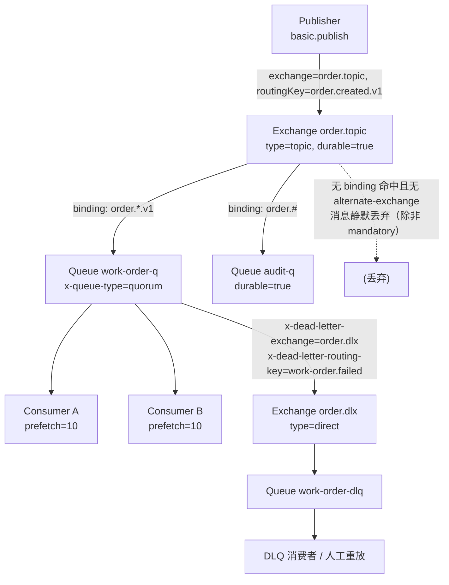
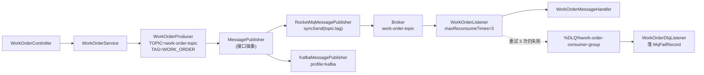
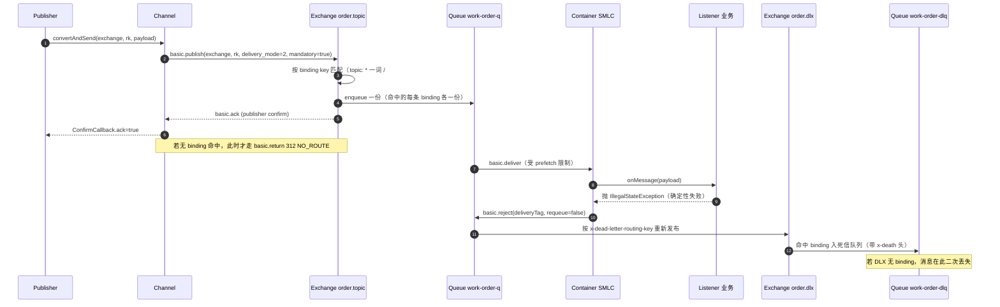

# 04-21 RabbitMQ 概念模型与 AMQP 协议：Exchange 给出最强的路由表达力，代价是「消息去哪了」不再写在你的代码里

> **一句话结论**：RabbitMQ 把「投递到哪个队列」从你代码里的一个队列名，拆成 `exchange + routing key → binding → queue` 的二级解析，解析表存在 broker 的元数据里而不是你的代码里；这让它的路由表达力在主流 MQ 里最强（fanout 广播、topic 通配、headers 按属性匹配一个不少），也让它的排障门槛最高——「发出去了没人收到」「消费者无限重投」「队列积压把内存打红」三件事的根因全都落在你读不到的那张表上。本项目没有引入它（C 类决策：只学不引），本篇是选型 / 原理文档 + 一份可执行的落地清单。
> **阅读前置**：看得懂 `topic + consumerGroup` 那种队列模型（同目录 [02-RocketMQ消息队列.md](02-RocketMQ消息队列.md)），知道 Spring 事务的提交时机（[01-transactional-事务拦截器与传播行为.md](../24-源码分析/01-Spring框架/03-事务管理/01-transactional-事务拦截器与传播行为.md)）；AMQP 的 Connection / Channel / vhost 这些词本篇首次出现时都会解释，不需要预先背。
> **证据基线**：「当前基线」指 Spring Boot 4.2.0 / Spring Cloud 2026.0.0 / Spring Cloud Alibaba 2025.1.0.0 / JDK 17 / Nacos 3.3 / Redis 7 / RocketMQ 5.1 这一套。A 级只引 `24-源码分析/assets/source/` 里**已在库**的 spring-tx 摘录；**spring-amqp 与 RabbitMQ 本体源码都不在本仓库**（已用 `Amqp|Rabbit` 过滤 assets/source 确认为空），因此凡涉及 broker 或客户端内部行为的结论一律标注「未入库，依据官方文档」并给出可自查的配置项 / 命令；B 级是本项目真实代码（`ai-cs-mq`、`ai-cs-common`、`deploy`），行号已逐条 read 核对；C 级是本机实测，但**本机没有 docker、没有 RabbitMQ、没有 RocketMQ**，所有探针只能证明「没装」，不能证明协议行为，文中会逐条写明「未实测，只给判读方法」。预计阅读 50 分钟。

## 0. 先看现象

三个症状都来自 RabbitMQ 生产环境的高频故障形态。**它们不是本机复现的**（本机无 RabbitMQ，见 §6.2 手法 1 的探测输出），日志文本按 RabbitMQ 官方日志格式与 Spring AMQP 异常类型书写，判读依据在每条之后给出。

**症状 1：消息发出去了，队列里一条没有，消费端一声不响。**

```text
# 生产端：调用成功，连 confirm 回调都告诉你 broker 收到了
2026-11-20T10:12:03.441  INFO 8124 --- [ntContainer#0-1] c.a.o.service.WorkOrderService : sent order-created, exchange=order.topic, rk=work.order.created.v2
2026-11-20T10:12:03.452 DEBUG 8124 --- [AMQP Connection 10.0.3.21:5672] o.s.a.r.c.CachingConnectionFactory : Publisher confirm received, ack=true, deliveryTag=1

# 管理台（15672）上交换机的出流量恒为 0，队列 Ready 恒为 0
# exchange order.topic : publish 1.0/s   |   messages out 0.00/s
# queue   work-order-q : ready 0  unacked 0  consumers 2

# broker 侧看绑定表，问题一眼可见：绑定键是 v1，发布用的是 v2
# rabbitmqctl list_bindings 输出节选
order.topic  work-order-q  work.order.created.v1  []
```

| 现象 | 你可能的第一反应 | 真正常见的原因 |
| --- | --- | --- |
| confirm `ack=true` 但队列 0 条 | 「消息丢了 / broker 有 bug」 | confirm 只承诺「交换机收到了」，**不承诺入队**；routing key 与 binding key 不匹配时消息被直接丢弃，若发布时没开 `mandatory`，broker 连一个 `basic.return` 都不会发给你 |
| 消费端完全静默 | 「消费者崩了」 | 队列上 `consumers 2` 说明消费者健康地挂着，只是在等永远不会来的消息 |
| 管理台看不出异常 | 「监控没告警就是没事」 | 「未路由消息数」默认不出现在队列维度指标里，要看交换机出流量或打开 `mandatory` 后的 returns 回调 |

**症状 2：消费者无限重投，一个核跑满，日志一分钟 40 MB。**

```text
2026-11-20T10:31:07.118 ERROR 8124 --- [ntContainer#2-1] o.s.a.r.l.SimpleMessageListenerContainer : Execution of Rabbit message listener failed, and the error handler threw an exception
org.springframework.amqp.rabbit.support.ListenerExecutionFailedException: Listener threw exception
Caused by: java.lang.IllegalStateException: ticket already closed, refuse to handle ticketNo=WO-20261120-0007
	at com.aics.order.service.WorkOrderMessageHandler.handle(WorkOrderMessageHandler.java:88) ~[classes/:na]

2026-11-20T10:31:07.119  WARN 8124 --- [ntContainer#2-1] o.s.a.r.l.SimpleMessageListenerContainer : Rejecting messages (requeue=true)
2026-11-20T10:31:07.121 ERROR 8124 --- [ntContainer#2-1] o.s.a.r.l.SimpleMessageListenerContainer : Execution of Rabbit message listener failed, ...
```

关键判读点：异常是**业务确定性失败**（「工单已关闭」重投一百次也不会变），而容器仍然 `requeue=true` —— 这是 spring-amqp `SimpleMessageListenerContainer` 的默认行为（`defaultRequeueRejected=true`，未入库，依据 spring-amqp 参考文档「Rejecting messages (requeue=true)」一节）。于是消息被放回队列头部，立刻又投给同一个消费者，形成**自旋**。注意 `x-death` 头在这条路径里**不会增长**：`requeue=true` 属于「退回队列」而不是「死信」，很多人盯着 `x-death` 看不出问题，就是被这一点带偏的。

**症状 3：队列积压，内存告警打红，生产端全部被阻塞。**

```text
# broker 日志（官方 alarm 格式）
2026-11-20 11:02:44.901 [warning] <0.812.0> memory resource limit alarm set on node 'rabbit@node1'.
2026-11-20 11:02:44.902 [warning] <0.812.0> Memory use: 3.1 GiB (61% of 5.1 GiB)

# 客户端侧：发布连接被 broker 主动 block，不是超时也不是拒绝
2026-11-20T11:02:45.013  WARN 8124 --- [AMQP Connection 10.0.3.21:5672] o.s.a.r.c.CachingConnectionFactory : Connection blocked, reason: low on memory
```

这条链路的因果是：消费者挂了 → 队列 Ready 增长 → 消息在内存里堆（持久化消息也不是立刻落盘，落盘由 `queue_index_embed_msgs_below` / 刷盘策略决定，未入库，依据官方文档「Memory alarms」与「Queues」两节）→ 达到 `vm_memory_high_watermark`（默认内存的 0.6）→ broker 对所有**发布连接**发 `connection.blocked` → 生产端写不进去、业务开始报「消息发送超时」。注意消费者连接**不会**被 block，这是设计上的救命通道：只要消费能恢复，水位就会降下来。

**这些现象指向同一件事：RabbitMQ 的「投递目标」是 broker 侧元数据（exchange + binding）算出来的，而不是你代码里写死的队列名；于是「发丢了」的根因不在发送代码里，「无限重投」的根因不在业务异常里，「积压」的根因不在消费者数量里。** 想排查它，先得能把这套元数据在脑子里画出来——这正是 §1 要做的事。

## 1. 整体地图

### 1.1 AMQP 0-9-1 的对象层次与一条消息的路由路径



> **读图说明**：全图只有一个分叉点值得盯——从 `EX` 出去的三条边。第一条和第二条是两条 binding：**同一条消息会被复制成多份进多个队列**（这是 RabbitMQ 相对 RocketMQ 的核心表达力来源，也是「发一条变成三条」类事故的来源）；第三条虚线边是**丢弃**，它不是错误分支而是默认分支——没有 `mandatory` 时 broker 认为「没有 binding 命中」是合法结果，连日志都不打。把虚线边看成异常路径，就会得出「消息丢了要查 broker」的错误结论；把它看成正常路径，才会去查 binding 表。另外注意 `Q1` 有两条消费者边：队列是竞争消费（每条消息只给一个消费者），不是广播；要在 RabbitMQ 里做广播，靠的是 `fanout` 交换机 + 每个消费者自己一个队列，而不是给同一个队列挂多个消费者。

### 1.2 本项目当前的真实链路：RocketMQ 的 Topic + Tag 模型

不画这张图，后面所有对照都会飘。本项目消息链路的真实骨架在 `ai-cs-mq`，与 RabbitMQ 的 Exchange/Binding 是**两种不同的抽象**。



> **读图说明**：看图上的两条边就够。第一，`C → D → E`：业务代码只依赖 `MessagePublisher` 接口，`topic` 与 `key` 两个参数被 RocketMQ 解释成 `Topic` 与 `Tag`（`ai-cs-common/src/main/java/com/aics/common/mq/MessagePublisher.java#L9-L14`），被 Kafka 解释成 `Topic` 与 `Record Key`——也就是说项目把「路由」压缩成了两个字符串，**没有 exchange 这一层**。第二，`G -.-> I`：RocketMQ 的重试与死信是**服务端内建**的（`maxReconsumeTimes` + `%DLQ%<consumerGroup>` 命名约定），不需要你声明任何路由元数据；而 RabbitMQ 里同样的能力要你自己声明 `x-dead-letter-exchange` 并维护绑定，这是两种运维成本的本质区别。

### 1.3 组件、责任与落地状态

| 组件 | 责任 | 本项目落点（B 级） | 缺口与风险 |
| --- | --- | --- | --- |
| `Exchange` + `Binding` + `Queue` 元数据 | 决定一条消息被复制到哪些队列 | **未落地**：全仓 `pom.xml` grep `amqp\|rabbit` 0 命中，`deploy` 无 RabbitMQ 服务 | 没有这套元数据，就没有「按通配符路由」的能力；本项目用「多 Topic 或消费端过滤」等价实现 |
| 发布抽象 | 屏蔽具体 broker | `ai-cs-common/src/main/java/com/aics/common/mq/MessagePublisher.java#L33-L46` | 只有 `send` / `sendDelayed` / `brokerType` 三个方法，没有 mandatory / confirm / return 的对应物（RocketMQ 用同步发送 + 异常表达） |
| RocketMQ 实现 | 同步发送、延迟分级、失败抛异常 | `ai-cs-common/src/main/java/com/aics/common/mq/rocketmq/RocketMqMessagePublisher.java#L41-L49` | 延迟只有 18 个固定级别（同文件 L25-L30），超 2 小时直接抛异常（L83-L94） |
| Kafka 实现（双栈演示） | 同契约第二实现 | `ai-cs-common/src/main/java/com/aics/common/mq/kafka/KafkaMessagePublisher.java#L25-L27` | 延迟消息「降级为进程内 `TaskScheduler`，进程重启即丢失」——与 RabbitMQ 的 TTL+DLX 相比，这是能力缺失而不是风格差异 |
| 消费者与重试 | 有限重试 + 死信兜底落库 | `ai-cs-mq/src/main/java/com/aics/mq/consumer/WorkOrderListener.java#L33-L37`、`ai-cs-mq/src/main/java/com/aics/mq/consumer/WorkOrderDlqListener.java#L68-L77` | 死信只落 `MqFailRecord`（status=PENDING），**没有自动重放**，需要人工触发 |
| 进程内 STOMP 通道 | 前端实时通知 | `ai-cs-notify/src/main/java/com/aics/notify/config/StompWebSocketConfig.java#L22-L26`（`enableSimpleBroker`） | SimpleBroker 是**单实例内存**广播；RabbitMQ 的 STOMP 插件常被拿来替代它做跨实例广播，本项目未引入（见 §5 可扩展点 6） |

### 1.4 一张表把三家 MQ 的「同一个词」对齐

跨 MQ 对照时最大的干扰是「词相同、含义不同」。下表左边是 RabbitMQ 的协议概念，中间两列是它在另外两家里的最接近物——注意「最接近物」不等于「等价物」，最后一列写清了差异造成的实际后果。

| RabbitMQ 概念 | RocketMQ 最接近物 | Kafka 最接近物 | 差异造成的实际后果 |
| --- | --- | --- | --- |
| Topic（AMQP 里没有这个概念） | Topic | Topic | RabbitMQ 的「Topic」是 exchange 的**类型名**（`type=topic`），不是消息容器；初学最大的术语陷阱 |
| Exchange + Binding | 无（Tag 只是消息属性） | 无（Key 只决定分区） | 一条消息进多个队列在 RabbitMQ 是元数据配置，在另两家是「发多次」或「多个消费组」 |
| routing key | Tag / Key | Record Key | 只有 RabbitMQ 的 key 参与「选队列」；RocketMQ 的 Tag 是过滤条件、Kafka 的 Key 是分区选择器 |
| Queue | MessageQueue（Topic 下的队列分片） | Partition | RabbitMQ 的队列必须显式创建和绑定；RocketMQ/Kafka 的分片由 broker 管理 |
| vhost | 无（用不同集群隔离） | 无（用不同集群隔离） | 多租户在 RabbitMQ 里成本最低（一个 broker 多个 vhost） |
| consumer + prefetch | consumerGroup + 消费位点 | consumerGroup + offset | RabbitMQ 的消费进度是「逐条 ack」，另两家是「位点提交」；前者可单条重投，后者只能回拨位点 |
| `x-dead-letter-exchange` | `%DLQ%<consumerGroup>`（内建） | 无内建（自己写） | 只有 RabbitMQ 需要手工保证 DLX 与 DLQ 的 binding 一致 |
| `x-message-ttl` + DLX | 18 级 `delayLevel`（内建） | 无内建 | 见 §3.6 三种实现与各自的丢失路径 |

## 2. 关键概念与关键类

「位置」一列写清证据等级：`broker`/`client` 表示协议或客户端库概念，**源码未入库**，只能按官方文档描述；写具体文件路径的才是 A/B 级。

| 名称 | 位置 | 角色 | 关键方法 / 参数 |
| --- | --- | --- | --- |
| Connection | AMQP 0-9-1 规范（未入库） | 一条 TCP 上的 AMQP 连接，承载认证、vhost 选择、心跳 | `ConnectionFactory.newConnection()`；心跳 `heartbeat`；`connection.blocked` 通知在此层 |
| Channel | AMQP 0-9-1 规范（未入库） | 连接上的逻辑多路复用通道，**所有帧都带 channel id** | `connection.createChannel()`；一个 Channel 上不能同时开 tx 和 confirm |
| vhost | AMQP 0-9-1 规范（未入库） | 逻辑隔离域，交换机/队列名在 vhost 内唯一 | 连接时指定；权限三元组 configure / write / read |
| Exchange | AMQP 0-9-1 规范（未入库） | 「往哪去」的第一级解析器 | `exchange.declare(name, type, durable, autoDelete, arguments)` |
| Queue | AMQP 0-9-1 规范（未入库） | 消息真正的存储与投递单位 | `queue.declare(queue, durable, exclusive, autoDelete, arguments)` |
| Binding | AMQP 0-9-1 规范（未入库） | exchange 与 queue 之间的「路由规则」条目 | `queue.bind(queue, exchange, routingKey, arguments)` |
| routing key | AMQP 0-9-1 规范（未入库） | 发布时由生产者给出，broker 用它做匹配 | `basic.publish(exchange, routingKey, ...)`；字节上限 255（官方文档） |
| binding key | AMQP 0-9-1 规范（未入库） | 绑定时给出，与 routing key 匹配；topic 型支持 `*` / `#` | `queue.bind` 的 routingKey 参数 |
| publisher confirm | AMQP 扩展（RabbitMQ 提案，未入库） | broker 对「交换机收下了」的异步承诺 | `channel.confirmSelect()`；`basic.ack` / `basic.nack` 回调 |
| mandatory + basic.return | AMQP 0-9-1 规范（未入库） | 无 binding 命中时把消息退回生产者，而不是静默丢弃 | `basic.publish` 的 `mandatory` 标志位；返回码 312 NO_ROUTE |
| alternate-exchange | RabbitMQ 扩展（未入库） | 无 binding 命中时转到备用交换机，兜底而不吞消息 | exchange 参数 `alternate-exchange` |
| consumer ack / nack / reject | AMQP 0-9-1 规范（未入库） | 消费确认；`reject` 是标准、`nack` 是 RabbitMQ 扩展（支持 multiple） | `basic.ack` / `basic.nack(requeue)` / `basic.reject(requeue)` |
| prefetch / QoS | AMQP 0-9-1 规范（未入库） | 单个消费者最多持有多少未确认消息，即消费端的背压旋钮 | `basic.qos(prefetchCount, global)` |
| DLX / `x-death` | RabbitMQ 扩展（未入库） | 死信交换机与死信审计头（记录原因、次数、来源队列） | 队列参数 `x-dead-letter-exchange`、`x-dead-letter-routing-key` |
| TTL | RabbitMQ 扩展（未入库） | 消息过期时间，是延迟队列的常用实现手段 | 队列参数 `x-message-ttl`、消息属性 `expiration`、队列空闲期 `x-expires` |
| Quorum Queue | RabbitMQ 3.8+ 内建（未入库） | 基于 Raft 的复制队列，镜像队列的替代者 | 队列参数 `x-queue-type=quorum`；`delivery-limit` |
| heartbeat | AMQP 0-9-1 规范（未入库） | 连接空闲时的双向探测，用于发现「半死连接」 | 协商值 `heartbeat`（秒）；超时两次即断连并触发客户端重连 |
| consumer tag | AMQP 0-9-1 规范（未入库） | 消费者在 channel 内的标识，取消订阅时用它 | `basic.consume(tag)` / `basic.cancel(tag)`；Spring 容器按 tag 管理并发消费者 |
| reply-to / correlationId | AMQP 0-9-1 规范（未入库） | 实现 RPC 式请求-响应的两个消息属性 | `basic.publish` 的 `reply-to`；响应端回填 `correlationId` 由调用方配对 |
| `BasicProperties` | AMQP 0-9-1 规范（未入库） | 消息属性集合（`deliveryMode`、`expiration`、`priority`、`headers` 等） | `deliveryMode=2` 即持久化消息；`priority` 仅在 `x-max-priority` 队列生效 |
| MessageConverter | spring-amqp（client，未入库） | Java 对象与 AMQP 消息体的转换器 | `Jackson2JsonMessageConverter`；需配 `trustedPackages`，否则反序列化被拒 |
| `AmqpRejectAndDontRequeueException` | spring-amqp（client，未入库） | 「确定性失败」的语义化异常：抛出即 `requeue=false`，绕过重试 | 业务校验失败时抛它，而不是抛业务异常让容器自旋 |
| `RepublishMessageRecoverer` | spring-amqp（client，未入库） | 重试耗尽后把消息**重新发布**到死信交换机，并附带 `x-exception-*` 头 | 重发会改变 `messageId`，幂等键必须自己塞进 header |
| `RabbitAdmin` | spring-amqp（client，未入库） | 启动时执行声明动作，`@Bean` 三件套的落地执行者 | `autoStartup=false` 或声明失败会静默跳过，必须看启动日志 |
| RabbitTemplate | spring-amqp（client，未入库） | 发布端门面，线程安全 | `convertAndSend(exchange, routingKey, payload)`、`setConfirmCallback`、`setReturnsCallback`、`setMandatory(true)` |
| `@RabbitListener` / `SimpleMessageListenerContainer` | spring-amqp（client，未入库） | 消费端容器，管并发、预取、拒绝策略 | `setPrefetchCount`、`setConcurrentConsumers`、`setDefaultRequeueRejected(false)` |
| AmqpAdmin | spring-amqp（client，未入库） | 声明 exchange / queue / binding 的编程入口 | `declareExchange`、`declareQueue`、`declareBinding` |
| `TransactionalEventListener` | [[源码:TransactionalEventListener.java.md#L28-L43]]（spring-tx 7.1.0 摘录，A 级） | 本项目在「MQ 无事务消息」时用来做事务提交后补发的机制 | `phase = AFTER_COMMIT`；事务外发布需 `fallbackExecution = true` |

## 3. 原理与证据逐段精读

### 3.1 Connection / Channel / vhost：为什么一条 TCP 上要再分一层

**在干什么**：生产者先建立 Connection（TCP + 认证 + 选 vhost），再在连接上开 Channel；此后所有 `queue.declare`、`basic.publish`、`basic.consume` 都在某个 channel 上发出，帧头里带 channel id，broker 按 id 把回包路由回调用者。

**为什么这么设计**：AMQP 是 2000 年代的设计，一条 TCP 连接要付 TLS 握手和认证的开销；多线程应用如果每个线程一条连接，broker 侧的连接数会随线程数线性膨胀（每个连接在 Erlang 侧都是一个进程 + 缓冲区）。Channel 把「协议状态」和「TCP 连接」解耦：一个进程一条连接、N 个线程各用一个 channel，是 RabbitMQ 官方推荐的默认用法（未入库，官方文档 Connection 一节）。

**换写法会怎样**：不用 Channel 而用「每请求建连」的写法，本地压测看不出问题，一上生产就在 `rabbitmqctl list_connections` 看到上万连接、`too many connections` 或 fd 打满；反过来，把**同一个 Channel 给多线程共享**会得到帧交错或 `AlreadyClosedException`——因为 Channel 不是线程安全的，协议层没有为并发写同一个 channel 做加锁。Spring AMQP 的 `RabbitTemplate` 之所以敢声明线程安全，是因为它内部通过 `CachingConnectionFactory` 按需借出 channel（默认缓存 25 个），而不是共享一个。

**常见坑**：① 在 Channel 上同时开 `txSelect()` 和 `confirmSelect()` —— 二者互斥，broker 会回 `precondition_failed`；② `vhost` 当命名空间随手用，结果跨 vhost 的 binding 永远建不起来（binding 只能在同一 vhost 内连接 exchange 与 queue）；③ 默认 `guest` 账号只能从 localhost 登录（官方安全默认值），容器里用 `guest` 连远程 broker 会得到 `ACCESS_REFUSED - Login was refused using authentication mechanism PLAIN`。

### 3.2 四种 Exchange 与路由键匹配规则

**在干什么**：`Exchange` 是路由的第一级解析器，`Binding` 是规则条目，`routing key` 是消息携带的输入。四种类型对应四套匹配算法：

| 类型 | 匹配算法 | 一条消息的去向 | 典型用法 |
| --- | --- | --- | --- |
| `direct` | `routing key` 与 `binding key` **逐字节相等** | 命中几条 binding 就进几个队列 | 按固定业务码分派（`order.paid` → 支付队列） |
| `fanout` | **忽略** routing key，所有绑定队列全收 | 所有绑定队列各一份 | 广播：缓存失效通知、审计镜像 |
| `topic` | binding key 按 `.` 分词，`*` 匹配**恰好一个**词，`#` 匹配**零个或多个**词 | 命中的 binding 全部投递 | 多维订阅：`order.*.paid`、`order.#` |
| `headers` | 忽略 routing key，按消息 headers 与 binding arguments 比对，`x-match=all`（缺省）或 `any` | 命中的 binding 全部投递 | routing key 表达不了的复合条件：`region=cn` 且 `priority=high` |

`topic` 的匹配规则值得单列一张表，因为它是唯一「看起来像正则、实际不是」的地方：

| binding key | routing key | 是否命中 | 原因 |
| --- | --- | --- | --- |
| `order.*.v1` | `order.created.v1` | 命中 | `*` 恰好吃掉 `created` 一个词 |
| `order.*.v1` | `order.created.paid.v1` | 不命中 | `*` 不能跨词 |
| `order.*` | `order` | 不命中 | `*` 要求**恰好一个**词，`order` 没有第二段 |
| `order.#` | `order` | 命中 | `#` 可匹配**零个**词（这条最容易记错） |
| `#.v1` | `v1` | 命中 | `#` 匹配零词后剩下的 `v1` 对齐 |
| `order.#` | `order.created.v1` | 命中 | `#` 吃多个词 |

`headers` 型交换机没有 routing key 参与，规则写在 binding 的 arguments 里，`x-match` 决定「全中」还是「命中一个即可」：

| binding arguments | 消息 headers | 是否命中 | 原因 |
| --- | --- | --- | --- |
| `x-match=all, region=cn, priority=high` | `region=cn, priority=high, retry=0` | 命中 | `all` 要求 binding 里每个键值都在 headers 中存在且相等，多余的 header 不影响 |
| `x-match=all, region=cn, priority=high` | `region=cn` | 不命中 | 缺 `priority` |
| `x-match=any, region=cn, priority=high` | `region=us, priority=high` | 命中 | `any` 只要有一个键值相等即可 |
| 不写 `x-match` | `region=cn, priority=high` | 命中 | `x-match` 缺省按 `all` 处理（未入库，依据官方文档 Exchange 一节） |

**为什么这么设计**：`direct` 是 O(1) 哈希查找，`fanout` 是一次遍历，`topic` 是按词分段的字典树匹配（broker 内部维护 trie，未入库，官方文档 Exchange 一节描述其匹配按词进行）。之所以不加正则，是因为正则在每条消息的热路径上都要跑一次，而 `*`/`#` 两符号的 trie 可以做到与消息速率基本无关的查找成本。`headers` 慢得多（要遍历 arguments 比较），所以官方把它定位成「其他类型都不合适时才用」。

**换写法会怎样**：如果像 RocketMQ 那样只有 `Topic + Tag`，要表达「一个事件送三个下游、其中一个只要 v1、另一个要全部」就得建 3 个 Topic（或 1 个 Topic + 3 个 consumerGroup + 消费端过滤），生产端要发 3 次或写很别扭的分支；RabbitMQ 里这是**一条 publish + 三条 binding**，而且加第四个下游时不用改生产端。这就是「表达力最强」的实际含义：**变更成本落在 binding 上，而不是落在代码上**——代价也在这里，binding 是谁建的、当前是什么样，你的代码里看不见。

**常见坑**：① 用 `#` 当「前缀」写 `order.#` 以为只匹配 `order.xxx`，其实 `order` 本身也命中，导致「空路由键的测试消息」也进了生产队列；② `fanout` 交换机的 binding key 被忽略，写上去以为生效了（管理台会显示但无意义）；③ 默认交换机（名字为空串 `""`）隐式把**每个队列**按队列名绑定，所以 `convertAndSend("hello", msg)` 能跑通——一旦有人误以为这是「按队列名路由」的通用规则，就会在建了显式 exchange 之后依然只传队列名，消息进默认交换机、与显式 binding 无关，正好撞上症状 1。

### 3.3 publisher confirm / mandatory / returns：三种「可靠性」不是一回事

**在干什么**：`confirm` 模式下 broker 会对每条 publish 异步回 `basic.ack`（已由交换机接收）或 `basic.nack`（交换机拒收，例如内部错误）；`mandatory` 标志让 broker 在「交换机收到但没有任何队列接收」时回一条 `basic.return`；`alternate-exchange` 则把这批「无处可去」的消息转给备用交换机。

| 机制 | 解决什么 | 不解决什么 | 触发方式 |
| --- | --- | --- | --- |
| publisher confirm | 生产者 → 交换机 之间是否送达 | **是否入队**（无 binding 命中时依然是 ack=true） | `channel.confirmSelect()` 或 Spring 的 `publisher-confirm-type=correlated` |
| mandatory + basic.return | 无 binding 命中时把消息退回，而不是静默丢弃 | 退回之后要你自己处理（记日志 / 落库 / 重发） | `setMandatory(true)` + `setReturnsCallback(...)` |
| alternate-exchange | 兜底一个兜底队列，把「路由不中」变成可观测流量 | 兜底队列自己塞满时仍然会积压 | exchange 参数 `alternate-exchange=order.ae` |

**为什么这么设计**：这三件事在 AMQP 0-9-1 里对应三个不同的语义层：confirm 是「链路级」确认（可靠性），return 是「路由级」反馈（正确性），AE 是「运维级」兜底（可观测性）。把它们合并成一个开关的话，broker 就必须为每条消息查 binding 表并维护返回通道，吞吐会掉；RabbitMQ 的选择是「默认全关，谁要谁开」，于是默认配置下**路由失败是完全静默的**。

**换写法会怎样**：把 confirm 当成「消息一定进队列了」是最高频的误判（症状 1 的日志里 `ack=true` 和 `ready 0` 同时出现）。反过来，如果为了绝对安全把 confirm + mandatory + 手动 ack + quorum 全开到最大，单条消息的往返会变成「publish → fsync 到多数派 → 返回 confirm → 消费 → ack」，官方文档明确说明同步 confirm 与批量 confirm 的吞吐差距可达一个数量级——这就是 §5 取舍表里「可靠性 vs 吞吐」那一行的现实来源。

**常见坑**：① Spring AMQP 里 `publisher-confirm-type=none` 是默认值，确认回调压根不注册，`setConfirmCallback` 写了也不触发；② `setMandatory(true)` 开了但没设 `ReturnsCallback`，退回的消息只进日志；③ `basic.nack` 的 `multiple` 语义（一次确认/拒绝 deliveryTag 之前的所有消息）被误用成「只拒一条」，导致批量丢消息。

### 3.4 consumer ack / nack / reject 与 prefetch：无限重投的机制就在这里

**在干什么**：消息投递给消费者后处于 unacked 状态，消费者必须显式确认：`basic.ack(deliveryTag)` 表示处理成功、从队列删除；`basic.reject(deliveryTag, requeue)` 表示拒收，`requeue=true` 放回队列（可能投给其他消费者），`requeue=false` 丢弃或进死信；`basic.nack(deliveryTag, multiple, requeue)` 是 RabbitMQ 扩展，一次处理多个。`basic.qos(prefetchCount)` 限定「一个消费者手上最多压多少条未确认」。

**为什么这么设计**：ack 是「至少一次」语义的基石——broker 只有在拿到 ack 之后才删消息，所以消费者进程被 kill 时消息会回到队列（并被打上 `redelivered=true`）。而 prefetch 是**唯一的消费端背压旋钮**：不设上限时 broker 会把队列里的消息尽可能快地下发，消费者内存里堆积几千条、业务线程却在等数据库，表现就是「消费者没满负荷但延迟很高」。

把 §3.4 的机制压成一张决策矩阵——**「重试」和「拒绝」是两个独立决策**，把它们的组合列全，就知道默认配置错在哪：

| 失败类型 | 默认（AUTO ack + `defaultRequeueRejected=true`） | 仅关掉默认重入队 | 再叠 `retry.enabled=true`（3 次） |
| --- | --- | --- | --- |
| 下游瞬时故障（超时、连接拒绝） | 无限重投，靠运气自愈，期间 CPU 与日志双爆 | 立刻进死信，可靠性下降 | 同一 delivery 内退避重试 3 次，仍失败才进死信（推荐） |
| 业务确定性异常（订单已关闭） | 无限自旋 | 立刻进死信，可人工处理 | 3 次重试纯属浪费，应抛 `AmqpRejectAndDontRequeueException` 跳过重试 |
| 反序列化失败（脏消息/毒消息） | 无限自旋，毒消息长期占用消费能力 | 立刻进死信 | 重试无效，必须直接拒绝 |
| 手动 ack 模式漏 ack | `unacked` 涨到 prefetch 上限后停收 | 同左 | 同左（重试救不了漏 ack） |

**换写法会怎样**：设 `prefetch=0`（无限制）时，积压会从 broker 内存「搬」到消费者堆里，broker 侧指标看起来很健康（`ready` 很小），OOM 发生在业务服务上——这是排查时最容易走错方向的一个不对称现象。把 prefetch 设成 1，则吞吐完全由往返时延决定，长事务处理场景会比 prefetch=10 慢一个量级。

**常见坑**：① **确定性失败 + `requeue=true` = 自旋**（症状 2）：消息立刻回到队头，同一个消费者再拿到，CPU 打满但消息一条没前进。`defaultRequeueRejected=true` 是 spring-amqp 的默认值，所以「抛异常就自动重投」是默认行为而不是意外行为；正确做法是 `setDefaultRequeueRejected(false)`（或 `AmqpRejectAndDontRequeueException`）把不确定性失败（网络抖动）留给 `RetryTemplate` 重试、把确定性失败直接进死信。② `requeue=true` **不产生 `x-death` 头**，盯着死信指标查自旋会一无所获。③ 手动 ack 模式（`AcknowledgeMode.MANUAL`）下忘了 ack 或忘在 finally 里 ack，消息永远不会被删，`unacked` 一路涨到 prefetch 上限后消费者**完全停止收消息**——队列看起来「有人在消费」，实际一动不动。

### 3.5 持久化三要素与投递确认链：为什么「三要素齐了」还不够

**在干什么**：一条消息在 RabbitMQ 里要活过「broker 重启」，需要四个条件同时成立：exchange `durable=true`、queue `durable=true`、消息 `delivery_mode=2`（持久化消息）、以及消息落在**已同步**的存储上（Quorum Queue 的多数派 fsync，或 classic queue 的刷盘策略）。

| 要素 | 声明位置 | 单独缺失的后果 |
| --- | --- | --- |
| exchange durable | `exchange.declare(durable=true)` | 重启后交换机消失，发布直接 `404 NOT_FOUND`，binding 一并丢失 |
| queue durable | `queue.declare(durable=true)` | 重启后队列消失，**队列里的消息一起消失** |
| message delivery_mode=2 | `basic.publish` 的消息属性 | 消息在内存里，重启即丢（哪怕队列是 durable） |
| 复制（quorum） | `x-queue-type=quorum` | 单节点 durable 只保证「本节点不丢」，节点磁盘挂了就没了 |

**为什么这么设计**：AMQP 把「结构持久化」和「消息持久化」分成两次声明，是因为两者生命周期不同——交换机与绑定是运维元数据（建一次用一年），消息是数据；把两者绑在一起会让「临时队列 + 持久化消息」这类组合无法表达。代价是**你有四次机会漏掉其中一项**，而且漏了都不报错，只在重启那天暴露。

**换写法会怎样**：`durable=false` + `autoDelete=true` 的临时队列在 RPC 模式（reply-to）里是正确用法（用完即删，不占元数据），但把它误用到业务队列上，一次 broker 重启就丢一整天数据。另一种常见替代是「不开持久化，靠下游重放」——这要求上游有完整的可重放来源（本项目里等价于依赖 `MqFailRecord` + 业务表对账，见 `ai-cs-mq/src/main/java/com/aics/mq/consumer/WorkOrderDlqListener.java#L68-L77`）。

**常见坑**：① 声明参数与既有队列不一致 → `PRECONDITION_FAILED - inequivalent arg 'durable' for queue 'work-order-q' in vhost '/'`，然后 channel 被关闭；改参数必须删队列重建（生产上是数据迁移事件，不是配置修改）。② 以为「持久化 = 更快落盘」，事实上持久化消息在内存水位高时会被换出到磁盘，吞吐显著下降。③ 只做了 durable 没做 confirm：broker 在落盘前崩溃，生产者以为发成功——这就是「三要素齐了仍丢消息」的那一环，必须由 confirm 补上。

### 3.6 TTL 与死信交换机：延迟队列的三种实现与各自的坑

**在干什么**：TTL 给消息或队列设过期时间，过期消息在队列内部被取出，若队列配了 `x-dead-letter-exchange`，它会被**重新发布**到该交换机（可指定 `x-dead-letter-routing-key` 覆盖原 routing key），这就是「延迟队列」的经典实现。触发死信的条件有四种：消费者 `reject`/`nack` 且 `requeue=false`、消息 TTL 到期、队列长度超 `x-max-length`、Quorum Queue 超过 `delivery-limit`。

| 实现方式 | 配置 | 精度与限制 | 适用与坑 |
| --- | --- | --- | --- |
| 队列级 TTL + DLX | 队列参数 `x-message-ttl=60000` + `x-dead-letter-exchange` | 整个队列同一延迟；配置极简 | 只支持「单一延迟值」；要做 5s/30s/5min 三档就得建三个队列三套 binding |
| 消息级 TTL + DLX | 消息属性 `expiration`（字符串毫秒） | **队头阻塞**：过期检查只发生在队头，队头是一条 1 小时的消息时，后面 1 秒的消息也压着 | 只适合「延迟单调递增」的队列；这是旧稿没写、但线上一律踩过的坑 |
| `rabbitmq_delayed_message_exchange` 插件 | exchange 类型 `x-delayed-message`，消息头 `x-delay` | 支持任意延迟，语法最贴近业务直觉 | 插件把延迟消息存在**声明该交换机的节点本地**，不做跨节点复制（未入库，依据该插件 README），节点故障会丢；生产关键路径不建议 |

**为什么这么设计**：AMQP 0-9-1 规范里**没有延迟消息**这个原语，TTL + DLX 是拿两个已有机制拼出来的（过期 → 死信 → 重投）。官方一直不把延迟做成一等公民，原因是「延迟」在分布式里意味着定时器与持久化状态的组合，做进协议核心会显著增加 broker 复杂度；插件化让需要的人自己承担风险。

**换写法会怎样**：本项目的 RocketMQ 路线里，延迟是**固定 18 级**（`ai-cs-common/src/main/java/com/aics/common/mq/rocketmq/RocketMqMessagePublisher.java#L25-L30`），超过 2 小时直接抛异常并提示「改用定时任务或延迟队列」（同文件 `#L83-L94`）；Kafka 侧则直接降级为进程内 `TaskScheduler`，`KafkaMessagePublisher` 的注释写明「进程重启即丢失」（`ai-cs-common/src/main/java/com/aics/common/mq/kafka/KafkaMessagePublisher.java#L25-L27`）。三种实现的共同结论：**跨 broker 的「任意精度延迟」都不是免费的**，选型时应先问「延迟精度要求是多少、允许丢吗」。

**常见坑**：① 死信交换机上**没有**任何 binding，消息进 DLX 后再次静默丢弃——死信也会二次失踪，这是「配了 DLX 却没收到死信」的第一原因；② 用 `x-dead-letter-routing-key` 后忘了 DLQ 的 binding key 要对得上，同样静默丢；③ `expiration` 必须是**字符串**（AMQP 属性类型），写成整数在某些客户端会被序列化成 `0`，于是消息立刻过期。

### 3.7 镜像队列 vs Quorum Queue：3.8 之后的正确答案

**在干什么**：两种「队列数据复制」方案。镜像队列（classic mirrored queue）把同一个 classic 队列在多个节点上做全量镜像，主节点负责读写、从节点同步；Quorum Queue 基于 Raft，一条消息要写入多数派才算成功，选主由 Raft 完成。

| 维度 | 镜像队列（classic mirroring） | Quorum Queue |
| --- | --- | --- |
| 引入 / 状态 | 2.x 时代方案；**3.9 起标记为弃用，4.0 起移除**（未入库，依据官方 4.0 release notes） | 3.8.0 引入，3.8+ 官方推荐用于复制队列 |
| 一致性模型 | 主从异步同步，主节点故障可能丢最近未同步的消息 | Raft 多数派提交，被确认的消息不丢 |
| 队列类型限制 | 仅 classic | 要求 `durable=true`，不支持 `exclusive` / 非持久化队列，不支持优先级 |
| 故障切换 | 主节点挂 → 从节点提升，期间该队列不可用（经典镜像不提供自动重连选主） | Raft 自动重新选主，客户端断连重连 |
| 运维 | 需要 policy 配置 `ha-mode`/`ha-params`，容易配成「全镜像」压垮集群 | 队列声明时写 `x-queue-type=quorum`，复制因子由集群节点数决定 |
| 内存与磁盘 | 全量镜像占 N 倍内存 | 每节点一段 Raft 日志，磁盘占用更可控 |

**为什么这么设计**：镜像队列的一致性模型（异步主从 + 手工 policy）在节点故障时无法保证「已确认的消息不丢」，而这对订单、支付类业务是致命的；Quorum Queue 用 Raft 把「已确认」定义成「多数派已写入」，代价是每次写入多一次网络往返、延迟上升。官方在 4.0 直接删掉镜像，本质是承认旧方案的正确性无法修补。

**换写法会怎样**：继续在 3.13 上用镜像队列并不是「保守」，而是**在一条已被官方删除的路上继续走**——升级到 4.x 时要么被迫迁移，要么钉死在 3.x。反过来，全部换成 Quorum Queue 也不是无痛：单条消息的写延迟从「本地写」变成「多数派写」，`x-max-priority` 这类特性直接不可用，临时队列（`exclusive`）必须改成 classic。

**常见坑**：① 用 quorum 队列却声明了 `durable=false` → `PRECONDITION_FAILED - invalid arg 'x-queue-type'`；② 把 `delivery-limit` 当成「重试次数」但不配 DLX，于是超限消息被丢弃；③ 迁移时直接改 policy 不会把已有 classic 队列变成 quorum，必须新建队列 + 迁移数据（shovel / federation 或停机切流）。

### 3.8 流控与内存告警：生产端被阻塞不是故障，是背压

**在干什么**：broker 有两个硬阈值：内存 `vm_memory_high_watermark`（默认 0.6，即物理内存的 60%）与磁盘 `disk_free_limit`（默认 50MB）。任一被突破就触发 alarm，broker 主动向所有**发布**连接发送 `connection.blocked`，客户端停止写；消费者连接不受影响。此外 3.2+ 默认启用基于信用的流控（credit flow），队列处理不过来时对发布端限速。

| 机制 | 默认值 | 作用对象 | 观测点 |
| --- | --- | --- | --- |
| `vm_memory_high_watermark` | 0.6 | 发布连接 | broker 日志 `memory resource limit alarm set`；客户端 `Connection blocked, reason: low on memory` |
| `disk_free_limit` | 50MB | 发布连接 | 日志 `disk free space limit`；`rabbitmqctl status` 的 `alarms` 字段 |
| credit flow | 开启 | 发布连接（按队列） | 发布端吞吐曲线出现平台期，但无异常 |

**为什么这么设计**：Erlang VM 的 GC 与内存放大在「用满」之后会导致整节点不可用（OOM kill 会牵连所有 vhost 的所有队列），所以官方选择**在 60% 就刹车**，把压力反弹给生产者而不是自己死。消费者不 block 是关键设计：只要消费能继续，水位自然会降。

**换写法会怎样**：把 watermark 调到 0.95 换取「更大的缓冲」，短期看发布不再被阻塞，长期看是拿**整节点不可用**换**队列更长**；正确的方向是给队列设 `x-max-length` + `x-overflow: reject-publish`（发布被 nack，形成可观测的背压），或者干脆在应用侧做限流。反过来，把水位降到 0.3 而消费能力不足，会让发布频繁阻塞、业务报「消息发送超时」，看起来像 broker 性能问题，实际是消费侧欠账。

**常见坑**：① 看到 `Connection blocked` 就去调大 watermark —— 这是把症状当原因；② `x-overflow: reject-publish` 与 publisher confirm 一起用时，被拒消息表现为 `basic.nack`，很多客户端把 nack 当「可重试」而无脑重试，反而加剧积压；③ 队列 `ready` 指标正常但内存告警，说明是 `unacked` 在涨（见 §3.4 坑 ③）。

### 3.9 Spring AMQP 的抽象：RabbitTemplate 与 Listener 容器把哪些细节藏了起来

**在干什么**：`RabbitTemplate` 是发布端门面（线程安全，内部借 channel），`@RabbitListener` + `SimpleMessageListenerContainer`（SMLC）是消费端容器（管并发、预取、ack 模式、异常处理），`AmqpAdmin` 负责声明 exchange/queue/binding，`RabbitTransactionManager` 提供 channel 级事务。

| 项目里你会写的 | AMQP 层面真正发生的事 | 藏起来的坑 |
| --- | --- | --- |
| `rabbitTemplate.convertAndSend("order.topic", "order.created.v1", msg)` | 序列化 + `basic.publish(exchange, routingKey, mandatory=false)` | 未开 `mandatory` 时路由失败完全静默（§3.3） |
| `@RabbitListener(queues = "work-order-q")` | `basic.consume` + 自动 ack（`AUTO` 模式：方法正常返回即 ack） | 方法返回前进程崩溃 → 消息重回队列并 `redelivered=true`，业务必须幂等 |
| 抛异常 | 容器 `basic.reject(requeue=true)`（默认） | 确定性失败 → 自旋（§3.4 坑 ①） |
| `setAcknowledgeMode(MANUAL)` | 你拿到 `Channel`，自己 ack | 忘了 ack → `unacked` 涨到 prefetch 上限后停收 |
| `setPrefetchCount(10)` | `basic.qos(10)` | 与 `concurrency` 相乘才是「本实例持有的未确认上限」 |
| `@Bean Queue/Exchange/Binding` + `AmqpAdmin` | 启动时 `queue.declare` 等幂等声明 | 与线上已有队列参数不一致 → `PRECONDITION_FAILED`，容器起不来 |
| `RabbitTransactionManager` / `channelTransacted=true` | `txSelect` + commit/rollback | 与 confirm 互斥；每条消息一次同步往返，吞吐掉一个数量级 |

把这些「藏起来的坑」逐个显式覆盖之后，一份可上生产的发布/消费配置大致是这个形状（键名按 spring-amqp 当前文档，本项目未引入故未实测绑定效果）：

```yaml
spring:
  rabbitmq:
    publisher-confirm-type: correlated
    publisher-returns: true
    template:
      mandatory: true
    listener:
      simple:
        prefetch: 10
        concurrency: 4
        max-concurrency: 8
        default-requeue-rejected: false
        retry:
          enabled: true
          max-attempts: 3
          initial-interval: 1000ms
          multiplier: 2.0
          max-interval: 10000ms
```

这段配置只做三件事，但每一件都对应一个症状：前两行 + `mandatory` 让「路由不中」从静默丢弃变成 `ReturnsCallback` 里的 `replyCode=312`（对症症状 1）；`prefetch × concurrency = 4×8` 说明单实例最多持有 320 条未确认消息，这个数字要按业务耗时与内存反算，不是随手填（对症症状 3）；`default-requeue-rejected: false` + 三段退避重试把「无限自旋」变成「最多 3 次尝试、两次间隔分别 1s 与 2s，之后进死信」（对症症状 2）。注意 `retry.enabled=true` 是在**同一次 delivery 内**重复调用业务方法，业务必须幂等；若改用 `acknowledge-mode: manual` 自己 ack，则 ack 时机完全由你掌握，重试与 ack 的配合要自己保证「重试成功后才 ack」，否则会出现「重试成功了但 ack 漏了」→ `unacked` 永远不降。

**为什么这么设计**：spring-amqp 的目标是「让 AMQP 用起来像 JMS」，所以它把 ack、预取、重试、声明都做成了配置项——代价是**默认值就是线上行为**。你什么都不配的时候，得到的是「自动 ack + 失败重新入队 + 无 confirm + 不 mandatory」，正好是症状 1 与症状 2 的配置组合。

**换写法会怎样**：把重试交给 `RetryTemplate`（有次数上限、退避），重试耗尽后交给 `RepublishMessageRecoverer` 转投死信队列（会带上 `x-exception-stacktrace` 等头），比「容器无限重投」可控得多；但 `RepublishMessageRecoverer` 是「重新发布」而不是 broker 级死信，消息的 `messageId` 会变，幂等键必须自己塞进 header。

**常见坑**：① `defaultRequeueRejected` 的默认 `true`；② 用 `Jackson2JsonMessageConverter` 时生产端与消费端的 DTO 包名必须显式配置 `trustedPackages`，否则 `SecurityException`（与本项目 Kafka 侧踩的是同一类坑，见 `ai-cs-mq/src/main/resources/application-kafka.yml#L42-L43`）；③ 容器 `concurrency` 设成 10 而 `prefetch` 也是 10，等于允许 100 条未确认消息，配合手动 ack 会把 `unacked` 拉到很大。

### 3.10 本项目为什么选 RocketMQ 而不是 RabbitMQ（如实对照）

这一节回答的是「既然表达力最强，为什么不用」。判断依据全部来自项目代码，不来自口味。

**在干什么**：本项目 `ai-cs-mq` 用「Topic + Tag + consumerGroup」上线工单消息链路：生产端 `WorkOrderProducer` 只依赖 `MessagePublisher` 接口（`ai-cs-mq/src/main/java/com/aics/mq/producer/WorkOrderProducer.java#L30`），Topic 常量 `work-order-topic`（同文件 `#L22`），Tag 常量 `WORK_ORDER`（同文件 `#L28`）；消费端 `@RocketMQMessageListener(topic=..., consumerGroup="work-order-consumer-group", maxReconsumeTimes=3)`（`ai-cs-mq/src/main/java/com/aics/mq/consumer/WorkOrderListener.java#L33-L37`）。

**为什么这么设计（四条实证理由）**：

1. **延迟消息开箱可用**：RocketMQ 固定 18 级延迟在 `RocketMqMessagePublisher` 里是一张表（`ai-cs-common/src/main/java/com/aics/common/mq/rocketmq/RocketMqMessagePublisher.java#L25-L30`）；RabbitMQ 侧要 TTL+DLX 或插件三条路，且各有 §3.6 的坑。
2. **死信与重试是服务端内建**：`maxReconsumeTimes=3` + `%DLQ%work-order-consumer-group` 命名约定即可，不需要声明任何路由元数据；RabbitMQ 要自己声明 DLX、DLQ、binding 并保证三者一致，且 DLX 无 binding 时消息二次失踪。
3. **事务消息**：RocketMQ 提供半消息 + 回查（`TransactionMQProducer`、`LocalTransactionState` 三个取值，见 §6.2 手法 6 的 javap 输出），订单/支付类「本地事务 + 消息」有现成原语；RabbitMQ 只有 channel 级 AMQP 事务（性能差）或 confirm + 本地消息表——后者在本项目里的等价路径是 `TransactionalEventListener(phase=AFTER_COMMIT)` + 补偿发送，而它有个硬前提：**事务外发布的事件默认被丢弃**，必须显式 `fallbackExecution=true`，这一点在 A 级摘录里有原文：`[[源码:TransactionalEventListener.java.md#L32-L34]]`「If the event is not published within an active transaction, the event is discarded unless the fallbackExecution flag is explicitly set.」
4. **平台同源**：本项目主栈是 Spring Cloud Alibaba（Nacos + OpenFeign + Resilience4j + RocketMQ），`deploy/docker-compose/docker-compose-all.yml#L107-L142` 已经起了 `rocketmq-namesrv` 与 `rocketmq-broker`，再加一套 RabbitMQ 意味着多一套 Erlang 运行时、多一套 15672 管理面、多一套 vhost/权限模型。

**换写法会怎样（即代价，也是「为什么表达力最强」的另一面）**：上 RabbitMQ 能换到的是什么、失去的是什么，必须一起说清。

| 能力 | RocketMQ（本项目现状） | RabbitMQ（若换） | 谁更强 |
| --- | --- | --- | --- |
| 一条消息进多个下游 | 每个下游一个 consumerGroup（**广播**语义要 `MessageModel.BROADCASTING`），或发多次 | 一条 publish + N 条 binding | RabbitMQ |
| 按属性/通配符路由 | Topic + Tag 精确匹配，复杂条件靠消费端过滤 | topic 通配 + headers 任意条件 | RabbitMQ |
| 顺序 | 同 Topic 同队列内有序，可用 `MessageQueueSelector` 指定队列 | 单队列单消费者有序；多消费者即无序 | 平手（都要业务配合） |
| 延迟消息 | 18 个固定级别，超 2h 抛异常 | TTL+DLX（精度粗）或插件（不安全） | RocketMQ |
| 事务消息 | 半消息 + 回查，一等公民 | 只有 AMQP tx 或 confirm+本地消息表 | RocketMQ |
| 吞吐量级 | 十万级/秒（官方标称，**未实测**） | 万~十万级/秒，开 confirm+持久化+quorum 后显著下降（官方标称，**未实测**） | RocketMQ（数量级相近但吞吐更稳） |
| 运维模型 | NameServer + Broker + 管理台，Topic 元数据少 | 多一套 Exchange/Binding 元数据 + vhost 权限 + Erlang VM 水位调参 | RocketMQ（更少的面） |

**常见坑**：把「RabbitMQ 表达力强」当成「所有场景都更强」，于是给「按通配符分发给十几个下游」这种真的需要路由的场景也硬套 Topic+Tag，代码里堆出一堆 `if (tag.equals(...))`——这才是两条路线选错的典型形态。判断标准一句话：**路由规则会不会频繁变化**。会变 → exchange/binding 更划算；基本不变 → 队列模型更省心（本项目属于后者）。

### 3.11 把 broker 侧的两本账算清楚：ready / unacked / prefetch / consumers

**在干什么**：一个队列在任何时刻只有三类消息：`ready`（等着被投递）、`unacked`（已投递给某消费者但还没 ack）、以及「正在入队/出队的中间态」。任何时刻的等式是：

```text
队列消息总数 ≈ messages_ready + messages_unacknowledged
单实例最多持有的未确认数 = prefetch_count × concurrency（并发消费者数）
积压速率 = 生产速率 − 消费速率（消费速率 = 单实例吞吐 × 实例数）
自旋速率 = 1 / 单条处理耗时（requeue=true 时，消息不减少，只换位置）
```

**为什么要把算式写出来**：因为三个症状的指纹完全不同——症状 1 是「`publish` 正常、`ready` 恒 0」；症状 2 是「`ready` 很小甚至 0、`unacked` 在 0/1 之间抖动、CPU 满」；症状 3 是「`ready` 单调涨、`unacked` 正常」。只看「队列里有没有消息」这一个数字，三种情况全都长得像「消息没进来」。

| 观测组合 | 结论 | 下一步 |
| --- | --- | --- |
| `ready=0, unacked=0, consumers>0`，交换机出流量 0 | 没有消息被路由进来 | 查 binding 与 routing key（症状 1） |
| `ready=0, unacked=1, consumers>0`，消费者 CPU 高 | 单条消息自旋 | 查 `Rejecting messages (requeue=true)` 与异常栈（症状 2） |
| `ready` 单调涨，`unacked` 稳定在 `prefetch×实例数` | 消费能力不足 | 扩容/优化业务耗时/调 prefetch（症状 3） |
| `ready=0, unacked` 涨到 `prefetch×实例数` 后不动 | 手动 ack 漏 ack | 查代码里 ack 是否在异常分支漏掉（§3.4 坑 ③） |
| `ready=0, unacked=0, consumers=0` | 没有消费者在订阅 | 查容器是否启动、`@RabbitListener` 的队列名是否存在 |

**换写法会怎样**：如果按「消费速率 = 消费者数」这种直觉扩容，在自旋场景下扩容毫无作用（消息只在 0/1 之间流动），在手动 ack 漏 ack 场景下扩容更危险（每个新实例都把自己的 prefetch 撑满然后一起停住）。正确顺序永远是：先按上表定位是哪一类，再决定扩不扩。

**常见坑**：① 把 `messages`（= ready + unacked 的合计）当成积压量，于是「unacked 涨」被误判为「积压」，扩容后更糟；② `prefetch` 与 `concurrency` 相乘的关系被忽略，10×10=100 条未确认消息一起压在同一个实例里，业务超时后全部重回队列，形成周期性抖动；③ 用管理台的「Message rates」瞬时值判断趋势，采样窗口太短，看不出「进得比出得快」这个关键事实。

### 3.12 帧、心跳与 connection.blocked：协议层次落到了哪一层

**在干什么**：AMQP 0-9-1 把一次 `basic.publish` 拆成三类帧：**方法帧**（`basic.publish`，带 exchange、routing key、mandatory 标志）、**内容头帧**（`BasicProperties`：`deliveryMode`、`expiration`、`headers` 等）、**内容体帧**（payload，可分段）。心跳（heartbeat）是连接层的空帧协商，`connection.blocked` 是连接层的通知方法。

**为什么这么设计**：帧化让大消息可以分片传输而不必一次性占满缓冲区，也让「属性」与「负载」分离——broker 只需解析内容头就能决定持久化与路由，不必反序列化业务体。心跳解决的是「TCP 连接还在但进程已死」这类半开连接，靠它而不是靠 TCP keepalive（后者在部分 NAT/容器网络下不可靠）。`connection.blocked` 放在连接层而不是 channel 层，是因为内存告警影响的是「整条发布链路」而不是某一个 channel。

**换写法会怎样**：如果客户端关掉心跳（`heartbeat=0`），半死连接会一直占着 broker 的 fd 与内存，直到 TCP 超时——容器化网络里这个超时可能长达十几分钟，期间消息全部投给「僵尸消费者」并停在 `unacked` 里，看起来像消费能力不足。如果自己在阻塞期间不停重试 publish，Spring AMQP 会在连接恢复后把缓存的重发出去，而自研客户端常常直接抛异常丢弃。

**常见坑**：① 把 `connection.blocked` 当成网络故障去查防火墙；② 心跳周期设得比业务处理时间还短（业务线程长时间不返回、连接空闲误判），官方建议心跳取 60 秒这类「比最长 GC 停顿更长」的值（未入库，依据官方文档心跳一节）；③ 大消息（几十 MB）走默认帧上限会被 broker 拒（`frame_max` 协商），表现为连接被关而不是业务异常。


## 4. 一次完整执行时序

以「发布一条工单事件，消费者业务失败，进死信」为主线，把 §3 的所有机制串起来。



> **读图说明**：三个箭头决定成败。① 第 3 条自环 `EX->>EX`：匹配发生在 broker 内部，应用侧没有任何回调——它匹配到 0 条 binding 与匹配到 3 条 binding，对应用代码是完全一样的返回值，只有第 5~6 条的 confirm 能证明「交换机收到了」。把第 6 条 `ack=true` 读成「入队成功」，后面的排查方向就全错了。② 第 12 条 `Q->>DLX`：它由 `requeue=false` 触发，**不是**由「重试次数到了」触发——RabbitMQ 没有 `maxReconsumeTimes` 这种计数器，重试次数要自己数（通常塞在 `x-death` 或业务 header 里），这一点与 RocketMQ 的 `maxReconsumeTimes=3` 是模型差异，不是配置差异。③ 第 14 条 `DLX->>DLQ`：死信也走一次路由，所以 DLX 自己也要有 binding，否则整条可靠性链路断在最后一米。

**哪一步失败会报什么错 / 落到哪**

| 步 | 失败形态 | 报错原文 / 表现 | 消息落到哪 |
| --- | --- | --- | --- |
| 2 | 交换机不存在 | `channel error; protocol method: #method<channel.close>(reply-code=404, reply-text=NOT_FOUND - no exchange 'order.topic' in vhost '/')` | 未发送，publish 抛异常 |
| 2 | 队列声明参数不一致（容器启动时） | `reply-code=406, reply-text=PRECONDITION_FAILED - inequivalent arg 'durable' for queue 'work-order-q'` | 容器启动失败，消息未发 |
| 3 | 无 binding 命中且 `mandatory=false` | **什么都不报**，交换机出流量为 0 | 直接丢弃（症状 1） |
| 3 | 无 binding 命中且 `mandatory=true` | `ReturnsCallback` 收到 `replyCode=312, replyText=NO_ROUTE` | 退回生产者，需自行处理 |
| 5 | confirm 超时 / nack | `AmqpException: Publisher nack` / 等待 `ConfirmCallback` 超时 | 交换机未接收，需重发 |
| 8 | 消费者数不足 / prefetch 太小 | 无报错，`ready` 单调增长 | 停在本队列，涨到内存水位触发 alarm（症状 3） |
| 10 | 业务确定性异常 + `requeue=true` | `ListenerExecutionFailedException` + `Rejecting messages (requeue=true)` | 回到队头，自旋（症状 2） |
| 11 | `requeue=false` 但队列未配 DLX | 消息被丢弃，`x-death` 不出现 | 消失（业务侧无痕迹） |
| 14 | DLX 无 binding | 无报错 | **二次丢失**，死信队列收不到 |

## 5. 设计取舍

| 取舍点 | 本项目选择 | 买到了什么 | 付出的代价 | 若要改改哪里 |
| --- | --- | --- | --- | --- |
| 消息模型 | Topic + Tag（RocketMQ）/ Topic + Key（Kafka） | 模型最少、元数据最少、上手最快 | 没有 fanout/topic 通配路由能力 | 引入 RabbitMQ 需新增 `spring-boot-starter-amqp` 依赖与 exchange/binding 声明类；现有链路不动 |
| 延迟消息 | RocketMQ 18 级固定延迟 | 服务端可靠、无需额外组件 | 超过 2h 必须换方案（代码里直接抛异常） | `ai-cs-common/src/main/java/com/aics/common/mq/rocketmq/RocketMqMessagePublisher.java#L83-L94` 的兜底提示已指向定时任务 |
| 死信 | `%DLQ%` + 落 `MqFailRecord` | 有台账、可人工重放 | 无自动重放，`status=PENDING` 会堆积 | 加一个扫描 `PENDING` 的定时任务 + 重放接口 |
| 可靠性档位 | 同步发送 + 失败抛异常（`MessagePublishException`） | 业务侧「发送失败」可感知 | 吞吐受同步往返限制；没有端到端 confirm 语义 | 若要端到端，需要消费侧幂等 + 对账表 |
| 事务性 | 业务库事务 + 事务提交后补发（`TransactionalEventListener`） | 不引入 Seata/MQ 事务也能保证「事务成了才发」 | 补发失败需补偿；事务外事件默认被丢弃 | A 级摘录给了原文前提：事务外发布必须 `fallbackExecution=true` |
| 实时通知 | 进程内 STOMP SimpleBroker | 零外部依赖、前端接入简单 | **多实例不互通**（`ai-cs-notify/src/main/java/com/aics/notify/config/StompWebSocketConfig.java#L22-L26` 的 `enableSimpleBroker` 是内存 broker） | 换 RabbitMQ STOMP 插件或加 Redis pub/sub 转发 |
| 运维面 | 一套 compose（7 个中间件容器） | 一台机器能拉起全栈 | 无 RabbitMQ 相关的 vhost/权限/水位调参经验沉淀 | `deploy/docker-compose/docker-compose-all.yml` 增服务 + `deploy/k8s/` 增 yaml |

**可扩展点清单**（真要落地 RabbitMQ 时按这个顺序做，别跳步）

1. **依赖与开关**：新增 `spring-boot-starter-amqp` 依赖 + `aics.mq.type=rabbitmq` 分支，实现 `MessagePublisher` 的第三个实现（与 `RocketMqMessagePublisher`、`KafkaMessagePublisher` 并列），`sendDelayed` 用 TTL+DLX 实现，超时上限写进 `MqProperties`。
2. **元数据声明**：用一个 `@Configuration` 集中声明 exchange / queue / binding（`AmqpAdmin` 或 `@Bean` 三件套），保证声明参数唯一来源，杜绝 `PRECONDITION_FAILED`。
3. **可靠性开关**：`publisher-confirm-type=correlated` + `publisher-returns=true` + `mandatory=true` + `ReturnsCallback` 三点齐开，并把 return 落库（否则等于没开）。
4. **消费端拒绝策略**：`setDefaultRequeueRejected(false)` + `RetryTemplate`（有限次 + 退避）+ `RepublishMessageRecoverer` 转投 DLQ，DLQ 侧落 `MqFailRecord`（复用现有实体）。
5. **复制方案**：队列一律 `x-queue-type=quorum`，不要用镜像队列（3.9 弃用 / 4.0 移除）。
6. **通知通道替换**：用 RabbitMQ 的 STOMP 插件替换 `enableSimpleBroker`，解决多实例广播缺口；验收方式是「起两个 notify 实例，A 实例产生的通知能被连在 B 实例上的浏览器收到」。

## 6. 踩坑与调试手法

### 6.1 七个真实坑

1. **confirm 当成入队确认** → 症状 1。confirm 只覆盖「交换机接收」，无 binding 命中时依然 `ack=true`；判定要看交换机出流量与 `basic.return`，不是看 confirm。
2. **`defaultRequeueRejected` 默认 `true`** → 症状 2。确定性异常 + 重新入队 = 单消息自旋；正确姿势是关掉默认重入队，把重试次数与退避交给 `RetryTemplate`。参考实现对「重试有上限」的处理在本项目 RocketMQ 侧是 `maxReconsumeTimes=3`（`ai-cs-mq/src/main/java/com/aics/mq/consumer/WorkOrderListener.java#L33-L37`）。
3. **`requeue=true` 不产生 `x-death`** → 查自旋时盯着死信指标一无所获。`x-death` 只在真正死信（TTL 到期 / reject(requeue=false) / 超限）时出现。
4. **死信交换机没有 binding** → 死信二次丢失，表现是「配了 DLX 却收不到死信」。DLX 也需要一条指向 DLQ 的 binding，routing key 与 `x-dead-letter-routing-key` 对齐。
5. **消息级 TTL 的队头阻塞** → 延迟队列精度漂移：先入队的长 TTL 消息把后面短 TTL 消息挡住，直到队头过期。多档延迟必须多队列。
6. **声明参数不一致导致 channel 关闭** → `PRECONDITION_FAILED - inequivalent arg`。durable / x-queue-type / x-message-ttl 任一不同都会触发；改参数等于删队列重建。
7. **镜像队列的路径依赖** → 3.9 弃用、4.0 移除；在 3.13 上继续用镜像等于把升级路径堵死。新集群一律 quorum。

### 6.2 调试手法（每条都有可复现命令与真实输出）

**手法 1：先确认本机到底有没有 RabbitMQ——端口探测（真实输出）**

```powershell
foreach ($p in 5672,15672,25672,9876,10911,6379,3306) {
  $c = New-Object System.Net.Sockets.TcpClient
  $ok = $c.ConnectAsync('127.0.0.1',$p).Wait(400)
  if ($ok -and $c.Connected) { "$p : 有监听" } else { "$p : 无监听（连接超时/拒绝）" }
  $c.Dispose()
}
```

```text
5672 : 无监听（连接超时/拒绝）
15672 : 无监听（连接超时/拒绝）
25672 : 无监听（连接超时/拒绝）
9876 : 无监听（连接超时/拒绝）
10911 : 无监听（连接超时/拒绝）
6379 : 无监听（连接超时/拒绝）
3306 : 无监听（连接超时/拒绝）
```

> **怎么读**：5672 是 AMQP 端口，15672 是管理台 HTTP，25672 是 Erlang 分布式（集群内部通信）。三个都没监听 + `Get-Command docker`、`rabbitmqctl` 均无返回（本机实测）→ 结论是「本机未安装 RabbitMQ，本文所有 broker 侧现象**未实测**」。**不要**把「无监听」读成「RabbitMQ 挂了」：端口探测只能证明进程在不在，不区分「没装」与「装了没起」；要区分得看 `Get-Service` 或 `docker ps`。9876/10911 无监听同时说明本机也没起 RocketMQ，所以 B 级代码只有静态证据，没有运行时证据——这一点在后文所有结论里都成立。

**手法 2：全仓静态扫描，证明「本项目没有 AMQP」（真实输出）**

```powershell
Get-ChildItem -Recurse -File -Filter pom.xml | Where-Object { $_.FullName -notmatch '\\target\\' } |
  Select-String -Pattern "amqp|rabbit"
Get-ChildItem -Recurse -File -Filter *.java | Where-Object { $_.FullName -notmatch '\\target\\' } |
  Select-String -Pattern "rabbit|amqp" -CaseSensitive:$false
```

```text
（两条命令均无任何输出：0 命中）
```

> **怎么读**：0 命中是本文「未落地」结论的硬依据——没有依赖、没有 `RabbitTemplate`、没有 `@RabbitListener`。注意扫描必须排除 `target/`，否则会把编译产物与 `eff-order.xml` 这类生成文件算进来；也正因为排除了，需要单独查手法 3。

**手法 3：查「BOM 里有、项目里没有」的传递依赖（真实输出）**

```powershell
Select-String -Path .\ai-cs-order\eff-order.xml -Pattern "amqp" | Select-Object LineNumber,Line
```

```text
LineNumber Line
---------- ----
      1357         <groupId>com.rabbitmq</groupId>
      1358         <artifactId>amqp-client</artifactId>
      1359         <version>5.37.1</version>
      1362         <groupId>com.rabbitmq.client</groupId>
      1363         <artifactId>amqp-client</artifactId>
      1364         <version>1.7.0</version>
      3794         <artifactId>zipkin-sender-amqp-client</artifactId>
      8894         <artifactId>spring-amqp-client</artifactId>
```

> **怎么读**：`eff-order.xml` 是 Maven 解析后的 effective pom，`<dependencyManagement>` 起 L58、止 L12684，`<dependencies>` 是 L12685–L12854。上面 4 处命中**全部落在 `dependencyManagement` 段**，`<dependencies>` 段里没有任何 amqp 条目 → 结论是「Spring Boot 4.2.0 的 BOM 托管了 `com.rabbitmq:amqp-client` 的 5.37.1，但本模块没声明它，编译产物里不存在 AMQP 客户端」。这正是「BOM 里有 ≠ 依赖里有」的典型误判点：只看 `dependency:tree` 的关键字命中就断言「项目用了 RabbitMQ」是错的。

**手法 4：查部署面里有没有 RabbitMQ（真实输出）**

```powershell
Select-String -Path .\deploy\docker-compose\docker-compose-all.yml -Pattern "^\s{2}[a-z0-9-]+:$" | Select-Object LineNumber,Line
```

```text
# 实测得到的服务清单（行号为匹配行）
   L9  mysql              L107 rocketmq-namesrv      L203 knowledge-service
  L33  redis              L126 rocketmq-broker       L224 ai-chat-service
  L52  nacos              L144 minio                 L244 search-service
  L82  elasticsearch      L166 api-gateway           L264 message-service
                                                    L285 notify-service
```

> **怎么读**：14 个服务里没有 `rabbitmq`；`grep rabbit|amqp|5672|15672` 在 `deploy` 下同样 0 命中，`deploy/k8s/` 只有 `rocketmq.yaml` 没有 rabbitmq 清单。这条输出的价值不在「没装」，而在**确认了「若落地要动哪些文件」的清单是完整的**：`deploy/docker-compose/docker-compose-all.yml` 加服务、`deploy/k8s/rocketmq.yaml` 旁边加一份 rabbitmq 的 StatefulSet。

**手法 5：用构建产物验证 classpath（真实输出 + 一个坑）**

```powershell
$e = jar tf .\ai-cs-mq\target\ai-cs-mq-1.0.0-SNAPSHOT.jar
"total entries: $($e.Count)"
"amqp/rabbit hits: $((($e | Select-String -Pattern 'amqp|rabbit' -CaseSensitive:$false)).Count)"
```

```text
total entries: 16
BOOT-INF/lib entries: 0
amqp/rabbit hits: 0
```

> **怎么读**：16 个条目、0 个 `BOOT-INF/lib` 说明这是**瘦 jar**（只有自身 class 与 yml，依赖由 `lib/` 或 mvn 提供），所以「0 命中」只能证明**模块自身没有 amqp 类**，不能证明运行时 classpath 干净。运行时证据要靠手法 2（pom 未声明）+ 手法 3（BOM 托管不等于引入）。这也是很多「用 jar 内容当证据」的文档会犯的错：瘦 jar 与 fat jar 的结论强度完全不同。

**手法 6：用 javap 验证「另一条路线原生有什么」（真实输出）**

```powershell
$jar = "tools\rocketmq\lib\rocketmq-client-5.1.4.jar"
javap -classpath $jar org.apache.rocketmq.client.producer.TransactionMQProducer
javap -classpath $jar org.apache.rocketmq.client.producer.LocalTransactionState
```

```text
public class org.apache.rocketmq.client.producer.TransactionMQProducer
    extends org.apache.rocketmq.client.producer.DefaultMQProducer
  public static final org.apache.rocketmq.client.producer.LocalTransactionState COMMIT_MESSAGE;
  public static final org.apache.rocketmq.client.producer.LocalTransactionState ROLLBACK_MESSAGE;
  public static final org.apache.rocketmq.client.producer.LocalTransactionState UNKNOW;
```

> **怎么读**：`TransactionMQProducer` 与三个回查状态枚举**存在于本项目实际使用的客户端 jar 里**（`javap -version` 本机为 17.0.19，jar 为 536888 字节的 5.1.4），这是「事务消息是一等公民」的可执行证据，比口头对比强。反过来说，**RabbitMQ 侧无法做同样的验证**：本机 `.m2` 里只有 `spring-amqp-bom` 的 pom，没有任何 `amqp-client` / `spring-rabbit` 的 jar，因此本文不对 `com.rabbitmq.client` 的任何方法签名作断言——这是「未入库就没有证据」原则的落地。

**手法 7：算清「落地时端口有没有冲突」（真实输出）**

```powershell
$i=0; Get-Content .\deploy\docker-compose\docker-compose-all.yml | ForEach-Object {
  $i++; if ($_ -match '^\s+-\s+"?(\d+):\d+"?$') { "{0,4}: {1}" -f $i,$_.Trim() }
}
```

```text
  13: - "3306:3306"      111: - "9876:9876"      207: - "8082:8082"
  37: - "6379:6379"      130: - "10909:10909"    228: - "8083:8083"
  56: - "8848:8848"      131: - "10911:10911"    248: - "8084:8084"
  57: - "9848:9848"      148: - "9000:9000"      268: - "8085:8085"
  86: - "9200:9200"      149: - "9001:9001"      289: - "8086:8086"
  87: - "9300:9300"      170: - "8080:8080"      187: - "8081:8081"
（共 18 条宿主端口映射，其中无 5672 / 15672）
```

> **怎么读**：18 条映射里没有 `5672`（AMQP）也没有 `15672`（管理台），说明「若要落地 RabbitMQ，这两个端口在本机 compose 里是空的、不会撞」。这条命令的通用价值在于：**新增中间件前先用它扫一遍宿主端口占用**，比 `netstat` 更早发现问题——因为它查的是「配置层声明的占用」而不是「当前进程的占用」，能提前发现「配置里已经声明但容器没起」的冲突。

**手法 8：真机上该敲哪几条（未实测，只给判读方法）**

| 目的 | 命令 / 端点 | 关键字段怎么读 |
| --- | --- | --- |
| 看 binding 全貌（查症状 1） | `rabbitmqctl list_bindings` 或 `GET /api/bindings`（15672，Basic Auth） | 第三列是 binding key，与发布用的 routing key 逐字比对 |
| 看队列积压与消费者数（查症状 3） | `rabbitmqctl list_queues name messages_ready messages_unacknowledged consumers` | `messages_ready` 涨 = 消费不足；`messages_unacknowledged` 涨 = ack 故障或业务慢 |
| 看内存/磁盘告警 | `rabbitmqctl status` 的 `alarms` 字段 | 非空数组即处于 block 状态，元素形式 `{resource_limit,memory,'rabbit@node1'}` |
| 看死信次数与原因 | 管理台队列 → Get messages → 看 `x-death` | `reason` 取值 `rejected` / `expired` / `maxlen`；`count` 是累计次数 |
| 定位自旋 | 客户端日志关键字 `Rejecting messages (requeue=true)` | 与异常栈成对出现即确认自旋 |
| 定位未路由 | 打开 `mandatory` 后看 `ReturnsCallback` 的 `replyCode=312` | 312 = NO_ROUTE；没有 312 日志说明 mandatory 没生效 |

## 7. ⚠️ 版本差异

本篇纠正了旧稿的两处事实问题：旧稿把 Quorum Queue 的引入版本写成「3.x8+」（应为 3.8.0），且把镜像队列当作可继续使用的推荐方案（3.9 起弃用、4.0 起移除）。下表是写代码时最容易撞上的过时写法。

| 旧写法 / 常见过时说法 | 当前基线 | 变化点 | 迁移动作 |
| --- | --- | --- | --- |
| 「镜像队列 + `ha-mode` policy 做高可用」 | Quorum Queue（3.8+ 引入；镜像队列 3.9 弃用、4.0 移除，未入库，依据官方 release notes） | 复制从「异步主从 + policy」变成「Raft 多数派 + 队列参数」 | 新建队列声明 `x-queue-type=quorum`，用 shovel/federation 迁数据 |
| 「`publisher-confirms=true` 开确认」 | `spring.rabbitmq.publisher-confirm-type=correlated`（配合 `publisher-returns=true`） | 布尔开关拆成三态枚举，旧的布尔键在新版本被忽略 | 改配置键；同时补 `setMandatory(true)` 与 `ReturnsCallback` |
| 「容器重试次数用 `x-max-retry` 之类参数」 | RabbitMQ 没有重试计数器；重试上限只能由客户端实现（`RetryTemplate` + `Repairable`）或读 `x-death` 的 `count` | 与 RocketMQ 的 `maxReconsumeTimes` 是模型差异 | 用 `RetryTemplate` 限次 + `RepublishMessageRecoverer` 转 DLQ |
| 「`docker run rabbitmq:3.13-management` 就是最新」 | 3.13 是 3.x 系列末期的特性版本；4.x 已成为主线（镜像队列已移除） | major 版本断代，镜像队列相关教程整体失效 | 新环境直接用 4.x 镜像，并用 `x-queue-type=quorum` |
| 「延迟消息用 `x-delayed-message` 插件就完事」 | 插件仍可用但延迟消息存于节点本地、不跨节点复制（未入库，依据插件 README） | 官方定位未变：非关键路径方案 | 关键延迟改「多队列 TTL + DLX」或定时任务 |
| 「AMQP 只能是 0-9-1」 | 4.x 原生支持 AMQP 1.0，0-9-1 仍支持（未入库，依据官方文档） | 协议版本与客户端选择解耦 | 选客户端时确认协议层；Spring AMQP 主线仍是 0-9-1 |
| 「Spring Boot 3.x 的 `spring.rabbitmq.listener.retry.*` 直接照抄」 | 本项目基线 Boot 4.2.0，spring-amqp 为主版本 4.x；属性名大体沿用，但**本项目未引入，未在本机实测到该 jar**（`.m2` 只有 `spring-amqp-bom` 的 pom） | 未实测项，需以官方 migration guide 为准 | 引入时先跑 `@SpringBootTest` 校验属性绑定是否生效 |
| 「headers 交换机不写 `x-match` 就是任意匹配」 | `x-match` 缺省按 `all`（全中）处理；要「命中一个即可」必须显式写 `x-match=any`（未入库，依据官方文档） | 默认值方向与直觉相反 | 显式写 `x-match`，别依赖缺省 |
| 「消费失败会自动重试 N 次然后进死信」 | RabbitMQ 没有内建重试计数器；Spring AMQP 的 SMLC 默认 `defaultRequeueRejected=true`，即**无限重新入队**，与 RocketMQ 的 `maxReconsumeTimes` 不是一回事 | 模型从「服务端计数」变成「客户端策略」 | 关默认重入队 + `RetryTemplate` 限次 + `RepublishMessageRecoverer` 转 DLQ |

## 8. 面试高频问与答

1. AMQP 0-9-1 里 Connection、Channel、vhost 各解决什么问题？为什么不是每个线程一条 Connection？
2. Channel 为什么不是线程安全的？Spring 的 `RabbitTemplate` 凭什么可以并发调用？
3. direct / fanout / topic / headers 四种交换机的匹配算法分别是什么？topic 的 `*` 和 `#` 差在哪？
4. binding key `order.*` 能匹配 routing key `order` 吗？`order.#` 呢？为什么？
5. 默认交换机（空串）的隐式绑定规则是什么？它如何导致「消息明明发了却没人收到」？
6. publisher confirm 保证了什么、不保证什么？为什么 `ack=true` 之后消息仍可能不在任何队列里？
7. `mandatory` 与 `alternate-exchange` 分别解决什么问题？两者能不能互相替代？
8. consumer 的 ack / nack / reject 有什么区别？`requeue=true` 和进死信有什么本质不同？
9. 消费者无限重投把 CPU 打满，机制是什么？为什么 `x-death` 在这条路径里不增长？怎么修？
10. prefetch（QoS）为什么是消费端唯一的背压旋钮？设得过大和过小分别出什么问题？
11. 消息要活过 broker 重启，需要哪几个条件同时成立？只有 durable 队列够不够？
12. 用 TTL + DLX 实现延迟队列有哪三种做法？消息级 TTL 的队头阻塞是怎么产生的？
13. 队列内存告警触发后，为什么生产者被阻塞而消费者不受影响？正确的应对顺序是什么？
14. 镜像队列和 Quorum Queue 的一致性模型差在哪？为什么 4.0 要移除镜像队列？
15. RabbitMQ、RocketMQ、Kafka 在「顺序、延迟消息、事务消息」三件事上各自的原生能力边界是什么？
16. 一条消息要投给 5 个下游，且其中一个只看某个字段，三家 MQ 分别怎么做？成本差在哪？
17. 为什么本项目选 RocketMQ 而不是 RabbitMQ？如果反过来选，要改哪些文件、代价是什么？
18. RabbitMQ 没有事务消息，业务上要保证「本地事务成功才发消息」该怎么实现？`TransactionalEventListener` 的哪个默认行为会坑你？

## 9. 动手练习

1. **画一遍路由推演**：给 exchange `order.topic` 设三条 binding（`order.*.v1`、`order.#`、`#.paid`），分别写出 routing key 为 `order.created.v1`、`order.created.paid.v2`、`paid`、`order` 时命中的队列集合。*验收标准*：四条全部正确，且能解释 `order` 为什么命中 `order.#` 而不命中 `order.*.v1`。
2. **静态盘点本项目**：用 pwsh 扫全仓 `pom.xml` / `*.java` / `deploy`，产出一行结论：「本项目是否引入 AMQP」。*验收标准*：命令可复现、输出贴进笔记、结论里明确区分「pom 未声明」与「BOM 托管」两件事。
3. **写一段最小发布/消费代码（不运行）**：用 `RabbitTemplate` + `@RabbitListener` 写「发一条 + 消费成功 ack + 消费异常进死信」三件套，配置里必须开 confirm、returns、`defaultRequeueRejected=false`。*验收标准*：能逐行指出每个配置项对应 §3 里的哪一条机制；指出「故意让 binding key 写错」时会在哪一行日志体现。
4. **对比延迟实现成本**：分别写出 RocketMQ（18 级）、RabbitMQ（TTL+DLX）、Kafka（无原生）三种「30 分钟后关单」的实现要点与失败模式。*验收标准*：三种都写出「哪个环节会丢消息」，并引用本项目 `RocketMqMessagePublisher` / `KafkaMessagePublisher` 的对应行号。
5. **调一份告警预案**：假定队列 `work-order-q` 的 `messages_ready` 30 分钟涨到 50 万、broker 报 `memory resource limit alarm`，写出你的处置顺序（先看什么、再动什么、绝不能先动什么）。*验收标准*：顺序里包含「先确认消费者数与 unacked」「不要先调 watermark」两条硬约束。
6. **写落地改造清单**：把 §5 可扩展点 1~6 落成一张「文件 → 改动 → 验收命令」的表。*验收标准*：每个验收都是可执行命令或可观测指标（如「两个 notify 实例 + 一个浏览器」），不能是「功能正常」。

## 小结

- RabbitMQ 的核心是**二级解析**：`exchange + routing key → binding → queue`；路由规则存在 broker 元数据里，所以表达力最强、可观测性最弱。
- 四种交换机各有明确分工：`direct` 精确、`fanout` 广播、`topic` 通配（`*` 一词 / `#` 零或多词）、`headers` 按属性；`topic` 的 `*` 不匹配零词是最常错的一条。
- 三种「可靠性」必须分开看：confirm 管「交换机收没收到」、mandatory/returns 管「有没有进队列」、ack 管「业务处理完没完」；只开 confirm 会遇到「ack=true 但队列 0 条」。
- 无限重投的根因是「确定性异常 + `requeue=true`」，而 `defaultRequeueRejected=true` 正是 spring-amqp 的默认值；修法是关闭默认重入队 + 有限次退避重试 + 转 DLQ。
- 持久化要四个条件同时成立（exchange durable、queue durable、delivery_mode=2、复制/刷盘），漏一条只在重启那天暴露；镜像队列已死，新集群用 Quorum Queue。
- 延迟队列的三种实现都有代价：队列 TTL 单一、消息 TTL 队头阻塞、插件不复制；本项目 RocketMQ 的 18 级延迟与 Kafka 的进程内降级同样是「近似延迟」。
- 内存告警时 broker 只 block 发布连接、不 block 消费连接，这是设计上的救命通道；先救消费，再谈扩容，绝不先调 watermark。
- **一句话可操作归纳**：出问题时按「binding 表对不对 → mandatory/return 有没有开 → requeue 是 true 还是 false → ready/unacked 谁在涨」四问顺序过一遍，症状 1/2/3 各有唯一入口；本项目未引入 RabbitMQ（C 类决策），要落地就照 §5 的六步清单动那几张文件。

## 自测题

**1. 一条消息 publish 之后，broker 内部按什么顺序决定它去哪些队列？**

<details><summary>参考答案</summary>先定位目标 exchange（名字由发布方给出），再由该 exchange 的全部 binding 与消息的 routing key（或 headers）做匹配，每命中一条 binding 就向对应队列投递一份。同一 exchange 下命中多条 binding 时消息会被复制成多份，这是 RabbitMQ 相对队列模型的表达力来源。整个过程在 broker 内部完成，应用侧没有回调。</details>

**2. 为什么 publisher confirm 返回 `ack=true`，消息仍可能不在任何队列里？**

<details><summary>参考答案</summary>confirm 的语义是「exchange 已接收这条消息」，它不覆盖路由结果。当没有任何 binding 命中时，broker 认为这是合法结果，消息被直接丢弃，同时仍会回 `basic.ack`。要把这种情况变成可观测事件，必须开 `mandatory`（拿 `basic.return`，replyCode 312 NO_ROUTE）或配 `alternate-exchange`。</details>

**3. topic 交换机里 `*` 与 `#` 的匹配规则，各自最容易错在哪？**

<details><summary>参考答案</summary>`*` 匹配恰好一个词，`#` 匹配零个或多个词。最容易错的两处：一是以为 `*` 可以匹配零个词（`order.*` 不匹配 `order`），二是以为 `#` 必须匹配至少一个词（`order.#` 实际匹配 `order`）。此外 routing key 有 255 字节上限，超长会被拒。</details>

**4. `requeue=true` 与「进死信」有什么区别？`x-death` 头在哪种情况下出现？**

<details><summary>参考答案</summary>`requeue=true` 只把消息放回队列（可能投给另一个消费者），消息仍在原队列中，不产生 `x-death`。死信是把消息重新发布到 `x-dead-letter-exchange`，此时才会追加 `x-death` 头，记录 reason（rejected/expired/maxlen）、count 与来源队列。查无限重投却盯 `x-death` 是常见误区。</details>

**5. 消费者无限重投、CPU 打满，从机制到修法讲一遍。**

<details><summary>参考答案</summary>业务异常是确定性的（重投多少次都不会成功），而容器默认 `defaultRequeueRejected=true`，于是异常 → `basic.reject(requeue=true)` → 消息回到队头 → 立刻再投给同一消费者，形成自旋。修法：`setDefaultRequeueRejected(false)` 或抛 `AmqpRejectAndDontRequeueException`，把重试交给 `RetryTemplate`（限次 + 退避），耗尽后 `RepublishMessageRecoverer` 转投 DLQ。</details>

**6. prefetch（QoS）设得过大和过小分别会发生什么？**

<details><summary>参考答案</summary>过大（或不设上限）时 broker 会把消息尽快下发，积压从 broker 内存搬到消费者堆里，broker 指标看着健康而业务服务 OOM。过小时吞吐被单条往返时延限制，长事务场景明显变慢。它还会与容器 `concurrency` 相乘，形成单实例的未确认上限。</details>

**7. 消息要活过 broker 重启，需要哪几个条件？只差一条会怎样？**

<details><summary>参考答案</summary>需要 exchange durable、queue durable、消息 `delivery_mode=2`，以及复制/刷盘到位（Quorum Queue 多数派写或 classic 的刷盘策略）。缺 exchange durable → 重启后发布 404；缺 queue durable → 队列与消息一起消失；缺 `delivery_mode=2` → 队列还在但消息没了；只有单节点 durable → 磁盘坏就全丢。</details>

**8. 用 TTL + DLX 做延迟队列，为什么「消息级 TTL」不可靠？**

<details><summary>参考答案</summary>过期检查只在队头发生：如果队头是一条 1 小时后过期的消息，排在后面的 1 秒过期消息也要等它过期后才被处理，于是延迟精度被队头阻塞拉长。要支持多档位延迟，应按档位拆成多个队列、每队列单一 `x-message-ttl`，且各队列都配 DLX 与 binding。</details>

**9. 镜像队列与 Quorum Queue 的核心差别是什么？新集群该选谁？**

<details><summary>参考答案</summary>镜像队列是异步主从 + policy 配置，主节点故障可能丢未同步消息，且 3.9 已弃用、4.0 已移除；Quorum Queue 基于 Raft，多数派提交才算成功，3.8+ 官方推荐。新集群应选 Quorum（`x-queue-type=quorum`），代价是写延迟上升、不支持优先级与临时队列。</details>

**10. 内存告警触发后，为什么消费者还能收到消息？该先做什么？**

<details><summary>参考答案</summary>alarm 只阻塞发布连接（向它们发 `connection.blocked`），消费连接不受影响——这是让系统能自愈的设计。正确顺序是先确认消费能力（消费者数、`messages_unacknowledged`、业务耗时），扩容或修复消费，让水位自然下降；绝不能先调大 `vm_memory_high_watermark`，那只是把 OOM 换成整节点不可用。</details>

**11. Spring AMQP 里哪些默认值会把线上直接带进坑里？**

<details><summary>参考答案</summary>`publisher-confirm-type=none`（confirm 默认不开，回调不触发）、`mandatory=false`（路由失败静默丢）、SMLC 的 `defaultRequeueRejected=true`（确定性异常自旋）、`AcknowledgeMode.AUTO`（方法返回即 ack，异常前崩溃会导致重投，业务需幂等）。这些都属「不配就是线上行为」，需要显式覆盖。</details>

**12. 本项目为什么没选 RabbitMQ？若要用它替换现有链路，最小改动是什么？**

<details><summary>参考答案</summary>理由是延迟消息（RocketMQ 18 级内建 vs TTL+DLX/插件）、死信重试服务端内建（`maxReconsumeTimes` + `%DLQ%` vs 自建 DLX 与 binding）、事务消息（半消息回查 vs AMQP tx/本地消息表）以及平台同源（SCA + 已有 compose 中的 namesrv/broker）。最小改动是新增 `spring-boot-starter-amqp` 与 `MessagePublisher` 的第三个实现，另加一个集中声明 exchange/queue/binding 的配置类，现有 RocketMQ 链路保持不动。</details>
