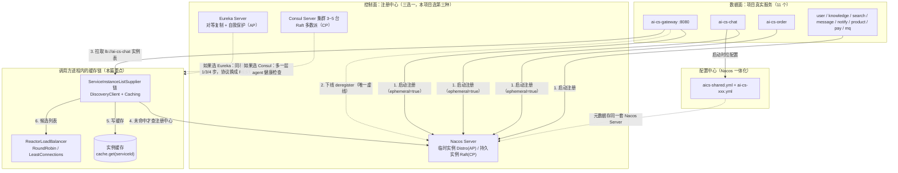
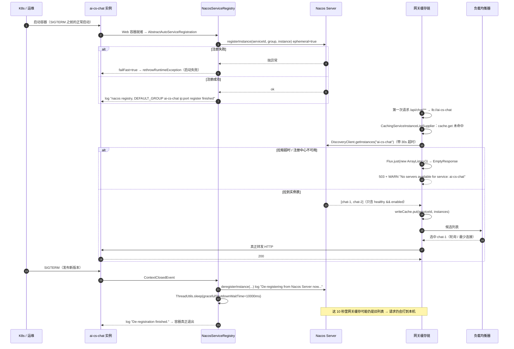

# 22-Eureka 与 Consul 注册中心对照：一致性还是可用性，以及本项目为什么落在 Nacos

> **一句话结论**：三个注册中心的"服务发现三动作"（注册 / 心跳续约 / 拉取列表）完全一致，真正的分歧只有一条——网络分区时它选谁：Eureka 选 AP（宁可留着死实例，也不让调用方查不到服务）、Consul 选 CP（宁可少数派不可用，也不给不一致的答案）、Nacos 把这条选择权下放到"实例"这一级（`ephemeral=true` 走 AP、`ephemeral=false` 走 CP），再加上配置中心一体化，这就是本项目选它的全部理由。

> **阅读前置**：读过 [03-Nacos注册与配置中心](../02-Spring微服务/03-Nacos注册与配置中心.md)，知道 `@EnableDiscoveryClient` 和网关 `lb://` 大概做什么。Spring Cloud LoadBalancer 的 `ServiceInstanceListSupplier` 没读过也能看，本篇会先把它拆开讲清楚；想看 Nacos 注册全链路源码，直接去 [24-源码分析/02-注册中心Nacos](../24-源码分析/04-SpringCloud/02-注册中心Nacos/01-nacos-服务注册与发现源码.md)。

> **证据基线**：A 级 = `learning-docs/24-源码分析/assets/source/` 里已入库的摘录（共 905 个 `.md`，按文件名匹配 `Nacos` 15 个、`Eureka` 0 个、`Consul` 0 个）；B 级 = 本仓 11 个服务的真实配置与 Gateway 真实代码（行号当次核对）；C 级 = 本机 pwsh 静态统计（2026-11-27 勘，pwsh 5.1.26100）。本机**没有** docker / docker-compose / redis-cli / mysql / consul 命令，8848 端口未监听，所以本篇所有"连上 Nacos 看实例"类命令只给判读方法、标注**未实测**。预计阅读 30 分钟。

## 本篇的证据边界，先说清楚再开始

| 类别 | 本仓状态 | 本篇怎么处理 |
|------|----------|--------------|
| Nacos 客户端（服务注册/发现/负载均衡/优雅下线） | **已入库** A 级：`NacosServiceRegistry.java.md`、`NacosServiceDiscovery.java.md`、`NacosLoadBalancer.java.md` 等 15 个摘录 | 引 `(src: 文件#L起-L止)` 逐段精读，行号以摘录文件自身的行号为准 |
| Eureka 服务端/客户端本体 | **未入库**：`assets/source/` 里按文件名匹配 `Eureka` 零命中 | 一律写"未入库，依据官方文档"，并给出可验证的官方默认值，不编造文件名 |
| Consul 服务端/客户端本体 | **未入库**：只有 `spring-cloud-dependencies-2026.0.0.pom.md` 里的版本号 | 同上；只引 BOM 里的版本这一条 A 级证据 |
| Spring Cloud 抽象层（`DiscoveryClient`、`ServiceInstanceListSupplier`、`LoadBalancerClientConfiguration`） | **已入库** A 级 | 用来证明"AP/CP 只是实现，抽象层不关心" |
| 本项目是否用了 Eureka / Consul | **未落地**：11 个服务 pom 只有 Nacos，本机 m2 里没有 eureka / consul 的 client jar | 明写"未落地"，并说明若要切换需要改哪些文件、验收标准是什么 |
| 实时行为（实例列表、心跳日志） | 本机未启动 Nacos 与服务 | 给命令 + 关键字 + 判读方法，标注未实测 |

**本机探测结果**（这些决定了本篇能给你什么、不能给你什么）：

```powershell
foreach ($t in 'docker','docker-compose','redis-cli','mysql','consul','curl','node','javap') {
  $c = Get-Command $t -ErrorAction SilentlyContinue
  if ($c) { "FOUND  $t -> $($c.Source)" } else { "MISS   $t" }
}
(Get-NetTCPConnection -LocalPort 8848 -ErrorAction SilentlyContinue | Measure-Object).Count
```

```text
MISS   docker
MISS   docker-compose
MISS   redis-cli
MISS   mysql
MISS   consul
FOUND  curl ->
FOUND  node -> C:\Program Files\nodejs\node.exe
FOUND  javap -> D:\DevTools\jdk\jdk17.0.19\bin\javap.exe
0
```

读法：最后一行 `0` 是 8848 端口上的监听连接数——本机没有 Nacos 在跑。所以本篇凡是"连上注册中心验证"的步骤都只给判读方法；能给你真实输出的，是**静态统计**（依赖树、配置文本、源码摘录行号），这类我全跑了并把原始输出贴在正文里。

## 0. 先看现象

注册中心的知识点不背不会，但"下线以后还被调用"这类故障会自己找上门。下面三个现象，都能在注册中心的"一致性/可用性 + 客户端缓存"这条线上解释清楚。

### 现象 1：实例已经下线（甚至进程被 kill），网关还在把请求打给它，1~3 分钟后自己好了

用户的体感是：`POST /api/chat/...` 每隔几次就失败一次，错误率在 1~2 分钟内从 30% 慢慢降到 0。翻**下线的那台实例**的日志，其实它已经干完了该干的事：

```text
De-registering from Nacos Server now...
De-registration finished.
```

这两行不是猜的，是 `NacosServiceRegistry.deregister()` 里的原文（`(src: NacosServiceRegistry.java.md#L106-L130)`）：

```java (src: NacosServiceRegistry.java.md#L106-L130)
	@Override
	public void deregister(Registration registration) {

		log.info("De-registering from Nacos Server now...");

		if (StringUtils.isEmpty(registration.getServiceId())) {
			log.warn("No dom to de-register for nacos client...");
			return;
		}

		NamingService namingService = namingService();
		String serviceId = registration.getServiceId();
		String group = nacosDiscoveryProperties.getGroup();

		try {
			namingService.deregisterInstance(serviceId, group, registration.getHost(),
					registration.getPort(), nacosDiscoveryProperties.getClusterName());
		}
		catch (Exception e) {
			log.error("ERR_NACOS_DEREGISTER, de-register failed...{},",
					registration.toString(), e);
		}

		log.info("De-registration finished.");
	}
```

也就是说**注册中心那边已经删掉了**，可调用方手里还捏着旧名单。旧名单来自两层缓存：调用方进程内的 Spring Cloud LoadBalancer 实例缓存，以及 Spring Cloud 为每个下游服务建的那条 `ServiceInstanceListSupplier` 链。名单不刷新，删除动作就传不到请求路径上——这就是"下线后仍被调用"的窗口。本篇第 3.5、3.7 节会把这个窗口一层层算出来。

### 现象 2：Nacos 重启/抖动一下，网关瞬间 503，日志里冒出 `No servers available for service: ai-cs-chat`

这不是"服务全挂了"，而是"这一瞬间调用方手里是空表"。两条日志几乎同时出现：

```text
WARN  c.a.c.l.NacosLoadBalancer - No servers available for service: ai-cs-chat
```

这行同样是原文，出自 `NacosLoadBalancer.getInstanceResponse()`（`(src: NacosLoadBalancer.java.md#L152-L156)`）。空表是怎么来的？往下看 `DiscoveryClientServiceInstanceListSupplier`：拉取超时**返回空列表而不是抛异常**（`(src: DiscoveryClientServiceInstanceListSupplier.java.md#L82-L90)`）：

```java (src: DiscoveryClientServiceInstanceListSupplier.java.md#L82-L90)
		this.serviceInstances = Flux.defer(() -> Mono.fromCallable(() -> delegate.getInstances(serviceId)))
			.timeout(timeout, Flux.defer(() -> {
				logTimeout();
				return Flux.just(new ArrayList<>());
			}), Schedulers.boundedElastic())
			.onErrorResume(error -> {
				logException(error);
				return Flux.just(new ArrayList<>());
			});
```

于是"注册中心抖一下"直接变成"网关选不到实例"，而 `NacosDiscoveryProperties` 里那个能兜底的开关默认是关的：`failureToleranceEnabled` 没有初始值（`(src: NacosDiscoveryProperties.java.md#L240)`），Java 默认 `false`。

### 现象 3：跨 namespace 调不通——服务注册在 `public`，客户端却去 `aics` 里找

本项目所有服务都把注册/配置命名空间钉死成 `aics`（B 级，`ai-cs-gateway/src/main/resources/application.yml#L17-L27`）：

```yaml
spring:
  cloud:
    nacos:
      discovery:
        server-addr: ${NACOS_ADDR:127.0.0.1:8848}
        namespace: aics
        group: DEFAULT_GROUP
      config:
        server-addr: ${NACOS_ADDR:127.0.0.1:8848}
        namespace: aics
        group: DEFAULT_GROUP
        file-extension: yml
```

只要有一个服务的 `namespace` 少了、写错大小写、或用了 namespace **名称**而不是 **ID**（Nacos 控制台里 `aics` 是名字，接口要的是 ID），它就会注册到 `public` 里；而网关仍然去 `aics` 里查，拿到空列表——表现和现象 2 一模一样（`No servers available for service`），但根因完全不同。这就是为什么本篇后面要把"注册中心三要素：server-addr / namespace / group"当作排障第一顺位。

**这些现象指向同一件事**：注册中心不是"一个存名单的数据库"，而是一条**最终一致的分布式缓存链**——服务端有一致性协议与缓存、客户端有本地缓存、负载均衡器还有一层内存缓存。AP 与 CP 的选择决定了这条链在故障时**偏哪边**：Eureka 偏"继续给答案（可能是死的）"，Consul 偏"不给答案"，Nacos 让你按实例自己选。理解了"链上有几层缓存、每层多久刷新、故障时返回什么"，上面三个现象就全是可推导的结果，而不是玄学。

## 1. 整体地图

先看全貌：注册中心（控制面）如何与实例（数据面）、调用方（负载均衡）、配置中心拼在一起。



> **读图说明**：
> 1. 图分四块：**控制面**（左上，三个注册中心只可能选一个）、**数据面**（右上，本仓真实的 11 个服务）、**客户端缓存链**（左下，本篇最核心）、**配置中心**（右下，Nacos 特有的"顺带把配置也管了"）。
> 2. 实线是当前项目的真实路径，虚线只有一条：`2. 下线 deregister`——它之所以被画成虚线，是因为它**不保证**在进程被 kill 时执行，这正是现象 1 的根因之一。
> 3. 编号 1→6 是一条请求拿实例的完整顺序：先注册（1），调用方要实例时先进自己的缓存链（3），缓存未命中才真去注册中心查（4），查到后写缓存（5），最后交给负载均衡选一个（6）。**能减掉一次网络访问，代价就是多一层可能过期的缓存。**
> 4. `Eureka`/`Consul` 两个灰框：如果换成它们，1/3/4 步的语义不变（都是"注册 + 拉列表"），变的只是协议与"故障时给不给答案"。这就是为什么本篇说"三者的分歧只有一致性取舍这一条"。
> 5. 右下角那条虚线说明：Nacos 的配置中心与注册中心是**同一套 Server**，一起挂一起恢复——这是运维上的一把双刃剑，第 5 节会讲。

三方在"调用方→注册中心"这一段里的责任划分：

| 组件 | 在本项目的责任 | 谁调用它 | 挂了会怎样 |
|------|----------------|----------|------------|
| Nacos Server（控制面） | 存服务实例表 + 配置；临时实例走 Distro（AP），持久实例/元数据走 Raft（CP） | 所有服务的 `NacosServiceRegistry`（写）、`NacosServiceDiscovery`（读） | 已启动的服务继续用本地缓存互调；新实例注册失败（`failFast=true` 直接启动失败）、配置拉不到（`optional:` 前缀兜底） |
| `NacosServiceRegistry`（A 级摘录在库） | 启动时 `registerInstance`、关闭时 `deregisterInstance`、状态变更时上/下线 | Spring Cloud 的 `AbstractAutoServiceRegistration`、actuator 的 `ServiceRegistryEndpoint` | 注册不上 → `failFast` 决定是启动失败还是只打 warn |
| `NacosWatch` + `NacosDiscoveryHeartBeatPublisher` | 订阅服务端推送、每 30s 发一次 `HeartbeatEvent` | Spring 生命周期（`SmartLifecycle`） | 实例元数据（权重/集群）变更感知变慢 |
| `CachingServiceInstanceListSupplier` | 缓存某服务 id 的实例列表，命中直接返回 | LoadBalancer 子上下文 | 缓存不刷新 → 旧实例继续被调用（现象 1） |
| `DiscoveryClientServiceInstanceListSupplier` | 真调 `DiscoveryClient.getInstances()`，带超时 | 上面那层缓存的 delegate | 超时 → 空列表（现象 2） |
| `LeastConnectionsLoadBalancer`（B 级，本仓自研） | 按"实例在途请求数"选一个，并列时轮询 | 网关的 `ReactiveLoadBalancerClientFilter` | 选不出（空表）→ `EmptyResponse` → 503 |
| `NacosGracefulShutdownDelegate` | `ContextClosedEvent` 时先注销、再睡 `gracefulShutdownWaitTime` | Spring 关闭钩子 | 不睡那 10s → 在途请求被硬断 |
| Eureka / Consul | **未落地**，本仓无依赖 | — | 若切换：见第 5 节末尾的迁移清单 |

## 2. 关键概念与关键类

先把四个高频术语钉死，后面所有推理都用它们：

1. **服务发现三动作**：**注册**（实例把自己写进注册中心）、**心跳/续约**（周期性证明"我还活着"）、**拉取/订阅**（调用方拿实例列表，或等推送）。三家的差别几乎全在"心跳失败多久后判死"和"拉取到的列表有多旧"。
2. **客户端发现 vs 服务端发现**：客户端发现 = 调用方自己查注册中心、自己选实例（Spring Cloud LoadBalancer + `lb://` 就是这一派，本项目走这条）；服务端发现 = 调用方只认一个固定地址，由中间的负载均衡器/Service 去查注册中心选实例（Nginx `upstream`、K8s Service + Endpoints 是这一派，见 [04-K8s网络模型与Service](../16-云原生与GitOps/04-K8s网络模型与Service.md)）。**选客户端发现，就必须接受"每个调用方进程都有一份会过期的缓存"这件事**——这正是本篇现象 1 的来源。
3. **AP / CP**：分区（P）发生时，AP 系统优先返回"可能过时但一定有"的答案，CP 系统优先返回"一致但可能没有"的答案。注册中心的特殊性在于：**它存的不是数据而是"谁活着"**，所以 AP 的代价是"可能把请求打到死实例"，CP 的代价是"可能所有调用方都查不到任何实例"。
4. **临时实例 / 持久实例**：Nacos 的实例级开关 `ephemeral`。临时实例只活在客户端心跳里（客户端断开、心跳超时就被摘掉），适合作无状态业务服务；持久实例由服务端持久化、不因客户端掉线而消失，用于需要"人肉确认"的场景（如数据库、中间件地址）。

关键类（按"你排障时会点到谁"排序）：

| 名称 | 位置 | 角色 | 关键方法 / 关键字段 |
|------|------|------|---------------------|
| `NacosServiceRegistry` | A 级 `NacosServiceRegistry.java.md` | 注册/注销的执行者 | `register(Registration)`、`deregister(Registration)`、`setStatus()`、`getNacosInstanceFromRegistration()` |
| `NacosDiscoveryProperties` | A 级 `NacosDiscoveryProperties.java.md` | 所有 `spring.cloud.nacos.discovery.*` 的落点 | `ephemeral`、`failFast`、`registerEnabled`、`group`、`namespace`、`watchDelay`、`gracefulShutdownWaitTime`、`failureToleranceEnabled` |
| `NacosServiceDiscovery` | A 级 `NacosServiceDiscovery.java.md` | 真正向 Nacos 查实例 | `getInstances(serviceId)` → `selectInstances(serviceId, group, true)` |
| `NacosDiscoveryClient` | A 级 `NacosDiscoveryClient.java.md` | 适配 Spring Cloud `DiscoveryClient` 接口 | `getInstances()`、`getServices()`，异常时回落 `ServiceCache` |
| `NacosWatch` | A 级 `NacosWatch.java.md` | 订阅服务端推送、同步实例元数据 | `start()` 里 `namingService.subscribe(...)`、`resetIfNeeded(Instance)` |
| `NacosDiscoveryHeartBeatPublisher` | A 级 `NacosDiscoveryHeartBeatPublisher.java.md` | 每 `watchDelay` 发一次 `HeartbeatEvent` | `start()`、`publishHeartBeat()` |
| `NacosGracefulShutdownDelegate` | A 级 `NacosGracefulShutdownDelegate.java.md` | 关容器时"先摘流量再睡一会儿" | `onApplicationEvent(ContextClosedEvent)`、`doGracefulShutdown()` |
| `NacosLoadBalancer` | A 级 `NacosLoadBalancer.java.md` | Nacos 官方 LB（同集群优先 + 权重算法） | `getInstanceResponse()`、`choose()` |
| `CachingServiceInstanceListSupplier` | A 级 | 实例列表缓存层（本篇主角） | `get()`：`cache.get(serviceId)` 命中即返回 |
| `DiscoveryClientServiceInstanceListSupplier` | A 级 | 真查注册中心 + 超时兜底 | 构造器里 `timeout(...)`、`SERVICE_DISCOVERY_TIMEOUT` 常量 |
| `LoadBalancerClientConfiguration` / `ServiceInstanceListSupplierBuilder` | A 级 | 决定"每个下游服务默认装配哪条 supplier 链" | `withDiscoveryClient().withCaching()`、`withHealthChecks()` |
| `LeastConnectionsLoadBalancer` | B 级 `ai-cs-gateway/src/main/java/com/aics/gateway/loadbalancer/LeastConnectionsLoadBalancer.java` | 本仓自研"最少连接"均衡器 | `chooseInstance(List<ServiceInstance>)` |
| `InstanceInFlightFilter` | B 级 `ai-cs-gateway/src/main/java/com/aics/gateway/loadbalancer/InstanceInFlightFilter.java` | 统计每个实例的在途请求数 | `filter()` 里 `increment` / `doFinally(decrement)` |
| `LoadBalancerConfig` | B 级 `ai-cs-gateway/src/main/java/com/aics/gateway/config/LoadBalancerConfig.java` | 用配置开关切换 LB 算法 | `@LoadBalancerClients(defaultConfiguration=...)` |
| `RouteConfig` | B 级 `ai-cs-gateway/src/main/java/com/aics/gateway/config/RouteConfig.java` | 16 条 `lb://` 路由，客户端发现的入口 | `customRouteLocator()` |
| Eureka 本体（`EurekaServerContext` / `PeerAwareInstanceRegistryImpl` 等） | **未入库**（`assets/source/` 零命中） | 对等复制 + 自我保护 | 官方文档：`renewalPercentThreshold`、`response-cache-update-interval-ms` |
| Consul 本体（agent / server / Raft） | **未入库**（仅 BOM 里有版本号） | agent 跑健康检查、server 跑 Raft | 官方文档：`check`（script/HTTP/TCP/TTL）、`DeregisterCriticalServiceAfter` |

## 3. 原理与证据逐段精读

每段固定四层：**在干什么 → 为什么这么设计 → 换写法会怎样 → 常见坑**。

### 3.1 注册：一次注册到底往注册中心写了什么

**在干什么。** 服务启动、Web 容器起来之后，Spring Cloud 触发 `register(Registration)`，把"服务名 + IP + 端口 + 集群 + 权重 + 是否临时实例"写进注册中心。

```java (src: NacosServiceRegistry.java.md#L82-L104)
		NamingService namingService = namingService();
		String serviceId = registration.getServiceId();
		String group = nacosDiscoveryProperties.getGroup();

		Instance instance = getNacosInstanceFromRegistration(registration);

		try {
			namingService.registerInstance(serviceId, group, instance);
			log.info("nacos registry, {} {} {}:{} register finished", group, serviceId,
					instance.getIp(), instance.getPort());
		}
		catch (Exception e) {
			if (nacosDiscoveryProperties.isFailFast()) {
				log.error("nacos registry, {} register failed...{},", serviceId,
						registration.toString(), e);
				rethrowRuntimeException(e);
			}
			else {
				log.warn("Failfast is false. {} register failed...{},", serviceId,
						registration.toString(), e);
			}
		}
	}
```

注意这行关键的"实例性质"赋值——**Nacos 的 AP/CP 分岔就写在这一行**（`(src: NacosServiceRegistry.java.md#L193)`）：

```java (src: NacosServiceRegistry.java.md#L193)
		instance.setEphemeral(nacosDiscoveryProperties.isEphemeral());
```

而 `isEphemeral()` 的来源在 `NacosDiscoveryProperties`，默认 `true`（`(src: NacosDiscoveryProperties.java.md#L234)`）：

```java (src: NacosDiscoveryProperties.java.md#L234)
	private boolean ephemeral = true;
```

**为什么这么设计。** 注册是"我存在"的唯一声明，它必须**幂等 + 可重试**：Nacos 客户端连不上时能重连重注册，服务端收到同一份 `(serviceId, group, cluster, ip:port)` 就覆盖而不是新增。第二个设计点是 `failFast`：注册失败要不要让应用起不来？默认 `true`（`(src: NacosDiscoveryProperties.java.md#L246)`），因为一个注册不上、别人永远调不到的服务，**起来也是僵尸**——早失败比晚失败便宜。

**换写法会怎样。** 如果把 `failFast` 改成 `false`（很多人为了"本地能起来"这么干），就会得到：应用日志里 `Failfast is false. ... register failed`，进程健康、端口在 listen，但调用方永远 404/503。排障时这行 warn 报错级别太低，极易被忽略——所以它是本仓配置里**不建议动**的开关之一。反过来，`@EnableDiscoveryClient` 只是导入自动配置，删掉它并不会停止注册（只要 classpath 上有 Nacos 依赖），很多人以为删注解就不注册了。

**常见坑。** ① 注册的 IP 不是你以为的 IP：多网卡机器上 `spring.cloud.nacos.discovery.ip` 不配，注册出去的可能是虚拟网卡地址（Docker/WSL/VMware 网段），表现为"注册成功但谁都连不上"。② 同一 `serviceId` 不同 `group` 视为**两个服务**，本项目组统一 `DEFAULT_GROUP`（`(src: NacosDiscoveryProperties.java.md#L154)`），改名即等于换服务。③ 临时实例在客户端进程被 `kill -9` 时**不会**执行 `deregister`，只能等心跳超时被服务端摘除——这就是"下线后仍被调用"的第一层来源。

### 3.2 心跳与续约：三种"我还活着"的证明方式，三种判死时间

**在干什么。** 注册中心不能只信"注册那一刻"，它要周期性确认实例还活着。三家的机制不同：

| 注册中心 | 续约机制 | 判死默认值 | 证据 |
|----------|----------|------------|------|
| Eureka | 客户端每 30s 发一次 REST 心跳（`PUT /eureka/apps/{app}/{instanceId}`） | 90s 内没续约则剔除（`lease-renewal-interval-in-seconds=30`、`lease-expiration-duration-in-seconds=90`） | **未入库，依据官方文档**（Spring Cloud Netflix 文档同名属性） |
| Consul | 由节点上的 **agent** 主动执行健康检查（HTTP/TCP/脚本/TTL/gRPC） | 取决于 `check` 的 `interval` / `timeout` / `DeregisterCriticalServiceAfter` | **未入库，依据官方文档** |
| Nacos 临时实例 | 客户端与服务端保持 **gRPC 长连接** + 心跳；客户端侧另有 30s 的"心跳事件"用于本地感知 | 心跳超时后服务端摘除（`heartBeatTimeout` 可配） | A 级：`NacosDiscoveryProperties.java.md#L214-L219`（`heartBeatInterval` / `heartBeatTimeout` 字段）+ B 级部署（2.x 双端口 8848/9848） |

Nacos 客户端里那个每 30 秒的"心跳事件"很容易被误读成"注册心跳"，它其实只是**本地事件**，用来触发调用方刷新实例缓存：

```java (src: NacosDiscoveryHeartBeatPublisher.java.md#L78-L84)
	@Override
	public void start() {
		if (this.running.compareAndSet(false, true)) {
			log.info("Start nacos heartBeat task scheduler.");
			this.heartBeatFuture = this.taskScheduler.scheduleWithFixedDelay(
					this::publishHeartBeat, Duration.ofMillis(this.nacosDiscoveryProperties.getWatchDelay()));
		}
	}
```

间隔来自 `watchDelay`，默认 `30000` 毫秒（`(src: NacosDiscoveryProperties.java.md#L128)`）。它的 javadoc 把设计动机写得明明白白（`(src: NacosDiscoveryHeartBeatPublisher.java.md#L115)`）：

```text
nacos doesn't support watch now , publish an event every 30 seconds.
```

**为什么这么设计。** 拉模式（客户端定时查）实现简单、对服务端压力可预测；推模式（服务端主动推）感知快，但要维护长连接和一致性视图。Eureka 纯拉 + 客户端缓存，所以它敢把自己设计成 AP（反正大家看到的都是"过一会儿才更新"的视图）；Consul 用 agent 本地检查，健康状态就在本机算，快但**依赖 agent 存活**；Nacos 2.x 走 gRPC 长连接 + 服务端推送（`NacosWatch` 里的 `subscribe`），所以它比 Eureka 快，但仍然保留了 30s 的本地兜底事件——**网络能推就推，推不动就按 30 秒轮一次**。

**换写法会怎样。** 把 `watchDelay` 调到 1 秒，看起来"感知更快"，实际上是让每个服务实例每秒唤醒一次调度器并发事件——几十个实例就是每秒几十次无意义唤醒，收益却接近零，因为真正的推送走的是 `NacosWatch` 订阅。反过来调成 5 分钟，则"推送链路断了以后"的兜底会慢 10 倍，故障时会看到"实例已经恢复，但调用方 5 分钟才恢复"。

**常见坑。** ① 把 `heartBeatInterval`/`heartBeatTimeout` 当作"调小可以更快摘除死实例"——调小会让网络抖动直接变成**大规模误摘除**，事故形态是"整个集群一起掉线"。② Consul 的 TTL 检查需要应用**主动** `PUT /v1/agent/check/pass/{checkId}`，忘记上报就是"实例一直在，但永远 critical"——排除在服务发现之外。③ Eureka 的自我保护就是把"心跳大面积失败"当成"网络问题而不是实例死了"，所以死实例会**留着**（见 3.3）。

### 3.3 AP 的代价：Eureka 的自我保护，为什么它宁可留着死实例

**在干什么。** Eureka Server 统计最近一分钟（15 分钟窗口内的滚动比例，`renewalPercentThreshold` 默认 0.85）收到的续约数，如果**低于期望值的 85%**，它判断"不是我客户端大面积挂了，而是我和客户端之间的网络出问题了"，于是进入**自我保护模式：不再剔除任何实例**，并把告警打出来。

**为什么这么设计。** 注册中心的故障有两种，后果完全不对称：

- 误删活实例 → 调用方拿到空表/残缺表 → **全站不可用**；
- 保留死实例 → 调用方列表里混着几个死地址 → **部分请求失败**，还能靠重试/熔断兜住。

Eureka 明确选后者。这是 AP 的典型表达：**宁可给一个可能错的答案，也不给"没有答案"**。Nacos 的临时实例在这一点上同派：客户端掉线后，服务端不会立刻删，而是等心跳超时才摘——同样是"先留着"。

**换写法会怎样（CP 那一侧）。** Consul 用 Raft：注册写操作要**多数派（quorum）**确认。3 台集群挂 1 台还能写；挂 2 台就选不出 leader，于是"注册"和"某些一致性读"全部失败——**所有新实例都注册不进来，已有实例的变更也写不进**。这不是 bug，是 CP 的定价：宁可整个系统"不知道谁活着"，也不让两个节点给出不同的名单。对注册中心来说这个定价很贵，因为控制面挂了会**放大到整个数据面**：本来只是"名单旧一点"，现在变成"无法上线新实例、无法摘除坏实例"。

**常见坑。** ① 把 Eureka 的自我保护告警当成"必须关掉"。关掉它（`eureka.server.enable-self-preservation=false`）等于把 AP 强行改成"激进剔除"，网络抖一下就把健康实例全删了——**这是经典事故**。② 以为 Nacos 的临时实例"没有自我保护"，于是期待"kill -9 后 3 秒内消失"：实际是心跳超时才摘，加上调用方缓存，观察到的窗口通常是 30 秒级起步。③ 只看注册中心控制台"实例还在"，就断定"服务没问题"——控制台看的是服务端视图，调用方看的是自己缓存里的**旧视图**，两者可以差几分钟。

### 3.4 多级缓存：Eureka 的 readWriteCacheMap → readOnlyCacheMap，和那 30 秒

**在干什么。** Eureka Server 前面挂了两级缓存（**未入库，依据官方文档**）：

1. `readWriteCacheMap`：写操作（注册/下线/续约）会**主动失效**这里对应 key；
2. `readOnlyCacheMap`：默认**每 30 秒**（`eureka.server.response-cache-update-interval-ms=30000`）从 `readWriteCacheMap` 同步一次，客户端读的**默认是这一层**。

于是 Eureka 的端到端感知延迟是个加法：服务端 `readOnly` 最多 30s + 客户端 `registry-fetch-interval-seconds` 默认 30s ≈ **最坏 60s**，若再叠加"心跳 90s 判死"，实例真正消失要 90~150s 级别。这解释了为什么 Eureka 生态里的默认容忍度是"分钟级"。

**为什么这么设计。** 服务端加读缓存是为了扛住"N 个客户端每秒都来拉一次全量列表"的读放大——注册是低频写、拉取是高频读，缓存层把高频读挡在内存里，代价就是读到旧数据。这与 3.2 的"AP"是一套逻辑的两面：**既然承认名单会旧，就干脆让它旧得可控**。

**换写法会怎样。** 把 `response-cache-update-interval-ms` 调成 0（不走 `readOnly` 直接读 `readWrite`），感知立刻变快，代价是每次拉取都打到 `readWriteCacheMap` 的锁上，实例多的时候 CPU 和 GC 会明显变差。这就是典型的"用一致性换吞吐"，反过来做就是"用延迟换稳定"。

**常见坑。** ① 只调客户端拉取间隔、不调服务端 `readOnly` 同步间隔，以为感知变快了——瓶颈可能还卡在服务端那 30 秒。② 在 Nacos 上面套用 Eureka 的经验值：Nacos 2.x 是推送模型，根本没有 `readOnlyCacheMap` 这层，照抄参数只会让人困惑。③ 把"控制台看到的实例列表"和"调用方拿到的实例列表"当成同一个东西——它们隔着两层缓存和一次网络。

### 3.5 客户端缓存：Spring Cloud LoadBalancer 那条 supplier 链，才是"下线后被调用"的主犯

**在干什么。** 每个调用方进程里，Spring Cloud LoadBalancer 会为**每个下游服务**创建一个子上下文，装配一条 `ServiceInstanceListSupplier` 链。本项目走的就是默认链（`(src: LoadBalancerClientConfiguration.java.md#L112)`）：

```java (src: LoadBalancerClientConfiguration.java.md#L112)
			return ServiceInstanceListSupplier.builder().withDiscoveryClient().withCaching().build(context);
```

链路是 `CachingServiceInstanceListSupplier`（外层缓存） → `DiscoveryClientServiceInstanceListSupplier`（真正查注册中心）。缓存层的命中逻辑短得让人不安（`(src: CachingServiceInstanceListSupplier.java.md#L70-L95)`）：

```java (src: CachingServiceInstanceListSupplier.java.md#L70-L95)
			// TODO: configurable cache name
			Cache cache = cacheManager.getCache(SERVICE_INSTANCE_CACHE_NAME);
			if (cache == null) {
				if (log.isErrorEnabled()) {
					log.error("Unable to find cache: " + SERVICE_INSTANCE_CACHE_NAME);
				}
			}
			else {
				List<ServiceInstance> list = cache.get(serviceId, List.class);
				if (list != null && !list.isEmpty()) {
					return Flux.just(list);
				}
			}
			return delegate.get().take(1).doOnNext(instances -> {
				Cache writeCache = cacheManager.getCache(SERVICE_INSTANCE_CACHE_NAME);
				if (writeCache == null) {
					if (log.isErrorEnabled()) {
						log.error("Unable to find cache for writing: " + SERVICE_INSTANCE_CACHE_NAME);
					}
				}
				else {
					writeCache.put(serviceId, instances);
				}
			});
```

**读法**：`cache.get(serviceId)` 拿到非空就 `return Flux.just(list)`——**根本不问注册中心**。只有当缓存为空/未命中时才 `delegate.get()`，并把结果写回缓存。所以"下线后仍被调用"的窗口 ≈ 这层缓存的存活时间，而不是注册中心的判死时间。

**为什么这么设计。** 一次请求如果都要查注册中心，网关 QPS 上万时注册中心会被拉取的读流量打爆，而且每次多一个网络 RTT。缓存把"服务发现"从请求路径上的**硬依赖**降级成**软依赖**——注册中心挂了，网关还能靠缓存继续转发（这本身也是 AP 思路）。

**换写法会怎样。** 把 `.withCaching()` 去掉，就是"每次请求都真查注册中心"：感知最快，但注册中心压力与 RTT 立刻上来，注册中心一抖整个网关都抖。本仓给"最少连接"算法单独实现了一条路径（B 级，`ai-cs-gateway/src/main/java/com/aics/gateway/config/LoadBalancerConfig.java#L41-L54`），但它**没有**动 supplier 链，缓存语义不变——这点很重要：**换算法不等于换缓存策略**。

**常见坑。** ① 以为 `spring.cloud.loadbalancer.cache.ttl` 一配就灵：本篇入库的 `LoadBalancerProperties` 摘录里只有 hint 与健康检查相关字段（`(src: LoadBalancerProperties.java.md#L86-L93)`），cache 相关属性**不在这个类**——它的属性类未入库，本篇不给默认值；但配置 key 写错时既不报错也不告警，只会**静默不生效**，这是它最难查的地方。② `LoadBalancerCacheManager` 缺失时，链会**退化**成不缓存（`(src: ServiceInstanceListSupplierBuilder.java.md#L329)` 那行 warn），此时"感知变快"其实是"缓存没了"，别误判为优化成功。③ 把网关的缓存当成"全局缓存"：每个调用方进程（网关、chat、order……）**各有一份**，实例下线时它们**各自**慢慢过期，所以你会看到"网关已经不打了，chat 还在打"。

### 3.6 拉取与超时：为什么"注册中心抖一下"会变成"选不到实例"

**在干什么。** 缓存未命中时，`DiscoveryClientServiceInstanceListSupplier` 去查 `DiscoveryClient`，并给它套了个**默认 30 秒**的超时（`(src: DiscoveryClientServiceInstanceListSupplier.java.md#L67-L71)`）：

```java (src: DiscoveryClientServiceInstanceListSupplier.java.md#L67-L71)
	public static final String SERVICE_DISCOVERY_TIMEOUT = "spring.cloud.loadbalancer.service-discovery.timeout";

	private final String serviceId;

	private final Flux<List<ServiceInstance>> serviceInstances;
```

配合 3.0 节引过的代码块（`(src: DiscoveryClientServiceInstanceListSupplier.java.md#L82-L90)`）：`timeout(...)` 和 `onErrorResume(...)` 两条兜底路径**都返回 `new ArrayList<>()`**。日志格式也给了（`(src: DiscoveryClientServiceInstanceListSupplier.java.md#L127)`、`#L134`）：

```text
Timeout occurred while retrieving instances for service %s.The instances could not be retrieved during %s   ← debug 级
Exception occurred while retrieving instances for service %s                                              ← error 级
```

**为什么这么设计。** 设计者认为"宁可空表也不要抛异常"更安全：抛异常会让整条 reactive 链冒泡到用户请求上，而空表能在上层被统一处理成 `EmptyResponse` → 503。所以框架的**契约**是：**下游永远会拿到一个 List，可能是空的**。这个契约解释了现象 2 里那行 `No servers available for service`——它不是"服务全死"，而是"这一瞬间我手里是空表"。

**换写法会怎样。** 如果真的抛异常，网关会返回 500 并带上堆栈，排障更容易，但用户侧同样是失败。**真正的改法是让空表不要一路走到用户面前**——这就是 `failureToleranceEnabled` 那类"注册中心不可用时用本地快照兜底"存在的原因（`(src: NacosDiscoveryClient.java.md#L85)` 的 `return ServiceCache.getInstances(serviceId)` 就是这条兜底路径），而它默认是关的（`(src: NacosDiscoveryProperties.java.md#L240)` 无初始值 = `false`）。

**常见坑。** ① 看到 `No servers available` 就重启服务——重启只会让新实例重新注册，如果是 namespace/group 配错，重启 100 次也没用。② 把超时调成 3 秒"让失败更快"：注册中心慢查询时会更频繁返回空表，错误率反而升高。③ 忽略 debug 级日志：`logTimeout()` 是 `LOG.debug`（`(src: DiscoveryClientServiceInstanceListSupplier.java.md#L127)`），默认日志级别下**你看不到**，于是"为什么空表"变成谜。**这条是排障时最容易漏的一步：先把对应包的 debug 打开再看。**

### 3.7 优雅下线：为什么"注销了"和"没流量了"是两件事

**在干什么。** 关容器时，Nacos 客户端会收到 `ContextClosedEvent`，先注销，再**睡一会儿**（默认 10 秒），然后才真正关停：

```java (src: NacosGracefulShutdownDelegate.java.md#L82-L96)
	protected void doGracefulShutdown() {
		try {
			autoServiceRegistration.stop();
			Integer gracefulShutdownWaitTime = this.nacosDiscoveryProperties.getGracefulShutdownWaitTime();
			if (gracefulShutdownWaitTime != null && gracefulShutdownWaitTime > 0) {
				ThreadUtils.sleep(gracefulShutdownWaitTime);
			}

			log.info("Nacos client graceful shutdown has been executed successfully. " +
					"Graceful shutdown wait time is {}", gracefulShutdownWaitTime);
		}
		catch (Throwable t) {
			log.error("Error occurred while performing Nacos client graceful shutdown", t);
		}
	}
```

那个等待时长默认 `10 * 1000` 毫秒（`(src: NacosDiscoveryProperties.java.md#L253)`）。而且它**不允许异步执行**（`(src: NacosGracefulShutdownDelegate.java.md#L99-L101)`：`supportsAsyncExecution()` 返回 `false`），注释就写着 `need wait for graceful shutdown`——Spring 必须等它睡完。

**为什么这么设计。** 因为"注册中心删掉了"不等于"调用方缓存刷掉了"。这 10 秒是留给调用方缓存过期 + 摘流量的**缓冲窗口**：先让注册中心里的人看到我没了，再等大家心里的旧名单过期，最后我才停止接收请求。**没有这 10 秒，注销就是自欺欺人**——你会看到 `De-registration finished.` 之后立刻出现一批 connection refused。

**换写法会怎样。** 把 `gracefulShutdownWaitTime` 设成 0，关停立刻完成，但在缓存窗口内到达的请求全部报错。反过来设成 60 秒，滚动发布时单实例关停要 60 秒，10 个实例的发布会拖到十几分钟。

**常见坑（本项目实测到的一个真空档）。** 本仓 11 个服务的 `application.yml` 都配了优雅停机（B 级，`ai-cs-gateway/src/main/resources/application.yml#L2-L7`）：

```yaml
server:
  shutdown: graceful
  port: 8080

spring:
  lifecycle:
    timeout-per-shutdown-phase: 30s
```

但 `deploy/k8s/services` 下的 Deployment 里，`terminationGracePeriodSeconds` 命中 **0** 次、`preStop` 命中 **0** 次（C 级统计，命令与输出见 6.8）。K8s 默认宽限期恰好是 30 秒，与 `timeout-per-shutdown-phase: 30s` 撞在一起：**SIGTERM 一到，Spring 开始 30 秒的优雅停机倒计时，K8s 也在数 30 秒，谁先到谁动刀**，而且没有 `preStop` 让 Pod 先从 Endpoints 里摘掉。结论：**"优雅下线"在本仓只落了应用层一半，K8s 层是空的**——这一条我在第 5 节的可扩展点里列为待办，并给出验收标准。

### 3.8 Consul 的 agent/server 与"CP 少数派不可用"到底贵在哪

**在干什么（未入库，依据官方文档）。** Consul 是"每台机器一个 agent + 3~5 台 server 组成 Raft 集群"的结构：

- **agent**（每个节点）：跑服务注册的本地入口、执行健康检查（`script`/`HTTP`/`TCP`/`TTL`/`gRPC`）、把状态同步给 server；
- **server**（3 或 5 台）：用 Raft 达成一致，存服务目录与 KV；
- 额外能力：多数据中心（WAN gossip）、DNS 接口（`xxx.service.consul` 天然支持服务端发现）、KV + Watch、Connect（mTLS 服务网格认证）。

**为什么这么设计。** 它把"健康判断"下推到**本机 agent**：HTTP 探测 2 秒一次比"跨网络拉全量列表"精确得多，这是 Consul 感知快的原因；Raft 保证"任何 client 读到的目录都是同一个版本"，这是 CP 的来源。代价也写在架构里：**注册与目录变更都要 quorum**。

**换写法会怎样（少数派不可用的真实代价）。** 3 台 server 挂 2 台：

- 注册失败 → **扩缩容、发布、重启全部卡住**，因为新实例进不来；
- 目录变更失败 → 下线的实例摘不掉（只能等 agent 侧 `DeregisterCriticalServiceAfter` 兜底）；
- 读可以用 `AllowStale` 让 agent 返回本地旧值，勉强保住"能查到"，但那是**降级**，不是 CP 的正常状态。

也就是说，选 Consul 就等于接受"注册中心集群是新的单点"——必须 ≥3 台、跨机架/可用区分布、定期演练"挂 1 台"。**本项目没有为控制面准备这种冗余**（`deploy/k8s/nacos.yaml#L40` 注释写着"单副本（生产建议 3 副本集群，学习环境 1 个够用）"），这也是不选 Consul 的一个现实理由：**CP 系统的运维成本，比 AP 系统高一档**。

**常见坑。** ① 单节点 Consul 集群"看起来能用"，一旦这台挂掉，所有 CP 语义直接归零。② 用 `script` 健康检查写复杂逻辑（curl + grep 业务接口），检查脚本自身超时/误判，会把健康实例判成 critical。③ TTL 检查忘了上报（应用不主动 pass），实例永远 critical，用户侧表现就是"注册中心里有它，但永远不会被选中"。

### 3.9 Nacos 的双模型：临时实例(AP) / 持久实例(CP)，以及"配置中心一体化"

**在干什么。** Nacos 把 AP/CP 的选择**下放到实例级**：`ephemeral=true`（默认，见 3.1 引的 `#L193`、`#L234`）的临时实例，靠客户端心跳/长连接存活，服务端不为它做 Raft 共识——这是 AP 一侧；`ephemeral=false` 的持久实例只在控制台或 API 显式注册/注销，数据落库并走共识协议——这是 CP 一侧。**同一个注册中心里，两种实例可以共存**。

**为什么这么设计。** 因为"谁活着"和"这个地址存在"是两种不同的事实：无状态业务服务（`ai-cs-chat`）的地址随时变，用 AP 最合适；数据库、中间件这类"地址是人工确认的、不能因为客户端断连就消失"的条目，需要 CP 的持久性。Nacos 不替你选，但把开关做得极其便宜（一个布尔字段）。

**换写法会怎样。** 把业务服务改成 `ephemeral=false`：好处是"Nacos 重启后实例不会消失"（现象 2 的一种缓解），坏处是**死实例永远不会自动摘除**，你必须自己写清理任务——AP 的自动清理能力被换成了 CP 的持久性。反过来把数据库地址配成临时实例：一次网络抖动，注册中心里那条记录就没了。

**常见坑。** ① 在 K8s 里跑副本时混用两种模型，滚动发布后残留一堆持久实例。② 以为"Nacos 3.x 默认就是 CP"——默认 `ephemeral=true` 没变（A 级 `#L234` 就是当前基线的客户端代码）。③ 把"配置中心也在 Nacos 里"当成纯粹的好处：**同一套 Server 一起挂**，注册 + 配置同时失联；本仓用 `optional:` 前缀降低影响（B 级，`ai-cs-gateway/src/main/resources/application.yml#L28-L31`）：

```yaml
  config:
    import:
      - optional:nacos:aics-shared.yml
      - optional:nacos:ai-cs-gateway.yml
```

`optional:` 的含义是"拉不到配置也启动"，这是本项目在"配置中心不可用"这件事上的唯一防线——但注意它**不保护注册**：注册那边由 `failFast=true` 决定，默认会让启动直接失败。

## 4. 一次完整执行时序

以"chat 服务上线 → 网关调到它 → chat 优雅下线"为主线，把三动作和两层缓存串起来。



> **读图说明**：
> 1. 上半段是"注册"（第 2~5 步），中间两个 `alt` 是**唯一会让启动直接失败的岔路**：`failFast=true` 时注册失败 = 启动失败，这是设计选择，不是 bug。
> 2. 第 6~13 步是"一次请求怎么拿实例"：注意第 7 步的缓存判断在**查注册中心之前**——命中缓存就永远走不到第 8 步。这是"下线后仍被调用"的时间来源。
> 3. 第 8 步的超时（默认 30 秒）和第 10 步的"空表"是现象 2 的完整链条：**超时不抛异常，而是给空表**，于是失败形态变成 503 + 一行 warn，而不是一个显眼的异常堆栈。
> 4. 下半段（第 15~19 步）是优雅下线：注销（17）与进程退出（19）之间有 10 秒睡眠，中间那条 `Note` 就是"注销成功但仍收到请求"的窗口——它不是 bug，是**故意留的缓冲**。
> 5. 全图没有出现 Eureka/Consul：换成它们时，第 3/8/17 步的调用协议会变（REST / agent HTTP），但**时序形状完全一样**——这就是"三动作模型"抽象的价值。

失败点与对应错误/日志（这张表是排障时的第一张牌）：

| 失败在哪一步 | 你看到的日志/错误 | 通常根因 | 下一步查什么 |
|--------------|-------------------|----------|--------------|
| 3 注册 | `nacos registry, ai-cs-chat register failed...` + 启动失败 | Nacos 不可达、namespace 不存在、group 写错 | `NACOS_ADDR` 是否指向 `nacos:8848`；namespace 用的是 ID 还是名字 |
| 3 注册 | `Failfast is false. ai-cs-chat register failed...` | 同上，但 `failFast=false` | 进程活着却没人能调到你，这是最坑的一种"假活" |
| 8 拉取 | `Timeout occurred while retrieving instances for service ai-cs-chat`（**debug 级**） | 注册中心慢/网络抖动 | 打开 `org.springframework.cloud.loadbalancer` 的 DEBUG |
| 8 拉取 | `Exception occurred while retrieving instances for service ai-cs-chat`（error 级） | 客户端连不上、鉴权失败 | Nacos 客户端连接日志、`nacos.core.auth.enabled` |
| 10 选实例 | `No servers available for service: ai-cs-chat` | 空表（上一步失败）或服务端确实没有健康实例 | 直接查注册中心（6.6 的 OpenAPI） |
| 13 转发 | 连接被拒 / 502 | 缓存里有旧实例，进程已死 | 对照两台机器时间戳，确认缓存窗口 |
| 17 注销 | `ERR_NACOS_DEREGISTER, de-register failed...` | 关闭时网络已断、Nacos 已不可达 | 只能等心跳超时；下次加 `preStop`/调大宽限期 |
| 18 等待 | `Nacos client graceful shutdown has been executed successfully. Graceful shutdown wait time is 10000` | 这是**成功**日志，不是错误 | 若紧随其后有大量 502，说明等待时间不够或缓存更长 |

## 5. 设计取舍

三方在同一组维度上的取舍（Eureka/Consul 列为**官方文档 + 未入库**，Nacos 列有 A/B 级证据）：

| 维度 | Eureka | Consul | Nacos（本项目） | 对本项目的含义 |
|------|--------|--------|------------------|----------------|
| 一致性模型 | AP：对等复制，自我保护下不剔死实例 | CP：Raft 多数派，少数派不可写 | 双模型：临时实例 AP / 持久实例 CP（`ephemeral` 开关，A 级 `#L193`/`#L234`） | 业务服务用默认临时实例即可，代价是分钟级判死 |
| 健康检查 | 客户端心跳 30s / 判死 90s | agent 本地执行 HTTP/TCP/脚本/TTL/gRPC | 客户端心跳 + 长连接，`heartBeatInterval`/`heartBeatTimeout` 可配（A 级 `#L214-L219`） | 本项目没写过任何自定义健康检查，全靠心跳 |
| 感知延迟 | 服务端两级缓存 + 客户端 30s 拉取 ≈ 分钟级 | agent 检查秒级，但受 quorum 写入约束 | 推送为主 + 30s 兜底事件（`watchDelay`，A 级 `#L128`） | 比 Eureka 快，但**不等于**调用方立刻知道 |
| 配置能力 | 无（配套 Spring Cloud Config） | 有 KV + Watch，非配置中心形态 | 一体化配置中心（`spring.config.import: optional:nacos:`，B 级 gateway yml `#L28-L31`） | **这是本项目最看重的点**：注册 + 配置一套 |
| 控制台 | 有，功能少、偏只读 | 有，UI 完整 | 有，实例/配置/命名空间/权重都能改 | 学习与排障都够用 |
| Spring Cloud 集成 | `spring-cloud-starter-netflix-eureka-client`（BOM 里 `spring-cloud-netflix.version=5.1.0`，A 级 `spring-cloud-dependencies-2026.0.0.pom.md#L113`） | `spring-cloud-starter-consul-discovery`（BOM 里 `spring-cloud-consul.version=5.1.0`，A 级 `#L104`） | `spring-cloud-starter-alibaba-nacos-discovery` + `-config`，11 个服务都引了（B 级） | Nacos 由 SCA BOM 统一管版本，零额外决策 |
| 运维成本 | 低（无状态对等集群） | **高**（Raft 集群必须 ≥3 台、要演练少数派） | 中（单机可用，生产建议 3 副本；本仓 `deploy/k8s/nacos.yaml#L40` 是单副本） | 本项目是学习/单机房形态，单副本 Nacos 的成本可接受 |
| 本项目是否落地 | **未落地**：11 个服务 pom 无 Eureka 依赖，本机 m2 无 eureka client jar（C 级见 6.8） | **未落地**：m2 里只有 `spring-cloud-consul-dependencies` 这个版本管理 pom，没有 client | **已落地**：11 个服务全部注册到 Nacos | — |

**为什么本项目不选 Eureka。** ① 它只管注册，配置中心要另配一套（Spring Cloud Config 或自建），本项目 11 个服务的配置已经全部走 Nacos（`tools/nacos-config/` 下有 `ai-cs-mq.yml`、`ai-cs-user.yml` 等真实配置文件），换 Eureka 等于把配置文件体系推倒重来。② Spring Cloud Netflix 的 Eureka 客户端在 2026.0.0 里仍是"维护态"，Alibaba 生态与本项目其余选型（Sentinel、Seata、RocketMQ）同源，混两套 BOM 会带来版本对齐成本。③ 感知延迟比 Nacos 2.x 的推送模型慢一档，对"发布即生效"的 AI 对话服务不划算。

**为什么本项目不选 Consul。** ① CP 的定价对本项目不划算：单机房、单副本注册中心，跑 Raft 多数派要么成本翻倍要么毫无意义。② 它的健康检查优势（脚本/HTTP/TCP/TTL）在本项目用不上——11 个服务没有自定义检查，K8s 已有 liveness/readiness 探针（B 级，`deploy/k8s/services/ai-chat-service.yaml#L100-L109`）。③ 配置中心、控制台、Spring Cloud 集成三项都要额外搭，而 Nacos 是"一套顶两套"。

**若真要落地这两种（明确未落地，给出验收标准）：**

- 换 Eureka：改 11 个服务的 pom（`ai-cs-*/pom.xml` 里把 `spring-cloud-starter-alibaba-nacos-discovery` 换成 `spring-cloud-starter-netflix-eureka-client`）、加 `eureka.client.service-url.defaultZone`、把 `spring.config.import: optional:nacos:` 换回 Config Server 或本地配置、网关 `lb://` 不用改。**验收**：两个实例注册后 kill 一个，观察网关错误率恢复时间 ≤ 缓存的刷新窗口，并把 `eureka.server.enable-self-preservation` 保持默认 `true`。
- 换 Consul：起 ≥3 台 server 集群、每个服务加 `spring-cloud-starter-consul-discovery`、配置 `spring.cloud.consul.host/port`、健康检查改成 HTTP `/actuator/health`（本仓各服务已有该端点）。**验收**：手动停掉 2 台 server，验证"注册失败但已注册实例仍可调用"这一降级路径，并确认控制台不再接受新实例。

**可扩展点清单（按性价比排序）：**

1. **K8s 优雅下线补齐**：给 `deploy/k8s/services` 下所有 Deployment 加 `terminationGracePeriodSeconds: 45` 与 `preStop: sleep 15`（比 Spring 侧的 30s 短，让应用自己先收尾）。验收：`kubectl delete pod` 期间对网关压测，5xx 为 0。
2. **打开 `failureToleranceEnabled`**：注册中心不可用时用本地 `ServiceCache` 快照兜底（A 级 `NacosDiscoveryClient.java.md#L85`）。验收：停 Nacos 后网关仍能转发到已缓存实例。
3. **实例级权重**：Nacos 控制台给新实例先设小权重（`weight`，A 级 `NacosDiscoveryProperties.java.md#L144` 默认 `1`），发布时灰度引流。验收：新实例在权重 10 时拿到约 10% 流量。
4. **健康检查端点接入**：`spring.cloud.loadbalancer.configurations=health-check` 切到 `withHealthChecks()` 链（A 级 `LoadBalancerClientConfiguration.java.md#L141`），默认 25s 一次（A 级 `LoadBalancerProperties.java.md#L275`）。验收：手工让某实例 `/actuator/health` 返回 DOWN，观察它被移出候选。
5. **同集群优先**：`NacosLoadBalancer` 有同 `nacos.cluster` 优先与跨集群告警（A 级 `NacosLoadBalancer.java.md#L173`），但本项目走的是 Spring Cloud 默认 LB，没启用这条；多机房时再评估。

## 6. 踩坑与调试手法

### 6.1 坑：只配了 `shutdown: graceful` 就以为做完了优雅下线

B 级事实：11 个服务都配了 `server.shutdown: graceful` 与 `timeout-per-shutdown-phase: 30s`；但 K8s 侧 `terminationGracePeriodSeconds` 与 `preStop` 都是 0 命中（C 级统计见 6.8）。SIGTERM 之后 K8s 默认 30 秒就 SIGKILL，与 Spring 的 30 秒竞态；且没有 `preStop`，Pod 从 Endpoints 摘除与容器收尾同时发生。**症状**：发布时零星 502，且集中在"新实例刚启动、旧实例刚退出"的几秒。

### 6.2 坑：namespace / group 三要素没对齐，得到和"服务挂了"一模一样的表现

本仓 `namespace: aics`、`group: DEFAULT_GROUP` 写死在每个服务的 yml 里（B 级 `ai-cs-user/src/main/resources/application.yml#L15-L29` 同结构）。任何一处不一致 → 注册到别的命名空间 → 调用方在 `aics` 里查不到 → `No servers available for service`。**判别方法**：直接查注册中心（6.6），而不是猜。

### 6.3 坑：把 LoadBalancer 的实例缓存当成实时数据

`CachingServiceInstanceListSupplier` 命中即返回（3.5 已引原文），**每个调用方进程各有一份**。所以"网关不打了、chat 还在打"是正常现象。**对策**：治理手段要分层——实例侧权重调 0 + 优雅下线等待，调用侧开重试/熔断兜底，别指望缓存秒变。

### 6.4 坑：`ephemeral` 与持久实例混用，滚动发布后残留"僵尸条目"

持久实例不随客户端掉线消失（3.9）。K8s 里给业务服务配了 `ephemeral=false`，发布后旧 Pod 的条目会**永久留下**，表现为"列表里有一堆不存在的 IP"。**判别**：控制台里实例的"临时"标记与心跳时间；**处置**：显式注销，或改回 `ephemeral=true`。

### 6.5 坑：以为"注册中心反正是 AP，挂了也没事"

AP 只保证"能查到可能过时的答案"，不保证"能注册新的"。Nacos 不可用时：新实例注册失败（`failFast=true` 直接启动失败）、配置中心同源一起挂（`optional:` 只保护配置不保护注册）。**结论**：注册中心仍然是发布链路上的单点，`deploy/k8s/nacos.yaml#L40` 那句"生产建议 3 副本集群"不是客套话。

### 6.6【调试手法】用注册中心自己的接口看"服务端到底有没有它"

先用应用侧端点确认客户端视图，再去注册中心确认服务端视图，**两侧对照**才能定位是"注册没成功"还是"缓存没刷新"。以下命令本机**未实测**（8848 未监听、无 Nacos 进程），只给判读方法：

```powershell
# 1) 应用侧：本服务是否已注册、发现到谁（需服务在跑，actuator 端点）
curl.exe -s http://127.0.0.1:8081/actuator/health | Select-String -Pattern 'discoveryComposite|nacosDiscovery'
curl.exe -s http://127.0.0.1:8081/actuator/service-registry

# 2) 注册中心侧：某个服务在某个 namespace/group 下的真实实例表（Nacos OpenAPI，2.x 起用 v2）
curl.exe -s "http://127.0.0.1:8848/nacos/v2/ns/instance/list?serviceName=ai-cs-chat&groupName=DEFAULT_GROUP&namespaceId=aics"

# 3) 注册中心自身健康（本项目容器 healthcheck 用的就是它，B 级 docker-compose.yml#L55-L77）
curl.exe -s http://127.0.0.1:8848/nacos/v1/console/health/readiness
```

判读方法：②里 `hosts` 里有没有那台机器的 `ip:port`、`healthy` 是否为 `true`、`ephemeral` 是否符合预期；③返回就绪而②返回空，说明是 **namespace/group/鉴权**问题而不是服务没起来；②有实例但调用方还报 `No servers available`，说明是**客户端缓存 + 超时**问题（回到 3.5/3.6）。

### 6.7【调试手法】用日志关键字一次定位"卡在哪一层"

把下面这些关键字（全部来自本篇引用的源码原文，可直接 grep）做成自己的排障清单：

| 关键字 | 出自 | 说明它证明了什么 |
|--------|------|------------------|
| `nacos registry,` …`register finished` | `NacosServiceRegistry.java.md#L90-L91` | 注册成功（服务端已收到） |
| `Failfast is false.` | `NacosServiceRegistry.java.md#L100` | 注册失败但被吞掉——进程"假活" |
| `De-registering from Nacos Server now...` / `De-registration finished.` | `NacosServiceRegistry.java.md#L109`/`#L129` | 主动注销走到了，若随后仍有请求说明缓存窗口 |
| `ERR_NACOS_DEREGISTER` | `NacosServiceRegistry.java.md#L125` | 注销失败，需等心跳超时 |
| `Nacos client graceful shutdown has been executed successfully` | `NacosGracefulShutdownDelegate.java.md#L90-L91` | 优雅下线等待已执行（**好消息**） |
| `No servers available for service` | `NacosLoadBalancer.java.md#L152` | 候选列表为空（现象 2） |
| `A cross-cluster call occurs` | `NacosLoadBalancer.java.md#L173` | 跨集群调用（用 NacosLoadBalancer 时） |
| `Timeout occurred while retrieving instances for service` | `DiscoveryClientServiceInstanceListSupplier.java.md#L127` | **debug 级**：拉取超时，需先开 DEBUG |
| `LoadBalancerCacheManager not available` | `ServiceInstanceListSupplierBuilder.java.md#L329` | 缓存层被静默降级成不缓存 |

用法示例（把日志级别先调上来，否则只能看到一半）：

```powershell
# 只看注册/发现这条线的关键事件
Get-Content .\logs\ai-cs-gateway.log | Select-String -Pattern 'No servers available|Timeout occurred while retrieving|LoadBalancerCacheManager'
```

### 6.8【C 级实测】静态统计：确认"你以为的配置"是否真的生效

以下三组命令都在本机真实跑过，输出原样贴出（2026-11-27，pwsh 5.1）。这类统计的价值是：**它能在不启动任何东西的前提下，证伪"项目用了 Eureka/Consul"或"缓存 TTL 配好了"这类想当然**。

**① 依赖树里到底有什么（本机 m2）**

```powershell
$m2 = "$env:USERPROFILE\.m2\repository"
Get-ChildItem "$m2\com\alibaba\nacos\nacos-client" -Directory | Select-Object -ExpandProperty Name
Get-ChildItem "$m2\com\alibaba\cloud\spring-cloud-starter-alibaba-nacos-discovery" -Directory | Select-Object -ExpandProperty Name
Get-ChildItem "$m2\org\springframework\cloud\spring-cloud-loadbalancer" -Directory | Select-Object -ExpandProperty Name
Get-ChildItem "$m2\org\springframework\cloud" -Directory | Where-Object { $_.Name -match 'eureka|consul|zookeeper' } | Select-Object -ExpandProperty Name
```

```text
2.3.2
3.1.1
2023.0.1.0
2025.1.0.0
4.1.2
5.1.0
spring-cloud-consul-dependencies
spring-cloud-zookeeper-dependencies
```

读法：`nacos-client` 同时存在 `2.3.2` 与 `3.1.1`（历史构建残留 vs 当前 BOM 带来的版本，见第 7 节）；`spring-cloud-loadbalancer` 有 `4.1.2` 与 `5.1.0`；**`eureka` 一个目录都没有**，`consul` 只有 `spring-cloud-consul-dependencies`（这是"版本管理 pom"，不是 client jar）——本项目依赖树里根本没有 Eureka/Consul 客户端，这是"未落地"最硬的证据。

**② 项目里真的只有 Nacos（源码/配置静态统计）**

```powershell
$java = Get-ChildItem -Recurse -Include *.java -File | Where-Object { $_.FullName -notmatch '\\target\\' }
"java files: $($java.Count)"
"EnableDiscoveryClient: " + (Select-String -Path $java.FullName -Pattern '@EnableDiscoveryClient' | Measure-Object).Count
"FeignClient: " + (Select-String -Path $java.FullName -Pattern '@FeignClient' | Measure-Object).Count
"lb:// routes: " + (Select-String -Path $java.FullName -Pattern 'lb://' | Measure-Object).Count
Select-String -Path ai-cs-gateway\src\main\resources\application.yml -Pattern 'nacos' -AllMatches |
  ForEach-Object { $_.Matches.Count } | Measure-Object -Sum | Select-Object -ExpandProperty Sum
```

```text
java files: 676
EnableDiscoveryClient: 11
FeignClient: 13
lb:// routes: 16
nacos hits in ai-cs-gateway yml: 5
```

读法：11 个 `@EnableDiscoveryClient` 对应 11 个服务（网关 + user/chat/knowledge/search/message/notify/order/product/pay/mq 里的 10 个），13 个 `@FeignClient` 说明**服务间调用也吃这套发现机制**（如 `ai-cs-chat/src/main/java/com/aics/chat/feign/OrderFeignClient.java#L15` 的 `@FeignClient(name = "ai-cs-order")`），16 条 `lb://` 路由在 `ai-cs-gateway/src/main/java/com/aics/gateway/config/RouteConfig.java#L66-L147`——**网关的每一次转发都要经过本篇讲的缓存链**。

**③ 优雅下线在 K8s 侧是不是真的缺**

```powershell
(Select-String -Path (Get-ChildItem deploy\k8s\services -File).FullName -Pattern 'terminationGracePeriodSeconds' | Measure-Object).Count
(Select-String -Path (Get-ChildItem deploy\k8s\services -File).FullName -Pattern 'preStop' | Measure-Object).Count
```

```text
0
0
```

读法：两个 0 就是 6.1 那个坑的证据——`deploy/k8s/services` 下 8 个 Deployment 都有 liveness/readiness 探针，但**没有一处**配置终止宽限期和 `preStop`。这类"配置真空档"用 grep 就能证明，不需要跑起来。

## 7. ⚠️ 版本差异

本篇结论（"三动作一致、分歧在一致性取舍、Nacos 用实例级开关把选择权交给用户"）在 Spring Cloud 2022.0.0 起未变——判断来源：`assets/source/` 里 2022~2026 各版本 BOM 摘录都保留 `spring-cloud-consul.version` 与 `spring-cloud-netflix.version` 两个独立版本线（如 `spring-cloud-dependencies-2026.0.0.pom.md#L104`/`#L113`），说明"两家并列可选"这个格局没变。变的是**客户端实现与配置位置**：

| 项 | 旧写法 | 当前基线（本仓） | 变化点 | 迁移动作 |
|----|--------|------------------|--------|----------|
| Nacos 通信协议 | 1.x：HTTP 长轮询（`/nacos/v1/ns/instance/list` 定时拉） | 2.x gRPC：8848(HTTP) + 9848(gRPC)，客户端自动 +1000（B 级 `deploy/k8s/nacos.yaml#L22-L27` 注释写明了这点） | 拉模式 → 长连接推送；防火墙只放 8848 会连不上 | 云上/自建都要放行 9848（含容器网络与 Service 端口） |
| Nacos 服务端版本 | 各种 1.x / 2.0 | 本仓镜像 `nacos/nacos-server:v2.3.2`（B 级 `deploy/k8s/nacos.yaml#L51`、`docker-compose.yml#L55-L77`），而事实基线是 3.3 生态 | 服务端 2.3.2 与客户端 3.1.1 跨大版本混跑 | 升级服务端到 3.x 前先确认 `tools/nacos-config/` 里的配置格式；2.x 到 3.x 有鉴权/端口变化 |
| nacos-client | 2.3.2（旧构建残留） | 3.1.1（SCA 2025.1.0.0 带来，C 级 m2 输出） | client 大版本升级 | 清一次 m2 或 `mvn -U` 重解析，避免新旧 jar 混进 classpath |
| 配置加载方式 | `bootstrap.yml` + `spring-cloud-starter-bootstrap` | `spring.config.import: optional:nacos:xxx.yml`（B 级 `ai-cs-gateway/src/main/resources/application.yml#L28-L31`） | Spring Boot 2.4+ 起改为 Config Data 导入 | 老项目删 `bootstrap.yml`、加 `spring.config.import`，否则配置静默不生效 |
| Spring Cloud LoadBalancer | 4.1.x | 5.1.0（C 级 m2） | supplier 链与缓存实现类位置调整；入库的 `LoadBalancerProperties` 摘录里只有 hint 与健康检查字段（A 级 `LoadBalancerProperties.java.md#L86-L93`），cache 属性不在这个类 | 别按老博客配 `spring.cloud.loadbalancer.cache.ttl` 并指望生效，先确认属性挂在哪个类上 |
| Eureka | Spring Cloud Netflix 多版本 | BOM 里 `spring-cloud-netflix.version=5.1.0`（A 级 `#L113`） | Netflix 自身 2.x 早已停更，Spring 侧仍维护 starter | 仅作对照，本项目不引入 |
| Consul | Spring Cloud Consul 4.x | BOM 里 `spring-cloud-consul.version=5.1.0`（A 级 `#L104`） | 与 Spring Cloud 2026.0.0 同步 | 仅作对照，本项目不引入 |

## 8. 面试高频问与答

只列问题，答案自己去第 3 节找（每题都标了对应小节）。

1. 服务发现的三个动作是什么？为什么"注册成功"不代表"调用方能调到"？（3.1 / 3.5）
2. 客户端发现和服务端发现有什么区别？`lb://` 属于哪一种？各自的代价是什么？（2 / 1）
3. Eureka 为什么选 AP？如果强行关掉自我保护会发生什么？（3.3）
4. Eureka 的两级缓存分别是什么、默认刷新间隔多少、端到端最坏感知延迟怎么算？（3.4）
5. Consul 的健康检查有哪几种类型？TTL 类型最容易出什么事故？（3.8）
6. Consul 3 台 server 挂 2 台，注册和查询分别会怎样？为什么说"控制面成了新的单点"？（3.8）
7. Nacos 的临时实例与持久实例分别对应 AP 还是 CP？开关字段叫什么、默认值是什么？（3.1 / 3.9）
8. 为什么 Nacos 客户端还有"每 30 秒发一次心跳事件"？它和注册心跳是一回事吗？（3.2）
9. `CachingServiceInstanceListSupplier` 命中缓存就直接返回，这个设计解决了什么问题、制造了什么问题？（3.5）
10. 拉取实例列表超时的时候框架返回什么？为什么这会让故障形态变成 503 而不是异常？（3.6）
11. Nacos 优雅下线为什么要"先注销再睡 10 秒"？这 10 秒和调用方缓存是什么关系？（3.7）
12. 实例下线后仍被调用，你会按什么顺序定位？每一步用什么证据？（6.6 / 6.7）
13. 如果项目要换成 Eureka 或 Consul，你会改哪些文件、验收标准是什么？（5）

## 9. 动手练习

1. **算一遍你项目的"下线感知窗口"。** 读 `ai-cs-gateway/src/main/resources/application.yml#L2-L7`，列出 `shutdown: graceful`、`timeout-per-shutdown-phase`、Nacos `gracefulShutdownWaitTime` 三个时间，写出最坏情况下"实例已死但仍有请求打进来"的时长表达式。**验收**：表达式里每一项都标了来源文件与行号，且能指出哪一项是 K8s 的默认值。
2. **复现"空表 503"的日志链路。** 在测试环境把 `NACOS_ADDR` 指向一个不存在的地址启动网关，观察并记录你实际看到的日志行。**验收**：能贴出 `Exception occurred while retrieving instances for service`（或 `Timeout occurred...`，需开 DEBUG）与 `No servers available for service` 两行，并说明它们分别来自哪个类。
3. **证明缓存是真的存在。** 用两个实例跑同一个下游服务，`kill -9` 其中一个（不触发注销），用秒表记录网关开始报错到恢复的时间。**验收**：给出实测秒数与你的解释（对比 3.5 里"命中即返回"的代码），并说明为什么这次恢复时间与"主动 deregister"不同。
4. **三要素对齐实验。** 把某个服务的 `spring.cloud.nacos.discovery.namespace` 从 `aics` 改成 `public` 后启动，观察网关表现。**验收**：能用控制台/OpenAPI 证明它注册到了另一个命名空间，并说明为什么错误信息和"服务没起来"完全一样。
5. **给一个 Deployment 补上优雅下线。** 在 `deploy/k8s/services` 下挑一个 Deployment，加 `terminationGracePeriodSeconds` 与 `preStop`（先写清你选的值和理由）。**验收**：`kubectl get deploy -o yaml` 能看到两个字段；滚动发布时网关 5xx 计数为 0（要有压测命令与结果）。
6. **写一个"注册中心健康"巡检脚本。** 用 `curl.exe` 打 `/nacos/v1/console/health/readiness` 与某个服务的 `instance/list`，输出非 0 退出码表示异常。**验收**：本机无 Nacos 时脚本返回非 0 并打印判定理由；接上 Nacos 后能区分"注册中心挂了"与"某个服务没实例"。
7. **对照读源码，写 200 字结论。** 读 `NacosServiceRegistry.java.md#L82-L104` 与 `NacosGracefulShutdownDelegate.java.md#L82-L96`，回答"注册失败"和"注销失败"为什么要用不同的处理策略。**验收**：结论里点到 `failFast`、`rethrowRuntimeException`、以及"注销失败只能等心跳超时"。

## 小结

- 注册中心的分歧不在"能不能发现服务"，而在**网络分区时它偏哪边**：Eureka 偏"继续给答案（可能含死实例）"，Consul 偏"不给答案"，Nacos 把开关下放到实例级（`ephemeral`）。
- 三动作（注册 / 心跳续约 / 拉取订阅）+ 两模型（客户端发现 / 服务端发现）是通用骨架；本项目是**客户端发现**，所以每个调用方进程都背着一份会过期的实例缓存。
- Eureka 的自我保护不是缺陷：误删活实例会导致全站不可用，保留死实例只是部分请求失败——AP 的定价买的就是这个不对称。
- Nacos 里"注册成功"与"调用方知道"之间隔着一条缓存链：`CachingServiceInstanceListSupplier` 命中即返回（A 级原文），拉取超时还会退化成空表，于是"注册中心抖一下"直接变成网关 503。
- 优雅下线是"先摘流量再等缓存过期"，`gracefulShutdownWaitTime` 默认 10 秒就是这段缓冲；本仓应用层配了、K8s 层（`preStop`/`terminationGracePeriodSeconds`）是空的。
- 本项目不选 Eureka/Consul 的理由是具体的：Nacos 一体化配置中心、SCA BOM 统一版本、单机房不需要 CP 的多数派成本；这些都不是"技术优劣"，而是**取舍与体量匹配**。
- 下一步动手：给你手上任意一个 Spring Cloud 项目，**先 `grep` 出 `lb://`、`@FeignClient`、`shutdown: graceful`、`preStop` 四类命中，再决定要不要动注册中心**——这四类命中就能画出你系统真实的"发现 + 下线"链路，比读十篇对比文章都快。

## 自测题

**1. 服务发现的三个动作分别是什么？哪一步决定"下线后仍被调用"的窗口长度？**
<details><summary>参考答案</summary>注册、心跳续约、拉取（或订阅）。窗口长度主要由"拉取"这一侧决定：调用方进程内 `CachingServiceInstanceListSupplier` 命中缓存就直接返回名单，不再问注册中心，所以窗口等于该缓存存活时间加上拉取/推送的延迟，而不是注册中心的判死时间。</details>

**2. Eureka 为什么选择 AP？进入自我保护模式的判断依据是什么？**
<details><summary>参考答案</summary>因为误删活实例会让所有调用方拿到残缺名单（全站不可用），而保留死实例只造成部分请求失败，后者可被重试和熔断兜住。判断依据是最近一段时间收到的续约数低于期望值的 85%（`renewalPercentThreshold` 默认 0.85，官方文档口径，未入库），此时它认为是网络问题而非实例死亡，于是停止剔除。</details>

**3. Eureka 的两级缓存分别叫什么？端到端最坏感知延迟怎么估？**
<details><summary>参考答案</summary>`readWriteCacheMap`（写操作会主动失效）与 `readOnlyCacheMap`（默认每 30 秒同步一次，客户端默认读这层）。估算方式是"服务端 readOnly 刷新间隔（约 30s）+ 客户端 `registry-fetch-interval-seconds`（默认 30s）"，再加上心跳判死的 90s，实例真正消失通常在分钟级。这些默认值属官方文档（Eureka 源码未入库）。</details>

**4. Consul 的 agent 与 server 各负责什么？健康检查有哪几类？**
<details><summary>参考答案</summary>agent 跑在每个节点上，负责本地服务注册入口和执行健康检查，并把状态同步给 server；server 用 Raft 维护一致的服务目录与 KV，通常 3 或 5 台。健康检查类型包括脚本（script）、HTTP、TCP、TTL、gRPC（以及容器运行时检查）。这些内容属官方文档，Consul 源码未入库。</details>

**5. 3 台 Consul server 挂掉 2 台，会发生什么？**
<details><summary>参考答案</summary>Raft 失去多数派，选不出 leader：新实例注册不进来（发布/扩缩容全卡），服务目录的变更也写不进；读可以靠 agent 返回本地旧值（如 `AllowStale`）勉强工作，但那是降级而不是 CP 的正常状态。所以 CP 型注册中心必须自己先具备高可用，等于把控制面变成需要单独演练的单点。</details>

**6. Nacos 的 `ephemeral` 字段是什么意思？默认值是多少、在哪一行？**
<details><summary>参考答案</summary>它标记实例是临时实例还是持久实例：`true` 表示临时实例（靠客户端心跳/长连接存活，AP 一侧），`false` 表示持久实例（服务端持久化，CP 一侧）。默认 `true`，见 `NacosDiscoveryProperties.java.md#L234`；注册时通过 `instance.setEphemeral(nacosDiscoveryProperties.isEphemeral())` 落到实例上（`NacosServiceRegistry.java.md#L193`）。</details>

**7. `NacosDiscoveryHeartBeatPublisher` 每 30 秒发的事件是什么？它等于注册心跳吗？**
<details><summary>参考答案</summary>它发的是 Spring 的 `HeartbeatEvent`（本地事件），用于驱动调用方侧的刷新逻辑，间隔取自 `watchDelay`（默认 30000ms）。它不等于注册心跳：注册续约走的是与服务端的 gRPC 长连接/心跳机制，源码 javadoc 明确写"nacos doesn't support watch now , publish an event every 30 seconds"（`NacosDiscoveryHeartBeatPublisher.java.md#L115`）。</details>

**8. `CachingServiceInstanceListSupplier.get()` 命中缓存时做了什么？这个设计的收益与代价各是什么？**
<details><summary>参考答案</summary>命中非空缓存时直接 `return Flux.just(list)`，完全不访问注册中心（`CachingServiceInstanceListSupplier.java.md#L70-L95`）。收益是把服务发现从请求路径上的硬依赖降成软依赖，省掉每个请求的网络 RTT 并保护注册中心；代价是名单会过期，实例下线后仍可能被调用，且每个调用方进程各有一份缓存。</details>

**9. 拉取实例列表超时时，`DiscoveryClientServiceInstanceListSupplier` 返回什么？为什么这样设计？**
<details><summary>参考答案</summary>返回空列表 `Flux.just(new ArrayList<>())`，异常路径（`onErrorResume`）同样返回空列表（`DiscoveryClientServiceInstanceListSupplier.java.md#L82-L90`），默认超时 30 秒（`#L71`）。这样下游始终拿到一个 List，不需要处理异常；代价是故障形态变成上层 `EmptyResponse` → 503 加一行 `No servers available for service` 的 warn，而超时本身只有 debug 日志。</details>

**10. Nacos 优雅下线为什么要注销后再 sleep 10 秒？这个时长怎么配？**
<details><summary>参考答案</summary>因为注册中心删除记录不等于调用方缓存刷新，这 10 秒是留给调用方缓存过期和流量摘除的缓冲；源码顺序是 `autoServiceRegistration.stop()` 然后 `ThreadUtils.sleep(gracefulShutdownWaitTime)`（`NacosGracefulShutdownDelegate.java.md#L82-L96`），默认值 `10 * 1000` 毫秒（`NacosDiscoveryProperties.java.md#L253`），可用 `spring.cloud.nacos.discovery.graceful-shutdown-wait-time` 调整，且必须同步检查 K8s 的终止宽限期。</details>

**11. 本项目为什么不用 Eureka 和 Consul？各给两条具体理由。**
<details><summary>参考答案</summary>不选 Eureka：它只做注册，配置中心要另配一套，而本项目 11 个服务的配置已全部走 Nacos（`spring.config.import: optional:nacos:`）；且它是维护态，和 SCA 2025.1.0.0 的 BOM 混用会增加版本对齐成本。不选 Consul：CP 需要 Raft 多数派，而本仓注册中心是单副本（`deploy/k8s/nacos.yaml#L40`），跑 CP 要么成本翻倍要么毫无意义；它的健康检查优势在这里用不上，因为各服务已有 K8s liveness/readiness 探针。</details>

**12. 网关报 `No servers available for service: ai-cs-chat`，你的排查顺序是什么？**
<details><summary>参考答案</summary>第一步先看服务端视图：用 Nacos OpenAPI 查该 `serviceName + groupName + namespaceId` 下有没有健康实例；第二步核对三要素（`server-addr`/`namespace`/`group`）是否与注册方一致；第三步若服务端有实例，则问题在客户端——打开 `org.springframework.cloud.loadbalancer` 的 DEBUG 看是否有 `Timeout occurred while retrieving instances`，并确认 `LoadBalancerCacheManager` 是否存在（否则缓存被静默降级）。两侧对照才能分清"没注册上"与"没刷新到"。</details>

**13. 你在排障时看到一个服务日志里有 `Failfast is false. ai-cs-chat register failed...`，说明什么？**
<details><summary>参考答案</summary>说明该实例注册 Nacos 失败，但因为 `spring.cloud.nacos.discovery.fail-fast=false`，异常被吞掉只是 warn（`NacosServiceRegistry.java.md#L100`）。结果是进程健康、端口在听，但注册中心里没有它，调用方永远调不到——典型的"假活"。应改回默认 `failFast=true` 让启动失败，或立刻修好注册链路。</details>

**14. 为什么说"每个调用方进程各有一份实例缓存"会让下线治理变复杂？**
<details><summary>参考答案</summary>因为网关、`ai-cs-chat`、`ai-cs-order` 等各自有独立的 LoadBalancer 子上下文与缓存，同一个被下线实例在不同进程里的过期时刻不同，所以会看到"网关已经不打了、chat 还在打"。治理必须分层：实例侧先调权重再优雅下线，调用侧用重试/熔断兜底，并且把"缓存窗口"写进发布预案，而不是指望缓存立即失效。</details>
