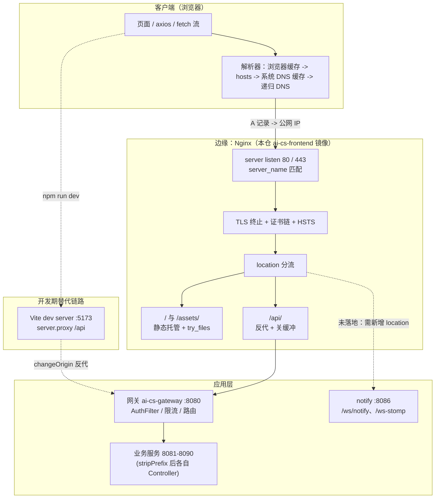
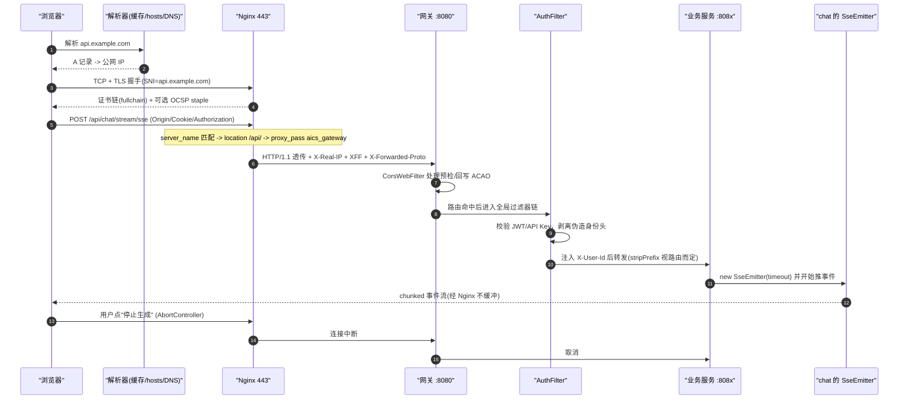

# Nginx 应用实战与域名 IP 配置：把 localhost:8080 变成 https://api.example.com

> **一句话结论**：从 `http://localhost:8080` 到 `https://api.example.com` 不是"换个地址"，而是四层各自闭合——**名字（DNS/hosts）、信任（证书）、路径（反向代理）、身份（请求头与跨域）**；任何一层没闭合，用户看到的都只有三种结果：白屏、502、`Network Error`。
> **阅读前置**：会发 HTTP 请求、见过 Nginx 配置文件、跑过 `npm run dev` 与 `mvn spring-boot:run`；不需要运维经验。网关的路由断言与过滤器链细节先看 [01-route-路由断言与过滤器链](../24-源码分析/04-SpringCloud/04-网关Gateway/01-route-路由断言与过滤器链.md)，SSE/WebSocket 协议本身看 [05-SSE与WebSocket实时通信](05-SSE与WebSocket实时通信.md)。
> **证据基线**：Spring Boot 4.2.0 / Spring Cloud 2026.0.0（`spring-cloud-gateway-server-webflux:5.1.0`）/ JDK 17 / 前端镜像 `nginx:1.27-alpine`。A 级只引 `24-源码分析/assets/source/` 已入库的摘录，B 级引本仓 `ai-cs-frontend/nginx.conf`、`vite.config.js`、网关与 chat 的 CORS/限流类，C 级是本机 pwsh 真实输出。预计阅读 45~60 分钟。

**证据边界**（先看清"哪些是本仓事实、哪些是官方文档推导"）：

| 类别 | 本仓状态 | 本篇怎么处理 |
| --- | --- | --- |
| Nginx / OpenResty 本体源码 | **未入库**（`assets/source/` 里 900+ 个摘录全是 Java，没有一行 C） | 只写"未入库，依据官方文档 + 本项目配置"，绝不编造 `ngx_http_*.c` 文件名与行号 |
| Spring Cloud Gateway 源码 | 已入库 `GatewayProperties.java.md`、`RoutePredicateHandlerMapping.java.md`、`XForwardedHeadersFilter.java.md` 等 | 涉及"跨域配置落到哪、真实 IP 谁改写"时引 A 级原文 |
| 本项目生产站点配置 | 真实存在：`ai-cs-frontend/nginx.conf`（74 行）+ `Dockerfile`（43 行） | 逐行读，作为"已经落地的部分" |
| HTTPS / 域名 / Ingress | **未落地**：全仓 grep `ssl_certificate`、`listen 443`、`real_ip`、`HSTS`（排除 learning-docs）= 0 命中；`deploy/` 下**没有 nginx 目录**；k8s 只有 NodePort 30080，无 Ingress | 明确标注"选型/设计文档"，写清落地要改哪些文件、验收标准 |
| 本机环境 | pwsh 5.1（26100）、`curl` 可用，**nginx / docker 均未安装** | Nginx 命令一条都没实跑，只给判读方法；DNS/hosts 部分给了真实输出 |

本机探测原文（`Get-Command nginx` / `Get-Command docker`）：`MISSING nginx`、`MISSING docker`，`FOUND curl`。所以凡出现 `nginx -t`、`docker exec`，都请理解为"在有 Nginx 的机器上执行时会看到什么"，不是本篇跑出来的。

---

## 0. 先看现象

三个症状，分别对应"路径、身份、流式"三层。每条都给真实配置位置 + 你会看到的原文。

### 现象 1：改完配置 502，或者干脆起不来

`ai-cs-frontend/nginx.conf` 把上游写死成一个**名字**而不是 IP：

```nginx
# ai-cs-frontend/nginx.conf#L8-L12
upstream aics_gateway {
    # docker-compose 里服务名是 api-gateway；k8s 里是 api-gateway.ai-customer-service.svc.cluster.local
    # 用变量 + resolver 会让配置复杂化，这里按 compose 网络约定写死，k8s 部署时用 ConfigMap 覆盖本行
    server api-gateway:8080;
}
```

于是有两种完全不同的失败：

- **名字解析不到**（比如按 `Dockerfile` 建议 `docker run --rm -p 8081:80` 单跑镜像，宿主机上没有 `api-gateway` 这个名字）：Nginx 在**加载配置时**就解析 upstream 的域名，解析失败直接退出，容器反复重启。`error.log` 形态（占位值用 `<>` 标出，非本篇实测）：

```text
nginx: [emerg] host not found in upstream "api-gateway" in /etc/nginx/conf.d/default.conf:11
```

- **名字能解析、但对端没在监听**（最常见：端口抄错。本仓端口表里 `8081` 是 `ai-cs-user`，网关是 `8080`，把 `aics_gateway` 写成 `api-gateway:8081` 就是这个结果）：Nginx 正常启动，请求期才 502。`error.log` 形态：

```text
<date> [error] <pid>#0: *<n> connect() failed (111: Connection refused) while connecting to upstream,
client: <客户端IP>, server: <server_name>, request: "GET /api/user/ping HTTP/1.1",
upstream: "http://<解析到的容器IP>:8081/api/user/ping", host: "<Host 头>"
```

浏览器侧拿到的是 Nginx 自带错误页：`<title>502 Bad Gateway</title>`。注意这一行 `upstream:` 里既有"解析到的 IP"又有"真实用的端口"——**它就是 502 的第一现场**，比任何 `nginx -t` 都直接。

### 现象 2：上了 HTTPS 之后，所有接口报 CORS

这不是"HTTPS 导致的"，而是"域名一变，前后端从同源变成跨源，而你其实一直没准备好 CORS 的所有权"。本仓有两条真实的、能对照的痕迹。

第一条：**应用层和网关层同时加了 CORS，于是响应头重复**。chat 服务的 CORS 配置类被整体注释掉，理由写在注解那行：

```java
// ai-cs-chat/src/main/java/com/aics/chat/config/CorsConfig.java#L14
// @Configuration  // CORS 统一由网关处理，避免重复响应头导致浏览器 Network Error（2026-08-07）
```

第二条：网关确实提供了一份全局跨域，且允许任意来源 + 允许带 Cookie：

```java
// ai-cs-gateway/src/main/java/com/aics/gateway/config/CorsConfig.java#L17-L24
@Bean
public CorsWebFilter corsWebFilter() {
    CorsConfiguration config = new CorsConfiguration();
    config.setAllowedOriginPatterns(List.of("*"));
    config.setAllowedMethods(List.of("GET", "POST", "PUT", "DELETE", "OPTIONS", "PATCH"));
    config.setAllowedHeaders(List.of("*"));
    config.setAllowCredentials(true);
    config.setMaxAge(3600L);
```

重复头的浏览器文案是这一句（Chrome/Edge 规范固定措辞，随版本略有差异；本篇未实测）：

```text
Access to XMLHttpRequest at 'https://api.example.com/api/user/login' from origin 'https://app.example.com'
has been blocked by CORS policy: The 'Access-Control-Allow-Origin' header contains multiple values '*, *',
but only one is allowed.
```

### 现象 3：SSE 在域名下变成"一次性返回"

开发机上 AI 回复是一个字一个字蹦出来的，上了域名后变成"转圈 8 秒，整段刷出来"。原因是链路上任何一环做了缓冲。本仓把这层要求写在注释里，而且是**四个指令同时在场**才算数：

```nginx
# ai-cs-frontend/nginx.conf#L46-L62（节选到关键行）
location /api/ {
    proxy_pass         http://aics_gateway;
    proxy_http_version 1.1;
    # SSE 必须走 HTTP/1.1 且关闭缓冲，否则 token 被攒起来一次性返回
    proxy_set_header   Connection        "";
    proxy_buffering    off;
    proxy_cache        off;
    proxy_read_timeout 300s;   # 大模型首 token 可能很慢，默认 60s 会 504
    chunked_transfer_encoding on;
}
```

少 `proxy_buffering off` → 攒包；少 `proxy_http_version 1.1` 或写了 `Connection: close` → 上游无法边算边发；`proxy_read_timeout` 保持默认 60s → 首 token 慢时先 504 而不是慢。开发期这条链路由 Vite 承担，`vite.config.js` 里对 `proxyRes` 专门做了处理（见 3.6）。

**这些现象指向同一件事：**`localhost:8080` 之所以能跑通，是因为它把"名字解析、证书、路径、跨域"四件事全部退化成了最省事的形式（同名主机、无 TLS、同源、端口直连）。一旦换成正式域名，这四件事同时被激活，而它们各有各的失败面——502 是路径层，CORS 是身份层，SSE 卡顿是流式层，`host not found in upstream` 才是名字层。下面按这四层逐段拆。

---

## 1. 整体地图



> **读图说明**：看图先分清两条**互斥**的链路。实线是生产：浏览器解析域名 → Nginx 443 终止 TLS → 按 `location` 分流（`/` 静态、`/api/` 反代到网关 8080）→ 网关按 `RouteConfig` 再分发给业务服务。虚线是开发期：`npm run dev` 时根本没有 Nginx，Vite 的 `server.proxy` 冒充了 Nginx 那一段，所以开发期"没有跨域问题"是假的同源，一上域名就暴露。还注意有一条点线（`/ws/` 到 notify:8086）：本仓网关**没有**任何 `/ws` 路由（grep `ws/notify|ws-stomp|/ws` 于 `ai-cs-gateway/` = 0 命中），所以 WebSocket 必须由 Nginx 直接指向 notify，而这条 location 目前**不存在**——这是本篇要补的落地项之一。

组件、责任与"谁在调它"：

| 组件 | 责任 | 调用方 | 是否权威源 | 失效后表现 |
| --- | --- | --- | --- | --- |
| DNS 权威记录（A/AAAA） | 名字 → IP | 递归解析器 | 是（域商控制台） | `NXDOMAIN`、指向旧 IP、只配了 AAAA 导致 IPv6 直连失败 |
| hosts 文件 | 本机名字覆盖，优先级高于 DNS | 本机操作系统解析器 | 是（仅本机） | 只影响本机；忘记改就"我这好着呢，别人全炸" |
| Nginx `server_name` | 一个 IP 上按 Host 头选虚拟主机 | Nginx 自身 | 是 | 落到默认 server，访问到别的站点或 444 |
| Nginx `location` | 按路径分流（静态/反代/WS） | Nginx 自身 | 是 | 深链接 404、`/api` 打到静态目录 |
| `client_max_body_size` | 请求体上限 | Nginx | 是 | 上传大文件 413 |
| 证书链（fullchain） | 证明"这个域名归我" | 浏览器 | 是（CA 签发） | 部分设备/安卓报"证书不受信任" |
| 网关 `CorsConfig` | 唯一 CORS 所有者（本仓选择） | 浏览器预检与实际请求 | 是 | 重复头或缺失头 → 全体接口 `Network Error` |
| 网关 `RouteConfig` | `/api/**` → `lb://ai-cs-xxx` | Nginx 反代 | 是 | 404/503，`stripPrefix` 配错则服务端 404 |
| 网关 `AuthFilter` | JWT/API Key 校验 + 注入 `X-User-Id` | 上述路由 | 是 | 401；或身份头被伪造 |
| Vite `server.proxy` | 开发期同源假象 | 浏览器 | 是（仅开发） | 开发期 CORS 报错、SSE 攒包 |

---

## 2. 关键概念与关键类

术语首现解释：**upstream**（Nginx 里对"后端一组服务器"的命名，可做负载均衡）· **server_name**（虚拟主机的名字，来自 HTTP `Host` 头或 TLS SNI）· **location**（Nginx 内部按 URI 前缀/正则分流的路由块）· **SNI**（TLS 握手时明文携带的域名，让一台 IP 支持多证书）· **A 记录**（域名 → IPv4）· **TTL**（DNS 结果被缓存多久）· **OCSP stapling**（Nginx 代浏览器去 CA 查询证书吊销状态并把结果"钉"在握手里）· **HSTS**（让浏览器以后强制走 HTTPS 的响应头）· **CORS 预检**（跨源的非简单请求先发 `OPTIONS` 问许可）· **XFF**（`X-Forwarded-For`，记录请求经过的代理链）· **SSE**（Server-Sent Events，服务器单向持续推流）。

| 名称 | 位置 | 角色 | 关键方法 / 指令 |
| --- | --- | --- | --- |
| `upstream aics_gateway` | `ai-cs-frontend/nginx.conf#L8-L12` | 把后端抽象成一个名字 | `server api-gateway:8080;`（配置加载时解析） |
| `server { listen; server_name; }` | `ai-cs-frontend/nginx.conf#L14-L18` | 虚拟主机 | `server_name _;` 即"这个 listen 端口的兜底" |
| `location /api/` | `ai-cs-frontend/nginx.conf#L49-L62` | 反向代理入口 | `proxy_pass`、`proxy_set_header`、`proxy_buffering` |
| `location /` | `ai-cs-frontend/nginx.conf#L68-L70` | SPA 兜底 | `try_files $uri $uri/ /index.html;` |
| `client_max_body_size` | `ai-cs-frontend/nginx.conf#L21` | 请求体上限 | 默认 1m，本仓 20m |
| `CorsWebFilter` | `ai-cs-gateway/src/main/java/com/aics/gateway/config/CorsConfig.java#L17-L29` | **唯一的** CORS 所有者 | `setAllowedOriginPatterns` / `setAllowCredentials` / `registerCorsConfiguration` |
| `CorsFilter`（已停用） | `ai-cs-chat/src/main/java/com/aics/chat/config/CorsConfig.java#L14` | 曾被注释掉的"第二个 CORS 所有者" | `@Configuration` 被注释 → Bean 不注册 |
| `GlobalCorsProperties` + `RoutePredicateHandlerMapping` | A：`RoutePredicateHandlerMapping.java#L56-L63` | 属性式 CORS 真正落地的位置 | `setCorsConfigurations(globalCorsProperties.getCorsConfigurations())` |
| `XForwardedHeadersFilter` | A：`XForwardedHeadersFilter.java#L221-L253` | SCG 决定"信不信进来的 XFF" | `trustedProxies.isTrusted(...)` → 不可信则先剥离再追加 |
| `AuthFilter` | `ai-cs-gateway/src/main/java/com/aics/gateway/filter/AuthFilter.java#L106-L169` | 校验 JWT/API Key，注入可信身份头 | `filter(ServerWebExchange, GatewayFilterChain)`、`getOrder()` |
| `RateLimitFilter.resolveKey` | `ai-cs-gateway/src/main/java/com/aics/gateway/filter/RateLimitFilter.java#L80-L89` | 限流键：用户 ID，退化到客户端 IP | `request.getRemoteAddress()` |
| `StompWebSocketConfig` / `WebSocketConfig` | `ai-cs-notify/src/main/java/com/aics/notify/config/StompWebSocketConfig.java#L28-L32` | WebSocket 端点与来源白名单 | `addEndpoint("/ws-stomp").setAllowedOriginPatterns(...)` |
| `server.proxy` | `ai-cs-frontend/vite.config.js#L22-L38` | 开发期冒充 Nginx | `target` / `changeOrigin` / `proxyRes` 回调 |
| `resolveGateway` | `ai-cs-frontend/src/utils/runtime.js#L14-L24` | 决定"绝对地址还是同源 `/api`" | 空串是 falsy，不能 `|| 'http://localhost:8080'` |

---

## 3. 原理与证据逐段精读

### 3.1 域名解析链路：五层缓存，谁先答谁算

**在干什么**：把 `api.example.com` 变成一个 IP。顺序大致是：浏览器自己的解析缓存 → 操作系统解析器（先查 hosts，再查系统 DNS 缓存）→ 递归解析器（运营商/公共 DNS）→ 权威 DNS（域商控制台的 A/AAAA 记录）。

本机真实输出（C 级，离线可复现）：

```powershell
Resolve-DnsName localhost | Format-Table -AutoSize
```

```text
Name      Type TTL  Section  IPAddress
----      ----  ---  -------  ---------
localhost AAAA 1200 Question ::1
localhost A    1200 Question 127.0.0.1
```

`localhost` 不走网络：解析器直接给回 `::1` 与 `127.0.0.1` 两条。**这条输出的教学价值在于"两条"**——只监听 `127.0.0.1:8080` 的服务，在被 `localhost` 访问时可能先走 IPv6 的 `::1`，于是出现"`curl 127.0.0.1` 通、`curl localhost` 不通"这种玄学。判读方法：`curl -4` / `curl -6` 各试一次就能定性。

**为什么这么设计**：缓存是为了不打爆权威服务器，TTL 就是"允许别人记多久"。所以"改了 A 记录没生效"绝大多数不是配置错，而是 **TTL 没到**：先查 `Resolve-DnsName api.example.com`（或 `nslookup`）看返回的 IP 与 TTL 剩余，再决定等还是 flush。

**换成别的写法会怎样**：假如你直接在代码里写 `http://1.2.3.4:8080`，就绕过了这一层——换来的是"IP 一变就要改代码、重新发版"。本仓前端刻意把地址抽成一处可留空的配置（`ai-cs-frontend/src/utils/runtime.js#L14-L24`），生产留空走同源 `/api`，就是为了不在产物里固化任何地址：

```js
// ai-cs-frontend/src/utils/runtime.js#L14-L18
export function resolveGateway(env) {
  const raw = env?.VITE_GATEWAY
  if (typeof raw !== 'string') return ''
  return raw.trim().replace(/\/+$/, '')
}
```

`ai-cs-frontend/.env.production#L3` 里 `VITE_GATEWAY=` 是空的。**这里有个著名的坑**：注释里已经写明——不能写成 `env.VITE_GATEWAY || 'http://localhost:8080'`，因为空串是 falsy，生产构建会回落到 localhost，"本地好、线上白屏"。

**常见坑**：① 浏览器自己的 DNS 缓存与可选"安全 DNS(DoH)"会让解析结果与命令行不一致，排障以 `curl -v` 的实际连接 IP 为准；② 只配了 AAAA 没配 A，纯 IPv4 环境直接连不上；③ 改 hosts 之后忘了 `ipconfig /flushdns`，Windows DNS Client 服务还拿着缓存。

### 3.2 hosts 的正确用法，以及 Windows 下改 hosts 的权限坑

**在干什么**：hosts 是**本机级别**的名字覆盖表，优先级高于 DNS。它的正确用途只有两个：本地开发把域名指到本机、临时绕过 DNS 做迁移验证。它不是"配置服务器"的手段——你改了只影响你这台机器。

本机真实内容（C 级，`Get-Content $env:SystemRoot\System32\drivers\etc\hosts`，共 39 行，非注释行只有 5 条）：

```text
  30: 112.2.6.215    nj.svn.com
  31: 112.2.6.215    nj.git.com
  33: 10.21.20.112    nj.svn.com
  34: 10.21.20.112    nj.git.com
  39: 127.0.0.1 view-localhost # view localhost server
```

用系统解析器读它，验证"hosts 真的生效了"（离线可复现，不查网络）：

```powershell
[System.Net.Dns]::GetHostAddresses('nj.svn.com') | ForEach-Object { $_.IPAddressToString }
```

```text
112.2.6.215
10.21.20.112
```

两条都返回了，顺序与文件顺序一致。这解释了两件常被误解的事：**一个名字可以对应多个 IP**（解析器返回全部，客户端按顺序尝试），所以"hosts 里同一个域名写两行"不是覆盖而是并列；以及 `127.0.0.1 view-localhost # view localhost server` 这种**行尾注释**是合法的（`#` 之后是注释）。

**为什么有人改不动 hosts**：因为默认权限里普通用户只有读。本机 ACL 真实输出（C 级）：

```text
NT AUTHORITY\SYSTEM FullControl Allow
BUILTIN\Administrators FullControl Allow
BUILTIN\Users ReadAndExecute, Synchronize Allow
APPLICATION PACKAGE AUTHORITY\ALL APPLICATION PACKAGES ReadAndExecute, Synchronize Allow
```

`BUILTIN\Users` 只有 `ReadAndExecute`。所以：

- 用记事本直接保存 → 弹"你需要提供管理员权限"或静默另存到别处；
- 用 VS Code 保存 → `EACCES: permission denied, open 'C:\Windows\System32\drivers\etc\hosts'`；
- 正确做法是用**管理员** PowerShell：`Start-Process notepad "$env:SystemRoot\System32\drivers\etc\hosts" -Verb RunAs`，改完 `ipconfig /flushdns`。

**换成别的写法会怎样**：如果不想动 hosts，可以让本地域名通过**内网 DNS 或 Nginx 的 Host 匹配**来模拟——比如在 hosts 里加 `127.0.0.1 api.aics.local`，然后 Nginx 上加 `server_name api.aics.local;`。这比"到处改 hosts"更接近生产，也顺便验证了 `server_name` 是否配对。

**常见坑**：① 改完不 flushdns 就断言"没用"；② 编辑器的"安全写入"会写临时文件再 rename，对**单文件 bind mount** 的容器是致命的（见 3.10）；③ 把 hosts 提交进仓库当"环境配置"，团队里每个人行为不一致。

### 3.3 server_name 匹配顺序：一个 IP 上的第一道分诊

**在干什么**：Nginx 收到请求后，先按 `listen` 端口分组，再在组内按 `server_name` 选虚拟主机（HTTPS 下这一步实际上由 TLS 的 SNI 决定，之后再用 `Host` 头复核）。官方文档给出的优先级是：

1. 精确名字：`server_name api.example.com;`
2. 最长的最前置通配：`server_name *.example.com;`
3. 最长的最后置通配：`server_name www.example.*;`
4. 第一个匹配的正则：`server_name ~^api\d+\.example\.com$;`
5. 都没匹配上 → 该 `listen` 上的 `default_server`；没显式声明时就是**第一个** server 块。

本仓生产配置用的是第 5 条兜底的写法：

```nginx
# ai-cs-frontend/nginx.conf#L14-L18
server {
    listen       80;
    server_name  _;
    root         /usr/share/nginx/html;
    index        index.html;
```

`_` 是一个永远不匹配任何真实域名的"占位名"，意义上等于"我是这个端口的默认站点"。容器里只有这一个站点时它没问题；一旦你为 `api.example.com` 再加一个 server 块，**必须**把域名明确写进某个块的 `server_name`，否则所有域名都会落回这个 `_` 块，表现为"访问新域名，出来的还是前端页面"。

三种拓扑的写法（**均为设计文档，本仓未落地**）：

```nginx
# 一个域名多站点：同一 server_name，靠 location 分流
server {
    listen 443 ssl;
    server_name app.example.com;
    location / { root /usr/share/nginx/html; try_files $uri $uri/ /index.html; }
    location /api/ { proxy_pass http://aics_gateway; }
}

# 多域名一站点：server_name 一行写多个（空格分隔）
server {
    listen 443 ssl;
    server_name example.com www.example.com app.example.com;
    root /usr/share/nginx/html;
}

# 一个 IP 挂多个站点：多个 server 块 + default_server 拦住未匹配的
server { listen 443 ssl default_server; server_name _; ssl_reject_handshake on; }
server { listen 443 ssl; server_name api.example.com; location /api/ { proxy_pass http://aics_gateway; } }
server { listen 443 ssl; server_name admin.example.com; root /usr/share/nginx/html-admin; }
```

**为什么这么设计**：HTTP/1.1 之前一个 IP 只能一个站点，`Host` 头 + 虚拟主机的出现让"一台机器托管 N 个域名"成为常态；`default_server` 是对"未知域名"的显式处理，避免扫站器把你的站点变成默认响应（泄露内容、污染 SEO）。

**换成别的写法会怎样**：如果只写 `server_name _;` 又不设 `default_server`，那么当存在多个 server 块时会有两个 `default_server` 候选，`nginx -t` 直接报错退出，形态如下（官方 emerg 文案，非实测）：`nginx: [emerg] a duplicate default server for 0.0.0.0:80 in /etc/nginx/conf.d/default.conf:14`。

**常见坑**：① `Host` 头是**客户端可控**的，把安全性绑在 `server_name` 上等于没绑（本仓的做法相反：身份只认网关注入的 `X-User-Id`，见 `AuthFilter` 的"先移除再注入"）；② 用 `Host` 做路由在网关层也有对应物——`HeaderRoutePredicateFactory` 就是按任意请求头（含 `host`）正则匹配，`[[源码:HeaderRoutePredicateFactory.java.md#L54-L82]]` 里 `test()` 只做 `getValuesAsList(header)` 遍历匹配，不含任何"可信"判断；③ 端口是否参与匹配在新版 SCG 里可配：`[[源码:GatewayAutoConfiguration.java.md#L506-L512]]` 显示 `spring.cloud.gateway.server.webflux.predicate.host.include-port` 默认 `true`，即默认把 `host:port` 一起比。

### 3.4 HTTPS：证书链、OCSP、跳转与 HSTS

**在干什么**：让浏览器相信"你连的这台机器确实是 `api.example.com`"。三件事必须同时正确：证书**覆盖的域名**、证书**链完整**、私钥**不外泄**。

本仓现状：**一轮都没落地**。全仓（排除 `learning-docs`）grep `ssl_certificate|listen 443|real_ip|Strict-Transport` = 0 命中，`deploy/` 下没有 nginx 目录，k8s 只有 NodePort：

```yaml
# deploy/k8s/services/api-gateway.yaml#L19-L23
type: NodePort           # 每个节点都开端口，对外就是 http://<节点IP>:30080
nodePort: 30080
```

也就是说，当前"外网入口"是 `http://<节点IP>:30080`，**没有域名、没有 TLS、没有 80/443**。下面是落地方案（依据 nginx 官方文档 `ngx_http_ssl_module`、`ngx_http_v2_module`、Let's Encrypt 官方文档；Nginx 源码未入库）。

```nginx
# 设计稿：ai-cs-frontend/nginx.conf 追加（本仓未落地）
server {
    listen 80;
    server_name api.example.com;
    # ACME 挑战必须在 301 之前，否则证书续期永远失败
    location /.well-known/acme-challenge/ { root /var/www/certbot; }
    location / { return 301 https://$host$request_uri; }
}

server {
    listen 443 ssl;
    http2 on;                       # 1.25.1+ 的写法，见 §7
    server_name api.example.com;

    ssl_certificate     /etc/nginx/certs/fullchain.pem;   # leaf + 中间证书，顺序不能反
    ssl_certificate_key /etc/nginx/certs/privkey.pem;
    ssl_protocols       TLSv1.2 TLSv1.3;
    ssl_session_cache   shared:SSL:10m;

    ssl_stapling on;                # OCSP 装订
    ssl_stapling_verify on;
    ssl_trusted_certificate /etc/nginx/certs/chain.pem;
    resolver 223.5.5.5 valid=300s;  # 没有 resolver，stapling 静默不生效

    add_header Strict-Transport-Security "max-age=31536000" always;

    location /api/ { proxy_pass http://aics_gateway; }
}
```

**为什么这么设计**：`ssl_certificate` 指向 **fullchain**（站点证书 + 中间证书）而不是站点证书单体，是因为浏览器信任的是根，中间的"桥"必须由服务器提供；链不全的表现很典型——桌面 Chrome 正常、Android 旧版或 curl 报 `unable to get local issuer certificate`。`always` 参数是因为 `add_header` 默认**只在 2xx/3xx** 生效，401/500 上不下发 HSTS，等于把安全头交给攻击者控制是否出现。

**换成别的写法会怎样**：用 certbot `standalone` 模式申请最简单（临时占用 80 端口起个服务应答 ACME），但它要求 80 端口在申请期间空闲——生产上往往 80 已被 Nginx 占着，所以要改成 `--webroot` 模式 + 上面那段 `acme-challenge` location。反过来，如果先写了 `location / { return 301 ...; }` 再去申请，续期会失败，而**续期失败是一个月后才爆炸的那种故障**。

**常见坑**：① HSTS 的 `max-age` 一旦下发就被浏览器记住，`includeSubDomains` 会连你还没上 HTTPS 的子域一起锁死，`preload` 更是难以回退——先在测试域名上跑一周再放大；② 只配 `listen 443 ssl` 忘了 80 的跳转，用户输域名打到 80 拿到 Nginx 默认页或超时；③ 证书文件和私钥权限过宽（`0644` 的 key 在合规审计里是硬伤）。

### 3.5 `/api` 反代到 8080：逐行讲清为什么这么写

**在干什么**：把 Nginx 收到的 `/api/**` 原封不动交给网关 8080。关键点在"原封不动"四个字，而它取决于 `proxy_pass` 后面**有没有 URI 部分**。

```nginx
# ai-cs-frontend/nginx.conf#L46-L62（完整块）
location /api/ {
    proxy_pass         http://aics_gateway;
    proxy_http_version 1.1;
    proxy_set_header   Host              $host;
    proxy_set_header   X-Real-IP         $remote_addr;
    proxy_set_header   X-Forwarded-For   $proxy_add_x_forwarded_for;
    proxy_set_header   X-Forwarded-Proto $scheme;
    # SSE 必须走 HTTP/1.1 且关闭缓冲，否则 token 被攒起来一次性返回
    proxy_set_header   Connection        "";
    proxy_buffering    off;
    proxy_cache        off;
    proxy_read_timeout 300s;   # 大模型首 token 可能很慢，默认 60s 会 504
    chunked_transfer_encoding on;
}
```

逐条判读：

| 行 | 在防什么 | 去掉会怎样 |
| --- | --- | --- |
| `proxy_pass http://aics_gateway;`（**无** URI） | 保持原始路径，`/api/user/ping` 原样透传 | 写成 `proxy_pass http://aics_gateway/;` → 变成 `/user/ping`，网关路由表里全是 `/api/...` 前缀，直接 404 |
| `proxy_http_version 1.1` | 允许 keepalive 与分块传输 | 默认 1.0，SSE 与 keepalive 都不正常 |
| `Host $host` | 让后端看到的 `Host` 是用户访问的域名（不带端口） | 默认传 `aics_gateway`（upstream 名），网关按 Host 做的日志/校验全乱 |
| `X-Real-IP` / `X-Forwarded-For` | 保留真实客户端 IP（见 3.8） | 后端只能看到 Nginx 的地址 |
| `X-Forwarded-Proto $scheme` | 让后端知道用户走的是 https | 后端生成回调/重定向 URL 时降级成 http，浏览器报混合内容 |
| `Connection ""` | 清掉 hop-by-hop 的 `Connection` 头 | 上游可能提前关连接，SSE 断流 |
| `proxy_buffering off` | 让 token 边到边发 | 攒包，AI 回复一次性刷出 |
| `proxy_read_timeout 300s` | 大模型首 token 可能 > 60s | 默认 60s 报 504，而后端其实算得很正常 |
| `chunked_transfer_encoding on` | 允许分块回传 | 长响应被整体缓冲 |

对照网关侧：`ai-cs-gateway/src/main/java/com/aics/gateway/config/RouteConfig.java#L66-L147` 里每条路由的 `path()` 都带 `/api` 前缀，其中一部分是 `stripPrefix(1)`（去掉 `/api` 后交给业务服务），另一部分（如 `/api/message/**`、`/api/notify/**`）**故意不去前缀**，因为对应 Controller 自身就映射在 `/api/message`、`/api/notify`。这就是"前缀到底由谁吃掉"必须一次性想清楚的原因：**Nginx 不加前缀、网关不加前缀，前缀只被其中一层消费一次**。

**为什么这么设计**：让边缘层对路径保持"透明"，把路径语义集中到网关的 `RouteConfig` 一处。代价是边缘无法做"按路径重写"的灵活路由，收益是两层不会互相猜。

**换成别的写法会怎样**：如果反代时用 `proxy_pass http://aics_gateway/api/;` 而 `location` 也是 `/api/`，路径会被替换两次，最终 `/api/api/...`；如果改用 `rewrite ^/api/(.*) /$1 break;` 手动剥前缀，就等于把网关的 `stripPrefix` 逻辑复制到 Nginx，两处都要维护。

**常见坑**：`proxy_pass` 是否带尾斜杠是**一个字符级别**的差异，出错时不要读配置，直接看 `error.log` 里的 `upstream:` 那一段实际路径。

### 3.6 `/` 反代到 Vite 5173：开发期和上线期是两套完全不同的实现

**在干什么**：让浏览器看到的都是 `http://localhost:5173`，从而"没有跨域"。开发期由 Vite 干这活，上线期由 Nginx 干这活，两套配置各管一路。

开发期（`ai-cs-frontend/vite.config.js#L10-L38`）：目标地址可被环境变量覆盖，`/api` 走代理；对 SSE 单独处理响应头：

```js
// ai-cs-frontend/vite.config.js#L10 与 #L22-L38（摘录）
const gateway = env.VITE_PROXY_TARGET || env.VITE_GATEWAY || 'http://localhost:8080'
...
server: {
  port: 5173,
  proxy: {
    '/api': {
      target: gateway,
      changeOrigin: true,
      configure: (proxy) => proxy.on('proxyRes', (proxyRes) => {
        // SSE（/api/chat/stream/sse、/api/agent/stream/sse）：必须关缓冲
        proxyRes.headers['cache-control'] = 'no-cache, no-transform'
        delete proxyRes.headers['content-encoding']
      }),
    },
  },
},
```

上线期：**不是反代**，是静态托管 + SPA 兜底（`ai-cs-frontend/nginx.conf#L68-L70`）：

```nginx
location / {
    try_files $uri $uri/ /index.html;
}
```

**为什么这么设计**：Vue Router 的 history 模式下 `/order/123` 在服务端没有对应文件，必须由前端路由接管；`try_files` 的三段语义分别是"找文件、找目录、兜底到 index.html"。同时 `index.html` 被显式设为不可缓存（`ai-cs-frontend/nginx.conf#L41-L44`），而带 hash 的 `/assets/` 可以缓存一年（`#L33-L37`）——这两条是一对：HTML 是"引用表"，chunk 是"内容"，内容可变名、引用表必须实时。

**WebSocket 的位置**：本仓有两个 WS 端点（`/ws/notify`、`/ws-stomp`，见 `ai-cs-notify/src/main/java/com/aics/notify/config/WebSocketConfig.java#L29-L30` 与 `StompWebSocketConfig.java#L28-L32`），而网关**没有任何 `/ws` 路由**（grep = 0 命中）。所以要在域名下用 WS，必须在 Nginx 里新开一段（**未落地**）：

```nginx
# 设计稿：与 /api/ 必须分开写（Connection 的值相反）
location /ws/ {
    proxy_pass http://notify:8086;
    proxy_http_version 1.1;
    proxy_set_header Upgrade    $http_upgrade;
    proxy_set_header Connection "upgrade";
    proxy_set_header Host       $host;
    proxy_read_timeout 3600s;
}
```

注意这里 `Connection "upgrade"` 与 3.5 里的 `Connection ""` 是**互斥**的两套设置，所以不能共用同一段 `proxy_set_header`。顺带一提，即使你在网关里补了 `/ws` 路由，SCG 默认会剥掉 hop-by-hop 头——`[[源码:RemoveHopByHopHeadersFilter.java.md#L39-L41]]` 的移除列表里明确包含 `upgrade` 与 `connection`，这正是很多"经网关的 WebSocket 握手 400/连接后立刻断开"的原因。**本项目选择让 WS 直连 notify，绕开网关**，代价是 notify 必须被边缘直接可达（安全组、白名单、鉴权要自己补；`WebSocketConfig` 的注释也写明禁止 `*` 来源，因为跨站连接可携带伪造的 `userId` 查询参数）。

**常见坑**：① 以为 `changeOrigin` 会解决 CORS——它只改 `Host`，跨域与否由浏览器按"页面源 vs 请求 URL"判定，而同时用上代理之后请求本来就同源了；② 开发期用 `EventSource` 加不了 `Authorization` 头，本仓因此手写了 fetch 流式解析（见 `ai-cs-frontend/src/utils/sse.js#L1-L15`）；③ `proxy_read_timeout` 只在有数据但太慢时才生效，完全没数据时是 `proxy_send_timeout`。

### 3.7 跨域到底该在 Nginx 还是应用层解决

**在干什么**：让浏览器允许"页面源"和"接口源"不同。判定完全在浏览器侧，服务器能做的只是"如实回答 `Origin` 是否被允许"。所以正确的问法不是"Nginx 还是应用"，而是"**谁是唯一的所有者**"。

三种可行架构，本仓选了第 3 种：

| 架构 | 做法 | 优点 | 代价 |
| --- | --- | --- | --- |
| Nginx 统一加 | `add_header Access-Control-Allow-Origin` + 处理 `OPTIONS` | 应用零改动、边缘统一管控 | 与上游自带头**叠加**（需 `proxy_hide_header`）、`add_header` 默认不含 4xx/5xx、预检要在 Nginx 短路 |
| 应用/网关统一加 | 网关一个 `CorsWebFilter` | 语义集中、随代码演进 | 边缘多一层转发、忘记关掉下层就重复 |
| 同源（推荐） | 静态与接口都在同一域名下，Nginx 反代 `/api` | 完全没有 CORS | 需要域名规划；不同源时（CDN + 独立 API 域）仍要 CORS |

本仓的落地证据链：

1. 生产走同源：`ai-cs-frontend/.env.production#L3` 把 `VITE_GATEWAY` 留空，前端所有请求是相对路径 `/api/...`，由 Nginx 反代。
2. 开发期由网关兜底：`ai-cs-gateway/src/main/java/com/aics/gateway/config/CorsConfig.java#L17-L29` 是全仓唯一的 `CorsWebFilter`。
3. 下层必须闭嘴：chat 侧那份 `CorsConfig` 被注释掉，原因写在 `ai-cs-chat/src/main/java/com/aics/chat/config/CorsConfig.java#L14`——"避免重复响应头导致浏览器 Network Error（2026-08-07）"。这是一次真实事故的处置记录，也是本篇最值得记住的一条：**CORS 头绝对不能有两层都加**。

再说属性式 CORS。本仓 Nacos 里还留着一份 `globalcors`：

```yaml
# tools/nacos-config/ai-cs-gateway.yml#L2-L13
spring:
  cloud:
    gateway:
      # Global CORS Configuration (frontend localhost:5173 -> gateway 8080)
      globalcors:
        cors-configurations:
          '[/**]':
            allowed-origin-patterns: "*"
            allowed-methods: "*"
```

**这份配置在当前基线下不生效**。SCG 5.x 的属性前缀已经搬到了 `server.webflux` 下面：`[[源码:GatewayProperties.java.md#L45]]` 里 `PREFIX = "spring.cloud.gateway.server.webflux"`，而 globalcors 的开关与装配也读新前缀——`[[源码:GatewayAutoConfiguration.java.md#L293-L305]]` 中 `GlobalCorsProperties` Bean 与 `@ConditionalOnProperty(name = "spring.cloud.gateway.server.webflux.globalcors.enabled", ...)` 都在新前缀下。属性式 CORS 最终落到路由处理器上：`[[源码:RoutePredicateHandlerMapping.java.md#L56-L63]]` 构造时 `setCorsConfigurations(globalCorsProperties.getCorsConfigurations())`，请求期由 `getCorsConfiguration(...)`（`#L113-L118`）取出配置。**所以：旧前缀既不报错也不生效，静默失效**——这类问题只能靠"发个带 `Origin` 的请求看响应头"来发现，配置文件里看不出来。

**换写法会怎样**：如果在 Nginx 里也加 `add_header Access-Control-Allow-Origin "*"`，而网关的 `CorsWebFilter` 同时工作，浏览器会看到两个 `Access-Control-Allow-Origin`（甚至 `*, *`），报的就是现象 2 里那条 `contains multiple values`。修法是**只留一层**；实在要在边缘加，就必须先把上游的头藏掉：

```nginx
# 设计稿：边缘接管 CORS 时才算数（本仓未采用）
location /api/ {
    proxy_hide_header Access-Control-Allow-Origin;
    proxy_hide_header Access-Control-Allow-Credentials;
    add_header Access-Control-Allow-Origin  $http_origin always;
    add_header Access-Control-Allow-Credentials "true" always;
    if ($request_method = OPTIONS) { return 204; }   # 预检直接在边缘短路
    proxy_pass http://aics_gateway;
}
```

**常见坑**：① `allowCredentials=true` 时通配 `*` 不合法（必须回具体的 `Origin` 或 `OriginPatterns`），本仓用的是 `setAllowedOriginPatterns`，注释里也写明了这个区别（`CorsConfig.java#L25-L26`）；② 预检 `OPTIONS` 被身份校验或限流拦掉 → 浏览器报"preflight failed"，但你的后端日志里什么也没有；③ `add_header` 不带 `always`，501/502 时浏览器看到的是"没有 CORS 头"，误判成跨域配置错。

### 3.8 真实 IP 传递：XFF 只写一半等于没写

**在干什么**：经过代理后，TCP 层的对端变成了 Nginx，真实客户端 IP 只能靠头传递。边缘必须写 `X-Real-IP` + `X-Forwarded-For`（本仓已写，`ai-cs-frontend/nginx.conf#L53-L54`），应用侧必须**读**这两个头（本仓没读，见下）。

网关按 `trusted-proxies` 决定信不信进来的一串 XFF，逻辑在 `[[源码:XForwardedHeadersFilter.java.md#L221-L253]]`：

```java
// (src: XForwardedHeadersFilter.java.md#L221-L253) 节选
boolean trustedRemoteAddress = request.getRemoteAddress() == null
        || trustedProxies.isTrusted(request.getRemoteAddress().getHostString());
if (!trustedRemoteAddress) {
    original = removeXForwardedHeaders(input, exchange);   // 不可信来源：先剥掉
}
if (trustedRemoteAddress) {
    write(updated, X_FORWARDED_FOR_HEADER, remoteAddr, isForAppend(), trustedProxies::isTrusted);
}   // 非可信走 append-only 的写入器，因此剥离必须发生在前面
```

读到两件事：**不可信来源带来的 XFF 会被整段丢弃**（防伪造），**可信来源则是追加**（保链路）。这就是"只信任已知代理网段"的实现级依据。

本仓的问题在应用侧：限流键取的是 `request.getRemoteAddress()`，而不是 XFF：

```java
// ai-cs-gateway/src/main/java/com/aics/gateway/filter/RateLimitFilter.java#L80-L89
private String resolveKey(ServerWebExchange exchange) {
    ServerHttpRequest request = exchange.getRequest();
    String userId = request.getHeaders().getFirst(USER_ID_HEADER);
    if (userId != null && !userId.isBlank()) {
        return "u:" + userId;
    }
    String ip = request.getRemoteAddress() == null
            ? "unknown" : request.getRemoteAddress().getAddress().getHostAddress();
    return "ip:" + ip;
}
```

`RouteConfig.userKeyResolver()`（`ai-cs-gateway/src/main/java/com/aics/gateway/config/RouteConfig.java#L155-L166`）是同样的写法。而全仓 yml/properties grep `forward-headers` = 0 命中（C 级真实输出：`(empty)`）。结论：

- 已登录用户不受影响（键是 `u:<userId>`）；
- **匿名流量全部落到 `ip:<Nginx 或上一跳的地址>` 这一个桶**，一旦前面挂了 Nginx，登录页/健康检查/公开接口会被"别人"的流量挤掉限流额度；
- 落地修复二选一：① 应用侧改读 XFF 第一跳（要配可信代理网段，否则可被伪造），② 在网关开 `server.forward-headers-strategy=framework`（Spring Boot 官方属性，WebFlux 下由 `ForwardedHeaderTransformer` 改写 `remoteAddress`，本项目未配置）。验收：`curl -H "X-Forwarded-For: 203.0.113.9" http://<网关>/api/health` 后，限流日志里出现的是 `ip:203.0.113.9`（前提是请求确实来自可信代理）。

**为什么还要 `real_ip` 模块**：只有在"前置还有一层代理（CDN/WAF/SLB）"时才需要，让 Nginx 把 `$remote_addr` 自己还原成真实客户端，否则 `proxy_set_header X-Real-IP $remote_addr` 传出去的仍是 CDN 的 IP：

```nginx
# 设计稿：多层代理场景（本仓未落地）
set_real_ip_from 10.0.0.0/8;          # 只信这些网段
set_real_ip_from 203.0.113.0/24;      # 例如 WAF 回源段
real_ip_header X-Forwarded-For;
real_ip_recursive on;
```

**常见坑**：① `set_real_ip_from` 写成 `0.0.0.0/0` → 任何人自带 `X-Forwarded-For: 1.2.3.4` 就能刷穿限流；② 只配 `real_ip_header X-Real-IP` 而 CDN 只给 XFF；③ 应用侧和边缘侧都"以为对方会处理"，结果谁都没处理（本项目当前状态）。

### 3.9 大文件上传与 client_max_body_size：两道闸门都要开

**在干什么**：Nginx 有一道默认 1m 的请求体限制，Spring 有一道默认 1MB（单文件）/10MB（整请求）的 multipart 限制。**两道都要调，只调一道的失败表现完全不同**。

本仓现状（B 级 + C 级）：

- Nginx 侧已放开：`ai-cs-frontend/nginx.conf#L20-L21` → `client_max_body_size 20m;`，注释写明"默认 1m 会 413"。
- Spring 侧**零配置**：全仓 yml/properties grep `multipart|max-file-size|max-request-size` = 0 命中（真实输出 `(empty)`）。
- 存在真实上传端点：`ai-cs-chat/src/main/java/com/aics/chat/controller/KnowledgeBaseController.java#L58-L65`（`POST /upload`，`@RequestParam("file") MultipartFile`）、`ChatController.java#L204`（`uploadImage`）。

所以现状下传一个 5MB 的 PDF：Nginx 放行（<20m），到 chat 服务被 Spring 挡下，抛 `MaxUploadSizeExceededException`（表现为 500 或"文件过大"的业务错误，**不是** 413）。落地清单：

```yaml
# 待改：ai-cs-chat/src/main/resources/application.yml（本仓当前无此段）
spring:
  servlet:
    multipart:
      max-file-size: 20MB
      max-request-size: 25MB
```

**为什么这么设计**：Nginx 的 `client_max_body_size` 在**流式读取阶段**按 `Content-Length` 判定，超限可以提前拒绝并断开，省带宽；Spring 的限制在**解析 multipart** 时判定，此时字节已经收完了。两层是"网络层保护"与"应用层策略"，职能不同，不能互相替代。

**换成别的写法会怎样**：把 `client_max_body_size` 设成 `0`（不限）是很常见的"先跑通"做法，代价是任何人都能用一个慢速大 POST 占满你的 worker 连接与磁盘；正确做法是按端点分别设（`location = /api/knowledge/upload { client_max_body_size 50m; }`），其余路径保持小值。

**常见坑**：① 只看到 413 就以为只有一层，结果调完 Nginx 又冒出 500；② `client_max_body_size` 写在 `server` 块但被更内层的 `location` 覆盖遗忘；③ 反向代理链上每一跳都要放开（Nginx→网关→服务，网关自身没有 body 限制，但若前面还有一层 LB 就是第三道闸门）。

### 3.10 日志格式设计与按 traceId 排查

**在干什么**：让一次用户投诉能在 30 秒内定位到"哪个请求、打到哪个后端、慢在哪一段"。这要求 access log 里同时出现：客户端 IP、真实 Host、上游耗时、以及一个能和后端日志对上的**关联 ID**。

推荐格式（设计稿，本仓未落地）：

```nginx
log_format aics '$remote_addr [$time_local] "$request" $status $body_bytes_sent '
                'rt=$request_time urt=$upstream_response_time '
                'host=$host xff="$http_x_forwarded_for" rid=$request_id';
access_log /var/log/nginx/access.log aics;

# 把同一个 id 回给浏览器，用户截图就能对上日志
add_header X-Request-Id $request_id always;
```

`$request_id` 是 Nginx 内置的 32 位十六进制随机串（每个请求一个），不需要额外模块。排查套路：

```bash
# 1) 按 rid 或时间段定位那一条；2) rt 大而 urt 小 => 慢在边缘/客户端，两者都大 => 慢在后端
docker exec aics-frontend sh -c "grep 'rid=<id>' /var/log/nginx/access.log"
# 3) 502/504 时直接看 error.log 的 "upstream:" 段
docker exec aics-frontend sh -c "tail -n 50 /var/log/nginx/error.log"
```

后端侧的 traceId 是另一条链路：网关与各服务都引了 `micrometer-tracing-bridge-otel`（如 `ai-cs-chat/pom.xml#L160-L165`），OTLP 导出到 Collector（`ai-cs-gateway/src/main/resources/application.yml#L58-L60`，`endpoint: ${OTLP_ENDPOINT:http://127.0.0.1:4318/v1/traces}`）。但**仓库没有配置日志关联格式**：yml/properties 里 grep `traceId|pattern` 只命中 `pom.xml` 的依赖声明，没有任何 `logging.pattern.*` 配置。也就是说控制台日志里目前看不到 traceId，只能到 OTel/Loki 那侧按 trace 拼。

落地建议（Spring Boot 3.4+ 提供 `logging.pattern.correlation`，基线 4.2.0 满足）：

```yaml
# 待改：tools/nacos-config/aics-shared.yml（本仓当前无此段）
logging:
  pattern:
    correlation: "[${spring.application.name:-},%X{traceId:-},%X{spanId:-}] "
```

**为什么这么设计**：Nginx 与 JVM 是两套日志系统，唯一能缝起来的是"请求级 ID"。要么让 Nginx 生成并传给后端（`proxy_set_header X-Request-Id $request_id;`，后端读它作为日志 MDC），要么让后端生成并由 Nginx 记录响应头；两者混用时会出现"前端有 id、后端有 traceId、对不上"的局面。

**常见坑**：① 只记 `$remote_addr` 不记 `$http_x_forwarded_for`，多层代理下永远是同一个 IP；② 开了 `access_log off` 的 location（本仓 `/assets/` 就关了，`ai-cs-frontend/nginx.conf#L36`）导致"静态资源 404 查不到"；③ access log 用默认的 combined 格式，缺 `$request_time`，于是你只能看到"慢"，看不出"慢在哪"。

### 3.11 Docker 里跑 Nginx：挂载、覆盖与 reload

**在干什么**：把上面所有配置装进容器并让它能安全地热更新。本仓的镜像是两阶段的：

```dockerfile
# ai-cs-frontend/Dockerfile#L31-L43（节选）
FROM nginx:1.27-alpine
# 覆盖默认站点配置（默认配置只有 root 静态托管，没有 try_files，深链接刷新必 404）
COPY nginx.conf /etc/nginx/conf.d/default.conf
COPY --from=build /app/dist /usr/share/nginx/html
EXPOSE 80
HEALTHCHECK --interval=30s --timeout=3s CMD wget -q --spider http://127.0.0.1/index.html || exit 1
CMD ["nginx", "-g", "daemon off;"]
```

三个细节值得记住：`COPY` 到 `/etc/nginx/conf.d/default.conf` 是**覆盖官方镜像自带的默认站点**（官方那份没有 `try_files`，所以你不覆盖就必然深链接 404）；`HEALTHCHECK` 用 `wget` 而不是 `curl`，因为 alpine 镜像里没有 curl；`CMD` 必须前台运行（`daemon off`），否则容器起来就退出。

调试期的三种改法，按可回滚性排序：

```bash
# A. 只读挂单文件（最快，但有 inode 坑）/ B. 挂整个目录（调试首选）
docker run --rm -p 8081:80 -v "$PWD/nginx.conf:/etc/nginx/conf.d/default.conf:ro" aics/frontend:local
docker run --rm -p 8081:80 -v "$PWD/nginx-conf:/etc/nginx/conf.d:ro" aics/frontend:local
# C. 改完先校验再 reload（顺序不能反）
docker exec <container> nginx -t && docker exec <container> nginx -s reload
```

**为什么不能直接 `docker restart` 了事**：`reload` 是"新配置起新 worker、老 worker 处理完存量连接再退出"，对 SSE 这类长连接最友好；`restart` 会把所有流式连接一起掐断。反过来，**当你改的是单文件 bind mount 时，`reload` 可能读到旧内容**——因为宿主机的编辑器多是"写临时文件再 rename"，容器里的挂载点还指着旧 inode。这就是把 B 方案（挂目录）作为调试首选的原因。

**本项目现状要如实说明**：`deploy/docker-compose/docker-compose-all.yml` 的服务清单只有 `mysql / redis / nacos / elasticsearch / rocketmq-namesrv / rocketmq-broker / minio / api-gateway / user-service / knowledge-service / ai-chat-service / search-service / message-service / notify-service`——**没有 frontend/nginx 服务**。前端镜像目前只通过 `docker build` + `docker run` 单独运行（`ai-cs-frontend/Dockerfile#L10-L13` 的建议命令），也没有任何挂载配置。要做"compose 一把起全栈"，需要新增一个 frontend 服务并把它接进 `aics-network`（否则 `api-gateway` 这个名字在容器内解析不到，就是现象 1 的第一种失败）。

**常见坑**：① 单跑镜像忘了 upstream 名字只在 compose 网络里存在；② `reload` 报 `[emerg] ... unexpected "}"` 之类的语法错时老进程仍在服务旧配置，看起来"没事"其实没更新；③ 容器内没有 `curl`/`vim`，排障请准备 `wget`、`cat`、`nginx -T`。

---

## 4. 一次完整执行时序



> **读图说明**：竖着看是"四层依次接力"。第 1~2 步是名字层（§3.1/3.2），第 3~4 步是信任层（§3.4），第 5~8 步是路径层（§3.3/3.5），第 9~10 步是身份层（§3.7）。要特别注意第 9 步的位置：`CorsWebFilter` 是 WebFlux 的 `WebFilter`，比网关的全局过滤器（`AuthFilter`）先跑，所以**预检请求在鉴权之前就被应答了**——这也是"预检通过、真实请求 401"这种组合完全正常的原因。第 12~13 步的"用户中断"是 SSE 场景必须设计的：长连接的生命周期由浏览器决定，服务端要靠取消信号释放资源。

失败在哪一步、报什么（原因为本仓配置/官方行为，文案为典型形态）：

| 失败在哪一步 | 触发条件 | 用户看到什么 | 证据 |
| --- | --- | --- | --- |
| 1~2 解析 | A 记录未生效 / 只配 AAAA | `ERR_NAME_NOT_RESOLVED` 或连不上 | §3.1 的 TTL 判读 |
| 3 TLS 握手 | 证书域名不覆盖 / 链不全 | `NET::ERR_CERT_COMMON_NAME_INVALID`、curl `unable to get local issuer certificate` | §3.4 |
| 5 虚拟主机 | 新域名没写进 `server_name` | 出来的是别的站点或前端首页 | §3.3 |
| 6 反代 | upstream 名字解析不到 | 容器起不来：`[emerg] host not found in upstream` | `ai-cs-frontend/nginx.conf#L8-L12` |
| 6 反代 | 端口写错（如写成 8081，那是 user 服务） | `502 Bad Gateway` | `#L11` + 端口表 |
| 7 转发 | `proxy_pass` 多写尾斜杠 | 网关 404（路径变成 `/user/ping`） | §3.5 表格 |
| 9 跨域 | 两层都加 CORS 头；或 Nacos 里用旧前缀写 globalcors | `contains multiple values`，或"配了却完全不生效" | `chat/CorsConfig.java#L14`、A：`GatewayProperties.java#L45` |
| 10 鉴权 | 未带凭证 / 预检被拦 | 401 JSON 或 `preflight failed` | `AuthFilter.java#L131-L143` |
| 12 流式 | 缺 `proxy_buffering off`；或 `proxy_read_timeout` 没调大 | 一次性返回无打字机效果；或 60s 后 504 而后端仍在算 | `ai-cs-frontend/nginx.conf#L56-L61`、`#L60` |

---

## 5. 设计取舍

### 5.1 关键决策表

| 决策点 | 选项 A | 选项 B | 本项目选择 | 代价 |
| --- | --- | --- | --- | --- |
| 边缘用什么 | Nginx | Spring Cloud Gateway 直接对外 | **Nginx 托管静态 + 反代网关**（`ai-cs-frontend/nginx.conf`） | 多一个组件、多一份配置要同步 |
| 路由语义放哪 | Nginx 里 rewrite | 网关 `RouteConfig` 统一 | 网关（`RouteConfig.java#L66-L147`） | 边缘不能按路径灵活改写，路径前缀只能被吃一次 |
| 跨域在哪解决 | 边缘 `add_header` | 应用/网关 CorsWebFilter | 同源优先 + 网关唯一所有者 | 需要域名规划；下层必须持续"闭嘴" |
| 前端的接口地址 | 构建期写死绝对地址 | 留空走同源 | 留空（`.env.production#L3`） | 需要边缘必定有 `/api` 反代 |
| WebSocket 走不走网关 | 走（需处理 hop-by-hop 头） | 直连 notify | 直连（网关无 `/ws` 路由） | notify 必须边缘可达，鉴权要自己做 |
| 上游地址 | 写死容器名 | 变量 + `resolver` + 服务发现 | 写死 `api-gateway:8080` | k8s 下必须用 ConfigMap 覆盖（注释已说明） |
| 上传限制 | 边缘只放开 | 边缘 + 应用两侧都放开 | **目前只有边缘放开，应用未配**（缺陷） | 5MB 文件必然 500 |
| 真实 IP | 应用读 XFF | 边缘 `real_ip` 还原 | 目前两侧都没做 | 匿名流量共用一个限流桶 |

### 5.2 可扩展点清单

- **入口层**：加 Ingress（k8s 现在只有 NodePort 30080）或云 LB，把 80/443、证书、WAF 收到集群入口；本仓需在 `deploy/k8s/` 下新增一个 Ingress 资源（文件名自定，如 `ingress` 资源清单）并联调 `api-gateway` Service。
- **证书与配置的自动化**：certbot `--webroot` + cron，或 cert-manager（k8s）负责续期；同时把 `nginx.conf` 里的 `server api-gateway:8080` 抽成 `envsubst` 模板或 ConfigMap，避免 compose/k8s 两份手改。验收：续期后 `openssl s_client` 显示的 `notAfter` 已推进。
- **日志管道**：access log 走 stdout（`/dev/stdout`）+ 容器日志采集，`$request_id` 与 OTel trace 对齐，做"前端投诉 → 网关 span"的一跳关联。
- **边缘限流**：现在限流在网关（Redis 令牌桶），如果被刷穿可加 `limit_req_zone` 在边缘先挡一层，注意两层限流键必须一致（都用真实 IP）。
- **SSE 专用 location**：把 `/api/chat/stream/sse`、`/api/agent/stream/sse` 单独拆出来，给更长的 `proxy_read_timeout`，避免"所有 API 都吃 300s"。

---

## 6. 踩坑与调试手法

> 下面 5 条，每条都给一条可执行的命令或日志关键字（真调试手法）。Nginx 命令本机未实跑（无 nginx/docker），写的是"执行后看什么"。

### 6.1 改完配置"没生效"：先看容器里到底读到了哪份文件

最常见的不是 Nginx 缓存，而是你改的是宿主机文件、容器挂的是另一份、或单文件 inode 换了。真调试三步：

```bash
docker exec <c> nginx -T | sed -n '1,40p'      # 打印合并后的完整配置（含 include 结果）
docker exec <c> cat /etc/nginx/conf.d/default.conf | head -20
docker exec <c> nginx -t && docker exec <c> nginx -s reload
```

`nginx -T` 比 `-t` 有用得多：它把 include 之后**真正生效**的配置全打出来，能一眼看出"你以为的那段"有没有被别的 `conf.d/*.conf` 覆盖。

### 6.2 502：从 `upstream:` 那一行反推

日志关键字：`connect() failed`、`no live upstreams while connecting to upstream`、`host not found in upstream`。判读顺序：

```bash
docker exec <c> tail -n 50 /var/log/nginx/error.log | grep -E "upstream|emerg"
docker exec <c> getent hosts api-gateway        # 名字能不能解析
docker exec <c> sh -c "wget -qO- http://api-gateway:8080/actuator/health || echo DOWN"
```

`getent hosts` 空输出 = 名字解析问题（网络不通/服务不在同一网络）；能解析但 `wget` 拒绝 = 端口/服务没起。**不要靠 `nginx -t` 判断 502**，它只校验语法。

### 6.3 SSE 变成一次性返回：用 `curl -N` 卡时间戳

```bash
curl -N -s -H "Accept: text/event-stream" \
     -H "Authorization: Bearer <token>" \
     http://localhost:8081/api/chat/stream/sse -d '{"..."}' | while read -r line; do
  printf '%s %s\n' "$(date +%T.%3N)" "$line"
done
```

若所有行的时间戳几乎相同 → 被缓冲。逐个排查：`proxy_buffering` 是否 off、是否有人写了 `proxy_http_version 1.0`、是否有 `gzip on` 把 `text/event-stream` 也压了（本仓 `gzip_types` 未包含它，`ai-cs-frontend/nginx.conf#L26-L27`，正确）、上游是否真的 flush（`SseEmitter` 没 `send` 就不会有数据）。另外永远用 `curl -N`（禁用缓冲）而不是浏览器截图来判断。

### 6.4 CORS 报错：错误信息会告诉你是"重复"还是"缺失"

```bash
curl -s -D - -o /dev/null -H "Origin: https://app.example.com" \
     http://localhost:8081/api/user/ping | grep -i "access-control"
```

- 两行 `Access-Control-Allow-Origin`（或 `*, *`）→ 重复：找出第二个写入者（下层服务的 `CorsFilter`，参考 `ai-cs-chat/src/main/java/com/aics/chat/config/CorsConfig.java#L14` 的处置）。
- 一行都没有 → 缺失：检查是不是 401/502 页面（`add_header` 默认不在错误响应里生效），或 Nacos 那份 `globalcors` 用旧前缀根本没绑定（§3.7）。
- 预检专门验一次：`curl -s -D - -o /dev/null -X OPTIONS -H "Origin: https://app.example.com" -H "Access-Control-Request-Method: POST" <url>`，看不到 `204/200` 就是预检被拦。

### 6.5 限流"莫名其妙把所有人一起限了"：看键是不是退化成了代理 IP

真调试手法：把 `X-Forwarded-For` 打进 access log（`xff="$http_x_forwarded_for"`），同时观察网关限流日志/Redis 里的键。如果所有匿名请求的键都是同一个 `ip:172.x.x.x`，就是 §3.8 那个问题。快速验证：

```bash
curl -s -H "X-Forwarded-For: 203.0.113.9" http://localhost:8080/api/health -o /dev/null -w '%{http_code}\n'
```

期望（修好后）该请求的限流键是 `ip:203.0.113.9`；当前实现下仍是 `remoteAddress`。

---

## 7. ⚠️ 版本差异

| 旧写法 | 当前基线 | 变化点 | 迁移动作 |
| --- | --- | --- | --- |
| `listen 443 ssl http2;` | `listen 443 ssl;` + `http2 on;` | Nginx 1.25.1 起 `listen` 的 `http2` 参数废弃（官方 Changes） | 拆成两行；本仓镜像是 `nginx:1.27-alpine`（`ai-cs-frontend/Dockerfile#L31`），照抄老教程会报 `invalid parameter "http2"` |
| `ssl on;` + `listen 443;` | 只写 `listen 443 ssl;` | `ssl` 指令自 1.15.0 起 obsolete | 删掉 `ssl on;` |
| `spring.cloud.gateway.globalcors.*` | `spring.cloud.gateway.server.webflux.globalcors.*` | SCG 5.x 属性前缀迁移，`GatewayProperties.PREFIX = "spring.cloud.gateway.server.webflux"`（A：`GatewayProperties.java#L45`） | 仓库里 `tools/nacos-config/ai-cs-gateway.yml#L6` 还是旧前缀 → **静默不生效**，需迁移或删除（删掉更安全，避免与 `CorsConfig` 双重所有权） |
| `spring.cloud.gateway.x-forwarded.*` | `spring.cloud.gateway.server.webflux.x-forwarded.*` | 同上，见 A：`XForwardedHeadersFilter.java#L43` | 同上 |
| 通过 `spring.cloud.gateway.*` 配 host 断言端口行为 | `spring.cloud.gateway.server.webflux.predicate.host.include-port`（默认 `true`） | A：`GatewayAutoConfiguration.java#L506-L512` | 想让 `Host` 不计端口需显式设 `false` |
| 日志里手写 `%X{traceId}` 拼 pattern | `logging.pattern.correlation`（Boot 3.4+） | 属性化，基线 4.2.0 可用 | 本仓尚未配置，加在 `aics-shared.yml` 一处即可对所有服务生效 |
| 用 `EventSource` 消费流式 | `fetch` + `ReadableStream` 手写分帧 | `EventSource` 只支持 GET、不能加 `Authorization` | 本仓已迁移（`ai-cs-frontend/src/utils/sse.js#L1-L15`） |
| Vite 的 `manualChunks` 写对象 | 必须写函数 | Vite 8 / rolldown 只接受函数，写对象报 `Invalid type: Expected Function but received Object` | 本仓已按函数写（`ai-cs-frontend/vite.config.js#L49-L54`） |

补充一条容易被忽略的：`nginx:1.27-alpine` 官方镜像**不带** `real_ip` 之外的第三方模块（也无 Brotli），`ngx_http_realip_module` 是内置的（需 `--with-http_realip_module`，官方镜像已包含），但 Brotli、`nginx-http-echo` 之类都需要换镜像或自行编译。

---

## 8. 面试高频问与答

只列问题，答法都能在前面的小节里找到依据。

1. 浏览器输入 `https://api.example.com` 到请求打到你的服务，中间经过哪些环节？每一环失败分别是什么表现？
2. `server_name` 的匹配优先级是什么？`default_server` 不写会怎样？
3. 一个 IP 上如何托管多个 HTTPS 站点？TLS 握手阶段靠什么区分（SNI 与 Host 头的分工）？
4. `proxy_pass http://backend;` 与 `proxy_pass http://backend/;` 有什么区别？在你的项目里会造成什么后果？
5. 为什么反代要显式设置 `Host`、`X-Real-IP`、`X-Forwarded-For`、`X-Forwarded-Proto`？少一个会出什么故障？
6. SSE 经过 Nginx 变成一次性返回，可能有哪些原因？逐个怎么验证？
7. WebSocket 经过 Nginx 需要哪些额外配置？为什么本项目让 WS 直连 notify 而不是走网关？
8. CORS 的预检请求是谁发的、发到哪、被谁应答？为什么 `allowCredentials=true` 时不能用 `*`？
9. 应用层和网关同时配置 CORS 会发生什么？为什么响应头会重复而不是合并？
10. `X-Forwarded-For` 为什么可以被伪造？`real_ip` 模块和 `trusted-proxies` 分别在哪一层解决问题？
11. `client_max_body_size` 与 Spring 的 `spring.servlet.multipart.max-file-size` 各自在哪一阶段生效？只调一个会看到什么错误？
12. HTTPS 证书链不完整会有什么表现？为什么 `ssl_certificate` 要用 fullchain 而不是站点证书单体？
13. HSTS 下发的风险是什么？`max-age`、`includeSubDomains`、`preload` 分别意味着什么、能不能回退？
14. `docker exec nginx -s reload` 与 `docker restart` 的区别？什么情况下 reload 拿不到你刚改的配置？
15. 前后端同源部署（Nginx 同时托管静态和 `/api`）为什么可以完全不用 CORS？什么情况下这个前提会失效？

---

## 9. 动手练习

> 以下练习**不需要启动任何服务**（除标注"可选"的联调项），Nginx 部分在有 nginx 的机器或容器里做；本机无 nginx/docker，本篇未实跑。

1. **画出你自己的解析链路**：用 `Resolve-DnsName`、`Get-Content hosts`、`Get-DnsClientCache` 三条命令，把 `localhost` 和一个真实域名各查一遍，记录"哪一层返回了什么"。验收：能说出为什么 `localhost` 返回两条记录、TTL 为什么是 1200、以及你机器上 hosts 里非注释行的条数。
2. **写三份 `server_name` 拓扑**：① 一个域名多站点（location 分流）②多域名一站点（一行多个名字）③一 IP 多站点（`default_server` 拦未知域名）。验收：`nginx -t` 通过；故意制造两个 `default_server`，确认报 `duplicate default server`。
3. **复刻 `ai-cs-frontend/nginx.conf` 的 `/api` 块并做 diff**：逐行写出每个指令去掉后的后果，填进 §3.5 那张表的下半部分。验收：能解释 `Connection ""` 与 `Connection "upgrade"` 为什么不能共存，并给出 `/ws/` 段的完整写法。
4. **做一次"缓冲实验"**（可选，需真 Nginx）：后端返回 `text/event-stream` 每秒一条，分别在 `proxy_buffering on/off` 下用 `curl -N` 打时间戳。验收：off 时时间戳逐秒递增，on 时挤在一起；能说出 `proxy_cache`、`gzip`、`proxy_http_version` 各自的影响。
5. **CORS 三角实验**：① 只网关加 ② 只应用加 ③ 两边都加，用 `curl -sD -` 数 `Access-Control-Allow-Origin` 行数。验收：能复现"两行/`*, *`"的重复头现象，并说出 `proxy_hide_header` 的修法。
6. **给本仓补两处缺失配置**（只写文件，不启动）：① `ai-cs-chat/src/main/resources/application.yml` 加 `spring.servlet.multipart`；② `tools/nacos-config/aics-shared.yml` 加 `logging.pattern.correlation`。验收：`node tools/check-doc.mjs` 无关；但要用 `Select-String` 证明两处改动后 grep `multipart`/`correlation` 从 0 命中变成各 1 条，并写清"为什么 20MB 与 25MB 是两个不同的值"。
7. **写一份上线检查脚本骨架**（PowerShell 或 bash）：4 条探针（深链接、`/api/health`、SSE 分片、CORS 头计数），退出码非 0 即失败。验收：故意把某条 URL 改成错的端口，脚本能退出非 0；并对齐 `deploy/scripts/check-local.ps1` 的参数风格（`-BaseHost`）。

---

## 小结

- 从 `localhost:8080` 到 `https://api.example.com` 是**四层同时闭合**：名字（DNS/hosts）、信任（证书链）、路径（`server_name` + `location` + `proxy_pass`）、身份（XFF 与 CORS）；任何一层没闭合，表现为白屏、502 或 `Network Error`。
- 502 的第一现场在 `error.log` 的 `upstream:` 行；而 `host not found in upstream` 是**启动期**失败，两者成因完全不同，别混着查。
- `proxy_pass` 有没有尾斜杠、前缀被吃几次，是路径层最容易错的一个字符；本仓的选择是"边缘透明、网关 `RouteConfig` 独占路径语义"。
- 跨域只能有一个所有者。本仓的答案是：生产同源（`VITE_GATEWAY` 留空）+ 网关一个 `CorsWebFilter`；chat 那份 `CorsConfig` 因为重复响应头被注释掉（2026-08-07 的真实处置）。
- 属性式 CORS 在 SCG 5.x 换了前缀（A：`GatewayProperties.java#L45`），仓库里 `tools/nacos-config/ai-cs-gateway.yml#L6` 的旧前缀**静默不生效**——这是"配了却没生效"这类故障的典型样本。
- 已落地 vs 未落地要分清：**已落地**是 `ai-cs-frontend/nginx.conf`（静态托管 + `try_files` + `/api` 反代 + SSE 关缓冲 + 20m 上传上限）与 `Dockerfile`；**未落地**是域名/DNS、HTTPS 与证书、80→443 跳转、HSTS、`real_ip`、`/ws/` 的 location、`/api` 之上的 Ingress、Spring 侧 multipart 上限、`forward-headers-strategy`、`logging.pattern.correlation`。
- 下一篇要读的：同目录 [13-Nginx与OpenResty反向代理](13-Nginx与OpenResty反向代理.md) 讲 OpenResty/Lua 与更细的代理语义；网关的路由表与过滤器链看 [04-SpringCloudGateway网关](../02-Spring微服务/04-SpringCloudGateway网关.md)；部署流水线看 [03-JenkinsCICD流水线](../07-运维部署/03-JenkinsCICD流水线.md)；浏览器侧的跨域原理看 [10-浏览器原理与HTTP跨域](../06-前端开发/10-浏览器原理与HTTP跨域.md)。
- **可操作归纳**：上线前把下面四行当门禁跑一遍，任一失败就别发版——`curl -I https://<域名>/order/1`（200 而非 404）、`curl -s https://<域名>/api/health`（反代通）、`curl -N https://<域名>/api/chat/stream/sse`（有分片）、`curl -sD - -H "Origin: <页面源>" https://<域名>/api/user/ping | grep -c access-control`（恰好非 0 且不重复）。

---

## 自测题

**Q1. `curl 127.0.0.1:8080` 通、`curl localhost:8080` 不通，最可能的原因是什么？**
<details><summary>参考答案</summary>

`localhost` 会解析出 `::1`(IPv6) 与 `127.0.0.1` 两条，客户端可能先试 IPv6，而服务只监听了 IPv4。用 `curl -4` / `curl -6` 各试一次即可定性；真机上 `Resolve-DnsName localhost` 就能看到这两条记录。</details>

**Q2. 改了域名 A 记录，半小时还没生效，先做什么？**
<details><summary>参考答案</summary>

先 `Resolve-DnsName <域名>` 看当前返回的 IP 与剩余 TTL，判断是缓存未过期还是记录配错。不要直接改配置——TTL 没到之前任何"修改"都看不到效果。</details>

**Q3. Windows 上用记事本改 hosts 保存失败，原因是什么？**
<details><summary>参考答案</summary>

hosts 的 ACL 里 `BUILTIN\Users` 只有 `ReadAndExecute`，写操作需要管理员。正确做法是用管理员身份的编辑器打开（`Start-Process notepad <path> -Verb RunAs`），改完 `ipconfig /flushdns`。</details>

**Q4. 一个 IP 上加了第二个站点后，访问新域名看到的还是旧站点，为什么？**
<details><summary>参考答案</summary>

新域名没有写进任何 `server` 块的 `server_name`，请求落到了该端口的 `default_server`（本仓是 `server_name _;` 那块）。加上 `server_name api.example.com;` 即可，并用 `default_server` 显式处理未知域名。</details>

**Q5. `proxy_pass http://aics_gateway;` 写成 `proxy_pass http://aics_gateway/;` 会导致什么？**
<details><summary>参考答案</summary>

带 URI 的写法会把 `location` 匹配到的前缀替换掉，`/api/user/ping` 变成 `/user/ping`。本仓网关路由表全是 `/api/**`，于是 404。判读方式是看 `error.log` 里 `upstream:` 段的实际路径。</details>

**Q6. 为什么 `/api` 段写 `Connection ""`，而 `/ws/` 段要写 `Connection "upgrade"`？**
<details><summary>参考答案</summary>

`Connection ""` 是清空 hop-by-hop 头，避免上游提前关连接，配合 `proxy_http_version 1.1` 让 SSE/keepalive 正常；WebSocket 握手必须显式传递 `Upgrade`/`Connection: upgrade` 才能升级协议。两者语义相反，必须分 location。</details>

**Q7. SSE 在本地正常、上了域名变成一次性返回，列出至少三个检查点。**
<details><summary>参考答案</summary>

① `proxy_buffering off`（与 `proxy_cache off`）；② `proxy_http_version 1.1` 且 `Connection ""`；③ `gzip` 是否压了 `text/event-stream`；④ `proxy_read_timeout` 是否过小导致 504。验证手段是 `curl -N` 打时间戳看是否逐条到达。</details>

**Q8. 浏览器报 `Access-Control-Allow-Origin contains multiple values '*, *'`，根因是什么？**
<details><summary>参考答案</summary>

有两层同时在写这个响应头（本仓真实案例是应用层 `CorsFilter` 与网关 `CorsWebFilter` 共存）。修法是只保留一个所有者，或在上游侧用 `proxy_hide_header` 去掉后再由边缘写。</details>

**Q9. Nacos 里配了 `spring.cloud.gateway.globalcors`，为什么跨域还是不通？**
<details><summary>参考答案</summary>

SCG 5.x 的属性前缀已迁移为 `spring.cloud.gateway.server.webflux`（`GatewayProperties.PREFIX`），旧前缀不再绑定，且不报错。要么迁移前缀，要么（更推荐）删掉它，只保留一个 `CorsWebFilter`。</details>

**Q10. 挂了 Nginx 之后匿名用户的限流额度被"共用"了，为什么？**
<details><summary>参考答案</summary>

限流键在拿不到 `X-User-Id` 时退化为 `request.getRemoteAddress()`，而经过 Nginx 后对端是代理地址，所有匿名请求共用一个 `ip:` 键。修法是边缘写好 `X-Real-IP`/`XFF`，应用侧读可信 XFF（或开 `forward-headers-strategy`）。</details>

**Q11. 上传 5MB 文件返回 500 而不是 413，说明什么？**
<details><summary>参考答案</summary>

413 是 Nginx 拦的，500 说明请求已经过 Nginx、被 Spring 的 multipart 限制挡下（默认单文件 1MB）。本仓正是这个状态：`client_max_body_size 20m` 已配，`spring.servlet.multipart.*` 全仓 0 命中。</details>

**Q12. 单跑前端镜像（`docker run -p 8081:80`）为什么容器一直重启？**
<details><summary>参考答案</summary>

`upstream` 里写的是 compose 服务名 `api-gateway`，Nginx 在**加载配置时**就解析这个名字，宿主机/非 compose 网络里解析不到，直接 `[emerg] host not found in upstream` 退出。要么接进同一网络，要么改 upstream 地址。</details>
