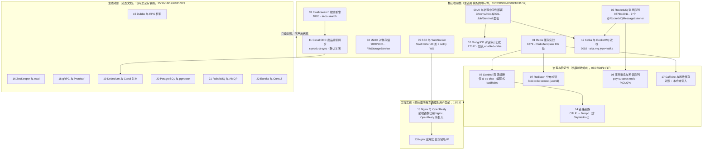

# 04-中间件：不是中间件百科，而是"哪些组件真在跑、哪些只是选型"的分层地图

> **一句话结论**：这是 04-中间件 23 篇的入口。它先回答"这个仓库里到底跑着哪些中间件、证据在哪一行"，再按**核心在用栈 / 治理与稳定性 / 生态对照 / 工程实践**四层把 23 篇排成一条走得通的路；标注"生态对照"的篇目是**选型文档**，代码里没有对应依赖，别把它们的结论当成已经上线的实现。

> **读者画像**：能写 Spring Boot CRUD、会改 `application.yml`，但一遇到"消息重复消费""锁没释放""SSE 变成一次性吐一坨"就只能重启服务的人；也适合面试前需要一张"我讲得清为什么选它、不选它代价是什么"的对照表的人。

> **证据基线**：Spring Boot 4.2.0 / Spring Cloud 2026.0.0 / Spring Cloud Alibaba 2025.1.0.0 / JDK 17（本地 21）。本机探测（2026-11-27，`Get-Command`）：`docker`、`redis-cli`、`mysql`、`kafka-topics.bat`、`mqadmin` **全部 NOT FOUND**，`node v24.16.0` 可用 —— 所以本篇没有任何"跑起来看到的输出"，全部结论只由静态证据（pom / yml / 源码 / 编排文件 / 已入库源码摘录）支撑；需要连中间件才能验证的地方，只给判读方法不给假输出。预计阅读 25~35 分钟，按路线跳读可压到 15 分钟。

---

## 1. 定位：这一篇补的是"跨进程之后凭空多出来的那一层"

### 1.1 能力缺口从哪来

单体应用里，下面每一种能力都是**进程内免费送的**，写一行就有：`synchronized` 是锁，`HashMap` 是缓存，方法调用是 RPC，`ApplicationEvent` 是消息，日志文件就是"链路"。项目拆成 `ai-cs-gateway / user / chat / knowledge / search / message / notify / order / pay / product / mq` 十几个服务之后，这些"免费"的东西**全部作废**：锁只在单个 JVM 内生效、缓存各进程各一份、方法调用跨不了网线、事件发布方和订阅方不在同一个进程里。

中间件就是**为补上这一层而引入的独立进程 + 客户端库**。所以判断"要不要学某个中间件"，不是看它在面试里多热，而是看下表的哪一格被你撞上了：

| 进程内的免费能力 | 跨进程后的替代 | 本仓实际用谁 | 换来的代价 |
| --- | --- | --- | --- |
| `synchronized` 互斥 | 分布式锁 | Redisson（仅 `ai-cs-order`） | 锁要过期、要续期、要防误解锁 |
| 进程内 `Map` 缓存 | 跨节点缓存 | Redis（几乎全模块）+ 自研 L1 LRU（`ai-cs-chat`） | 一致性、击穿、雪崩要自己兜 |
| 本地方法调用 | 远程调用 | **OpenFeign**（不是 Dubbo / gRPC） | 超时、重试、幂等、序列化全自理 |
| `ApplicationEvent` 同步通知 | 消息队列 | **RocketMQ**（Kafka 为可切换分支） | 重复消费、顺序、死信要设计 |
| 逐行扫表 | 倒排检索 | Elasticsearch（`ai-cs-search`） | 双写/CDC 一致性问题 |
| 本地磁盘 | 对象存储 | MinIO（`FileStorageService` 在 common） | 访问控制、超大文件、预签名 |
| 请求-响应 | 服务端推送 | SSE（chat）+ WebSocket（notify） | 代理缓冲、连接数、心跳 |
| 翻日志 grep | 链路追踪 | OTel Collector + Tempo（不是 SkyWalking） | 埋点、采样、存储成本 |

**读完这一篇你应该能把上表倒着背**：给一个症状，说得出是哪一格塌了。

### 1.2 读完能验证的行为

学完 04 篇（不必读完 23 篇，读完路线里指定的即可），你应该能做到下面 5 条，且每条都能当场验证：

1. 任给一个中间件名字（`Caffeine`、`Dubbo`、`RabbitMQ`…），**30 秒内**回答"本仓用不用、证据在哪一行"，并指出反面证据（例如"没有依赖"靠的是 `pom.xml` 里搜不到）。
2. 打开 `docker-compose.yml`，说清 6379 / 9876 / 10911 / 9200 / 27017 / 9000 / 9092 / 8858 各自是谁、谁依赖谁、哪个是 `profile` 才起。
3. 解释**为什么**前端 Nginx 那段 `/api/` 反代必须 `proxy_buffering off`，并能指出配置在 `ai-cs-frontend/nginx.conf#L49-L58`。
4. 说出至少 5 个"本仓没有选"的技术，并各给一句"为什么没选 / 代价是什么"（第 9 节有答案表，但要能自己讲）。
5. 拿到一条线上抱怨（"订单重复""搜索搜不到新商品""用户收不到通知"），能直接跳到对应篇目的"踩坑与调试"小节，而不是从 01 篇开始翻。

---

## 2. 模块地图：23 篇按"离主链路多远"分四层



> **读图说明**：图的纵轴是**离用户请求的远近**，不是难度。
> ① `L1` 是"请求经过它"的组件——用户消息、商品检索、图片上传都走这几个端口，所以 01~05、09~12 是必读；`09` 是这批基础设施的**部署总入口**（Chroma/Neo4j/XXL-Job/Sentinel 面板都在同一个 compose 里），`10/11/12` 都带"默认关闭"开关，属于**代码已落地、功能默认灰度在关**。
> ② `L2` 是"出事时才显形"的组件：正常流量下你感觉不到它，一旦 QPS 打满、锁竞争、消息重复，它决定你是降级还是雪崩。`14` 之所以放在这一层，是因为它不改业务语义，只让你**看得见**链路；`17` 是**反向对照**（本仓未引入 Caffeine，L1 缓存是自研 LRU，见 `ai-cs-chat/src/main/resources/application.yml#L177-L182`），放在这里是为了和 `01` 形成"该不该上两级缓存"的辩论。
> ③ `L3` 全部是**虚线进来的选型文档**：它们不产出本仓代码，只回答"为什么不是它"。不要把这一层当成待办事项。
> ④ `L4` 是唯一"用户能直接看见"的一层（`try_files` 兜底、SSE 不缓冲、域名/IP 配置），它是前面所有服务对外暴露的最后一道门。
> ⑤ 实线边是**阅读前置关系**：`01 → 07` 表示先懂 Redis 的 key/TTL/淘汰策略，07 的看门狗与续期才有意义；`03 → 11 → 19` 是一条"检索 → 同步 → 方案对比"的链；`05 → 13` 表示不理解 SSE 是长连接，就看不懂 Nginx 那几行缓冲配置为什么必须关。

### 2.1 为什么这样排序

| 层 | 篇目 | 为什么放这一层 | 不读的代价 |
| --- | --- | --- | --- |
| 核心在用栈 | 01 02 03 04 05 09 10 11 12 | 主链路真跑，端口在编排文件里能查到，代码里有真实调用点 | 读不懂本项目的任何一条业务链路 |
| 治理与稳定性 | 06 07 08 14 17 | 平时不显形，压力/故障时才决定生死；06 只在一个服务落地、17 根本没落地，正好练"落地程度判断" | 线上出事只会重启 |
| 生态对照 | 15 16 18 19 20 21 22 | 面试高频、但本仓未选；价值在"取舍论证"而非"会用" | 面试被追问"为什么不用 Dubbo"就哑火 |
| 工程实践 | 13 23 | 把服务暴露给用户/运维的最后一公里 | 本地跑得通、部署就白屏/超时 |

### 2.2 推荐阅读顺序（一条主干 + 三个岔路）

主干（顺序不可打乱，因为后者依赖前者的概念）：**01 → 02 → 03 → 07 → 06 → 08 → 05 → 13**。
理由：`01` 建立"缓存/过期/淘汰"的公共词汇；`02` 建立"生产-消费-重试"的公共词汇；`03` 把"检索"接上；接着用 `07`（锁）和 `06`（限流）补治理，`08` 是 `02` 的可靠升级版（事务消息 + 死信），必须紧跟在 02 后面读；`05` 讲流式推送，是 `13` 的前置。

岔路 A（做 AI 相关）：`01 → 03 → 09 → 10 → 11`，把向量库、对象存储、对话归档、CDC 串起来。
岔路 B（准备面试）：`01 → 02 → 06 → 07 → 15 → 22`，只读每篇的"设计取舍 + 面试高频问"。
岔路 C（线上救火）：直接跳第 8 节症状表，读对应篇目的"踩坑与调试手法"。

---

## 3. 每篇一句话摘要（含落地判定）

"是否落地"一列只认代码/配置证据，不认文档说法；证据类型 **A** = 已入库源码摘录（`24-源码分析/assets/source/`），**B** = 本项目真实文件与行号，**C** = 可复现静态统计或命令。

| # | 篇目 | 解决什么问题（一句话） | 本项目是否已落地 | 证据类型 |
| --- | --- | --- | --- | --- |
| 01 | [Redis 缓存实战](01-Redis缓存实战.md) | 缓存穿透/击穿/雪崩、key 设计与淘汰策略，决定"读多写少"这条路的成败 | **已落地**：`redis:7` 编排在 6379，`deploy/redis/redis.conf#L24-L25` 设 `maxmemory 256mb` + `allkeys-lru` | B + C（`RedisTemplate` 静态计数 102 处） |
| 02 | [RocketMQ 消息队列](02-RocketMQ消息队列.md) | 生产/消费/重试/顺序的完整语义，是"服务解耦"的主力 | **已落地**：namesrv 9876 + broker 10911；`@RocketMQMessageListener` 静态计数 9 处（knowledge/message/mq/notify/order/search） | B + C |
| 03 | [Elasticsearch 搜索引擎](03-Elasticsearch搜索引擎.md) | 倒排索引与检索精度，替代 `LIKE '%x%'` | **已落地**：`ai-cs-search` 用 `ElasticsearchClient`（`config/ElasticsearchConfig.java`、`service/impl/SearchServiceImpl.java`、`hybrid/HybridSearchServiceImpl.java`），编排为 `elasticsearch:8.12.0` 9200 | B |
| 04 | [MinIO 对象存储](04-MinIO对象存储.md) | 图片/文档不落库落盘，走 S3 协议对象存储 | **已落地**：`ai-cs-common/src/main/java/com/aics/common/storage/FileStorageService.java`；编排 `minio` 9000/9001 | B |
| 05 | [SSE 与 WebSocket 实时通信](05-SSE与WebSocket实时通信.md) | 大模型流式输出与主动推送，解决"HTTP 只能一问一答" | **已落地**：chat 用 `SseEmitter`（`ChatController` / `agent/AgentController`），notify 用 `NotifyWebSocketHandler` + `WebSocketConfig` | B + C（`SseEmitter` 48 处） |
| 06 | [Sentinel 限流与熔断降级](06-Sentinel限流与熔断降级.md) | 保护有限的外部依赖（LLM 并发），把"慢"转成"快速失败" | **已落地但只在一个服务**：starter 仅 `ai-cs-chat` 引入（`ai-cs-chat/pom.xml#L204-L217`），规则编程式装配（`config/SentinelFlowConfig.java#L29-L41`），切面在 `controller/ChatController.java#L79`；`bladex/sentinel-dashboard:1.8.6` 编排在 8858 但未接规则持久化 | B + A（`SphU.java.md#L262-L264`） |
| 07 | [Redisson 分布式锁](07-Redisson分布式锁.md) | 跨 JVM 互斥、看门狗续期、解锁安全 | **已落地**：`ai-cs-order` 的 `config/RedissonConfig.java`、`lock/OrderCreateLockService.java#L31-L34`（`lock:order:create:{userId}`） | B + C（`RLock|RedissonClient` 19 处） |
| 08 | [RocketMQ 事务消息与死信队列](08-RocketMQ事务消息与死信队列.md) | "本地事务 + 消息"原子性，以及重试耗尽后的兜底 | **已落地**：`ai-cs-pay/src/main/java/com/aics/pay/mq/PaySuccessMessageProducer.java#L35-L52` + `ai-cs-pay/src/main/java/com/aics/pay/mq/PaySuccessTransactionListener.java`；死信侧 `ai-cs-mq/src/main/java/com/aics/mq/consumer/WorkOrderDlqListener.java#L22-L30` | B |
| 09 | [AI 与治理中间件部署](09-AI与治理中间件部署.md) | Chroma / Neo4j / XXL-Job / Sentinel 面板等"AI 周边基础设施"怎么起 | **已落地（编排层）**：`docker-compose.yml#L194-L274`（chroma 8000、neo4j 7474/7687、xxl-job 8099、sentinel 8858），`deploy/k8s/` 有对应清单 | B |
| 10 | [MongoDB 对话审计归档](10-MongoDB对话审计归档.md) | 长文本对话从 MySQL 迁到文档库，主链路不变 | **代码已落地、默认关闭**：`ai-cs-chat/src/main/java/com/aics/chat/history/mongo/MongoChatHistoryArchiveService.java` 等三个类（Document/Repository/Service），开关 `ai-cs-chat/src/main/resources/application.yml#L174-L176`（`MONGO_ARCHIVE_ENABLED:false`）；编排 `mongo:7.0` 27017 | B |
| 11 | [Canal CDC 商品索引同步](11-CanalCDC商品索引同步.md) | 商品变更如何实时进 ES，而不是定时全量刷 | **消费端已落地、生产端未部署**：`ai-cs-search/src/main/java/com/aics/search/cdc/ProductCdcConsumer.java#L23-L30` 监听 `c-product-sync`，但 `aics.cdc.product.enabled` 默认 false（`ai-cs-search/src/main/resources/application.yml#L54-L58`），编排里**没有 canal server**，只有 `deploy/mysql/canal-init.sql` 账号脚本 | B |
| 12 | [Kafka 与 RocketMQ 双栈切换](12-Kafka与RocketMQ双栈切换.md) | 同一套业务语义在两种 Broker 上跑，靠配置切换 | **已落地（可选分支）**：`ai-cs-mq` 同时有 RocketMQ 与 Kafka 两套监听（`consumer/kafka/WorkOrderKafkaListener.java#L29-L30` 用 `@ConditionalOnProperty(aics.mq.type=kafka)`），`application-kafka.yml#L23` 指 9092；编排里 kafka 在 `profile=kafka` 下才起（`docker-compose.yml#L276-L342`） | B + C（`@KafkaListener|KafkaTemplate` 23 处） |
| 13 | [Nginx 与 OpenResty 反向代理](13-Nginx与OpenResty反向代理.md) | 静态资源、反代、SSE 不缓冲、上传大小限制 | **Nginx 已落地，OpenResty 未引入**：`ai-cs-frontend/nginx.conf#L49-L58`（`/api/` 反代 + `proxy_buffering off`）+ `ai-cs-frontend/Dockerfile` | B |
| 14 | [SkyWalking 链路追踪](14-SkyWalking链路追踪.md) | 跨服务一次请求的耗时归因 | **未落地（换了实现）**：无 SkyWalking 依赖；实际走 OTLP → OTel Collector → Tempo（`deploy/observability/otel-collector.yaml`、`tempo.yaml`），search 侧配置见 `ai-cs-search/src/main/resources/application.yml#L60-L62` | B（反面证据） |
| 15 | [Dubbo 与 RPC 框架](15-Dubbo与RPC框架.md) | RPC 协议、序列化、服务治理的另一种做法 | **未引入**：全仓无 `dubbo` 依赖，服务间调用走 OpenFeign | B（反面证据）+ 官方文档未入库 |
| 16 | [ZooKeeper 与 etcd 分布式协调](16-ZooKeeper与etcd分布式协调.md) | 一致性与选主、临时顺序节点的原理 | **未引入**：协调/注册全用 Nacos 3.x；无 `zookeeper` / `etcd` 客户端依赖 | B（反面证据） |
| 17 | [Caffeine 本地缓存与两级缓存](17-Caffeine本地缓存与两级缓存.md) | 进程内缓存怎么和 Redis 组合，避免"每次都打远端" | **未引入 Caffeine**：L1 缓存是自研 LRU（`ai-cs-chat/src/main/resources/application.yml#L177-L182`，`l1-max-entries: 4096`、`ttl-hours: 168`） | B + 官方文档未入库 |
| 18 | [gRPC 与 Protobuf 跨语言调用](18-gRPC与Protobuf跨语言调用.md) | 二进制协议 + IDL，跨语言高吞吐调用 | **未引入**：Java 侧全 OpenFeign，Python 服务（`ai-cs-py-chat` / `ai-cs-py-recommend`）走 HTTP | B（反面证据） |
| 19 | [Debezium 与 Canal 的 CDC 对比](19-Debezium与Canal的CDC对比.md) | binlog 订阅的两种工程实现怎么选 | **两者都未部署**；Canal 只到"消费端 + 账号脚本"（同 11 篇），Debezium 零依赖 | B（反面证据） |
| 20 | [PostgreSQL 与 pgvector](20-PostgreSQL与pgvector.md) | 关系库内建向量检索，替代独立向量库 | **未引入**：无 `postgresql` 驱动；向量检索用 Chroma（8000）+ Neo4j（7687） | B（反面证据） |
| 21 | [RabbitMQ 概念模型与 AMQP 协议](21-RabbitMQ概念模型与AMQP协议.md) | Exchange/Queue/Binding 模型与 AMQP 语义 | **未引入**：消息统一 RocketMQ（Kafka 为备选分支），无 `amqp` 依赖 | B（反面证据）※本篇仍是旧稿 |
| 22 | [Eureka 与 Consul 注册中心对照](22-Eureka与Consul注册中心对照.md) | 两种注册中心的健康检查与一致性取舍 | **未引入**：注册与配置都用 Nacos（11 个模块引入 nacos discovery/config） | B（反面证据）※本篇仍是旧稿 |
| 23 | [Nginx 应用实战与域名 IP 配置](23-Nginx应用实战与域名IP配置.md) | 域名/证书/多站点/IP 直连的实操清单 | **部分可用**：本仓的 Nginx 只在前端镜像里做静态站 + 反代（`ai-cs-frontend/nginx.conf`）；域名/IP 章节属通用运维技能，仓库里没有对应的 ingress/证书文件 | B ※本篇仍是旧稿 |

> 说明：**21 / 22 / 23 三篇目前仍是旧稿**（100~300 行量级，未按本批次范式补齐"先看现象 / 证据精读 / 踩坑与调试"结构）。它们的技术结论可参考，但**引用前要自己回代码核实**；其余 20 篇已按新范式重写，证据可直接顺着锚点核对。

---

## 4. 三条学习路线

三条路线内容重叠约 40%，不要同时开三条——选一条走完，再用"检查点清单"（第 6 节）验收。

### 路线 A：面试速通（≈ 6 小时，产出：一页 A4 对照表）

只读 6 篇，每篇只读三节：`设计取舍`、`面试高频问与答`、`自测题`。

| 顺序 | 篇目 | 只回答这一个问题 | 耗时 |
| --- | --- | --- | --- |
| 1 | 01 Redis 缓存实战 | 缓存穿透/击穿/雪崩分别怎么防，为什么用 `allkeys-lru` 而不是 `volatile-lru` | 70 min |
| 2 | 02 RocketMQ 消息队列 | 重复消费怎么幂等、顺序消息怎么保证、重试几次进死信 | 70 min |
| 3 | 07 Redisson 分布式锁 | 看门狗解决什么、`waitTime=0` 的代价是什么 | 50 min |
| 4 | 06 Sentinel 限流与熔断降级 | 限流和熔断的区别、为什么阈值要按外部依赖定 | 50 min |
| 5 | 15 Dubbo 与 RPC 框架 | 为什么本仓选 OpenFeign 而不是 Dubbo，各自的代价 | 40 min |
| 6 | 22 Eureka 与 Consul 注册中心对照 | AP/CP 取舍，Nacos 站在哪一边 | 40 min |

产出物：一页纸写清"每个组件的替代方案 + 为什么没选 + 代价"，面试时按这个顺序讲。

### 路线 B：项目落地（≈ 20 小时，产出：一条能演示的端到端链路）

按主干顺序读 8 篇，并且**每读一篇都要在本仓找到对应调用点**（找不到就记进第 9 节的诚实清单）。

| 阶段 | 篇目 | 落地动作 | 耗时 |
| --- | --- | --- | --- |
| 1 | 01 → 02 | 给 chat 的会话缓存加 TTL 与空值缓存；跑通一条 RocketMQ 生产-消费 | 5 h |
| 2 | 03 → 11 | 商品写入后能查到 ES 文档（Canal 未部署时用"定时对账"兜底路径） | 5 h |
| 3 | 07 → 06 | 下单防重锁 + chat 限流规则，各写一个能被触发的验证 | 4 h |
| 4 | 08 | 把 pay → order 的通知换成事务消息并验证回查 | 3 h |
| 5 | 05 → 13 | SSE 全链路（chat → gateway → nginx）不缓冲，用浏览器看 token 逐步出现 | 3 h |

产出物：一条"下单 → 支付 → 消息 → 通知"的端到端演示 + 每步一个"我以为 vs 实际"的记录。

### 路线 C：线上排障（≈ 2 小时，产出：一份自己的排障索引）

不按篇目顺序读，按**症状**读第 8 节的表，每跳一篇只读两节：`踩坑与调试手法`、`版本差异`。读完把自己的项目日志关键字（端口、topic、consumerGroup、锁 key 前缀）补进那张表，形成私人索引。

产出物：一张"症状 → 日志关键字 → 下一步命令"的表，贴在 oncall 群里。

---

## 5. 依赖关系：进来之前要会什么，出去之后去哪

### 5.1 前置（不读会卡住）

| 前置 | 为什么是前置 | 建议先读 |
| --- | --- | --- |
| [01-Java基础](../01-Java基础/README.md) | 分布式锁的看门狗是线程 + `ScheduledExecutor`；`SseEmitter` 是 `DeferredResult` 的兄弟；序列化决定消息体能不能跨版本 | [04-并发编程进阶](../01-Java基础/04-并发编程进阶.md)、[08-语言级细节与序列化](../01-Java基础/08-语言级细节与序列化.md) |
| [03-数据库与ORM](../03-数据库与ORM/README.md) | 事务消息回查要读本地事务状态；CDC 是读 binlog；ES 文档 id 要对齐 MySQL 主键 | [06-事务进阶-MVCC实现与三大日志](../03-数据库与ORM/06-事务进阶-MVCC实现与三大日志.md)、[03-ShardingSphere用户表分库分表实战](../03-数据库与ORM/03-ShardingSphere用户表分库分表实战.md) |
| [02-Spring微服务](../02-Spring微服务/README.md) | 中间件的客户端几乎都是"自动装配 + 一个 Starter"，不懂自动装配只会抄配置 | [03-Nacos注册与配置中心](../02-Spring微服务/03-Nacos注册与配置中心.md)、[10-自定义Starter与自动装配](../02-Spring微服务/10-自定义Starter与自动装配.md) |

### 5.2 后续（这里读完去那里）

| 后续 | 承接关系 | 入口 |
| --- | --- | --- |
| 12-性能工程 | 缓存命中率、消息积压、锁等待，最终都要落到线程/GC/火焰图上 | [README](../12-性能工程/README.md)、[06-接口性能优化实战](../12-性能工程/06-接口性能优化实战.md) |
| 13-稳定性工程 | 限流/降级/熔断是 SLO 的执行手段，不是目标 | [README](../13-稳定性工程/README.md)、[05-降级预案与开关治理](../13-稳定性工程/05-降级预案与开关治理.md) |
| 14-数据工程与OLAP | CDC 只是"数据进湖"的第一步，之后是分层与对账 | [04-CDC与实时同步链路](../14-数据工程与OLAP/04-CDC与实时同步链路.md)、[08-数据质量与对账](../14-数据工程与OLAP/08-数据质量与对账.md) |
| 16-云原生与GitOps | 本篇所有编排都是单机 compose，真正上线要变成 K8s 清单 | [README](../16-云原生与GitOps/README.md)、[02-K8s资源治理与弹性伸缩](../16-云原生与GitOps/02-K8s资源治理与弹性伸缩.md) |

### 5.3 横向深挖（想看"源码级为什么"，去 24-源码分析）

本篇只做**索引 + 落地核对**，不讲 Spring Cloud 内部实现细节；源码级内容在 [24-源码分析/04-SpringCloud](../24-源码分析/04-SpringCloud/README.md)。两条最常用的跳转：

- 限流为什么"拦在方法入口"：`@SentinelResource` 最终落到 `SphU.entry`，再由 `Env.sph`（`CtSph`）走 slot chain，`BlockException` 就是 `blockHandler` 的触发点。

  ```java
  // 24-源码分析/assets/source/SphU.java.md#L262-L264
  public static Entry entryWithPriority(String name) throws BlockException {
      return Env.sph.entryWithPriority(name, EntryType.OUT, 1, true);
  }
  ```

  （src: SphU.java.md#L262-L264）[[源码:SphU.java.md#L262-L264]]

- 注册中心的"下线"为什么偶尔静默失败：`NacosServiceRegistry.deregister` 把异常吞成一条 error 日志，服务却已经停了。

  ```java
  // 24-源码分析/assets/source/NacosServiceRegistry.java.md#L105-L115
  try {
      namingService.deregisterInstance(serviceId, group, registration.getHost(),
              registration.getPort(), nacosDiscoveryProperties.getClusterName());
  }
  catch (Exception e) {
      log.error("ERR_NACOS_DEREGISTER, de-register failed...{},", registration.toString(), e);
  }
  ```

  （src: NacosServiceRegistry.java.md#L105-L115）[[源码:NacosServiceRegistry.java.md#L105-L115]]

> ⚠️ 这里引的两份摘录是**已入库**的（`assets/source/` 里真实存在）。反过来，Nginx / OpenResty / SkyWalking / Dubbo / ZooKeeper / etcd / Caffeine / gRPC / Debezium / Canal / PostgreSQL / RabbitMQ / Eureka / Consul 的**本体源码都不在** `assets/source/`，所以涉及它们的篇目一律以"官方文档 + 本仓代码"为据，不编文件名、不编行号。
>
> 相关深读：[02-注册中心Nacos/01-nacos-服务注册与发现源码](../24-源码分析/04-SpringCloud/02-注册中心Nacos/01-nacos-服务注册与发现源码.md)、[06-熔断限流与容错/02-sentinel-限流降级原理](../24-源码分析/04-SpringCloud/06-熔断限流与容错/02-sentinel-限流降级原理.md)。

---

## 6. 检查点清单（分阶段，勾完再往下走）

每个勾选项都必须是**可在本仓验证的动作**，不是"我读过了"。

### 阶段 0：认清家底（30 分钟）

- [ ] 能对着 `docker-compose.yml` 说出每个 `ports:` 分别是谁，并指出 `kafka` 那段为什么在 `profiles: [kafka]` 下（不开 profile 就不起）。
- [ ] 能说出编排里**没有**的三样东西：canal server、nginx、skywalking（`deploy/observability/` 用的是 OTel/Tempo）。
- [ ] 能用一条命令列出全仓中间件相关依赖：在仓库根执行 `Select-String -Path ai-cs-*/pom.xml -Pattern "redis|rocketmq|kafka|mongodb|elasticsearch|minio|sentinel|redisson|xxl-job"`，并把输出按模块归类。

### 阶段 1：核心在用栈（8~10 小时）

- [ ] 能解释 `deploy/redis/redis.conf#L24-L25` 的 `maxmemory 256mb` + `allkeys-lru` 意味着什么：内存打满时**连不过期的 key 也可能被淘汰**，所以不要把"绝不能丢"的数据只放 Redis。
- [ ] 能画出 chat 的一次 RAG 请求里，Redis（会话/缓存）、ES（检索）、Chroma（向量）、MinIO（图片）分别在什么位置。
- [ ] 能在 `ai-cs-mq` 里指出 RocketMQ 与 Kafka 两套监听是**互斥注册**的（`@ConditionalOnProperty(aics.mq.type=kafka)`），并说清切换的失败点（topic 名、DLQ 机制不同）。
- [ ] 能解释 `ai-cs-search/src/main/resources/application.yml#L54-L58` 中 `aics.cdc.product.enabled` 默认 false 的后果：**消费者注册了但直接 return，货不会进 ES**，这解释了"搜不到新商品"。
- [ ] 能说出 MongoDB 归档为什么默认关（`ai-cs-chat/src/main/resources/application.yml#L174-L176`），以及打开它需要改什么、风险是什么。

### 阶段 2：治理与稳定性（6~8 小时）

- [ ] 能指出 Sentinel 只在一个服务落地（`ai-cs-chat/pom.xml#L204-L217`），并说清"其余服务没有限流"这件事的风险与补齐成本。
- [ ] 能读懂 `config/SentinelFlowConfig.java#L29-L41` 为什么把规则写死在常量类里（`SentinelRules`），以及这样做的代价（改阈值要重启）。
- [ ] 能讲清 Redisson `waitTime=0` 的语义（快速失败而非排队）与看门狗续期的边界（进程假死时仍会续期）。
- [ ] 能解释事务消息的"半消息 → 本地事务 → 回查"三步各自失败时，`ai-cs-pay` 与 `ai-cs-order` 分别会看到什么。

### 阶段 3：对照与排障（4 小时）

- [ ] 能就 5 个未落地技术（Dubbo / gRPC / ZK / RabbitMQ / PostgreSQL+pgvector）各说一句"本项目没选它，是因为…，代价是…"。
- [ ] 能在第 8 节的症状表里，找到自己项目最近一次故障对应的篇目，并说出当时漏看了哪个判读点。
- [ ] 能独立完成一次 **C 级**验证：用静态统计证明某个中间件"没被用"（例如 `MongoTemplate` 计数为 0，说明归档走的是 Repository 而不是模板）。

---

## 7. 本项目中间件真实清单（数值全部来自 `deploy/` 与 pom，不来自记忆）

### 7.1 编排里真跑着的（`docker-compose.yml`，单机基础设施）

| 组件 | 版本（镜像/依赖） | 端口 | 在编排里 | 落地程度 |
| --- | --- | --- | --- | --- |
| MySQL | `8.0` | 3306 | 是（`docker-compose.yml#L11-L34`） | 全量业务库在用 |
| Redis | `redis:7` | 6379 | 是（`#L37-L53`），配置 `deploy/redis/redis.conf` | 缓存/会话/锁三用 |
| Nacos | 镜像 `nacos/nacos-server:v2.3.2` | 8848 / 9848 | 是（`#L56-L83`） | 注册 + 配置中心，11 个模块接入 |
| Elasticsearch | `8.12.0`（客户端依赖 8.12.2） | 9200 / 9300 | 是（`#L86-L107`） | `ai-cs-search` 检索主路径 |
| RocketMQ | `apache/rocketmq:5.1.4`（客户端 `rocketmq-spring 2.3.0`） | 9876（namesrv）、10911/10909（broker） | 是（`#L110-L148`） | 9 个模块引入客户端，6 个模块注册了监听器 |
| MinIO | `quay.io/minio/minio:latest`（客户端 `minio 8.5.12`） | 9000 / 9001 | 是（`#L151-L171`） | 图片/文档上传 |
| MongoDB | `mongo:7.0` | 27017 | 是（`#L174-L191`） | 归档代码就绪，**默认关闭** |
| Chroma | `chromadb/chroma:0.5.20` | 8000 | 是（`#L194-L209`） | 向量检索 |
| Neo4j | `neo4j:5-community` | 7474 / 7687 | 是（`#L211-L232`） | 图谱能力 |
| XXL-Job | `xuxueli/xxl-job-admin:2.4.1`（客户端 2.4.1） | 8099→8080 | 是（`#L235-L257`） | 调度，`@XxlJob` 仅 1 处 |
| Sentinel Dashboard | `bladex/sentinel-dashboard:1.8.6`（内核 1.8.10） | 8858 | 是（`#L259-L274`） | 面板起得来，**规则未推送到面板** |
| Kafka | `apache/kafka:3.7.1`（KRaft） | 9092 | 是，但 `profiles: [kafka]` 才起（`#L276-L342`） | `ai-cs-mq` 双栈备选，另建 `work-order-topic` / `work-order-dlt` |

### 7.2 编排里**没有**的（容易记错的三个）

| 东西 | 现状 | 正确说法 |
| --- | --- | --- |
| Canal Server | 只有 `deploy/mysql/canal-init.sql`（账号初始化）与消费端 `ProductCdcConsumer` | "CDC 链路只到消费端，生产端未部署"，所以 `aics.cdc.product.enabled` 保持 false |
| Nginx / OpenResty | 只在 `ai-cs-frontend` 镜像里（`ai-cs-frontend/nginx.conf` + `Dockerfile`） | 前端站点有反代，**没有独立的边缘网关层**，也没有 OpenResty（无 Lua 逻辑） |
| SkyWalking | 无 | 链路追踪走 OTLP → OTel Collector → Tempo（`deploy/observability/`） |

### 7.3 版本对不上基线的两处（必须知道，否则排查会走偏）

| 组件 | 编排/依赖里的实际值 | 文档基线 | 影响 |
| --- | --- | --- | --- |
| Nacos | 镜像 `v2.3.2` | Nacos 3.3 | 控制台接口/鉴权项有差异，照 3.x 文档配 2.3.2 可能找不到菜单；升级前先看 24-源码分析里的 Nacos 篇 |
| Sentinel | Dashboard `1.8.6`，客户端内核 `1.8.10` | Sentinel 1.8.10 | 面板与内核小版本不一致时，规则推送失败通常只表现为"面板看不到规则" |

### 7.4 一次可复现的静态统计（C 级证据，2026-11-27 实测输出）

```powershell
# 仓库根执行，纯静态，不启动任何服务，秒级完成
$src = Get-ChildItem -Path . -Recurse -File -Filter *.java |
       Where-Object { $_.FullName -notmatch '\\target\\' -and $_.FullName -match '\\ai-cs-' }
$src.Count                                                              # 668 个 Java 文件
($src | Select-String -Pattern '@RocketMQMessageListener').Count         # 9
($src | Select-String -Pattern 'RLock|RedissonClient').Count            # 19
($src | Select-String -Pattern 'SseEmitter').Count                      # 48
($src | Select-String -Pattern 'ElasticsearchClient').Count             # 19
($src | Select-String -Pattern 'MongoTemplate').Count                   # 0
($src | Select-String -Pattern '@XxlJob').Count                         # 1
```

怎么读这组数：`@RocketMQMessageListener` 有 9 处但 `MongoTemplate` 是 0 ——说明**消息是真在用，Mongo 归档走的是 `Repository` 接口而不是模板**（对应 10 篇）；`@XxlJob` 只有 1 处，说明调度能力"接了但几乎没用"，这是第 9 节里要承认的落差。数字本身会随代码变化，**方法是永久的**：想知道"用没用"，数调用点比读文档可靠。

---

## 8. 常见问题直达表（按症状查，不按篇目查）

| 症状 / 日志关键字 | 大概率原因 | 去哪篇 | 第一手判读动作 |
| --- | --- | --- | --- |
| 商品刚改价，搜索还是旧值 | CDC 开关没开，或 canal 没部署，消费者直接 return | 11、19 | 看 `aics.cdc.product.enabled` 与环境变量 `CANAL_PRODUCT_CDC_ENABLED`；再看 ES 文档 `_id` 是否等于 `product.id` |
| `documentMissing` / 删除后文档又冒出来 | 幂等策略没覆盖 DELETE 重放 | 11 | 复核消费端对 `documentMissing` 的忽略逻辑与对账任务 |
| 同一工单通知发了两次 | 消费重试 + 无幂等键 | 02、08 | 查 `mq_fail_record` 与业务唯一键；确认幂等键取自 `msg_id` 还是业务 id |
| 消息重试耗尽后"消失" | 死信主题 `%DLQ%<consumerGroup>` 无人消费 | 08 | 看 `WorkOrderDlqListener` 是否注册、`maxReconsumeTimes` 配置值 |
| 支付成功但订单没变已支付 | 事务消息回查失败 / `executeLocalTransaction` 抛异常回滚 | 08 | 看 `PaySuccessTransactionListener` 的回查日志与支付流水状态 |
| 支付回调超时后事件丢失 | 旧路径是"markSuccess 后 Feign 通知"，超时即丢 | 08、02 | 确认是否已切事务消息（`pay-success-topic`） |
| 下单按钮连点生成两单 | 锁未生效或 `waitTime` 语义理解错 | 07 | 查锁 key `lock:order:create:{userId}` 是否真的被加；`isHeldByCurrentThread` 是否误判 |
| 锁 30 秒后"自己开了" | 指定了 `leaseTime` 导致看门狗失效 | 07 | 检查是否显式传 `leaseTime`；业务耗时是否超过续期粒度 |
| AI 回答不是逐字出现，而是憋一大坨 | 中间某层开了缓冲（Nginx 或网关） | 05、13 | 先看 `ai-cs-frontend/nginx.conf` 的 `proxy_buffering off`，再看网关是否压缩/缓冲 |
| 大模型首 token 很慢，前端 504 | 代理读超时默认 60s | 05、13 | `proxy_read_timeout` 是否放大到 300s |
| chat 在压测时直接报限流 | Sentinel 阈值按 LLM 并发定得很低（`chat-send` 10 QPS、`chat-rag` 5 QPS） | 06 | 看 `SentinelRules` 常量与 `SentinelFlowConfig` 的 WarmUp 参数 |
| 面板里看不到规则 | Dashboard 1.8.6 与内核 1.8.10 版本错配，或规则是编程式加载不推面板 | 06 | 直接读 `FlowRuleManager.getRules()`（有单测示范） |
| 上传图片 413 | `client_max_body_size` 太小 | 04、13 | 看 nginx 的 20m 与后端 multipart 上限是否一致 |
| 服务停掉后注册中心还有它 | 下线失败被吞 | 22、24-SpringCloud | 搜日志关键字 `ERR_NACOS_DEREGISTER`，见 5.3 的源码摘录 |
| 同一条链路不知慢在哪一跳 | 追踪没接或采样率过低 | 14 | 查 OTLP endpoint 与 Tempo 是否有该 traceId |
| Kafka 分支启动后收不到消息 | 没开 `profile=kafka`，或 topic 名不一致 | 12 | 对照 `work-order-topic` / `work-order-dlt` 与 `aics.mq.type` |
| 缓存雪崩（大批 key 同时过期） | 统一 TTL + 无随机抖动 | 01 | 抽样看 key 的 TTL 分布是否"同一秒到齐" |
| Redis 内存满后热点 key 也没了 | `allkeys-lru` 会淘汰未过期 key | 01 | 看 `maxmemory-policy` 与 `info memory` 的 `evicted_keys` |

---

## 9. 诚实清单：这些是设计/选型文档，不是已上线能力

下表每一项都**没有**进本仓的 `pom.xml`（可用 7.3 的统计方法自证：`Select-String -Path ai-cs-*/pom.xml -Pattern "dubbo|grpc|zookeeper|etcd|debezium|postgresql|amqp|eureka|consul|caffeine"` 返回空）。读它们的目的是**能讲清取舍**，不是"以后要用"。

| 技术 | 为什么本项目没选 | 把话说清的代价 | 若真要落地，改哪里 / 验收标准 |
| --- | --- | --- | --- |
| Dubbo | 已有 Nacos + OpenFeign + Resilience4j 的组合，够用；引入 Dubbo 要维护接口 jar（API 包）与序列化契约 | 高吞吐 RPC 场景下 HTTP/JSON 开销大，长连接复用缺失 | 抽 `ai-cs-api` 接口模块 + 换注册与调用方式；验收：一次跨服务调用能在 tracing 里看到同一 traceId，且超时/降级语义不丢 |
| gRPC + Protobuf | Java 与 Python 服务（`ai-cs-py-chat` / `ai-cs-py-recommend`）用 HTTP 已跑通，IDL 维护成本现阶段不划算 | 大 payload、高频调用的编解码浪费 | 定义 `.proto` + 生成 stub + 两侧改造；验收：跨语言调用成功且 p99 优于现 HTTP 路径 |
| ZooKeeper / etcd | 注册与配置都由 Nacos 覆盖，多引入一套协调系统只增加运维面 | 需要强一致选主/分布式队列时缺手段 | 先确认 Nacos 的 CP 能力是否够；验收：选主场景脑裂测试通过 |
| Caffeine | 现用自研 LRU（4096 条，`ai-cs-chat` 向量缓存），功能已够；引入前应先证明本地缓存命中率是瓶颈 | 缺统计/淘汰策略的成熟度，两级缓存一致性要自己设计 | 用 Caffeine 替换自研 LRU 并接 Micrometer；验收：命中率、内存占用、失效传播三项指标可观测 |
| RabbitMQ | 消息栈已统一 RocketMQ（含事务消息），再引入一套 AMQP 只增加两套语义的心智负担 | 复杂路由（Exchange 模型）与轻量队列的灵活性 | 只在需要"灵活路由/优先级队列"时评估；验收：路由规则可配置、死信可观测 |
| Eureka / Consul | Nacos 同时提供注册 + 配置，且与 Spring Cloud Alibaba 版本对齐 | Eureka 2.x 停更风险已规避，Consul 的 KV/健康检查能力未用上 | 不建议改；若改需重做配置中心方案 |
| SkyWalking | 已用 OTel + Tempo（`deploy/observability/`），标准协议更利于多语言 | SkyWalking 的 Java 探针零侵入、开箱告警更强 | 需要"零改造接入"时再评估；验收：不改代码即可拿到跨服务 span |
| OpenResty | 前端 Nginx 只做静态站 + 反代，没有 Lua 业务逻辑需求 | 网关级鉴权/灰度若下沉到 Nginx，需要 Lua | 评估前置：为什么不在 `ai-cs-gateway` 做（Gateway 已有过滤器链） |
| Debezium | 与 Canal 同类能力，当前 CDC 生产端都还没部署，选型为时过早 | 无 Kafka Connect 生态支撑时运维更重 | 先解决 Canal 生产端部署（`deploy/mysql/canal-init.sql` 之外还要 server 编排） |
| PostgreSQL + pgvector | 向量检索已用 Chroma，业务库是 MySQL；引入 PG 意味着第三种存储 | 库内向量检索少一次网络跳转、事务一致性强 | 只在"向量与业务数据需强一致"时评估；验收：召回率与延迟不劣于 Chroma |
| Canal 生产端 | 只有账号脚本与消费端代码，server 未编排 | CDC 链路不通，商品索引只能靠对账 | 加 canal-server 编排 + 打开 `CANAL_PRODUCT_CDC_ENABLED`；验收：改一次价格，ES 文档在秒级更新 |

另有三处**"接了但没跑满"**的落差，也要写进你的项目总结里，别当成已完成：

1. `@XxlJob` 全仓仅 1 处 —— 调度平台起了，任务几乎没写。
2. Sentinel 仅 `ai-cs-chat` 一个服务有限流 —— 其余服务裸奔在网关之后。
3. MongoDB 归档、Canal CDC、Kafka 分支三者**默认关闭** —— 代码就绪，生产链路未启用。

---

## 小结

- 04-中间件 的价值不在"23 个组件都认识"，而在**每个组件都能说出"本仓用没用、证据在哪一行、没用的代价是什么"**。
- 四层分组是判断工具：`核心在用栈` 决定读不读，`治理与稳定性` 决定出事时活不活，`生态对照` 决定面试能不能讲深，`工程实践` 决定用户看不看得见。
- 读的顺序有依赖：`01/02` 是词汇基础，`07/06/08` 是治理，`05/13` 是最后一公里；顺序错了会反复回炉。
- 落地程度必须分级：**已落地 / 代码就绪默认关 / 只到消费端 / 完全未引入** 是四种不同的话，混着说就是编。
- 本仓最容易误判的三件事：Nginx 在**前端镜像**里而不在编排里；Canal 只有**账号脚本**没有 server；链路追踪用 **OTel/Tempo 不是 SkyWalking**。
- 版本有两处对不上基线（Nacos 镜像 2.3.2 vs 3.3、Sentinel 面板 1.8.6 vs 内核 1.8.10），排查前先确认实际值，别拿文档版本套现场。
- 马上可做的一件事：用 7.4 那 7 行统计命令跑一遍自己的仓库，把输出贴进项目 README ——**能数的东西不要凭记忆**。

---

## 本篇的维护约定

- 新增中间件篇目时，必须同时更新三处：第 2 节 Mermaid 分组、第 3 节摘要表（含"是否落地"）、第 8 节症状表（至少一条可查症状）。
- 任何"已落地"的断言都要带项目内路径（可带行号）或统计命令；只写"项目里用了 X"视为未验证。
- 版本数字只从 `docker-compose.yml` / `pom.xml` 抄，不抄记忆；镜像 tag 变了（例如 Nacos 升到 3.x）要同步改第 7.3 节。
