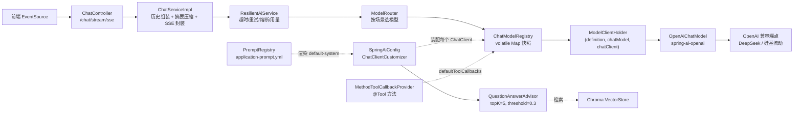
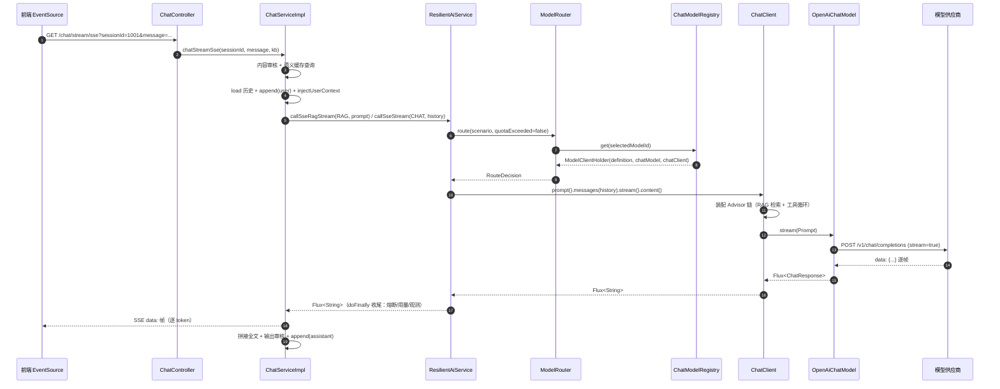

# Spring AI 入门：把模型、提示词、工具、检索、会话抽象成可替换的 Bean

> 一句话结论：Spring AI 的价值不是"再包一层 HTTP 客户端"，而是把**模型（ChatModel）、提示词（Prompt）、工具（ToolCallback）、检索（VectorStore）、会话（SessionService）**抽象成可以用 Bean 装配、用配置替换、用 Advisor 串联的组件——所以本文的判断都落在"这个组件在容器里是谁、被谁替换、被谁串起来"。
> 阅读前置：读过 Spring Boot 自动装配与 `@Bean`/`@ConfigurationProperties`；知道 SSE（Server-Sent Events，服务器单向推送文本流的长连接协议）；能看懂 `Flux`（Reactor 的响应式流类型，"还没发生的多个值"）这种签名，不需要写过响应式代码。
> 证据基线：Spring AI 2.1.0（`spring-ai-client-chat-2.1.0.jar` 已用 `javap` 实测核对）/ Spring Boot 4.2.0 / Spring Framework 7.1.0 / JDK 17 / 本项目 `ai-cs-chat` 当前工作区代码。预计阅读 40~50 分钟。

本篇的证据边界先摊开，后面每一条结论都能对回这张表：

| 类别 | 本仓状态 | 本篇怎么处理 |
| --- | --- | --- |
| Spring AI 框架源码 | `learning-docs/24-源码分析/assets/source/` 已入库 2.1.0 摘录（`ChatClient.java.md`、`ChatModel.java.md`、`ChatResponseMetadata.java.md`、`Usage.java.md`、`BeanOutputConverter.java.md`、`ChatMemory.java.md`、`SessionService.java.md`、`Advisor.java.md` 等） | 唯一 A 级来源，行号即原始 `.java` 行号，逐段引用 |
| `spring-ai-client-chat-2.1.0.jar` | `C:\Users\16680\.m2\repository\org\springframework\ai\spring-ai-client-chat\2.1.0\` 真实存在（161044 字节） | C 级：`javap` 反编译签名，用来验证"接口方法以 jar 为准"，也验证入库摘录没抄错 |
| 本项目 `ai-cs-chat` 装配与调用链 | 真实存在，行号已逐行 `read` 核对 | B 级：`ChatModelRegistry`/`ChatClientCustomizer`/`ResilientAiService`/`ChatServiceImpl`/`application.yml` |
| Spring AI OpenAI 实现（`OpenAiChatModel`、`OpenAiChatOptions`） | **未入库** | 依据官方文档 + 本项目真实调用点，明确标注"未入库，依据本项目代码/官方文档" |
| 会话记忆（SessionService / ChatMemory） | **本项目未落地**：`grep` 全仓 `SessionService|ChatMemory|MessageChatMemoryAdvisor` 只命中 `SpringAiConfig.java` 里的一句 javadoc | 讲清框架能力 + 明确标注"本项目未接入，历史自管"，并给出改造清单 |
| 真实模型调用、Chroma 检索、Redis | 本机无 `docker`/`redis-cli`/`mysql`/`chroma`（探测输出见第 6 节），且本篇禁止联网调模型 | 不做运行时实测；成本/效果类数字只给"怎么算"，不给"实测值" |

## 0. 先看现象

### 现象 1：前端 EventSource 建连成功，但一个 token 都没收到

浏览器 `EventSource` 的 `onopen` 正常触发，控制台一条 `data:` 都没有，最后收到一句兜底文案就 `onerror`。服务端日志（下面是**源码里真实的日志模板 + 真实异常消息**，变量值是我填的示例，不是跑出来的）：

```text
WARN  c.a.chat.service.impl.ResilientAiService - 模型流式调用初始化失败: modelId=deepseek-chat, err=streaming is not supported
WARN  c.a.chat.service.impl.ChatServiceImpl - SSE流式降级: sessionId=1001, msg=AI 助手暂时繁忙，请稍后重试。
```

这两行一出现就意味着：调用根本没走到"模型吐字"那一步。第二行来自 `Flux.just("[ERROR]AI 助手暂时繁忙，请稍后重试。")`（降级成一条固定文本的流），第一行才是根因——`streaming is not supported` 是 `ChatModel` 接口里 `stream()` 默认实现抛出的原话（见 3.9）。

### 现象 2：想加一个视觉模型/备用供应商，改的不是配置而是代码，还撞上 Bean 冲突

`VisionModelClient` 的类注释把这件事写成了"为什么这么设计"，反读就是当年的坑：

```java
 * <p>为什么独立成组件而非注册 OpenAiChatModel Bean：
 * 容器中已有 DeepSeek 的 {@link OpenAiChatModel}（自动装配），再注册一个同类型的
 * 视觉模型 Bean 会引发类型歧义。故本组件在 {@link PostConstruct} 阶段用
 * {@link VisionProperties} 手动构造视觉模型，与文本模型解耦。</p>
```

（`ai-cs-chat/src/main/java/com/aics/chat/service/impl/VisionModelClient.java#L35-L38`；同一段注释的 L79-L80 直接点名"两个 `OpenAiChatModel` 类型相同，用 `@Primary` 会冲突"。）

一出现这个现象就说明：**模型没有被抽象成"数据"，而是被写成了"代码"**。Spring AI 只提供了 `ChatModel` 这个接口，你自己不把"哪家供应商、哪个 base-url、什么能力"抽成配置，就只能靠多加 `@Bean` 硬塞——而多个同类型 Bean 在注入点必然歧义。

### 现象 3：成本看板永远是 0，`promptTokens` / `completionTokens` 全空

`ai-cs-chat` 有一条完整用量链路：`ModelUsageRecorder.record(scenario, provider, model, promptTokens, completionTokens, status, err, modelId)`。但流式路径落库的 token 数长期是 `null`。`grep` 一下就有答案：

```powershell
Select-String -Path "ai-cs-chat\src\main\java\com\aics\chat\service\impl\ResilientAiService.java" -Pattern "usageRef"
# 277:  AtomicReference<Usage> usageRef = new AtomicReference<>();   // 声明
# 303:  Usage usage = usageRef.get();                               // 读取
# （没有第三处：全类只有这两行，没有任何 usageRef.set(...)）
```

声明了、读了、从来没人写。于是 `usage == null` 恒成立，`record(...)` 的两个 token 参数一直是 `null`（`ResilientAiService.java#L318-L325`）。模型调用没坏，只是"用量"这个人造概念在流式分支里被漏掉了。

这些现象指向同一件事：**模型、提示词、工具、检索、会话这五样东西，只要有一处还长在代码里而不是挂在容器里，它就会以"流式收不到字""加模型要改类""成本算不出来"的形式漏出来。** Spring AI 的分层设计正是为了把这五处全部变成可替换的 Bean —— 前提是你真的按它的分层去装配。

## 1. 整体地图



| 组件 | 责任（一句话） | 谁调用它 |
| --- | --- | --- |
| `ChatController` | 把 HTTP 请求转成 `SseEmitter`，声明 `produces=text/event-stream` | Spring MVC |
| `ChatServiceImpl` | 组装会话历史、做摘要压缩、注入用户身份 `SystemMessage`、把 `Flux<String>` 写成 SSE 帧 | `ChatController` |
| `ResilientAiService` | 场景路由 → 逐模型尝试 → 超时/重试/熔断 → 记录用量与观测 | `ChatServiceImpl`、`VisionChatServiceImpl` |
| `ModelRouter` | 按 `ModelScenario` 从主/备模型里挑一个（含额度、能力过滤） | `ResilientAiService`、`RoutedChatClientFactory` |
| `ChatModelRegistry` | 启动/刷新时按 `aics.model-router.models[]` 造 `ChatModel` + `ChatClient`，一次性替换不可变快照 | `ModelRouter`、`RoutedChatClientFactory` |
| `ModelClientHolder` | 一个模型的三件套：配置定义、`ChatModel`（原生调用）、`ChatClient`（带 Advisor 的统一入口） | `ResilientAiService` |
| `SpringAiConfig` | 定义 `ChatClientCustomizer`、`QuestionAnswerAdvisor`、`ToolCallbackProvider`、`EmbeddingModel` 四个 Bean | Spring 容器 / `ChatModelRegistry` |
| `QuestionAnswerAdvisor` | 调用前把检索到的文档拼进 prompt（RAG，检索增强生成） | `ChatClient` 内部的 Advisor 链 |

> **读图说明**：图里最容易被看错的是 `CFG -.装配每个 ChatClient.-> REG` 这条虚线。它不是"配置类调用注册表"，而是**注册表反过来调用 `ChatClientCustomizer` 这个函数式接口**（`ChatModelRegistry.java#L73`），也就是"配置漂移"被消掉的那条边——如果把它读成反向依赖，你会以为 `SpringAiConfig` 知道有哪些模型在运行，实际它一个模型名都不知道。第二个要看的是 `H --> M`：真正发 HTTP 的只有 `OpenAiChatModel`，`ChatClient` 只是同一层的门面，两条线并存是刻意的（3.4 会讲什么时候必须绕过 `ChatClient`）。

## 2. 关键概念与关键类

| 名称 | 位置 | 角色 | 关键方法 |
| --- | --- | --- | --- |
| `ChatModel` | `org.springframework.ai.chat.model`（A: `ChatModel.java`） | 一个供应商对话能力的**最小契约**，唯一抽象方法是 `call(Prompt)` | `call(Prompt)`、`stream(Prompt)`、`getOptions()` |
| `ChatClient` | `org.springframework.ai.chat.client`（A: `ChatClient.java`） | 门面：链式 API + 默认值 + Advisor 链装配 | `prompt()`、`builder(ChatModel)`、`mutate()` |
| `ChatClient.Builder` | 同上（A: `ChatClient.java#L541-L627`） | 一次性默认值容器（system / advisors / tools / options） | `defaultSystem`、`defaultAdvisors`、`defaultToolCallbacks` |
| `Advisor` | `org.springframework.ai.chat.client.advisor.api`（A: `Advisor.java`） | 调用前后插逻辑的拦截器，**实现 `Ordered`**，靠 order 决定包裹顺序 | `adviseCall`、`adviseStream`、`getName` |
| `ChatResponse` | `org.springframework.ai.chat.model`（A: `ChatResponse.java`） | 一次调用的全部结果：候选文本 + 元数据 | `getResult()`、`getMetadata()`、`hasToolCalls()` |
| `ChatResponseMetadata` | 同上（A: `ChatResponseMetadata.java`） | 响应级元数据：用量、限流信息 | `getUsage()`、`getRateLimit()` |
| `Usage` | `org.springframework.ai.chat.metadata`（A: `Usage.java`） | token 计数的**唯一出口** | `getPromptTokens()`、`getCompletionTokens()`、`getTotalTokens()` |
| `BeanOutputConverter<T>` | `org.springframework.ai.converter`（A: `BeanOutputConverter.java`） | 把 Bean 类型转成"JSON Schema 说明"再反序列化回来 | `getFormat()`、`convert(String)` |
| `VectorStore` | `org.springframework.ai.vectorstore`（A: `VectorStore.java`） | 向量库抽象，RAG 的检索端 | `similaritySearch(SearchRequest)` |
| `EmbeddingModel` | `org.springframework.ai.embedding`（A: `EmbeddingModel.java`） | Embedding（把文本映射成高维向量的函数，输出是 float 数组，语义相近的文本向量距离更近） | `embed(String)`、`call(EmbeddingRequest)` |
| `ToolCallbackProvider` | `org.springframework.ai.tool`（A: `ToolCallbackProvider.java`） | 工具集合的供应者，`@Tool` 方法的打包器 | `getToolCallbacks()` |
| `ChatMemory` | `org.springframework.ai.chat.memory`（A: `ChatMemory.java`） | **1.x 时代的会话记忆接口，2.1 起已 `@Deprecated(forRemoval=true)`** | `add`、`get`、`clear` |
| `SessionService` | `org.springframework.ai.session`（A: `SessionService.java`） | 2.1 起的会话记忆新契约：append-only 事件日志 + active view | `appendEvents`、`getActiveMessages`、`compact` |
| `ModelClientHolder` | `ai-cs-chat/src/main/java/com/aics/chat/modelrouter/ModelClientHolder.java` | 本项目自造的"模型三元组"（定义 / ChatModel / ChatClient） | `getChatModel()`、`getChatClient()`、`getDefinition()` |

一句话记住分工：**`ChatModel` 是能力，`ChatClient` 是用法，`Advisor` 是管线，`Builder` 是默认值，`Response/Metadata` 是账本。**

## 3. 原理与证据逐段精读

### 3.1 分层的第一刀：`ChatModel` 是最小契约，`ChatClient` 是门面

**在干什么**：`ChatModel` 只承诺一件事——给一个 `Prompt`，还一个 `ChatResponse`。其余全是 default 便利方法。

```java
public interface ChatModel extends Model<Prompt, ChatResponse>, StreamingChatModel {

	default @Nullable String call(String message) {
		Prompt prompt = new Prompt(new UserMessage(message));
		Generation generation = call(prompt).getResult();
		return (generation != null) ? generation.getOutput().getText() : "";
	}

	@Override
	ChatResponse call(Prompt prompt);
```

`(src: ChatModel.java#L30-L45)`

**为什么这么设计**：供应商再多（OpenAI、DashScope、Ollama、Bedrock），能统一的最小语义就是"prompt 进、response 出"。把 `call(String)` 做成 default 而不是抽象方法，是为了让新供应商实现方**只需要实现一个方法**就能跑起来——这是"接口窄、抽象低"的典型取舍，代价是这些便利方法拿不到完整元数据（`call(String)` 只返回 `String`，`usage` 直接丢掉了）。

**换成别的写法会怎样**：如果像很多自研封装那样把 `chat(model, messages, temperature, maxTokens, stream, tools...)` 全塞进一个方法签名，每接一家供应商就要在原方法里加 `if (provider == ...)`；而 Spring AI 的做法是"能力差异下沉到 `ChatOptions` 子类"（`ChatOptions.java#L29-L65` 只定义 `getModel`/`getMaxTokens`/`getTemperature` 这三个跨供应商共有的项）。

**常见坑**：`getResult()` 可能返回 `null`（候选被内容过滤掉时），直接 `.getOutput()` 就 NPE；所以上面第 34 行写了三元判断。另一个坑是 `stream()` 的默认实现——它不抽象，而是**抛异常**：`default Flux<ChatResponse> stream(Prompt prompt) { throw new UnsupportedOperationException("streaming is not supported"); }`（`ChatModel.java#L64-L66`）。现象 1 里那句 `streaming is not supported` 就是它。也就是说：**接口实现类不重写 `stream()` 也能编译通过，但运行到流式就炸**——这是 Spring AI 里最典型的一类"编译期安全、运行期不安全"。

### 3.2 拿到 `ChatClient` 的两条路：静态工厂与 Builder（用 `javap` 把签名钉死）

**在干什么**：`ChatClient` 有两个入口——`create(model)` 一步到位，`builder(model)` 拿 Builder 攒默认值。

```java
public interface ChatClient {

	static ChatClient create(ChatModel chatModel) {
```

`(src: ChatClient.java#L61-L63)`

```java
	static Builder builder(ChatModel chatModel) {
```

`(src: ChatClient.java#L80-L80)`

```java
	ChatClientRequestSpec prompt();

	ChatClientRequestSpec prompt(String content);

	ChatClientRequestSpec prompt(Prompt prompt);
```

`(src: ChatClient.java#L128-L132)`

**为什么这么设计**：`create` 是给"我只想发一句话"的场景；`builder` 是给"整个应用共用一套 system prompt + advisor 链"的场景。本质区别是**默认值的归属**：Builder 攒的默认值属于"这个 ChatClient 实例"，`prompt()` 每次生成的 request spec 再在其上覆盖。

**换成别的写法会怎样**：不用 Builder，就得在每次调用点重复 `.system(...)`、`.advisors(...)`、`.options(...)`。本项目正是踩过这个坑才引入 `ChatClientCustomizer`——注释写得很直白："ChatClient 从单一 Bean 改为 Customizer——模型注册表为每个模型构建 ChatClient 时统一注入公共配置，避免多模型配置漂移"（`ai-cs-chat/src/main/java/com/aics/chat/config/SpringAiConfig.java#L276-L277`）。

**"以 jar 为准"的核对**：入库摘录是机械抓取的，但签名这种事最怕抄漏。用 `javap` 直接问 jar：

```powershell
& "D:\DevTools\jdk\jdk17.0.19\bin\javap.exe" -classpath `
  "C:\Users\16680\.m2\repository\org\springframework\ai\spring-ai-client-chat\2.1.0\spring-ai-client-chat-2.1.0.jar" `
  org.springframework.ai.chat.client.ChatClient
```

```text
Compiled from "ChatClient.java"
public interface org.springframework.ai.chat.client.ChatClient {
  public static org.springframework.ai.chat.client.ChatClient create(org.springframework.ai.chat.model.ChatModel);
  public static org.springframework.ai.chat.client.ChatClient create(org.springframework.ai.chat.model.ChatModel, io.micrometer.observation.ObservationRegistry);
  public static org.springframework.ai.chat.client.ChatClient create(org.springframework.ai.chat.model.ChatModel, io.micrometer.observation.ObservationRegistry, org.springframework.ai.chat.client.observation.ChatClientObservationConvention, org.springframework.ai.chat.client.advisor.observation.AdvisorObservationConvention);
  public static org.springframework.ai.chat.client.ChatClient$Builder builder(org.springframework.ai.chat.model.ChatModel);
  public static org.springframework.ai.chat.client.ChatClient$Builder builder(org.springframework.ai.chat.model.ChatModel, io.micrometer.observation.ObservationRegistry, org.springframework.ai.chat.client.observation.ChatClientObservationConvention, org.springframework.ai.chat.client.advisor.observation.AdvisorObservationConvention);
  public static org.springframework.ai.chat.client.ChatClient$Builder builder(org.springframework.ai.chat.model.ChatModel, io.micrometer.observation.ObservationRegistry, org.springframework.ai.chat.client.observation.ChatClientObservationConvention, org.springframework.ai.chat.client.advisor.observation.AdvisorObservationConvention, org.springframework.ai.chat.client.advisor.ToolCallingAdvisor$Builder<?>);
  public abstract org.springframework.ai.chat.client.ChatClient$ChatClientRequestSpec prompt();
  public abstract org.springframework.ai.chat.client.ChatClient$ChatClientRequestSpec prompt(java.lang.String);
  public abstract org.springframework.ai.chat.client.ChatClient$ChatClientRequestSpec prompt(org.springframework.ai.chat.prompt.Prompt);
  public abstract org.springframework.ai.chat.client.ChatClient$Builder mutate();
}
```

怎么读这段输出：①`create`/`builder` 各有 3 个重载，参数只差 `ObservationRegistry` 与两个 `ObservationConvention` 以及 `ToolCallingAdvisor.Builder`，说明**可观测性与工具循环都是"可以替换的注入点"而不是硬编码**；②最后一行 `mutate()` 返回 `Builder`，这是"从一个已有 ChatClient 派生一个改了几项默认值的新实例"的官方口径（本项目没有用它，而是每次从 `ChatModel` 重新 `builder`，见 3.4）；③入库摘录 `ChatClient.java#L63/L80/L128-L132` 与 jar 完全对得上——这是"入库摘录可信"的实证，后面的 A 级引用都可以放心。

### 3.3 prompt 是怎么拼出来的：Builder 默认值 + request 覆盖

**在干什么**：`Builder` 提供三类默认值，`prompt()` 返回的 request spec 逐项覆盖。

```java
		Builder defaultAdvisors(Advisor... advisors);

		Builder defaultAdvisors(Consumer<AdvisorSpec> advisorSpecConsumer);

		Builder defaultAdvisors(List<Advisor> advisors);

		Builder defaultSystem(String text);

		Builder defaultSystem(Resource text, Charset charset);

		Builder defaultSystem(Resource text);

		Builder defaultSystem(Consumer<PromptSystemSpec> systemSpecConsumer);
```

`(src: ChatClient.java#L543-L565)`

```java
		ChatClientRequestSpec system(String text);

		ChatClientRequestSpec system(Resource textResource, Charset charset);

		ChatClientRequestSpec system(Resource text);

		ChatClientRequestSpec system(Consumer<PromptSystemSpec> consumer);

		ChatClientRequestSpec user(String text);
```

`(src: ChatClient.java#L514-L522)`

**为什么这么设计**：`defaultSystem` 与 `system` 是**同一份数据的两层**——前者是实例级默认，后者是请求级覆盖，且都是"单字段赋值"语义（`DefaultChatClient` 里就是给 `systemText` 赋值），**不是追加**。这个"覆盖不追加"是新人最常误判的点：你 `defaultSystem("你是客服")` 之后再 `.system("你是翻译")`，结果是只有"你是翻译"。

还有一个容易忽略的细节：`defaultSystem(Consumer<PromptSystemSpec>)` 与 `system(Consumer<PromptSystemSpec>)` 接收的 spec 里除了 `text(...)` 还有 `param(String, Object)`（`ChatClient.java#L178`），而 `param` 才是**模板变量**的入口——`text` 里的 `{name}` 会被渲染。团队里"为什么我的 `{sessionId}` 原样输出去了"的答案通常就在这里：**`{x}` 只有在带 `param` 的 spec 路径上才会被替换**。

**换成别的写法会怎样**：不用模板变量、自己在 Java 里 `String.format` 拼 prompt，短期更直观，长期会丢掉两个能力：一是 prompt 无法外置到配置文件（本项目的 `PromptRegistry` 就是外置派，见 3.4 末段）；二是无法按 `templateRenderer` 更换渲染引擎（jar 里有 `Builder defaultTemplateRenderer(TemplateRenderer)`，见 3.2 的 javap 输出）。

**本项目真实拼装**（三层都在，一层不少）：

```java
    // 设计要点：ChatClient 从单一 Bean 改为 Customizer——模型注册表为每个模型构建 ChatClient 时统一注入公共配置，避免多模型配置漂移
    @Bean
    public ChatClientCustomizer chatClientCustomizer(ToolCallbackProvider toolCallbackProvider,
                                                     QuestionAnswerAdvisor ragAdvisor,
                                                     com.aics.chat.prompt.PromptRegistry promptRegistry) {
        // 默认系统提示词外置到 application-prompt.yml（scenario=default-system），DB_SCHEMA 作为 {{dbSchema}} 注入
        String defaultSystem = promptRegistry
                .render("default-system", java.util.Map.of("dbSchema", DB_SCHEMA))
                .getSystem();
        return builder -> builder
                .defaultSystem(defaultSystem)
                // 设计要点：工具回调不在此统一挂载——是否具备 TOOL_CALLING 能力由模型定义决定，注册表按能力条件装配
                .defaultAdvisors(ragAdvisor);
    }
```

（`ai-cs-chat/src/main/java/com/aics/chat/config/SpringAiConfig.java#L276-L289`）

注意第 285-288 行只挂了 `defaultSystem` 与 `defaultAdvisors`，**故意不挂 `defaultToolCallbacks`**：工具要按模型能力条件挂载，放到 `ChatModelRegistry` 里判断（3.4）。这就是"默认值该归谁"的实际决策——跨模型通用的进 Customizer，跟模型能力相关的留在注册表。

### 3.4 模型可替换性：换一家供应商，到底改哪几行

**在干什么**：本项目把"模型"从代码里拔出来变成配置文件中的数据，`ChatModelRegistry` 按这份数据造 `ChatModel` 与 `ChatClient`：

```java
                OpenAIClient client = OpenAIOkHttpClient.builder()
                        .baseUrl(definition.getBaseUrl())
                        .apiKey(definition.getApiKey())
                        .build();
                OpenAiChatModel chatModel = OpenAiChatModel.builder()
                        .openAiClient(client)
                        .openAiClientAsync(client.async())
                        .options(OpenAiChatOptions.builder()
                                .model(definition.getModel())
                                .temperature(properties.getTemperature())
                                .maxTokens(properties.getMaxTokens())
                                .build())
                        .build();
                ChatClient.Builder builder = chatClientCustomizer.customize(ChatClient.builder(chatModel));
```

（`ai-cs-chat/src/main/java/com/aics/chat/modelrouter/ChatModelRegistry.java#L60-L73`）

数据长这样（`ModelRouterProperties` 绑定 `aics.model-router`）：`models[]`（每项含 `id`、`provider`、`base-url`、`api-key`、`model`、`capabilities`）+ `scenarios{}`（每个场景配 `primary` 与 `fallbacks`）+ `temperature`/`maxTokens` 默认值（`ai-cs-chat/src/main/java/com/aics/chat/modelrouter/ModelRouterProperties.java#L22-L31`）。

**为什么这么设计**：`ChatModel`/`ChatClient` 都是接口，**"哪一个实现"必须由外部决定**，否则接口白抽象。真正让"换供应商"从"改 N 个类"变成"改一行 YAML"的，是三个动作叠加：

1. 模型定义数据化（`aics.model-router.models[]`）；
2. 装配集中到一个同步方法（`rebuild()`），并且**用不可变 Map 一次性替换引用**——`this.clients = Map.copyOf(next);`（`ChatModelRegistry.java#L83`），在跑的请求永远看不到半成品；
3. 公共默认值用 `ChatClientCustomizer` 注入，避免"新加一个模型忘了挂 RAG advisor"。

**换成别的写法会怎样**：如果直接在 `ChatServiceImpl` 里 `ChatClient.builder(chatModel)`，那么"每个模型都要挂同一个 defaultSystem"这条规则就散落在 N 个调用点；一旦漏挂，症状是"某个模型的回答风格/格式突然不对"，且极难复现。反过来，如果所有模型都共用一个 `ChatClient` Bean，就回到现象 2 的 Bean 歧义。

**常见坑**：`rebuild()` 的两级失败策略是刻意不对称的——启动时 `clients` 为空则 fail-fast `throw new IllegalStateException("failed to initialize model registry", e)`；刷新时则"保留旧配置"只打日志（`ChatModelRegistry.java#L84-L90`）。**判断依据是"有没有旧快照可回退"**。更隐蔽的坑在这个方法第 52-57 行：配置没变就复用旧 `ModelClientHolder`，因为"重建 `OpenAiChatModel` 有初始化成本，刷新时批量重建会造成不必要的连接抖动"。如果你改的是 `api-key` 却只改了大小写/空格导致 `sameDefinition` 判定为"相同"，就会出现"刷新了但还在用旧 Key"的灵异现象。

补充一个必须直说的点：本项目的 `ChatModel` 实现**只有 `OpenAiChatModel` 一种**——DeepSeek、硅基流动都是 OpenAI 兼容协议，靠换 `base-url` 而不是换实现类。要真换成非 OpenAI 协议（例如 Bedrock、Ollama 原生），改的是 `ChatModelRegistry` 里那三行 `OpenAIOkHttpClient` + `OpenAiChatModel.builder()`，其余两百多行调用链不用动——**这才是"抽象成 Bean"的收益**。

### 3.5 `ChatResponse` 与 metadata：token 用量到底在哪一层

**在干什么**：一次调用的账本在 `ChatResponse.getMetadata()`，不在 `getResult()`。

```java
	public RateLimit getRateLimit() {
	public Usage getUsage() {
```

`(src: ChatResponseMetadata.java#L80-L89)`

```java
public interface Usage {

	Integer getPromptTokens();

	Integer getCompletionTokens();

	default Integer getTotalTokens() {
```

`(src: Usage.java#L29-L56)`

**为什么这么设计**：`getResults()` 是**候选列表**（一次调用可能返回多个候选），每个候选有自己的 `finishReason`；而 token 用量、限流是**整次请求**的属性，所以放在 metadata 层。`Usage` 的默认实现是 `EmptyUsage`（`ChatResponseMetadata.java#L51` `private Usage usage = new EmptyUsage();`），它**所有计数返回 0 而不是抛异常**——这就是"接了一个不返回 usage 的兼容端点时，成本看板显示 0 而不是报错"的根因，很难被发现。

**本项目怎么取**（非流式路径，写法就是标准姿势）：

```java
                    if (response == null || response.getMetadata() == null) {
                        ...
                    }
                    Usage usage = response.getMetadata().getUsage();
                    ...
                    modelUsageRecorder.record(scenarioId(scenario), provider, model,
                            usage.getPromptTokens(), usage.getCompletionTokens(), "SUCCESS", null, modelId);
```

（`ai-cs-chat/src/main/java/com/aics/chat/service/impl/ResilientAiService.java#L206-L215`）

**换成别的写法会怎样**：很多人从 `content()` 拿文本后就结束了（`CallResponseSpec#content()` 返回 `String`），此时 `usage` 已经丢了。要拿用量**必须走 `call().chatResponse()`**（`ChatClient.java#L321`）而不是 `call().content()`（`ChatClient.java#L323`）。流式的对应关系是 `stream().chatResponse()` 与 `stream().content()`（`ChatClient.java#L418-L424`）——这也是本项目 `callSseStream` 用 `stream().content()`（`ResilientAiService.java#L148-L151`）后拿不到用量的直接原因：**`content()` 把 `ChatResponse` 拆掉了，元数据无处可取**。

**怎么算成本**（本篇不给实测值，只给口径）：`成本 = promptTokens/1e6 × 输入单价 + completionTokens/1e6 × 输出单价`。单价请以各家官方定价页为准；下面是**示例口径**（输入 0.5 元/百万 token、输出 1.5 元/百万 token，不对应任何真实报价）：

```powershell
node -e "const inPrice=0.5, outPrice=1.5; const prompt=1200, completion=350; const cost=prompt/1e6*inPrice+completion/1e6*outPrice; console.log('promptTokens=1200 completionTokens=350'); console.log('cost = 1200/1e6*0.5 + 350/1e6*1.5 = ' + cost.toFixed(8)); console.log('10000 次对话 = ' + (cost*10000).toFixed(4));"
```

```text
promptTokens=1200 completionTokens=350
cost = 1200/1e6*0.5 + 350/1e6*1.5 = 0.00112500
10000 次对话 = 11.2500
```

怎么读：单次 1200 入 / 350 出的对话约 0.0011 元，一万次约 11.25 元——这个数量级说明**"没有 token 用量"不是小问题**：它直接决定你无法回答"这个功能一年花多少钱"。反过来，如果你手里只有文本长度，可以用 `tokens ≈ 中文字符数 × 1.5 + 英文字符数 ÷ 4` 粗估（误差 ±20% 量级，仅用于容量规划，不能当账单依据）。

### 3.6 结构化输出：`BeanOutputConverter` 生成的是"说明"不是"魔法"

**在干什么**：把一个 Java Bean 类型变成两样东西——给模型的**格式说明字符串**，和把返回文本反序列化回来的**转换器**。

```java
	protected String generateSchema() {
		return JsonSchemaGenerator.generateForType(this.type);
	}
```

`(src: BeanOutputConverter.java#L179-L181)`

```java
	@Override
	public String getFormat() {
		String template = """
				Your response should be in JSON format.
				Do not include any explanations, only provide a RFC8259 compliant JSON response following this format without deviation.
				Do not include markdown code blocks in your response.
				Remove the ```json markdown from the output.
				Here is the JSON Schema instance your output must adhere to:
				```%s```
				""";
		return String.format(template, this.jsonSchema);
	}
```

`(src: BeanOutputConverter.java#L213-L224)`

**为什么这么设计**：模型不认 Java 类型，只认文字。所以"结构化输出"在 2.1 里默认是**提示词工程**：用 `JsonSchemaGenerator` 从 `Class<T>` 反射出 JSON Schema，再包进一段"别解释、别加 markdown 围栏"的强硬指令，最后把 schema 塞进 `%s`。这也解释了 `convert()` 里为什么要先清洗再反序列化（`BeanOutputConverter.java#L190`）——因为**提示词只能"请求"模型守规矩，不能"强制"**，真实模型经常回你 ``` ```json ... ``` ``` 包一层。

**换成别的写法会怎样**：手写 `.user("请返回 JSON，字段有 a、b、c")`，字段一多就漏，改字段忘改提示词更是常态。而 `entity(Class<T>)`（`ChatClient.java#L306-L317`）把这两步都收了：它把 `getFormat()` 的结果放进请求上下文（`ChatClientAttributes.OUTPUT_FORMAT`），由 `ChatModelCallAdvisor` 在真正调用前拼到最后一条 user 消息末尾，再把返回文本交给 `convert()`。

**常见坑**：
- `JsonMapper` 是 `disable(FAIL_ON_UNKNOWN_PROPERTIES)` 的（`BeanOutputConverter.java#L201-L206`），**模型多返回字段不会报错**——好处是容错，坏处是"模型偷偷塞了个字段"你永远不知道；
- 流式 + 结构化输出，在本项目依赖的 Advisor 里是直接不支持的（`StructuredOutputValidationAdvisor` 对 `adviseStream` 直接 `Flux.error(new UnsupportedOperationException(...))`），所以"边流边解析 JSON"必须自己做增量拼接；
- 本项目**没有使用** `entity()` 做业务结构化输出，NL2SQL 是"让模型吐 SQL 文本 + 自己白名单校验"的路子（见 `02-LLM工程化实践.md`），这属于"没采用框架能力"，不是"框架不支持"。

### 3.7 多模态输入：`Media` 是唯一的载体

**在干什么**：把"图片"作为消息的一部分，而不是塞进 prompt 文本里。

```java
                UserMessage userMessage = UserMessage.builder()
                        .text(prompt)
                        .media(new Media(MimeTypeUtils.IMAGE_PNG, URI.create(imageUrl)))
                        .build();
```

（`ai-cs-chat/src/main/java/com/aics/chat/service/impl/VisionModelClient.java#L186-L188`；调用在 L202：`ChatResponse response = visionModel.call(new Prompt(List.of(userMessage)));`）

**为什么这么设计**：多模态不是"文本 + 链接"，而是协议级的 content 数组。`Media`（`org.springframework.ai.content.Media`，**未入库，依据本项目代码与官方文档**）承载 `MimeType + URI/字节`，`OpenAiChatModel` 负责把它翻成 OpenAI 的 `image_url` 字段。`VisionModelClient` 的类注释把转换后的 JSON 结构都写下来了（`VisionModelClient.java#L64-L71`）。

**换成别的写法会怎样**：直接把图片 URL 拼进 prompt 文本（"请描述 https://... 这张图"），模型只会去"读这段文字"，不会真的看图——这是最常见的"多模态不生效"事故。另一种写法是把 base64 塞进字符串，能跑但会把 prompt token 撑爆（图片按 base64 计费且体积大 33%）。

**常见坑**：`MimeType` 必须与真实格式一致。本项目固定用 `MimeTypeUtils.IMAGE_PNG`（L188），如果前端传的是 JPEG 而这里写死 PNG，部分供应商会直接 400。更稳的写法是按 URL 后缀或 `Content-Type` 探测，并做 host 白名单（本项目把 `allowed-image-host` 放在 Nacos 的 `aics.vision.*` 里，见 `ai-cs-chat/src/main/resources/application.yml#L161-L168` 的注释）。

另外注意 L202 用的是 `visionModel.call(...)`——**绕过了 `ChatClient`**。这跟 3.4 的 `callSummary` 是同一个理由：视觉场景不需要那套 defaultSystem/Advisor 链，直接用 `ChatModel` 更省 token、更可控。这个"两代入口并存"不是历史包袱，而是设计。

### 3.8 会话记忆：从 `ChatMemory` 到 2.1 的 `SessionService`（⚠️ 这一段版本差异最大）

**在干什么**：会话记忆要把"历史消息"喂给模型，但又不能无限增长。

1.x 的做法是一个存储接口 + 一个 Advisor：

```java
@Deprecated(since = "2.1.0", forRemoval = true)
public interface ChatMemory {

	String CONVERSATION_ID = "chat_memory_conversation_id";
```

`(src: ChatMemory.java#L34-L40)`

```java
@Deprecated(since = "2.1.0", forRemoval = true)
public final class MessageChatMemoryAdvisor implements BaseChatMemoryAdvisor {
```

`(src: MessageChatMemoryAdvisor.java#L49-L51)`

2.1 换成了 `SessionService`：append-only 事件日志 + 两个"视图"。

```java
	boolean appendEvents(String sessionId, List<SessionEvent> events, long expectedVersion);

	long getEventVersion(String sessionId);

	default List<Message> getMessages(String sessionId) {

	default List<Message> getActiveMessages(String sessionId) {

	CompactionResult compact(String sessionId, CompactionTrigger trigger, CompactionStrategy strategy);
```

`(src: SessionService.java#L143-L208)`

**为什么这么设计**：老 `ChatMemory` 的问题不是"存不下"，是"**存的和喂的不一致**"。你压缩一次历史，就再也无法审计"模型当时到底看到了什么"。`SessionService` 的核心就是把两件事分开：`getMessages()` 返回**整条日志**（含被压缩掉的部分，用于审计与回放），`getActiveMessages()` 返回**当前 active view**（真正发给模型的上下文窗口）。压缩从"删除消息"变成"追加一条 `COMPACTION` 事件"，历史不可变。`appendEvents(..., expectedVersion)` 是 CAS（compare-and-set，比对版本号后才写入）——并发两个请求同时改一个会话，后到的那个返回 `false` 而不会互相覆盖。

**换成别的写法会怎样**：本项目走的是第三条路——**完全不用框架的记忆组件**，自己 `ChatHistoryService` + Redis 存 `List`，超长就"摘要压缩成一条 `SystemMessage`"：

```java
    public List<Message> toSpringMessages(List<ChatMessage> history) {
        ...
                messages.add(new UserMessage(msg.getContent()));
        ...
                messages.add(new AssistantMessage(msg.getContent()));
```

（`ai-cs-chat/src/main/java/com/aics/chat/service/impl/ChatServiceImpl.java#L246-L256`；压缩逻辑在 L278-L310，压缩结果是一句 `new SystemMessage("以下是之前对话的摘要，请参考：\n" + summary)`）

这个自研方案能跑，但有三个自认的代价：①摘要是有损的，压完就查不回原文；②没有版本/CAS，多端并发同会话会互相覆盖；③`getMessages` 永远等于 `getActiveMessages`，没有审计视图。**结论：会话记忆这块本项目"未落地框架能力"，是自研简化版**，不是 Spring AI 没提供。

**常见坑**：`ChatMemory` 与 `MessageChatMemoryAdvisor` 是 `forRemoval = true`，3.0 会删；且 2.1 起 `SessionService` 的过期清理**不会自动跑**——`deleteExpiredSessions(Instant before)` 的注释明写 "Nothing calls this on its own: call it from a scheduler, every hour for example."（`SessionService.java#L98`）。接了 `SessionService` 却不加调度，会话表会一直涨。

### 3.9 流式、超时与中断：为什么"流式不重试"

**在干什么**：流式把一次调用变成"一串 `ChatResponse`"。

```java
	interface StreamResponseSpec {

		Flux<ChatResponse> chatResponse();

		Flux<String> content();
```

`(src: ChatClient.java#L418-L424)`

**为什么这么设计**：`Flux` 是惰性的，**订阅之前什么都不会发生**。这带来两个语义差异：①超时不能只靠 HTTP 客户端的 read-timeout，必须对整个"从订阅到最后一个 chunk"的时长封顶；②**一旦第一个 token 已经推给用户，重试就无解**——你没法把已经流出去的字收回来。

**本项目怎么落实**：`invokeStream` 的注释把这条原则写在方法头上——"流式不重试、不走 fallback 链 —— Flux 一旦开始发射 token 就无法重放"（`ai-cs-chat/src/main/java/com/aics/chat/service/impl/ResilientAiService.java#L246`）。收尾全靠 `doFinally`：

```java
                            .doOnNext(chunk -> {
                                if (firstTokenMs.get() < 0) {
                                    firstTokenMs.set(System.currentTimeMillis() - start);
                                }
                            })
                            .doOnError(errorRef::set)
                            .doFinally(signal -> {
                                ...
                                    if (signal == SignalType.ON_COMPLETE) {
                                        selectedBreaker.onSuccess(durationMs, TimeUnit.MILLISECONDS);
                                    } else if (signal == SignalType.ON_ERROR) {
```

（`ResilientAiService.java#L284-L298`，全块 L282-L332）

`doFinally` 是唯一能保证"成功、失败、用户取消"三种结局都走一次的地方——**熔断器计数、用量落库、观测收尾必须放这里**，放 `doOnNext` 会漏掉失败，放 `doOnComplete` 会漏掉取消。

**换成别的写法会怎样**：用 `subscribe()` 里的 lambda 收尾，遇到浏览器关页面（下游取消订阅）就什么都不执行，熔断器永远看不到这次失败，于是"用户狂刷断线"不会触发熔断。这就是必须用 `doFinally(SignalType)` 而不是 `doOnComplete` 的原因。

**常见坑**（三个，全部有真实出处）：
1. **SSE 超时与模型超时是两套时钟**：`SseEmitter` 的超时是 5 分钟（`ChatServiceImpl.java#L156` `SSE_EMITTER_TIMEOUT = 5 * 60 * 1000L`，L525 `new SseEmitter(SSE_EMITTER_TIMEOUT)`），而模型侧 `timelimiter` 是 60s（`application.yml` 的 `sseChatService`）。**先到先得**：如果 SSE 连接先超时，`onTimeout` 里只能打一行 `log.warn("SSE连接超时: sessionId={}")`（L830）然后关连接，此时上游 `Flux` 还在跑，token 白花。
2. **`content()` 过滤空 chunk**：`Flux<String> content()` 会 `filter(StringUtils::hasLength)`，所以"模型返回了空 chunk"在 `content()` 上看不出来；要排查"为什么前端看到断句"得用 `chatResponse()` 看原始帧。
3. **流式拿不到 usage**：`content()` 已经把 `ChatResponse` 拆成 `String`，元数据在原地丢失。本项目试图用 `AtomicReference<Usage> usageRef` 跨管道传递，但**只声明没赋值**（现象 3 的 `grep` 证据），所以流式用量恒为 `null`。正确写法是在 `.doOnNext(...)` 里判断 `chatResponse.getMetadata().getUsage().getCompletionTokens() != null` 时 `usageRef.set(...)`，或直接在 `Flux<ChatResponse>` 上用 `chatResponse()`。

### 3.10 异常与重试：只对"可重放"的错误重试

**在干什么**：非流式路径有完整的"逐模型尝试 + 瞬时故障重试一次 + 超时取消"。

```java
            return callWithTransientRetry(holder, call);
```

（`ai-cs-chat/src/main/java/com/aics/chat/service/impl/ResilientAiService.java#L356-L367` 的 `callWithTransientRetry` 只对 `ResourceAccessException | SocketTimeoutException | TimeoutException` 重试一次，日志模板为 `模型瞬时故障，重试一次: modelId={}, err={}`）

**为什么这么设计**：重试的前提是"重放安全"。网络抖动、连接被重置可以在几百毫秒后重来；而"模型已经生成了 800 token 后超时"重试会让成本翻倍、延迟翻倍。所以白名单只有三个"连接层"异常，业务异常（`BusinessException`、`IllegalArgumentException`）在 `application.yml` 的 `resilience4j.retry.chatService.ignore-exceptions` 里显式排除。

**换成别的写法会怎样**：无脑 `@Retryable(maxAttempts=3)` 覆盖所有异常，会把"内容审核拒绝""参数非法"这种必然失败也重试三次，用户多等 3 倍时间，日志里出现三条同因异常，排查时极易误判为"模型不稳定"。

**超时的实现值得单独看**（这是本项目最"不框架"的一段）：`timedCall` 用 `CircuitBreaker.executeCallable` 包住 `CompletableFuture.supplyAsync`，再 `future.get(holder.getDefinition().getTimeoutMs(), TimeUnit.MILLISECONDS)`，超时则 `future.cancel(true)`（`ResilientAiService.java#L378-L404`）。**注意 `cancel(true)` 只是中断 Java 线程，底层的 HTTP 请求可能仍在跑**——真正的"取消"要靠响应式取消订阅，这也解释了为什么流式路径不用 `timedCall`。

**常见坑**：`CompletableFuture` 抛 `CompletionException` 包一层 `ExecutionException`，不双层解包会把"超时"报成"未知错误"（L394-L403 就是为了这个）。

### 3.11 Spring Boot 自动装配与配置项：`spring.ai.openai.*` 到底还生效吗

**在干什么**：`application.yml` 里的 `spring.ai.openai.*` 是**自动装配的兜底**，不是主力。

```yaml
  ai:
    # 禁用 Spring AI 内置 Embedding 自动装配（由 SpringAiConfig 手动提供）
    model:
      embedding: none
    # 本地兜底配置：Nacos 的 ai-cs-chat.yml 负责提供模型名等生产配置。
    openai:
      base-url: ${OPENAI_BASE_URL:https://api.deepseek.com}
      chat:
        model: ${OPENAI_MODEL:deepseek-chat}
        temperature: ${OPENAI_TEMPERATURE:0.7}
    vectorstore:
      chroma:
        # 启动时不调用远端 Chroma；RAG 使用前仍需启动可达的 Chroma 服务。
        initialize-schema: false
        collection-name: aics-knowledge
        client:
          host: http://${aics.mysql.host:localhost}
          port: ${CHROMA_PORT:8000}
```

（`ai-cs-chat/src/main/resources/application.yml#L35-L52`；另 L12-L15 的 `spring.autoconfigure.exclude` 排除了 `OpenAiEmbeddingAutoConfiguration` 与 `DataSourceAutoConfiguration`）

**为什么这么设计**：注意三个"反常识"的点，每一个都能从文件里读出来：

1. **没有 `spring.ai.openai.api-key`**。整段只有 `base-url` 与 `chat.*`，Key 来自 Nacos。因为没有 Key，`OpenAiChatAutoConfiguration` 实际上装配不出可用客户端——真正的 `OpenAiChatModel` 全部由 `ChatModelRegistry` 手工构造。所以"我只改 `spring.ai.openai.chat.model` 为什么没效果"的答案是：**主链路不走这个配置**（`ModelRouterProperties` 的注释也承认这点："路由模型绕过 spring.ai.openai 自动配置，默认参数必须在这里显式声明"）。
2. **`spring.ai.model.embedding: none`** 是显式关掉 Embedding 自动装配，改用 `SpringAiConfig` 里的 `siliconFlowEmbeddingModel`（`SpringAiConfig.java#L171-L204`，末尾还套了一层 `CachingEmbeddingModel` 做向量缓存）。
3. **`initialize-schema: false`** 让启动不连 Chroma——否则本地没起 Chroma 时整个服务起不来。这是"可启动性优先于功能可用性"的取舍。

**换成别的写法会怎样**：全信自动装配（配 key、配 model、注入 `OpenAiChatModel`），单供应商单模型场景确实最省事；但一旦要"按场景路由 + 故障切换"，自动装配的那个单例反而变成障碍（现象 2 的 Bean 歧义就是这么来的）。

**常见坑**：`@RefreshScope` + `@ConfigurationProperties` 的组合下，Nacos 配置变更会触发 `RefreshScopeRefreshedEvent`，本项目借这个事件重建注册表（`ChatModelRegistry.java#L39-L42`）。如果你自己新写一个持有 `ChatClient` 的 Bean 却不监听这个事件，就会出现"配置刷新了，但那个 Bean 还拿着旧模型"。

## 4. 一次完整执行时序



> **读图说明**：最关键的一条是 `CC->>CC: 装配 Advisor 链` 这个自调用——它决定了"RAG 检索发生在模型调用之前"，也决定了 `stream()` 的返回值已经是"检索 + 工具循环都跑完"的文本流。**如果把这条边漏掉，你会以为 RAG 是 `ChatServiceImpl` 做的**（其实是 `QuestionAnswerAdvisor` 在链里做的，`ChatServiceImpl` 只传了一个 `ragPrompt` 字符串）。第二条要注意 `R-->>S` 与 `S-->>FE` 之间没有箭头标注缓冲：`Flux` 的每一帧是**直接**写给 `SseEmitter` 的，所以 `SseEmitter` 一旦超时或客户端断连，下游取消订阅会一路传导回 `OpenAiChatModel`——这条传播路径正是"SSE 超时能省 token"的原因（反之，若用了 `timedCall` 那种线程中断式超时，就传不回去）。

每一步失败分别报什么（全部是源码里的真实消息）：

| 失败点 | 触发条件 | 报错/日志 | 用户看到 |
| --- | --- | --- | --- |
| 内容审核 | 输入命中敏感词 | `log.warn("SSE对话输入被内容审核拦截: sessionId={}")`（`ChatServiceImpl.java#L531`） | 拦截提示，流不建立 |
| 路由无可用模型 | 场景没配 `primary` 或全部禁用 | `IllegalStateException("no eligible model for scenario: " + scenario)`（`RoutedChatClientFactory.java#L17-L27`） | 500 / SSE 初始化异常 |
| 模型未注册 | 配置里引用了不存在的 id | `IllegalStateException("model not registered: " + modelId)`（`ChatModelRegistry.java#L111-L117`） | 同上 |
| 模型实现不支持流式 | `stream()` 走默认实现 | `UnsupportedOperationException("streaming is not supported")`（`ChatModel.java#L64-L66`） | 兜底文案 `[ERROR]AI 助手暂时繁忙，请稍后重试。` |
| 流式初始化失败 | 建连/鉴权失败 | `log.warn("模型流式调用初始化失败: modelId={}, err={}")`（`ResilientAiService.java#L337-L339`） | 同上兜底文案，`ChatServiceImpl` 再打 `SSE流式降级`（L672） |
| SSE 连接超时 | 超过 5 分钟未完成 | `log.warn("SSE连接超时: sessionId={}")`（`ChatServiceImpl.java#L830`） | 连接断开，前端 `onerror` |
| SSE 写失败 | 客户端已断开 | `log.warn("SSE发送失败: sessionId={}, err={}")`（`ChatServiceImpl.java#L702`） | 无（对端已走） |

## 5. 设计取舍

| 决策点 | 备选方案 | 优点 | 代价 | 本项目怎么选 |
| --- | --- | --- | --- | --- |
| 模型入口 | 只用 `ChatModel` / 只用 `ChatClient` / **两者并存** | 并存：简单调用走 `ChatModel` 省掉 Advisor 开销，复杂调用走 `ChatClient` 复用链 | 两套入口，新人要判断"该用哪个" | 并存：`callSummary`/视觉走 `ChatModel`（`ResilientAiService.java#L130-L132`、`VisionModelClient.java#L202`），业务对话走 `ChatClient` |
| 模型来源 | 全交自动装配 / **自己按配置造** | 自造：可按场景路由、故障切换、能力过滤 | 放弃 `spring.ai.openai.*` 的部分便利；要自己管客户端生命周期 | 自造（`ChatModelRegistry`），`spring.ai.openai.*` 降级为兜底 |
| 默认值归属 | 每个调用点写 / 单例 `ChatClient` / **Customizer** | Customizer 消除配置漂移，又能按模型差异化 | 多一个 9 行接口（`ChatClientCustomizer.java`） | Customizer（`SpringAiConfig.java#L277-L289`） |
| 会话记忆 | `ChatMemory`（已废弃）/ `SessionService`（2.1）/ **自研 Redis + 摘要** | 自研最省事、可控 | 无审计视图、无 CAS、摘要有损 | 自研**（未落地框架能力）** |
| 流式失败处理 | 重试 / 降级换模型 / **直接失败** | 直接失败最诚实（已经吐出的字收不回） | 用户体验差，需要前端配合重试 | 直接失败 + 兜底文案（`ResilientAiService.java#L246`） |
| 超时实现 | HTTP 客户端超时 / **`CompletableFuture.get(timeout)`** | 后者能统一封顶、能打断等待 | `cancel(true)` 不保证取消底层请求 | `timedCall`（`ResilientAiService.java#L378-L404`） |
| 结构化输出 | `entity(Class)` / 手写 JSON 提示词 / **让模型吐 SQL 再校验** | 后者对 SQL 场景更可控（可白名单校验） | 不是通用结构化输出 | NL2SQL 走手写，通用 `entity()` 未使用 |

可扩展点清单（按改动成本从低到高）：

- **加一个模型**：只改 Nacos 的 `aics.model-router.models[]` + `scenarios.*.fallbacks`，零代码（前提是 OpenAI 兼容协议）。
- **换供应商协议**（如 Bedrock）：改 `ChatModelRegistry.java#L60-L72` 那十来行，新增一个 `ChatModel` 实现的选择分支。
- **加一个横切能力**（日志、脱敏、审计）：写一个 `Advisor` 实现，挂进 `ChatClientCustomizer` 的 `defaultAdvisors(...)`。
- **换会话记忆实现**：接 `SessionService`，把 `ChatServiceImpl` 的 `ChatHistoryService` 三处调用（load / append）替换为 `getActiveMessages` / `appendEvents`。
- **补流式用量**：在 `ResilientAiService` 的 `doOnNext` 里给 `usageRef` 赋值（3.9 坑 3）。

## 6. 踩坑与调试手法

| 现象 | 根因 | 验证手段 | 解法 |
| --- | --- | --- | --- |
| 流式一个 token 都没有，只收到兜底文案 | 调用方用 `ChatModel.stream()` 但实现类没重写，走默认实现抛 `streaming is not supported` | `javap -classpath <jar> <ChatModel 实现类>` 看有没有 `stream(Prompt)`；或看日志里的异常消息原文 | 换支持流式的实现 / 用 `ChatClient.stream()`（它会走 `StreamingChatModel`） |
| 加了第二个 `OpenAiChatModel` 后启动报注入歧义 | 同类型 Bean 多个，`@Primary` 也救不了两个都被 `@Qualifier` 之外的方式注入 | 启动日志里的 `NoUniqueBeanDefinitionException`；`grep -r "@Bean" | grep ChatModel` 数 Bean 数 | 像 `VisionModelClient` 那样不注册 Bean，`@PostConstruct` 里手工构造（`VisionModelClient.java#L35-L38`） |
| 改了 `spring.ai.openai.chat.model` 没生效 | 主链路用 `aics.model-router` 造客户端，`spring.ai.openai.*` 只是兜底 | `grep -rn "spring.ai.openai" ai-cs-chat/src/main/java` 为零 → 说明没代码读它 | 改 Nacos 的 `aics.model-router.models[].model` |
| 成本看板 token 恒空 | 流式路径 `usageRef` 只声明不赋值 | `Select-String -Pattern "usageRef"` 只出两行（声明 + 读取） | 在 `doOnNext` 里从 `ChatResponse.getMetadata().getUsage()` 取值 `set` |
| 结构化输出偶尔解析失败 | 模型回了带 ```` ```json ```` 围栏的文本 | 把原始返回文本打日志（在 `convert()` 之前） | 用 `BeanOutputConverter`（内置 `CompositeResponseTextCleaner`：去空白→去思考标签→去 markdown 围栏→再去空白），或换原生结构化输出 |
| 页面关了但模型还在烧 token | 用了 `timedCall`（线程中断式超时），取消信号传不回 HTTP 客户端 | 观察 `doFinally` 的 `SignalType` 是否为 `CANCEL` | 流式路径一律用响应式取消，不要用 `CompletableFuture` 包 |

**两个真调试手法**（本篇亲测可用，都不需要启动服务）：

1. **用 `javap` 把"接口到底有几个方法"钉死**。当文档、博客、IDE 补全三方说法不一致时，唯一可信的是 jar 里的字节码：
   ```powershell
   & "D:\DevTools\jdk\jdk17.0.19\bin\javap.exe" -classpath `
     "C:\Users\16680\.m2\repository\org\springframework\ai\spring-ai-client-chat\2.1.0\spring-ai-client-chat-2.1.0.jar" `
     'org.springframework.ai.chat.client.ChatClient$Builder'
   ```
   ```text
   Compiled from "ChatClient.java"
   public interface org.springframework.ai.chat.client.ChatClient$Builder {
     public abstract org.springframework.ai.chat.client.ChatClient$Builder defaultAdvisors(org.springframework.ai.chat.client.advisor.api.Advisor...);
     public abstract org.springframework.ai.chat.client.ChatClient$Builder defaultOptions(org.springframework.ai.chat.prompt.ChatOptions$Builder);
     public abstract org.springframework.ai.chat.client.ChatClient$Builder defaultSystem(java.lang.String);
     public abstract org.springframework.ai.chat.client.ChatClient$Builder defaultTools(java.lang.Object...);
     public abstract org.springframework.ai.chat.client.ChatClient$Builder defaultToolCallbacks(org.springframework.ai.tool.ToolCallback...);
     public abstract org.springframework.ai.chat.client.ChatClient$Builder defaultToolContext(java.util.Map<java.lang.String, java.lang.Object>);
     public abstract org.springframework.ai.chat.client.ChatClient$Builder clone();
     public abstract org.springframework.ai.chat.client.ChatClient build();
   }
   ```
   怎么读：`defaultTools(Object...)` 是给"直接传 `@Tool` 对象"的便捷入口，`defaultToolCallbacks(ToolCallback...)` 是底层入口；`clone()` 说明 Builder 是可复制的（所以"给某个模型多加一个 advisor"不会污染别的模型）。输出里我省略了若干重载，**以你自己跑出来的为准**。

2. **用 `grep` 的"命中行数"判断一段逻辑是死是活**。判断"这个字段到底有没有被赋值""这个 Bean 到底有没有被读"，比读一百行代码更快：
   ```powershell
   cd D:\Projects\Persion\ai-customer-service
   $files = Get-ChildItem ai-cs-chat\src\main\java -Recurse -Filter *.java
   "ai-cs-chat java 文件数: $($files.Count)"
   foreach($s in @('ChatClient','ChatModel','Advisor','VectorStore','EmbeddingModel','ToolCallbackProvider','ChatResponse','Usage')){
       $n = ($files | Select-String -Pattern "\b$s\b" | Measure-Object).Count
       $f = ($files | Select-String -Pattern "\b$s\b" | Select-Object -ExpandProperty Path -Unique | Measure-Object).Count
       "{0,-22} 出现 {1,3} 行 / {2,2} 个文件" -f $s,$n,$f
   }
   ```
   ```text
   ai-cs-chat java 文件数: 215
   ChatClient             出现  26 行 /  9 个文件
   ChatModel              出现  14 行 /  5 个文件
   Advisor                出现   9 行 /  3 个文件
   VectorStore            出现  52 行 / 10 个文件
   EmbeddingModel         出现  46 行 / 10 个文件
   ToolCallbackProvider   出现  13 行 /  4 个文件
   ChatResponse           出现  16 行 /  3 个文件
   Usage                  出现  45 行 / 11 个文件
   ```
   怎么读：215 个文件里 `ChatClient` 只出现 26 行、`Advisor` 只出现 9 行——说明**这个项目的 Spring AI 用法是"收口式"的**：真正的框架调用集中在 `ChatModelRegistry`/`ResilientAiService`/`SpringAiConfig` 三个文件，其余都是业务逻辑。反过来说，凡是需要"理解 Spring AI 在本项目怎么用"的问题，答案几乎都能在这三个文件里找到；而 `Usage` 出现在 11 个文件里（45 行），说明用量记录是横切关注点、被很多类各自处理——这正是"流式那一路漏了"能被长期忽视的原因（没人有一个统一的 usage 出口）。

## 7. ⚠️ 版本差异

| 旧写法（1.x / 旧文档） | 当前基线（Spring AI 2.1.0） | 变化点 | 迁移动作 |
| --- | --- | --- | --- |
| `ChatModel.getDefaultOptions()` | `ChatModel.getOptions()`（`@since 2.0.0`），旧方法 `@Deprecated(forRemoval=true)`（`ChatModel.java#L52-L62`） | 去掉 `Default` 前缀，统一叫 `getOptions` | 全局替换；自研 `ChatModel` 实现类重写 `getOptions` |
| `ChatMemory` + `MessageChatMemoryAdvisor.conversationId(...)` | `ChatMemory` 与 `MessageChatMemoryAdvisor` 均 `@Deprecated(since="2.1.0", forRemoval=true)`（`ChatMemory.java#L34`、`MessageChatMemoryAdvisor.java#L49`），替代品 `SessionService` + `SessionAdvisors` | 记忆从"可删可改的存储"变成"append-only 事件日志 + active view + compaction" | 注入 `SessionService`，用 `SessionAdvisors.builder(sessionService)` 取代 `MessageChatMemoryAdvisor.builder(chatMemory)`；会话 ID 的 context key 仍复用 `MemoryAdvisor.CONVERSATION_ID` |
| `ChatClient.create(model)` 一把梭 | `ChatClient.builder(model)` + `defaultSystem` / `defaultAdvisors` / `defaultToolCallbacks`（`ChatClient.java#L541-L627`） | 默认值成为一等公民，`mutate()` 可派生（`ChatClient.java#L139`） | 把散落在调用点的 `.system(...)` 提到 Builder |
| `.tools(Object...)` 与 `.toolCallbacks(...)` 并存 | Builder 上 `defaultTools(Object...)` 与 `defaultToolCallbacks(ToolCallback...)` 两个入口并存（jar 实测），`toolCallbacks` 系列在 2.x 标 `@Deprecated` | 工具调用"模型无关化"：`ToolCallingAdvisor` 独立于模型实现 | 新代码用 `defaultTools(...)`/`defaultToolCallbacks(...)`；旧的 `.toolCallbacks(...)` 逐步替换 |
| `ToolCallAdvisor` | `ToolCallingAdvisor`（`DEFAULT_ORDER = HIGHEST_PRECEDENCE + 300`） | 类名纠正为 `ToolCalling` | 读配置/日志里出现 `ToolCallAdvisor` 的是 1.x 遗留 |
| 结构化输出只能靠提示词 | 2.x 增加原生结构化输出（`StructuredOutputChatOptions` + schema 校验），默认仍是提示词路线（`BeanOutputConverter.getFormat()`，`BeanOutputConverter.java#L213-L224`） | "请求模型守格式" → "让供应商强约束格式" | 供应商支持时改走原生路径；不支持的仍用 `BeanOutputConverter` |
| 配置项 `spring.ai.openai.chat.options.*` 嵌套 | 扁平化 `spring.ai.openai.chat.model` / `chat.temperature`（`application.yml#L41-L44`） | 2.x 把 `options` 段拍平 | 旧 YAML 的 `chat.options.temperature` 要改成 `chat.temperature`，否则 key 绑不上、静默用默认值 |
| 一个 `OpenAiChatModel` Bean 够用 | 多模型场景要自己管 `ChatClient` 集合（本项目 `ChatModelRegistry`），自动装配只提供兜底 | "单模型自动装配" → "多模型自装配" | 引入 `@RefreshScope` + `@ConfigurationProperties` + 不可变 Map 快照（`ChatModelRegistry.java#L31-L42`） |
| 无限长的 `ChatMemory` 窗口 | `SessionService` 用 `compaction` 事件替代"删除"，并提供 `deleteExpiredSessions` 需自行调度（`SessionService.java#L98`） | 记忆治理从"截断"变成"压缩 + 视图隔离" | 加定时任务调用 `deleteExpiredSessions`；用 `getMessages` 做审计、`getActiveMessages` 做提示词 |

## 8. 面试高频问与答

1. Spring AI 的 `ChatModel` 和 `ChatClient` 是什么关系？为什么要有两层？
2. `ChatClient.create()` 和 `ChatClient.builder()` 该选哪个？Builder 上的默认值在什么时机被应用？
3. `defaultSystem(String)` 之后再 `.system(String)`，最终生效的是哪一句？为什么？
4. `prompt().user("{name} 你好").param("name", x)` 与 `.user("张三 你好")` 的实现差异在哪？`param` 没有绑定时会发生什么？
5. 一次调用的 token 用量应该从哪个对象的哪个方法取？为什么 `content()` 拿不到？
6. `ChatResponseMetadata` 里默认的 `Usage` 是什么？为什么"接了个不返回 usage 的端点"时看板显示 0 而不是报错？
7. `BeanOutputConverter` 生成的结构化输出约束，是"强制"还是"建议"？它是怎么提高成功率的？
8. 结构化输出在流式场景下为什么难做？本项目依赖的 Advisor 对 `adviseStream` 是怎么处理的？
9. 2.1 的 `SessionService` 相比 1.x 的 `ChatMemory` 解决了什么本质问题？`getMessages` 与 `getActiveMessages` 的区别？
10. `appendEvents(sessionId, events, expectedVersion)` 为什么要版本号？版本不匹配时的行为是什么？
11. 为什么流式调用不做重试、不走 fallback 链？如果一定要提高流式可用性，你会怎么做？
12. `Flux` 的 `doFinally` 为什么比 `doOnComplete` 更适合做熔断器与用量收尾？
13. 本项目为什么把 `ChatClient` 从"一个 Bean"改成"一个 Customizer"？这样解决了什么具体问题？
14. 容器里已有 `OpenAiChatModel`，再加一个视觉模型 Bean 会出现什么问题？本项目怎么绕开的？
15. 如果要把会话记忆换成 `SessionService`，`ChatServiceImpl` 里哪三处要改？验收标准是什么？

## 9. 动手练习

1. **用 `javap` 核对三个接口的真实签名**：读 `ChatClient`、`ChatClient$Builder`、`ChatClient$StreamResponseSpec` 的字节码，把方法列表与入库摘录 `ChatClient.java.md` 逐条对一遍。
   验收标准：能指出至少一处"摘录里省略了、jar 里存在"的方法（例如 `StreamResponseSpec.chatClientResponse()`），并说明省略原因不影响"摘录可信"这个结论。
2. **给流式路径补上 token 用量**：在 `ResilientAiService` 的流式管道里，让 `usageRef` 真的被赋值，再跑一次 `modelUsageRecorder.record` 验证落库的 token 不为 `null`。
   验收标准：`grep usageRef` 出现三处（声明/赋值/读取）；`modelUsageRecorder` 记录里 `completionTokens` 与供应商返回一致；不改变现有"流式不重试"语义。
3. **加一个"备用模型"并验证切换**：在 Nacos 的 `aics.model-router.scenarios.chat.fallbacks` 里加一个模型 id，人为让 `primary` 失败（例如写错 api-key），观察是否自动切到 fallback。
   验收标准：日志里出现逐模型尝试记录且最终成功；`aics.model-router.models[]` 里没有的 id 会触发 `unknown fallback model for scenario ...` 的启动校验失败（`ModelRouterProperties.java#L59-L63`）。
4. **写一个 Advisor 做敏感词兜底**：实现 `CallAdvisor`，在 `adviseCall` 里检查用户输入，命中则直接返回固定文案，不发起模型调用。
   验收标准：`ChatClientCustomizer` 里挂上后，日志显示模型调用次数减少；`Advisor` 的 `getOrder()` 小于 `QuestionAnswerAdvisor` 默认值（保证先拦截、再检索）。
5. **把 `SpringAiConfig` 的 RAG advisor 参数改成可配置**：把 `similarityThreshold=0.3` / `topK=5` 从硬编码提成 `@ConfigurationProperties`（如 `aics.rag.*`）。
   验收标准：改 Nacos 值后不重启生效（需 `@RefreshScope`），且 `QuestionAnswerAdvisor` 用的是新值；`grep` 确认 `SpringAiConfig` 里不再有字面量 `0.3d`/`5`。
6. **给会话记忆写一个迁移可行性评审**：不改代码，只输出一份清单——把 `ChatServiceImpl` 的 `ChatHistoryService.load/append` 替换为 `SessionService.getActiveMessages/appendEvents` 需要动哪些文件、哪些行为会变（摘要压缩 vs compaction、并发覆盖 vs CAS）、如何回滚。
   验收标准：清单里每个改动点都带 `文件#行号`；明确指出"自研方案的哪两个能力会丢/会得"；给出可验证的验收用例（多端并发同会话不丢消息）。

## 小结

- Spring AI 的四种抽象各自解决一件事：`ChatModel`（能力）、`ChatClient`（用法 + 管线）、`Advisor`（横切逻辑）、`VectorStore`/`EmbeddingModel`（检索）——**它们都是接口，所以"换实现"必须由容器/配置决定，否则抽象白做**。
- `ChatModel` 的唯一抽象方法是 `ChatResponse call(Prompt)`；`stream()` 是**会抛 `UnsupportedOperationException` 的 default 方法**，这是"运行期才炸"的第一大坑源。
- `ChatClient.Builder` 提供实例级默认值（`defaultSystem`/`defaultAdvisors`/`defaultToolCallbacks`），request spec 逐项**覆盖**而非追加；模板变量只在带 `param` 的 spec 路径上生效。
- token 用量只在 `ChatResponse.getMetadata().getUsage()` 上；`content()` 会丢掉元数据；`EmptyUsage` 让"没返回用量"表现成 0 而不是异常。
- 结构化输出在 2.1 默认仍是"提示词 + JSON Schema 说明"（`BeanOutputConverter.getFormat()`），本质是请求而非强制。
- 会话记忆在 2.1 换代了：`ChatMemory`/`MessageChatMemoryAdvisor` 已 `@Deprecated(forRemoval=true)`，`SessionService` 用 append-only 日志 + active view + compaction 取代"删消息"。
- 流式一旦开始吐字就无法重放，所以**流式不重试、失败就降级文案**；收尾必须放 `doFinally(SignalType)`。
- **可操作归纳**：读任何一个 Spring AI 项目，先 `grep` 三件事——`ChatClient.builder(`（谁在造客户端）、`Advisor`（管线里有什么）、`getUsage`（账本有没有接全）。这三处看清了，剩下的都是业务代码。

## 自测题

1. `ChatModel` 接口里唯一没有 default 实现的抽象方法是哪个？`stream()` 为什么可以不实现也能编译通过？

<details><summary>参考答案</summary>
唯一抽象方法是 `ChatResponse call(Prompt prompt)`（`ChatModel.java#L45`）。`stream(Prompt)` 是 default 方法，默认实现直接抛 `UnsupportedOperationException("streaming is not supported")`（`ChatModel.java#L64-L66`），所以实现类不重写也能编译通过，但运行到流式调用就抛异常——这是"编译期安全、运行期不安全"的典型。
</details>

2. `defaultSystem("A")` 之后调用 `.system("B")`，最终发出去的系统提示是什么？依据是什么？

<details><summary>参考答案</summary>
只有 "B"。`defaultSystem` 与 `system` 都作用在同一个 `systemText` 字段上是覆盖语义，不是追加；Builder 攒的是实例级默认值，request spec 的 `system(...)` 在其上覆盖（`ChatClient.java#L514-L520`、`#L559-L565`）。
</details>

3. 想在一次调用里拿到 token 用量，为什么要用 `call().chatResponse()` 而不是 `call().content()`？

<details><summary>参考答案</summary>
`content()` 的返回类型是 `String`（`ChatClient.java#L323`），它已经把 `ChatResponse` 拆成纯文本，`getMetadata().getUsage()` 无处可取。`chatResponse()` 返回完整 `ChatResponse`（`ChatClient.java#L321`），用量在 `getMetadata().getUsage()`（`ChatResponseMetadata.java#L89`）。
</details>

4. `ChatResponseMetadata` 里 `usage` 字段的默认值是什么？它会造成什么"看起来正常"的错误？

<details><summary>参考答案</summary>
默认是 `new EmptyUsage()`（`ChatResponseMetadata.java#L51`），所有 token 计数返回 0。后果是：接了一个不返回 usage 的兼容端点时，成本看板显示 0 而不是报错——看起来"免费"，实际只是"没记账"。
</details>

5. `BeanOutputConverter.getFormat()` 生成的内容里包含哪三样关键指令？为什么它不能保证 100% 成功？

<details><summary>参考答案</summary>
包含：只返回 JSON（RFC8259）、不要解释、不要 markdown 代码块（`BeanOutputConverter.java#L215-L221`），最后附上由 `JsonSchemaGenerator.generateForType(type)` 生成的 JSON Schema（L179-L181）。它本质是提示词，模型只能被"请求"守规矩，所以 `convert()` 前还要用 `CompositeResponseTextCleaner` 清洗（去围栏、去思考标签）。
</details>

6. 2.1 里 `ChatMemory` 和 `MessageChatMemoryAdvisor` 的状态是什么？替代方案叫什么？

<details><summary>参考答案</summary>
两者都标了 `@Deprecated(since = "2.1.0", forRemoval = true)`（`ChatMemory.java#L34`、`MessageChatMemoryAdvisor.java#L49`），3.0 会移除。替代方案是 `org.springframework.ai.session` 包下的 `SessionService` + `SessionAdvisors`。
</details>

7. `SessionService.getMessages()` 与 `getActiveMessages()` 的区别是什么？各自适合什么用途？

<details><summary>参考答案</summary>
`getMessages` 返回整条 append-only 日志（含已被压缩覆盖的部分），用于审计/回放；`getActiveMessages` 返回当前 active view，即真正作为上下文窗口发给模型的消息（`SessionService.java#L167-L177`）。前者查账，后者拼 prompt。
</details>

8. `appendEvents(sessionId, events, expectedVersion)` 的版本号机制解决了什么问题？冲突时返回什么？

<details><summary>参考答案</summary>
解决多请求并发写同一会话的覆盖问题（CAS 语义）：写入前比对版本号，不匹配则返回 `false` 且**不写入任何事件**（`SessionService.java#L143`）。调用方据此重读后重试，而不是静默丢一方的消息。
</details>

9. 为什么本项目流式路径不做重试和 fallback？如果产品要求"流式也要高可用"，可行的工程手段有哪些？

<details><summary>参考答案</summary>
因为 `Flux` 一旦开始向用户发射 token 就无法重放，重试会重复计费且用户会看到重复/错乱文本（`ResilientAiService.java#L246` 注释原文）。可行的工程手段：①在"第一帧之前"做失败切换（订阅前探测/预热），②把 TTFT 超时与整体超时分开，TTFT 超时就降级到非流式，③前端支持"续写/重试"语义而不是静默重放。
</details>

10. 为什么熔断器计数和用量落库必须放在 `doFinally` 而不是 `doOnComplete`？

<details><summary>参考答案</summary>
`doOnComplete` 只在正常结束时触发，失败和取消都不会走；`doFinally` 三种信号（`ON_COMPLETE`/`ON_ERROR`/`CANCEL`）都会执行一次（`ResilientAiService.java#L292-L332` 用它统一收尾熔断、用量、观测）。用 `doOnComplete` 会让"用户断连"这类失败不被熔断器看见。
</details>

11. 本项目为什么把 `ChatClient` 从"一个 Bean"改成"一个 `ChatClientCustomizer`"？

<details><summary>参考答案</summary>
因为多模型场景下每个模型都要一套 `ChatClient`，而公共配置（`defaultSystem`、RAG advisor）不能在 N 个地方各写一遍，否则必然漂移。`ChatClientCustomizer`（`ai-cs-chat/src/main/java/com/aics/chat/modelrouter/ChatClientCustomizer.java`）只有 9 行，由 `ChatModelRegistry` 在造每个客户端时调用一次，公共配置只有一份（`ChatModelRegistry.java#L73`、`SpringAiConfig.java#L276-L289`）。
</details>

12. `spring.ai.openai.chat.model` 在本项目为什么改了没效果？

<details><summary>参考答案</summary>
因为主链路不用自动装配的客户端：`ChatModelRegistry` 按 `aics.model-router.models[]` 手工构造 `OpenAIOkHttpClient` + `OpenAiChatModel`（`ChatModelRegistry.java#L60-L72`），且 `application.yml` 里连 `spring.ai.openai.api-key` 都没有。`spring.ai.openai.*` 只是本地兜底，改模型名要改 Nacos 的 `aics.model-router`。
</details>

13. 现象 3 里"流式 token 恒为 null"的根因，用一条命令怎么证实？

<details><summary>参考答案</summary>
`Select-String -Path "ai-cs-chat\src\main\java\com\aics\chat\service\impl\ResilientAiService.java" -Pattern "usageRef"` 只输出两行（L277 声明、L303 读取），没有 `usageRef.set(...)`。声明了、读了、没人写，所以 `usage` 恒为 `null`，`modelUsageRecorder.record(...)` 的 token 参数恒为 `null`。
</details>

14. 容器里已经有一个自动装配的 `OpenAiChatModel`，再注册一个视觉模型 `OpenAiChatModel` Bean 会怎样？本项目怎么绕开的？

<details><summary>参考答案</summary>
会出现同类型 Bean 注入歧义，`@Primary` 也无法让"两个都要用"的场景正常工作（`VisionModelClient.java#L79-L80` 明写"用 @Primary 会冲突"）。本项目让视觉模型**不注册为 Bean**，在 `VisionModelClient` 的 `@PostConstruct` 里用 `VisionProperties` 手工构造（`VisionModelClient.java#L35-L38`、L124）。
</details>

15. 把会话记忆换成 `SessionService`，最少的改动集合是哪些？验收标准怎么写？

<details><summary>参考答案</summary>
改动集合：①`ChatServiceImpl` 的三处历史操作（`load` → `getActiveMessages`、`append(user)`/`append(assistant)` → `appendEvents`，`ChatServiceImpl.java#L246-L256`、L571-L574）；②删除自研 `compressHistory` 的摘要逻辑，改为调用 `compact(...)`（L278-L310）；③加定时任务调用 `deleteExpiredSessions`（否则日志无限增长，`SessionService.java#L98`）。验收标准：多端并写同会话不丢消息（版本冲突返回 false 并重试）、压缩后 `getMessages` 仍能查回原文、`getActiveMessages` 长度受控。
</details>
