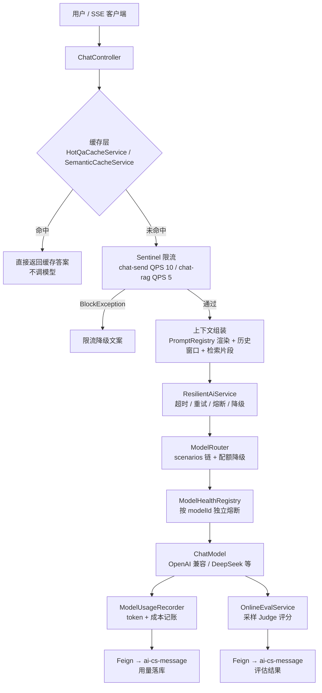
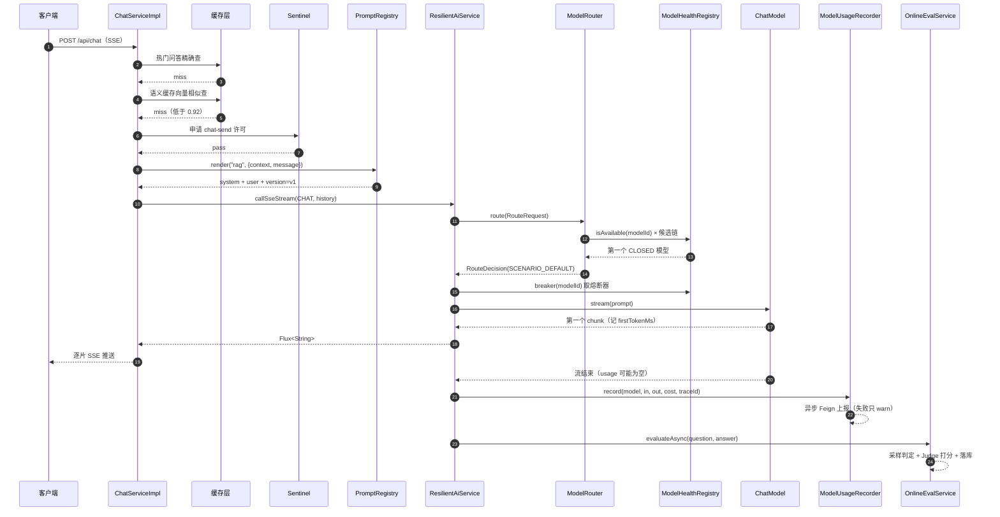

# LLM 工程化实践：把"能跑通的 demo"做成"能上线的功能"

> **一句话结论**：LLM 功能的难点从来不是"调通模型"，而是把三件反常识的事管住——非确定性、长尾延迟、按 token 计费；本项目用 `ResilientAiService`（超时/重试/熔断/降级）、`ModelRouter`（场景路由 + 配额降级）、`ModelUsageRecorder`（成本记账）、`PromptRegistry`（提示词版本化）、`OnlineEvalService`（在线评估）五块拼出这条防线，但"token 预算硬限"与"离线 eval 进 CI"仍是明确缺口。
> **阅读前置**：读过本目录 01 篇（ChatClient / Advisor 链路），知道 `ChatClient#call` 最终落到 `ChatModel`；写过 `@ConfigurationProperties`、`CompletableFuture`，用过 Resilience4j 或 Sentinel 任意一个。
> **证据基线**：Spring Boot 4.2.0 / Spring AI 2.1.0 / Spring Cloud 2026.0.0 / JDK 17 / Resilience4j（Spring Boot 4 托管版本）；A 级证据取自 `24-源码分析/assets/source/`（spring-ai-model:2.1.0 静态抓取原文），B 级为 `ai-cs-chat` 源码（行号本次核对），C 级为可复现命令输出。预计阅读 35~45 分钟。

## 0. 先看现象

先看三个真实故障形态。它们不是"模型坏了"，而是工程护栏缺失时必然出现的三种爆法。

**现象一：大促流量一上来，模型侧返回 429，整条链路的熔断器全打开。**

库存服务没问题、订单服务没问题，只有 AI 客服挂。日志里先后出现两类行（异常文本来自各库自身的 message 模板，堆栈已省略）：

```text
WARN  c.a.c.service.impl.ResilientAiService : 模型调用失败 model=deepseek-chat attempt=2
io.github.resilience4j.circuitbreaker.CallNotPermittedException: CircuitBreaker 'deepseek-chat' is OPEN and does not permit further calls
```

上游返回体（OpenAI 兼容口径；该结构未入库，以厂商官方文档为准）：

```json
{"error":{"message":"Rate limit reached for requests","type":"requests","code":"rate_limit_exceeded"}}
```

关键点：**429 不是"模型故障"，是"你超出了对方给你的并发/频率配额"**。而本项目的熔断器按 modelId 计数（`ai-cs-chat/src/main/java/com/aics/chat/modelrouter/ModelHealthRegistry.java#L18-L21`），它会如实把 429 记成"这个模型不健康"，于是主模型被剔除、流量被推到备选模型，备选模型同样被打满——雪崩的不是模型，是你没有"排队"这一层。

**现象二：单次请求卡到 30 秒超时，用户手动点重试，成本直接乘三。**

文本主链路走的是编程式超时（`ai-cs-chat/src/main/java/com/aics/chat/service/impl/ResilientAiService.java#L390-L392`），超时那一刻抛的是 JDK 原生异常，`get(timeout)` 的 `TimeoutException` 连 message 都是空的，看着像"莫名其妙失败"：

```text
java.util.concurrent.TimeoutException
java.util.concurrent.CancellationException: null
```

第一行来自 `future.get(timeoutMs, TimeUnit.MILLISECONDS)`；第二行来自随后的 `future.cancel(true)`——被取消的任务在别处拿结果时抛 `CancellationException`。用户看见转圈 30 秒后点"重试"，而**第一次那次调用在服务端已经真的把 token 烧出去了**（请求已发出，只是我们不等了）。第 4 节的成本表会算给你看：重试 3 次 = 月成本 7680 元变 23040 元。

**现象三：回答质量悄悄回退，两周没人发现。**

线上评估的开关默认是关着的（`ai-cs-chat/src/main/java/com/aics/chat/observability/OnlineEvalProperties.java#L25-L29`）：

```java
/** 线上评估总开关（默认关闭） */
private boolean enabled = false;

/** 采样率 0~1（默认 0.01） */
private double sampleRate = 0.01;
```

于是链路上有 trace、有 token 账、有 P95 延迟，**唯独没有"这次答得好不好"**。离线黄金集是有的（`ai-cs-chat/src/main/resources/eval/` 目录下的 `golden-set.json`，20 条 gc-001~gc-020），门禁字段也写好了（`ai-cs-chat/src/main/java/com/aics/chat/rag/eval/EvalGateConfig.java#L38-L43`），但仓库 `.github/workflows/` 下只有 `python-learning-validate.yml` 一条流水线，**没有任何自动跑 eval 的任务**——所以"换了模型/改了提示词导致准确率掉 10 个点"这件事，只能等用户投诉。

> 这些现象指向同一件事：**LLM 调用是"外部、慢、按字计费、还会说错话"的依赖**，而 Spring AI 只给了你"怎么调"的抽象，没给"怎么活下来"的护栏。工程化要补的就是护栏：超时、限流、降级、成本、评测。

## 1. 整体地图

一次"AI 客服回答"在 ai-cs-chat 里要穿过 8 个关卡，任何一个关卡缺护栏，故障都会以另一种样子冒出来。



> **读图说明**：这张图按"请求先后顺序"读，节点分三层责任。第一层是**省钱**（缓存层：热门问答精确命中走 O(1)，语义缓存走向量相似），它是唯一"不花 token"的分支。第二层是**保命**（Sentinel 限流 → ResilientAiService 的超时/熔断/降级），负责在模型侧撑不住时把请求挡在门外或快速失败。第三层是**记账与体检**（ModelUsageRecorder 记 token 与成本、OnlineEvalService 抽样打分），它们都在主链路之外异步执行，失败不影响用户。注意 `ModelRouter` 与 `ModelHealthRegistry` 是两个不同粒度的东西：前者决定"用哪个模型"，后者记录"每个模型现在健康吗"，粒度都是 modelId 而非全局。

| 组件 | 真实类 / 位置 | 责任 | 调用方 |
| --- | --- | --- | --- |
| 缓存层 | `ai-cs-chat/src/main/java/com/aics/chat/cache/HotQaCacheService.java`、`SemanticCacheService.java` | 精确命中与语义命中，命中即免 token | `ChatServiceImpl` |
| 限流 | `ai-cs-chat/src/main/java/com/aics/chat/config/SentinelRules.java` | 单机 QPS 兜底（chat-send 10 / chat-rag 5），预热式冷启动保护 | Spring AI 侧资源埋点 |
| 容错模板 | `ai-cs-chat/src/main/java/com/aics/chat/service/impl/ResilientAiService.java` | 超时、瞬时故障重试一次、熔断、降级文案、观测 | `ChatServiceImpl` 等业务服务 |
| 路由 | `ai-cs-chat/src/main/java/com/aics/chat/modelrouter/ModelRouter.java` | 按场景主备链选模型，配额超限降档 | `ResilientAiService` |
| 健康 | `ai-cs-chat/src/main/java/com/aics/chat/modelrouter/ModelHealthRegistry.java` | 每个 modelId 一个熔断器 | `ModelRouter`、`ResilientAiService` |
| 配额 | `ai-cs-chat/src/main/java/com/aics/chat/observability/QuotaService.java` | 按日/周/月窗口判 token 与成本是否超限 | `ResilientAiService` |
| 成本 | `ai-cs-chat/src/main/java/com/aics/chat/observability/ModelUsageRecorder.java` | token 用量 + 估算成本，异步上报 | `ResilientAiService` |
| 提示词 | `ai-cs-chat/src/main/java/com/aics/chat/prompt/PromptRegistry.java` + `ai-cs-chat/src/main/resources/application-prompt.yml` | 模板外置、变量渲染、版本/灰度、热切换 | `ChatServiceImpl`、意图/改写/摘要各场景 |
| 评估 | `ai-cs-chat/src/main/java/com/aics/chat/observability/OnlineEvalService.java`、`ai-cs-chat/src/main/java/com/aics/chat/rag/eval/RagEvalServiceImpl.java` | 在线采样打分 + 离线黄金集评测 | 业务侧异步钩子、`RagEvalController` |

## 2. 关键概念与关键类

先统一口径，后面所有判断都建立在这些词上。

- **Token（模型的最小计费单位，约 1 个汉字 0.7~1 个 token、4 个英文字符 1 个 token）**：输入和输出分开计价，输出通常贵 2~4 倍。
- **上下文窗口（context window，一次请求里"输入+输出"共享的硬上限）**：项目里由 `ModelDefinition.contextWindow` 表达，默认 32768；超了不是排队，是直接报错或被截断。
- **TTFT（Time To First Token，从发出请求到收到第一个流式分片的时间）**：流式体验的真实指标，比总耗时更能反映"用户等多久"。本项目把它作为高基数观测字段记下来。
- **熔断（circuit breaker，连续失败达到阈值后"直接拒绝"，不再打下游，等冷却期后放少量试探）**：Resilience4j 的三种状态 CLOSED（正常放行）/ OPEN（拒绝）/ HALF_OPEN（试探）。
- **fail-open / fail-close（治理逻辑自身出错时，选择"放行"还是"拦截"）**：成本类治理 fail-open（宁可少省钱也别挂业务），安全类治理 fail-close（宁可误拦也别放过）。
- **语义缓存（semantic cache，把问题转成向量，相似度超阈值就复用旧答案）**：省 token 的利器，也是"答非所问"的新来源。
- **Eval / Judge（评测与判分模型）**：用另一个 LLM 按 rubric 给答案打分，成本低但有偏差，所以要采样、要有离线基线兜底。

| 名称 | 位置 | 角色 | 关键方法 / 字段 |
| --- | --- | --- | --- |
| `ResilientAiService` | `ai-cs-chat/src/main/java/com/aics/chat/service/impl/ResilientAiService.java` | 容错模板：把"路由→熔断→超时→记账→降级"收在一处 | `callChat` L112、`callSseStream` L148、`invokeNonStream` L172-L246、`invokeStream` L252-L341、`timedCall` L378-L400 |
| `ModelRouter` | `ai-cs-chat/src/main/java/com/aics/chat/modelrouter/ModelRouter.java` | 确定性选模：场景主备链 + 配额降档 | `route` L20、候选过滤 L38-L40、`cheapestEligible` L66-L78、`noEligible` L92-L99 |
| `ModelHealthRegistry` | `ai-cs-chat/src/main/java/com/aics/chat/modelrouter/ModelHealthRegistry.java` | 每 modelId 一个熔断器 | `breaker` L18-L21、`isAvailable` L23-L31、`config` L34-L43 |
| `ModelDefinition` | `ai-cs-chat/src/main/java/com/aics/chat/modelrouter/ModelDefinition.java` | 单个模型的元数据（含独立超时/上下文窗口/tier） | `timeoutMs` 默认 30000、`contextWindow` 默认 32768、`tier`、`priority` |
| `ModelRouterProperties` | `ai-cs-chat/src/main/java/com/aics/chat/modelrouter/ModelRouterProperties.java` | `aics.model-router` 绑定 + fail-fast 校验 | `validate` L34-L65 |
| `QuotaService` | `ai-cs-chat/src/main/java/com/aics/chat/observability/QuotaService.java` | 按窗口查配额、判超限 | `check` L38-L81、`windowStart` L84-L91 |
| `ModelUsageRecorder` | `ai-cs-chat/src/main/java/com/aics/chat/observability/ModelUsageRecorder.java` | token 记账 + 成本估算 + 异步上报 | `record` L55-L114、`estimateCost` L127-L137、`PER_MILLION` L30 |
| `ModelUsageProperties` | `ai-cs-chat/src/main/java/com/aics/chat/observability/ModelUsageProperties.java` | `aics.usage` 单价表（元/百万 token） | `pricing`、`defaultPricing`、`executorSize` |
| `PromptRegistry` | `ai-cs-chat/src/main/java/com/aics/chat/prompt/PromptRegistry.java` | 模板渲染 + 版本选择 + 热切换 | `PLACEHOLDER` L35、`validate` L59-L75、`render` L86-L110、`renderTemplate` L134-L147、`setActiveVersion` L160-L170 |
| `SentinelRules` | `ai-cs-chat/src/main/java/com/aics/chat/config/SentinelRules.java` | 限流资源名与阈值常量 | `RESOURCE_CHAT_SEND` L15、`CHAT_SEND_QPS_THRESHOLD` L21、`WARM_UP_PERIOD_SEC` L30 |
| `OnlineEvalService` | `ai-cs-chat/src/main/java/com/aics/chat/observability/OnlineEvalService.java` | 采样 + Judge + 异步落库 | `evaluateAsync` L54-L98 |
| `EvalGateConfig` | `ai-cs-chat/src/main/java/com/aics/chat/rag/eval/EvalGateConfig.java` | 离线评测的延迟/Token 门禁 | `p95LatencyMs` L40、`avgTokensPerRequest` L43 |

## 3. 原理与证据逐段精读

### 3.1 先把"LLM 与传统 API 的五处差异"钉死

**在干什么**：把"为什么不能照抄 REST 客户端的写法"落到五条具体差异上，每条差异对应一个工程动作。

| 差异 | 传统 REST 依赖 | LLM 调用 | 你要补的东西 | 本项目证据 |
| --- | --- | --- | --- | --- |
| 非确定性 | 同样入参→同样出参，可断言 | 同样入参，生成结果每次不同（温度 0.7） | 断言改成"结构 + 关键词 + 判分"，不能字符串相等 | `aics.model-router.temperature` 默认 0.7（`ai-cs-chat/src/main/java/com/aics/chat/modelrouter/ModelRouterProperties.java#L20-L23`） |
| 延迟长尾 | p99 常常是 p50 的 2 倍 | 首 token 几秒、整段几十秒，长尾 10 倍以上 | 独立超时 + 流式 + 更好的降级文案 | `application.yml` 里 chatService 30s、sseChatService 60s（`ai-cs-chat/src/main/resources/application.yml#L73-L87`） |
| 计费 | 按请求数 | 按 token，输入输出不同价，还可能一次提问触发多轮调用 | 用量记账 + 预算/配额 + 缓存 | `ModelUsageRecorder#estimateCost` L127-L137；工具循环每轮都计费（见下） |
| 上下文长度 | 无限制概念 | 硬窗口，超了报错或截断 | 上下文预算分配（3.7） | `ModelDefinition.contextWindow` 默认 32768 |
| 输出不可解析 | 有 schema/契约 | 自由文本，JSON 可能缺括号、带 markdown 围栏 | 结构化输出 + 校验 + 有限重试 | A 级：`StructuredOutputValidationAdvisor` 的校验重试循环 |

"一次提问可能多轮计费"这件事不是猜测，而是工具调用的固有形状：

```java
// (src: ToolCallingAdvisor.java.md#L244-L246)
		while (isToolCall); // loop until no tool calls are present

		chatClientResponse = usageAccumulator.applyAccumulatedUsage(chatClientResponse);
```

**为什么这么设计**：`while (isToolCall)` 意味着"模型要调工具 → 执行工具 → 把结果回灌模型 → 模型再决定"，每一轮都是一次独立计费调用。Spring AI 用 `UsageAccumulator` 把多轮 usage 累加后统一回填（同文件 L246），所以**你在应用侧看到的一次调用成本，是 N 次上游调用的总和**。

**换写法会怎样**：如果你按"一次请求 = 一次计费"去做预算，工具密集型场景（订单查询、智能问数）会成倍超支；反之如果按最坏情况（比如假定 5 轮）做硬限，普通闲聊场景又会被误杀。正确做法是预算按"场景"分档，而不是全局一个数。

**常见坑**：把 `ChatResponseMetadata#getUsage()` 的 `EmptyUsage`（全 0）当成"免费调用"。流式场景下不少 provider 不给精确 usage，本项目因此在记账 DTO 上打了 `estimated` 标记（`ai-cs-chat/src/main/java/com/aics/chat/observability/ModelUsageRecorder.java#L100`），全 0 的 usage 记进账本只会让成本报表失效，必须与"真的用了 0 token"区分开。

"输出不可解析"这一条的代价同样是**乘数**。Spring AI 的结构化输出校验 advisor 在 schema 校验失败时会**再调一次模型**：

```java
// (src: StructuredOutputValidationAdvisor.java.md#L133-L146)
		boolean isValidationSuccess = false;
		...
		UsageAccumulator usageAccumulator = new UsageAccumulator();
		for (var currentAttemptNumber = 1 + this.maxRepeatAttempts; currentAttemptNumber > 0
				&& !isValidationSuccess; currentAttemptNumber--) {
			// Next Call
			chatClientResponse = callAdvisorChain.copy(this).nextCall(processedChatClientRequest);
			...
			ChatResponse chatResponse = chatClientResponse.chatResponse();
			usageAccumulator.addRoundResponse(chatResponse);
```

`maxRepeatAttempts` 默认 3（同文件 Builder），意味着**最坏情况一次"要 JSON"的请求会打 4 次上游**。所以预算评估里"输出格式要求越严 → 重试越多 → 单请求成本越高"是一条必须写进容量规划的经验规则；也正因为如此，`adviseStream` 直接抛 `UnsupportedOperationException`——流式下没法回头重生成，索性不支持。

### 3.2 超时：为什么不用 HTTP 层超时，而用 `CompletableFuture.get(timeout)`

**在干什么**：给每一次模型调用套一个"到点就放弃"的闸门，并且放弃后**尝试真正释放**挂起的线程。

```java
// 摘自 ai-cs-chat/src/main/java/com/aics/chat/service/impl/ResilientAiService.java#L378-L406
private ChatResponse timedCall(CircuitBreaker breaker, ModelClientHolder holder, NonStreamCall call) throws Exception {
    // breaker.executeCallable：熔断器打开时直接抛 CallNotPermittedException，不真正调用下游
    return breaker.executeCallable(() -> {
        CompletableFuture<ChatResponse> future = CompletableFuture.supplyAsync(() -> {
            try {
                return call.call(holder); // 真正发起 LLM HTTP 调用
            } catch (Exception e) {
                throw new CompletionException(e);
            }
        });
        try {
            return future.get(holder.getDefinition().getTimeoutMs(), TimeUnit.MILLISECONDS);
        } catch (TimeoutException e) {
            future.cancel(true); // true = 发送 interrupt() 中断挂起的 HTTP 连接，释放线程池资源
            throw e;
        } catch (ExecutionException | CompletionException e) {
            // 必须先逐层解包，否则"瞬时故障 / 业务失败"判定会失真，fallback 原因也会记错
            Throwable cause = e.getCause();
            if (cause instanceof CompletionException && cause.getCause() != null) {
                cause = cause.getCause();
            }
            if (cause instanceof Exception ex) {
                throw ex;
            }
            throw new RuntimeException(cause == null ? e : cause);
        }
    });
}
```

**为什么这么设计**：三个理由，缺一不可。

1. **HTTP 层超时管不住"已经计费的慢请求"**：连接超时/读超时是分段的（连上之后每段都没超时，但整体拖了 40 秒），而业务上要的是"整体 30 秒内必须给用户答复"。
2. **`future.cancel(true)` 是唯一能提示上游"别算了"的手段**：它发送 interrupt，尽量释放挂起的线程，避免线程池被慢请求攥死。
3. **超时粒度下沉到模型维度**：`ModelDefinition.timeoutMs` 默认 30000（`ai-cs-chat/src/main/java/com/aics/chat/modelrouter/ModelDefinition.java#L24`），因为便宜的小模型 5 秒该出结果，顶配大模型可能要 25 秒；全局一个超时值必然一半场景误杀、一半场景白等。

**换写法会怎样**：只用 `@TimeLimiter` 注解（声明式）看起来更优雅，但它要求方法返回 `CompletableFuture`，且超时后同样只是 cancel，没有"按模型差异化"的表达力；用 WebClient 的 `responseTimeout` 则更糟——它只看单次读写，不看整体。

**常见坑**：`TimeoutException` 的 message 是 null（JDK 行为），日志里只打 `e.getMessage()` 会看到空白行，排查时以为是被吞的异常。要么打 `e.getClass().getSimpleName()`，要么按本项目做法在观测里带 `firstTokenMs`/`attempt` 等维度（`ai-cs-chat/src/main/java/com/aics/chat/service/impl/ResilientAiService.java#L313-L315`）。

### 3.3 重试：只对该重试的错重试，生成请求绝不超过一次

**在干什么**：仅对"瞬时"类故障重试一次，而且**只在流式开始之前**。看调用点：

```java
// 摘自 ai-cs-chat/src/main/java/com/aics/chat/service/impl/ResilientAiService.java#L356-L367
private ChatResponse callWithTransientRetry(ModelClientHolder holder, NonStreamCall call) throws Exception {
    // 拿到该模型的熔断器：熔断器会记住最近 N 次调用的成功/失败率，失败率超阈值就自动"打开"，直接快速失败不再调用下游
    CircuitBreaker breaker = healthRegistry.breaker(holder.getDefinition().getId());
    try {
        return timedCall(breaker, holder, call); // 第一次尝试：带熔断+超时的调用
    } catch (ResourceAccessException | SocketTimeoutException | TimeoutException e) {
        // 只有网络类瞬时故障才重试，业务异常（如模型返回错误码）不重试
        log.warn("模型瞬时故障，重试一次: modelId={}, err={}",
                holder.getDefinition().getId(), e.getMessage());
        return timedCall(breaker, holder, call); // 第二次（最后一次）尝试
    }
}
```

**为什么这么设计**：生成类请求不是幂等的——它已经开始消耗 token、已经在写流。重试的代价是"再花一次钱 + 用户多等一个超时"。所以判定标准必须窄：只有 `ResourceAccessException`/`SocketTimeoutException`/`TimeoutException` 这类"网络层没拿到响应"的错才重试；业务异常 `BusinessException`（比如内容审核拒绝）必须原样抛出，重试只会重复被拒。

**换写法会怎样**：如果照搬 `@Retryable(maxAttempts=3, backoff=2s)`（旧文档就是这么写的），在 429 场景下会变成"对方限流 → 你还连打三次" → 三次都失败 → 熔断阈值瞬间打满 → 主模型被摘掉。这就是现象一的加速器。流式路径本项目直接不重试（`invokeStream` 全段没有 retry 逻辑），因为 `Flux` 一旦开始消费就无法重放。

**常见坑**：把重试次数配在 yml 里却以为代码在用。`application.yml` 里 retry 的 `chatService` 实例定义了 `max-attempts: 3`（`ai-cs-chat/src/main/resources/application.yml#L88-L112`），但文本主链路是自己写的"最多两次"；真正读这三个 resilience4j 实例的只有视觉链路（`ai-cs-chat/src/main/java/com/aics/chat/service/impl/VisionModelClient.java#L153-L156`）。配置与代码是两套，见 3.4 与第 7 节的对照表。

### 3.4 熔断：为什么必须按 modelId 隔离，而不是全局一个

**在干什么**：给每个模型一个独立的熔断器，失败率到阈值就暂时不再打它。

```java
// 摘自 ai-cs-chat/src/main/java/com/aics/chat/modelrouter/ModelHealthRegistry.java#L15-L31
private final CircuitBreakerRegistry circuitBreakerRegistry = CircuitBreakerRegistry.ofDefaults();
private final Map<String, CircuitBreaker> breakers = new ConcurrentHashMap<>();

public CircuitBreaker breaker(String modelId) {
    // 设计要点：熔断器按 modelId 隔离——若共享一个熔断器，主模型故障会连累备用模型，路由降级就失去意义
    return breakers.computeIfAbsent(modelId, id -> circuitBreakerRegistry.circuitBreaker(id, config()));
}

public boolean isAvailable(String modelId) {
    CircuitBreaker breaker = breakers.get(modelId);
    if (breaker == null) {
        return true;
    }
    // 设计要点：可用性只看"是否 OPEN"——CLOSED 正常放行，HALF_OPEN 也要放行以完成恢复探测；只有 OPEN 才从路由候选剔除
    return breaker.getState() == CircuitBreaker.State.CLOSED
            || breaker.getState() == CircuitBreaker.State.HALF_OPEN;
}
```

**为什么这么设计**：熔断器是"对下游能力的判断"。共享一个熔断器会让**主模型的故障连累备选模型**——主模型 429 打满阈值，全局 OPEN，备选模型哪怕完全健康也进不来，降级链形同虚设。同理 `isAvailable` 只在 OPEN 时返回 false，HALF_OPEN 必须放行：不放行就永远试探不出去（永远停在 OPEN）。

**换写法会怎样**：把熔断做成"整条链路一个"，看起来更简单，但等于把"多模型冗余"这个设计意图废掉了。另一个常见错法是让熔断异常也参与"失败率计算"之外的判断——本项目用 `executeCallable`，熔断打开时抛 `CallNotPermittedException` 而**不会真的调用下游**（`ai-cs-chat/src/main/java/com/aics/chat/service/impl/ResilientAiService.java#L381`），这是"快速失败"而不是"再失败一次"的关键区别。

**常见坑**：用一个全局 `CircuitBreakerRegistry.ofDefaults()` 的默认配置却不校验参数。本项目显式给了 `COUNT_BASED / slidingWindowSize=10 / minimumNumberOfCalls=3 / failureRateThreshold=50 / waitDurationInOpenState=30s / permittedNumberOfCallsInHalfOpenState=3`（同文件 L34-L43）。`minimumNumberOfCalls=3` 意味着"只要连错 2 次就可能 OPEN"——低流量场景下很容易被偶发抖动误熔断，这是有意的取舍（宁可快速失败，也不要让用户干等 30 秒）。

顺带一个"框架自带的熔断器长什么样"的对照。库里的 A 级摘录 `Resilience4JCircuitBreaker.java.md`（来源 `org.springframework.cloud:spring-cloud-circuitbreaker-resilience4j:5.1.0`，不是 Spring AI 的类）就是这个思路的标准实现：

```java
// (src: Resilience4JCircuitBreaker.java.md#L98-L133)
	public <T> T run(Supplier<T> toRun, Function<@Nullable Throwable, T> fallback) {
		final Map<String, String> tags = Map.of(CIRCUIT_BREAKER_GROUP_TAG, this.groupName);
		Optional<TimeLimiter> timeLimiter = loadTimeLimiter();
		io.github.resilience4j.circuitbreaker.CircuitBreaker defaultCircuitBreaker = registry.circuitBreaker(this.id,
				this.circuitBreakerConfig, tags);
		circuitBreakerCustomizer.ifPresent(customizer -> customizer.customize(defaultCircuitBreaker));
		...
				Callable<T> restrictedCall = timeLimiter
					.map(tl -> TimeLimiter.decorateFutureSupplier(tl, futureSupplier))
					.orElse(() -> futureSupplier.get().get());
				Callable<T> callable = io.github.resilience4j.circuitbreaker.CircuitBreaker
					.decorateCallable(defaultCircuitBreaker, restrictedCall);
				return getAndApplyFallback(callable, fallback);
```

它和本项目 `timedCall` 的骨架完全一致：**先 TimeLimiter 包 Future，再 CircuitBreaker 包 Callable，最后套 fallback**。差别在于它按 `id`/`groupName` 从 registry 取熔断器，而本项目要的是"按模型 id 取 + 与路由候选链联动"，在 Spring AI 的 Advisor 体系里没有现成挂点（m2 里能查到 `spring-ai-retry` 模块，但文本主链路没有用它），所以自己写了 `ModelHealthRegistry` 这 44 行。

### 3.5 路由：确定性选模，绝不引入"再来一次 LLM 判断"

**在干什么**：按场景查出候选链（primary + fallbacks），过滤掉"未注册 / 已熔断 / 能力不满足"的，取第一个能用的。

```java
// 摘自 ai-cs-chat/src/main/java/com/aics/chat/modelrouter/ModelRouter.java#L29-L44
// 设计要点：路由按场景链的 primary/fallbacks 顺序确定性执行，不引入 LLM 判断——模型选择必须是零成本、可解释、可复现的
List<String> candidates = new ArrayList<>();
candidates.add(scenarioRoute.getPrimary());
if (scenarioRoute.getFallbacks() != null) {
    candidates.addAll(scenarioRoute.getFallbacks());
}
Set<ModelCapability> required = request.getRequiredCapabilities() == null
        ? Set.of() : request.getRequiredCapabilities();
// 设计要点：先按“已注册 + 未熔断 + 能力满足”过滤，再取链上第一个可用模型——fallback 永远不会选到不存在或不可用的模型
candidates.removeIf(id -> !registry.contains(id)
        || !healthRegistry.isAvailable(id)
        || !hasCapabilities(id, required));

if (candidates.isEmpty()) {
    return noEligible();
}
```

**为什么这么设计**：选模这条路径在**每一次**请求上都要走，它自己不能变成一个新的不确定性来源和成本来源。用 LLM 判"该用哪个模型"是常见的反模式：多花一次调用、多一个失败点、还不可复现（同样的输入今天选 A、明天选 B），出问题时无法解释。

配额超限时切换到"便宜档"，也是同一份确定性逻辑：

```java
// 摘自 ai-cs-chat/src/main/java/com/aics/chat/modelrouter/ModelRouter.java#L46-L54
// 设计要点：配额降级是全局扫描 cheap 档，普通路由仍严格走场景链——成本治理可以跳出场景约束，默认行为必须保持可预测
if (request.isQuotaExceeded() && properties.getQuota().isEnabled()) {
    String cheap = cheapestEligible(required);
    if (cheap != null) {
        return decision(cheap, rest(candidates, cheap), RouteReason.QUOTA_DOWNGRADE);
    }
    return decision(candidates.get(0), rest(candidates, candidates.get(0)),
            RouteReason.QUOTA_NO_CHEAPER_MODEL);
}
```

**换写法会怎样**：如果"配额超了"直接抛异常拒绝服务，用户体验会突然从"好答案"掉到"完全不可用"；本项目的选择是**降档服务**（`QUOTA_DOWNGRADE`：换便宜模型，答案质量略降但服务不断），并且 `cheapestEligible` 里先按 tier 过滤再按 priority 倒序（同文件 L66-L78）——注释写得很直白："便宜不是唯一标准"。

**常见坑**：路由失败时抛异常。本项目 `noEligible()` 返回 `selectedModelId=null` + `RouteReason.NO_ELIGIBLE_MODEL`（L92-L99），把"没有可用模型"交给上层变成一句友好文案，而不是 5xx。**如果这里抛异常，模型选择失败就会变成一次服务不可用**。

### 3.6 限流与排队：为什么阈值是 10 QPS，以及它管不住什么

**在干什么**：用 Sentinel 在入口做单机 QPS 兜底，超出直接走降级。

```java
// 摘自 ai-cs-chat/src/main/java/com/aics/chat/config/SentinelRules.java#L14-L30
/** 同步对话接口资源（/chat/send） */
public static final String RESOURCE_CHAT_SEND = "chat-send";

/** RAG 对话接口资源（/chat/rag） */
public static final String RESOURCE_CHAT_RAG = "chat-rag";

/** 同步对话 QPS 阈值：LLM 供应商并发有限，超出直接走限流降级 */
public static final int CHAT_SEND_QPS_THRESHOLD = 10;

/** RAG 对话 QPS 阈值：检索 + 生成链路更重，阈值更低 */
public static final int CHAT_RAG_QPS_THRESHOLD = 5;

/** 流控效果：0-直接拒绝，1-预热(WarmUp)，2-匀速排队 */
public static final int CONTROL_BEHAVIOR_WARM_UP = 1;

/** 预热时长（秒）：冷启动 slowly lift QPS，保护刚启动的 LLM 连接池 */
public static final int WARM_UP_PERIOD_SEC = 10;
```

**为什么这么设计**：模型侧的配额是"供应商给的并发/每分钟请求数"，它比你的实例数更稀缺。与其让请求都发出去然后一起吃 429（现象一），不如在门口挡住一部分、其余走降级文案——**被拒的请求是 0 成本，被限流的 429 请求是花了钱的失败**。用 `WARM_UP`（预热）而非匀速通过，是为了让冷启动时缓存刚失效、并发最差的阶段缓慢放量。

**换写法会怎样**：用"按用户每日 100 次"这种业务配额（旧文档的写法）替代 QPS 限流，能防滥用但防不住瞬时峰值——10 万用户同时在线时每个人都"没超日配额"，模型侧照样雪崩。这两者不是替代关系：**QPS 限流保系统活着，业务配额保账单可控**（后者本项目在 `QuotaService` 里实现）。

**常见坑**：Sentinel 限流是**单机**的。3 个实例各配 10 QPS，实际打到模型侧是 30 QPS；如果供应商给的是 20 QPS，你依然会 429。要么用集群流控，要么把单机阈值除以实例数，要么在模型维度做并发信号量（本项目未做，属缺口）。

还有一个更隐蔽的坑，本项目当前真实存在：**规则注册了，但入口没埋点**。`SentinelFlowConfig.initFlowRules()` 把 `chat-send`（QPS 10）和 `chat-rag`（QPS 5）两条规则都 `loadRules` 了（`ai-cs-chat/src/main/java/com/aics/chat/config/SentinelFlowConfig.java#L27-L45`），但只有 `/chat/send` 挂了注解（`ai-cs-chat/src/main/java/com/aics/chat/controller/ChatController.java#L79`），`/chat/rag`（同文件 L119-L120）和 `/stream/sse`（L167）都没有 `@SentinelResource`——Sentinel 只对**被埋点的资源**生效，没埋点的请求连规则都不会命中。落到线上就是"RAG 链路配了 5 QPS，但从来没限过一次"，而 RAG 恰恰是最重、最该限的那条。查这类问题的手法：`grep -rn 'chat-rag' --include=*.java`，如果只在 config 包出现、controller 里没有，就是没埋点。

### 3.7 上下文预算：按条数裁剪 ≠ 按 token 预算

**在干什么**：把有限窗口切成几块固定预算，给每一块设上限。下面是按 8192 窗口的一个可执行分配（C 级脚本输出，见 3.9 的同一套口径）：

```text
预算分配（以 8192 窗口为例，和为窗口大小）:
  system 系统提示              600    7.3%
  history 历史                2500   30.5%
  retrieval 检索片段          3000   36.6%
  output 输出预留              1200   14.6%
  margin 安全余量               892   10.9%
  合计                        8192
```

**为什么这么设计**：输出预留必须显式占位。很多人把窗口全给输入，结果模型刚要好好回答就被 `max_tokens` 掐断（`aics.model-router.maxTokens` 默认 2048），表现为"回答说到一半没了"。安全余量则是给"渲染后比模板长"的情况（变量插值、检索片段拼接）留 buffer。

**换写法会怎样**：本项目当前的真实做法是**按消息条数裁剪，不是按 token**：

```java
// 摘自 ai-cs-chat/src/main/java/com/aics/chat/service/impl/ChatServiceImpl.java#L149-L156
/** 最大历史消息数，超过时触发压缩 */
private static final int MAX_HISTORY_SIZE = 20;

/** 压缩后保留的最近消息数 */
private static final int KEEP_RECENT_SIZE = 10;

/** SSE 超时时间：5 分钟（与 TimeLimiter 60s 配合，Limiter 先触发，Emiter 兜底） */
private static final long SSE_EMITTER_TIMEOUT = 5 * 60 * 1000L;
```

`history.size() > MAX_HISTORY_SIZE` 时调 `compressHistory`（L278-L281）把老消息交给 LLM 压成摘要。条数裁剪的问题很直接：**20 条短问候 ≈ 200 token，20 条长回答 ≈ 8000 token**，同样是"20 条"，一个还剩 3/4 窗口，另一个已经爆窗。压缩本身还要再花一次 LLM 调用（等于每 10 轮多一次计费）。

顺带对照 Spring AI 官方记忆窗口的语义（A 级，它同样是条数而非 token）：

```java
// (src: MessageWindowChatMemory.java.md#L104-L124)
		// Collect the indices of non-system messages; SystemMessages are always
		// preserved.
		...
		// Snap the cut forward to the nearest USER message so the kept window always
		// starts at a complete turn. This prevents keeping an assistant reply or tool
		// result without the user message that originated its turn.
		while (cutIndex < nonSystemIndices.size()
				&& processedMessages.get(nonSystemIndices.get(cutIndex)).getMessageType() != MessageType.USER) {
			cutIndex++;
		}
```

**常见坑**：`DEFAULT_MAX_MESSAGES = 20`（同文件 L50）本项目也用了 20——数字巧合但机制不同：本项目是"超过 20 条就调 LLM 压缩"，Spring AI 的是"超过就把最老的丢掉"。压缩比丢弃更好（信息不丢），但**压缩要花钱且会失败**，所以两条上限都要有（兜底失败时退回丢弃）。真正的 token 预算硬限在本项目**未落地**：`token budget|maxContextTokens|tokenLimit|hardLimit` 在 `ai-cs-chat`、`ai-cs-knowledge`、`ai-cs-py-chat` 的代码与配置里零命中，唯一的 token 类上限是评测报告里的 `EvalGateConfig.avgTokensPerRequest`（只判报告，不进主链路）。

### 3.8 提示词版本管理：模板外置 + 变量校验 + 热切换

**在干什么**：把提示词从代码里搬进 `application-prompt.yml`，按 scenario 组织、支持多版本与灰度、支持运行时切换。

```yaml
# 摘自 ai-cs-chat/src/main/resources/application-prompt.yml#L55-L63
      rag:
        activeVersion: v1
        rollout:
          strategy: pinned
          pinned: v1
        versions:
          v1:
            system: "你是AI客服平台的智能助手，代表平台为用户提供专业、友好的服务。"
            user: "请严格基于下面的【知识库资料】回答用户问题。\n重要规则：\n1. 如果资料中没有相关信息，请如实告知：\"我暂时没有这方面的资料\"，不要编造内容\n2. 回答时优先引用资料中的内容，不要提及\"根据资料/检索结果\"之类的表述\n\n【知识库资料】\n{{context}}\n\n【用户问题】\n{{message}}"
```

```java
// 摘自 ai-cs-chat/src/main/java/com/aics/chat/prompt/PromptRegistry.java#L134-L147
private String renderTemplate(String template, Map<String, Object> variables) {
    Matcher m = PLACEHOLDER.matcher(template);
    StringBuffer sb = new StringBuffer();
    while (m.find()) {
        String key = m.group(1);
        Object val = variables == null ? null : variables.get(key);
        if (val == null) {
            throw new PromptRenderException("Prompt 模板缺少变量占位符 {{" + key + "}}");
        }
        m.appendReplacement(sb, Matcher.quoteReplacement(String.valueOf(val)));
    }
    m.appendTail(sb);
    return sb.toString();
}
```

**为什么这么设计**：提示词是"会天天改的业务资产"，改一次就要发版是最大的浪费；而一旦外置，就有两个新风险必须一起解决——**变量漏传**（模板里有 `{{context}}` 但代码没塞）和**版本失控**（谁把 v2 全量了？）。所以 `PromptRegistry` 在启动时（`afterPropertiesSet` → `validate`，L48-L75）做 fail-fast：`versions` 非空、`activeVersion` 必须存在、`weights` 之和≈1；渲染时缺变量直接抛 `PromptRenderException`。

**换写法会怎样**：只做"外置"不做"校验"，漏传变量会让模型收到字面量 `{{context}}` 并一本正经地编答案——这是最难查的一类线上问题，因为不报错。版本上只支持"全量切换"（本项目当前 8 个场景全是 `strategy: pinned`）就无法做 A/B；`PromptProperties` 里已备好 `weights`（按比例）与 `userIdMod`（按用户尾号）两种策略，属于"字段已就位、配置未启用"。

**常见坑**：`setActiveVersion` 是**内存态**（`activeOverrides`，L41、L160-L170），重启回落到 yml 里的 `activeVersion`。也就是说"线上手动切到 v2 排查问题"的行为不是持久的，重启即失效——忘记这点会在重启后"问题复现"时白查半天。另外 `RenderedPrompt` 会带上 `scenario` 与 `version`（L198-L220），这是后续把"答案质量"和"提示词版本"关联起来的唯一钩子，**丢了它，A/B 就只剩下感觉**。

### 3.9 成本核算：公式、口径与一个真实算例

**在干什么**：每次调用结束把 token 用量换算成钱，异步上报。核心公式只有三行：

```java
// 摘自 ai-cs-chat/src/main/java/com/aics/chat/observability/ModelUsageRecorder.java#L127-L137
BigDecimal estimateCost(String pricingKey, int inputTokens, int outputTokens) {
    ModelUsageProperties.ModelPrice price = properties.getPricing().getOrDefault(
            pricingKey, properties.getDefaultPricing());
    BigDecimal inCost = BigDecimal.valueOf(inputTokens)
            .divide(PER_MILLION, 10, RoundingMode.HALF_UP)
            .multiply(price.getInput());
    BigDecimal outCost = BigDecimal.valueOf(outputTokens)
            .divide(PER_MILLION, 10, RoundingMode.HALF_UP)
            .multiply(price.getOutput());
    return inCost.add(outCost).setScale(6, RoundingMode.HALF_UP);
}
```

即 **成本 = 输入 token ÷ 1,000,000 × 输入单价 + 输出 token ÷ 1,000,000 × 输出单价**，单价单位是"元/百万 token"（`ai-cs-chat/src/main/java/com/aics/chat/observability/ModelUsageProperties.java`）。

**为什么这么设计**：用 `BigDecimal` 而不是 `double`——一次调用差 1e-9 元无所谓，但一天 10 万次、按用户/租户聚合后再对账，浮点误差会让账单和实际付款对不上（注释写的就是这个理由）。异步 + 失败只 warn，是因为记账失败不该影响用户拿到回答。

**换写法会怎样**：用 `int` 存"厘"或"微元"也行，但要自己处理除法精度；用 `double` 是最常见的错法。

下面这个算例是 C 级可复现输出（`node` v24.16.0 本地跑）。先说明环境边界：本机 **没有安装 `docker` / `redis-cli` / `mysql` / `chroma`**（`Get-Command` 全部 NOT FOUND，实测），所以本篇所有 C 级证据都是"本地计算 + 静态核对"，**不含任何中间件连接、任何真实模型调用**——这也是它能被你在任何一台机器上原样复现的原因：

```text
口径：每次输入 8000 tokens（≈8192 上下文窗口的 97.7%），输出 1200 tokens，日 10000 次，月 30 天
档位                        单次(元)       日(元)         月(元)     月/万次
cheap   (小模型)          0.006400      64.00      1920.00      64.00
standard(主力模型)         0.025600     256.00      7680.00     256.00
premium (顶配模型)         0.312000    3120.00     93600.00    3120.00

敏感度（standard 档，月成本）:
  基线                     7680.00
  超时后用户重试 3 次      23040.00  (+200%)
  历史 2500→5000 tokens    9180.00
  输出 1200→2400 tokens    10560.00
  缓存命中 30% 输入 5 折   6960.00
  上下文减半 8192→4096     5280.00
```

**怎么读这张表**：

- 单价是**示例口径**（cheap 0.5/2、standard 2/8、premium 30/60 元每百万 token），只为演示量级与敏感度；真实价格以各厂商官方定价页为准，且随时会变。
- 单位是"元/百万 token"，所以"8000 输入 + 1200 输出"在 standard 档是 `8000/1e6×2 + 1200/1e6×8 = 0.016 + 0.0096 = 0.0256` 元。
- 最大杠杆不是"换便宜模型"（那会掉质量），而是**重试**：×3 直接把 7680 变 23040。这也是 3.2/3.3 强调"超时 + 不盲目重试"的经济原因。
- 缓存带来的收益比想象的小（30% 输入命中打 5 折才省 9%），因为**输出更贵**；真正省钱的是"降输出长度"和"减检索片段"。

Spring AI 2.1 还给了更细的省钱口径——prompt caching 的命中/写入 token 数：

```java
// (src: Usage.java.md#L78-L80)
	default @Nullable Long getCacheReadInputTokens() {
		return null;
	}
```

**常见坑**：provider 支持 prompt caching 时，`getPromptTokens()` 通常**仍报全量输入**，缓存命中的便宜部分体现在 `getCacheReadInputTokens()` 里（`@since 2.0.0`）。若你的记账只读 `getPromptTokens()`，成本会被系统性高估，进而误判"该换模型了"。本项目只记 in/out 两个数，即属这种情况——缺口见第 5 节可扩展点。

### 3.10 缓存：三层的分工，与语义缓存的真实风险

**在干什么**：查询依次命中"热门问答（精确）→ 语义缓存（向量相似）→ 完整 RAG 链路"，前两层命中即完全跳过模型调用（配置见 `ai-cs-chat/src/main/resources/application.yml#L172-L178`，注释也写明了这个顺序）。

**为什么这么设计**：客服场景的问题分布极度长尾但头部重复（"怎么退款""运费谁出"能占一半），精确缓存命中率就不低；语义缓存则覆盖"说法不同、意思一样"。

```java
// 摘自 ai-cs-chat/src/main/java/com/aics/chat/cache/CachingEmbeddingModel.java#L42-L58
@Override
public EmbeddingResponse call(EmbeddingRequest request) {
    List<String> texts = request.getInstructions();
    float[][] vectors = new float[texts.size()][];

    // 1. 逐条查缓存，收集未命中的下标与文本
    List<String> missTexts = new ArrayList<>();
    List<Integer> missIndexes = new ArrayList<>();
    for (int i = 0; i < texts.size(); i++) {
        float[] cached = cache.get(modelKey, texts.get(i));
        if (cached != null) {
            vectors[i] = cached;
        } else {
            missTexts.add(texts.get(i));
            missIndexes.add(i);
        }
    }
    if (missTexts.isEmpty()) {
        return respond(vectors);
    }
    ...
}
```

Embedding（把文本映射成高维向量的函数，输出是一个 float 数组，语义相近的文本向量距离更近）模型也是要花钱的，所以向量本身也要缓存，且缓存键必须带模型命名空间（同文件 L29-L40）——换模型后向量空间变了，复用旧向量等于拿错坐标系算相似度。

**换写法会怎样**：把语义缓存阈值从 0.92 放松到 0.85，命中率立刻上去、成本立刻下来，然后你会开始收到"答非所问"的投诉：问"退款多久到账"命中"退款怎么申请"。语义缓存没有免费的命中率。

**常见坑**：语义缓存的三类事故——① **阈值误命中**（0.92 是经验值，需要按业务语料校准）；② **越权泄漏**（A 用户问到的答案缓存后被 B 用户命中，所以命中后仍要过 ACL/内容审核，本项目 `RagAclFilter` 在检索侧做，缓存层不重复做，属需注意的边界）；③ **时效性**（政策类答案变了，缓存还留着旧的，必须靠 TTL，本项目默认 168 小时/24 小时两档）。

### 3.11 可观测性：每次调用的 model / tokens / latency / traceId 怎么落地

**在干什么**：一次调用结束，至少留下四样东西：用了哪个模型、花了多少 token、等了多久（含 TTFT）、属于哪个 trace。

```java
// 摘自 ai-cs-chat/src/main/java/com/aics/chat/observability/ModelUsageRecorder.java#L74-L106
public void record(String scenario, String provider, String model,
                   Integer inputTokens, Integer outputTokens,
                   String status, String errorSummary, String pricingKey) {
    // 计量总开关：关闭时零开销返回（成本治理本身也要可控成本）
    if (!properties.isEnabled()) {
        return;
    }
    // 从当前 TraceContext 关联 requestId/userId：让"这一次用量"能回溯到"哪一次请求"
    TraceContext trace = TraceContextHolder.current();
    ModelUsageDTO dto = new ModelUsageDTO();
    dto.setRequestId(trace == null ? null : trace.getRequestId());
    dto.setUserId(trace == null ? null : trace.getUserId());
    dto.setSessionId(trace == null ? null : parseSessionId(trace.getSessionId()));
    dto.setScenario(scenario);
    dto.setProvider(provider);
    dto.setModel(model);
    int in = inputTokens == null ? 0 : inputTokens;
    int out = outputTokens == null ? 0 : outputTokens;
    dto.setInputTokens(in);
    dto.setOutputTokens(out);
    dto.setTotalTokens(in + out);
    // 学习点：pricingKey 与展示 model 分离——单价配置按内部模型 id，供应商展示名变化不会导致费用查不到单价
    dto.setEstimatedCost(estimateCost(pricingKey, in, out));
    // estimated 标记：流式调用常取不到精确 usage，此时按估算记且打标
    dto.setEstimated(inputTokens == null || outputTokens == null);
    dto.setStatus(status == null ? "SUCCESS" : status);
    dto.setErrorSummary(errorSummary);

    // 异步落库：Feign 调用是网络 IO，若同步执行会拖慢用户请求
    usageExecutor.execute(() -> {
        ...
```

**为什么这么设计**：**成本与排障必须用同一个 ID 串起来**。没有 `requestId`，你只有"今天花了 300 元"这种总数；有了它，"这个用户这次投诉的那次回答"才和"这一笔 0.03 元"对得上。延迟侧则在 Micrometer Observation（`chat.llm`）上挂高基数键（`firstTokenMs`、`attempt`、`routeReason`），因为 LLM 的耗时分布是双峰的（缓存/命中 vs 长生成），平均值毫无意义。

框架自己提供的"最小可用观测"是 `SimpleLoggerAdvisor`（[[源码:SimpleLoggerAdvisor.java.md#L73-L91]]）：`adviseCall` 先打请求、再 `nextCall`、再打响应；`adviseStream` 则用 `ChatClientMessageAggregator` 把流聚合成一个完整响应后再打印，且整段只在 `logger.isDebugEnabled()` 时输出。它够用来定位"发出去的提示词到底是什么"，但**不够做成本与 SLO**——它没有 token 数、没有结构化字段、也没有落库，所以本项目在这之上又做了 `ModelUsageRecorder` + Observation。

**换写法会怎样**：只记应用层耗时（Controller 进出），你会把"用户等了 30 秒"归因错——其中 28 秒可能花在检索和排队上，只有 2 秒在模型。必须分段打点。

**常见坑**：把高基数键（userId、sessionId）挂在指标 tag 上，直接把 Prometheus 打爆。正确做法：**指标用低基数聚合（model/scenario/reason），明细落库用高基数**（本项目的 `TraceRecorder` + `Feign` 上报就是这个分工）。

### 3.12 评测：离线黄金集是基线，在线采样是雷达

**在干什么**：两个闭环。离线：跑固定用例集算准确率/延迟/token；在线：按采样率抽真实问答让 Judge 打分。

离线侧真实存在的东西：20 条黄金用例（`ai-cs-chat/src/main/resources/eval/` 下的 `golden-set.json`，每条含 `question`/`expectedDocumentIds`/`referenceAnswer`/`expectedKeywords`），入口 `POST /run`（`ai-cs-chat/src/main/java/com/aics/chat/controller/RagEvalController.java#L45-L46`），门禁字段 `p95LatencyMs` 与 `avgTokensPerRequest`。

在线侧的门禁是三层"漏斗"，顺序本身就有讲究：

```java
// 摘自 ai-cs-chat/src/main/java/com/aics/chat/observability/OnlineEvalService.java#L54-L84
public void evaluateAsync(String requestId, Long sessionId, Long userId, String question, String answer) {
    // 三层门禁：总开关 → 采样率 → 数据完整性，任一不过直接跳过
    if (!properties.isEnabled() || !sampler.shouldSample(properties.getSampleRate())) {
        return;
    }
    if (!StringUtils.hasText(question) || !StringUtils.hasText(answer)) {
        return;
    }
    evalExecutor.execute(() -> {
        OnlineEvalRecordDTO dto = new OnlineEvalRecordDTO();
        dto.setRequestId(requestId);
        dto.setSessionId(sessionId);
        dto.setUserId(userId);
        // 摘要截断：只存截断摘要，控制表体积同时避免敏感信息全量留存
        dto.setQuestionDigest(truncate(question, 1000));
        dto.setAnswerDigest(truncate(answer, 2000));
        try {
            Integer score = llmJudgeService.score(question, answer, null);
            if (score == null) {
                dto.setJudgeStatus("FAILED");
                dto.setErrorSummary("Judge 返回空评分");
            } else {
                dto.setJudgeStatus("SUCCESS");
                dto.setLlmScore(score);
            }
        } catch (Exception e) {
            ...
```

**为什么这么设计**：Judge 本身是一次 LLM 调用，**评测是要花钱的**。所以默认 `enabled=false`、采样 1%，且全异步、失败不重试（重试会重复花钱，且在"评估数据"这种允许丢样本的场景里不值得）。`shouldSample` 还专门处理了边界：`rate>=1` 直接 true（`nextDouble()` 返回 `[0,1)`，不特判会漏采）。

**换写法会怎样**：用规则断言（比如"答案里必须含'7 天'"）替代 Judge，成本降到 0，但会漏掉"答对了字面却答错了意思"的情况；只用 Judge 不用离线集，则**没有基线**——你无法回答"这次改动到底变好还是变坏"，只能回答"今天平均 3.8 分"。

**常见坑**：门禁字段用了 `long` 而不是 `Long`。`EvalGateConfig` 两个字段都是包装类型，注释写得很清楚（`ai-cs-chat/src/main/java/com/aics/chat/rag/eval/EvalGateConfig.java#L38-L43`）：基本类型默认 0 会被误判成"上限是 0ms"，`null` 才能表达"未配置就不判定"。

## 4. 一次完整执行时序

以"用户提问、缓存未命中、正常走完 RAG + 流式输出"为例：



> **读图说明**：按阶段读三段。**第 1~5 步是"省钱"**：两次缓存查询都在限流之前，因为命中缓存根本不该消耗 QPS 配额，也不该占用模型并发。**第 6~9 步是"保命与备料"**：Sentinel 在提示词渲染之前，被限流的请求不该做任何准备工作；`PromptRegistry.render` 返回的 `version=v1` 会随请求一路带到 trace 里（否则事后无法把"答案变差"归因到"提示词改了"）。**第 10~19 步是"选模与调用"**：注意 11~14 的 `route` 在 15 的 `breaker` 之前——`ModelRouter` 用 `isAvailable` 做**候选过滤**（决定"选谁"），`ResilientAiService` 随后拿同一个熔断器做**计数与执行**（决定"这次算不算失败"），同一份状态、两种职责。**第 21~24 步完全异步**：记账和评估的失败不会回滚用户的回答。整条链路里，**只有第 16 步真正打模型会花 token**，其余都是本地计算或本地 IO。

哪一步失败、报什么错、用户看到什么：

| 失败步骤 | 抛出的东西 | 用户看到 |
| --- | --- | --- |
| 6（Sentinel 限流） | `BlockException`（默认实现 `FlowException`，message 常为 null） | 限流降级文案，HTTP 200 + 固定话术 |
| 8（模板缺变量） | `PromptRenderException: Prompt 模板缺少变量占位符 {{context}}` | 500（这是 bug，不该出现在线上） |
| 11~14（候选链全不可用） | 不抛异常，返回 `RouteReason.NO_ELIGIBLE_MODEL` | 友好兜底文案（`fallbackText`） |
| 15（熔断已 OPEN） | `CallNotPermittedException`（`CircuitBreaker 'x' is OPEN`） | 走下一个候选模型；全 OPEN 则兜底文案 |
| 16（超时） | `TimeoutException`（message 为 null） | 超时降级文案（同步 30s / 流式 60s） |
| 16（429 / 5xx） | 视 provider 而定，常见被 `ResourceAccessException` 包装 | 重试一次后仍失败 → 换模型 / 兜底 |
| 17~19（流已开始后断流） | 流内 error 信号（无重试） | 已吐出的片段保留 + 错误提示"请重试" |
| 21（记账上报失败） | Feign 异常（被 catch 后只 warn） | 无感知，但**成本报表会缺数** |

## 5. 设计取舍

| 决策点 | 本项目选择 | 放弃的方案 | 代价 / 换来什么 |
| --- | --- | --- | --- |
| 容错实现方式 | 编程式（`timedCall` + 手写重试） | 纯 `@TimeLimiter/@Retry/@CircuitBreaker` 注解 | 代码多几十行，换来"按模型超时 + 只重试一次 + 流式不重试"的精确控制；代价是注解那套在视觉链路仍并存，两套心智 |
| 熔断粒度 | 每个 modelId 一个 | 全局一个 / 每个场景一个 | 隔离故障，降级链才有意义；代价是配置项变多 |
| 选模依据 | 静态场景链 + 健康过滤 | 用 LLM/规则动态打分 | 零成本、可复现、可解释；代价是无法自动发现"新模型更合适" |
| 阈值来源 | 常量类（`SentinelRules`） | 配置中心动态下发 | 改动需发版；换来"阈值与代码一起评审"（本项目 Sentinel 阈值暂无热更新） |
| 配额超限处理 | 降档（换便宜模型） | 直接拒绝 / 无配额 | 服务不断；代价是质量会波动，且**配额判断 fail-open**（查配额失败按未超限处理） |
| 记忆管理 | 超 20 条 → LLM 压缩 | 直接丢弃最老 / 无限制 | 信息不丢；代价是每 10 轮多一次模型调用 |
| 成本记账 | 异步 + 估算标记 + BigDecimal | 同步精确记账 | 不阻塞用户；代价是流式场景 `estimated=true`，报表有误差 |
| 在线评估 | 默认关 + 1% 采样 + 不重试 | 全量评估 | 成本可控；代价是**默认关着 = 质量回退不可见** |

可扩展点清单（都能在现有结构上做，不必重构）：

1. **token 预算硬限**：在 `ChatServiceImpl` 组装上下文处按 3.7 的分配表估算并裁剪（新增一个 `TokenBudgetAllocator`），超限时先砍检索片段再砍历史，最后拒绝而不是发给模型。
2. **prompt caching 记账**：`ModelUsageRecorder` 增加 `cacheReadTokens` 字段，读 `Usage#getCacheReadInputTokens()`，对缓存命中部分按折扣单价计费。
3. **集群限流**：把 `SentinelRules` 的常量阈值换成集群流控规则，或在 `ModelRouter` 前加一个按 modelId 的并发信号量。
4. **eval 进 CI**：用 `POST /run` + `aics.eval.gate` 门禁字段做一个流水线任务（当前 `.github/workflows/` 只有 `python-learning-validate.yml`），低于基线就红。
5. **提示词 A/B 打开**：把某个 scenario 的 `rollout.strategy` 从 `pinned` 改成 `weights` 或 `userId-mod`，配合 `RenderedPrompt.version` 写入 trace 后按版本聚合评分。
6. **未接线的 resilience4j 实例**：`application.yml` 里 `chatService`/`sseChatService` 两个实例目前没有消费方（只有 `visionService` 被 `VisionModelClient` 用），要么删掉要么接线，别留"看起来配了其实没用"的配置。

## 6. 踩坑与调试手法

| # | 坑 | 现象 | 正解 |
| --- | --- | --- | --- |
| 1 | 把 429 当模型故障重试 | 越重试越熔断，主备一起挂 | 429/限流错误不重试，先限流再谈重试；`isTransient` 白名单要含 429 的反面——**不该**把 429 当瞬时故障 |
| 2 | 流式路径也不加区分地重试 | 前端收到重复片段 / 计费翻倍 | 流式绝不重试（`invokeStream` 无 retry），只能在"首片之前"失败做一次换模型 |
| 3 | 以为 `@Retryable(maxAttempts=3)` 生效 | yml 配了 3 次但行为没变 | 文本链路是手写的两次尝试；注解只在 `VisionModelClient` 生效（真实注解见 L153-L155） |
| 4 | `Resilience4jConfig` 的注释当文档读 | 注释说"通过注解在 ResilientAiService 里引用"，实际该类无 `@Bean`、链路是编程式 | 以代码为准；这类注释漂移要写进文档，别照着注释排障 |
| 5 | 只重试"超时"，不看"超时后上游还在算" | 账单出现"用户没收到答案却花了钱" | 超时是客户端放弃，不是上游取消；`cancel(true)` 只是尽力，预算要按"发出即计费"算 |
| 6 | 用条数当 token 预算 | 长对话爆窗 / 短对话浪费 | 按 3.7 估算 token；条数只是粗筛 |
| 7 | 语义缓存阈值调低换命中率 | 答非所问投诉上升 | 阈值按语料校准 + 命中后仍过 ACL/审核 |
| 8 | 记账用 `double` | 报表与账单差几毛，对不上 | `BigDecimal` + 每百万 token 口径（借用 `ModelUsageRecorder#estimateCost`） |

真调试手法（都能直接抄去用）：

**手法 A：用 `javap` 对比 m2 里两个版本的同一个类，确认"这个方法到底有没有"。**
排查"为什么 `getCacheReadInputTokens()` 编译不过/恒为 null"时，别翻文档，直接看字节码：

```text
$ javap -classpath %USERPROFILE%\.m2\repository\org\springframework\ai\spring-ai-model\1.1.4\spring-ai-model-1.1.4.jar org.springframework.ai.chat.metadata.Usage
Compiled from "Usage.java"
public interface org.springframework.ai.chat.metadata.Usage {
  public abstract java.lang.Integer getPromptTokens();
  public abstract java.lang.Integer getCompletionTokens();
  public default java.lang.Integer getTotalTokens();
  public abstract java.lang.Object getNativeUsage();
}

$ javap -classpath %USERPROFILE%\.m2\repository\org\springframework\ai\spring-ai-model\2.1.0\spring-ai-model-2.1.0.jar org.springframework.ai.chat.metadata.Usage
Compiled from "Usage.java"
public interface org.springframework.ai.chat.metadata.Usage {
  public abstract java.lang.Integer getPromptTokens();
  public abstract java.lang.Integer getCompletionTokens();
  public default java.lang.Integer getTotalTokens();
  public abstract java.lang.Object getNativeUsage();
  public default java.lang.Long getCacheReadInputTokens();
  public default java.lang.Long getCacheWriteInputTokens();
}
```

怎么读：两个版本前四个方法完全一致，2.1.0 多出最后两行 → prompt caching 的计费口径是 2.0 之后才进 SPI 的。如果你的代码按 2.1 写、依赖却锁在 1.1.4，编译/链接就会失败在 `getCacheReadInputTokens` 上，而不是"运行期返回 null"。同理可用 `javap -constants` 看常量：

```text
$ javap -constants -classpath %USERPROFILE%\.m2\repository\org\springframework\ai\spring-ai-client-chat\2.1.0\spring-ai-client-chat-2.1.0.jar org.springframework.ai.chat.client.advisor.api.Advisor
  public static final int DEFAULT_CHAT_MEMORY_PRECEDENCE_ORDER = -2147483448;
$ javap -constants -classpath %USERPROFILE%\.m2\repository\org\springframework\ai\spring-ai-client-chat\2.1.0\spring-ai-client-chat-2.1.0.jar org.springframework.ai.chat.client.advisor.ToolCallingAdvisor
  public static final int DEFAULT_ORDER = -2147483348;
```

两者差 100，即 `Integer.MIN_VALUE + 200` 与 `+300` 的真实数值——这就是"为什么 memory advisor 位于工具循环外面"的机器可验证答案（`ToolCallingAdvisor` 的 Javadoc 也明写了这一点）。

**手法 B：用 `node` 把成本/预算算成表，而不是拍脑袋。**
把 `8000 输入 / 1200 输出 / 日 1 万次` 代进 3.9 的脚本，一眼能看出"重试 ×3"比"换模型"影响大一个数量级。同类脚本还能算 prompt 模板的 token 占用（用同一个估算函数跑 `application-prompt.yml`）：

```text
default-system  system+user 模板 ≈  440 tokens
intent          system+user 模板 ≈  203 tokens
rag             system+user 模板 ≈  101 tokens
summary         system+user 模板 ≈   32 tokens
```

怎么读：`default-system` 是**每次调用都要付的固定成本**（440 token × 每次请求），`rag` 只有 101 —— 所以"优化系统提示词长度"在长会话里比"优化 RAG 模板"更值得做；而 summary 模板很便宜，说明压缩历史这件事的成本主要在"被压缩的内容"而不是"压缩指令"。

**手法 C：用一条 grep 判断"配置到底有没有人消费"。**
`grep -rn "visionService\|chatService" ai-cs-chat/src/main/java` 会发现只有 `visionService` 出现在真实注解里；`chatService/sseChatService` 只出现在 `application.yml` 与注释 ASCII 图里。**配置项没有消费方 = 它不会生效**，这是排查"改了配置没反应"的最快路径。

## 7. ⚠️ 版本差异

| 旧写法 / 旧认知 | 当前基线（本次核对） | 变化点 | 迁移动作 |
| --- | --- | --- | --- |
| `Usage` 只有 prompt/completion/total 三个数 | `Usage` 另有 `getCacheReadInputTokens()` / `getCacheWriteInputTokens()`，`@since 2.0.0` | prompt caching 进入 SPI，成本口径要能表达"缓存命中" | 记账 DTO 增字段；读不到就保持 `null`，不要填 0 |
| 旧文档：「`MessageWindowChatMemory` 是标准做法」 | 该类自 2.1.0 `@Deprecated(forRemoval=true)`，注释指向 `org.springframework.ai.session.SessionService`（`spring-ai-session`） | 记忆从"按条数驱逐窗口"转向 session memory + `EventFilter.lastN` + compaction | 新代码别再用 `MessageWindowChatMemory`；本项目自研压缩逻辑（`compressHistory`）不受影响，但要注意 `spring-ai-session` 依赖未引入（m2 里没有该 artifact） |
| 旧文档：「用 `ToolCallAdvisor` 处理工具调用」 | `ToolCallingAdvisor` 为当前实现，`DEFAULT_ORDER = HIGHEST_PRECEDENCE + 300`；`ToolCallAdvisor` 已 `@Deprecated` | 工具循环改为模型无关的 advisor，且循环内 usage 用 `UsageAccumulator` 累加 | 用 `.tools(...)` 统一入口；不要再手动 new `ToolCallAdvisor` |
| 旧文档：「`MessageChatMemoryAdvisor` 管会话记忆」 | 该类在 2.1.0 已 `@Deprecated`（`javap -v` 可见 `Deprecated: true`） | 同上，向 session memory 迁移 | 新项目直接用 `SessionService`；存量项目先保证不新增用法 |
| 旧文档：「`ResilientAiService` 用 `@TimeLimiter/@Retry/@CircuitBreaker` 注解」 | 实际是编程式：`timedCall` 里 `CompletableFuture.get(timeoutMs)` + `cancel(true)`；注解只在 `VisionModelClient`（视觉链路）使用 | 容错实现从"声明式"改为"模板式"，以支持按模型超时与流式不重试 | 读代码别读注释；`ai-cs-chat/src/main/java/com/aics/chat/config/Resilience4jConfig.java` 无 `@Bean`，Javadoc 已漂移 |
| 旧文档：「yml 里 `chatService`/`sseChatService` 的 resilience4j 配置在生效」 | 这两个实例没有消费方，只有 `visionService` 被 `VisionModelClient` 引用 | 配置与代码脱节 | 删除或接线；用 `grep` 验证消费方（第 6 节手法 C） |
| 旧文档：`.options()`/`.defaultOptions()` 传 `ChatOptions` 实例 | 2.x 只接受 `ChatOptions.Builder`，Options 不可变，`copy()/fromOptions()` 已移除 | 构建期校验更强 | 改 `mutate()...build()` |
| 旧文档：GPT-4 级 `$30/$60` 每 1M token 是"标准价" | 单价随厂商/模型/时间剧烈变化；本项目按 `aics.usage.pricing` 配置，单位"元/百万 token" | 计价口径本地化（人民币 + 配置化） | 别把文档里的价格当常量；一律走配置表 |

## 8. 面试高频问与答

1. LLM 调用为什么不能像普通 REST 依赖那样"失败就重试三次"？
2. 超时应该配在 HTTP 层、Feign 层还是业务层？为什么本项目选了 `CompletableFuture.get(timeout)`？
3. 熔断器为什么必须按模型实例隔离？共享一个会出什么问题？
4. 主模型返回 429 时，你的系统应该做什么？限流、重试、降级三者的顺序是什么？
5. 一次用户提问可能触发多少次计费调用？工具调用场景怎么核算成本？
6. 上下文窗口怎么分配预算？输出预留为什么必须显式占位？
7. 按"消息条数"裁剪历史和按"token"裁剪，差别在哪？各自会怎么翻车？
8. 语义缓存阈值调低能省钱，风险是什么？怎么设计才不会把越权内容泄漏给别的用户？
9. 提示词外置之后新增了哪些风险？变量校验和版本灰度分别解决哪一个？
10. 线上评估为什么默认关闭、默认 1% 采样？Judge 的成本怎么控制？
11. 离线评测集应该包含哪些字段才既能判"检索对不对"又能判"回答好不好"？
12. 成本报表里 `estimated=true` 意味着什么？为什么流式场景常拿不到精确 usage？
13. prompt caching 命中后，为什么 `getPromptTokens()` 不能直接用来算钱？
14. 治理逻辑（限流/配额/审核）出错时，什么该 fail-open、什么该 fail-close？

## 9. 动手练习

1. **算出你自己的成本基线**：写一个 `node` 脚本，输入你的平均输入/输出 token、日调用量、单价，输出月成本与"重试 ×2/×3"的敏感度。
   验收标准：能说清脚本里每个常量的来源（哪个是配置、哪个是假设），并给出"若重试率 5%，月成本增加多少"。
2. **给 `ChatServiceImpl` 加 token 预算**：新增 `TokenBudgetAllocator`，按 system/history/retrieval/output 四块分配，超限先砍检索片段。
   验收标准：单测覆盖"恰好不超 / 超 1 token / 历史超长 / 检索为空"四种情况；日志里能看到每次的分配明细。
3. **打开在线评估并量化成本**：把 `aics.eval.online.enabled` 设 true、`sample-rate` 设 0.05，跑一天。
   验收标准：能报出"评估占总量比例、Judge 花的 token、对 P95 延迟的影响（应为 0，因为异步）"。
4. **把 eval 接进流水线**：用 `POST /run` + `aics.eval.gate` 门禁，在 CI 里跑黄金集，低于基线失败。
   验收标准：故意把一个检索参数改坏，CI 必须红；把门禁 `p95LatencyMs` 留空时不应误判。
5. **复现一次"429 → 熔断 → 降级"**：写一个假 ChatModel 抛 429，跑 5 次，观察熔断器状态迁移与路由选择。
   验收标准：能打印出 `CLOSED → OPEN → HALF_OPEN` 的时序，并说明第几次开始换模型。
6. **验证提示词热切换**：运行时把 `rag` 的 `activeVersion` 改成 v2 再重启，对比行为。
   验收标准：能说清"内存态切换"与"配置持久化"的区别，重启后行为回到哪个版本。
7. **做一次 m2 静态核对**：用 `javap` 验证你项目依赖的 Spring AI 版本里有没有某个方法。
   验收标准：给出命令与输出片段，并说明结论（有/没有 → 该不该升级）。

## 小结

- LLM 与传统 API 的五处差异（非确定性、长尾延迟、token 计费、窗口硬限、输出不可解析）不是"注意事项"，而是**五个必须单独设计的能力**。
- 超时的关键不是"设个数字"，而是"超时后谁付钱、谁释放线程、按哪个模型的节奏设"——本项目把超时下沉到 `ModelDefinition.timeoutMs` 并用 `cancel(true)` 兜底。
- 重试的判定标准必须窄：只重试"没拿到响应"的瞬时故障，**生成请求（尤其流式）不重试**；429 属于"该限流"而非"该重试"。
- 熔断要按 modelId 隔离，路由要确定性（`ModelRouter` 明确拒绝"用 LLM 选模型"）；熔断打开时抛 `CallNotPermittedException` 是快速失败，不是二次伤害。
- 成本 = 输入 token × 输入单价 + 输出 token × 输出单价（每百万口径、`BigDecimal`）；`estimated` 标记与 prompt caching 字段决定报表可信度。
- 上下文按 token 预算而不是条数（本项目仍是条数，属缺口）；提示词外置后必须补变量校验与版本灰度，否则会出现"不报错但答得离谱"。
- 评测要两条腿：离线黄金集给基线（可进 CI），在线采样给雷达（默认关 + 1% + 不重试）；只有其中一条，等于没有质量数据。
- 落地判断：**已落地**=超时/重试/熔断/路由/降级/成本记账/提示词版本化/三层缓存/离线黄金集与门禁字段；**未落地**=token 预算硬限、eval 进 CI、集群限流、prompt caching 记账、提示词 A/B 实际启用、`chatService`/`sseChatService` 两个 resilience4j 实例的接线。

## 自测题

**1. LLM 调用为什么不能套用"失败重试三次"的通用套路？**
<details><summary>参考答案</summary>生成请求不是幂等的：请求发出即开始计费，重试等于再花一次钱并让用户多等一个超时。而且 429 表示超出配额，重试只会更快打满熔断阈值，把主备模型一起拖垮。</details>

**2. `Timed out` 日志里 `TimeoutException` 的 message 为什么是空的？**
<details><summary>参考答案</summary>来自 JDK 的 `CompletableFuture.get(timeout, unit)`，超时时构造的 `TimeoutException` 不带 message。排查时要靠异常类型、观测字段（如 `attempt`、`firstTokenMs`）而不是 `getMessage()`。</details>

**3. 为什么熔断器必须按 modelId 分别创建？**
<details><summary>参考答案</summary>熔断器是对"某个下游能力"的判断。共享一个会让主模型的故障连累备选模型：主模型 429 打满阈值后全局 OPEN，健康的备选模型也进不来，降级链失效。</details>

**4. `isAvailable` 为什么在 HALF_OPEN 时返回 true？**
<details><summary>参考答案</summary>HALF_OPEN 的作用就是"放少量请求试探"。若把 HALF_OPEN 也判为不可用，熔断器永远拿不到成功样本，会一直停在 OPEN，无法恢复。</details>

**5. `ModelRouter` 为什么明确拒绝"用 LLM 决定用哪个模型"？**
<details><summary>参考答案</summary>选模在每次请求都要执行，引入 LLM 判断会多一次成本、多一个失败点，且同样输入可能选中不同模型，问题无法复现与解释。确定性场景链 + 健康过滤才可审计。</details>

**6. 配额超限时为什么"换便宜模型"而不是直接拒绝？**
<details><summary>参考答案</summary>拒绝会让用户体验从"好答案"直接掉到"不可用"，而降档只是质量略降、服务不断。代价是质量会波动，所以降档原因（`QUOTA_DOWNGRADE`）必须记进 trace 便于事后归因。</details>

**7. 按消息条数裁剪历史会怎么翻车？**
<details><summary>参考答案</summary>条数与 token 不成比例：20 条短问候可能只有 200 token，20 条长回答可能 8000 token。同一个阈值在两个会话里一个浪费窗口、一个直接爆窗。</details>

**8. 压缩历史（`compressHistory`）的隐性成本是什么？**
<details><summary>参考答案</summary>压缩本身要调一次模型，等于每 N 轮多一次计费调用；且压缩可能失败或丢关键信息，所以要有"压缩失败退回丢弃最老消息"的兜底。</details>

**9. 语义缓存阈值从 0.92 调到 0.85 会发生什么？**
<details><summary>参考答案</summary>命中率上升、成本下降，但会开始误命中相似度不足的问题（"退款多久到账"命中"退款怎么申请"），表现为答非所问；同时要防止答案跨用户复用造成越权泄漏，命中后仍需 ACL/审核。</details>

**10. 提示词外置后，为什么不报错也可能出错？**
<details><summary>参考答案</summary>模板里有 `{{context}}` 但代码没传变量时，若不做校验，模型会收到字面量并据此编造答案——没有任何异常，只有答案变差。`PromptRegistry` 用 `PromptRenderException` 把这类问题变成启动/运行期显式失败。</details>

**11. `setActiveVersion` 的热切换为什么要求"重启后再确认一次"？**
<details><summary>参考答案</summary>它只改内存里的 `activeOverrides`，不写回 YAML。重启后回落到配置文件的 `activeVersion`，所以"临时切版本排查问题"的效果不持久，验证必须覆盖重启场景。</details>

**12. 为什么在线评估默认关闭、默认 1% 采样？**
<details><summary>参考答案</summary>Judge 本身是 LLM 调用，全量评估等于把成本翻倍；评估数据允许丢样本（丢一条不影响整体结论），所以默认关、低采样、全异步、失败不重试是成本与收益的平衡。</details>

**13. `EvalGateConfig` 的字段为什么用 `Long` 而不是 `long`？**
<details><summary>参考答案</summary>基本类型默认 0 会被解释成"上限是 0ms/0 token"，导致未配置也判定失败；包装类型的 `null` 才能表达"没配就不校验"。</details>

**14. prompt caching 命中时，`getPromptTokens()` 为什么不能直接用于报价？**
<details><summary>参考答案</summary>多数 provider 的 `getPromptTokens()` 仍报全量输入，缓存命中的优惠部分单独在 `getCacheReadInputTokens()`（2.0 起）里。只读前者会把成本算高，做出"该换便宜模型"的错误决策。</details>

**15. 成本报表里出现 `estimated=true` 意味着什么？**
<details><summary>参考答案</summary>流式或部分 provider 拿不到精确 usage（`inputTokens`/`outputTokens` 为 null），本项目按可得的数值估算成本并打标。读表时要把它与精确记账分开统计，否则预算判断会被系统性偏差带偏。</details>
