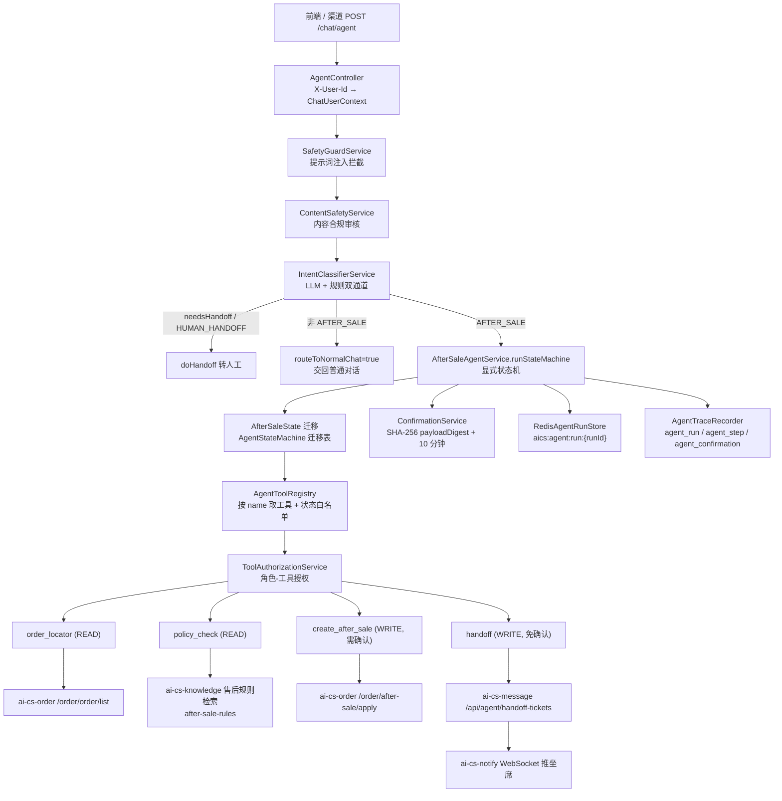
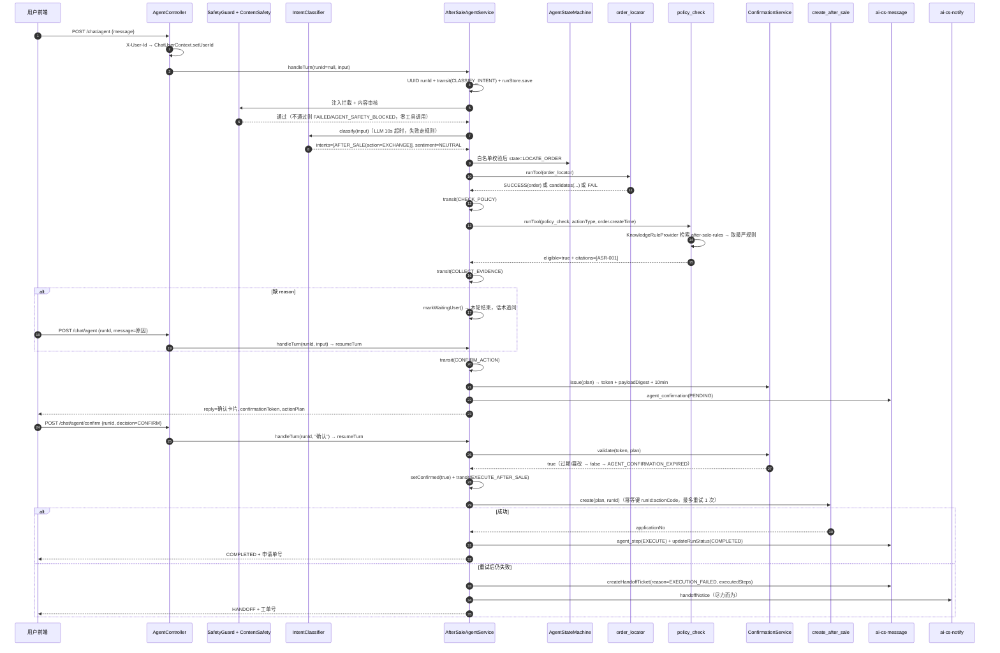

# 智能客服 Agent 编排与人工转接：难点不是"能调工具"，而是"什么时候停、什么时候交给人"

> **一句话结论**：本仓的售后 Agent 没有走"把工具丢给模型、让它自由 ReAct"的路线，而是用**显式状态机 + 编排器直调工具**把"每一步做什么"钉死在代码里，换来的是可控与可审计；因此它真正的风险不在"调不动工具"，而在三处判据：**步数/超时闸门够不够**、**没有出口的分支会不会把用户困住**、**转人工时交接的上下文够不够坐席直接接手**。
> **阅读前置**：读得懂 Spring Boot 的 `@Component` / `@ConfigurationProperties` / Feign 调用；知道"工具调用（Tool Calling，模型输出一个结构化请求，由应用侧执行后把结果回填给模型）"的基本流程；对状态机的"迁移表"有概念即可。不要求跑过本项目，也不要求有 Redis/MySQL 实例——本篇所有"跑不了"的地方都明确标注了。
> **证据基线**：A 级为已入库的 Spring AI 2.1.0 摘录（`24-源码分析/assets/source/` 下 `ToolCallingAdvisor` / `ToolCallLimits` / `ToolCallConfirmationPolicy` / `ToolCallDecisions` / `SessionService` / `Tool` 等，逐行可核）；B 级为本仓 `ai-cs-chat` agent 包、`ai-cs-order`、`ai-cs-message` 真实代码（行号已逐行核对）；C 级是本机静态核对与脚本推演（`jar tf` / `javap` / `node`），本机**无 docker、无 redis-cli、无 mysql**，因此没有一条线上实测数据。预计阅读 75~90 分钟。

**本篇的证据边界，先说清楚再开始**：

| 类别 | 本仓状态 | 本篇怎么处理 |
|---|---|---|
| Spring AI 2.1.0 的 `ToolCallingAdvisor` / `ToolCallLimits` / `ToolCallConfirmationPolicy` / `ToolCallDecisions` / `SessionService` / `Tool` | 已入 `24-源码分析/assets/source/*.java.md` | 直接引 `[[源码:Xxx.java.md#L起-L止]]`，当 A 级证据 |
| `AfterSaleAgentService` / `AgentStateMachine` / `IntentClassifierService` / `HandoffTool` / `ConfirmationService` / `RedisAgentRunStore` / `AgentTraceRecorder` | 真实存在，行号已核对 | 引 `路径#L起-L止`，当 B 级证据 |
| `AfterSaleServiceImpl`（售后落库） | 真实存在，但**不驱动订单状态机**（未注入 `OrderStateTransitionService`） | 写成"真实缺口"，并给出要改的文件 |
| `aics.agent.*` 配置项 | **未在 `ai-cs-chat/src/main/resources` 落地**：`application.yml` 与 `application-prompt.yml` 里 grep `agent` / `max-steps` / `intent-threshold` **零命中** | 说明"当前全部依赖 `AgentProperties` 的硬编码默认值"，改阈值要么加 yml，要么靠外部配置中心 |
| 坐席工作台（Agent 侧 UI、排队、坐席路由、技能组） | **未落地**：只有 `handoff_ticket` 表 + WebSocket 事件 | 明确标注"设计/规划"，写清落地要改哪些文件 |
| 槽位填充（slot filling）框架 | **未落地**：无 slot 类，grep `slot` 零命中 | 用 `COLLECT_EVIDENCE` 状态 + `userProvidedReason` 讲"手写槽位"的做法与代价 |
| Agent 的 eval 基线、提示词版本管理、LLM 成本硬预算 | **未落地**（`AgentTraceRecorder` 里 `promptVersion` 硬编码 `"after-sale-v1"`） | 只讲缺口与验收标准，不编造指标 |
| 线上耗时、成功率、token 消耗 | **无实测** | 成本只给公式与"示例口径"，并注明"以官方定价页为准" |

本机探测（pwsh 7 / `2026-11-27` 勘）：`docker`、`redis-cli`、`mysql` 三个命令**均不存在**；`java` = `D:\DevTools\jdk\jdk17.0.19`、`javap` 可用、`node v24.16.0` 可用。所以本篇的 C 级证据全部是**对真实文件与本地 m2 里 jar 的静态核对**，以及一段"状态机模拟推演"，逐条注明"非实测"。

---

## 0. 先看现象

### 现象 1：Agent 反复调同一个工具，最后抛一句"超出最大步骤数"

线上（或本地压测）最容易看到的是这两句用户可见文案，它们不是异常堆栈，而是编排器自己兜底时写的 `errorSummary`：

```text
超出最大步骤数（12），已中止
状态机执行异常，已中止
```

前者来自步数闸门，后者来自状态机主循环的"防呆计数器"：

```java
// ai-cs-chat/src/main/java/com/aics/chat/agent/workflow/AfterSaleAgentService.java#L318-L332
    private AgentTurnResult runStateMachine(AfterSaleContext ctx) {
        // 循环保护计数：防止状态机异常死循环
        int guard = 0;
        while (!ctx.isTerminal() && !ctx.isNeedsUserInput()) {
            if (++guard > 50) {
                return failWith(ctx, "AGENT_TIMEOUT", "状态机执行异常，已中止");
            }
            // 步骤数超限：可解释中止
            if (ctx.getSteps() >= properties.getMaxSteps()) {
                return failWith(ctx, "AGENT_MAX_STEPS_EXCEEDED",
                        "超出最大步骤数（" + properties.getMaxSteps() + "），已中止");
            }
            if (isTotalTimeout(ctx)) {
                return failWith(ctx, "AGENT_TIMEOUT", "执行超时，已中止");
            }
```

注意这里有个反直觉的细节：**`guard` 与 `steps` 是两个不同的计数器**。`steps` 只在 `ctx.transit(...)` 时自增（见 3.5），也就是说"处理器忘了迁移状态"这类 bug 会让 `steps` 原地不动，`maxSteps` 永远拦不住，只有 `guard`（每轮循环 +1，上限 50）能兜住。我用脚本把这两种 bug 都推演了一遍（第 6 节给命令与真实输出）：

- **Bug A（状态不变）**：`iter=1..50` 全是 `steps=0`，第 51 次命中 `guard>50` → `AGENT_TIMEOUT`（用"超时"这个错误码报了一个其实是"死循环"的问题，可观测性上是缺陷）。
- **Bug B（自环）**：`step=12` 时命中 `steps>=maxSteps(12)` → `AGENT_MAX_STEPS_EXCEEDED`。

另一处反复出现的日志是写操作重试：

```java
// ai-cs-chat/src/main/java/com/aics/chat/agent/workflow/AfterSaleAgentService.java#L483-L483
            log.warn("售后申请执行失败(第{}次): {}", i + 1, result.message());
```

它出现说明下游 `ai-cs-order` 的 `/order/after-sale/apply` 失败，而 `writeRetryTimes` 默认只有 1（重试 1 次共 2 次尝试），重试完就转人工。

### 现象 2：答不出来也不肯转人工，用户被"闷死"在一个没有出口的分支里

把"转人工"的四个调用点 grep 出来（第 6 节给命令），会看到一个明确的事实：**只有 4 个位置会转人工**，而且都不是"聊不下去了"：

```text
L226: 情绪负向（intent.needsHandoff()）→ NEGATIVE_SENTIMENT / HIGH
L231: 用户显式要人工（HUMAN_HANDOFF 意图）→ USER_REQUEST / NORMAL
L409: 售后规则不满足（policy.eligible()==false）→ POLICY_NOT_MET / NORMAL
L496: 写操作重试后仍失败 → EXECUTION_FAILED / NORMAL
```

反过来，下面这些"明显该找人"的情况**没有出口**，代码里直接走终态或回普通对话：

```java
// ai-cs-chat/src/main/java/com/aics/chat/agent/workflow/AfterSaleAgentService.java#L378-L385
        } else {
            // 无可用订单：按需推荐后结束本轮
            if (ctx.getIntentResult().has(AgentIntentType.PRODUCT_RECOMMEND)) {
                recommendByBudget(ctx);
            }
            ctx.transit(AfterSaleState.COMPLETED);
            traceRecorder.updateRunStatus(ctx, "COMPLETED", null);
        }
```

"用户没有已支付订单"被记成 `COMPLETED`——从状态机视角这是"处理完成"，从用户视角这是"我啥也没得到"。同理，非售后意图直接回普通对话：

```java
// ai-cs-chat/src/main/java/com/aics/chat/agent/workflow/AfterSaleAgentService.java#L233-L245
        // 2.3 非售后意图：纯推荐走一次性推荐；其余路由回普通对话
        if (!intent.has(AgentIntentType.AFTER_SALE)) {
            ctx.setState(AfterSaleState.COMPLETED);
            ...
            ctx.emitStep("ROUTE", "路由: 普通对话");
            return AgentTurnResult.of(newRunId, "NORMAL_CHAT", ctx.getIntents(), null,
                    false, true, null, null, List.of(), null, null, null);
        }
```

**没有"连续 N 轮未解决就转人工"的计数器，也没有"意图置信度低于阈值就转人工"的分支**——阈值只用来"过滤掉低置信意图"（见 3.6），过滤完可能剩空集，最后回落成 `NORMAL_CHAT`，依然不转人工。

### 现象 3：转人工成功了，但客户还得把问题重讲一遍

转人工的工单是由 `HandoffTool` 组装的，字段就是这些：

```java
// ai-cs-chat/src/main/java/com/aics/chat/agent/tool/HandoffTool.java#L64-L74
        HandoffTicketDTO dto = new HandoffTicketDTO();
        dto.setRunId(runId);
        dto.setSessionId(sessionId);
        dto.setUserId(userId);
        dto.setReason(reason);
        dto.setPriority(priority);
        dto.setOrderNo(orderNo);
        dto.setSentiment(sentiment);
        dto.setProblemSummary(problemSummary);
        // 已执行步骤清单随工单移交（坐席可追溯 Agent 做过什么）
        dto.setExecutedSteps(executedSteps);
```

问题出在 `problemSummary` 的来源：它由调用方传入，而"用户主动要人工"这一支传的是**写死的字符串**：

```java
// ai-cs-chat/src/main/java/com/aics/chat/agent/workflow/AfterSaleAgentService.java#L224-L231
        // 2.1 情绪触发转人工（愤怒/强烈负面）
        if (intent.needsHandoff()) {
            return doHandoff(ctx, "NEGATIVE_SENTIMENT", "HIGH", null,
                    "检测到用户情绪" + intent.sentiment() + "，触发转人工");
        }
        // 2.2 用户主动要求转人工
        if (intent.has(AgentIntentType.HUMAN_HANDOFF)) {
            return doHandoff(ctx, "USER_REQUEST", "NORMAL", null, "用户主动要求转人工");
        }
```

用户的**原话 `input` 根本没进工单**；此时 `stepSummaries` 里也只有"意图识别: …"这一条，`executedSteps` 几乎是空的。坐席看到的是"用户主动要求转人工"，只能重新问一遍。这不是模型能力问题，是**交接契约设计问题**。

这些现象指向同一件事：**Agent 的编排质量，取决于把"停止"和"交人"写成可执行的判据与可复用的交接数据，而不是交给模型自觉。**

---

## 1. 整体地图



> **读图说明**：整条链是"**双闸在前、状态机在中、工具在后**"。两个安全闸（注入 + 合规）都在意图识别之前，任何一个命中都直接 `FAILED` 返回，**本轮零工具调用**（这一点在 `AfterSaleAgentService` 的注释里写得很明确）；状态机只负责"下一个该做哪一步"，工具只负责"一步怎么执行"，两者之间隔着注册表的状态白名单与授权服务；`RedisAgentRunStore` 存的是**上下文快照**（多轮续跑用），`AgentTraceRecorder` 存的是**审计轨迹**（事后追溯用），同源不同用。

| 组件 | 责任 | 调用方 |
|---|---|---|
| `AgentController` | HTTP 入口、`X-User-Id` → `ChatUserContext`、SSE 流式 | 前端 / 网关 |
| `SafetyGuardService` / `ContentSafetyService` | 提示词注入拦截、输入内容审核 | `AfterSaleAgentService.startTurn` |
| `IntentClassifierService` | 意图 + 情绪识别（LLM 优先，规则兜底），输出置信度 | `startTurn` |
| `AfterSaleAgentService` | 编排器：驱动状态机、闸门判定、结果组装 | `AgentController` |
| `AgentStateMachine` | 迁移表 + 每状态允许工具白名单（纯静态数据） | 编排器 / `AgentToolRegistry` |
| `AgentToolRegistry` | 按 `name()` 注册工具、状态白名单校验 | 编排器 |
| `ToolAuthorizationService` | 角色-工具授权矩阵，拦"模型参数越权" | `runTool` 包装器 |
| `ConfirmationService` | 写操作确认凭证的签发/校验（含 payload 摘要） | `issueConfirmation` / `resumeTurn` |
| `RedisAgentRunStore` | 上下文快照持久化（TTL 覆盖确认窗口） | 编排器 |
| `AgentTraceRecorder` | 轨迹/确认记录写入 `ai-cs-message` | 编排器 |
| `HandoffTool` | 建工单 + 尽力而为地通知坐席 | `doHandoff` |

---

## 2. 关键概念与关键类

先把容易含混的词钉死（首次出现即解释，后文不再重复）：

- **Tool Calling（工具调用）**：模型不直接执行代码，而是输出一个结构化请求 `{name, arguments}`，由应用侧执行后把结果作为一条 `ToolResponseMessage` 回填，模型再基于它继续生成。
- **ReAct 循环**：Think → Act（调工具）→ Observe（读结果）→ 再 Think 的循环，**循环次数由模型自己决定**，直到它不再请求工具为止。它的对立面是"固定工作流"：步骤在代码里写死。
- **Human-in-the-loop（人在环）**：在工具真正执行前插入一个人的审批。Spring AI 2.1.0 把它做成了框架能力（`ToolCallConfirmationPolicy` + `ToolCallDecisions`），见 3.7。
- **Slot Filling（槽位填充）**：把"办一件事需要的参数"列成槽位（本例：订单号、售后动作、原因），缺哪个就追问哪个。
- **Handoff（转人工）**：把会话连同上下文交给人类坐席，通常要落一张工单。
- **状态机迁移表**：`from → Set<to>` 的静态映射，"哪些跳转合法"由数据决定，而不是散落在 if 里。

| 名称 | 位置 | 角色 | 关键方法 |
|---|---|---|---|
| `ToolCallingAdvisor` | `org.springframework.ai.chat.client.advisor`（A 级摘录） | 框架侧的 ReAct 循环体 | `adviseCall`、`doGetNextInstructionsForToolCall` |
| `ToolCallLimits` | `org.springframework.ai.model.tool`（`@since 2.0.1`） | 单轮/单工具调用次数闸门 | `check`、`countPriorToolCalls` |
| `ToolCallConfirmationPolicy` | 同上（`@since 2.1.0`） | "哪些工具调用必须人确认" | `requiresConfirmation`、`fromToolMetadata`、`forTools` |
| `ToolCallDecisions` | 同上（`@since 2.1.0`） | 人对一批 tool call 的决定 | `toolCallKeys`、`awaitingDecision` |
| `SessionService` | `org.springframework.ai.session`（`@since 2.1.0`） | 2.1 的会话/事件存储 abstraction | `appendEvent`、`appendEvents`(CAS)、`findOrCreate` |
| `AgentStateMachine` | `ai-cs-chat/src/main/java/com/aics/chat/agent/state/AgentStateMachine.java` | 迁移表 + 工具白名单 | `canTransit`、`isToolAllowed` |
| `AfterSaleAgentService` | `.../agent/workflow/AfterSaleAgentService.java`（833 行） | 编排器主体 | `handleTurn`、`runStateMachine`、`doHandoff` |
| `AfterSaleContext` | `.../agent/context/AfterSaleContext.java` | 一轮/多轮的执行上下文（也被序列化进 Redis） | `transit`、`markWaitingUser`、`recordStep` |
| `IntentClassifierService` | `.../agent/intent/IntentClassifierService.java` | 意图 + 情绪识别 | `classify`、`ruleBasedClassify` |
| `AgentToolRegistry` | `.../agent/tool/AgentToolRegistry.java` | 工具注册与白名单断言 | `get`、`assertToolAllowed` |
| `ToolResult` | `.../agent/tool/ToolResult.java` | 工具返回值三态协议 | `success`、`fail`、`candidates` |
| `ConfirmationService` | `.../agent/confirm/ConfirmationService.java` | 写操作确认凭证 | `issue`、`validate`、`digest` |
| `RedisAgentRunStore` | `.../agent/store/RedisAgentRunStore.java` | 上下文快照存储 | `save`、`load` |
| `AgentTraceRecorder` | `.../agent/trace/AgentTraceRecorder.java` | 轨迹落库（脱敏 + 摘要） | `createRun`、`step`、`confirmation` |
| `HandoffTool` | `.../agent/tool/HandoffTool.java` | 工单创建 + 通知 | `createHandoff` |

---

## 3. 原理与证据逐段精读

### 3.1 三种 Agent 形态：本仓选了"最不聪明但最可控"的那一种

**在干什么。** 框架层面，Spring AI 的 Agent 能力就是 `ToolCallingAdvisor` 里那个 `do { ... } while (isToolCall)` 循环：模型说调工具 → 管理器执行 → 结果追加进历史 → 再问模型，直到模型不再请求工具。

[[源码:ToolCallingAdvisor.java.md#L170-L244]]

```java (src: ToolCallingAdvisor.java.md#L170-L244)
		do {

			// Before Call
			var processedChatClientRequest = ChatClientRequest.builder()
				.prompt(new Prompt(instructions, toolCallingChatOptions))
				.context(chatClientRequest.context())
				.build();
			...
			chatClientResponse = callAdvisorChain.copy(this).nextCall(processedChatClientRequest);
			...
			isToolCall = this.toolExecutionEligibilityChecker.isToolCallResponse(chatResponse);

			if (isToolCall) {
				...
				toolExecutionResult = this.toolCallingManager
					.executeToolCalls(new Prompt(fullTurnHistory, toolCallingChatOptions), chatResponse);
				...
				instructions = this.doGetNextInstructionsForToolCall(processedChatClientRequest, chatClientResponse,
						toolExecutionResult);
			}

		}
		while (isToolCall); // loop until no tool calls are present
```

而本仓**没有**把工具注册进这个循环。`AgentTool` 的类注释就是决策声明：

```java
// ai-cs-chat/src/main/java/com/aics/chat/agent/tool/AgentTool.java#L3-L8
/**
 * Agent 工具抽象
 *
 * <p>实现类提供各自的类型化执行方法（由编排器直接调用，不做模型自由 ReAct），
 * 注册中心统一管理注册、状态权限与风险等级。</p>
 */
```

**为什么这么设计。** 三种形态的可控性是单调变化的光谱：

| 形态 | 谁决定下一步 | 可控性 | 失败模式 | 本仓是否采用 |
|---|---|---|---|---|
| 固定工作流（显式状态机） | 代码（迁移表） | 最高：同输入必同路径，可审计 | 覆盖不到没预想的场景 | ✅ 售后主流程 |
| ReAct 循环 | 模型（每轮自由选工具） | 中：靠次数/超时闸门兜底 | 死循环、绕远路、乱调工具 | ❌ 未落地 |
| 规划-执行（Plan-and-Execute） | 模型先出计划，再按计划执行 | 低：计划一旦错，后面全错 | 计划不可执行、计划漂移 | ❌ 未落地 |

售后这类"规则密集 + 有写操作 + 要留痕"的业务，最大的成本不是"答得不够聪明"，而是"做错了一笔写操作"。所以本仓把"聪明"压缩到两个很小的点：**意图识别**（LLM）和**情绪判断**（LLM），其余全是代码。

**换写法会怎样。** 如果按 ReAct 路线实现：把 `OrderLocatorTool` / `PolicyCheckTool` / `CreateAfterSaleTool` 包成 `@Tool` 注册给模型，那么"先查订单再查规则再建单"的顺序就交给模型了。收益是能处理没预想的组合（比如"先推荐个便宜的再换货"）；代价是：① `create_after_sale` 这种写操作可能被模型在信息不全时调用（所以框架 2.1.0 才加了 `requiresConfirmation`）；② 排障从"看状态"变成"看模型的自然语言推理"，`guard`/`maxSteps` 这类闸门才真正开始起作用；③ 单轮 token 成本按轮次线性累积（第 4 节给了计算公式与推演数字）。

**常见坑。** 最常见的误解是"不注册 `@Tool` 就没有工具调用"。实际上框架的闸门（`ToolCallLimits`、确认策略）只在你走 `ToolCallingAdvisor` 时生效；本仓既然不走，就**必须自己实现等价的闸门**——这正是 3.4 那一堆 `guard` / `maxSteps` / `isTotalTimeout` 存在的原因。第二个坑：`AgentTool` 接口虽叫 Tool，但它**不是** Spring AI 的 `ToolCallback`，两者签名完全不同，别指望 `ToolCallbacks.from(...)` 能直接吃它。

### 3.2 工具定义四要素：名字、描述、参数 schema、返回值协议

**在干什么。** 框架侧的工具定义只有三个必要字段 + 若干行为开关：

[[源码:ToolDefinition.java.md#L25-L47]]

```java (src: ToolDefinition.java.md#L25-L47)
public interface ToolDefinition {

	/**
	 * The tool name. Unique within the tool set provided to a model.
	 */
	String name();

	/**
	 * The tool description, used by the AI model to determine what the tool does.
	 */
	String description();

	/**
	 * The schema of the parameters used to call the tool.
	 */
	String inputSchema();

	/**
	 * Create a default {@link ToolDefinition} builder.
	 */
	static DefaultToolDefinition.Builder builder() {
		return DefaultToolDefinition.builder();
	}

}
```

注解写法里还有两个行为开关（是否把结果直接返回、是否要人确认）：

[[源码:Tool.java.md#L54-L75]]

```java (src: Tool.java.md#L54-L75)
	String name() default "";

	/**
	 * The description of the tool. If not provided, the method name will be used.
	 */
	String description() default "";

	/**
	 * Whether the tool result should be returned directly or passed back to the model.
	 */
	boolean returnDirect() default false;

	/**
	 * Whether a call of the tool needs a person's confirmation before it runs.
	 * ... A custom ToolCallingManager has to check it itself.
	 * @since 2.1.0
	 */
	boolean requiresConfirmation() default false;
```

参数描述走 `@ToolParam`（`required` + `description`，见 `[[源码:ToolParam.java.md#L34-L45]]`），它们最终被拼成 JSON Schema 送给模型。

本仓的"工具定义"是手写的等价物：`AgentTool` 只有 `name()` / `riskLevel()` / `requiresConfirmation()`，**没有 description、没有 schema**，因为调用方是代码而不是模型（`ai-cs-chat/src/main/java/com/aics/chat/agent/tool/AgentTool.java#L9-L26`）。至于"工具会被谁调用"，注册表做了两件事：按 name 索引 + 状态白名单。

```java
// ai-cs-chat/src/main/java/com/aics/chat/agent/state/AgentStateMachine.java#L52-L60
    private static Map<AfterSaleState, Set<String>> buildAllowedTools() {
        Map<AfterSaleState, Set<String>> map = new EnumMap<>(AfterSaleState.class);
        map.put(AfterSaleState.LOCATE_ORDER, Set.of(TOOL_ORDER_LOCATOR, TOOL_PRODUCT_RECOMMEND));
        map.put(AfterSaleState.CHECK_POLICY, Set.of(TOOL_POLICY_CHECK));
        map.put(AfterSaleState.EXECUTE_AFTER_SALE, Set.of(TOOL_CREATE_AFTER_SALE));
        map.put(AfterSaleState.HANDOFF, Set.of(TOOL_HANDOFF));
        // START/CLASSIFY_INTENT/COLLECT_EVIDENCE/CONFIRM_ACTION/COMPLETED/CANCELLED/FAILED 不允许工具调用
        return map;
    }
```

**为什么这么设计。** 如果把"工具描述"交给模型，描述质量直接决定它用不用对；而本仓由代码决定"什么时候能调哪个工具"，所以**名字是给日志和审计看的，白名单才是给安全看的**。这也是为什么 `AgentToolRegistry.assertToolAllowed` 用了一个看起来很奇怪的结果码 `AGENT_WRITE_OP_NOT_CONFIRMED` 来报"状态 X 不允许调用工具 Y"（码与语义不符，是可读性上的小瑕疵）。

**换写法会怎样。** 如果将来真要接 ReAct，就必须把 `description` 当产品文案来写。经验规则（无实测数据，属工程共识）：描述里要写清 **"什么时候该用我 / 什么时候不该用我 / 我返回什么"**，并把互斥工具的特征点写出来——例如 `order_locator` 的描述要写明"仅在用户已登录且需要定位**已支付**订单时使用；若用户只说'我买的东西坏了'而没有订单号，先调用它拿候选列表，不要猜测订单号"。反例是只写"定位订单"四个字：模型会把"订单"理解成"用户提到的任意编号"，然后在没有订单的场景下反复尝试。

**常见坑。** ① 名字里带空格/括号（`get order`、`tool()`）在部分模型上直接被拒，官方注释就举了这两个反例；② 同一个能力注册成两个名字（`order_locator` 与 `OrderLocatorTool` 混用）会让次数闸门按名字分别计数，等于把上限翻倍；③ 参数用 `String` 兜一切（`orderNo` 传空串而不是 `null`），白名单与幂等键都会退化。

### 3.3 返回值设计：三态优于布尔，让"下一步"可判断

**在干什么。** 本仓所有工具统一返回 `ToolResult`，三态：`success(data)` / `fail(message)` / `candidates(message, list)`。这不是随手封装，而是让编排器能**不改工具就分叉**：

```java
// ai-cs-chat/src/main/java/com/aics/chat/agent/workflow/AfterSaleAgentService.java#L363-L385
        // 成功：绑定唯一订单并进入规则校验
        if (result.isSuccess()) {
            ctx.setOrder((OrderVO) result.data());
            ctx.setCandidates(List.of());
            ...
            ctx.transit(AfterSaleState.CHECK_POLICY);
        } else if (result.isCandidates()) {
            // 多候选：回传候选列表并等待用户选择
            ctx.setCandidates((List<OrderVO>) result.data());
            ctx.markWaitingUser();
            runStore.save(ctx);
        } else {
            // 无可用订单：按需推荐后结束本轮
            ...
            ctx.transit(AfterSaleState.COMPLETED);
```

**为什么这么设计。** 有"多候选"这个语义，就必须三态。如果用布尔 + 字符串 message，编排器只能靠 `message.contains("多个")` 这种字符串匹配来判断（本仓在 `errorCodeOf` 里就干了类似的事，见 3.10），既脆又难测。而"工具告诉我该不该继续"这条信息，恰恰是 ReAct 里由模型自己"读"的东西——**固定工作流必须把它变成类型**。

**换写法会怎样。** 如果 `ToolResult` 只保留 `success/fail`，多候选场景只能二选一：要么 `fail`（用户被判定为"没有可售后订单"，直接 `COMPLETED`，体验更差），要么 `success` 但 `data` 是 `List` 而 `order` 字段为空（下游 `checkPolicy(ctx.getOrder().getCreateTime())` 直接 NPE）。第三条路是抛异常，但那会把"业务分支"变成"故障"，`agent_step` 里就会留下 `FAILED` 痕迹，指标失真。

**常见坑。** ① 工具内部把"下游服务不可用"也归进 `fail`，编排器无法区分"业务不满足"与"系统故障"——本仓 `OrderLocatorTool` 的 `catch` 分支就返回 `ToolResult.fail("订单服务暂时不可用，请稍后再试")`，而编排器会把它当"没有订单"处理并 `COMPLETED`（真实缺陷：故障被降级成"业务结论"）；② `candidates` 的 `data` 必须是完整的领域对象而不仅是单号，否则回复文案没法带商品名与金额。

### 3.4 终止条件：框架有两级计数闸门，本仓有三道自己的闸

**在干什么。** 框架侧的闸门是按"次数"计的，两个维度：单工具默认 40、单轮总计默认 150。

[[源码:DefaultToolCallingManager.java.md#L95-L110]]

```java (src: DefaultToolCallingManager.java.md#L95-L110)
	/**
	 * Default cap applied to every tool name unless overridden via
	 * {@link Builder#maxCallsPerTool(String, int)}, exempted via
	 * {@link Builder#excludeToolFromLimit(String)}, or disabled entirely via
	 * {@link Builder#unlimitedCallsPerTool()}. Generous enough for legitimate iterative
	 * tool use (pagination, retries) while still catching a runaway loop long before it
	 * becomes expensive.
	 */
	public static final int DEFAULT_MAX_CALLS_PER_TOOL = 40;

	/**
	 * Default cap on the total number of tool calls, across all tools combined, allowed
	 * within a turn, unless disabled entirely via
	 * {@link Builder#unlimitedTotalToolCalls()}.
	 */
	public static final int DEFAULT_MAX_TOTAL_TOOL_CALLS = 150;
```

判定逻辑本身很朴素，但注释里藏着关键设计：**计数是从会话历史里"重新数"出来的，管理器自己不持有每轮状态**，而且只数"本轮"（最后一条 `UserMessage` 之后）的 `ToolResponseMessage`，避免多轮记忆把上一轮的调用也算进来：

[[源码:ToolCallLimits.java.md#L81-L130]]

```java (src: ToolCallLimits.java.md#L81-L130)
	static Map<String, Integer> countPriorToolCalls(List<Message> instructions) {
		Map<String, Integer> counts = new HashMap<>();
		for (Message message : currentTurnMessages(instructions)) {
			if (message instanceof ToolResponseMessage toolResponseMessage) {
				for (ToolResponseMessage.ToolResponse response : toolResponseMessage.getResponses()) {
					counts.merge(response.name(), 1, Integer::sum);
				}
			}
		}
		return counts;
	}
	...
	@Nullable Breach check(String toolName, int toolCallCount, int totalToolCallCount) {
		if (!this.toolsExcludedFromLimit.contains(toolName)) {
			int maxCallsForTool = this.maxCallsPerTool.getOrDefault(toolName, this.defaultMaxCallsPerTool);
			if (maxCallsForTool != NO_LIMIT && toolCallCount > maxCallsForTool) {
				return new Breach(toolName, maxCallsForTool,
						"Tool call limit (%d) exceeded for tool '%s'. No further calls to this tool are allowed in this turn."
							.formatted(maxCallsForTool, toolName));
			}
		}

		if (this.maxTotalToolCalls != NO_LIMIT && totalToolCallCount > this.maxTotalToolCalls) {
			return new Breach(null, this.maxTotalToolCalls,
					"Total tool call limit (%d) exceeded for this turn. No further tool calls are allowed."
						.formatted(this.maxTotalToolCalls));
		}

		return null;
	}
```

超限之后做什么，有两个策略可选（枚举 `THROW` / `RETURN_ERROR_RESPONSE`，见 `[[源码:ToolCallLimitBehavior.java.md#L26-L40]]`）：抛异常终止这一批，或者"跳过执行、把它当作一条错误结果回给模型让它自己收场"。循环体在捕获异常时做的事情是——**把这条 breach 当成最终回复直接返回给应用，不再回模型**：

[[源码:ToolCallingAdvisor.java.md#L197-L222]]

```java (src: ToolCallingAdvisor.java.md#L197-L222)
			if (isToolCall) {
				...
				try {
					toolExecutionResult = this.toolCallingManager
						.executeToolCalls(new Prompt(fullTurnHistory, toolCallingChatOptions), chatResponse);
				}
				catch (ToolCallLimitExceededException ex) {
					// Return the breach as a single generation - directly to the
					// application client instead of looping back to the LLM.
					chatClientResponse = chatClientResponse.mutate()
						.chatResponse(ChatResponse.builder()
							.from(chatResponse)
							.generations(List.of(ex.buildGeneration()))
							.build())
						.build();
					break;
				}
				catch (ToolCallConfirmationRequiredException ex) {
					// A call that needs a person's confirmation pauses the loop: none of
					// the reply's calls ran, the reply goes back to the caller with the
					// keys of the calls that wait for a decision.
					chatClientResponse = paused(chatClientResponse, chatResponse, ex);
					break;
				}
```

本仓的闸门是另外三道，全部在 `runStateMachine` 里（见现象 1 的代码）：`guard>50`（防"状态不变"的死循环）、`steps>=maxSteps(12)`（防"自环"）、`isTotalTimeout`（`totalTimeoutMs` 默认 60000）。**没有任何"置信度不足则停"的判据**，也没有"连续 N 次工具失败则停"。

**为什么这么设计。** 40/150 这两个默认值是为"合法的迭代式工具使用（分页、重试）"留足空间，同时"在变贵之前抓住跑飞的循环"——注意它是**贵的兜底**，不是**好的体验**：134 次调用足以烧掉大量 token 才停。本仓因为不走自由循环，实际单轮最多 5~6 次迁移（见第 6 节推演：正常一轮 `steps=5`），所以 `maxSteps=12` 几乎不可能触发，它真正防的是"代码 bug"而不是"模型跑飞"。

**换写法会怎样。** 如果 `maxSteps` 调成 3：正常换货流程（`START→CLASSIFY_INTENT→LOCATE_ORDER→CHECK_POLICY→COLLECT_EVIDENCE→CONFIRM_ACTION` = 5 步）第二、三次交互就会撞闸，用户体验直接崩。如果调成 100：Bug B 型自环会跑到 100 轮才停。**`maxSteps` 必须按"最长合法路径"来定，而不是按"我能忍多久"来定**——这是这类系统最常见的配置错误。

**常见坑。** ① 把 `guard` 的报错码写成 `AGENT_TIMEOUT`（本仓如此），事后按错误码聚合时会看到一堆"超时"其实是死循环；② 超时用 `createdAt` 起算（`isTotalTimeout`），而确认等待可能长达 10 分钟（`confirmTimeoutMinutes`），两者的关系必须算清（`RedisAgentRunStore` 的 TTL 就是 `totalTimeout + 确认窗口 + 60s` 的拼接）；③ 没给"工具连续失败"计数，导致下游全挂时用户会被反复重试而不是直接转人工。

### 3.5 状态管理：会话状态（框架）与槽位填充（自己写）

**在干什么。** Spring AI 2.x 把"会话"抽象成了 `Session` + `SessionService`：session 有 id、TTL、metadata，事件（message）追加进去，且支持带版本号的 CAS 批量追加（并发安全）：

[[源码:SessionService.java.md#L41-L98]]

```java (src: SessionService.java.md#L41-L98)
public interface SessionService {

	// Sessions

	/**
	 * Creates a session with the request's id, a random UUID when it has none, its time
	 * to live and its metadata.
	 * @throws SessionAlreadyExistsException if a session with the requested id exists
	 */
	Session create(CreateSessionRequest request);

	/**
	 * The session with the request's id, created from the request when there is none.
	 * Safe under concurrent first use: when another caller creates it first, the stored
	 * session is returned, not this request's.
	 */
	default Session findOrCreate(CreateSessionRequest request) {
		...
	}
```

[[源码:SessionService.java.md#L119-L135]]

```java (src: SessionService.java.md#L119-L135)
	/**
	 * Appends one or more events in order, atomically, only if the log's version still
	 * equals {@code expectedVersion}. Otherwise nothing is written and {@code false} is
	 * returned: another writer appended in between. ...
	 * Read {@link #getEventVersion}, then read what the new events depend on, then call
	 * this method. On {@code false}, read again and rebuild the events.
```

本仓**没有**用 `SessionService`，而是自己维护了一个可序列化的执行上下文 `AfterSaleContext`：状态、意图、订单、策略结果、动作计划、确认凭证、`stepSummaries`、`steps` 计数全在一个 `@Data` 对象里，整体以 JSON 存进 Redis：

```java
// ai-cs-chat/src/main/java/com/aics/chat/agent/store/RedisAgentRunStore.java#L24-L43
    private static final String KEY_PREFIX = "aics:agent:run:";
    ...
    @Override
    public void save(AfterSaleContext context) {
        try {
            // 上下文序列化后写入 Redis
            String json = objectMapper.writeValueAsString(context);
            // TTL：总超时 + 确认超时 + 60s 缓冲，保证确认窗口内不失效
            long ttlSeconds = properties.getTotalTimeoutMs() / 1000
                    + properties.getConfirmTimeoutMinutes() * 60L + 60;
            redisTemplate.opsForValue().set(KEY_PREFIX + context.getRunId(), json, Duration.ofSeconds(ttlSeconds));
        } catch (Exception e) {
            // Redis 不可用时仅告警，不阻断业务（走内存/降级路径）
            log.warn("Agent run 状态写入 Redis 失败: runId={}, err={}", context.getRunId(), e.getMessage());
        }
    }
```

槽位填充是"手写"的：`COLLECT_EVIDENCE` 状态就是"填 `reason` 这个槽"，来源三级优先，缺了就暂停等用户：

```java
// ai-cs-chat/src/main/java/com/aics/chat/agent/workflow/AfterSaleAgentService.java#L415-L426
    private void collectEvidence(AfterSaleContext ctx) {
        // 原因来源优先级：用户补充 > 动作计划 > 意图参数
        String reason = firstNonBlank(
                ctx.getUserProvidedReason(),
                ctx.getActionPlan() == null ? null : ctx.getActionPlan().reason(),
                param(ctx, "reason"));
        // 缺少原因：询问用户后暂停等待输入
        if (!StringUtils.hasText(reason)) {
            ctx.markWaitingUser();
            runStore.save(ctx);
            return;
        }
```

**为什么这么设计。** 三层理由：① 上下文里需要放的东西远超"消息列表"（`order`、`policyResult`、`confirmationToken`），`SessionService` 的"事件日志"模型装不下这些结构化状态；② 一个 run 就是一次可恢复的事务，`runId` 天然是幂等键与审计主键；③ 2.1 的 `SessionService` 更偏向通用对话记忆（还带 compaction），把它硬改造成业务状态机会引入不必要的抽象。

**换写法会怎样。** 若改用 `SessionService` 存上下文，就得把结构化状态序列化进 event payload，并自己处理 CAS 冲突（两个人同时续跑同一个 run 时）；好处是能白拿"过期清理"（`deleteExpiredSessions`）与按 metadata 检索会话（`findByMetadata`）。本仓目前的替代品是 TTL 自动过期，`RedisAgentRunStore` 的 TTL 是"总超时 + 确认窗口 + 60 秒"——这个公式能自洽，但它**只在写时计算一次**，续跑时会重新 `save` 刷新，所以长期不动的 run 会被自然回收。

**常见坑。** ① 上下文里塞了不可序列化的字段（比如 SSE 的监听器）会让 `ObjectMapper` 直接炸——本仓用 `@JsonIgnore transient streamListener` 解决了，注释里专门写了这一点；② 槽位只有一个（`reason`）时"手写"很划算，但槽位长到 5~6 个（地址、时间、凭证照片、金额上限…）时，`if-else` 会长成不可维护的怪物，那时才值得引入通用的 slot 定义 + 追问策略；③ `markWaitingUser()` 与 `transit()` 的区别（前者不改状态、后者 `steps+1`）如果搞混，会把"等待用户"计成"推进了一步"，`maxSteps` 就会被无谓消耗。

### 3.6 意图识别与路由：先分类再分派，还是全交给模型

**在干什么。** 意图识别是"LLM 优先 + 规则兜底"的双通道，输出带置信度的多意图：LLM 通道调 `ModelScenario.INTENT` 的模型（10 秒超时），任何解析失败/超时/异常都落到 `ruleBasedClassify`；之后用 `intentThreshold`（默认 0.6）过滤，全被过滤空则回落成 `NORMAL_CHAT 0.6`。规则通道的关键词表直接决定"转人工"能不能被触发：

```java
// ai-cs-chat/src/main/java/com/aics/chat/agent/intent/IntentClassifierService.java#L187-L236
    public IntentResult ruleBasedClassify(String input) {
        String text = input == null ? "" : input;
        List<AgentIntent> intents = new ArrayList<>();
        // 命中转人工关键词：优先标记转人工意图
        if (containsAny(text, HANDOFF_KEYWORDS)) {
            intents.add(AgentIntent.of(AgentIntentType.HUMAN_HANDOFF, 0.95, Map.of("reason", text)));
        }
        // 命中售后关键词：抽取动作参数并补齐原因
        if (containsAny(text, AFTER_SALE_KEYWORDS)) {
            Map<String, String> params = new HashMap<>();
            Matcher actionMatcher = ACTION_PATTERN.matcher(text);
            if (actionMatcher.find()) {
                // 将中文动作词映射为枚举编码（换货/退货/其余→退款）
                String action = switch (actionMatcher.group(1)) {
                    case "换货" -> "EXCHANGE";
                    case "退货" -> "RETURN";
                    default -> "REFUND";
                };
                params.put("action", action);
            }
            params.put("reason", text);
            intents.add(AgentIntent.of(AgentIntentType.AFTER_SALE, 0.95, params));
        }
        ...
        if (intents.isEmpty()) {
            // 无任何命中：普通对话兜底
            intents.add(AgentIntent.of(AgentIntentType.NORMAL_CHAT, 0.6, Map.of()));
        }
        SentimentType sentiment = detectSentiment(text);
        // 主动要求转人工或情绪愤怒：触发转人工
        boolean needsHandoff = intents.stream().anyMatch(i -> i.type() == AgentIntentType.HUMAN_HANDOFF)
                || sentiment == SentimentType.ANGRY;
        return IntentResult.of(intents, sentiment, needsHandoff, null);
    }
```

关键词表本身是常量（`HANDOFF_KEYWORDS` = 转人工/人工客服/人工服务/投诉/找真人；`AFTER_SALE_KEYWORDS` = 换货/退货/退款/售后/保修/维修/坏了/质量问题/无法开机/故障/补发；`RECOMMEND_KEYWORDS` = 推荐/同价位/预算/帮我看看/类似的），规则通道给这些命中的置信度统一写 0.95，兜底 `NORMAL_CHAT` 写 0.6。

路由策略是"**先分类、再分派**"：分类结果决定的是"进不进状态机"，而不是"调哪个工具"。非 `AFTER_SALE` 一律 `routeToNormalChat=true` 交回通用对话（见现象 2 的代码），只有 `AFTER_SALE` 才进 `LOCATE_ORDER`。

**为什么这么设计。** 把"分类"和"执行"分成两段，是为了让**分派点是可数、可测、可回滚的**：意图只有 4 类（`AFTER_SALE` / `PRODUCT_RECOMMEND` / `HUMAN_HANDOFF` / `NORMAL_CHAT`），每一类都能写单测与 eval 用例；而"全交给模型"意味着每一次分派都要重新推理，且无法离线比较两个提示词版本的差异。注意 `INTENT` 场景是**唯一**真正让模型做决策的地方，因此它的**评测基线缺失**就是本项目最大的质量隐患之一（真实缺口，见第 9 节练习）。

**换写法会怎样。** 若把意图也做成"模型直接选工具/直接选状态"，则 LLM 输出的将是一个 `{state: ...}` 的自由字段，任何幻觉值都会打到 `switch` 的 `default` 分支——本仓 `switch` 的 `default` 是 `return buildResult(ctx)`（静默返回），模型幻觉会变成"什么也没发生"。这是很难查的一类故障，所以"枚举 + 校验"比"自由文本"划算得多。

**常见坑。** ① LLM 通道返回的 JSON 带 ```` ```json ```` 包裹，解析器必须容忍（本仓 `parseLlmJson` 就是取"首个 `{` 到末个 `}`"）；② 情绪判定和意图判定耦合在同一个 JSON 里（`needsHandoff = JSON 值 || sentiment==ANGRY`），一次调用要承担两个职责，超时/失败时两个都丢；③ `intentThreshold` 过滤后为空就回落 `NORMAL_CHAT`——**这一步会悄悄吞掉"低置信但确实是售后"的请求**，而用户看到的是"这问题我答不了"。

### 3.7 人工转接：四类触发条件与框架级的"人在环"

**在干什么。** 本仓把转人工触发分成 4 类，且优先级是写死的顺序（情绪 > 显式要求 > 规则不满足 > 执行失败）。原因码与优先级直接进工单：

| 触发条件 | 原因码 | 优先级 | 判定位置 |
|---|---|---|---|
| 情绪负向（愤怒/强烈负面） | `NEGATIVE_SENTIMENT` | `HIGH` | `AfterSaleAgentService#L225-L228` |
| 用户显式索取人工（"转人工/投诉/找真人"） | `USER_REQUEST` | `NORMAL` | 同上 `#L230-L231` |
| 售后规则不满足（超期/不满足换货条件/规则未命中） | `POLICY_NOT_MET` | `NORMAL` | `AfterSaleAgentService#L409-L410` |
| 写操作重试后仍失败 | `EXECUTION_FAILED` | `NORMAL` | `AfterSaleAgentService#L496-L497` |

"规则不满足"这一支的判定在 `PolicyCheckTool` 里，注意它把"检索不到规则"也算成"不满足"，这是**保守但正确**的选择：

```java
// ai-cs-chat/src/main/java/com/aics/chat/agent/tool/PolicyCheckTool.java#L52-L75
    public PolicyCheckResult check(AfterSaleActionType actionType, LocalDateTime orderCreateTime) {
        // 加载规则（知识库优先，静态种子兜底）
        List<PolicyRule> rules = ruleProvider.loadRules(actionType);
        // 无规则依据：判定依据不足，不编造结论
        if (rules.isEmpty()) {
            return PolicyCheckResult.insufficient();
        }
        // 取期限最短的规则做判定（最严口径）
        PolicyRule rule = rules.get(0);
        // 无法确定订单时间：无法判定是否在期限内
        if (orderCreateTime == null) {
            return PolicyCheckResult.notEligible(rule, "无法确定订单时间，无法判定是否在售后期限内");
        }
        // 订单已过天数 = 当前时间 - 下单时间
        long days = Duration.between(orderCreateTime, LocalDateTime.now()).toDays();
        // 期限内：资格满足（携带规则引用）
        if (days <= rule.days()) {
            log.info("售后规则校验通过: rule={}, orderDays={}", rule.id(), days);
            return PolicyCheckResult.eligible(rule);
        }
        // 超期：资格不满足（携带规则引用与超期原因）
        return PolicyCheckResult.notEligible(rule,
                "订单已下单 " + days + " 天，超出规则 " + rule.id() + " 规定的 " + rule.days() + " 天期限");
    }
```

框架侧的"人在环"是另一套机制，值得对照：`ToolCallConfirmationPolicy` 决定"哪些调用必须先问人"，默认实现是"看工具元数据"：

[[源码:ToolCallConfirmationPolicy.java.md#L45-L73]]

```java (src: ToolCallConfirmationPolicy.java.md#L45-L73)
	boolean requiresConfirmation(AssistantMessage.ToolCall toolCall, @Nullable ToolMetadata toolMetadata);

	/** A call needs confirmation when either policy says so. */
	default ToolCallConfirmationPolicy or(ToolCallConfirmationPolicy other) {
		Assert.notNull(other, "other must not be null");
		return (toolCall, toolMetadata) -> requiresConfirmation(toolCall, toolMetadata)
				|| other.requiresConfirmation(toolCall, toolMetadata);
	}

	/** No call needs confirmation. */
	static ToolCallConfirmationPolicy none() {
		return (toolCall, toolMetadata) -> false;
	}

	/**
	 * The calls of tools whose metadata says so
	 * ({@link ToolMetadata#requiresConfirmation()},
	 * {@code @Tool(requiresConfirmation = true)}). The default of
	 * {@link DefaultToolCallingManager}.
	 */
	static ToolCallConfirmationPolicy fromToolMetadata() {
		return (toolCall, toolMetadata) -> toolMetadata != null && toolMetadata.requiresConfirmation();
	}

	/** The calls of the named tools. */
	static ToolCallConfirmationPolicy forTools(String... toolNames) {
		Set<String> names = Set.of(toolNames);
		return (toolCall, toolMetadata) -> names.contains(toolCall.name());
	}
```

两者思路其实一致：**"要不要问人"必须是显式声明的策略，而不是模型自己觉得该不该**。本仓的等价物是 `AgentTool.requiresConfirmation()` + `ConfirmationService`（3.8 会讲它比框架版多做了什么）。

**为什么这么设计。** 四类触发的共同点是"**代码能判定**"。所有"需要理解语义才知道该不该转"的情况（比如"用户其实没听懂"、"用户绕了三圈没说明白"）都没有实现——这不是疏忽，而是这类信号缺少可靠判据，强行做反而会误转人工（转人工是有成本的）。真正该补的是**可数的弱信号**：同一 run 内 `tool fail` 次数、同一 session 内 `COMPLETED` 但用户再次提问的次数（本仓两个都没统计）。

**换写法会怎样。** 如果只保留"用户显式要求"一种触发（很多简单客服机器人就是这样），那么"规则不满足"的场景会变成机器人反复解释政策、用户反复骂人，最后靠情绪识别兜底——把"业务判断"退化成了"情绪判断"，也就是等到用户生气才找人。反过来，如果把"每轮都问一次要不要转人工"做成默认，转人工率会飙升、坐席成本失控。

**常见坑。** ① 情绪触发依赖 LLM 的结构化输出，模型抖一下就没触发（本仓的兜底是"JSON 里 needsHandoff 为真 **或** sentiment==ANGRY"，只能兜住显式标注的情况）；② `HANDOFF` 优先级没有排队实现，`HIGH` 只是工单上的一个字段（见 3.8）；③ 转人工后**没有清空/关闭原 run 的后续路径**——`HANDOFF` 是终态（`isTerminal()` 含 HANDOFF），因此同一 `runId` 再发消息会走"终态幂等返回"，用户必须开新会话。

### 3.8 交接上下文、确认凭证与"转人工之后"

**在干什么。** 转人工的落地动作是 `doHandoff`：调 `handoff` 工具建工单 → 记录轨迹 → 无论迁移表允不允许都置 `HANDOFF` 终态 → 落库：

```java
// ai-cs-chat/src/main/java/com/aics/chat/agent/workflow/AfterSaleAgentService.java#L537-L563
    private AgentTurnResult doHandoff(AfterSaleContext ctx, String reason, String priority,
                                      String orderNo, String summary) {
        long t0 = System.currentTimeMillis();
        // 创建转人工工单（携带订单、情绪、摘要与已执行步骤）
        ToolResult result = runTool(AgentStateMachine.TOOL_HANDOFF,
                traceRecorder.digest(reason),
                () -> handoffTool.createHandoff(ctx.getRunId(), ctx.getSessionId(),
                        reason, priority, orderNo,
                        ctx.getIntentResult() == null ? null : ctx.getIntentResult().sentiment().name(),
                        summary, traceRecorder.executedStepsJson(ctx.getStepSummaries())));
        ...
        // 无论迁移表是否允许，最终置为 HANDOFF 终态
        if (stateMachine.canTransit(ctx.getState(), AfterSaleState.HANDOFF)) {
            ctx.transit(AfterSaleState.HANDOFF);
        } else {
            ctx.setState(AfterSaleState.HANDOFF);
        }
        traceRecorder.updateRunStatus(ctx, "HANDOFF", null);
        runStore.save(ctx);
        return buildResult(ctx);
    }
```

工单本身由 `ai-cs-message` 落库（`handoff_ticket`，工单号 `"HF"+yyyyMMddHHmmss+4 位随机`，默认状态 `OPEN`，见 `ai-cs-message/src/main/java/com/aics/message/service/impl/AgentTraceServiceImpl.java#L211-L232`），随后 `ai-cs-notify` 用 WebSocket 推一条事件给坐席侧（`HandoffTool#L94-L108`，失败只 `log.warn` 不阻断）。

写操作确认（另一个"人在环"）在本仓是自己实现的，比框架版多了"**payload 摘要绑定**"：

```java
// ai-cs-chat/src/main/java/com/aics/chat/agent/confirm/ConfirmationService.java#L33-L60
    public String issue(AfterSaleContext context, AgentActionPlan plan) {
        // 随机凭证：不可预测，防止伪造
        String token = UUID.randomUUID().toString();
        context.setConfirmationToken(token);
        // 绑定操作摘要摘要值：确认时比对，防确认内容被篡改
        context.setPayloadDigest(digest(plan));
        // 确认超时 = 签发时间 + 配置确认时长（分钟）
        context.setConfirmationExpiresAt(LocalDateTime.now()
                .plusMinutes(properties.getConfirmTimeoutMinutes()));
        return token;
    }

    /**
     * 校验确认凭证：存在、未超时、摘要与当前操作一致
     */
    public boolean validate(AfterSaleContext context, AgentActionPlan plan) {
        // 无凭证或无操作计划：直接校验失败
        if (context.getConfirmationToken() == null || plan == null) {
            return false;
        }
        // 已超时：校验失败（需重新发起确认）
        if (context.getConfirmationExpiresAt() == null
                || LocalDateTime.now().isAfter(context.getConfirmationExpiresAt())) {
            return false;
        }
        // 摘要一致才算有效确认：当前操作与签发时完全一致
        return digest(plan).equals(context.getPayloadDigest());
    }
```

**为什么这么设计。** 摘要绑定的意义是**防止"确认 A 执行 B"**：用户看到的是"换货 3 号订单"，如果确认之后上下文被改写（比如同一 `runId` 被另一条消息推进成退款），旧 token 的 `payloadDigest` 就对不上，直接判定"确认凭证无效"。这与框架 `ToolCallDecisions` 的告诫完全同源——决定必须绑定"那份具体的回复"，而且那份回复不能由终端用户改写：

[[源码:ToolCallDecisions.java.md#L29-L57]]

```java (src: ToolCallDecisions.java.md#L29-L57)
 * A manager pauses a batch when one of its calls needs confirmation (see
 * {@link ToolCallConfirmationPolicy}), by throwing
 * {@link ToolCallConfirmationRequiredException} before any call runs. A tool-calling loop
 * then returns the reply to the caller, listing the keys of the calls that wait for a
 * decision under {@link #AWAITING_DECISION_METADATA_KEY} in the response metadata
 * ({@link #awaitingDecision(ChatResponse)}). The caller shows them to a person and runs
 * the reply's calls with the decisions through
 * {@link ToolCallingManager#executeToolCalls(org.springframework.ai.chat.prompt.Prompt, ChatResponse, ToolCallDecisions)}:
 * the allowed calls run, a denied call answers the model with its message. ...
 * Every tool call of the reply needs a decision, and an allowed call has to run with a
 * tool the prompt carries. The reply the calls come from must be the one the model gave,
 * read from storage the end user cannot change: whoever can edit it can run any tool with
 * any arguments.
```

**换写法会怎样。** 如果只校验 token 存在、不校验 payload，攻击面很清楚：拿到 token 的人可以构造任意"换货 → 退款 999 元"的计划去执行。如果完全不确认（`requiresConfirmation=false` 直接执行），那么"模型/编排器判断失误"会直接变成一笔真实售后单——这是本仓唯一一处**不允许妥协**的设计。

**常见坑（也是本篇最大的落地缺口）**：交接上下文里**没有用户原话**、**没有会话摘要**（只有 `stepSummaries` 这种机器视角的短句）、**没有客户画像**（历史售后次数、VIP 等级、黑名单）；转人工后**没有坐席路由与排队**——`handoff_ticket` 有 `priority` 与 `status`，但仓库里没有任何"分配坐席 / 技能组 / 排队序号"的代码（`assigned_agent` 字段存在但只被写入 `null`）。第 5 节把这几条列成了可扩展点，第 9 节给了验收标准。

### 3.9 Agent 与知识库检索的配合：先检索后决策

**在干什么。** 售后规则不放代码里，而是放知识库（`after-sale-rules`），`KnowledgeRuleProvider` 先检索、再解析、最后按"最严口径"排序：

```java
// ai-cs-chat/src/main/java/com/aics/chat/agent/tool/KnowledgeRuleProvider.java#L32-L61
    @Override
    public List<PolicyRule> loadRules(AfterSaleActionType actionType) {
        List<PolicyRule> rules = new ArrayList<>();
        try {
            String query = actionType.getDesc() + " 规则 期限";
            // 从知识库检索规则文档（TopK + 相似度阈值）
            List<Document> docs = knowledgeBaseService.search(
                    properties.getRuleKnowledgeBase(), query,
                    properties.getRuleTopK(), properties.getRuleSimilarityThreshold());
            for (Document doc : docs) {
                String title = doc.getMetadata() != null
                        ? String.valueOf(doc.getMetadata().getOrDefault("title", "")) : "";
                PolicyRule rule = RuleProvider.parse(title, doc.getText());
                // 仅保留与目标动作匹配的规则
                if (rule != null && rule.actionType() == actionType) {
                    rules.add(rule);
                }
            }
        } catch (Exception e) {
            // 检索异常：降级静态规则
            log.warn("售后规则知识库检索失败，降级静态规则: {}", e.getMessage());
        }
        // 未命中任何规则：静态种子兜底
        if (rules.isEmpty()) {
            rules = new ArrayList<>(staticRuleProvider.loadRules(actionType));
        }
        // 按期限升序排列，校验时取最短期限判定
        rules.sort(Comparator.comparingInt(PolicyRule::days));
        return rules;
    }
```

也就是说本仓走的是"**先检索、再决策**"（RAG-as-a-tool：检索是 `policy_check` 工具内部的一步），而不是"把检索结果拼进提示词让模型自己读"。框架里另一种形态是 `RetrievalAugmentationAdvisor` 把检索做成 Advisor，把文档塞进上下文再生成（`[[源码:RetrievalAugmentationAdvisor.java.md]]`、`[[源码:VectorStoreDocumentRetriever.java.md]]`）；两种形态的差别是：**Advisor 形态的结果进入"模型要读的上下文"，工具形态的结果进入"代码要判的分支"**。

**为什么这么设计。** 规则判定的输出必须是一个可审计的布尔值 + 规则编号（`PolicyCheckResult` 带 `citations=[ASR-00x]`），因为它要进工单、要能解释给用户（"已下单 20 天，超出规则 ASR-002 规定的 7 天"）。让模型"读文档然后说行不行"做不到这种可解释性。**这是本篇最重要的一条落地面：售后判定的"事实"来自检索，"判断"来自代码。**

**换写法会怎样。** 若改成"边检索边决策"（模型每轮自己决定要不要再查一次知识库），好处是能处理"规则有例外条款"这类复杂情况；代价是无法离线验证、无法解释、且每次判定都要多一次模型调用。若改成"规则硬编码在 `StaticRuleProvider`"，好处是零依赖、零延迟，坏处是运营改一次期限就要发版——本仓用"知识库优先、静态兜底"折中，代价是**规则文档没有版本管理**（真实缺口）。

**常见坑。** ① 检索阈值（0.7）与 topK（3）配得松，会把"退货 7 天"的规则匹配到"换货 15 天"的查询上——本仓用"仅保留 `actionType` 匹配"这道后置过滤兜住，但这依赖文档 metadata 规范；② 检索异常时静默降级到静态规则，用户毫无感知，`agent_step` 里只留下一条 `SUCCESS`，**降级不可观测**；③ 取 `rules.get(0)`（最严）而不是"最匹配"，在规则冲突时是保守但可能与业务预期不符。

### 3.10 失败兜底与话术：让"卡住"这件事听起来像"处理中"

**在干什么。** 每个状态都有一句对应的用户话术，`FAILED`/`CANCELLED`/`HANDOFF`/`CONFIRM_ACTION` 各有专门文案：

```java
// ai-cs-chat/src/main/java/com/aics/chat/agent/workflow/AfterSaleAgentService.java#L630-L665
    private String buildReply(AfterSaleContext ctx) {
        switch (ctx.getState()) {
            case FAILED -> {
                return ctx.getErrorSummary() == null
                        ? "很抱歉，本次处理未能完成，请稍后重试或联系人工客服。"
                        : "很抱歉，" + ctx.getErrorSummary() + "。您可以重新发起或联系人工客服。";
            }
            case CANCELLED -> {
                return "好的，已为您取消本次售后申请，未执行任何操作。如有其他问题欢迎随时咨询。";
            }
            case HANDOFF -> {
                HandoffInfo h = ctx.getHandoff();
                String ticket = h != null && h.ticketNo() != null ? "，工单号 " + h.ticketNo() : "";
                return "已为您转接人工客服" + ticket + "。坐席将携带您的订单与问题上下文尽快接入，请稍候。";
            }
            ...
```

错误码则是从 `errorSummary` 的**字符串内容**反推的（含"超时"→`AGENT_TIMEOUT`，含"最大步骤"→`AGENT_MAX_STEPS_EXCEEDED`）。

**为什么这么设计。** `FAILED` 话术里把 `errorSummary` 直接透给用户（"很抱歉，超出最大步骤数（12），已中止。您可以重新发起或联系人工客服。"），这是**面向开发者的文案泄漏到用户侧**的典型：内部闸门信息对用户毫无意义，还暴露了系统结构。更合理的做法是"内部错误码 + 面向用户的分层话术"（这也是"话术设计"要单独成节的原因）。

**换写法会怎样。** 如果统一用"系统繁忙，请稍后再试"，用户不知道要不要重试；如果用"已为您转人工"但实际工单创建失败（`ticketNo == null`），用户会一直等一个不存在的坐席——本仓 `HANDOFF` 话术用 `ticketNo` 是否为空来决定是否显示工单号，但**仍会说"已为您转接人工客服"**，这是需要修的兜底逻辑。

**常见坑。** ① 用字符串内容反推错误码，改一个字就归类错（`errorCodeOf` 属于"能跑但脆"的实现）；② `COMPLETED` 分支的话术由 `buildCompletedReply` 决定，"没有可售后订单"与"售后申请已提交"共用同一个状态，用户从状态里分不出"办成了"还是"没戏了"；③ 兜底话术里没有给出"下一步动作"（如"回复'转人工'即可接入坐席"），用户只能自己猜。

---

## 4. 一次完整执行时序

下面这条是"换货、需要确认、一次成功"的主路径，以及"执行失败转人工"的旁路：



> **读图说明**：这张图有三个"停顿点"，理解它们就理解了整篇——① **安全闸之后**：任何拦截都是终态 `FAILED`，不产生任何工具调用；② **`markWaitingUser` 之后**：本轮编排循环退出、上下文存 Redis、用户再发消息时靠 `runId` 续跑（`resumeTurn` 按当前状态分派，`CONFIRM_ACTION` 走确认分支，`COLLECT_EVIDENCE` 把用户输入当 `reason`）；③ **写操作之前**：`if (!ctx.isConfirmed()) throw` 是硬门禁，绕过它没有第二条路。步骤 1 的时序编号可以对应 `AgentTraceRecorder` 落下的 `agent_step.step_no`，这也是排查时最该先看的东西。

| 步骤 | 发生什么 | 失败会报什么 |
|---|---|---|
| 1-2 | 身份注入，`ChatUserContext` 绑定 `userId` | 工具内 `userId == null` → `ToolResult.fail("无法识别当前登录用户身份，请先登录")` |
| 3-4 | 建 run、写初始快照 | Redis 不可用：`save` 只 `log.warn`，后续 `load` 返回空 → `AGENT_RUN_NOT_FOUND` |
| 5 | 提示词注入 / 内容审核 | `AGENT_SAFETY_BLOCKED`，`state=FAILED`，本条消息零副作用 |
| 6 | 意图识别 | LLM 超时 → 规则兜底（静默）；置信度全低 → 回落 `NORMAL_CHAT`，`routeToNormalChat=true` |
| 7 | 工具授权 + 白名单 | 白名单：`AGENT_WRITE_OP_NOT_CONFIRMED`（文案"状态 X 不允许调用工具 Y"）；授权：`FORBIDDEN` |
| 8 | 订单定位 | 下游不可用 → `ToolResult.fail("订单服务暂时不可用，请稍后再试")`，被当"无订单"→ `COMPLETED` |
| 9 | 规则校验 | 规则未命中 → `insufficient()` → `eligible=false` → `HANDOFF(POLICY_NOT_MET)` |
| 10-12 | 槽位/确认 | 确认过期或 payload 变 → `AGENT_CONFIRMATION_EXPIRED`；用户拒绝 → `CANCELLED` |
| 13 | 写操作执行 | 未确认直接抛 `AGENT_WRITE_OP_NOT_CONFIRMED("写操作未经确认，拒绝执行")`；执行失败重试后 → `HANDOFF(EXECUTION_FAILED)` |
| 14 | 闸门 | `steps>=12` → `AGENT_MAX_STEPS_EXCEEDED`；`guard>50`/超时 → `AGENT_TIMEOUT` |

---

## 5. 设计取舍

| 决策点 | 本仓选了什么 | 放弃了什么 | 代价 / 换来的 |
|---|---|---|---|
| Agent 形态 | 固定工作流（显式状态机） | ReAct 的自由组合能力 | 换到"可审计、可回放、路径可枚举"；代价：没预想的场景进不来 |
| 工具协议 | 自研 `AgentTool` + `ToolResult` 三态 | Spring AI `@Tool` / `ToolCallback` / JSON Schema | 换到"类型安全 + 编排器可控"；代价：无法直接复用框架的确认/限额机制，需自建 |
| 写操作保护 | token + payloadDigest（SHA-256）+ 10 分钟过期 | 框架 `ToolCallConfirmationPolicy` + `ToolCallDecisions` | 多了一层"防篡改"；代价：确认状态存在 Redis + DB 两处，要保证一致 |
| 上下文存储 | `aics:agent:run:{runId}` 整包 JSON + TTL | 2.1 的 `SessionService` / `Session` 事件日志 | 换到"一个 run 一个键、续跑简单"；代价：无 CAS、无按 metadata 检索、无会话压缩 |
| 槽位填充 | 手写单槽（`reason`）+ `markWaitingUser` | 通用 slot 定义框架 | 覆盖当前 3 个参数很划算；代价：参数一多就不可维护 |
| 意图识别 | LLM 优先 + 规则兜底 + 阈值过滤 | 全模型 / 全规则 | 可用性与成本平衡；代价：阈值过滤会吞掉低置信真实意图 |
| 规则来源 | 知识库检索（`after-sale-rules`）+ 静态兜底 | 硬编码 / 纯提示词 | 运营可改；代价：规则文档无版本化、降级不可观测 |
| 转人工 | 4 类代码可判定的触发 | "未解决次数/满意度/语义级挫败"等软信号 | 误转率低；代价：软失败场景无出口（现象 2） |
| 交接数据 | 工单携带订单/情绪/摘要/已执行步骤 | 会话全文 + 客户画像 | 结构清晰；代价：坐席仍要重问（现象 3） |
| 售后落库 | `after_sale_application` 独立表（`PENDING`） | 驱动订单状态机（`REFUND_REQUEST`） | 解耦、可幂等；代价：**两套状态机不连通**（真实缺口） |

**可扩展点清单（都写了要改哪里）**：

1. **"未解决即转人工"计数器**：在 `AfterSaleContext` 加 `unresolvedTurns`，在 `IntentClassifierService` 的低置信/空意图分支累加，`startTurn` 中 `>=2` 即 `doHandoff(reason="UNRESOLVED_REPEAT")`。改动文件：`AfterSaleContext.java`、`AfterSaleAgentService.java`、`AgentProperties.java`（新增 `unresolvedHandoffTurns`）。
2. **交接上下文补齐**：`doHandoff` 的 `summary` 改为"会话摘要 + 用户原话首句 + 已完成动作"，并在 `HandoffTicketDTO`/`handoff_ticket` 增加 `customer_profile` 与 `transcript_digest` 字段。改动文件：`AfterSaleAgentService.java`、`HandoffTool.java`、`ai-cs-message` 的 `AgentTraceServiceImpl.java`、`deploy/mysql/after-sales-agent-init.sql`。
3. **坐席路由与排队**：`handoff_ticket` 已有 `priority`/`assigned_agent`/`status`，但无分配逻辑；需新增 `HandoffDispatchService`（按 `priority` + 技能组 + 在线坐席空闲度分配）与 `queue_no` 字段，并在 `ai-cs-notify` 侧增加"接单/释放"事件。
4. **配置落地**：`ai-cs-chat/src/main/resources/application.yml` 里 grep `aics.agent` 零命中，当前全部吃 `AgentProperties` 的硬编码默认值——要把 12 个阈值写进 yml（或配置中心），否则改 `maxSteps` 必须发版。
5. **售后与订单状态机打通**：`AfterSaleServiceImpl.createApplication` 落库后应发一条 `REFUND_REQUEST`（或售后专用事件）驱动订单状态机；当前 `REFUND_REQUEST` 只在 `ai-cs-order/src/main/java/com/aics/order/statemachine/OrderStateMachineConfig.java#L19-L31` 登记的迁移里被订单自身的退款入口使用。
6. **工具级失败可区分**：`ToolResult` 增加 `SYSTEM_ERROR` 维度，让 `OrderLocatorTool` 的"下游不可用"不再被当作"无订单"。
7. **提示词/规则版本化**：`AgentTraceRecorder.createRun` 里 `promptVersion` 硬编码 `"after-sale-v1"`（`ai-cs-chat/src/main/java/com/aics/chat/agent/trace/AgentTraceRecorder.java#L39-L54`），应改为从提示词注册表取真实版本。

---

## 6. 踩坑与调试手法

| # | 现象 | 原因 | 怎么解 |
|---|---|---|---|
| 1 | 日志里一堆 `AGENT_TIMEOUT`，但下游根本没超时 | 状态机死循环被 `guard>50` 拦下，却复用超时错误码 | 给 `guard` 单独错误码（如 `AGENT_STATE_NO_PROGRESS`），并记录当时的 `state` |
| 2 | `maxSteps` 调到 5 后正常换货流程会被打断 | 正常路径本身要 5 次迁移（`steps` 从 0 涨到 5） | 阈值按最快路径 + 2 倍余量定；或让 `transit` 只在"跨阶段"时计步 |
| 3 | 用户说"帮我换货"，Agent 却回了"您没有已支付的可售后订单" | `order_locator` 的 `catch`（下游不可用）与"真无订单"共用 `fail` | 见可扩展点 6：区分系统错误与业务结论 |
| 4 | 确认卡片点了"确认"却报"确认凭证无效" | 确认期间上下文被改写（`payloadDigest` 对不上），或 Redis 里 ctx 已被 TTL 回收 | 核对 `confirmTimeoutMinutes` 与 `RedisAgentRunStore` 的 TTL 公式；确认卡片上展示计划摘要供用户比对 |
| 5 | 同一 `runId` 再发消息，回复永远是上一条 | `HANDOFF`/`COMPLETED`/`CANCELLED`/`FAILED` 都是终态，`resumeTurn` 直接幂等返回 | 这是设计而非 bug；前端应在终态后换新 `runId`（或后端在终态时自动开新 run） |
| 6 | 转人工成功率看着是 100%，坐席却说没收到 | `HandoffTool.notifyHandoff` 失败只 `log.warn` 不阻断 | 用 `ticketNo != null && 通知失败` 单独打点，别把"工单建成"当"坐席已收到" |
| 7 | 改了 `after-sale-rules` 文档判定就变了，查不到原因 | 规则无版本化，`PolicyCheckResult` 只存 `ASR-00x` 编号 | 把文档 `version` 写进 `citations` 与 `agent_step`（可扩展点 7） |

**真调试手法（可复现，命令与真实输出都在下面）**

**手法 1：从源码里"抽"出状态机，而不是靠读**。把下面这段脚本存成 `agent-sim.mjs`（纯静态：只读一个 Java 文件，不连服务、不调模型），一条命令把迁移表、两类循环 bug、正常路径步数一次算完：

```javascript
// 用法：node agent-sim.mjs <仓库根>
import fs from 'node:fs';
const root = process.argv[2] ?? '.';
const src = fs.readFileSync(
  `${root}/ai-cs-chat/src/main/java/com/aics/chat/agent/state/AgentStateMachine.java`, 'utf8');

// 抽迁移表：只取 buildTransitions 方法体
// 坑：直接 split('buildAllowedTools') 会切在字段声明 ALLOWED_TOOLS = buildAllowedTools() 上，
//     那一行在 buildTransitions 之前，抽出来是空表
const seg = src.slice(src.indexOf('Set<AfterSaleState>> buildTransitions()'),
                      src.indexOf('Set<String>> buildAllowedTools()'));
const edges = [...seg.matchAll(/put\(AfterSaleState\.(\w+),\s*Set\.of\(([^)]*)\)\)/gs)]
  .map((m) => [m[1], [...m[2].matchAll(/AfterSaleState\.(\w+)/g)].map((x) => x[1])]);
console.log('=== 1. 迁移表（含自环标注）===');
for (const [from, tos] of edges) {
  console.log(from.padEnd(20), '->', tos.join(', ') || '- （终态，无出边）', tos.includes(from) ? '  <- 自环' : '');
}

// Bug A：处理器忘了迁状态（状态不变 → steps 不增）→ 只有 guard 能拦
let guard = 0;
while (++guard <= 50);
console.log(`=== 2. Bug A: iter=${guard} guard>50 => AGENT_TIMEOUT（steps 始终 0）`);

// Bug B：处理器迁回自己（自环 → steps 每轮 +1）→ maxSteps 拦
let steps = 0;
while (++steps < 12);
console.log(`=== 3. Bug B: step=${steps} steps>=maxSteps(12) => AGENT_MAX_STEPS_EXCEEDED`);

// 正常主路径：BFS 走同一张迁移表
const next = new Map(edges), prev = new Map([['START', null]]), q = ['START'];
while (q.length) { const cur = q.shift(); for (const to of next.get(cur) ?? []) if (!prev.has(to)) { prev.set(to, cur); q.push(to); } }
const path = [];
for (let n = 'CONFIRM_ACTION'; n; n = prev.get(n)) path.unshift(n);
console.log(`=== 4. 主路径: ${path.join(' -> ')} => steps=${path.length - 1}，余量 ${12 - (path.length - 1)} 步`);

// token 量级对照（示例口径，不是账单）
const [sysTok, schemaTok, perRoundTok, price] = [900, 300, 260, 0.28 / 1e6];
console.log('=== 5. ReAct 循环被拦在不同轮次的累计 input（示例口径）===');
for (const rounds of [4, 12, 40]) {
  let total = 0;
  for (let i = 0; i < rounds; i++) total += sysTok + schemaTok + perRoundTok * i;
  console.log(`拦在第 ${String(rounds).padStart(2)} 轮 => ≈ ${total.toLocaleString('en-US')} tokens（示例单价 $0.28/1M ≈ $${(total * price).toFixed(4)}）`);
}
```

```bash
node agent-sim.mjs D:\Projects\Persion\ai-customer-service
```

真实输出（2026-11-27 本机，`node v24.16.0`，脚本为模拟推演、非线上实测）：

```text
=== 1. 迁移表（含自环标注）===
START                -> CLASSIFY_INTENT
CLASSIFY_INTENT      -> LOCATE_ORDER, HANDOFF
LOCATE_ORDER         -> CHECK_POLICY, LOCATE_ORDER, COMPLETED, FAILED   <- 自环
CHECK_POLICY         -> COLLECT_EVIDENCE, HANDOFF, FAILED
COLLECT_EVIDENCE     -> CONFIRM_ACTION, COLLECT_EVIDENCE, FAILED   <- 自环
CONFIRM_ACTION       -> EXECUTE_AFTER_SALE, CANCELLED, CONFIRM_ACTION, FAILED   <- 自环
EXECUTE_AFTER_SALE   -> COMPLETED, HANDOFF, FAILED
COMPLETED            -> - （终态，无出边）
CANCELLED            -> - （终态，无出边）
HANDOFF              -> - （终态，无出边）
FAILED               -> - （终态，无出边）
=== 2. Bug A: iter=51 guard>50 => AGENT_TIMEOUT（steps 始终 0）
=== 3. Bug B: step=12 steps>=maxSteps(12) => AGENT_MAX_STEPS_EXCEEDED
=== 4. 主路径: START -> CLASSIFY_INTENT -> LOCATE_ORDER -> CHECK_POLICY -> COLLECT_EVIDENCE -> CONFIRM_ACTION => steps=5，余量 7 步
=== 5. ReAct 循环被拦在不同轮次的累计 input（示例口径）===
拦在第  4 轮 => ≈ 6,360 tokens（示例单价 $0.28/1M ≈ $0.0018）
拦在第 12 轮 => ≈ 31,560 tokens（示例单价 $0.28/1M ≈ $0.0088）
拦在第 40 轮 => ≈ 250,800 tokens（示例单价 $0.28/1M ≈ $0.0702）
```

**怎么读**：① 三段"自环"是 `maxSteps` 存在的全部理由（`LOCATE_ORDER` 自环＝用户换了个订单号重查、`COLLECT_EVIDENCE` 自环＝补充原因、`CONFIRM_ACTION` 自环＝用户回了句非确认也非拒绝的话）；② `steps=5` 说明当前 `maxSteps=12` 的余量是 7 步——任何"多加两级状态"的重构都要重新算这个余量；③ Bug A 的 `steps 始终 0` 直接证明"只有 `guard` 能拦住不迁状态的死循环"；④ token 数字的公式是"第 i 轮 input ≈ 系统提示 900 + 工具 schema 300 + 260×(i-1)"，单价 `$0.28/1M` 只是**示例口径**（真实价格以官方定价页为准），用来比较"拦在第 4 轮 vs 第 40 轮"的量级差，**不是实测账单**。顺带一个真实的翻车经验：这脚本第一版用 `split('buildAllowedTools')` 切方法体，切在了字段声明 `ALLOWED_TOOLS = buildAllowedTools()` 上（它在 `buildTransitions` 之前），抽出来是空表、静默输出 0 条迁移——**任何"用正则从源码抽事实"的手法，都必须有一条"抽到 0 条就报错"的自检**。

**手法 2：用 grep 数"出口"，而不是靠猜**。判断"哪里会转人工"，一条命令就够：

```bash
Select-String -Path ai-cs-chat\src\main\java\com\aics\chat\agent\workflow\AfterSaleAgentService.java `
  -Pattern "doHandoff\(" -Encoding utf8 | ForEach-Object { "L" + $_.LineNumber + ": " + $_.Line.Trim() }
```

真实输出：

```text
L226: return doHandoff(ctx, "NEGATIVE_SENTIMENT", "HIGH", null,
L231: return doHandoff(ctx, "USER_REQUEST", "NORMAL", null, "用户主动要求转人工");
L409: doHandoff(ctx, "POLICY_NOT_MET", "NORMAL", ctx.getOrder().getOrderNo(),
L496: doHandoff(ctx, "EXECUTION_FAILED", "NORMAL", ctx.getOrder().getOrderNo(),
L537: private AgentTurnResult doHandoff(AfterSaleContext ctx, String reason, String priority,
```

**怎么读**：4 个调用点 + 1 处定义，就足以确认"出口只有 4 个"。同理数 `runTool(` 得 6 个调用点（5 个工具 + `doHandoff` 里的 `handoff`），数 `failWith(ctx, "` 得 5 处闸门。当你怀疑"某条分支会不会转人工"时，这比读 833 行快得多。

**手法 3：用 `jar tf` / `javap` 核对框架能力的"有没有"，别信记忆**。版本差异（第 7 节）全部由此得出：

```bash
jar tf %USERPROFILE%\.m2\repository\org\springframework\ai\spring-ai-model\1.1.4\spring-ai-model-1.1.4.jar |
  Select-String "ToolCallLimits|ToolCallConfirmationPolicy|ToolCallDecisions|DecisionModel"
```

真实输出：**空**（1.1.4 里这些类都不存在）。对 2.1.0 的同一条命令则列出：

```text
org/springframework/ai/decision/DecisionModel.class
org/springframework/ai/model/tool/ToolCallConfirmationPolicy.class
org/springframework/ai/model/tool/ToolCallDecisions.class
org/springframework/ai/model/tool/ToolCallLimits$Breach.class
org/springframework/ai/model/tool/ToolCallLimits.class
```

再看默认值：

```bash
javap -p -constants -cp %USERPROFILE%\.m2\repository\org\springframework\ai\spring-ai-model\2.1.0\spring-ai-model-2.1.0.jar `
  org.springframework.ai.model.tool.DefaultToolCallingManager
```

```text
  private static final boolean DEFAULT_RESOLUTION_FALLBACK_ENABLED = false;
  public static final int DEFAULT_MAX_CALLS_PER_TOOL = 40;
  public static final int DEFAULT_MAX_TOTAL_TOOL_CALLS = 150;
```

**怎么读**：这三个常量是"线上出现死循环时，最多被烧多少 token"的默认值；如果你在 1.x 上，它们根本不存在。

**手法 4：直接看上下文快照（本机未实测，本机无 `redis-cli`）**。`RedisAgentRunStore` 的键是 `aics:agent:run:{runId}`，值是 `AfterSaleContext` 的 JSON：

```text
（预期输出形状，非实测）
aics:agent:run:3f2c…  => {"runId":"3f2c…","state":"CONFIRM_ACTION","steps":5,
  "actionType":"EXCHANGE","order":{"orderNo":"SO2026…","createTime":"2026-11-10T…"},
  "policyResult":{"eligible":true,"citations":["ASR-001"]},"confirmed":false,
  "confirmationToken":"9f1a…","confirmationExpiresAt":"2026-11-27T06:52:10Z",
  "needsUserInput":true,"stepSummaries":["意图识别: …","订单定位: …","规则校验: …"]}
```

**怎么读**：`state` + `steps` + `stepSummaries` 三个字段基本能复现"Agent 刚才走到哪、为什么停"。`needsUserInput=true` 说明循环是在等用户，而不是崩了。

**手法 5：从 `agent_step` 回放轨迹（本机无 mysql，未实测）**。表结构与唯一键 `uk_run_step(run_id, step_no)` 见 `deploy/mysql/after-sales-agent-init.sql#L32-L47`：

```sql
SELECT step_no, step_type, tool_name, status, duration_ms, substr(output_digest,1,12) AS out12
FROM agent_step WHERE run_id = '3f2c…' ORDER BY step_no;
```

**怎么读**：`step_no` 与状态机推演出来的 `step` 一一对应；`tool_name` 为空的步骤是意图/审核这类非工具步骤；`duration_ms` 突然变大的那一步，就是"慢在哪"的答案（`ai-cs-message` 侧按 `(run_id, step_no)` 幂等覆盖，重复调用不会写重）。

---

## 7. ⚠️ 版本差异

Spring AI 2.x 对"Agent 编排"这块的改动几乎是重写级别的：把 1.x 的经验值（`ToolCallAdvisor`）换成了带限额与确认的循环（`ToolCallingAdvisor`），把"人在环"从"自己写"变成框架能力。本项目的基线是 `spring-ai.version=2.1.0`（`pom.xml#L42`），下面每一项都用 `jar tf` / `javap` 在本机 m2 上核对过。

| 旧写法（1.0.x / 1.1.4） | 当前基线（2.1.0） | 变化点 | 迁移动作 |
|---|---|---|---|
| `ToolCallAdvisor`（1.x 的循环 advisor） | `ToolCallingAdvisor`；`ToolCallAdvisor` 仅作兼容 | `@Deprecated(since="2.0.0", forRemoval=true)`（`[[源码:ToolCallAdvisor.java.md#L22-L28]]`） | 把 `new ToolCallAdvisor(...)` 换成 `ToolCallingAdvisor.builder()...build()`；`setAdvisorOrder` 改成 `DEFAULT_ORDER = HIGHEST_PRECEDENCE + 300` 相对定位 |
| 无调用次数上限 | `ToolCallLimits`（`@since 2.0.1`）：单工具 40 / 单轮 150 | `jar tf` 证实 1.1.4 无此类 | 若你依赖"无限重试"，显式 `unlimitedCallsPerTool()` / `unlimitedTotalToolCalls()`，否则升级后行为会变（第 3.4 节） |
| 工具调用无法"暂停等人" | `@Tool(requiresConfirmation=true)` + `ToolCallConfirmationPolicy` + `ToolCallDecisions`（`@since 2.1.0`） | 循环遇确认会 `paused` 并 `break`，把"待决策 key"放在响应 metadata 里（`[[源码:ToolCallingAdvisor.java.md#L216-L222]]`） | 写操作工具加 `requiresConfirmation=true`；应用侧读 `awaitingDecision()` → 展示 → `executeToolCalls(prompt, response, decisions)` 续跑 |
| 用 `ChatMemory` 管多轮 | `Session` / `SessionService` / `SessionMemoryAdvisor`（`@since 2.1.0`，带 CAS 追加与 compaction） | `ChatMemory` 已标记弃用；`appendEvents(sessionId, events, expectedVersion)` 是日志级的 compare-and-set | 长期记忆迁到 `SessionService`；短期"本轮工具循环历史"交给 `ToolCallingAdvisor.fullTurnHistory`，两者不要混用 |
| 结构化决策靠提示词硬解 | `DecisionModel` / `YesNoQuestion` / `ChoiceQuestion`（`@since 2.1.0`，答案带概率） | 把"要不要/选哪个"变成带概率的结构化输出 | 用 `DecisionModel` 替换"解析模型 JSON"的土办法；后者的容错代码（去 ```` ```json ```` 包裹、首个 `{`…末个 `}`）本仓还在用 |
| Agent = 自己拼 prompt + 手写循环 | Agent = `ToolCallingAdvisor` 循环 + 三道闸（限额/确认/异常处理） | 框架不再提供"agent"artifact，Agent 是组合出来的 | 别找 `spring-ai-agent` 依赖；用 `ChatClient + tools + ToolCallingAdvisor` |

⚠️ **未验证声明**：上表"1.0.x"一列除 `ToolCallAdvisor` 的弃用注解（仓库内有摘录）与 `1.1.4` 的类缺失（本机 `jar tf` 实测）之外，其余属于"官方文档 + 迁移指南口径"，本仓未在 1.x 上跑过。

**本仓与版本演进的关系**：本仓**既没有用** 1.x 的 `ToolCallAdvisor`，**也没有用** 2.1 的 `ToolCallingAdvisor`——它绕开了整个循环，自己实现状态机与确认。所以升级 2.1 对本篇主题的直接影响只有两处：① `SessionService`/`DecisionModel` 目前是"可选替代品"（见 3.5、3.7）；② `ToolCallConfirmationPolicy`/`ToolCallDecisions` 是本仓 `ConfirmationService` 的"官方参考实现"，两者语义可以对齐（尤其"决定必须绑定不可篡改的模型回复"这一点）。

---

## 8. 面试高频问与答（只列问题，答案见自测题与正文）

1. 三种 Agent 形态（固定工作流 / ReAct / 规划-执行）各自的可控性与失败模式差别在哪？为什么售后场景常选固定工作流？
2. 固定工作流最容易在哪些地方"卡死"？`guard` 与 `maxSteps` 为什么要两个计数器？
3. ReAct 循环的终止条件应该怎么设计？只设"最大步数"够吗？
4. Spring AI 2.1.0 的 `DEFAULT_MAX_CALLS_PER_TOOL=40` / `DEFAULT_MAX_TOTAL_TOOL_CALLS=150` 为什么定这么松？它防的是什么？
5. 工具描述（description）怎么写，模型才不容易用错工具？请给出"该用/不该用/返回什么"三段的写法。
6. 工具的返回值为什么要三态（success/fail/candidates）而不是布尔？三态如何影响编排器的分支？
7. 槽位填充（slot filling）在固定工作流里怎么落地？手工 slot 与通用 slot 框架的临界点在哪？
8. 意图识别应该"先分类再分派"还是"全交给模型"？阈值过滤会带来什么副作用？
9. 人工转接的触发条件你会怎么设计？哪些是代码能判定的，哪些必须依赖模型？
10. 转人工时应该交接哪些上下文？为什么"会话摘要 + 已执行动作 + 客户画像"三样缺一不可？
11. 写操作前的确认怎么做才安全？`payloadDigest` 绑定解决了什么攻击面？
12. Agent 与知识库怎么配合：RAG-as-a-tool 与 RAG-as-an-advisor 的差别、各自适用场景？
13. Agent 的成本怎么估？给一个可落地的 token 估算公式与预算闸门设计。
14. 一个 Agent 系统上线后，你会用哪些指标判断"它该不该转人工"这件事做得好不好？

---

## 9. 动手练习

> 每条都给了验收标准。本机**不需要**启动服务、不需要连中间件；能在静态文件与脚本层面完成。

1. **抽出状态机并画出可达图**。写一个 node/pwsh 脚本，从 `ai-cs-chat/src/main/java/com/aics/chat/agent/state/AgentStateMachine.java` 抽迁移表，输出"从 `START` 到每个终态的全部路径"。
   *验收*：输出中 `START→…→COMPLETED` 至少 2 条、`→HANDOFF` 至少 4 条，且能指出哪 3 个状态允许自环。
2. **给状态机加一个"未解决即转人工"闸门**。在 `AfterSaleContext` 增加 `unresolvedTurns`，在低置信/空意图分支累加，`>=2` 时 `doHandoff(reason="UNRESOLVED_REPEAT")`。
   *验收*：`AgentStateMachine.canTransit(CLASSIFY_INTENT, HANDOFF)` 仍为 `true`（不需要改迁移表）；新增单测覆盖"连续两次低置信 → HANDOFF"，且不改变原有 4 类触发的行为。
3. **修掉"故障被当成业务结论"**。给 `ToolResult` 增加系统错误维度，让 `OrderLocatorTool` 的下游不可用不再落进 `COMPLETED`。
   *验收*：`grep -c "SYSTEM_ERROR"` 至少出现在 `ToolResult`、`OrderLocatorTool`、`AfterSaleAgentService` 三处；构造下游抛异常的用例，状态应为 `FAILED` 或 `HANDOFF`，而不是 `COMPLETED`。
4. **补齐交接上下文**。让 `doHandoff` 的 `problemSummary` 包含用户原话首句 + 会话摘要，并在工单表加 `customer_profile`。
   *验收*：`USER_REQUEST` 触发的工单里 `problem_summary` 不再是"用户主动要求转人工"这一句；`deploy/mysql/after-sales-agent-init.sql` 的 `handoff_ticket` 有对应字段且 `AgentTraceServiceImpl.createHandoffTicket` 完成映射。
5. **把 12 个阈值写进配置**。在 `ai-cs-chat/src/main/resources/application.yml` 增加 `aics.agent.*` 块，值取自 `AgentProperties` 的默认值。
   *验收*：`Select-String -Path ai-cs-chat\src\main\resources\application.yml -Pattern "aics" ` 有命中；`max-steps`、`intent-threshold`、`confirm-timeout-minutes` 三个键必须出现；启动后 `AgentProperties` 绑定值不变。
6. **给确认流程写"篡改"用例**。用 `ConfirmationService` 的 `digest(plan)` 逻辑构造两个只差一个字段的 `AgentActionPlan`，验证 `validate` 拒绝。
   *验收*：两个计划的 `digest` 不同；`validate(token, tamperedPlan)` 返回 `false`；用例里不启动 Spring 容器（纯 JUnit + 反射/构造）。
7. **推演 ReAct 对照**。把 `ToolCallLimits` 的 40/150 与本仓 `maxSteps=12` 放进同一个脚本，输出"拦在第 N 轮的累计 input tokens"。
   *验收*：脚本给出公式（系统提示 + schema + 每轮增量 × (轮次-1)），并把单价标注为"示例口径，以官方定价页为准"；不得出现"实测"字样。

---

## 小结

- 本仓 Agent 的形态是**固定工作流 + 显式状态机**：工具由编排器直接调用，不注册给模型（`AgentTool` 注释明确"不做模型自由 ReAct"），因此框架的 `ToolCallLimits` / 确认策略在本仓**不生效**，必须自建等价闸门。
- "能调工具"是最容易的部分；难的是三处判据——**什么时候停**（`guard` / `maxSteps` / `isTotalTimeout`）、**什么时候交人**（4 类触发）、**交人时带什么**（工单字段）。
- `guard` 与 `maxSteps` 是两个不同的计数器：前者防"状态不变"的死循环（上限 50），后者防"自环"（默认 12）；正常一轮只走 5 步，所以 `maxSteps` 拦的是代码 bug 而不是模型跑飞。
- 转人工共有 **4 个调用点**（情绪/显式要求/规则不满足/执行失败），**没有**"连续未解决"与"置信度不足"的出口——这是"答不出来也不肯转人工"的根因，也是最好补的一处（加计数器即可）。
- 交接上下文的最大缺口是**用户原话与会话摘要没进工单**（`problemSummary` 传的是写死字符串），坐席只能重问；坐席路由与排队**完全未落地**（`assigned_agent` 恒为 `null`）。
- 写操作保护是本仓做得最扎实的一环：`token + SHA-256(payloadDigest) + 10 分钟过期`，与 Spring AI 2.1 `ToolCallDecisions` 的"决定必须绑定不可篡改的回复"语义一致。
- 售后判定走"**先检索后决策**"：事实来自 `after-sale-rules` 知识库检索，判断来自代码（`PolicyCheckResult` 带 `citations`），可解释、可审计；代价是规则文档**无版本化**、降级**不可观测**。
- 下次排查这类问题，先做一件事：`grep doHandoff(` 数出口、`node` 抽迁移表数自环、`jar tf` 核对框架闸门——三步就能把"Agent 为什么停在这里"定位到具体行号，而不是靠猜模型。

---

## 自测题

<details><summary>1. 为什么本仓的 Agent 不能指望 Spring AI 的 `ToolCallLimits` 起作用？</summary>

因为 `ToolCallLimits` 只在 `ToolCallingAdvisor` 的 `do-while` 循环里被 `DefaultToolCallingManager` 使用；本仓不走这条循环，工具是由编排器（`AfterSaleAgentService`）直接调用的，`AgentTool` 也不是 Spring AI 的 `ToolCallback`。所以次数闸门必须自己实现——`guard`、`steps>=maxSteps`、`isTotalTimeout` 就是替代品。

</details>

<details><summary>2. `guard > 50` 和 `steps >= maxSteps` 各自防的是什么？</summary>

`steps` 只在 `ctx.transit(...)` 时自增，所以"处理器既不迁移状态也不 `markWaitingUser`"这类 bug 会让 `steps` 原地不动，只有每轮 +1 的 `guard` 能兜住；反过来，"处理器把状态迁回自己（自环）"会让 `steps` 一直涨，由 `maxSteps` 拦下。两者缺一就会出现无限循环。

</details>

<details><summary>3. 正常一轮换货要走几步？`maxSteps=12` 合理吗？</summary>

`START→CLASSIFY_INTENT→LOCATE_ORDER→CHECK_POLICY→COLLECT_EVIDENCE→CONFIRM_ACTION`，`steps=5`，中间在 `CONFIRM_ACTION` 处 `markWaitingUser` 退出循环。余量 7 步，对当前状态图足够；但它拦的是代码 bug 而不是模型跑飞，一旦重构增加状态，必须重算余量。

</details>

<details><summary>4. 框架把 `DEFAULT_MAX_CALLS_PER_TOOL` 定为 40 的理由是什么？它防得住"贵"吗？</summary>

官方注释写的是"对合法的迭代式工具使用（分页、重试）足够宽松，同时仍能在循环跑飞、变贵之前抓住它"。它防的是"无上限"，但不防"贵"：按本篇公式，第 40 轮单轮累计 input 已到约 25 万 tokens 量级（示例口径），所以生产上通常要自己把上限收到个位数。

</details>

<details><summary>5. 工具描述（description）应该写哪三件事？</summary>

①**什么时候该用我**（触发条件与前置事实，例如"用户已登录且需要定位已支付订单"）；②**什么时候不该用我**（易混淆的邻近场景，例如"用户只描述故障但没有订单号时，先调它拿候选而不是猜订单号"）；③**我返回什么**（成功/多候选/失败三态的含义）。本仓因为没有把工具暴露给模型，`AgentTool` 干脆没有 description——这是"不需要"而不是"忘了"。

</details>

<details><summary>6. `ToolResult` 为什么要三态而不是布尔？</summary>

因为"多候选"是一个必须让编排器分叉的业务语义：`candidates` 分支要 `setCandidates` + `markWaitingUser`（等用户选单号），`success` 分支要 `transit(CHECK_POLICY)`，`fail` 分支要 `transit(COMPLETED)`。用布尔 + 字符串就只能靠 `message.contains("多个")` 判断，脆且不可测——本仓 `errorCodeOf` 里的字符串匹配就是这种味道的遗留。

</details>

<details><summary>7. `markWaitingUser()` 与 `transit()` 的关键差别是什么？</summary>

`transit(to)` 会改状态、清 `needsUserInput`、并且 `steps++`；`markWaitingUser()` 只把 `needsUserInput` 置真、**不改状态也不计步**。如果混用，会把"等待用户输入"错算成"推进了一步"，白白消耗 `maxSteps` 预算，也会让后续 `resumeTurn` 的分派逻辑走错分支。

</details>

<details><summary>8. 为什么意图阈值过滤（`intentThreshold=0.6`）会"吞掉"真实售后请求？</summary>

`applyThreshold` 会过滤掉低于阈值的意图，如果全被过滤空就回落成 `NORMAL_CHAT 0.6`。于是"低置信但确实是售后"的请求被路由回普通对话，用户看到的是"这问题我答不了"，而不是"我帮你转人工"。修法是给"空意图/低置信"加一条转人工或追问分支（可扩展点 1）。

</details>

<details><summary>9. 转人工的 4 类触发分别是什么？为什么"软信号"没做？</summary>

情绪负向（`NEGATIVE_SENTIMENT`/HIGH）、显式索取人工（`USER_REQUEST`）、规则不满足（`POLICY_NOT_MET`）、写操作失败（`EXECUTION_FAILED`）。共同点是"代码能判定"。软信号（没听懂、绕圈、挫败）缺可靠判据，强做会推高误转率；正确的补法是先上"可数的弱信号"（同 run 工具失败次数、同 session 重复提问次数）。

</details>

<details><summary>10. `ConfirmationService` 的 `payloadDigest` 防的是什么？</summary>

防"确认 A 执行 B"：`digest` 是对 `AgentActionPlan` 做 `ObjectMapper` 序列化后的 SHA-256，`validate` 会把当前计划重新摘要并与 token 里存的比对。这样即使有人拿到 token，也无法把计划改成"退款 999 元"再执行；超时（默认 10 分钟）后同样失效。这与 `ToolCallDecisions` javadoc 里"回复必须来自终端用户无法篡改的存储"是同一个安全模型。

</details>

<details><summary>11. 转人工工单里为什么"会话摘要 + 已执行动作 + 客户画像"缺一不可？</summary>

摘要让坐席不必重问（现在 `problemSummary` 传的是写死字符串，所以必须重问）；已执行动作让坐席知道"Agent 已经做过什么、有没有落单"，避免重复写操作（本仓有 `executedSteps`，方向是对的）；客户画像让坐席一眼判断"这是不是高风险客户/是否重复售后"。三者对应的字段在 `handoff_ticket` 里目前只有第二个。

</details>

<details><summary>12. 售后规则为什么走"知识库检索 + 代码判定"，而不是让模型读文档直接答？</summary>

因为判定结果要进工单、要对用户解释、要能离线回归：`PolicyCheckResult` 带 `citations=[ASR-00x]` 与"已下单 N 天，超出规则规定的 M 天"这类可解释文案，模型自由生成做不到。检索只提供"事实"（哪条规则、多少天），判断仍由代码完成，这就是"先检索后决策"。

</details>

<details><summary>13. `KnowledgeRuleProvider` 检索失败时会发生什么？为什么这是隐患？</summary>

它 `log.warn("售后规则知识库检索失败，降级静态规则: {}")` 后回落到 `StaticRuleProvider` 的静态种子规则，流程继续。隐患是降级**不可观测**：`agent_step` 记录的状态仍是 `SUCCESS`，事后无法区分"按知识库最新规则判的"还是"按内置种子判的"，一旦规则变更就会产生静默的业务偏差。

</details>

<details><summary>14. `RedisAgentRunStore` 的 TTL 为什么要"总超时 + 确认窗口 + 60 秒"？</summary>

上下文必须在"最长的可能生命周期"内可读：一轮执行受 `totalTimeoutMs`（60s）约束，而确认等待最长 `confirmTimeoutMinutes`（10 分钟），再留 60 秒余量避免边界竞态。如果 TTL 只按总超时算，用户在第 3 分钟点"确认"时上下文已被回收，`load` 返回空 → 上层报 `AGENT_RUN_NOT_FOUND`，表现为"莫名失败"。

</details>

<details><summary>15. 为什么 `HANDOFF`、`COMPLETED` 之后再发同一个 `runId` 会得到重复回复？</summary>

因为四个终态（`COMPLETED`/`CANCELLED`/`HANDOFF`/`FAILED`）都被 `isTerminal()` 判为真，`resumeTurn` 遇到终态直接幂等返回上次结果——这是为了防重复提交写操作，是**设计**而非 bug。前端应在终态后换新 `runId`；若希望无缝续用，应后端自动开新 run 并把旧 run 作为 `parentRunId` 关联。

</details>

<details><summary>16. 从 Spring AI 1.1.4 升到 2.1.0，本篇主题相关的"必查项"有哪几个？</summary>

①`ToolCallAdvisor` 已弃用（`forRemoval=true`），换 `ToolCallingAdvisor`；②新增 `ToolCallLimits`（40/150），原来无限次调用的代码行为会变，必要时显式 `unlimited*`；③新增 `requiresConfirmation` 与 `ToolCallDecisions`，"暂停等人"成为框架能力；④`ChatMemory` 弃用，长期记忆改走 `SessionService`（带 CAS 追加）；⑤新增 `DecisionModel` 结构化决策。①②④都能用 `jar tf` / `javap` 在本地 m2 上自行核对。

</details>
