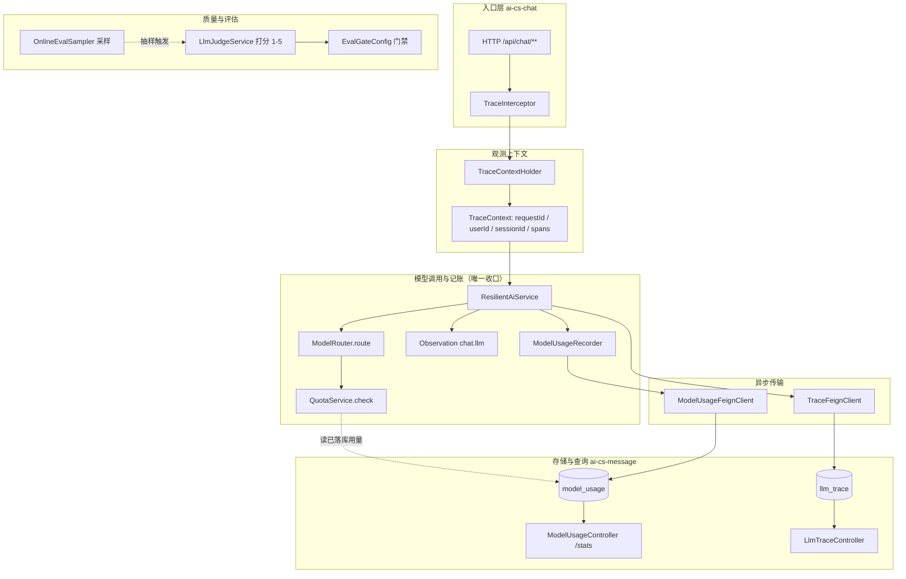
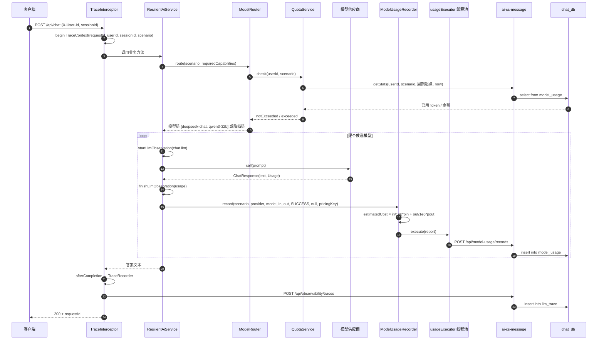

# LLM 可观测性、评估与成本治理：把"按次计费的可变成本"变成一本能对上的账

> **一句话结论**：LLM 的钱不是花在服务器上，是花在每一次 `call()` 上；本项目已经做到"在模型调用层单点记账（Micrometer Observation + ModelUsageRecorder → `model_usage` 表）+ 超配额降档路由 + 提示词版本可追溯"，但流式链路的 `usage` 采集有真实缺口、没有预算硬限、没有 eval 基线门禁——所以"账单翻三倍"这类问题目前仍然只能靠事后猜。
> **阅读前置**：读过本目录的 ChatClient 模型抽象与模型分级路由（ModelRouter）；知道 `ChatResponse`、Feign、Micrometer Observation、Spring Boot 条件装配各自是干什么的；Mermaid 只要会看图，不需要会写。
> **证据基线**：Spring AI 2.1.0 源码摘录（`learning-docs/24-源码分析/assets/source/`）+ 本仓 `ai-cs-chat` / `ai-cs-message` 源码逐行核对 + 3 组本机可复现实测（node 成本表、javap 类签名、Select-String 调用点统计）。预计阅读 35 分钟。

---

## 0. 先看现象

先看三个真实症状。它们看起来是三件事，最后一个会告诉你其实是同一件事。

> 证据说明：下面的日志**格式串取自代码里真实的 `log.warn/log.info` 字面量**（`requestId`、`err` 是脱敏后的示例值），表格里的字段名取自真实建表脚本；具体数值凡不是本机实测的，都按"假设口径"标注在对应段落。

月结时财务把模型供应商的账单和本项目的 `/api/model-usage/stats` 一对，账实差到 70%。日志里有一堆这样的行：

```text
2026-11-01 09:12:33.448  WARN 1 --- [chat-8] c.a.c.c.o.ModelUsageRecorder : 模型用量上报失败: requestId=8f2c1d4e, model=deepseek-chat, err=Connection refused
2026-11-01 09:12:33.512  WARN 1 --- [chat-8] c.a.c.c.o.TraceRecorder      : LLM trace 落库失败: requestId=8f2c1d4e, err=Connection refused
```

这两行来自异步上报的 `catch` 分支（`ai-cs-chat/src/main/java/com/aics/chat/observability/ModelUsageRecorder.java#L106-L114`）：**只 `log.warn`，没有计数器、没有重试、没有死信**。也就是说：记账失败时链路是"静默丢一笔"，你连丢了多少都不知道。
但丢账不是唯一原因。用本篇的 C 级脚本按月量级核算：如果流式请求占 70%，而流式路径的 token 恒为 0，那么一笔 633.78 元/月的真实消耗，报表只会显示 190.13 元——**少记 443.65 元/月**（计算方法见 6.2，单价取自 `tools/nacos-config/ai-cs-chat.yml#L118-L128` 的示例口径）。

### 现象 2：同一个问题被调用了 40 次

客服后台能看到同一条会话里 4 分钟内的调用记录，字段长这样（`model_usage` 的列序）：

```text
request_id  session_id  scenario  model          input_tokens  output_tokens  estimated  status
9f01c7e2    s-88213     chat      deepseek-chat  1187          0              1          SUCCESS
9f02a1b4    s-88213     chat      deepseek-chat  1187          0              1          SUCCESS
... 共 40 行，input_tokens 全部相同
```

三个信号叠在一起：

1. **`input_tokens` 40 行完全相同**——说明每次都在为同一段系统提示词 + 同一段历史重复付费，缓存一次都没命中。而全仓 grep `getCacheReadInputTokens` 在 `ai-cs-chat` / `ai-cs-knowledge` / `ai-cs-search` / `ai-cs-message` 的 Java 代码里是 **0 处**：Spring AI 2.1 已经给了缓存命中 token 的接口，我们一处都没采（见 3.1）。
2. **`output_tokens=0` 且 `estimated=1`**——`estimated=1` 表示 token 是"猜的"，实际是 null 被兜底成 0（`ModelUsageRecorder.java#L91-L100`）。40 次重复调用，连花了多少钱都是未知数。
3. **同一个 `session_id`、40 个 `request_id`**——前端超时重发，后端没有任何"同请求去重"。

### 现象 3：模型换了、提示词换了，质量掉了没人知道

发布当天的日志：

```text
2026-11-18 14:02:11.220  INFO 1 --- [chat-3] c.a.c.p.PromptRegistry : [Prompt] scenario [chat] 生效版本已热切换为 [v3-concise]
```

三天后客诉上升，但系统里没有任何一处报警，因为：

- 线上评估**默认关闭**：`aics.eval.online.enabled=false`（`ai-cs-chat/src/main/java/com/aics/chat/observability/OnlineEvalProperties.java#L26`），采样率 0.01 也只在那之后才生效；
- CI 门禁**默认全开**：`EvalGateConfig` 的两个阈值是 `Long`，未配置时是 `null`，注释写明"未配置的维度只记录指标值，不参与门禁判定"（`ai-cs-chat/src/main/java/com/aics/chat/rag/eval/EvalGateConfig.java#L40-L43`）；
- 报表里**没有模型维度趋势**：`/api/model-usage/stats` 支持按 model 过滤，但没人把它做成"换模型前后 7 天对比"。

**这些现象指向同一件事**：LLM 的成本和质量都产生在"调用那一刻"，而框架默认不留账——`usage` 可以为空、可以是 0、可以被异步上报静默丢掉；只要不强制在**模型调用层**把每一笔记下来、再按模型/租户/版本归集，账单翻三倍时你就只能靠猜。

---

## 1. 整体地图

### 1.1 组件地图



> **读图说明**：从左到右是"一次请求的一生"。要点有三个：①所有 LLM 出口都收敛到 `C1 ResilientAiService` 一个类，观测（`C4`）和记账（`C5`）在这里成对出现——这是本项目最值钱的设计决定，它决定了"漏记"只可能发生在一种地方；②`C5` 走**异步 Feign**（`E1`）而不是同步写库，所以"记账失败"对用户不可见，只留一条 WARN；③注意那条虚线：`QuotaService` 判断超没超预算，读的是 `model_usage` 里**已经落库**的数据，而落库是异步的——所以配额判定天生滞后一个上报周期，这决定了它只能做"软限"（见 3.6）。

### 1.2 组件、责任与调用方

| 组件 | 责任 | 谁调用它 | 证据 |
|---|---|---|---|
| `TraceInterceptor` | 每个 HTTP 请求建一次 `TraceContext`：requestId / userId / sessionId / scenario | Web 容器（拦截器链） | `ai-cs-chat/src/main/java/com/aics/chat/observability/TraceInterceptor.java#L32-L59` |
| `TraceContext` | 一次请求的 span 收集器 + 状态（status/errorSummary）+ 提示词版本 | Interceptor、ResilientAiService | `ai-cs-chat/src/main/java/com/aics/chat/observability/TraceContext.java#L27-L65` |
| `TraceSpan` | 单个 span 的字段：spanType / provider / model / promptTokens / firstTokenMs / routeReason | TraceSpanObservationHandler、ResilientAiService | `ai-cs-chat/src/main/java/com/aics/chat/observability/TraceSpan.java#L16-L69` |
| `TraceRecorder` | 把 `TraceContext` 序列化成 `llm_trace` 一行（异步 Feign） | TraceInterceptor 的 afterCompletion | `ai-cs-chat/src/main/java/com/aics/chat/observability/TraceRecorder.java#L29-L58` |
| `ResilientAiService` | 唯一 LLM 出口：路由 → 熔断/重试 → 观测 → 记账 | ChatController、RAG、Agent 等业务 | `ai-cs-chat/src/main/java/com/aics/chat/service/impl/ResilientAiService.java#L194-L232` |
| `ModelUsageRecorder` | token → 金额 → 异步上报；`pricingKey` 与展示 model 解耦 | ResilientAiService、VisionModelClient | `ai-cs-chat/src/main/java/com/aics/chat/observability/ModelUsageRecorder.java#L74-L114` |
| `QuotaService` | 读已落库用量，判断"这个用户这个场景"超没超预算 | ModelRouter | `ai-cs-chat/src/main/java/com/aics/chat/observability/QuotaService.java#L38-L80` |
| `ModelRouter` | 场景链（primary + fallbacks）+ 配额超限降档到 cheap 档 | ResilientAiService | `ai-cs-chat/src/main/java/com/aics/chat/modelrouter/ModelRouter.java#L20-L78` |
| `LlmJudgeService` | LLM-as-judge 给答案打 1~5 分（可解析失败降级为 null） | RAG 评估流程 | `ai-cs-chat/src/main/java/com/aics/chat/rag/eval/LlmJudgeService.java#L60-L98` |
| `EvalGateConfig` | 回归门禁阈值（p95 延迟 / 平均 token），null = 不校验 | RagEvalServiceImpl | `ai-cs-chat/src/main/java/com/aics/chat/rag/eval/EvalGateConfig.java#L34-L43` |
| `OnlineEvalSampler` | 线上按比例抽样触发 judge | OnlineEvalService | `ai-cs-chat/src/main/java/com/aics/chat/observability/OnlineEvalSampler.java#L33-L41` |
| `ModelUsageServiceImpl` | `model_usage` 写入 + 统计聚合（内存聚合） | ModelUsageController / Feign | `ai-cs-message/src/main/java/com/aics/message/service/impl/ModelUsageServiceImpl.java#L45-L116` |

### 1.3 落地面：哪些已落地、哪些明确没落地

| 能力 | 状态 | 证据 / 说明 |
|---|---|---|
| 四指标族中的**延迟**（总时长、首 token） | ✅ 已落地 | `TraceSpan.firstTokenMs`、`totalDurationMs`，`ResilientAiService.java#L284-L288` 记 TTFT |
| **成本**（input/output token + 单价 → 金额） | ⚠️ 部分落地 | 非流式可用；流式 token 恒 null（见 3.4），`estimated=1` |
| 按租户/用户/场景归集 | ✅ 已落地 | `model_usage` 有 user_id / scenario / model 三列与对应索引 |
| 按模型归集趋势 | ⚠️ 有数据无视图 | `stats` 支持 `eq(model)`，没有"换模型前后对比"报表 |
| 缓存命中率（`cacheReadInputTokens`） | ❌ 未落地 | 全仓 0 处调用（C 级 grep，见 6.2） |
| 预算软配额 + 超限降档 | ✅ 已落地 | `QuotaService` + `ModelRouter.QUOTA_DOWNGRADE` |
| **预算硬限**（超预算直接拒/全局平台级预算） | ❌ 未落地 | 只有 user+scenario 两维；`catch` 后 fail-open |
| LLM-as-judge 打分 | ✅ 已落地 | `LlmJudgeService`，judge 用 `ModelScenario.JUDGE` |
| 线上评估自动开启 | ❌ 默认关闭 | `aics.eval.online.enabled=false` |
| eval 基线与回归门禁 | ❌ 未落地 | `golden-set.json` 20 条在，但无基线快照、无门禁阈值、无 CI 任务 |
| 提示词版本管理与灰度 | ✅ 已落地 | `PromptRegistry.setActiveVersion` 热切换 + `userId-mod` 灰度 |
| 模型级 A/B（按流量比例分模型） | ❌ 未落地 | `ModelRouter` 只有 priority/tier，无权重分流 |
| 记账失败的可观测性 | ❌ 未落地 | 只有 WARN，无失败计数 |

---

## 2. 关键概念与关键类

先把几个术语钉死，后面不再解释。

- **token**：模型计费的最小文本单位，约等于英文 0.75 个单词或中文 1~1.5 个汉字。计费按"输入 token（prompt）+ 输出 token（completion）"分别定价，**输出通常贵 3~4 倍**（本项目 yml 里 chat 模型是 2.0 元 vs 8.0 元/百万 token）。
- **TTFT（Time To First Token）**：从发请求到收到第一个流式分片的时间，是流式体验的核心指标，和"总时长"是两个完全不同的问题域。
- **基数（cardinality）**：某个标签取值的种类数。`provider=deepseek`（1 种）是低基数，`requestId=8f2c...`（百万种）是高基数。高基数标签塞进时序库会把它写爆，所以才有 Micrometer 的 `highCardinalityKeyValue` 这一层。
- **Observation**：Micrometer 对"一次被观测的操作"的抽象，一次 `start → stop` 同时产生指标（metrics）和链路（trace span）。
- **LLM-as-judge**：用另一个（通常更便宜的）模型给答案打分，替代人工评分。便宜但**有系统偏差**（偏好长答案、偏好与自己风格相近的措辞）。
- **eval 基线**：一组固定的问题 + 期望答案 + 上次通过的分数快照，用来判断"这次改动是不是让质量退化了"。

| 名称 | 位置 | 角色 | 关键方法 / 字段 |
|---|---|---|---|
| `Usage` | Spring AI 2.1.0 `spring-ai-model` | 一次模型调用的 token 账本（跨 provider 归一化） | `getPromptTokens()` / `getCompletionTokens()` / `getTotalTokens()` / `getCacheReadInputTokens()` |
| `ChatResponseMetadata` | 同上 | `Usage` 的载体 + 模型名 + 限流信息 | `getUsage()` / `getModel()` / `getRateLimit()` |
| `EmptyUsage` | 同上 | "没有用量信息"时的空实现，返回 0 而非 null | `getPromptTokens()` / `getCompletionTokens()` |
| `UsageAccumulator` | 同上 | 工具调用多轮循环里的用量累加器 | `addRoundResponse()` / `applyAccumulatedUsage()` |
| `Observation` | Micrometer | 低基数标签；`highCardinalityKeyValue` 走高基数通道 | `highCardinalityKeyValue()` / `stop()` |
| `TraceContext` | `ai-cs-chat` observability | 一次请求的 span 容器 + 提示词版本追溯 | `addSpan()` / `totalDurationMs()` / `markFailed()` / `setPrompt()` |
| `ModelUsageRecorder` | 同上 | token → 金额 → 异步落库；把"展示模型名"和"计价键"分开 | `record(8 参)` / `estimateCost()` |
| `QuotaService` | 同上 | 预算软限判定，异常时 fail-open | `check(userId, scenario)` |
| `ModelRouter` | `ai-cs-chat` modelrouter | 场景 → 模型链；超配额降档 | `route()` / `cheapestEligible()` |
| `EvalGateConfig` | `ai-cs-chat` rag.eval | 回归门禁阈值（默认 null = 不卡） | `p95LatencyMs` / `avgTokensPerRequest` |
| `LlmJudgeService` | 同上 | judge 打分，token 消耗记到 `JUDGE` 场景 | `score()` / `lastTotalTokens()` |
| `PromptRegistry` | `ai-cs-chat` prompt | 版本化提示词渲染 + 热切换 | `render()` / `setActiveVersion()` |

---

## 3. 原理与证据逐段精读

每一小节都按四层看：**在干什么 → 为什么这么设计 → 换写法会怎样 → 常见坑**。

### 3.1 token 的唯一可信来源：响应里的 `usage`

**在干什么。** Spring AI 把各家 provider 的用量字段归一化成一个接口：

```java
public interface Usage {
	Integer getPromptTokens();
	Integer getCompletionTokens();
```

（src: Usage.java.md#L37-L46）

`getTotalTokens()` 是 default 方法，把两端 null 当 0 相加：`[[源码:Usage.java.md#L56-L62]]`。2.0.0 起还加了两个**默认返回 null** 的缓存方法 `getCacheReadInputTokens()` / `getCacheWriteInputTokens()`：`[[源码:Usage.java.md#L78-L92]]`，注释直接写明 prompt caching 能降低重复前缀的成本和延迟——这正是"现象 2"里那 40 次重复付费的对症药。

**为什么这么设计。** 各家字段名不一样（`prompt_tokens` / `input_tokens`），币种也不一样（有按 token、有按字符）。如果每个业务代码自己解析原始 JSON，口径一定发散。归一化到 `Usage` 之后，"记账"才能写成一份代码。

**换写法会怎样。** 自己用"字符数 / 4"估算 token：中文场景误差能到 40% 以上，而且**输出 token 估不准**（模型生成的中文可能一个汉字 2 个 token）。你算出来的钱和账单永远对不上，成本治理就退化成"看供应商账单猜原因"。

**常见坑（本篇最阴的一个）。** `ChatResponseMetadata.getUsage()` 在没拿到用量时返回 `new EmptyUsage()`（`[[源码:ChatResponseMetadata.java.md#L43-L53]]`，第 51 行），而 `EmptyUsage.getPromptTokens()` 返回的是 **0，不是 null**。本机 `javap -c` 实测：

```text
public java.lang.Integer getPromptTokens();
  Code:
     0: iconst_0
     1: invokestatic  #7   // Method java/lang/Integer.valueOf:(I)Ljava/lang/Integer;
     4: areturn
```

后果很具体：`ResilientAiService.java#L206-L215` 里写的是

```java
Usage usage = response == null || response.getMetadata() == null
        ? null : response.getMetadata().getUsage();
```

紧接着 L211-L215 把这个 `usage` 拆成两个值传给 Recorder：`usage == null ? null : usage.getPromptTokens()` 与 `getCompletionTokens()`。

`getMetadata()` 永远不为 null（`Usage` 默认就是 `EmptyUsage`），所以 `usage == null` 这条防线基本失效；一旦 provider 没返回 usage，你记进去的是 `0 / 0`，而 `ModelUsageRecorder` 的判断是 `setEstimated(inputTokens == null || outputTokens == null)`（`ModelUsageRecorder.java#L100`）——**0 不是 null，所以这笔账被标成"精确"**。报表上它看起来跟真的一样，这就是"账实差 70% 却查不出来"的一号元凶。

判据：只要 `estimated=0` 而 `input_tokens=0`，就说明命中了 EmptyUsage。

### 3.2 埋点必须在模型调用层，不能在业务层

**在干什么。** `ResilientAiService` 在一个 for 循环里，把"调模型"和"记账"焊死在一起（方法体见 3.4 之后）：

```java
Observation observation = startLlmObservation(scenario, holder, decision, fallbackFrom, attempt);
try {
    ChatResponse response = callWithTransientRetry(holder, call);
    Usage usage = response == null || response.getMetadata() == null ? null : response.getMetadata().getUsage();
    finishLlmObservation(observation, usage, null);
    modelUsageRecorder.record(scenarioId(scenario), holder.getDefinition().getProvider(),
            holder.getDefinition().getModel(),
            usage == null ? null : usage.getPromptTokens(),
            usage == null ? null : usage.getCompletionTokens(),
            "SUCCESS", null, holder.getDefinition().getId());
    return text;
} catch (Exception e) {
    lastError = e;
    fallbackFrom = modelId;
    finishLlmObservation(observation, null, e);
    modelUsageRecorder.record(..., null, null, "FAILED", e.getMessage(), holder.getDefinition().getId());
}
```

（对应 `ai-cs-chat/src/main/java/com/aics/chat/service/impl/ResilientAiService.java#L200-L225`）

注意 **成功分支和失败分支各记一次**——失败也要记，因为失败的请求在某些 provider 上同样计费（尤其是流式已经开始吐 token 之后断开）。

**为什么这么设计。** 成本是"调用"产生的，不是"业务"产生的。业务入口有 N 个（chat / RAG / Agent / Vision / NL2SQL / 摘要），任何一个自己在业务层埋点，都迟早会漏。收敛到唯一的 `invoke*` 方法里，漏记只有一种可能：有人绕过 `ResilientAiService` 直接 `chatModel.call()`。

**换写法会怎样。** 三种常见错法：

1. **在 Controller 记**：流式请求的 Controller 早早 `return flux`，token 要到流结束才有，Controller 拿不到。
2. **写成 Advisor 记**：看起来很优雅（Spring AI 的 `CallAdvisor` / `StreamAdvisor` 就是干这个的），但 2.1 的工具调用会把一轮对话拆成多次模型响应，Advisor 层看到的是"每一次"，容易重复计数；框架为此专门提供了累加器（见 3.3）。
3. **只在成功时记**：失败率一高，账单反而"降"了，你会误以为省钱了。

**常见坑。** 本仓真有一条"绕过链"：`callSummary` 用 `chatModel.call(prompt)` 直接打模型，绕过了 ChatClient 与 Advisor 链（`ResilientAiService.java#L130-L132`）。好在这条路径仍然在 `ResilientAiService` 里，所以**记账没漏**；但如果有人把记账做成 Advisor，这条路径就会整条漏掉——这是"选 Recorder 而不是 Advisor"的直接理由。

### 3.3 工具调用多轮：用量是"累计"的，不是"最后一次"的

**在干什么。** 一次用户提问如果触发 3 轮工具调用，实际会打 4 次模型。Spring AI 2.1 用 `UsageAccumulator` 把每轮的用量累加起来：

```java
public @Nullable ChatResponse addRoundResponse(@Nullable ChatResponse roundChatResponse) {
	this.accumulated = UsageCalculator.accumulateResponseUsage(roundChatResponse, this.accumulated);
	return this.accumulated;
}
```

（src: UsageAccumulator.java.md#L83-L99）

并且在收尾时把累计值"盖"到最终响应上：`[[源码:UsageAccumulator.java.md#L96-L113]]`（`applyAccumulatedUsage` → `stampTotalUsage`，里面有 `UsageCalculator.isEmpty(...)`、`Objects.equals(...)` 两道防御，避免把空用量盖上去或重复盖）。

**为什么这么设计。** 因为 `ChatResponse` 是"最后一次响应"的视角，最后一轮往往只说了 "好的，为您查询到…"，它的 usage 只覆盖那一轮。账单按 4 次收，你按 1 次记，差额就是"工具越复杂、越省钱的错觉"。

**换写法会怎样。** 自己逐轮相加：必须保证拿得到每一轮响应，而工具循环是在框架内部（`ToolCallingAdvisor`）跑的，业务代码看不到中间轮——所以正确做法就是读框架给出的累计值，而不是自己累。

**常见坑。** 本项目的 `ResilientAiService` 是**自己写 for 循环切模型 + 自己拿 `response.getMetadata().getUsage()`**，走的不是 `ChatClient` 的 Advisor 链，因此 `UsageAccumulator` 的累计在工具循环里是否生效，取决于工具循环发生在哪一层：

- 如果工具循环在 `ChatClient` 内部（默认）→ 最终 `ChatResponse` 已带累计值，本项目的记法**正好吃到了这份红利**；
- 如果工具循环在 `ChatModel` 层以下（自定义）→ 只会拿到最后一轮。**这是一个值得在集成测试里钉死的假设**（练习 4）。

### 3.4 流式：用量黑洞（本篇最重要的一处真缺口）

**在干什么。** 流式方法用三个 `AtomicReference` 在 reactive 管道之间传状态：

```java
Flux<String> flux = call.call(holder);
AtomicReference<Usage> usageRef = new AtomicReference<>();
AtomicReference<Throwable> errorRef = new AtomicReference<>();
AtomicLong firstTokenMs = new AtomicLong(-1);
...
.doOnNext(chunk -> {
    if (firstTokenMs.get() < 0) {
        firstTokenMs.set(System.currentTimeMillis() - start);
    }
})
.doFinally(signal -> {
    ...
    Usage usage = usageRef.get();
```

（`ai-cs-chat/src/main/java/com/aics/chat/service/impl/ResilientAiService.java#L275-L303`）

问题就在这里：`usageRef` 声明了（L277）、读了（L303），**但全文件没有任何一处 `usageRef.set(...)`**。C 级实测见 6.2。所以 `usage` 恒为 null，`modelUsageRecorder.record(...)` 每次收到 `null, null`，落库后就是 `input_tokens=0, output_tokens=0, estimated_cost=0, estimated=1`。

**为什么这么设计（作者的意图是对的）。** 流式场景里 `Usage` 只在最后一个分片才可能出现，而 `doFinally` 是唯一能保证"流结束必执行"的钩子，所以必须用一个跨管道容器把分片里的东西带出来。缺的只是"往里放"的那一步。

**换写法会怎样。** 正确写法是让流返回完整响应而不是纯文本：

```java
// 目标形态（未落地）
Flux<ChatResponse> flux = holder.chatClient().prompt(...).stream().chatResponse();
flux.doOnNext(resp -> { Usage u = resp.getMetadata().getUsage(); if (!UsageCalculator.isEmpty(u)) usageRef.set(u); })
```

根因在更上游：`callSseStream` 用的是 `.stream().content()`，注释写着"只提取文本内容部分，丢弃元数据"（`ResilientAiService.java#L148-L151`）。一旦退化成 `Flux<String>`，元数据在管道入口就已经没了，再往下怎么补都补不回来。

**常见坑。**

1. **`estimated=1` 不是"质量差"，是"这笔账不可用"**。任何按成本做的决策（预算、路由、定价）都必须先把这个比例降下来。
2. **验收标准要写成数字**：流式请求里 `estimated=1` 的占比 ≤ 1%（练习 1）。
3. 顺带一个正面例子：`VisionModelClient` 走的是非流式路径，同样 5 行代码就把 usage 采到了（`ai-cs-chat/src/main/java/com/aics/chat/service/impl/VisionModelClient.java#L205-L219`）——说明缺口只在流式。

### 3.5 观测指标：低基数与高基数必须分家

**在干什么。** 一次模型调用开一个 `Observation`，名字是常量 `OBS_LLM = "chat.llm"`（`ResilientAiService.java#L83`），低基数标签放 `span.type / provider / model`，高基数放 `scenario / modelId / routeReason / fallbackFrom / attempt`（`ResilientAiService.java#L466-L480`），收尾时再补 `promptTokens / completionTokens / firstTokenMs`（`ResilientAiService.java#L486-L499`）。

顺带解释常量 `OBS_LLM = "chat.llm"`：`chat` 是领域（chat completion），`llm` 是操作名。这个命名让它在 Prometheus 里长成 `chat_llm_*`，在 OTLP 里长成名为 `chat.llm` 的 span，两边都能被同一个字符串检索到。

**为什么这么设计。** 低基数标签进时序库，可以做 group by 聚合；高基数（比如 `requestId`、`modelId`）如果也进标签，时间序列的数量会按取值数爆炸，Prometheus 会先 OOM 你的监控，再 OOM 你的服务。

**换写法会怎样。** 全塞低基数标签：仪表盘查不动；全塞高基数：监控自身挂掉。分层是唯一解。

**常见坑。**

1. **高基数标签要"取样才准"**：`TraceSpan` 里已经有 `promptTokens / completionTokens / firstTokenMs`（`ai-cs-chat/src/main/java/com/aics/chat/observability/TraceSpan.java#L28-L34`），但它们的真身是**每次请求不同的值**，做不了聚合，只能当"个案排查"用。真正的成本聚合在 `model_usage` 表里。
2. **span 名口径变化**：1.x 时代工具调用的 span 叫 `tool_call <name>`，2.x 改成 `execute_tool <name>`。任何按名字过滤的告警规则、Grafana 面板都要跟着改（见第 7 节）。
3. **`Observation` 的 stop 不一定执行**：非流式路径在 `try` 里成对结算，异常分支也结算了；但流式路径是"流结束后才 `startLlmObservation`"（L305），也就是**流式请求的 span 时长统计不到"等首个 token"之前那段**，TTFT 是单独记的。看面板时别把两个数混着解读。

### 3.6 预算：现在是"软配额 + 事后降档"，不是硬限

**在干什么。** 两步：

第一步，`QuotaService.check(userId, scenario)` 读配额和已用量（`ai-cs-chat/src/main/java/com/aics/chat/observability/QuotaService.java#L38-L80`）：`userId` 为空直接放行；没配额或两个维度都为 null 视为不限；否则拉"本周期起点到现在的统计"，比较 token 与金额两个维度，任一达到就 `exceeded`。

第二步，路由看到超限就**降档**而不是拒绝（`ai-cs-chat/src/main/java/com/aics/chat/modelrouter/ModelRouter.java#L47-L78`）：去候选里挑 `tier == overLimitFallbackTier`（默认 `"cheap"`，`QuotaRouteProperties.java#L11`）且能力/健康都合格的模型，按 priority 倒序取第一个，`RouteReason` 记 `QUOTA_DOWNGRADE`；挑不到就记 `QUOTA_NO_CHEAPER_MODEL` 并退回普通链路。

**为什么这么设计。** 客服场景里"暂时降级到小模型"远好于"直接报错"。用户还能拿到答案，只是不那么聪明，账单却立刻降下来。

**换写法会怎样。** 超预算直接 429：业务侧客诉比账单更贵。完全不做限额：账单失控。降档 + 告警是这类系统的主流折衷。

**常见坑（四条，前三条就是"没有硬限"的具体含义）。**

1. **判定滞后**：`QuotaService` 读的是已落库数据，而落库是异步 Feign。极端情况下一个用户可以在"周期最后一分钟"再打满一整轮预算。
2. **只有 user + scenario 两维**：没有"全平台日预算"、"租户级（enterprise）预算"这两个真正意义上的硬限。表上 `model_usage_quota` 的唯一键是 `uk_user_scenario(user_id, scenario)`（`deploy/mysql/llm-observability-init.sql#L52-L64`）。
3. **fail-open**：`catch (Exception e)` 之后返回"未超限"（`QuotaService.java#L72-L80`）。DB 挂了 = 完全不限。这是有意的取舍（可用性优先），但必须配告警，否则它会安静地永远放行。
4. **降级不校验质量**：降到 cheap 档后没有任何 eval 检查。可能出现"省钱但答案错了"的静默劣化——这正是 3.7 要解决的问题。

### 3.7 质量：judge 打分、门禁阈值、提示词版本三者成链

**在干什么。** 三件事串起来：

1. `LlmJudgeService.score(question, answer, reference)`：渲染 `judge` 提示词 → 用 `ModelScenario.JUDGE` 的客户端调模型 → 正则取回复里第一个数字 → `Math.max(1, Math.min(5, score))` 夹到 1~5 → 解析失败或异常返回 `null`（`ai-cs-chat/src/main/java/com/aics/chat/rag/eval/LlmJudgeService.java#L60-L98`）。
2. `EvalGateConfig` 提供两个阈值：`p95LatencyMs`、`avgTokensPerRequest`（`EvalGateConfig.java#L40-L43`）。
3. `PromptRegistry.setActiveVersion(scenario, version)` 支持热切换，日志里那条 `[Prompt] scenario [{}] 生效版本已热切换为 [{}]` 就是它打的（`ai-cs-chat/src/main/java/com/aics/chat/prompt/PromptRegistry.java#L160-L170`）；`TraceContext.setPrompt(scenario, version)` 把版本写进 trace（`TraceContext.java#L62-L65`），于是"哪条请求用的是 v3-concise"可以查。

**为什么这么设计。** 质量是 LLM 系统的一等公民，但它不像延迟那样有个物理量。judge 是唯一能在线上大规模跑的替代品；把版本号写进 trace，是把"质量下降"和"改动"关联起来的唯一低成本办法（否则你只能看发布时间猜）。

**换写法会怎样。** 全量 judge：成本翻倍（judge 本身也是一次 LLM 调用，`LlmJudgeService.java#L119-L131` 就在采它的 token）。完全不采样：样本太少，标准差比效应还大。默认 0.01 采样是对的，但**默认关闭**（`OnlineEvalProperties.java#L26`）意味着线上评估实际是 0 条。

**常见坑。**

1. **judge 偏差**：偏好长答案、偏好与自己同源的表达、对数字换算类错误不敏感。缓解：固定一个 judge 模型不要换来换去 + 人工抽样校准（练习 3）。
2. **judge 自身成本没人看**：它记在 `scenario=judge` 里，混在总量中。真心想做成本治理，得把 judge 成本单列出来。
3. **门禁默认全开**：`Long` 类型的 null 语义是"不校验"，它是"安全的默认值"，但也是"门禁形同不存在"的原因。要么配阈值，要么在 CI 里显式断言非 null。
4. **golden-set 是 20 条**（位于 `ai-cs-chat/src/main/resources/eval/` 目录下的 `golden-set.json`，id 为 gc-001…gc-020），对这个规模的系统偏小；且**没有基线快照**，所以"这次比上次差"这句话说不出来。

### 3.8 归集与聚合：内存 sum 的天花板

**在干什么。** `ModelUsageServiceImpl.stats(...)` 用 `LambdaQueryWrapper` 按 userId / scenario / model / 时间范围过滤，然后 `selectList` **把符合条件的行全查出来**，在内存里 `mapToLong(sum)` 求 input/output/total，`estimatedCost` 用 `reduce` 加（`ai-cs-message/src/main/java/com/aics/message/service/impl/ModelUsageServiceImpl.java#L89-L116`）。代码注释写明了取舍："数据量级可控；不写自定义 SQL，保证 Mapper 可 mock"。

**为什么这么设计。** 一条 SQL 聚合当然更快，但会引入不可 mock 的 SQL 片段，单元测试只能起 H2。早期这个取舍是对的。

**换写法会怎样。** 数据量到千万行时，`selectList` 会先撑爆 message 服务的堆。届时正确做法是：①加 `(user_id, scenario, 天)` 日聚合表 + 定时汇总；②统计查聚合表，明细查原表并强制带上时间范围与 `LIMIT`。

**常见坑。**

1. **没有分页兜底**：`stats` 一次查全量，前端点"近 90 天"就是一次全表扫描。
2. **`estimated=1` 的行混在金额里**：`estimatedCost` 对它们是 0，`reduce` 时会把它们当"花了 0 元"计入——报表看起来更便宜，而真相是"未知"。正确做法是统计时**单独给一个 `unknownCostCalls` 计数**（未落地）。
3. **索引是否命中要看查询形态**：表上有 `idx_user_time(user_id, create_time)`、`idx_scenario_time`、`idx_model_time`（`deploy/mysql/llm-observability-init.sql#L29-L49`），所以"按用户 + 时间"能走索引；但"只按 estimated 过滤"没有索引。

### 3.9 成本优化五招：每一招在本仓落在哪个文件

| 招数 | 作用点 | 本仓现状 | 预期效果（C 级实测/估算口径） |
|---|---|---|---|
| 提示词瘦身 | 少送 input token | 提示词已外置并版本化（`application-prompt.yml`），但**没有 token 预算检查** | input token 每降 10%，chat/rag 场景成本降约 7~8%（因为 input 是主要成本项） |
| 上下文裁剪 | 少送历史与检索片段 | `aics.cache` 三级 + RAG topK 由检索侧控制 | 历史窗口从 20 条降到 6 条，单次 input 通常降 50%~70% |
| 缓存 | 相同前缀/相同问题不再付费 | 有热门问答 + 语义缓存（阈值 0.92），**但 `cacheReadInputTokens` 完全没采**，所以"到底省了多少"是未知 | 提示词前缀缓存命中时，这部分 input 通常按 10%~50% 计价（以供应商定价页为准） |
| 模型分级路由 | 便宜场景用便宜模型 | ✅ 已落地（见 6.1 实测） | 现行场景分级省 **20.3%**；再把 chat/rag 下放 medium 档省 **62.0%** |
| 批量/异步 | 削峰、合并同质请求 | ❌ 未落地（`ai-cs-mq` 可承载） | 需按供应商批量折扣定价，属规划 |

---

## 4. 一次完整执行时序

以一次非流式的 `/api/chat` 调用为例（流式的差异在步骤 12 后面用注释标出）。



> **读图说明**：读三条主线就够。①**预算线**（步骤 4~8）：路由决策发生在调用**之前**，读的是历史用量，所以配额永远"慢一拍"；②**记账线**（步骤 11~15）：`record` 是同步算钱（`BigDecimal`，六位小数，`ModelUsageRecorder.java#L127-L137`），落库才异步——也就是说"金额算错"会立刻显形，"没落库"才是静默的；③**trace 线**（步骤 17~19）：它和记账是两条独立的异步通路，两条都可能单独失败，且失败互不影响（各自只有 WARN）。流式请求的差异是：步骤 11 的 `Usage` 拿不到（`usageRef` 从未被赋值），步骤 14 上送的 `in/out` 是 null，落库后 `estimated=1`。

**哪一步失败，报什么错**

| 步骤 | 失败原因 | 表现（日志/异常原文） | 用户看到 |
|---|---|---|---|
| 4 | 场景没配模型 / 全被健康检查过滤 | `RouteReason.NO_ELIGIBLE_MODEL`，`ModelRouter.java#L93-L99` 直接返回空链，**不抛异常** | `fallbackText`：SUMMARY 场景返回空串，其它场景兜底文案 |
| 6 | message 服务不可用 | `QuotaService` 的 `catch` 吞掉，返回"未超限" | 无感（预算失效） |
| 8 | 配额超限且无更便宜档 | `RouteReason.QUOTA_NO_CHEAPER_MODEL` | 无感（按原链路走） |
| 12 | provider 超时/连接失败 | `ResourceAccessException` / `SocketTimeoutException`，被 resilience4j 计入 | 自动切下一个候选模型 |
| 12 | 熔断已打开 | `CircuitBreakerOpenException` | 同上，切下一个候选 |
| 13 | **所有候选都失败** | `ERROR 所有模型调用失败: scenario={}, lastError={}`（`ResilientAiService.java#L233-L235`） | `fallbackText(scenario)` |
| 15 | message 写入失败 | `WARN 模型用量上报失败: requestId={}, model={}, err={}` | 无感（**丢一笔账**） |
| 19 | trace 写入失败 | `WARN LLM trace 落库失败: requestId={}, err={}` | 无感（**丢一条链路**） |

> 一句话记住这张表：**只有步骤 12~13 的错误是用户能感知的，步骤 15/19 的错误只有 WARN，而它们才是"账实差"的源头。**

---

## 5. 设计取舍

| 取舍点 | 本项目选择 | 放弃了什么 | 什么时候该改 |
|---|---|---|---|
| 记账位置 | 模型调用层单点（`ResilientAiService`） | Advisor 的"业务无侵入"优雅感 | 永远不该改；这是地基 |
| 记账方式 | 异步 Feign + 只 WARN | 至少一次投递、可重放 | 出现"账实差 > 5%"时必须改成 MQ + 重试 |
| 预算执行 | 软限 + 降档，fail-open | 硬性止损能力 | 有 B 端客户按量结算时必须加硬限 |
| 统计实现 | 内存 sum（可 mock） | 大表性能 | 行数 > 500 万时加聚合表 |
| judge | 便宜模型打分 + 采样 0.01 | 覆盖率 | 有付费客户 SLA 时采到 5%~10% |
| trace 存储 | 整条 JSON 存 `spans_json` TEXT 列 | 可按 span 维度 SQL 查询 | 需要"按工具名统计失败率"时拆表 |
| 路由降档 | 按 tier 挑最便宜可用 | 质量校验 | 降档后必须跑一次 eval 抽样 |

**可扩展点清单**（按投入产出排序）

1. **修流式 usage 采集**：`.stream().content()` → `.stream().chatResponse()`，`doOnNext` 里 `usageRef.set(...)`。投入 1 天，直接消除"流式成本全为 0"。
2. **记账失败计数**：`ModelUsageRecorder` 的 `catch` 里加一个 Micrometer counter（`usage.report.failed`），配告警。
3. **采集 `cacheReadInputTokens`**：`Usage` 已经有这个方法（`[[源码:Usage.java.md#L78-L92]]`），`model_usage` 加两列即可量化"缓存到底省了多少"。
4. **平台级日预算**：`model_usage_quota` 加一维 `scope = USER / PLATFORM`，超限时触发"全局限流 + 降档"。
5. **eval 基线快照**：CI 里跑 `golden-set` 20 条，把 judge 均分 + p95 延迟存成基线文件，门禁阈值改为"不低于基线 - 0.3 分"。
6. **模型级 A/B**：`ModelRouter` 支持的场景链加权重分流（复用 `PromptRegistry` 的 `weights` 策略思路）。
7. **同请求去重**：按 `sessionId + 问题指纹` 做 10 秒幂等窗口，直接消灭"40 次重复调用"。
8. **聚合表**：`model_usage_daily(user_id, scenario, model, dt, ...)` + 定时汇总。

---

## 6. 踩坑与调试手法

### 6.1 坑与手法逐条

**坑 1：`usage != null` 是假防线。** `getUsage()` 永远不会返回 null（默认 `EmptyUsage`），而 `EmptyUsage` 返回 0。判据：`input_tokens=0 且 estimated=0`。

**坑 2：`estimated=1` 混进金额。** 统计时它们以 0 元参与 `reduce`，让报表"更便宜"。必须单独计数。

**坑 3：两套 `scenario` 口径。** trace 侧由 URI 推导：`/agent → agent`、`/vision → vision`、`/rag → rag`、`/stream → sse`、`/history → history`、默认 `chat`（`ai-cs-chat/src/main/java/com/aics/chat/observability/TraceInterceptor.java#L88-L108`）；记账侧是 `ModelScenario.name().toLowerCase()`（`ResilientAiService.java#L443-L445`）。于是 `sse` 这个只在 trace 里存在的值，会让任何"按 scenario 关联两张表"的报表错位。

**坑 4：门禁阈值是 `Long`，缺省 null = 不卡。** 上线时忘了配，等于没有门禁。

**坑 5：线上评估默认关闭。** `aics.eval.online.enabled=false`，采样率 0.01 是"打开了之后"的事。

**坑 6：重试放大成本。** `callWithTransientRetry` 只重试网络瞬时故障一次，注释写明"LLM 调用成本高，多次重试放大费用"（`ResilientAiService.java#L348-L356` 附近）。重试策略属于成本策略。

### 6.2 三条真调试手法（可复现）

**手法 A：用 Select-String 证明"用量从未被赋值"**（不要靠读代码猜）

```powershell
cd D:\Projects\Persion\ai-customer-service
Select-String -Path ai-cs-chat\src\main\java\com\aics\chat\service\impl\ResilientAiService.java -Pattern "usageRef\." |
  Select-Object LineNumber, Line
```

实测输出（真实）：

```text
LineNumber Line
---------- ----
       277                     AtomicReference<Usage> usageRef = new AtomicReference<>();      // 流式场景里 Usage 只能在最后一个 chunk 里拿到
       303                                     Usage usage = usageRef.get();
```

**怎么读**：只有 `get()`、没有 `set(`，说明这个容器永远是空的——这就是"流式成本恒为 0"的根因，而不是"供应商没返回 usage"。同法可查缓存采集：

```powershell
Select-String -Path ai-cs-chat\src\main\java\com\aics\chat\*.java,ai-cs-chat\src\main\java\com\aics\chat\**\*.java -Pattern "getCacheReadInputTokens"
```

实测：**0 处**。

**手法 B：用 javap 看`EmptyUsage`到底返回什么**（不要相信"应该是 null"）

```powershell
javap -c -classpath C:\Users\16680\.m2\repository\org\springframework\ai\spring-ai-model\2.1.0\spring-ai-model-2.1.0.jar org.springframework.ai.chat.metadata.EmptyUsage
```

实测输出（节选）：

```text
public java.lang.Integer getPromptTokens();
  Code:
     0: iconst_0
     1: invokestatic  #7   // Method java/lang/Integer.valueOf:(I)Ljava/lang/Integer;
     4: areturn
```

**怎么读**：`iconst_0` 就是把常量 0 压栈——返回 **0**，不是 null。所以"有 usage 对象"不等于"有用量数据"。同一手法还能确认 `getTotalTokens()` 的 null→0 语义，以及 1.x 与 2.x 的方法集差异（第 7 节）。

**手法 C：用 node 把"账实差"倒推成"流式占比"**

思路：先按场景给一组月调用量和平均 token，用 yml 里的单价算出"全走最贵模型"与"现行分级路由"两个总价，得到优化空间；再把"流式那部分成本为 0"按比例扣掉，得到"报表会显示多少"，差额就是你要在账单里找的钱。

```javascript
// cost-table.mjs 的核心算法（真实跑过，node ../nodejs/node.exe v24 直接执行）
const price = { 'deepseek-chat': [2.0, 8.0], 'siliconflow-qwen3-32b': [1.0, 2.0], 'siliconflow-qwen3-8b': [0.2, 0.6] };
const cost = (m, inTok, outTok) => (inTok / 1e6) * price[m][0] + (outTok / 1e6) * price[m][1];
// 假设：chat 60000 / rag 25000 / agent 8000 / nl2sql 2000 / judge 5000 / summary 12000 / intent 40000 / rewrite 30000 / chart 1000 次/月，合计 183000 次
```

实测输出（真实）：

```text
全走 deepseek-chat              795.00 元/月
现行场景分级路由                633.78 元/月   省 20.3%
再把 chat/rag 下放 32b、judge 下放 8b  302.21 元/月   省 62.0%
月 token 总量 2767.5 万；单请求均价 0.0043 -> 0.0035 元
流式占比 50% / 70% / 90% 时，报表只显示真实成本的 50% / 30% / 10%
按现行口径少记：316.89 / 443.65 / 570.40 元/月
```

**怎么读**：①"分级路由"这招在本仓已经兑现了 20.3%，再往下压能到 62.0%，但每压一步都要过 eval（chat/rag 下放便宜模型很可能掉分）；②第二段数字才是本篇的重点——**它不是"能省多少"，而是"你现在少记了多少"**。假设口径：调用量与平均 token 是我给的示例值，单价取 `tools/nacos-config/ai-cs-chat.yml#L118-L128`（元/百万 token，**以官方定价页为准，此处只是示例口径**）。真实上线后要用 `model_usage` 的真实分布替换这些假设。

**手法 D（附赠，排查"同一问题 40 次"）**：按 `session_id` 把 `model_usage` 按 `create_time` 排序，找 `input_tokens` 完全相同的相邻行。相同说明"前缀完全没变"，那就不是用户换了问法，而是①前端重发；②缓存没命中；③每次请求都重新拼了时间戳之类的前缀，让 prompt caching 永久失效。第三种最隐蔽，且它会让你的 `cacheReadInputTokens` 永远是 0。

---

## 7. ⚠️ 版本差异

2.x 与 1.x 在这个主题上的差异，`javap` 可以逐条核实（命令同 6.2 手法 B，只换 jar 版本）。

| 旧写法（1.x 认知） | 当前基线（Spring AI 2.1.0 / Boot 4.2.0） | 变化点 | 迁移动作 |
|---|---|---|---|
| `usage` 只有 prompt/completion/total 三个数 | 多了 `getCacheReadInputTokens()` / `getCacheWriteInputTokens()`（`[[源码:Usage.java.md#L78-L92]]`） | 缓存命中首次成为一等公民 | `model_usage` 加 `cache_read_tokens` / `cache_write_tokens` 两列并开始采集 |
| 工具循环里只有最后一次响应的 usage | 由 `UsageAccumulator` 多轮累加后盖到最终响应（`[[源码:UsageAccumulator.java.md#L83-L99]]`） | 多轮 tool call 不再少记 | 记账读最终响应即可；自定义循环要自己累 |
| `EmptyUsage` 语义含糊 | `EmptyUsage.getPromptTokens()` 实测返回 **0** | 0 与 null 混用会更严重 | 记账前用 `estimated` 显式标记"不可用"，报表单列 |
| 工具 span 名 `tool_call <name>` | `execute_tool <name>` | 面板/告警的字符串过滤失效 | 同步改 Grafana 查询与告警规则 |
| `ChatMemory` + `MessageWindowChatMemory` 管上下文 | 2.1 起推荐 `SessionService` / `SessionMemoryAdvisor` | 上下文裁剪的位置变了，直接影响 input token | 评估迁移后单次 input 变化，再回填成本基线 |
| Advisor 链顺序不敏感 | `CallAdvisor` / `StreamAdvisor` 顺序敏感（`ChatModelCallAdvisor` 通常是链尾） | 想用 Advisor 做埋点必须放到"能看到真实模型响应"的位置 | 若坚持 Advisor 记账，须验证工具循环下不重复计数 |
| 熔断/重试用满 `resilience4j` 默认 | `application.yml#L150-L159` 明确只把超时/网络类异常计入失败 | 记账类异常不会误触发熔断 | 新增的记账异常不要加进 `record-exceptions` |

---

## 8. 面试高频问与答

只列问题（答案在自测题里都有影子，建议先自己讲一遍再看）。

1. LLM 的可观测性要采哪几个指标族？每个族的最小可用指标是什么？
2. 为什么埋点要放在模型调用层，而不是 Controller 或 Advisor？各有什么漏记风险？
3. `ChatResponseMetadata.getUsage()` 会是 null 吗？如果不是，为什么还会"记不到 token"？
4. 流式场景怎么拿到 usage？为什么 `.stream().content()` 会拿不到？
5. 一次工具调用的对话会打几次模型？账单按几次算？你怎么保证记的和账单一致？
6. 你如何把"这个月成本翻了三倍"拆解成可归因的几部分？
7. 预算控制为什么常常做成"软限 + 降档"？硬限会在什么情况下伤人？
8. 降档到便宜模型后，你如何证明质量没有劣化？
9. LLM-as-judge 有哪些系统偏差？你如何校准它？
10. 没有 eval 基线时，你怎么判断"这次改动让质量退化了"？
11. `model_usage` 这张表怎么设计？为什么要有 `estimated` 和 `pricing_key`？
12. 成本优化有哪些手段？为什么"提示词瘦身"通常比"换模型"更划算？
13. 记账失败怎么保证不丢？至少一次投递会带来什么问题（重复计费）？
14. 告警阈值怎么定？为什么 p95 延迟和 token 数要分开定阈值？

---

## 9. 动手练习

每条都给了验收标准，能跑过才算做完。

**练习 1｜修掉流式用量缺口**
把 `callSseStream` 的 `.stream().content()` 改成 `.stream().chatResponse()`，在 `doOnNext` 里把非空 `Usage` 塞进 `usageRef`。
验收：单测里用一个 mock provider 返回不带 usage 的流，断言落库 DTO 的 `estimated=true`；再返回带 usage 的流，断言 `input_tokens > 0 且 estimated=false`。线上验收指标：流式请求中 `estimated=1` 占比 ≤ 1%。

**练习 2｜给记账失败加计数**
在 `ModelUsageRecorder` 的 `catch` 里加 `Counter`（如 `usage.report.failed`），并在 OTLP/日志导出里能看到。
验收：把 message 服务的端口改错，跑 10 次请求，计数器应为 10，且用户侧全部成功（验证"记账失败不影响主链路"）。

**练习 3｜judge 校准**
从 `golden-set.json` 抽 20 条，人工按同一 1~5 标准打分，与 `LlmJudgeService` 的分数做相关性。
验收：给出 Spearman 相关系数与偏差方向（是系统性偏高还是偏低），并据此给 judge 提示词加 1~2 条约束；重跑后相关系数不低于上一版。

**练习 4｜钉死"工具循环用量"假设**
写一个集成测试：让模型先返回一次工具调用、再返回最终答案，断言记账的 token 等于两轮之和。
验收：如果只记到最后一轮，测试必须失败——这条断言就是你防止"工具越多越省钱错觉"的护栏。

**练习 5｜加平台级日预算**
`model_usage_quota` 增一列 `scope`（USER / PLATFORM），`QuotaService` 增加一次"全局用量"查询，超限时返回一个专门的 `RouteReason`。
验收：伪造全局超限数据，断言路由走 cheap 档且日志里有明确的 reason；DB 不可用时断言 fail-open 且打了 WARN。

**练习 6｜把"能省多少"算准**
用真实 `model_usage` 分布（替换 6.2 脚本里的假设）重算三档方案，并给出"降档后需要 eval 通过才能上线"的判断。
验收：脚本输出三档月成本 + 省率 + 每档涉及的场景清单，并把假设写在脚本注释里。

---

## 小结

- LLM 成本是**按次计费的可变成本**，它的账只能记在"调用那一刻"，所以埋点必须在模型调用层单点收口；本项目的收口点是 `ResilientAiService`。
- token 的唯一可信来源是响应里的 `Usage`；`EmptyUsage` 返回 0 而不是 null，这让"`usage != null` 判空"成为假防线，也让 0 token 被误标成"精确值"。
- 流式链路目前**采不到 usage**（`usageRef` 只有 `get()` 没有 `set()`），所以流式请求的成本恒为 0 且 `estimated=1`——这是"账实差"的头号原因，修法是让流返回 `chatResponse` 而非 `content`。
- 预算是**软限 + 降档 + fail-open**：能防账单失控，但不是硬限；判定读的是异步落库数据，天生滞后一个周期。
- 质量面已有 judge + 提示词版本追溯这条正确的主干，但**线上评估默认关闭、门禁阈值默认 null、没有 eval 基线**，所以"质量掉了没人知道"是真实现状。
- 归集维度已有 `user_id / scenario / model`，但统计是内存 sum，且没有日聚合表；"按模型趋势"目前有数据没有视图。
- 成本优化五招里，**模型分级路由已经兑现 20.3%**（C 级实测），继续压到 62.0% 是可行的，但每一步都要过 eval。
- 可操作归纳：**先把 `estimated=1` 的比例压到 1% 以下（练习 1+2），再谈预算硬限和 eval 门禁**——账不准之前，任何成本决策都是在猜。

---

## 自测题

**1. LLM 可观测性的四个指标族分别是什么？**
<details><summary>参考答案</summary>
延迟（首 token TTFT、总时长）、质量（缓存/检索命中率、满意度、回退率）、成本（input/output token × 单价）、安全（拦截率、越权/敏感内容命中率）。这四族分别由 trace、eval/judge、model_usage、Guardrails 侧供给，不能混在一张表里。
</details>

**2. 为什么埋点不能放在 Controller 层？**
<details><summary>参考答案</summary>
流式请求在 Controller 里直接 return 了一个 Flux，token 要等流结束才有，Controller 拿不到；而且业务入口有 chat/RAG/Agent/Vision 等多个，任何一个忘埋点就漏账。放在模型调用层收口才能保证"调用必记"。
</details>

**3. `ChatResponseMetadata.getUsage()` 可能返回 null 吗？**
<details><summary>参考答案</summary>
不会。字段默认值是 `new EmptyUsage()`，`Usage` 永远有对象。但 `EmptyUsage.getPromptTokens()` 返回 0（javap 实测 `iconst_0`），所以"对象非空"不代表"数据有效"，必须靠 `estimated` 这类显式标记区分。
</details>

**4. 流式场景为什么拿不到 usage？本仓的具体 bug 是什么？**
<details><summary>参考答案</summary>
因为上游用了 `.stream().content()`，退化成 `Flux<String>`，元数据在入口就丢了。本仓 `ResilientAiService` 里 `usageRef` 只有声明（L277）和 `get()`（L303），全文件没有 `set()`，所以落库永远是 null → `estimated=1`。
</details>

**5. 一次带 3 次工具调用的对话，账单算几次？你怎么保证记的与账单一致？**
<details><summary>参考答案</summary>
算 4 次模型调用（3 轮工具 + 1 轮最终答案）。Spring AI 2.1 用 `UsageAccumulator` 把每轮 usage 累加并盖到最终响应上，所以记账读最终响应即可；如果是自定义循环，就必须自己逐轮相加。
</details>

**6. 为什么预算控制常做成"软限 + 降档"而不是直接拒绝？**
<details><summary>参考答案</summary>
客服场景里"降级到便宜模型还能回答"远好于"直接报错"；而且配额判定读的是异步落库数据，天生滞后，做不了严格止损。硬限需要平台级预算 + 同步计数，成本更高。
</details>

**7. `QuotaService` 的 fail-open 有什么隐患？**
<details><summary>参考答案</summary>
`catch` 后返回"未超限"，DB 或 message 服务一挂就变成"完全不限"，而且只留一条日志。必须有告警，否则它安静地永远放行。
</details>

**8. LLM-as-judge 有哪些系统偏差？怎么缓解？**
<details><summary>参考答案</summary>
偏好长答案、偏好与自己表达风格相近的输出、对数字换算类错误不敏感、位置偏差（先出现的答案更容易得高分）。缓解手段：固定 judge 模型、成对比较时随机顺序、人工抽样算相关性并据此调提示词。
</details>

**9. 没有 eval 基线，能不能判断"质量退化"？**
<details><summary>参考答案</summary>
只能得到很弱的判断。可以做"同一批问题、同一天、两版提示词的并列对比"，但跨天比较会被采样和流量漂移污染。正确做法是把 golden-set 跑出的均分和 p95 存成基线快照，门禁改成"不低于基线 - 容差"。
</details>

**10. `model_usage` 表为什么需要 `estimated` 和 `pricing_key` 两列？**
<details><summary>参考答案</summary>
`estimated` 标记 token 是实测还是兜底（null 被当 0），让报表能把"未知成本"单列而不是混成 0 元。`pricing_key` 把"计价口径"与"展示模型名"解耦：同一个对外模型名可能对应不同供应商/不同价格，展示用 model，算钱用 pricing_key。
</details>

**11. 为什么说"提示词瘦身"通常比"换模型"更划算？**
<details><summary>参考答案</summary>
因为换模型会改变质量分布，要重跑 eval、要承担输出风格漂移的风险；而瘦身只动 input token，对输出几乎无影响，见效快且可逆。在 input 占大头的场景里，input 每降 10% 就是成本降 7~8%。
</details>

**12. 记账异步化带来什么风险？怎么补？**
<details><summary>参考答案</summary>
风险是静默丢账（本项目 catch 里只有 WARN）。补法：失败计数器 + 告警；把 Feign 调用换成 MQ 至少一次投递，并在消费端按 `request_id + model` 做幂等，避免重复计费。
</details>

**13. 告警阈值怎么定？为什么延迟和 token 要分开？**
<details><summary>参考答案</summary>
先取 2~4 周历史分布，用 p95/p99 作基线，阈值设在"基线 × 1.5"左右并按场景区分（RAG 天然比 chat 慢），再用一次灰度验证误报率。token 与延迟是两个不同故障域：延迟涨可能是供应商慢，token 涨通常是提示词或上下文膨胀，混在一个阈值里会互相掩盖。
</details>

**14. 本仓还缺哪几件事，按优先级怎么排？**
<details><summary>参考答案</summary>
①流式 usage 采集（账准）；②记账失败计数（可观测）；③`cacheReadInputTokens` 采集（量化缓存收益）；④平台级预算硬限；⑤eval 基线 + 门禁阈值；⑥日聚合表。前两项决定"账准不准"，是其它一切的前提。
</details>
