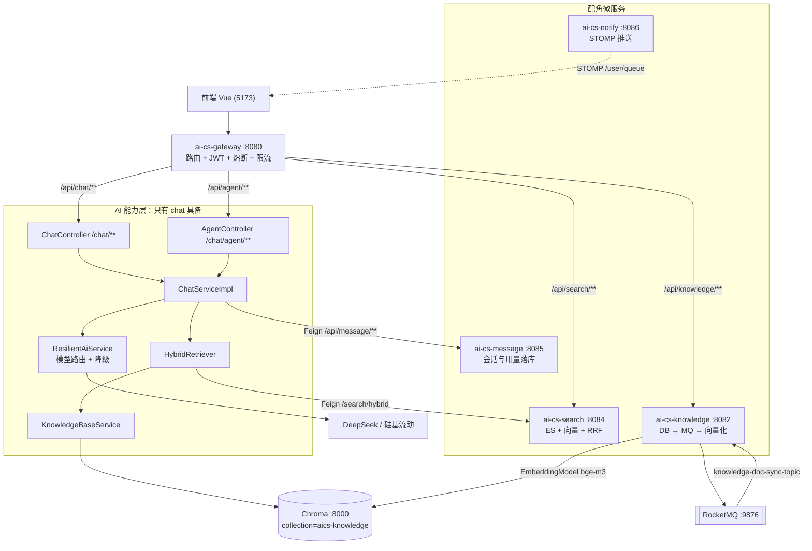
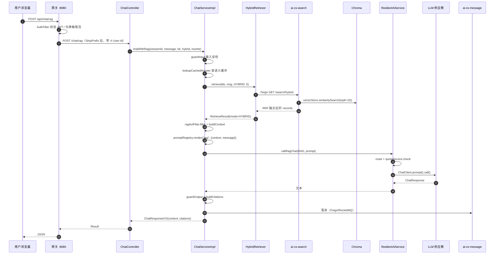

# AI 集成总览：AI 能力在这套微服务里的接线图

> **一句话结论**：这套系统的"AI 能力"几乎全部长在 `ai-cs-chat` 一个服务里（215 个 Java 类、50 处 `VectorStore`、77 处 `ChatClient`/`ChatModel`），其余模块只是配角——`ai-cs-search` 被 Feign 调来做混合召回、`ai-cs-knowledge` 只往同一个 Chroma 集合里写向量、`ai-cs-message`/`ai-cs-notify` 只负责落库与推送；而"接线"只有三种：网关路由、Feign 同步、RocketMQ 异步。
> **阅读前置**：需要知道 Controller/Service 分层、Feign 声明式调用、Spring Boot 自动配置；AI 概念（Embedding、RAG、SSE）在本文首次出现处都会解释。建议先读 [01-SpringAI入门](01-SpringAI入门.md)。
> **证据基线**：Spring AI 2.1.0 / Spring Boot 4.2.0 / Spring Cloud 2026.0.0 / JDK 17，项目代码按仓库 `main` 分支实测；Spring AI 源码锚点取自 `24-源码分析/assets/source/`。预计阅读 40 分钟。

## 本篇的证据边界

| 类别 | 本文怎么处理 | 例子 |
|---|---|---|
| 真实存在且已核对行号 | 给 `路径#L起-L止`，可直接点开 | `ai-cs-chat/src/main/java/com/aics/chat/controller/ChatController.java#L78-L91` |
| 已入库的 Spring AI 2.1.0 源码 | 给 `[[源码:文件#L..]]` 或代码块头部 `(src: ...)` | `ChatClient.java.md#L76-L147` |
| 未入库的第三方（Chroma 客户端、OpenAI Java SDK、Spring Cloud Gateway 内部实现） | 明确写"未入库，依据官方文档"，只讲可验证的行为 | 网关断路器 `forward:/gateway-fallback` 的处理语义 |
| 未落地（只有设计、注释或配置样例） | 单独列出并给验收标准 | LLM 全局预算硬限、eval 基线 |

本机探测（决定哪些结论只能静态核对）：

```powershell
foreach ($c in 'docker','redis-cli','mysql','chroma') {
  $x = Get-Command $c -ErrorAction SilentlyContinue
  "{0} => {1}" -f $c, ($(if($x){'FOUND'}else{'NOT FOUND'}))
}
```

```text
docker => NOT FOUND
redis-cli => NOT FOUND
mysql => NOT FOUND
chroma => NOT FOUND
```

四个全 `NOT FOUND`。所以本文所有"运行时行为"结论都来自源码阅读与可离线复现的静态统计，没有一条来自"我起了服务跑了一遍"；凡是我没把握的，会在正文里标成"待核实"。

## 0. 先看现象

### 现象一：把 `ai-cs-knowledge` 整个停掉，对话照样能答——但新文档永远搜不到

这是第一个让人误判的地方。停掉 8082 之后，`/api/chat/rag` 依然返回答案，看起来"降级做得很完善"。真相是：对话链路里根本没有指向 `ai-cs-knowledge` 的调用。判断依据很硬：

```powershell
Get-ChildItem ai-cs-chat\src\main\java -Recurse -Filter *.java |
  Select-String -Pattern '@FeignClient\(name\s*=\s*"([^"]+)"' |
  ForEach-Object { $_.Matches[0].Groups[1].Value } | Sort-Object | Get-Unique
```

```text
ai-cs-message
ai-cs-notify
ai-cs-order
ai-cs-product
ai-cs-search
```

chat 一共依赖 5 个下游服务，**没有 `ai-cs-knowledge`**。所以故障不是"对话挂了"，而是"写入侧静默断了"：正常情况下知识库服务的消费端会打出

```text
文档向量化完成: id=12, title=退款政策, chunks=7
```

（该日志在 `ai-cs-knowledge/src/main/java/com/aics/knowledge/service/KnowledgeVectorService.java#L86`。）停掉服务后这条日志再也不会出现，而检索侧只会留下一条"正常"的统计：

```text
混合检索完成: knowledgeBase=knowledge, 融合结果=0 条
```

问题在于——`融合结果=0 条` 和"知识库里本来就没这条"是同一个日志，没人能从中看出**是写入坏了还是确实没数据**。这是本篇第一个真缺口。

### 现象二：`/chat/stream/sse` 直连 8083 一个字一个字吐，走网关 8080 变成一次性吐完或直接失败

流式回答（SSE，Server-Sent Events，一种"服务端保持 HTTP 连接、持续 push `data:` 文本帧"的传输方式，浏览器用 `EventSource` 或前端 `fetch` 逐块读取）在这个项目里被套了两层超时：

- 服务内：`new SseEmitter(SSE_EMITTER_TIMEOUT)`，常量为 `5 * 60 * 1000L`（`ai-cs-chat/src/main/java/com/aics/chat/service/impl/ChatServiceImpl.java#L156`）；
- 网关内：每条路由都被 `.circuitBreaker(...)` 包了一层，并且失败时 `forward:/gateway-fallback`（`ai-cs-gateway/src/main/java/com/aics/gateway/config/RouteConfig.java#L174-L187`）。

网关这一层用的是 Spring Cloud CircuitBreaker 的默认超时语义（未入库，依据官方文档：Resilience4J `TimeLimiter` 默认 1 秒）。也就是说：一个设计上允许活 5 分钟的长连接，在网关侧的判定窗口可能只有秒级。表现出来就是前端 `event-stream` 里收到的不是 `data: {"content":"..."}` 而是网关降级 JSON，或者整段文本在最后一次性到达。**这条必须先按 §6 的调试手法 1 验证再下结论**，但它解释了"直连正常、过网关异常"这一类最容易被误判成"模型太慢"的症状。

### 现象三：要改"知识库问答的行为"，到底改 `ai-cs-chat` 还是 `ai-cs-py-chat`？

仓库里确实有个 Python 版对话服务 `ai-cs-py-chat`（FastAPI，11 个 py 文件），它的 README 第一段就写着：

> 服务独立运行在 `http://localhost:8000`，开发环境 CORS 全放开，现有前端 `ai-cs-frontend` 可直接跨域调用，**不需要改动 Java 网关**。

而全仓（排除 `node_modules`/`target`/`.venv`/`learning-docs`）匹配 `py-chat|py_chat` 的文件只有 2 处，且两处都在 py-chat 自己目录里（`ai-cs-py-chat/README.md#L5` 与 `ai-cs-py-chat/app/__init__.py#L1`）。也就是说：它没有任何 Java 调用方、没有网关路由、前端代码里也没有引用——**它是一条孤立支线**，改它不会影响线上任何一条链路，反之改 `ai-cs-chat` 也不会影响它。这一点必须写清楚，否则新人会花半天在两个"看起来都像对话服务"的模块之间反复确认。

这些现象指向同一件事：**这套系统的 AI 集成不是一个"全家桶框架"，而是一个 chat 服务加三条异构接线（网关路由 / Feign 同步 / MQ 异步），每条接线点各有一套自己的降级语义，而其中两处（知识库写入、消息投递）是静默失败。**

## 1. 整体地图



> **读图说明**：
> 1. 全图只有一个 AI 服务：`subgraph AI` 里的五个组件全在同一个 JVM（`ai-cs-chat`）。认图的捷径是看 `LLM` 有几条入边——只有一条，从 `ResilientAiService` 出来；`ai-cs-search`、`ai-cs-knowledge` 都不直接调模型。
> 2. 实线里唯一一条跨服务**同步**依赖是 `HR -->|Feign| SEARCH`（混合检索）；唯一一条跨服务**异步**依赖是 `KNOW --> MQ --> KNOW`（知识库写入自循环，生产与消费在同一个服务内）。这两条边性质完全相反，也是本文后续所有降级讨论的分界线。
> 3. `KNOW` 到 `CHROMA` 是**写**，`KB` 到 `CHROMA` 是**读+写**，两者落在同一个 `collection=aics-knowledge` 上，但代码之间没有任何 RPC 契约——靠配置对齐。这条"看不见的边"是本篇最容易踩的坑（见 3.7）。
> 4. `MSG`、`NOTIFY` 是两条旁路：`MSG` 走 Feign（阻塞、影响响应时间），`NOTIFY` 走 STOMP WebSocket（由 agent 的转人工工具触发，不影响对话主链路）。

### 组件责任表

| 组件 | 端口 | 在 AI 链路里负责什么 | 谁调它 | 调用方式 | 是否权威源 |
|---|---|---|---|---|---|
| `ai-cs-gateway` | 8080 | 唯一入口；路由前缀、JWT、断路器、Redis 令牌桶 | 前端 | HTTP | 否（配置在 `RouteConfig`） |
| `ai-cs-chat` | 8083 | ChatClient 调用、模型路由、RAG、Agent、流式、审核 | 网关 | HTTP | **是**（AI 逻辑唯一权威） |
| `ai-cs-search` | 8084 | ES 关键词 + 向量语义双路召回 + RRF 融合 | chat（Feign） | 同步 HTTP | 否（数据来自 Chroma + ES 索引） |
| `ai-cs-knowledge` | 8082 | 文档 CRUD、发 MQ、消费 MQ 做向量化 | 前端（网关）、RocketMQ | HTTP + MQ | 是（文档元数据在 MySQL） |
| `ai-cs-message` | 8085 | 会话消息与模型用量落库、配额查询 | chat（Feign）、RocketMQ | 同步 + 异步 | 是（历史消息权威源） |
| `ai-cs-notify` | 8086 | STOMP 转人工通知、订单事件推送 | chat（Feign）、RocketMQ | 同步 + 异步 | 否 |
| `ai-cs-mq` | 8090 | **工单（WorkOrder）域**的 MQ 管理台，与 AI 无关 | 前端 | HTTP | 否 |
| `ai-cs-py-chat` | 8000 | 独立演示服务，无调用方 | 无 | 前端可跨域直连 | 否（孤立） |
| Chroma | 8000 | 向量库，`collection=aics-knowledge` | chat、search、knowledge | HTTP（Spring AI 客户端） | 是（向量唯一落地） |
| RocketMQ | 9876 | 异步解耦：消息落库、知识同步 | chat、knowledge、notify | MQ | 否 |

## 2. 关键概念与关键类

术语先解释一遍，后文不再重复：

- **Embedding（把文本映射成高维向量的函数**，输出是一个 float 数组，语义相近的文本向量距离更近）——本项目用 `BAAI/bge-m3`，通过硅基流动（SiliconFlow）调用，与对话模型是两家供应商。
- **RAG（Retrieval-Augmented Generation，检索增强生成）**：先把问题拿去知识库检索出若干片段，再把片段塞进 prompt 让模型"照着资料答"，从而减少幻觉。
- **RRF（Reciprocal Rank Fusion，倒数排名融合）**：把两路检索结果按名次而非分数融合，公式 `score = Σ 1/(k + rank)`，`k` 一般取 60。
- **SSE / TTFT**：SSE 见§0；TTFT（Time To First Token）指从请求发出到收到第一个 token 的毫秒数，是流式体验的核心指标。
- **Advisor**：Spring AI 的"对话拦截器链"，类似 Servlet Filter，在调用模型前后插入逻辑（记忆、检索、工具调用都在这一层）。
- **Tool Calling（工具调用）**：模型输出"我要调用某个方法+参数"，框架反射执行后把结果回填给模型再生成最终答案。

| 名称 | 位置 | 角色 | 关键方法/字段 |
|---|---|---|---|
| `ChatClient` | Spring AI 2.1.0 | 面向开发者的门面（Fluent API），屏蔽 provider 差异 | `prompt()`、`prompt(String)`、`prompt(Prompt)` [[源码:ChatClient.java.md#L143-L147]] |
| `ChatModel` | Spring AI 2.1.0 | 模型抽象层，`call(Prompt)` 是同步调用的最底层 | `ChatResponse call(Prompt)` [[源码:ChatModel.java.md#L45-L60]] |
| `StreamingChatModel` | Spring AI 2.1.0 | 流式抽象，`ChatModel` 继承它 | `Flux<ChatResponse> stream(Prompt)` [[源码:StreamingChatModel.java.md#L45-L64]] |
| `Prompt` / `Message` | Spring AI 2.1.0 | 一次请求的载体：一串 `Message`（system/user/assistant） | `getInstructions()`、`getContents()` [[源码:Prompt.java.md#L62-L113]] |
| `VectorStore` | Spring AI 2.1.0 | 向量库统一接口：写（`add`/`upsert`/`delete`）+ 查（继承 `VectorStoreRetriever`） | `add(List<Document>)` [[源码:VectorStore.java.md#L40-L51]] |
| `VectorStoreRetriever` | Spring AI 2.1.0 | 检索接口，`SearchRequest` 里带 topK / 阈值 / filter 表达式 | `similaritySearch(SearchRequest)` [[源码:VectorStoreRetriever.java.md#L51-L69]] |
| `EmbeddingModel` | Spring AI 2.1.0 | 文本转向量的抽象 | `float[] embed(Document)` [[源码:EmbeddingModel.java.md#L39-L60]] |
| `ToolCallbackProvider` | Spring AI 2.1.0 | 把 `@Tool` 方法注册成模型可调用的工具 | `ToolCallback[] getToolCallbacks()` [[源码:ToolCallbackProvider.java.md#L42-L44]] |
| `SessionService` | Spring AI 2.1.0 | 2.1 新增的会话级记忆抽象（本项目**未采用**） | `findById(String)` [[源码:SessionService.java.md#L56-L95]] |
| `ChatController` | `ai-cs-chat/src/main/java/com/aics/chat/controller/ChatController.java#L51` | 对话 HTTP 入口，`/chat/**` | `POST /chat/send` L78、`/chat/rag` L119、`/chat/stream/sse` L167 |
| `AgentController` | `ai-cs-chat/src/main/java/com/aics/chat/agent/AgentController.java#L35` | Agent 入口，注意它在 `agent` 包而不是 `controller` 包 | `POST /chat/agent` L47、`/stream/sse` L130 |
| `ChatServiceImpl` | `ai-cs-chat/src/main/java/com/aics/chat/service/impl/ChatServiceImpl.java#L132` | 对话主编排：安检→历史→检索→渲染→调模型→引用→落库 | `chat()` L322、`chatWithRag()` L400、`chatStreamSse()` L520 |
| `ResilientAiService` | `ai-cs-chat/src/main/java/com/aics/chat/service/impl/ResilientAiService.java#L80` | 模型路由 + 重试 + 降级文案的唯一出口 | `callChat` L112、`callRagChat` L121、`callSseRagStream` L157、`fallbackText` L451 |
| `HybridRetriever` | `ai-cs-chat/src/main/java/com/aics/chat/rag/retrieve/HybridRetriever.java#L98` | 四条检索路径的分发器 | `retrieve(kb,query,mode,topK)` L119 |
| `KnowledgeBaseService` | `ai-cs-chat/src/main/java/com/aics/chat/service/KnowledgeBaseService.java#L83` | chat 侧自己读写 Chroma | `search()` L228、`searchRaw()` L265、`buildContext()` L287 |
| `HybridSearchServiceImpl` | `ai-cs-search/src/main/java/com/aics/search/hybrid/HybridSearchServiceImpl.java#L38` | ES + 向量双路召回 + RRF | `hybridSearch()` L50、`esSearch()` L80、`vectorSearch()` L123 |
| `RrfMerger` | `ai-cs-search/src/main/java/com/aics/search/hybrid/RrfMerger.java#L21` | 纯静态 RRF 融合工具 | `merge(list1,list2,topK,k)` L35 |
| `KnowledgeVectorService` | `ai-cs-knowledge/src/main/java/com/aics/knowledge/service/KnowledgeVectorService.java#L49` | 切成 chunk → embedding → 入 Chroma | `vectorize()` L69、`deleteByDocumentId()` L103 |
| `KnowledgeSyncConsumer` | `ai-cs-knowledge/src/main/java/com/aics/knowledge/mq/KnowledgeSyncConsumer.java#L39` | 消费 `knowledge-doc-sync-topic` 触发向量化 | `onMessage()` L52 |
| `QuotaService` | `ai-cs-chat/src/main/java/com/aics/chat/observability/QuotaService.java#L27` | 按用户+场景查配额，检查失败时 fail-open | `check()` L38 |

## 3. 原理与证据逐段精读

### 3.1 网关是唯一入口：三种前缀语义决定了"后端能不能收到这条请求"

**在干什么。** 所有外部流量先到 8080，由 `RouteConfig` 按前缀分流。这段代码值得逐条看，因为它决定了"前端写的 URL"和"后端 Controller 上写的 URL"之间的翻译规则：

```java
.route("ai-cs-knowledge", r -> r
        .path("/api/knowledge/**")
        .filters(f -> addResilience(f.stripPrefix(1), "cb-knowledge", redisRateLimiter, userKeyResolver))
        .uri("lb://ai-cs-knowledge"))
.route("ai-cs-rag", r -> r
        .path("/api/rag/**")
        .filters(f -> addResilience(f.stripPrefix(1), "cb-rag", redisRateLimiter, userKeyResolver))
        .uri("lb://ai-cs-chat"))
.route("ai-cs-observability", r -> r
        .path("/api/observability/**")
        .filters(f -> addResilience(f, "cb-observability", redisRateLimiter, userKeyResolver))
        .uri("lb://ai-cs-chat"))
.route("ai-cs-agent", r -> r
        .path("/api/agent/**")
        .filters(f -> addResilience(f.rewritePath("/api/agent/(?<segment>.*)", "/chat/agent/${segment}"),
                "cb-agent", redisRateLimiter, userKeyResolver))
        .uri("lb://ai-cs-chat"))
.route("ai-cs-notify", r -> r
        .path("/api/notify/**")
        .filters(f -> addResilience(f, "cb-notify", redisRateLimiter, userKeyResolver))
        .uri("lb://ai-cs-notify"))
```

> 出处：`ai-cs-gateway/src/main/java/com/aics/gateway/config/RouteConfig.java#L71-L122`（已去掉原文件的注释行，控制流与过滤器完全一致）。注意三条路由的 `f` 后面有 `stripPrefix(1)`、两条没有——这就是下面表格里"三种语义"的代码来源。

三种语义要能背下来：

| 语义 | 例子 | 后端收到的路径 | 为什么这么设计 |
|---|---|---|---|
| `StripPrefix=1` | `/api/chat/send` | `/chat/send` | `/api` 只是网关的命名空间，后端 Controller 上不该出现它 |
| 不剥前缀 | `/api/message/**`、`/api/notify/**`、`/api/observability/**` | `/api/message/...` | 这些 Controller 的 `@RequestMapping` 本身就写了 `/api/...`（如 `NotifyController` 是 `/api/notify`），再剥就 404 |
| `RewritePath` | `/api/agent/runs/1` | `/chat/agent/runs/1` | `/api/agent` 是产品语义，`/chat/agent` 是代码结构；改用 rewrite 而不是"让 Controller 迁就 URL" |

**为什么这么设计。** 三个语义混用看着不统一，但它换来一个好处：**后端 URL 由各服务自己决定，网关只做翻译**。如果强行统一成"全部剥 `/api`"，就得去改 `NotifyController` 的 `@RequestMapping`，那会把"是否经过网关"这个部署细节泄漏进业务类。

**换写法会怎样。** 如果图省事把所有路由都配 `StripPrefix=1`，`/api/notify/handoff` 到后端就变成 `/notify/handoff`，而 `ai-cs-notify` 的 Controller 声明是 `@RequestMapping("/api/notify")`（`ai-cs-notify/src/main/java/com/aics/notify/controller/NotifyController.java#L19`），直接 404——而且 404 是"业务不存在"的语义，排查时会先怀疑路由规则、最后才怀疑前缀，非常耗时。

**常见坑。** `/api/rag/**` 指向的是 **chat** 而不是 knowledge（注释写得很直白："向量知识库（chat 服务的 RAG 入库/检索）"）。原因见 3.6：chat 自己也能写向量库。于是"知识库文档上传"这件事有两个入口：走 `/api/knowledge/**` 到 knowledge 服务，或走 `/api/rag/**` 到 chat 服务——这就是§0 现象一的根因之一。

另一层坑在限流键上：`userKeyResolver` 优先取 `X-User-Id` 拼成 `u:{id}`，取不到才退化成 `ip:{ip}`。这意味着**网关必须先认人再限流**，否则同一 NAT 出口后面的所有用户会共享一个桶。

### 3.2 chat 的六层链路，以及为什么所有调用都要穿过 `ChatClient`

**在干什么。** 一个"用户提问"在 chat 内部要过六层：

```text
Controller → ChatServiceImpl → ResilientAiService → ModelRouter → ChatClient → ChatModel(provider)
                    ↓                    ↓
              HybridRetriever      ModelHealthRegistry / QuotaService / ModelUsageRecorder
```

中间任何一层想加功能（审核、缓存、观测、配额），都不需要改 provider 的调用代码，因为**所有出网请求都收敛到 `ResilientAiService` 这一处**。这是本项目"AI 可运维性"的底座。

Spring AI 这一侧的分层是官方的，`ChatClient` 只是门面：

```java
// (src: ChatClient.java.md#L143-L147)
// (elided: 接口前半部分的 builder 与默认方法)
	ChatClientRequestSpec prompt();

	ChatClientRequestSpec prompt(String content);

	ChatClientRequestSpec prompt(Prompt prompt);
```

三个重载的差别只有入参形态：无参版等后续 `.user(...)` 补内容；`prompt(String)` 是最常用的"一句话"；`prompt(Prompt)` 接收已经拼好的多消息结构（本项目的 RAG 场景就是先用 `PromptRegistry` 渲染模板再包成 `Prompt`）。

**为什么这么设计。** `ChatClient` 不继承 `ChatModel`，是有意的：`ChatModel` 的 `call(Prompt)` 只做一次裸调用（[[源码:ChatModel.java.md#L45-L60]]），而 `ChatClient` 负责组装 advisor 链、记忆、工具、结构化输出。**把"编排"和"传输"分开**，才能让 provider（DeepSeek、硅基流动）只实现最简单的 `call`/`stream` 两个方法——这也正是本项目能在一套代码里同时接两家的原因。

**换写法会怎样。** 如果直接在 `ChatServiceImpl` 里注入 `OpenAiChatModel` 并自己拼 `Prompt`，会立刻丢掉三样东西：Advisor 链（记忆、RAG 注入）、`ModelCapability` 判断（有没有 `tool-calling`）、以及 2.1 的流式封装。更麻烦的是，模型路由就无处安放——你总不能在业务 Service 里 `if (modelId.equals(...))` 分支选客户端。

**常见坑。** `ChatClient` 是有状态的（绑定了一个 `ChatModel` 或一套 default 配置）。本项目用 `RoutedChatClientFactory`（`ai-cs-chat/src/main/java/com/aics/chat/modelrouter/RoutedChatClientFactory.java#L28`）按模型 id 造 client，**不能把某个 `ChatClient` 实例当成"全局通用"缓存起来**，否则路由切到备用模型后仍在用旧 client。

### 3.3 `ResilientAiService`：路由、重试、以及"用一句文案当降级信号"

**在干什么。** 它是唯一出口，非流式路径的主干逻辑在 `invokeNonStream`：先算路由决策，拿不到模型就直接给兜底文案；拿到就把 `primary + fallbacks` 拼成一条链顺序试：

```java
// ai-cs-chat/src/main/java/com/aics/chat/service/impl/ResilientAiService.java#L180-L235（节选）
RouteDecision decision = route(scenario, userId);
if (decision == null || decision.getSelectedModelId() == null) {
    log.warn("模型路由无可用模型: scenario={}, reason={}", scenario, decision);
    return fallbackText(scenario);
}
for (String modelId : chain) {
    try {
        // ...
        String text = callWithTransientRetry(holder, call);
        modelUsageRecorder.record(/* SUCCESS */);
        return text;
    } catch (Exception e) {
        // 记 FAILED，fallbackFrom = modelId，继续下一个
    }
}
log.error("所有模型调用失败: scenario={}, lastError={}", scenario, lastError);
return fallbackText(scenario);
```

> 出处：`ai-cs-chat/src/main/java/com/aics/chat/service/impl/ResilientAiService.java#L172-L240`（上面把日志与统计代码按语义压缩，控制流未改）。

兜底文案本身在这：

```java
// ai-cs-chat/src/main/java/com/aics/chat/service/impl/ResilientAiService.java#L451-L456
private String fallbackText(ModelScenario scenario) {
    if (scenario == ModelScenario.SUMMARY) {
        return "";
    }
    return "AI 助手暂时繁忙，请稍后重试。";
}
```

> 出处：`ai-cs-chat/src/main/java/com/aics/chat/service/impl/ResilientAiService.java#L451-L456`。

**为什么这么设计。** 两个细节都是"有过事故才会写出来"的：

1. `SUMMARY` 场景返回空串而不是礼貌话。摘要结果会被拼进下一轮对话的 system message，如果兜底文案被当摘要存进去，用户后续每轮都会看到模型"记得"自己曾说"我暂时繁忙"。
2. 兜底文案是**返回值而不是异常**。好处是调用方（`ChatServiceImpl` 的 `.get()`）不用写 try-catch 就能拿到字符串；坏处见下。

**换写法会怎样。** 如果超过 fallback 就抛异常，`ChatController` 会返回 HTTP 500，前端弹"系统错误"——对普通用户是灾难。所以"降级成一句人话"是产品正确的选择。但代价是：**降级与正常回答在协议层不可区分**（都是 200 + 一段文本）。前端只能靠字符串匹配判断"这是兜底"，非常脆弱。这是真实的、可改进的取舍点。

**常见坑。** 流式路径的规则完全不同：`invokeStream` 的注释明确写了"流式不重试、不走 fallback 链"，理由是 Flux 一旦开始往外发 token，再换模型会让前端收到重复或乱序的内容。流式的降级信号是一条**带 `[ERROR]` 前缀的假数据帧**：`Flux.just("[ERROR]AI 助手暂时繁忙，请稍后重试。")`，由 `ChatServiceImpl` 的 `onNext` 识别前缀后转成 `{"error": "..."}` 事件再 `complete()`。所以排查流式问题时，**别去日志里找异常栈，要去前端看有没有收到 `error` 帧**。

### 3.4 `HybridRetriever` 的四条检索路径，以及"哪条会出网"

**在干什么。** 检索不是一条路，是一个四选一的分发器（`retrieve(kb, query, mode, topK)`，`ai-cs-chat/src/main/java/com/aics/chat/rag/retrieve/HybridRetriever.java#L119`）：

| mode | 实际动作 | 出网吗 | 失败时 |
|---|---|---|---|
| `VECTOR` | `knowledgeBaseService.search()` → chat 自己的 `VectorStore` → Chroma | 出网到 Chroma | 直接抛，无兜底 |
| `HYBRID` | Feign 调 `ai-cs-search` 的 `GET /search/hybrid` | 出网到 search | 降级为 `VECTOR` |
| `HYBRID_QUERY_REWRITE` | 先 LLM 改写子查询 + HyDE，再多路检索后 `MultiQueryMerger` 融合 | 出网到 LLM + Chroma | 无改写时降级 |
| `GRAPH_RAG` | `GraphRagService` 走图存储（Neo4j 或内存实现） | 视实现 | 降级为纯向量 |

`HYBRID` 这条最关键，因为它把"微服务协作"和"降级"写在同一个方法里：

```java
// ai-cs-chat/src/main/java/com/aics/chat/rag/retrieve/HybridRetriever.java#L176-L212（节选）
private RetrieveResult hybrid(String knowledgeBase, String query, int topK) {
    try {
        Result<ChatHybridPageVO> result = searchFeignClient.hybridSearch(knowledgeBase, query, 1, topK);
        if (result == null || !result.isSuccess() || result.getData() == null
                || result.getData().getRecords() == null) {
            return vector(knowledgeBase, query, topK, "搜索服务无数据");
        }
        // 逐条转成 Spring AI Document，保留 knowledgeBase/documentId/title/page 元数据
        return buildResult(query, docs, RetrievalMode.HYBRID.name(), null);
    } catch (Exception e) {
        log.warn("混合检索失败，降级纯向量: kb={}, query={}, err={}", knowledgeBase, query, e.getMessage());
        return vector(knowledgeBase, query, topK, "搜索服务不可用");
    }
}
```

> 出处：`ai-cs-chat/src/main/java/com/aics/chat/rag/retrieve/HybridRetriever.java#L176-L213`。

**为什么这么设计。** 注意两个降级点的**语义不同**：`"搜索服务无数据"` 表示"对方活着但没命中"，`"搜索服务不可用"` 表示"对方死了/超时"。都降级到纯向量，但 `degradeReason` 被写进 `RetrieveResult`，最后会出现在 trace/回答元数据里——这就是排查"为什么这次召回质量差"的唯一线索。另外，转换成 `Document` 时把 `documentId/title/page_number` 塞进 metadata，是引用溯源（前端显示"出自《退款政策》第 3 页"）的前提，丢了就再也补不回来。

**换写法会怎样。** 如果 Feign 失败时直接抛出，那么 `ai-cs-search` 一抖动，所有 RAG 问答全挂——而向量检索这条路本来就在 chat 进程内可用，白白浪费。反过来，如果失败时返回空列表（而不是降级到向量），模型会收到"没有参考资料"的 prompt，答案质量下降但日志一片祥和，这是最坏的一种"看起来正常"。

**常见坑。** `vector(...)` 内部调的是 `knowledgeBaseService.search(knowledgeBase, query, topK, 0.0)`——**相似度阈值传 `0.0`**。也就是说降级路径不做相关性过滤，Top-K 全收。这是刻意的（宁可多召回也不空手），但意味着降级期间的答案更容易出现"资料里根本没有"的引用，排查时要先确认 `RetrievalMode` 是不是 `VECTOR`。

### 3.5 `ai-cs-search` 内部：两路召回、一个公式、两个方向的降级

**在干什么。** 混合检索服务收到请求后并行做两件事，再融合：

```java
// ai-cs-search/src/main/java/com/aics/search/hybrid/HybridSearchServiceImpl.java#L50-L74（节选）
List<RankedItem> esItems = esSearch(knowledgeBase, query);      // ES 关键词
List<RankedItem> vectorItems = vectorSearch(knowledgeBase, query); // Chroma 语义
if (esItems.isEmpty() && vectorItems.isEmpty()) {
    log.warn("混合检索两路均无结果: knowledgeBase={}, query={}", knowledgeBase, query);
    return Collections.emptyList();
}
if (esItems.isEmpty()) {
    log.info("ES 路无结果/异常，降级为仅向量结果: knowledgeBase={}, 命中={}", knowledgeBase, vectorItems.size());
} else if (vectorItems.isEmpty()) {
    // 对称降级：只剩 ES 路
}
return RrfMerger.merge(esItems, vectorItems, topK, RRF_K);
```

> 出处：`ai-cs-search/src/main/java/com/aics/search/hybrid/HybridSearchServiceImpl.java#L50-L74`。

融合公式本身只有一行，在 `RrfMerger` 里：

```java
// ai-cs-search/src/main/java/com/aics/search/hybrid/RrfMerger.java#L58-L75（节选）
for (int i = 0; i < items.size(); i++) {
    int rank = i + 1;
    scores.merge(item.getId(), 1.0 / (k + rank), Double::sum);
}
```

> 出处：`ai-cs-search/src/main/java/com/aics/search/hybrid/RrfMerger.java#L58-L75`（`k` 由调用方传入，本服务传 `RRF_K = 60`）。

**为什么这么设计。** 两路检索的"分数"根本不可比——ES 的 BM25 分数是 0~∞ 的无界值，向量的余弦相似度是 -1~1。任何"归一化后加权求和"都要先定权重，而权重又和语料相关。RRF 绕开了这个问题：**只看名次，不看分数**。`1/(60+1)` 与 `1/(60+2)` 差距很小，这恰好实现了"在另一路也排得靠前"才有额外加分的效果，避免单路的第一名碾压一切。

**换写法会怎样。** 如果改成 `0.5*esScore + 0.5*vectorScore`，需要 ES 索引和向量库两侧都做归一化，且换一个知识库就得重新调权重；更糟的是两路都缺席一条时分数尺度会整体漂移，`topK` 截断位置每次都不同，回归测试无法稳定。

**常见坑。** 双向降级是把异常吞在 `esSearch`/`vectorSearch` 内部（`log.warn("ES 检索失败（降级为仅向量检索）")` L113、`log.warn("向量检索失败（降级为仅 ES 检索）")` L149），返回 `emptyList()`。这带来一个隐蔽后果：**当 ES 的索引名算错、或 Chroma 不可用时，接口仍然是 200，只是质量下降**。ES 索引名的计算方式是 `knowledgeBase.toLowerCase(Locale.ROOT)`，取不到就退化成 `default`——如果前端传的 `knowledgeBase` 大小写与建索引时不一致，你会一直在搜一个空索引，日志里只有"ES 路无结果"这句 `info`。

### 3.6 `ai-cs-knowledge` 的写入链路：DB → MQ → 向量化，以及被吞掉的异常

**在干什么。** 写路径是"写库 + 发消息"两段式，向量化发生在消费者里：

```text
POST /knowledge  →  KnowledgeServiceImpl.createDocument  →  MySQL 落库
                          ↓ KnowledgeSyncProducer
                   topic=knowledge-doc-sync-topic
                          ↓ KnowledgeSyncConsumer.onMessage
        KnowledgeVectorService.vectorize: TokenTextSplitter 切块 → EmbeddingModel → vectorStore.add
```

关键代码是向量化本身：

```java
// ai-cs-knowledge/src/main/java/com/aics/knowledge/service/KnowledgeVectorService.java#L69-L92（节选）
public int vectorize(KnowledgeDocument doc) {
    if (doc.getContent() == null || doc.getContent().isBlank()) {
        log.info("文档内容为空，跳过向量化: id={}", doc.getId());
        return 0;
    }
    List<Document> chunks = new TokenTextSplitter().split(new Document(doc.getContent()));
    // metadata: knowledgeBase / documentId / title
    vectorStore.add(chunks);
    log.info("文档向量化完成: id={}, title={}, chunks={}", doc.getId(), doc.getTitle(), chunks.size());
    return chunks.size();
}
```

> 出处：`ai-cs-knowledge/src/main/java/com/aics/knowledge/service/KnowledgeVectorService.java#L69-L92`（`catch` 分支见下文）。

`vectorStore.add(...)` 来自 Spring AI 的统一写接口，签名很短：

```java
// (src: VectorStoreRetriever.java.md#L51-L60)
// (elided: 上方接口声明与注释)
public interface VectorStoreRetriever {

	/**
	 * Perform a similarity search over the vector store.
	 */
	List<Document> similaritySearch(SearchRequest request);
```

写侧对应的是 `VectorStore#add(List<Document>)`（[[源码:VectorStore.java.md#L40-L51]]）。选 `add` 而不是 2.1 新增的 `upsert` 是有后果的：官方注释明确写着 `add(List)` 对重复 id 的行为"由底层 provider 决定"，而 `upsert` 才是 replace-by-id（[[源码:VectorStore.java.md#L64-L82]]）。本项目用 `add`，所以**同一条消息被重复消费时会在 Chroma 里留下重复 chunk**，而消费端的 `return 0` 会让 RocketMQ 认为消费成功——"天然可重试"的注释与实际行为并不一致。

**为什么这么设计。** 用 MQ 而不是同步向量化，是因为 embedding 是**外部 HTTP 调用**（bge-m3 在硅基流动），一批文档切出几十个 chunk 就是几十次调用，放在 `POST /knowledge` 里会让接口秒级变十秒级。异步化后接口只保证"文档已入库"，向量化失败可以重投。

**换写法会怎样。** 改成同步：写接口 P99 直接受 embedding 供应商抖动影响，且没有幂等基础（重试会重复写库）。改成"写完库直接调 chat 的入库接口"：多一条 RPC，且 chat 挂的时候连文档都存不进去。

**常见坑。** 三处必须记住：

1. `vectorize` 的 `catch` 是 `log.error("文档向量化失败: id={}, err={}", ...)` 后 `return 0`——**吞异常**。消费端不会重试，失败文档永久缺失，且只有一条 error 日志。
2. metadata 里的 `documentId` 写的是**文档主键**（`doc.getId()`），而 chat 侧 `KnowledgeBaseService.addChunks` 写的 `documentId` 是**chunk id**（`chunk.getId()`）。于是 `deleteByDocumentId(12)` 用 `vectorStore.delete("documentId == '12'")` 只能删掉 knowledge 服务写入的那批数据，删不掉 chat 写入的。这是"两个写入者"的直接后果，见 3.7。
3. `KnowledgeController` 只有 5 个 CRUD 端点（`ai-cs-knowledge/src/main/java/com/aics/knowledge/controller/KnowledgeController.java#L47`），**没有文件上传接口**。所谓"上传→解析→切分"，在 knowledge 服务里其实只有"文本内容入库"，PDF/Tika 解析能力在 chat 的 `KnowledgeBaseService.addFile` 里（`ai-cs-chat/src/main/java/com/aics/chat/service/KnowledgeBaseService.java#L125-L140`）。

### 3.7 两个写入者、一个集合：向量空间靠"配置对齐"而不是接口契约

**在干什么。** 同一份 Chroma 集合 `aics-knowledge` 被两个服务写：

| 写入者 | 入口 | 切块方式 | metadata `documentId` | 解析能力 |
|---|---|---|---|---|
| `ai-cs-knowledge` | `/api/knowledge/**` → MQ | `new TokenTextSplitter()` | 文档主键 | 无（只收纯文本 `content`） |
| `ai-cs-chat` | `/api/rag/**` → `KnowledgeBaseService.addFile` | `new TokenTextSplitter().apply(...)` | chunk id | PDF / Tika / Text 三分支 |

两边能"对上"，靠的是三处配置完全相同：

```yaml
spring:
  ai:
    vectorstore:
      chroma:
        initialize-schema: false
        collection-name: aics-knowledge
        client:
          host: http://${aics.mysql.host:localhost}
          port: ${CHROMA_PORT:8000}
```

> 出处：`ai-cs-chat/src/main/resources/application.yml#L45-L52`、`ai-cs-knowledge/src/main/resources/application.yml#L25-L34`。

再加上一条"必须用同一个 embedding 模型"的隐式约定——它在 chat 的配置类里只以**注释**存在（`ai-cs-chat/src/main/java/com/aics/chat/config/SpringAiConfig.java#L90`，原文大意："ai-cs-knowledge 模块使用相同的 bge-m3 模型进行文档向量化，保证向量空间一致"）。

**为什么这么设计。** 复用同一个 `VectorStore` 接口和同一个 collection，可以让"写入"和"检索"各自独立部署，不需要 chat 反向依赖 knowledge 的 API。代价是契约退化成"人肉约定"。

**换写法会怎样。** 更规范的做法是让 chat 只读、knowledge 只写，用 Feign 反向调用：`/chat/retrieve` 由 knowledge 提供。但那样 chat 的每一次问答都多一次 RPC，且 knowledge 挂了会连带对话不可用（正是很多项目踩过的坑）。本项目选了"耦合在存储层"，牺牲一致性换可用性——这是可辩护的，前提是**把约定写成代码**（见可扩展点）。

**常见坑。** 这条坑最贵：向量空间（Embedding 输出的维度与语义方向）由**模型决定**。两边如果用了不同的 embedding 模型（哪怕都是 bge 系列的不同版本），向量虽然维度可能相同，但相似度计算毫无意义——检索不会报错，只会"怎么搜都不准"。唯一判据是：确认两侧 `aics.embedding.model` / Nacos 配置一致，且 `spring.ai.model.embedding: none` 已经关掉自动装配（`ai-cs-chat/src/main/resources/application.yml#L38`），否则 Spring AI 会按 OpenAI 默认再建一个 embedding 模型，两个 Bean 抢着用。

### 3.8 流式回传：Spring MVC 里没有 `Flux` 渲染器，只能手工桥接

**在干什么。** 这是全篇最容易"看代码看不懂"的一段。项目是 Spring MVC（Servlet 栈），不是 WebFlux，所以不能直接 `@ResponseBody Flux<...>` 返回流——Spring MVC 没有为 `Flux` 提供 SSE 消息转换器。于是代码把 Flux 订阅下来，一条条塞进 `SseEmitter`：

```java
// ai-cs-chat/src/main/java/com/aics/chat/service/impl/ChatServiceImpl.java#L646-L695（节选）
flux.subscribe(
    chunk -> {
        if (chunk.startsWith("[ERROR]")) {
            log.warn("SSE流式降级: sessionId={}, msg={}", sessionId, chunk);
            emitter.send(Map.of("error", errorMsg));
            emitter.complete();
            return;
        }
        full.append(chunk);
        emitter.send(Map.of("content", chunk));
    },
    error -> { /* 发 error 帧后 complete */ },
    () -> { /* 发 done 帧 + citations，落库，complete */ }
);
```

> 出处：`ai-cs-chat/src/main/java/com/aics/chat/service/impl/ChatServiceImpl.java#L646-L695`。

**为什么这么设计。** 四个决定都有明确理由：

1. **为什么 `subscribe` 而不是返回 Flux**：Servlet 栈下 `SseEmitter` 是原生支持（`produces = TEXT_EVENT_STREAM_VALUE`，见 `ai-cs-chat/src/main/java/com/aics/chat/controller/ChatController.java#L167-L180`）。
2. **为什么用 `StringBuilder full` 累积**：流结束后要把完整答案落库，如果重新调一次模型就白烧一遍 token 和延迟。
3. **为什么 `StringBuilder` 不加锁**：Reactive Streams 规范要求 `onNext` 串行调用，所以不需要。
4. **为什么降级用 `complete()` 而不是 `completeWithError()`**：降级是**预期内**的容错，用 error 会让浏览器 `EventSource` 直接断开重连，反而更糟。

**换写法会怎样。** 如果为了"技术上更纯粹"把 chat 改成 WebFlux，会牵动 Redis、MyBatis、Sentinel 全部改响应式——这不是一个文档章节能承担的改造。反过来，如果在 Servlet 里硬返回 `Flux`，最常见的现象是"接口 200 但 body 是一个序列化后的对象数组"，前端一个 token 都流不出来。

**常见坑。** 三个：

- `SseEmitter` 的 5 分钟超时与服务端线程无关，**它只是个异步容器的 timeout**；真正的长连接还受网关、Nginx、浏览器各自超时约束。任何一层更短，用户看到的就是"突然结束"。
- 流式场景下工具调用发生在 Spring AI 的 `ChatModel` 内部（`ToolCallingManager`），`subscribe` 收到的 chunk 永远是最终文本，**对工具执行完全无感知**。所以"流式 + Agent"时你别指望在 onNext 里看到工具中间态。
- 输入被安全策略拦截时走的是另一条分支：直接 `send(Map.of("content", blockMessage))` + `Map.of("done", true, ...)` + `complete()`（`ChatServiceImpl.java#L529-L540`），事件形态和非流式返回不同，前端两种都要处理。

### 3.9 落库与推送：一条 MQ 边、一条 STOMP 边

**在干什么。** 对话产生的数据有两条外流：

1. **异步落库**：`ChatMessageProducer.send(...)` 投递到 `chat-message-topic`，由 `ai-cs-message` 的 `ChatMessageConsumer` 消费入库。
2. **实时推送**：Agent 的转人工工具通过 Feign 调 `ai-cs-notify` 的 `POST /api/notify/handoff`，服务端用 `SimpMessagingTemplate.convertAndSendToUser(...)` 推到 `/user/queue`。

投递侧最关键的三行是它**故意不重试**：

```java
// ai-cs-chat/src/main/java/com/aics/chat/mq/ChatMessageProducer.java#L32-L43（节选）
try {
    log.info("投递对话消息到 RocketMQ: sessionKey={}, role={}, len={}", sessionKey, role, content.length());
    rocketMQTemplate.convertAndSend(TOPIC, message);
} catch (Exception e) {
    log.warn("对话消息投递失败: sessionKey={}, role={}, err={}", sessionKey, role, e.getMessage());
}
```

> 出处：`ai-cs-chat/src/main/java/com/aics/chat/mq/ChatMessageProducer.java#L32-L43`；消费端为 `ai-cs-message/src/main/java/com/aics/message/consumer/ChatMessageConsumer.java#L30-L53`。

**为什么这么设计。** 用户的回答已经生成好了，不能因为"落库侧抖了一下"就让他看到错误页。所以这里选择"丢消息保响应"——加上 Redis 里有会话热缓存，短期上下文不会断，只是持久化丢一条。

**换写法会怎样。** 改成同步 Feign 落库（`MessageFeignClient` 已经有这个能力），响应时间会多一跳，而且 message 服务挂掉时对话直接不可用。改成"失败重试 N 次"，会在 MQ 不可用时把请求线程拖住，比丢一条消息糟得多。

**常见坑。** 转人工这条边是**反的**：它必须可靠，所以 `ai-cs-notify` 侧失败会 `throw new BusinessException(ResultCode.NOTIFY_SEND_FAIL)`（`ai-cs-notify/src/main/java/com/aics/notify/service/impl/NotifyHandoffServiceImpl.java#L33-L36`），异常会顺着 Feign 传回 chat 的工具层——也就是说，"消息落库失败静默、转人工通知失败报错"是两种不同强度的约定，别写反。

### 3.10 降级矩阵：模型挂了 / 检索挂了 / 下游挂了，分别会怎样

把前面各节的结论汇总成一张表，这是本篇最该背下来的东西：

| 故障点 | 感知位置 | 实际行为（代码证据） | 用户看到 | 落地状态 |
|---|---|---|---|---|
| 主模型超时/5xx（非流式） | `ResilientAiService#invokeNonStream` | 顺序试 `primary → fallbacks`；全失败返回兜底文案 | HTTP 200 + "AI 助手暂时繁忙，请稍后重试。" | ✅ 已落地 |
| 主模型超时/5xx（流式） | `ResilientAiService#invokeStream` | **不重试、不换模型**，推一帧 `[ERROR]...` | SSE `error` 事件 | ✅ 已落地 |
| 所有模型都没配置 | `ModelRouterProperties#validate` | 启动期 fail-fast；运行期路由为空 | 同上兜底文案 | ✅ 已落地 |
| `ai-cs-search` 挂 | `HybridRetriever#hybrid` catch | 降级纯向量，`degradeReason="搜索服务不可用"` | 正常回答，召回质量下降 | ✅ 已落地 |
| Chroma / Embedding 挂 | `KnowledgeBaseService#searchRaw` 抛出 | 异常一路上抛到 `chatWithRag`，**没有"无检索直答"降级** | RAG 接口报错 | ❌ 未落地 |
| `ai-cs-knowledge` 挂 | 无人感知 | 对话完全不受影响；只是新文档永不向量化（MQ 消费端不在，消息堆积但无人监控） | 无异常表现，检索悄悄变空 | ❌ 未落地（缺写入失败告警/补偿） |
| `ai-cs-message` 挂 | `QuotaService#check` catch | 配额检查 fail-open（`log.warn("配额检查失败，按未超限降级")`） | 对话正常，但限流/预算失效 | ✅ 已落地（fail-open 是显式选择） |
| `ai-cs-notify` 挂 | `NotifyHandoffServiceImpl` | 抛 `NOTIFY_SEND_FAIL`，异常回传工具层 | 转人工失败提示 | ✅ 已落地 |
| Redis 挂 | 网关限流 / 会话缓存 | 分布式限流失效；`aics.gateway.rate-limit.enabled` 可手工切回本地内存限流；语义缓存退化为不命中 | 对话变慢，限流需人工介入 | ⚠️ 半落地（配置级兜底，不自动） |
| RocketMQ 挂 | `ChatMessageProducer` | 只打 `warn`，消息丢弃 | 对话正常，历史消息缺一段 | ✅ 已落地（有意为之） |

这张表能直接回答面试里的"你们系统怎么保证 AI 高可用"：**模型层做得最细（路由+链式 fallback+流式特例），检索层做了半套（search 有降级、向量库没有），写入层基本没做（静默失败）**。

### 3.11 成本与限流的三个落点

**在干什么。** 钱的约束被放在三个不同高度：

| 落点 | 位置 | 粒度 | 触发后果 |
|---|---|---|---|
| 网关令牌桶 | `ai-cs-gateway/src/main/resources/application.yml#L47-L49`（`replenish-rate: 5`、`burst-capacity: 10`） | 每用户/每 IP，每秒 | 429 |
| Sentinel 资源 | `ai-cs-chat/src/main/java/com/aics/chat/config/SentinelRules.java#L15-L30`（`chat-send` QPS 10、`chat-rag` QPS 5、预热 10s） | 单机 | `Result.fail(TOO_MANY_REQUESTS, "当前对话人数过多，请稍后再试")` |
| 用户配额 | `ai-cs-chat/src/main/java/com/aics/chat/observability/QuotaService.java#L64-L79` | 每 user + scenario + 时间窗 | 切便宜的 tier（`over-limit-fallback-tier: cheap`）或拒绝 |

费用本身是**估算**出来的，公式写在配置类的注释里：

```java
// ai-cs-chat/src/main/java/com/aics/chat/observability/ModelUsageProperties.java#L19-L23（注释节选）
// 各模型每百万 Token 单价（元）
// 费用估算 = 输入 Token/1e6 × 输入单价 + 输出 Token/1e6 × 输出单价
```

> 出处：`ai-cs-chat/src/main/java/com/aics/chat/observability/ModelUsageProperties.java#L19-L23`；实现见 `ModelUsageRecorder#estimateCost`（`ai-cs-chat/src/main/java/com/aics/chat/observability/ModelUsageRecorder.java#L127-L129`）。

单价样例取自仓库内的 Nacos 配置样例 `tools/nacos-config/ai-cs-chat.yml#L118-L128`（`deepseek-chat` 输入 2.0 / 输出 8.0 元每百万 token；`siliconflow-qwen3-8b` 0.2 / 0.6）。**这是示例口径，真实计费以各厂商官方定价页为准。**

按这个口径算一次 RAG 问答（假设 prompt 3000 token、输出 400 token，全部走 `deepseek-chat`）：

```text
3000/1e6 × 2.0 + 400/1e6 × 8.0 = 0.006 + 0.0032 = 0.0092 元/次
```

一天 10 万次就是 920 元。所以"限流"和"成本"在这套系统里是同一件事的两面：网关挡洪水，Sentinel 挡单机突发，配额挡单个用户刷。

**为什么这么设计。** 三层各管一段，是因为它们的失败模式不同：网关挂了还有 Sentinel；Sentinel 是单机计数，多实例会放大配额，所以还要服务端配额做最终闸。

**换写法会怎样。** 只在网关限流：内网调用（Feign、定时任务、压测）完全不受约束，模型费用可以瞬间烧穿。只在服务里限流：网关流量照样打进来，线程池照样被打满。

**常见坑。** 配额检查是 **fail-open** 的：`QuotaService` 在 Feign 异常时返回"未超限"。这是可用性优先的显式选择，但意味着 message 服务一挂，成本闸门就全开。真正缺的是"全局预算硬限"——目前没有任何地方能回答"今天这个租户最多花多少钱"这个全局问题，只有按 user+scenario 的配额。

## 4. 一次完整执行时序

以 `/api/chat/rag`（带知识库的问答，走混合检索）为例：



> **读图说明**：
> 1. 第 8 步 `lookupCachedAnswer` 是**短路点**：命中就直接返回，后面 9~18 步全部跳过。所以"为什么这次没走检索"经常是因为命中缓存，日志里是 `RAG对话命中缓存`。
> 2. 第 11 步是整个链路里**唯一一次跨服务同步调用**（chat → search）。它之后的每一步都在 chat 进程内或直接连 Chroma/LLM，这也解释了为什么 `ai-cs-search` 挂了只是降级、而 Chroma 挂了直接报错。
> 3. 注意第 16 步 `route + quotaService.check` 在**检索之后**。也就是说检索的成本（embedding 调用 + Chroma 查询）已经花掉了，配额超限只影响模型调用。把配额检查前移到第 4 步之后能省下这部分开销（见可扩展点）。
> 4. 第 20 步的落库是异步的（MQ），它的失败不会出现在用户看到的响应里——这就是 3.9 说的"丢消息保响应"。

**哪一步失败会报什么错：**

| 步 | 失败原因 | 用户/调用方看到 |
|---|---|---|
| 2 | JWT 过期 / 令牌桶耗尽 | 401 / 429（网关直接返回） |
| 4 | 入参校验不通过 | `Result` 业务码 + 参数错误文案 |
| 5 | 命中安全策略 | 非流式：审核文案；流式：`content` 帧 + `done:true` |
| 10~12 | `ai-cs-search` 不可达 | **不报错**，降级纯向量（日志 `混合检索失败，降级纯向量`） |
| 11' | Chroma 不可达（纯向量路径） | 接口抛异常 → 全局异常处理返回错误码 |
| 15 | 路由无可用模型 | 200 + "AI 助手暂时繁忙，请稍后重试。" |
| 16 | 配额超限 | 切 `cheap` tier 或返回超限文案 |
| 17 | 模型超时/限流 | 主模型失败 → 试 fallback；全失败 → 兜底文案 |
| 19 | 输出审核命中 | 替换成安全文案，且**不写缓存**（`outputBlocked` 分支） |
| 20 | MQ 不可用 | **用户无感知**，消息丢失（只有一条 `warn`） |

## 5. 设计取舍

| 决策 | 选择了什么 | 放弃了什么 | 什么时候会后悔 |
|---|---|---|---|
| AI 能力集中在一个服务 | chat 独占 215 个类，改一处即可 | 单点体积大、启动慢、包依赖复杂 | 想让"知识库管理"独立成团队时，发现它离不开 chat 的 RAG 代码 |
| 向量库共享 collection，无 RPC 契约 | 读写解耦、无额外跳数 | 一致性靠人工配置对齐 | 换 embedding 模型时，两侧没同时改 |
| 检索走 search 服务而非 chat 内部 | ES+向量+RRF 能力复用，chat 保持轻 | 多一次网络跳；search 挂了要降级 | 对延迟敏感的场景（P99 多 20~50ms） |
| 降级到"文案"而非错误码 | 用户体验平滑 | 调用方无法区分真实回答与兜底 | 接入方想统计"降级率"，只能字符串匹配 |
| 消息落库走 MQ 且失败不重试 | 响应快、模型调用不受下游影响 | 可能丢消息 | 客服合规审计要求"每条对话必须留痕" |
| 配额检查 fail-open | message 服务抖动不影响对话 | 成本闸门会短暂全开 | 被刷量时恰好 message 服务也忙 |
| 用 Sentinel + 网关限流两层 | 单机与全局限流互补 | 两套计数不共享，阈值要分别调 | 压测时两边阈值不一致，结论互相矛盾 |

### 可扩展点清单（按性价比排序）

1. **给知识库写入加失败可见性**：`KnowledgeVectorService.vectorize` 现在是 `log.error + return 0`，改成抛出特定异常让 MQ 重投（配 `maxReconsumeTimes` + 死信队列），并在 chat 的 `/chat/rag` 返回体里带上"知识库最后同步时间"。验收：人为让 embedding 返回 401，文档能在 3 次重投后进死信，且监控能看到。
2. **给 RAG 加"检索失败 → 无检索直答"降级**：`retrieveRagDocs` 的 `catch` 里现在只是 `observation.error(e)` 后 rethrow，改成返回空列表并在 prompt 里加"未检索到资料，请说明无法确认"。验收：停掉 Chroma，`/chat/rag` 仍返回 200，且回答里明确说"未找到资料"。
3. **统一两个写入者的 metadata 契约**：把 `knowledgeBase/documentId/title` 的字段名与语义（文档主键 vs chunk id）抽成一个共享常量类放 `ai-cs-common`，两侧引用。验收：`deleteByDocumentId` 对两个入口写入的数据都能删干净。
4. **配额检查前移**：在调检索之前先 `quotaService.check`，省掉超限用户仍触发 embedding 的开销。
5. **给降级加机器可读信号**：`ChatResponseVO` 增加 `degraded: boolean` + `degradeReason` 字段，前端按字段渲染而不是按文案。
6. **网关 SSE 路由单独关掉断路器或放大 TimeLimiter**：验证手法见下一节。

## 6. 踩坑与调试手法

| # | 坑 | 现象 | 原因与解法 |
|---|---|---|---|
| 1 | 以为 chat 依赖 knowledge 做检索 | 停 knowledge 对话照常，误以为"降级很好" | chat 自己连 Chroma，压根没有指向 knowledge 的 Feign。查法：翻 `ai-cs-chat/.../feign/` 下的 `@FeignClient(name=...)` |
| 2 | Chroma 的 `client.host` 复用了 `aics.mysql.host` 变量 | 单独改 MySQL 地址，Chroma 也跟着变，报连接失败 | `ai-cs-chat/src/main/resources/application.yml#L51` 写的是 `http://${aics.mysql.host:localhost}`。是复制粘贴留下的耦合，应改为独立的 `aics.chroma.host` |
| 3 | 两个服务写同一集合但 `documentId` 语义不同 | 删除文档后向量还在，"搜得到但删不掉" | knowledge 写文档主键，chat 写 chunk id（3.7）。删除要用 `deleteByDocumentId` 前先确认数据来自哪个入口 |
| 4 | embedding 模型不一致导致"搜什么都不准" | 检索不报错，但召回全是无关内容 | 向量空间由模型决定。确认 `spring.ai.model.embedding: none` 生效，两侧 `aics.embedding.model` 一致 |
| 5 | 流式降级被当成异常排查 | 日志里没有异常栈，前端却报错 | 流式降级是 `[ERROR]` 帧（3.3），不是异常。要搜 `SSE流式降级` 这条 warn |
| 6 | ES 索引名大小写不一致 | `ES 路无结果` 一直是 0 条 | 索引名是 `knowledgeBase.toLowerCase(Locale.ROOT)`，前端传错大小写就搜空索引 |
| 7 | 网关把 SSE 掐断 | 直连 8083 正常，走 8080 一次性吐完 | 路由的 `circuitBreaker` 默认超时远小于 5 分钟（§0 现象二），按下面手法 1 验证 |

### 调试手法（都可在本机离线执行）

**手法 1：定位"是不是网关把流掐了"。** 不启服务也能做的部分是查路由与过滤器配置；能启前端环境后，做 A/B 对照：

```powershell
# 直连服务（绕开网关）
curl.exe -N -H "X-User-Id: 1" -H "Content-Type: application/json" `
  -d '{\"sessionId\":\"t1\",\"message\":\"退款流程\",\"knowledgeBase\":\"knowledge\",\"hybrid\":true}' `
  http://127.0.0.1:8083/chat/rag
```

`-N` 关掉 curl 的响应缓冲，这样"逐帧到达 vs 一次性到达"在终端上直接可辨。**判据**：直连是逐字出现、走 `http://127.0.0.1:8080/api/chat/...` 是一次性出现 → 问题在网关层（超时或缓冲），不在模型。

（注意 `/chat/rag` 是普通 JSON 接口；要验证真正的 SSE 应换成 `/chat/stream/sse`，并把 `-H "Accept: text/event-stream"` 带上。）

**手法 2：用静态统计确认"AI 能力到底长在哪"。** 这是判断"该改哪个模块"最快的办法，不需要任何中间件：

```powershell
foreach ($m in 'chat','knowledge','search','message','notify','mq','gateway') {
  $files = Get-ChildItem "ai-cs-$m\src\main\java" -Recurse -Filter *.java -ErrorAction SilentlyContinue
  $text = ($files | Get-Content -Raw) -join "`n"
  "{0,-10} java={1,-4} VectorStore={2,-4} ChatClient|ChatModel={3,-4} FeignClient={4}" -f `
    $m, $files.Count, ([regex]::Matches($text,'VectorStore')).Count,
    ([regex]::Matches($text,'ChatClient|ChatModel')).Count, ([regex]::Matches($text,'@FeignClient')).Count
}
```

真实输出（本机实测）：

```text
chat       java=215  VectorStore=50   ChatClient|ChatModel=77   FeignClient=11
knowledge  java=25   VectorStore=6    ChatClient|ChatModel=0    FeignClient=0
search     java=14   VectorStore=6    ChatClient|ChatModel=0    FeignClient=0
message    java=67   VectorStore=0    ChatClient|ChatModel=0    FeignClient=0
notify     java=12   VectorStore=0    ChatClient|ChatModel=0    FeignClient=0
mq         java=18   VectorStore=0    ChatClient|ChatModel=0    FeignClient=0
gateway    java=14   VectorStore=0    ChatClient|ChatModel=0    FeignClient=0
```

怎么读：`VectorStore` 只出现在 chat / knowledge / search 三家；`ChatClient|ChatModel` **只出现在 chat**——这一列全 0 就是"AI 能力只长在一个服务里"的硬证据。`FeignClient` 只有 chat 有 11 个，说明 chat 是唯一的"调用发起方"，其余模块都是被调方。

**手法 3：确认某个下游到底有没有调用方。** 怀疑"这个模块是不是死代码"时，直接查引用（排除构建产物与文档）：

```powershell
Get-ChildItem . -Recurse -Include *.java,*.yml,*.vue,*.ts,*.py -File -ErrorAction SilentlyContinue |
  Where-Object { $_.FullName -notmatch '\\(node_modules|target|\.venv|learning-docs)\\' } |
  Select-String -Pattern 'py-chat|py_chat' |
  ForEach-Object { "$($_.Path)#L$($_.LineNumber)" }
```

实测只有 2 条命中，都在 `ai-cs-py-chat` 自己目录内。**判据**：命中全在自身目录 = 孤儿模块。

**手法 4：查 trace 里的 span 判断走的是哪条检索路径。** `retrieveRagDocs` 开了 `rag.retrieval` Observation（`ai-cs-chat/src/main/java/com/aics/chat/service/impl/ChatServiceImpl.java#L931-L939`），high-cardinality 标签里有 `query/topK/hybrid/rewrite`。看 OTLP（默认 `http://127.0.0.1:4318/v1/traces`）里的这个 span，就知道这次到底是纯向量还是走了 search——比翻日志猜快得多。

## 7. ⚠️ 版本差异

| 旧写法（Spring AI 1.0 / Boot 3.x 时代） | 当前基线（Spring AI 2.1.0 / Boot 4.2.0） | 变化点 | 迁移动作 |
|---|---|---|---|
| `spring-ai-openai-spring-boot-starter`、`spring-ai-advisors-vector-store` | `spring-ai-starter-model-openai`、`spring-ai-vector-store-advisor` | 2.x 重命名 starter 坐标，旧坐标不再解析 | 全仓搜 `spring-ai-.*-spring-boot-starter`，逐个换 |
| `spring.ai.openai.chat.options.model` | `spring.ai.openai.chat.model` | 属性扁平化，`options` 层被去掉 | 替换 yml 键，并检查 Nacos 里的同名配置 |
| `spring.ai.openai.chat.options.temperature` | `spring.ai.openai.chat.temperature` | 同上 | 同上 |
| 自己实现 `ChatMemory` + `InMemoryChatMemory` | `SessionService` / `SessionMemoryAdvisor`（2.1 新增，`DEFAULT_ORDER = HIGHEST_PRECEDENCE + 1000`，[[源码:SessionMemoryAdvisor.java.md#L120]]） | 2.1 提供会话级持久记忆抽象 | 本项目**未采用**，仍是自研 `ChatHistoryService`（Redis + message 服务）。若要迁移，先评估"记忆压缩"逻辑如何搬进 advisor |
| `QuestionAnswerAdvisor` 一把梭 | `RetrievalAugmentationAdvisor` + `VectorStoreDocumentRetriever`（模块化 RAG，[[源码:RetrievalAugmentationAdvisor.java.md#L62-L85]]、[[源码:VectorStoreDocumentRetriever.java.md#L57-L96]]） | 检索器、查询改写、上下文拼接可分别替换 | 本项目用自研 `HybridRetriever` + `PromptRegistry`，比官方 advisor 更贴业务（多路融合、ACL 过滤），短期不建议替换 |
| 工具调用与具体模型绑定 | 工具调用模型无关化：`ToolCallbackProvider` 提供 `ToolCallback[]`，只有声明 `tool-calling` 能力的模型才挂载（[[源码:ToolCallbackProvider.java.md#L42-L44]]） | 2.x 把工具挂在 `ChatClient` 层，不再要求特定 provider | 检查 `ChatModelRegistry` 里的 `ModelCapability` 判断是否与配置一致 |
| `Document.getContent()` | `Document.getText()` | 方法改名 | 全仓替换，注意别和 `VectorStore#getContent` 混淆 |
| `VectorStore.add` 是唯一写法 | 2.1 新增 `upsert(List<EmbeddedDocument>)`（replace-by-id，[[源码:VectorStore.java.md#L80-L82]]） | 写入语义显式化 | 幂等写入场景应从 `add` 换成 `upsert`，否则重复消费产生重复 chunk |

## 8. 面试高频问与答

1. 你们系统里哪些服务具备 AI 能力？为什么这样划分？
2. chat 服务的内部链路分几层？为什么所有模型调用都要收敛到一个 `ResilientAiService`？
3. `ChatClient` 和 `ChatModel` 是什么关系？为什么 `ChatClient` 不继承 `ChatModel`？
4. 一次"用户提问"从网关到模型要经过哪些环节？哪一步是唯一一次跨服务同步调用？
5. 你们的知识库写入链路为什么用 MQ 异步？如果向量化失败怎么办？（追问：现在能感知到失败吗？）
6. 同一个 Chroma 集合被两个服务写入，怎么保证一致性？有什么风险？
7. 混合检索为什么要用 RRF 而不是加权求和？`k` 取 60 的依据是什么？
8. 模型供应商挂了，非流式和流式的降级策略为什么不一样？
9. 流式回答在 Spring MVC 里怎么实现？为什么不直接返回 `Flux`？
10. `ai-cs-search` 挂了会怎样？Chroma 挂了呢？为什么这两者表现不同？
11. 你们的成本是怎么算出来的？限流有几层？配额检查为什么是 fail-open？
12. `ai-cs-py-chat` 在架构里是什么角色？为什么它不接网关？
13. 如果要把"知识库检索"抽成独立服务，你会怎么改？会遇到什么问题？

## 9. 动手练习

1. **画出真实调用图。** 用"手法 2"的命令统计四个模块，再手写一张只有 chat 出边的调用图。验收：图上 `ai-cs-knowledge` 不在 chat 的出边里，且你能说出 chat 的 5 个 Feign 目标各自负责什么。
2. **证明"knowledge 挂了对话不受影响"。** 不启服务，只读代码：列出 chat 里所有可能触达 knowledge 的路径。验收：结论是 0 条，并能指出 grep 命令与输出。
3. **修正 metadata 契约。** 把两个写入者的 `documentId` 语义差异写成一张对照表，并设计一个共享常量类。验收：表里能明确"谁写什么 id"，且 `deleteByDocumentId` 对两个入口都有效。
4. **给 RAG 加降级。** 在 `retrieveRagDocs` 的异常分支返回空列表，并让 prompt 在无资料时明确说"未找到资料"。验收：注释掉 Chroma 配置（或改成错误端口）后，`/chat/rag` 仍返回 200，回答里包含"未找到"。
5. **验证网关超时假设。** 按"手法 1"做 A/B 对照，记录直连与过网关的到达形态。验收：能给出"逐帧 vs 一次性"的判定，并指出把 `circuitBreaker` 换成仅 `requestRateLimiter` 后是否恢复。
6. **算一次真实成本。** 从 `tools/nacos-config/ai-cs-chat.yml#L118-L128` 取单价，按你最近一次问答的 token 数算钱。验收：写出算式与结果，并说明"单价来源是样例配置，真实以官方定价页为准"。
7. **补上全局预算缺口。** 设计一个"租户日预算"方案：数据放哪、在哪个环节检查、超限后是拒绝还是切 cheap tier。验收：方案里能回答"配额服务自己挂了怎么办"（提示：参考现有 fail-open 的取舍）。

## 小结

- 这套系统的 AI 集成不是"全家桶框架"，而是**一个 chat 服务 + 三条接线**：网关路由（入口）、Feign 同步（检索/历史）、RocketMQ 异步（落库/知识同步）。
- 硬证据：`VectorStore` 只在 chat / knowledge / search 出现，`ChatClient|ChatModel` **只在 chat** 出现（77 次），chat 是唯一的调用发起方（11 个 `@FeignClient`）。
- chat 的六层链路把"编排"和"传输"分开：`ChatClient` 负责组装，`ChatModel` 只负责一次裸调用，中间夹着路由、重试、审核、观测、配额。
- 降级是不对称的：模型层有链式 fallback（非流式）与 `[ERROR]` 帧（流式），search 有纯向量兜底，而 **Chroma 挂和 knowledge 写入失败都是静默/直抛，没有兜底**。
- 向量库的一致性靠"配置对齐 + 同一个 embedding 模型 + 同一个 collection"维持，没有任何 RPC 契约——这是最脆弱的一环，也是最容易出"搜什么都不准"的一环。
- `ai-cs-py-chat` 是孤儿模块（全仓仅 2 处引用，都在自身目录），讨论"AI 集成"时可以直接排除。
- 下一步最该做的三件事：① 给 `KnowledgeVectorService.vectorize` 加可重试失败信号；② 给 `retrieveRagDocs` 加"无检索直答"降级；③ 统一两个写入者的 metadata 契约。

**延伸阅读（源码级，本文只讲接线、不讲内部实现）**：Advisor 链与记忆的逐行分析见 [02-advisor-链与对话记忆](../../24-源码分析/06-SpringAI/01-ChatClient与模型抽象/02-advisor-链与对话记忆.md)；工具调用循环见 [01-toolcalling-工具调用循环源码](../../24-源码分析/06-SpringAI/02-工具调用与RAG/01-toolcalling-工具调用循环源码.md)；官方 RAG 实现与本项目手写方案的对照见 [02-rag-questionanswer-与-检索增强](../../24-源码分析/06-SpringAI/02-工具调用与RAG/02-rag-questionanswer-与-检索增强.md)；混合检索的工程细节见 [05-混合检索实战-ES-BM25与向量RRF融合](../02-RAG全栈实战/05-混合检索实战-ES-BM25与向量RRF融合.md)；知识库增量同步见 [08-知识库增量同步实战-RocketMQ驱动向量化](../02-RAG全栈实战/08-知识库增量同步实战-RocketMQ驱动向量化.md)。

## 自测题

<details><summary>1. chat 服务的 Feign 客户端指向哪几个下游服务？为什么不包含 knowledge？</summary>

实测 `@FeignClient(name=...)` 去重后是 `ai-cs-message`、`ai-cs-notify`、`ai-cs-order`、`ai-cs-product`、`ai-cs-search` 五个。不包含 knowledge 是因为 chat 自己注入 `VectorStore` 直连 Chroma 做检索，写入侧也不需要调 knowledge（`/api/rag/**` 直接路由到 chat）。所以 knowledge 服务挂了对话仍然可用，但新文档不会进入向量库。

</details>

<details><summary>2. 为什么"停掉 ai-cs-knowledge 对话照常"不代表降级做得好？</summary>

因为"降级"隐含"曾经有依赖、现在有兜底"，而这里根本没有依赖。真正的故障是静默的：MQ 消费端不在，新文档永不向量化，而检索侧只会打出"融合结果=0 条"，和"知识库里本来就没这条"无法区分。结论是缺可观测性，不是有降级。

</details>

<details><summary>3. `ChatClient` 与 `ChatModel` 的分工是什么？</summary>

`ChatModel#call(Prompt)` 是最底层的裸调用，provider（DeepSeek、硅基流动）只实现它和 `stream`；`ChatClient` 是面向业务的门面，负责组装 advisor 链、记忆、工具、结构化输出。`ChatClient` 不继承 `ChatModel`，正是为了把"编排"和"传输"分层，这样模型路由才有地方安放。

</details>

<details><summary>4. 非流式和流式的降级策略为什么不同？</summary>

非流式可以顺序试 `primary → fallbacks`，全失败返回兜底文案（HTTP 200）；流式一旦开始发 token，中途换模型会让前端收到重复或乱序内容，所以不重试、不换模型，只在路由为空时推一帧 `[ERROR]...`，由 `ChatServiceImpl` 的 `onNext` 识别前缀后转成 `error` 事件。

</details>

<details><summary>5. 混合检索为什么用 RRF？公式里的 k 起什么作用？</summary>

ES 的 BM25 分数无界、向量相似度在 -1~1，两者不可直接比较。RRF 只看名次：`score = Σ 1/(k + rank)`，本项目 `k = 60`。k 越大，相邻名次的分差越小，从而削弱"单路第一名"的统治力，只有在多路都靠前的文档才会显著加分。

</details>

<details><summary>6. Chroma 挂了会发生什么？为什么和 ai-cs-search 挂了表现不同？</summary>

search 挂了，`HybridRetriever#hybrid` 的 `catch` 会降级到纯向量（`degradeReason="搜索服务不可用"`），用户看到正常回答。Chroma 挂了，纯向量路径 `knowledgeBaseService.search` 直接抛异常，一路 rethrow 到 `chatWithRag`，接口报错——因为没有任何一层把"没有资料"当成可接受的状态。

</details>

<details><summary>7. Spring MVC 里怎么把 Flux 变成 SSE？为什么不直接返回 Flux？</summary>

Servlet 栈没有 `Flux` 的 SSE 消息转换器，直接返回会得到一个序列化后的数组而前端一个 token 都流不出来。本项目用 `SseEmitter` 配合 `flux.subscribe(onNext, onError, onComplete)` 手工桥接，并用 `StringBuilder full` 累积完整答案供流结束后落库。

</details>

<details><summary>8. 两个服务写同一个 Chroma 集合，一致性靠什么维持？</summary>

靠三处配置完全一致：`collection-name: aics-knowledge`、同一个 `client.host`/`port`、以及同一个 embedding 模型（bge-m3）。没有任何 RPC 契约，chat 侧只在 `SpringAiConfig` 的注释里写了"必须共用同一模型"。风险是换模型或改 collection 时只改了一侧，检索不报错但结果全错。

</details>

<details><summary>9. 为什么知识库向量化要走 MQ 而不是同步做？失败会被重试吗？</summary>

embedding 是外部 HTTP 调用，一批文档切几十个 chunk 就是几十次请求，同步做会让 `POST /knowledge` 从毫秒级变十秒级。**当前失败不会被重试**：`vectorize` 的 `catch` 只打 `log.error` 然后 `return 0`，消费端视为成功，与类注释里"天然可重试"的说法并不一致。

</details>

<details><summary>10. 网关为什么对每条路由都套断路器？它对 SSE 有什么副作用？</summary>

为了让下游不可达时返回统一的降级响应（`forward:/gateway-fallback`），并且断路器实例按路由独立命名避免失败统计互相污染。副作用是断路器自带超时判定（Spring Cloud CircuitBreaker 语义，未入库、依据官方文档默认 1s），可能远小于 `SseEmitter` 的 5 分钟，导致长连接在网关侧被提前终结。

</details>

<details><summary>11. 成本是怎么算的？为什么说"没有预算硬限"？</summary>

`ModelUsageRecorder#estimateCost` 用 `输入Token/1e6 × 输入单价 + 输出Token/1e6 × 输出单价`，单价来自 `aics.usage.pricing`（样例配置：deepseek-chat 2.0/8.0 元每百万 token）。没有硬限是指：只有按 user+scenario 的配额，且 `QuotaService` 检查失败时 fail-open，全局"今天最多花多少钱"这个闸门不存在。

</details>

<details><summary>12. `ai-cs-py-chat` 在这套架构里是什么角色？</summary>

独立演示服务：FastAPI + pydantic-settings，默认连 DeepSeek，端口 8000，CORS 全放开。全仓（排除构建产物与文档）只有 2 处提到它，都在它自己目录里，既没有 Java 调用方也没有网关路由。改它与线上链路无关，判断"该改哪边"时可以直接排除。

</details>
