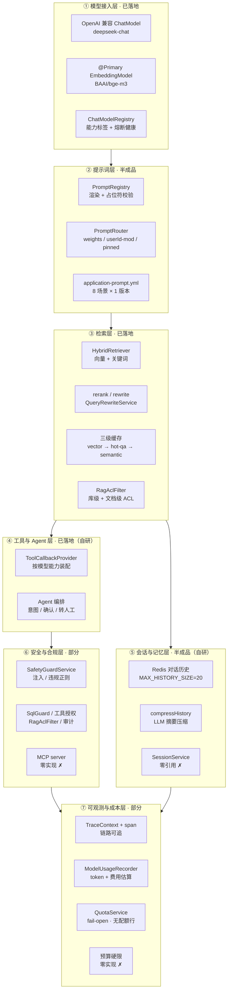
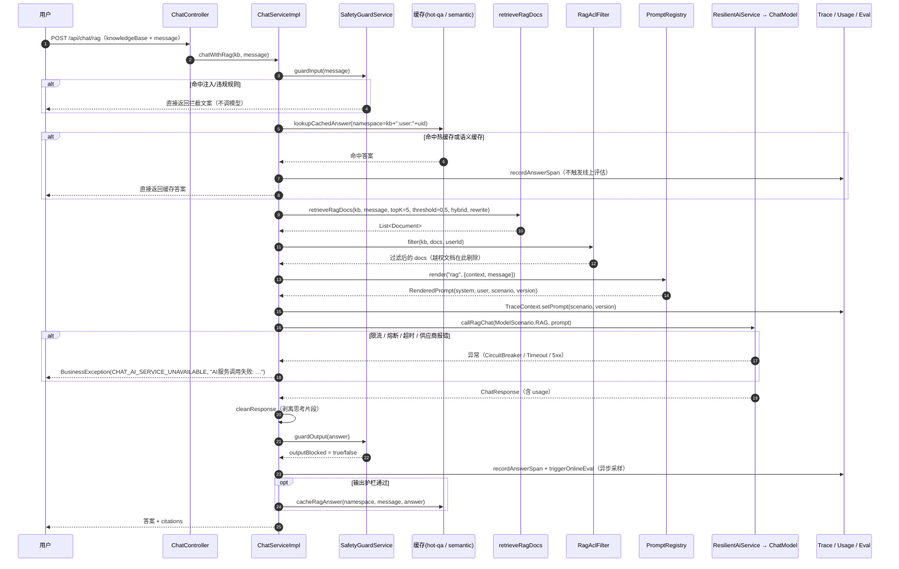

# AI 能力诚实账本：七层能力逐层对账，把「已落地 / 半成品 / 未落地」钉到文件与 grep 计数

> **一句话结论**：这个项目的 AI 能力既不是「文档写的都做了」，也不是「全是 PPT」——七层里真正闭环的只有**模型接入层**和**检索层**；**提示词层**是「引擎装好了、只挂了一个版本、而且开关一旦关掉就崩」的半成品；**会话与记忆层**完全绕开了 Spring AI 2.1 刚给的 Session Memory；**安全合规层**有 38 个 BDD 场景撑着，但 MCP 与模型侧审核是空的；**可观测与成本层**能记账不能刹车——全仓 `budgetLimit|monthlyBudget|costBudget` 命中 **0**。
> **阅读前置**：最好先读同目录的 [01-SpringAI入门.md](01-SpringAI入门.md)、[02-LLM工程化实践.md](02-LLM工程化实践.md)、[10-提示词版本管理与灰度发布实战.md](10-提示词版本管理与灰度发布实战.md)；没有也能跟，每个术语第一次出现处都给了定义。
> **证据基线**：A 级 17 处（13 个源码锚点 + 4 个带 `(src: ...)` 的代码块，全部来自 `learning-docs/24-源码分析/assets/source/` 的 Spring AI 2.1.0 摘录，锚点形如「源码:ChatModel.java.md#L30-L45」）、B 级 40 处本项目源码路径（带行号的部分本轮逐个 `read` 核对过真实行号）、C 级 11 段本机 PowerShell 实测命令与输出（原样贴出，含 2 段原始文本摘录）。预计阅读 40 分钟。

---

## 0. 先看现象

这一节不讲原理，只摆三个「我们以为做了、其实没做」的现场。三个都来自本机实测命令，输出是原样粘贴的。

### 现象一：文档写着「支持提示词灰度」，配置里却是 8 个场景 × 1 个版本 × 全 pinned

```powershell
PS> Select-String -Path 'ai-cs-chat\src\main\resources\application-prompt.yml' `
      -Pattern 'activeVersion|strategy|^    [a-z-]+:$' | ForEach-Object { "{0}:{1}" -f $_.LineNumber, $_.Line.Trim() }
13:scenarios:
18:activeVersion: v1
20:strategy: pinned
30:activeVersion: v1
32:strategy: pinned
43:activeVersion: v1
45:strategy: pinned
56:activeVersion: v1
58:strategy: pinned
69:activeVersion: v1
71:strategy: pinned
81:activeVersion: v1
83:strategy: pinned
94:activeVersion: v1
96:strategy: pinned
107:activeVersion: v1
109:strategy: pinned
```

八组 `activeVersion: v1` + `strategy: pinned`，就是八个场景各只有一个版本、且策略钉死在唯一版本上。也就是说**灰度引擎装好了，但没有第二个版本可以分流**。`aics.prompt.enabled` 开关也一样经不起检查：

```powershell
PS> (Get-ChildItem -Path . -Recurse -File -Include *.java | Where-Object {$_.FullName -notmatch '\\target\\'} |
     Select-String -Pattern 'renderOrFallback').Count
1
```

`1` 是「只有定义、零调用点」。而业务侧 9 处提示词渲染全部走两参 `render(scenario, Map)` 重载，内层把 fallback 传成 `null`（`ai-cs-chat/src/main/java/com/aics/chat/prompt/PromptRegistry.java#L113-L115`）。于是把开关改成 `false` 的后果不是「降级到硬编码副本」，而是八个场景同时抛 `PromptRenderException("Prompt 配置化已关闭且无 fallback: " + scenario)`（同文件 `#L88-L93`）。这不是猜测，`openspec/changes/2026-08-18-prompt-config/tasks.md` 里挂着一条至今未勾选的任务：

```text
- [ ] 3.6 过渡开关：aics.prompt.enabled=false 时回退保留的硬编码副本…已实现 enabled=false 走 fallback 分支机制，但各调用点未逐一传 fallback（后续按需补齐）
```

**反直觉的点**：半成品不是「少写了一个功能」，而是「多写了一个没人用的分支 + 少了一个能用的开关」。功能列表上看它齐全，运维视角看它是负资产——你想关掉它，反而让整条链路 500。

### 现象二：以为有 RAG 评测，其实是一份 20 条手写集 + 默认关闭的线上采样 + 没接 CI 的门禁

```powershell
PS> (Select-String -Path 'ai-cs-chat\src\main\resources\eval\golden-set.json' -Pattern '"question"').Count
20
PS> Get-ChildItem '.github\workflows' -File | ForEach-Object { $_.Name }
python-learning-validate.yml
```

`golden-set.json`（Golden Set：一组「问题 + 期望答案要点」的人工标注样本，用来回归 RAG 效果）只有 20 条；CI 目录里唯一的 workflow 是 Python 学习校验，跟 AI 毫无关系。再看门禁阈值：

```java
// ai-cs-chat/src/main/java/com/aics/chat/rag/eval/EvalGateConfig.java
40:    private Long p95LatencyMs;
43:    private Long avgTokensPerRequest;
```

两行都是**包装类型**（`Long` 而非 `long`），注释写明「null = 不校验 / 未配置不判定」；而全仓任何 `application*.yml` 里都没有 `aics.eval.gate.*` 的实际赋值。于是这个「评估门禁」的判定逻辑只有在有人手动赋值之后才存在——它默认是**永远通过**。线上评估同理：`ai-cs-chat/src/main/java/com/aics/chat/observability/OnlineEvalProperties.java#L26-L29` 里 `enabled = false`、`sampleRate = 0.01`，且没有任何环境把它打开。

**反直觉的点**：评测相关的类一共有 13 个（`ai-cs-chat/src/main/java/com/aics/chat/rag/eval/` 整个包），看起来相当完备，但「评测」的价值全部落在**样本量 × 是否卡口**这两件事上，而这两件事恰好都缺。13 个类 + 0 个卡口 = 0 个回归保护。

### 现象三：以为有成本控制，其实只记了 token，配额表默认一行数据都没有

```powershell
PS> (Get-ChildItem -Path deploy -Recurse -File -Include *.sql |
     Select-String -Pattern 'INSERT INTO model_usage_quota').Count
0
PS> (Get-ChildItem -Path . -Recurse -File -Include *.java | Where-Object {$_.FullName -notmatch '\\target\\'} |
     Select-String -Pattern 'budgetLimit|monthlyBudget|BUDGET_LIMIT|costBudget').Count
0
```

配额表 `model_usage_quota` 建了（`deploy/mysql/all-init.sql` 里能看到建表语句），但**没有一行种子数据**；「月度预算硬限」这类关键字全仓命中 0。把这两件事和 `QuotaService` 的行为连起来看，结论就很硬：

- `ai-cs-chat/src/main/java/com/aics/chat/observability/QuotaService.java#L48-L50`：配额为 `null` 或两个维度都没配 → 直接 `notExceeded()`；
- 同文件 `#L72-L80`：Feign 调用抛任何异常 → `log.warn` + `notExceeded()`（注释自己写着 fail-open，即「出错时按没超限放行」）。

所以真实行为是：**能记账、不会刹车**。这不是 bug，是当初刻意的降级选择；但把它写进「成本治理已实现」的结论里，就是账本造假。

**反直觉的点**：`ModelUsageRecorder` 每次 LLM 调用后都会落一条用量（`ai-cs-chat/src/main/java/com/aics/chat/observability/ModelUsageRecorder.java#L14-L25`），数据是有的、也能出报表；缺的是「超了会怎样」这个动作。监控做到「看得见」花了 90% 的工，最后 10% 的「管得住」没做。

这些现象指向同一件事：**这个项目的 AI 能力是「机制先行、闭环滞后」——每一层的核心实现都能找到代码，但每一层的「判定 / 刹车 / 回归」环节系统性缺失一半。**下面这张地图就是把这半张缺口画清楚。

---

## 1. 整体地图

七层能力，三层判定口径先立在前面，避免"看起来有代码就算落地"：

- **已落地**：有实现 + 有调用点（grep 能数到生产链路）+ 有自动化验证（单测/BDD）；
- **部分实现**：机制在，但缺触发条件、缺数据、或缺回归保护中的至少一项；
- **未落地**：实现或调用点任一为空（grep = 0），或依赖根本没引入。



> **读图说明**：
> - 横向读图：请求从①模型接入层往上走，①→②→③→④ 是「选模型 → 拼提示词 → 查知识 → 决定要不要动手」的主链；⑤会话记忆与⑦可观测是**横切**的，挂在主链两侧（图里用 ③→⑤、⑤→⑦ 表示记忆读写和 tracing 的挂载点）。
> - 每个子图标题后面的「已落地 / 半成品 / 部分 / 未落地」是**本篇最核心的输出**：它不是按"有没有类"评的，而是按 §0 那三条命令能数到的调用点评的。
> - 带 ✗ 的节点是**明确没有实现**的：`SessionService`（Spring AI 2.1 的会话记忆接口，全仓 0 引用）、MCP server、预算硬限。它们在图上占位置是为了防止「以为自己有」。
> - 整张图里真正能挡住线上事故的只有三处：③的 `RagAclFilter`（防越权检索）、⑥的正则护栏（防注入）、⑦的 CircuitBreaker（防雪崩）。这三处都有 BDD 或配置兜底，其余多为「能跑」级别。

| 层 | 成熟度 | 关键类 · 位置 | 责任 | 谁调用 | 判定证据（实测） |
|---|---|---|---|---|---|
| ① 模型接入 | 已落地 | `ai-cs-chat/src/main/java/com/aics/chat/config/SpringAiConfig.java`、`ai-cs-chat/src/main/java/com/aics/chat/modelrouter/ChatModelRegistry.java` | 选 ChatModel / EmbeddingModel、注册能力标签、健康熔断 | 全链路所有 AI 调用 | `spring.ai.model.embedding: none` + `@Primary` 自定义 embedding，两条腿分离 |
| ② 提示词 | 半成品 | `ai-cs-chat/src/main/java/com/aics/chat/prompt/PromptRegistry.java`、`PromptRouter.java` | 模板渲染、占位符校验、版本路由 | 9 处业务调用点 | 8 场景各 1 版本；`renderOrFallback` 定义 1 / 调用 0 |
| ③ 检索 | 已落地 | `ai-cs-chat/src/main/java/com/aics/chat/cache/SemanticCacheService.java`、`ai-cs-knowledge/src/main/java/com/aics/knowledge/service/KnowledgeVectorService.java` | 切块向量化、混合检索、重排、三级缓存、ACL | `ChatServiceImpl.chatWithRag` | `SemanticCacheService` 命中 14 处引用；`QuestionAnswerAdvisor` 19 处 |
| ④ 工具与 Agent | 已落地 | `ai-cs-chat/src/main/java/com/aics/chat/agent/`、`SpringAiConfig.java#L277-L289` | 工具注册、能力条件装配、Agent 状态机 | ChatClient / Agent 编排 | `MethodToolCallbackProvider` 真实装配；BDD `02_tool_authorization` 4 场景 |
| ⑤ 会话与记忆 | 半成品（自研） | `ChatServiceImpl.java#L150-L159`、`#L278-L322` | 保留最近 20 条、超限用 LLM 摘要压缩 | chat / chatWithRag / 流式 | `SessionService` grep **0**；`spring-ai-session` 未引入 |
| ⑥ 安全与合规 | 部分 | `ai-cs-chat/src/main/java/com/aics/chat/agent/safety/SafetyGuardService.java`、`ai-cs-chat/src/main/java/com/aics/chat/security/SqlGuard.java` | 注入/违规检测、SQL 白名单、工具授权、审计 | Controller 与 Agent 工具层 | BDD 35（chat）+ 3（gateway）场景；MCP grep **0** |
| ⑦ 可观测与成本 | 部分 | `ai-cs-chat/src/main/java/com/aics/chat/observability/`（18 文件） | span 追踪、token 计量、费用估算、配额判定 | 每次 LLM 调用 | 预算硬限 grep **0**；配额种子行 **0** |

> **与全库总账的分工**：`learning-docs/00-学习路线总览/05-技术缺口分析与补全计划.md` 是**全库**的总账（七层里包含语言底座、框架内核、数据与中间件、工程效能、稳定性与性能、架构与业务、AI 能力），它的 §1.2 成熟度表里第七层「AI 能力」只有一行结论；**本篇是那一行的展开明细**——把「AI 能力」拆成七条子层，每条都给出可复现的判定命令。看总账知道"哪里欠债"，看本篇知道"AI 这条债具体欠在哪个方法哪一行"。反过来说，本篇不重复总账的跨域比对，只做 AI 专题对账。

---

## 2. 关键概念与关键类

先把本篇会反复用的术语一次讲清（都是**首现解释**，后面直接使用）：

| 术语 | 一句话解释 |
|---|---|
| Embedding（嵌入） | 把文本映射成高维向量的函数，输出是一个 float 数组；语义相近的文本，向量距离更近。本项目用 `BAAI/bge-m3` 产出 1024 维向量，写入 Chroma 供相似度检索。 |
| RAG（检索增强生成） | 先按用户问题检索出若干文档片段，把它们拼进提示词再让模型作答。它把「模型不知道的私有知识」从训练问题变成检索问题。 |
| Golden Set（黄金集） | 人工标注的「问题 + 期望答案要点」样本集合，用来做离线回归。样本量小则只能证伪明显退化，不能证明效果。 |
| LLM-as-Judge（模型当裁判） | 用另一个 LLM 给回答打分（相关性/忠实度），替代纯字符串匹配。便宜、有噪声、需要校准。 |
| fail-open / fail-closed | 判定组件自身出错时，是「当没超限放行」（open）还是「当超限拦截」（closed）。安全场景应 closed，可用性场景常 open。 |
| BDD 场景 | 用 `Given/When/Then` 自然语言写的可执行验收用例（本项目用 Cucumber `.feature` 文件），一个 `Scenario` 就是一条验收标准。 |
| Span（跨度） | 链路追踪里的一个「操作节点」，带开始/结束时间和标签。一个请求由多个 span 串成树，用来定位是哪一段慢。 |
| Advisor（环绕增强器） | Spring AI 的 AOP 式拦截链：在 `ChatClient` 调用前后插入逻辑（检索增强、记忆读写、日志）。顺序由 `getOrder()` 决定，数字越小越先执行。 |

再看关键类。这张表是本篇的「对账底稿」，每个类都标注了它在哪一层、扮演什么角色、关键方法是什么：

| 名称 | 位置 | 角色 | 关键方法 / 字段 |
|---|---|---|---|
| `PromptRegistry` | `ai-cs-chat/src/main/java/com/aics/chat/prompt/PromptRegistry.java` | 提示词渲染中枢；启动时校验版本完整性 | `afterPropertiesSet()`、`render(...)`、`setActiveVersion()` |
| `PromptRouter` | `ai-cs-chat/src/main/java/com/aics/chat/prompt/PromptRouter.java` | 版本路由（灰度算法） | `resolveVersion()`、`byWeights()`、`byUserIdMod()` |
| `PromptProperties` | `ai-cs-chat/src/main/java/com/aics/chat/prompt/PromptProperties.java` | `aics.prompt.*` 配置载体；注释自陈「单一事实来源为 YAML（非持久化）」 | `enabled`、`scenarios`、`strategy` |
| `SemanticCacheService` | `ai-cs-chat/src/main/java/com/aics/chat/cache/SemanticCacheService.java` | 语义缓存：问题向量化后与缓存条目算余弦相似度，超阈值即命中 | `lookup()`、`store()` |
| `HotQaCacheService` | `ai-cs-chat/src/main/java/com/aics/chat/cache/HotQaCacheService.java` | 高频问答缓存（精确匹配 + 晋升机制） | `lookup()`、`record()` |
| `RagAclFilter` | `ai-cs-chat/src/main/java/com/aics/chat/security/RagAclFilter.java` | 检索结果权限过滤，库级 + 文档级 | `filter(kb, docs, userId)` |
| `SafetyGuardService` | `ai-cs-chat/src/main/java/com/aics/chat/agent/safety/SafetyGuardService.java` | 输入侧护栏：注入与违规正则 | `BUILTIN_RULES`、check 方法 |
| `SqlGuard` | `ai-cs-chat/src/main/java/com/aics/chat/security/SqlGuard.java` | NL2SQL 安全：两道防线（关键字黑白名单 + AST 校验） | `validate(database, sql)` |
| `ToolAuthorizationService` | `ai-cs-chat/src/main/java/com/aics/chat/security/ToolAuthorizationService.java` | 工具调用授权，拒绝时写审计事件 | `authorize(userId, toolName, paramsDigest)` |
| `ModelUsageRecorder` | `ai-cs-chat/src/main/java/com/aics/chat/observability/ModelUsageRecorder.java` | 每次调用后计量 token 与估算费用，异步落库 | `PER_MILLION`、record 重载 |
| `QuotaService` | `ai-cs-chat/src/main/java/com/aics/chat/observability/QuotaService.java` | 配额判定（日/周/月窗口），异常时 fail-open | `check(userId, scenario)`、`windowStart()` |
| `OnlineEvalProperties` | `ai-cs-chat/src/main/java/com/aics/chat/observability/OnlineEvalProperties.java` | 线上采样评估配置（默认关闭） | `enabled=false`、`sampleRate=0.01` |
| `EvalGateConfig` | `ai-cs-chat/src/main/java/com/aics/chat/rag/eval/EvalGateConfig.java` | 离线评估门禁阈值（可空 = 不校验） | `p95LatencyMs`、`avgTokensPerRequest` |
| `RagEvalServiceImpl` | `ai-cs-chat/src/main/java/com/aics/chat/rag/eval/RagEvalServiceImpl.java` | 跑黄金集、算检索指标、出报告 | `evaluate(...)` |
| `KnowledgeVectorService` | `ai-cs-knowledge/src/main/java/com/aics/knowledge/service/KnowledgeVectorService.java` | 文档切块 + 向量化 + 写 Chroma | `vectorize(doc)` |
| `ChatServiceImpl` | `ai-cs-chat/src/main/java/com/aics/chat/service/impl/ChatServiceImpl.java` | 主链路编排：护栏 → 缓存 → 检索 → 提示词 → 模型 → 输出护栏 → 记账 | `chatWithRag()`、`compressHistory()` |
| `ModelRouter` | `ai-cs-chat/src/main/java/com/aics/chat/modelrouter/ModelRouter.java` | 按场景 primary/fallbacks 链确定性选模型 | `route(request)` |

> **读表提示**：这张表里 17 个类，只有 6 个真正出现在线上主链路的**必经路径**上（`ChatServiceImpl`、`PromptRegistry`、`RagAclFilter`、`SafetyGuardService`、`ModelUsageRecorder`、`ModelRouter`）。另外 11 个是「条件触发或可选」——这个比例本身就是「半成品」的量化表达。

---

## 3. 原理与证据逐段精读

每个小节都按四层走：**在干什么 → 为什么这么设计 → 换写法会怎样 → 常见坑**。引用分两类标注：`[[源码:...]]` 是 Spring AI 2.1.0 的 A 级摘录锚点，`路径#L行号` 是本项目 B 级代码位置。

### 3.1 模型接入层：为什么 ChatModel 与 EmbeddingModel 必须是「两条腿」

```java
// ChatModel 是"文本进、文本出"的唯一抽象
30 | public interface ChatModel extends Model<Prompt, ChatResponse>, StreamingChatModel {
45 | 	ChatResponse call(Prompt prompt);
```
（src: ChatModel.java#L30-L45）

```java
// EmbeddingModel 是"文本进、向量出"，与 ChatModel 完全独立
39 | public interface EmbeddingModel extends Model<EmbeddingRequest, EmbeddingResponse> {
49 | 	default float[] embed(String text) {
```
（src: EmbeddingModel.java#L39-L49）

**在干什么**：Spring AI 把「聊天生成」和「向量化」拆成两个平行接口，各自有独立的模型供应商、独立的 Key、独立的计费。本项目的接入决策正是基于这一点——聊天走 DeepSeek 的 OpenAI 兼容端点，向量化走硅基流动的 `BAAI/bge-m3`：

```yaml
# ai-cs-chat/src/main/resources/application.yml#L35-L44
spring:
  ai:
    model:
      embedding: none          # 关键：关闭 Spring AI 对 embedding 的自动装配
    openai:
      base-url: ${OPENAI_BASE_URL:https://api.deepseek.com}
      chat:
        model: ${OPENAI_MODEL:deepseek-chat}
        temperature: 0.7
```

**为什么这么设计**：DeepSeek 这个端点**不提供** `/v1/embeddings`，如果让 Spring AI 用同一套 OpenAI 配置自动装配 `EmbeddingModel`，启动就会报「没有可用 embedding 实现」或者在首次检索时 404。所以 `embedding: none` 关闭自动装配，再由 `ai-cs-chat/src/main/java/com/aics/chat/config/SpringAiConfig.java#L171-L179` 手工提供一个 `@Primary EmbeddingModel` 指向硅基流动。注释里写清了两个理由：供应商不提供 embedding；`@Primary` 保证**全项目只有一个向量空间**。

**换写法会怎样**：如果图省事让两个能力都走同一个 `spring.ai.openai.*`，你会得到「聊天正常、检索全空」的诡异状态——`vectorStore.add()` 成功但相似度全 0.3 以下，检索永远返回空，用户看到的是「我不知道」。这种 bug 极难定位，因为没有任何异常抛出。

**常见坑**：
- `@Primary` 漏加 → 一旦以后引入第二个 `EmbeddingModel`，注入点按类型查会报 `NoUniqueBeanDefinitionException`，且是启动期才炸；
- 忘了 `spring.ai.model.embedding: none` → 自动装配与手工 Bean 打架，表现为「有时用错模型，向量空间混用」，**历史向量全部失效且不可恢复**（不同模型的向量不可比）；
- 换 embedding 模型 = 换向量空间 = 必须全量重刷知识库，这不是配置项，是数据迁移。

### 3.2 提示词层：`PromptRegistry` 的三道校验，和那个关不掉的开关

```java
// ai-cs-chat/src/main/java/com/aics/chat/prompt/PromptRegistry.java#L86-L115
86:    public RenderedPrompt render(String scenario, String userId,
87:                                 Map<String, Object> variables, FallbackSupplier fallback) {
88:        if (!properties.isEnabled()) {
89:            if (fallback == null) {
90:                throw new PromptRenderException("Prompt 配置化已关闭且无 fallback: " + scenario);
91:            }
92:            return fallback.get();
93:        }
...
101:        String active = activeOverrides.getOrDefault(scenario, config.getActiveVersion());
102:        String version = router.resolveVersion(scenario, config, userId);
...
112:    /** 便捷方法：无 userId、无 fallback */
113:    public RenderedPrompt render(String scenario, Map<String, Object> variables) {
114:        return render(scenario, null, variables, null);
115:    }
```

**在干什么**：`render` 干四件事——① 开关检查；② 取「当前生效版本」（内存覆盖优先于 YAML 的 `activeVersion`）；③ 交给 `PromptRouter` 按灰度策略再定一次版本；④ 取到模板后做占位符替换，缺变量就抛异常（`#L141`）。

**为什么这么设计**：提示词从「散落在 Java 代码里的字符串常量」搬到 YAML，本质是把**改文案从发版问题降级为配置问题**。但要保证不倒退，就得有三道校验：`afterPropertiesSet()` 启动时检查每个场景的 `activeVersion` 是否真实存在（`#L48-L57`）；`validate()` 检查灰度权重和是否偏离 1.0（`#L59-L75`，只 warn 不阻死）；`renderTemplate()` 检查模板占位符与入参是否对得上（`#L134-L147`，缺就抛）。这三道都是「把错误提前到启动/首次调用」，而不是让用户看到半句话。

**换写法会怎样**：如果不做占位符校验，缺变量时会渲染出 `用户输入：` 后面一片空白，模型照样能答——于是这个 bug 会**安静地活很久**，直到某个场景答案质量莫名下降才被怀疑。占位符校验把「静默降质」变成了「立刻 500」，是典型的用失败换可观测性。

**常见坑**（这一条就是本篇现象一的根因）：
- 两参重载 `render(scenario, Map)` 把 fallback 固定传 `null`，于是 `enabled=false` 时**必抛**；全仓 `renderOrFallback` 定义 1 处、调用 0 处，等于这个「过渡开关」从来没被接上；
- 热切换版本写的是 `ConcurrentHashMap`（`#L160-L170`），**重启即丢**，YAML 才是真相；所以「运维在页面上切了版本」和「重启后回到 v1」之间没有任何提示；
- 场景名是字符串字面量（`"rag"`、`"intent"`…），写错一个字母得到的是运行时 `PromptRenderException("Prompt scenario [xxx] ...")`，没有编译期保护。

### 3.3 提示词灰度：`PromptRouter` 的三种策略，纪律性比聪明更重要

```java
// ai-cs-chat/src/main/java/com/aics/chat/prompt/PromptRouter.java#L42-L64（节选）
42:    public String resolveVersion(String scenario, ScenarioConfig config, String userId) {
...
52:        case "pinned" -> rollout.getPinned() != null ? rollout.getPinned() : config.getActiveVersion();
...
57:        // 命中版本不存在时逐级回退：pinned/权重结果 -> activeVersion -> versions 首个 key
```

**在干什么**：三种灰度策略——`weights`（按权重随机分流）、`userId-mod`（按用户 ID 取模，保证同一用户稳定命中同一版本）、`pinned`（钉死某一个版本）。三者统一的兜底逻辑是「算出来的版本不存在，就逐级回退」。

**为什么这么设计**：灰度最怕的不是「分流不准」，而是**同一个用户在两版之间反复跳**——那会让你永远分不清效果差异是版本造成的还是随机性造成的。所以 `userId-mod` 用 `Math.floorMod` 保证稳定分桶，`weights` 内部还特意把 key 排序（`#L77`）让浮点累加的边界确定下来。这是「可复现」优先于「均匀」的取舍。

**换写法会怎样**：如果用 `Math.random()` 或 `hashCode() % n`（可能为负）做分流，你会得到「权重 10% 实际分流出 0% 或 30%」的偏斜，且负余数会直接 `ArrayIndexOutOfBounds`。更隐蔽的是用 `UUID` 做种子——同一用户每次请求分到不同版本，A/B 数据彻底作废。

**常见坑**：
- `weights` 权重和写成 0.9 或 1.1，`validate()` 只 `log.warn` 不阻断 → 灰度悄悄失真；
- 场景只有 1 个版本时，三种策略在行为上**完全等价**（都是 v1）。本项目 8 个场景全是这种状态，所以「灰度」这个词目前只是能力储备，不是运行事实；
- 版本切换是**全局**的（内存 Map），没有租户/环境维度，想在生产小流量验证只能靠 `userId-mod`。

### 3.4 检索层：从切块到 ACL 到三级缓存，这是全项目最完整的一层

```java
// ai-cs-knowledge/src/main/java/com/aics/knowledge/service/KnowledgeVectorService.java#L77-L86
77:        List<Document> chunks = new TokenTextSplitter().split(new Document(doc.getContent()));
79:        chunks.forEach(chunk -> {
80:            chunk.getMetadata().put("knowledgeBase", KNOWLEDGE_BASE);
81:            chunk.getMetadata().put("documentId", doc.getId());
82:            chunk.getMetadata().put("title", doc.getTitle());
...
85:        vectorStore.add(chunks);
86:        log.info("文档向量化完成: id={}, title={}, chunks={}", doc.getId(), doc.getTitle(), chunks.size());
```

**在干什么**：入库侧把长文档切成 token 级窗口（Chunking：把长文切成小段，因为向量模型有输入上限、且片段越聚焦检索越准），每块带上 `knowledgeBase/documentId/title` 三个元数据，再交给 `VectorStore.add()` 内部逐块调 embedding 写进 Chroma。查询侧则是 `ChatServiceImpl.retrieveRagDocs(kb, message, 5, 0.5, hybrid, rewrite)`（`ai-cs-chat/src/main/java/com/aics/chat/service/impl/ChatServiceImpl.java#L924`）——topK=5、阈值 0.5、混合检索、可开查询改写。

**为什么这么设计**：元数据不是为了好看，是为了**权限过滤和引用溯源**。`RagAclFilter.filter(kb, docs, userId)`（`ai-cs-chat/src/main/java/com/aics/chat/security/RagAclFilter.java#L39`）靠 `knowledgeBase` 和 `documentId` 做库级 + 文档级 ACL 判定；引用卡片靠 `title` 回显。检索层用 `QuestionAnswerAdvisor`（19 处引用）自动把检索结果注入提示词，同时 `SpringAiConfig.java#L266-L274` 里配了 `similarityThreshold(0.3d)` 与 `topK(5)` 作为兜底默认。

框架侧这两个抽象的分工值得记住：`VectorStore` 只管「存和搜」（`[[源码:VectorStore.java.md#L40]]`：`public interface VectorStore extends DocumentWriter, VectorStoreRetriever`），`VectorStoreDocumentRetriever` 才是「把 Query 变成 topK 文档」的那一层，`[[源码:VectorStoreDocumentRetriever.java.md#L81-L86]]` 里 `topK` 缺省取 `SearchRequest.DEFAULT_TOP_K`。

**换写法会怎样**：不分块直接把整篇文档塞进一个向量，会得到「一篇 5000 字的文档只有一个平均语义」——用户问文档里某一句话，相似度被全文平均拉低，检不出来。反过来，块切太小（比如按句切）会丢上下文，模型拿着半句话无法回答。`TokenTextSplitter` 是折中方案，块大小要按「答案的最小完整单位」调，不是按技术参数调。

**常见坑**：
- 缓存命名空间必须带用户维度：`ChatServiceImpl.java#L175-L178` 的 `cacheNamespace()` 拼的是 `knowledgeBase + ":user:" + userId`，注释明写「不按用户隔离会绕过 `RagAclFilter`」——**这是本项目最容易被后人改坏的一行**，因为它看起来像是多余的 key 前缀；
- 只有**输出护栏通过**的回答才允许回填缓存（`#L200-L204`），否则会把违规回答缓存下来反复命中；
- 缓存命中直接 return 时**不触发线上评估**（`#L424-L433`，注释理由「评估对象应是模型新生成的回答」），这决定了评估覆盖率天然低于请求量——排查「评估样本数对不上 QPS」时要记得这一点。

### 3.5 工具与 Agent 层：为什么工具挂载从 `ChatClient` 挪到了「按模型能力装配」

```java
// ai-cs-chat/src/main/java/com/aics/chat/config/SpringAiConfig.java#L276-L289（节选）
277:    public ChatClientCustomizer chatClientCustomizer(ToolCallbackProvider toolCallbackProvider,
278:                                                    QuestionAnswerAdvisor ragAdvisor,
279:                                                    PromptRegistry promptRegistry) {
282:            String defaultSystem = promptRegistry
283:                    .render("default-system", java.util.Map.of("dbSchema", DB_SCHEMA))
285:            builder.defaultSystem(defaultSystem)
286:                   .defaultAdvisors(ragAdvisor);
287:            // 工具回调不在此统一挂载——是否具备 TOOL_CALLING 能力由模型定义决定，注册表按能力条件装配
```

**在干什么**：全局 `ChatClient` 定制器只做两件事——把 `default-system` 提示词（内含五库表结构 `DB_SCHEMA`）设为系统提示，把 RAG Advisor 设为默认增强器。**工具回调刻意不在这里挂**，因为「这个模型能不能调工具」是模型属性，不是客户端属性。

**为什么这么设计**：一旦走多模型路由（`ModelRouter` 按场景选 `deepseek-chat` / 便宜档 / 视觉档），不同模型的工具调用能力不同。如果工具在全局客户端上无条件挂载，把请求路由到不支持 tool calling 的模型时会直接 400/500。所以挂在**注册表按能力条件装配**这一层：模型有 `TOOL_CALLING` 能力才注工具。这是「能力声明驱动装配」而不是「配置驱动装配」。

框架侧 2.1 也把这件事显式化了：工具调用循环不再是藏在 `ChatClient` 里的黑盒，而是可插拔的 `ToolCallingAdvisor`，`[[源码:ToolCallingAdvisor.java.md#L86-L96]]` 里 `public class ToolCallingAdvisor implements CallAdvisor, StreamAdvisor, ToolAdvisor`，且 `DEFAULT_ORDER = Ordered.HIGHEST_PRECEDENCE + 300`。真正执行工具的是 `[[源码:DefaultToolCallingManager.java.md#L205-L210]]` 的 `executeToolCalls(...)`；工具回调来源是 `[[源码:MethodToolCallbackProvider.java.md#L53-L60]]`（把 `@Tool` 注解的方法包成 `ToolCallback`）；递归上限语义由 `[[源码:ToolCallLimitBehavior.java.md#L26]]` 的枚举（`CONTINUE` / `STOP`）表达。

**换写法会怎样**：如果全靠提示词「请调用 getOrderStatus 工具」，模型会虚构工具名或参数格式；如果工具无上限递归（模型反复调同一个工具），会烧钱且卡死。2.1 用 `ToolCallLimitBehavior` + `ToolCallLimitExceededException` 把「超限怎么办」变成显式策略，而不是靠超时兜底。

**常见坑**：
- 工具装配点分散后，**「为什么这个模型不调工具」的排查路径变长**：先看模型注册表有没有 `TOOL_CALLING` 标签，再看 provider 有没有注册该回调，最后才怀疑模型；
- `DB_SCHEMA` 硬编码在 `SpringAiConfig.java#L115-L137` 的文本块里，**表结构变更后提示词不会自动更新**，模型会按旧 schema 写 SQL——这是 NL2SQL 类 bug 的头号来源（`SqlGuard` 能拦住非法 SQL，但拦不住「语法合法、字段过时」的 SQL）；
- 治理手段要分工记牢：Sentinel 管入口限流（`@SentinelResource` 全仓只有 1 处真注解，在 `ai-cs-chat/src/main/java/com/aics/chat/controller/ChatController.java#L79`），Resilience4j 管对下游的熔断/超时/重试（`application.yml#L73-L159`）；两者混用会导致「同一个流量被限两次」。

### 3.6 会话与记忆层：Spring AI 2.1 给了 Session Memory，我们一条没接

```java
// 框架侧：2.1 的新一代会话记忆
85 |  * @since 2.1.0
87 | public final class SessionMemoryAdvisor implements BaseAdvisor, MemoryAdvisor {
105 | 	public static final int DEFAULT_ORDER = Ordered.HIGHEST_PRECEDENCE + 1000;
```
（src: SessionMemoryAdvisor.java#L85-L105）

```java
// 框架侧：老接口已标弃用
34 |  * @deprecated since 2.1.0, for removal in 3.0.0, in favor of session memory
35 | @Deprecated(since = "2.1.0", forRemoval = true)
```
（src: ChatMemory.java#L34-L35）

**在干什么**：2.1 把「对话记忆」从 `ChatMemory`（按 `conversationId` 存消息窗口）换成了 `SessionService` + `SessionMemoryAdvisor`（有会话对象、元数据、可跨请求查询）。`SessionService` 的接口形如 `[[源码:SessionService.java.md#L41]]` `public interface SessionService`，含 `create(...)`、`findOrCreate(...)`、`@Nullable findById(sessionId)`、`findByMetadata(name, value)`。

**为什么这么设计**：`ChatMemory` 只能表达「一串消息」，无法表达「这个会话属于谁、什么场景、有什么业务状态」。把会话升格为一等对象后，记忆才能和审计、配额、权限对齐——这正是本项目自研逻辑里最别扭的地方。

**本项目的真实状态**：一句 `grep` 说明一切。

```powershell
PS> (Get-ChildItem -Path . -Recurse -File -Include *.java | Where-Object {$_.FullName -notmatch '\\target\\'} |
     Select-String -Pattern 'SessionService|SessionMemoryAdvisor|SessionTurnAdvisor').Count
0
```

全仓 0 引用。项目用的是自研方案：`ChatServiceImpl.java#L150-L153` 里 `MAX_HISTORY_SIZE = 20`、`KEEP_RECENT_SIZE = 10`，超限时 `compressHistory()`（`#L278-L322`）用一次 LLM 摘要把旧消息压成一段话，摘要提示词走 `scenario = "summary"` 的配置化模板。也就是说**记忆逻辑是我们自己维护的**，框架的弃用/替代跟我们无关——这既是自由，也是长期维护成本。

**换写法会怎样**：接入 `SessionService` 需要额外引入 `spring-ai-session` artifact（本轮实测：`~/.m2` 里**不存在**该目录，`pom.xml` 与 `ai-cs-chat/pom.xml` 也未声明），并重写会话存储后端。收益是「会话对象 + 元数据 + 记忆 Advisor」标准化，代价是一次数据迁移与语义变更。当前选择「不接」是合理的技术债，但必须记账——因为 `ChatMemory` 在 3.0 会被移除，我们虽然没用 `ChatMemory`，却在自研等价物里踩同样的坑（窗口截断语义、摘要漂移）。

**常见坑**：
- LLM 摘要压缩会让**早期信息不可逆丢失**：用户在第 3 轮说的订单号，第 25 轮时可能已被压掉；凡是「关键槽位」必须显式存业务字段，不能指望对话历史；
- 摘要本身是一次 LLM 调用，会计入 token 成本——而它**同样走 `ModelUsageRecorder`**，做成本归因时别把它当成「用户请求」重复计算；
- 摘要请求也要过护栏吗？当前实现是「对已通过输入护栏的历史做压缩」，因此不重复过护栏；一旦有人在压缩前注入违规内容并留在历史里，摘要会把违规语义「洗」进上下文，这是残留风险。

### 3.7 安全与合规层：正则算不算 Guardrails？

```java
// ai-cs-chat/src/main/java/com/aics/chat/agent/safety/SafetyGuardService.java#L14-L30（注释节选）
14: * 输入安全检查（Prompt 注入 / 违规内容检测）…
15: * 规则为确定性正则匹配…内置规则 + aics.security.injection-extra-rules 配置追加
17: * 另有"紧凑文本"二次检测，防"忽 略 指 令"这类分割绕过
30:    private static final List<Rule> BUILTIN_RULES = List.of(...);
```

**在干什么**：输入侧用确定性正则拦 Prompt 注入（把用户输入里「忽略以上指令」类表达识别出来）与违规内容；`aics.security.injection-extra-rules` 允许配置追加规则；还做了一次「去掉空格后的紧凑文本」二次匹配，防 `忽 略 指 令` 这种插空格绕过。输出侧由 `ContentSafetyService` + `RegexContentReviewer`（按分类正则逐条匹配，分类来自 `SecurityProperties#getContentCategories()`）判定。

配套的还有三处硬控制：`RagAclFilter` 做检索越权拦截、`SqlGuard` 做 NL2SQL 两道防线（关键字 + jsqlparser AST 校验，见 `ai-cs-chat/src/main/java/com/aics/chat/security/SqlGuard.java#L83-L121`）、`ToolAuthorizationService.authorize(...)` 做工具级授权并在拒绝时写 `TOOL_UNAUTHORIZED` 审计事件（`#L36-L50`）。

**为什么这么设计**：确定性的规则有可解释、可审计、零调用成本三个好处，对「已知攻击模式」足够；而模型侧审核（用另一个模型判违规）有语义泛化能力但有延迟、成本、误杀。在客服这种「错杀会造成用户投诉」的场景，先上确定性规则是稳妥的第一步。

**换写法会怎样**：如果只有模型审核没有正则，攻击面变成「概率游戏」，且每次判定都要花 token；如果只有正则没有模型审核，则所有「换语言/换同义表达」的注入都能绕过。业界做法是「正则前置快筛 + 模型后置审核 + 输出侧强制过滤」三道，本项目实现了第一道和第三道，**第二道缺**。

**常见坑**：
- 正则护栏的规则集是**编译期常量**（`BUILTIN_RULES`），改规则要发版；`injection-extra-rules` 的追加机制存在，但没有任何 yml 实际配置（全仓无 `aics.security.*` 赋值）；
- BDD 场景数要分清口径：chat 模块 7 个 feature 共 **35** 个 `Scenario`（`01_prompt_injection` 7、`02_tool_authorization` 4、`03_pii_masking` 6、`04_content_safety` 5、`05_rag_acl` 3、`06_sql_safety` 7、`07_audit_trail` 3），gateway 模块 2 个 feature 共 **3** 个；合计 38。旧稿写成「chat 7 Feature 38 场景」是把两个模块混成一句，**分母错了**；
- 场景数 ≠ 功能数：一个 feature 里的多个 Scenario 往往测的是同一个入口的不同分支，不能拿 38 去对照「38 个安全功能」。

### 3.8 可观测与成本层：能记账、不能刹车

```java
// ai-cs-chat/src/main/java/com/aics/chat/observability/ModelUsageRecorder.java#L14-L30（注释节选）
14: * 每次 LLM 调用完成后计量 Token 与估算费用，异步经 Feign 落库。
15: * 费用估算 = 输入tokens/1e6 × 输入单价 + 输出tokens/1e6 × 输出单价；
16: * 未配置单价时走默认单价。
30:    private static final BigDecimal PER_MILLION = new BigDecimal(1000000);
```

**在干什么**：每次模型调用完成后记一条 usage（输入/输出 token + 估算费用），异步落库；`QuotaService.check(userId, scenario)` 按日/周/月窗口比对配额，超限返回 `exceeded`。

**成本怎么算（可复现口径，不是实测数字）**：

```text
单次调用费用 = (prompt_tokens / 1_000_000) × 输入单价 + (completion_tokens / 1_000_000) × 输出单价
单日费用     = Σ 当日所有调用费用 + Σ 摘要压缩等辅助调用费用
```

其中 `prompt_tokens` / `completion_tokens` 必须取响应里的 `usage` 字段（框架与供应商都会回传），**不要自己用字符数除 4 估算**——中文token率差异可达 1.5 倍以上。单价必须写清来源：**以供应商官方定价页为准，此处只给口径，不写具体数字**。`ModelUsageProperties` 的 `pricing` map 就是用来放 `aics.usage.pricing.<model>.input/output` 的，而全仓 yml 里**没有任何实际赋值**，所以现在全部走 `defaultPricing`——意味着费用字段是「同口径估算值」，可用于趋势对比，不能直接当账单。

**为什么这么设计**：可观测的第一阶段一定是「先有数据」。把计量做成 `enabled` 开关 + 异步落库，保证它不会拖慢主链路（计量失败不影响业务）。这个取舍是对的。

**换写法会怎样 / 差在哪**：成本治理的完整闭环是「计量 → 归因 → 预算 → 拦截 → 告警」。本项目只做到前两步：`TraceContext` 能把一次请求的 span 串起来（`ai-cs-chat/src/main/java/com/aics/chat/observability/TraceContext.java`），用量能归因到 user/scenario；但没有预算硬限（`budgetLimit|monthlyBudget|costBudget` 全仓 0），配额又是 fail-open：

```java
// ai-cs-chat/src/main/java/com/aics/chat/observability/QuotaService.java#L48-L50
48:        if (quota == null || (quota.getQuotaTokens() == null && quota.getQuotaCost() == null)) {
49:            return QuotaCheckResult.notExceeded();
50:        }
// 同文件 #L72-L80：catch (Exception e) { log.warn(...); return QuotaCheckResult.notExceeded(); }
```

**常见坑**：
- 配额「没配 = 不限」这个语义很容易被误解成「默认有保护」。`deploy/mysql/all-init.sql` 里建了 `model_usage_quota` 表却**没有一行种子数据**（`INSERT` 命中 0），所以线上默认全放行；
- fail-open 在「成本失控」场景里是把刹车拆了：数据库抖动时配额判定失效 → 放行 → 账继续涨。成本类限流应改成 fail-closed 或「降级到 cheap 档模型」（`QuotaRouteProperties.overLimitFallbackTier` 默认 `cheap`，说明设计者想到过，只是没接上）；
- 计量开关 `aics.usage.enabled` 默认 `true`，但如果 Feign 落库失败只会有日志，没有本地补偿队列 → 「报表少了几天」无法自愈。

### 3.9 评估层：20 条黄金集能证伪什么、不能证伪什么

```java
// ai-cs-chat/src/main/java/com/aics/chat/rag/eval/EvalGateConfig.java#L40-L43
40:    private Long p95LatencyMs;
43:    private Long avgTokensPerRequest;
```

**在干什么**：`RagEvalServiceImpl` 载入 `golden-set.json`（位于 `ai-cs-chat/src/main/resources/eval/` 目录，实测 20 条 `"question"`），跑检索 + 生成，算检索指标（`RetrievalMetrics`），必要时用 `LlmJudgeService`（`scenario = "judge"`，LLM-as-Judge）打相关性分，出 `RagEvalReport`；门禁阈值由 `EvalGateConfig` 提供。

**为什么这么设计**：20 条样本的作用是「快速证伪明显退化」——比如你把 topK 从 5 改成 1、把相似度阈值从 0.5 提到 0.9，这 20 条会立刻掉分。它的作用是**回归哨兵**，不是**效果评估**。

**换写法会怎样**：想要「证明 RAG 效果达标」，20 条远远不够（统计上至少要上百条覆盖各知识库与问法分布）；想要「防止改坏」，20 条加上固定随机种子就够用。把两者混为一谈，就会出现「黄金集全绿但线上答非所问」的经典事故。

**常见坑**：
- 门禁阈值全为空 → 恒通过；CI 也没接（`.github/workflows` 只有 `python-learning-validate.yml`）→ 就算有人配了阈值也不会自动跑；
- 线上采样评估默认 `enabled = false`、`sampleRate = 0.01`（`OnlineEvalProperties.java#L26-L29`），且缓存命中的请求不参与评估（`ChatServiceImpl.java#L424-L433`）→ **评估样本天然不含最热的问题**，这是系统性偏差；
- 黄金集分两份（`src/main/resources/eval/` 与 `src/test/resources/eval/` 各 20 条，内容同源）→ 两份不同步就会出现「测试过的和线上跑的不是一套题」。

---

## 4. 一次完整执行时序

这是 RAG 主链路 `ChatServiceImpl.chatWithRag`（`ai-cs-chat/src/main/java/com/aics/chat/service/impl/ChatServiceImpl.java#L411-L486`）的真实步骤，每一步都标了对账位置。



> **读图说明**：
> - 两个 `alt` 是**短路出口**：输入护栏命中直接回拦截文案（第 1 个 alt），缓存命中直接回缓存答案（第 2 个 alt）。这两个出口都**不经过模型**，也都**不产生 token 成本**——所以「QPS 高但成本低」是正常现象，别当成计量漏记。
> - 顺序上最容易搞错的是 `RagAclFilter` 的位置：它必须夹在「检索出文档」和「拼进提示词」之间。图里第 11→12 步一旦颠倒（先拼提示词再过滤），越权内容就已经进了上下文，后面再过滤也删不掉模型已经看到的文字。
> - 第 16 步把 `scenario/version` 写进 `TraceContext`，是为了让「这条回答用了哪个提示词版本」可追——这是提示词灰度能被归因的唯一前提（架构上在，统计聚合没做，见 §7）。
> - 最后一个 `opt` 说明缓存回填有前置条件：只有输出护栏通过的回答才入缓存，否则违规内容会被缓存反复命中。
> - 全程只有一次模型调用（第 15 步）是同步阻塞的；`triggerOnlineEval` 是异步的，不影响用户响应时间。

**哪一步失败、报什么错**（都能在代码里指到具体行）：

| 失败步骤 | 触发条件 | 用户看到 | 服务端实际异常 / 日志 |
|---|---|---|---|
| 提示词渲染（第 13 步） | 场景版本不存在，或模板缺变量 | 500 | `PromptRenderException("Prompt scenario [..] 版本 [..] 不存在")` / `("Prompt 模板缺少变量占位符 {{x}}")` |
| 提示词开关（第 13 步） | `aics.prompt.enabled=false` 且调用点未传 fallback | 500 | `PromptRenderException("Prompt 配置化已关闭且无 fallback: " + scenario)` |
| 入口限流（第 1 步之前） | `chat-send` / `chat-rag` QPS 超阈值 | 友好降级文案 | Sentinel `blockHandler = "chatSendBlocked"` 命中 |
| 模型调用（第 15 步） | 超时 / 熔断打开 / 供应商 5xx | 「AI服务调用失败，请稍后再试」 | `BusinessException(ResultCode.CHAT_AI_SERVICE_UNAVAILABLE, "AI服务调用失败: " + getFriendlyMessage(e))` |
| 模型调用（第 15 步） | 单次耗时超 30s（SSE 为 60s） | 同上 | Resilience4j `TimeLimiter` 触发 |
| 计量落库（第 18 步） | Feign 到 observability 失败 | 无感知 | 只打 warn，无补偿（`ModelUsageRecorder` 侧不阻塞主链） |
| 配额判定（路由前） | 配额表无行 / Feign 异常 | 无感知（放行） | `QuotaService` catch 后 `notExceeded()`（fail-open） |

> **这张表怎么读**：7 行里只有前 4 行会产生用户可见错误，后 3 行是「静默失败」。静默失败不是 bug，但它们是**账本里最容易被漏记的一类缺口**——因为监控面板上看不见。

---

## 5. 设计取舍

| 决策点 | 本项目选择 | 得到的 | 付出的 | 什么时候该反悔 |
|---|---|---|---|---|
| 提示词存 YAML（非 DB） | `PromptProperties` 注释自陈「单一事实来源为 YAML（非持久化）」 | 零运维依赖、可 review、可回滚到 git | 热切换重启即丢；无法做按环境的版本审计 | 当「非研发人员要改提示词」成需求时 |
| 灰度策略三种但只启用 pinned | `PromptRouter` 三策略齐全 | 能力储备在，改 yml 即可开 | 目前是「空转的灰度」，容易误以为已验证 | 有第二个候选版本时立刻切 `userId-mod` |
| 工具按模型能力装配（不在全局客户端挂） | `SpringAiConfig.java#L287` 注释明确 | 多模型路由安全，不会把工具发给不支持模型的模型 | 排查链路变长；新人容易在客户端里重复挂 | 引入不支持工具的预览模型时（必须保持） |
| 记忆自研（不接 `SessionService`） | 未引入 `spring-ai-session` | 完全可控、不绑框架节奏 | 框架弃用提醒看不到；等价功能自己维护 | `ChatMemory` 3.0 移除前，或需要会话级业务状态时 |
| 成本 fail-open | `QuotaService` catch → 放行 | 配额组件故障不影响业务可用性 | 成本失控时静默放行 | 上线「付费套餐」或出现大额账单事故时 |
| 护栏用确定性正则 | `SafetyGuardService.BUILTIN_RULES` | 可解释、零成本、误杀低 | 绕过容易（换语言/同义表达）；改规则要发版 | 出现真实绕过事故时补模型侧审核 |
| 评估只做回归哨兵（20 条） | 黄金集 20 条 | 便宜、快、能拦住明显退化 | 无法证明效果；不接 CI 就等于没有 | 要做「效果周报」或模型换版评审时 |
| 语义缓存按 user 隔离 | `cacheNamespace()` = kb + user | 不会绕过 ACL | 命中率下降（同一问题不同用户不共享） | 知识库 ACL 简化到「全员可读」时可放宽 |

**可扩展点清单**（按「改动量 ÷ 收益」排序，都是本篇缺口对应的最小改造）：

1. **给 9 处 `render` 调用点补 fallback**（或把 `enabled=false` 改成校验失败启动即报错）——1 个文件 × 9 行，让开关真的能关。
2. **在 `application-prompt.yml` 加第二个版本 + 一个场景切 `userId-mod`**——不需要写代码，一次配置就验证了灰度链路。
3. **给 `EvalGateConfig` 配上 p95 / avgTokens 阈值，并把 `node`/`mvn` 评估任务挂进 `.github/workflows`**——把「能跑」变成「会卡」。
4. **给 `model_usage_quota` 插入默认配额行，并把 `QuotaService` 的 fail-open 改成可配置**（`aics.quota.fail-open: false`）——成本刹车的最小闭环。
5. **接入 `spring-ai-session` 用 `SessionMemoryAdvisor` 替换自研窗口逻辑**——一次数据迁移换长期标准件。
6. **`SessionService` 之外更便宜的一步：把摘要压缩的「关键槽位」（订单号/工单号）显式落库**，别只放在对话历史里。
7. **给 `PromptVersion` 建表**：现在版本只在 yml + 内存（`PromptVersion|prompt_version` 的 DAO 命中集中在配置类，没有实体表），要做审批流就必须落库。
8. **MCP server 侧落地**：`McpClient|McpSyncClient|McpToolCallbackProvider|spring-ai-starter-mcp` 全仓 0 命中，工具复用只能靠复制粘贴。

---

## 6. 踩坑与调试手法

### 坑 1：把「有类」当成「落地」——判定必须三段式

新手最容易犯的错：`Get-ChildItem -Recurse -Include *.java | Select-String 'SemanticCache'` 有命中 → 结论「语义缓存已实现」。但真正的判定要三段：**有实现 → 有调用点 → 有验证**。

```powershell
# 第 2 段：调用点（生产链路是否真的用了）
PS> (Get-ChildItem -Path ai-cs-chat -Recurse -File -Include *.java | Where-Object {$_.FullName -notmatch '\\target\\'} |
     Select-String -Pattern 'SemanticCacheService|semanticCacheService').Count
14
```

14 处引用 → 这条「已落地」站得住。对比 `renderOrFallback` 的 `1`（只有定义）→ 「有实现无调用」，只能记 `半成品`。**同一套命令，两个结论，差别全在第 2 段。**

### 坑 2：`javadoc` 会骗你——`ChatMemory` 的「1 次命中」是假的

`grep ChatMemory` 会命中 1 处，位置在 `ai-cs-chat/src/main/java/com/aics/chat/config/SpringAiConfig.java#L254-L261`。但那里是**注释**（javadoc 里提到 `MessageChatMemoryAdvisor`、`SafeGuardAdvisor` 这些"理想形态"），不是代码。真实的 `@Bean` 定义里一个记忆 Advisor 都没有。

**真调试手法**：把注释行排除后再数，或直接看注解/`new`：

```powershell
# 排除以 * 或 // 开头的注释行，只数真实代码
PS> Get-ChildItem -Path . -Recurse -File -Include *.java | Where-Object {$_.FullName -notmatch '\\target\\'} |
    Select-String -Pattern 'MessageWindowChatMemory|MessageChatMemoryAdvisor' |
    Where-Object { $_.Line.Trim() -notmatch '^(\*|//|/\*)' } | Measure-Object | Select-Object -ExpandProperty Count
0
```

结论修正：**记忆 Advisor 一个都没用**。这个方法对所有「注释里写了将来要做什么」的项目都适用——注释是设计意图，不是运行事实。

### 坑 3：`Get-ChildItem 'ai-cs-*' -Include` 静默返回 0（本轮真踩）

```powershell
# 错误写法：通配符目录 + -Include，返回 0，你会误判"全都没落地"
PS> (Get-ChildItem 'ai-cs-*' -Recurse -File -Include *.java).Count
0
# 正确写法：先 -Path . 递归，再过滤路径
PS> (Get-ChildItem -Path . -Recurse -File -Include *.java | Where-Object {$_.FullName -notmatch '\\target\\'}).Count
676
```

`-Include` 只在路径末尾带通配（或配合 `-Recurse` 且路径本身可展开）时生效，`'ai-cs-*'` 这种写法在很多 PowerShell 版本下匹配不到任何文件，而且**不报错**。这轮我因此得到过一整批「全是 0」的统计结果——如果直接写进文档，就会得出「这个项目 AI 能力全是 PPT」的错误结论。**教训：任何「计数为 0」的结论，必须先做一次阳性对照**（拿一个你确信存在的关键字跑同一套命令，能数到非 0 才证明命令是对的）。

### 坑 4：`javap` 找不到类，先怀疑包名而不是 jar

想核对 `QuestionAnswerAdvisor` 在 2.1 的签名，按 1.x 的印象猜包名 `org.springframework.ai.vectorstore.advisors` → `javap` 报类找不到。真相是 2.1 把它挪到了 `org.springframework.ai.chat.client.advisor.vectorstore`。

**真调试手法**：不要猜，用 `jar tf` 反查：

```powershell
PS> jar tf "$env:USERPROFILE\.m2\repository\org\springframework\ai\spring-ai-vector-store-advisor\2.1.0\spring-ai-vector-store-advisor-2.1.0.jar" |
    Select-String 'QuestionAnswerAdvisor.class'
org/springframework/ai/chat/client/advisor/vectorstore/QuestionAnswerAdvisor.class
PS> javap -cp "路径\spring-ai-vector-store-advisor-2.1.0.jar" -public org.springframework.ai.chat.client.advisor.vectorstore.QuestionAnswerAdvisor
public class org.springframework.ai.chat.client.advisor.vectorstore.QuestionAnswerAdvisor implements org.springframework.ai.chat.client.advisor.api.BaseAdvisor
```

这也顺带证明了它是 `BaseAdvisor` 而非 `Advisor`——2.x 的 Advisor 体系分了两层，这个细节在 1.x 教程里全是错的。

### 坑 5：`enabled=false` 不是降级开关，是炸弹开关

见 §3.2。这类「开关的另一侧没接线」的设计，危害在于它**只在你想关的时候爆炸**——平时全绿，出事时才想起它。判断方法：对每个 `enabled`/`switch`/`flag` 配置，都问一句「置 false 时谁会抛异常」，然后 grep 那个异常类型的所有抛出点。本项目 `PromptRenderException` 在 `PromptRegistry` 里有 3 处抛出，其中 1 处专为 `enabled=false` 准备。

### 坑 6：fail-open 的沉默是最大的坑

`QuotaService` 在配额缺失、Feign 异常两种情况下都返回 `notExceeded()`，且只有 `log.warn`。这意味着**成本刹车失效时没有任何指标告警**。验证手法：搜 `return QuotaCheckResult.notExceeded()` 的所有出现位置，逐个看前置条件；再看对应的 catch 块有没有打点（counter / span event）。本项目只有 warn 日志，没有 metric——所以「配额判定失败率」在监控上是不可见的。

### 坑 7：注释与文档漂移，会让你引到不存在的文件

`EvalGateConfig` 的类注释写着「依据 docs/15 第 3.3 节」，但 `docs/15-TDD开发商品服务实践.md` 讲的是 TDD 开发商品服务，与评估门禁无关；更严重的是旧稿引用的 `docs/25` **在仓库里根本不存在**（`docs/` 下没有 25 开头的文件），因为 `openspec/changes/archive/2026-08-14-llm-observability-cost-governance/tasks.md` 里那条「新增实现文档（docs/25）」至今未完成。

**做法**：写完文档后跑一次链接校验（本项目 `learning-docs/tools/check-doc.mjs` 会校验相对链接与 A/B 级证据路径是否存在），把它当成「引用是否撒谎」的自动守门员。

### 坑 8：分母陷阱——38 个 BDD 场景 ≠ 38 个安全功能

chat 35 + gateway 3 = 38 个 `Scenario`，但 chat 的 7 个 feature 里 `06_sql_safety` 一个 feature 就占 7 个场景，那 7 个场景测的都是 `SqlGuard` 一个类的不同分支。汇报时写「38 个安全场景覆盖 XX 项能力」是合理的，写「38 项安全能力已验证」就是错的。同样，`QuestionAnswerAdvisor` 的 19 处命中里包含测试与注释，真实装配点只有 `SpringAiConfig.java#L266-L274` 一处。

---

## 7. ⚠️ 版本差异

Spring AI 1.1.4 与 2.1.0 在本机 `~/.m2/repository/org/springframework/ai/` 下**并存**，这就是最容易踩混的地方——你从网上抄的 1.x 教程能编译，但语义已经变了。

| 维度 | 旧写法（Spring AI 1.1.x 时代 / 本仓现存写法） | 当前基线（Spring AI 2.1.0） | 变化点 | 迁移动作 |
|---|---|---|---|---|
| 对话记忆 | `ChatMemory` + `MessageWindowChatMemory`（窗口条数） | `SessionService` + `SessionMemoryAdvisor`（会话对象 + 元数据） | `ChatMemory` 标 `@Deprecated(since="2.1.0", forRemoval=true)`，3.0 移除（[[源码:ChatMemory.java.md#L34-L35]]） | 引入 `spring-ai-session`；本仓当前 **0 引用**，自研窗口逻辑可暂留但要立迁移项 |
| 记忆 Advisor 顺序 | 记忆 Advisor 用 `DEFAULT_CHAT_MEMORY_PRECEDENCE_ORDER`（`HIGHEST_PRECEDENCE + 200`，[[源码:Advisor.java.md#L39]]） | `SessionMemoryAdvisor.DEFAULT_ORDER = HIGHEST_PRECEDENCE + 1000`（[[源码:SessionMemoryAdvisor.java.md#L105]]） | 会话记忆被推到链尾，保证它在工具调用之后 | 自定义 Advisor 的 order 要重新排，别再用 1.x 的常量抄 |
| 工具调用 | 工具循环藏在 `ChatClient` 内部，无法干预 | `ToolCallingAdvisor`（`DEFAULT_ORDER = HIGHEST_PRECEDENCE + 300`，[[源码:ToolCallingAdvisor.java.md#L96]]）可插拔；`ToolCallLimitBehavior` 控制超限 | 「模型无关化」：工具执行从模型适配器里抽出来 | 本仓未使用 `ToolCallingAdvisor`（grep 0），走的是 `ToolCallbackProvider` + 注册表按能力装配，等价但需自证 |
| 检索增强 Advisor | `QuestionAnswerAdvisor.builder(vectorStore)` | `RetrievalAugmentationAdvisor` + `VectorStoreDocumentRetriever` + QueryTransformer 组合 | 2.x 推荐显式拼装检索管线（`[[源码:RetrievalAugmentationAdvisor.java.md#L62]]`） | 本仓 `QuestionAnswerAdvisor` 19 处、`RetrievalAugmentationAdvisor` **0** 处 → 仍停在 1.x 写法，可用但拿不到 2.x 的 query 改写/多路合并 |
| 包名迁移 | `org.springframework.ai.vectorstore.advisors.QuestionAnswerAdvisor` | `org.springframework.ai.chat.client.advisor.vectorstore.QuestionAnswerAdvisor` | 包结构随 `BaseAdvisor` 拆分重排 | `javap`/`jar tf` 核对后再写 import，别信旧教程 |
| 本次口径纠正 | 旧稿称「语义缓存缺失」 | `SemanticCacheService` + `HotQaCacheService` + `VectorCacheStore` 已落地 | 旧稿（2026-08 版）已过期 | 以本篇 §3.4 实测为准 |
| 本次口径纠正 | 旧稿称「chat 7 Feature 38 场景」 | chat 7 Feature **35** 场景 + gateway 2 Feature **3** 场景 | 两个模块被合并计数 | 汇报时分模块写 |
| 本次口径纠正 | 旧稿引用 `docs/25` 作为交付文档 | `docs/` 无 25，该交付项未完成 | openspec tasks 未勾 | 改指向本目录 `05-LLM可观测性评估与成本治理实现文档.md` |
| 平台基线 | Spring Boot 3.x + Resilience4j 原生 starter | Spring Boot 4.2.0 + `resilience4j-spring-boot4` | starter 坐标随 Boot 4 改名 | pom 里必须是 `resilience4j-spring-boot4`，用旧的启动不装配 |

> **怎么用这张表**：左边一列不是「错误」，而是「能跑但会还债」。真正必须立刻动的是最后一行与第一行——前者不改启动不了，后者不改 3.0 会断。

---

## 8. 面试高频问与答

只列问题，答案自己在 §3 里找（这也是对账练习的一部分）。

1. 你怎么判断一个 AI 能力"已经落地"而不是"只是写了代码"？给出你的三步判据。
2. 提示词配置化的开关 `enabled=false` 时应该走什么路径？如果所有调用点都没传 fallback，会发生什么？
3. 灰度三种策略（权重 / 用户取模 / 钉死）各适合什么场景？为什么不能用 `Math.random()` 分桶？
4. 为什么 EmbeddingModel 必须和 ChatModel 分开选型？换 embedding 模型时知识库要怎么处理？
5. `@Primary` 在这个项目里解决的是什么问题？漏加会报什么错、什么时候报？
6. RAG 链路里 ACL 过滤为什么必须夹在"检索"和"拼提示词"之间，放到最后过滤行不行？
7. 语义缓存的 key 为什么要带上 userId？不带的后果是什么？
8. Spring AI 2.x 为什么把 `ChatMemory` 弃用换成 Session Memory？两者能力差异在哪？
9. 预算治理的完整闭环有几步？只有"计量"没有"硬限"和 fail-open，会出什么生产事故？
10. 20 条黄金集能证明什么、不能证明什么？为什么缓存命中的请求不参与线上评估会带来系统性偏差？
11. 确定性正则护栏和模型侧审核各自的边界在哪？为什么本项目只做了前者？
12. Sentinel 与 Resilience4j 在这个项目里各自管什么？为什么不能混用？
13. 你怎么设计一个"不允许因为观测组件故障而阻塞业务"的计量链路？代价是什么？
14. 如果让你把 38 个 BDD 场景折算成"覆盖了多少项安全能力"，你怎么避免分母造假？

---

## 9. 动手练习

练习都设计成「不启动服务、不联网、30 秒内跑完」，靠本机静态核对完成。

### 练习 1：复现三个现象（10 分钟）

跑 §0 那五条命令，把输出贴进笔记。然后回答：如果只看文件清单（`ai-cs-chat/src/main/java/com/aics/chat/rag/eval/` 有 13 个类），你会得出什么结论？实际结论差在哪？

**验收标准**：能分别解释 `1`（`renderOrFallback`）、`0`（`INSERT INTO model_usage_quota`）、`0`（预算关键字）、`python-learning-validate.yml`（唯一 workflow）各代表什么缺口，且能指出每个缺口的「最小改造文件」。

### 练习 2：做一次阳性对照（5 分钟）

故意用错误写法跑 `(Get-ChildItem 'ai-cs-*' -Recurse -File -Include *.java).Count`，得到 0；再用 `-Path .` 得到 676。把两次输出并排记录。

**验收标准**：能说清为什么错写法会静默返回 0，以及「任何计数为 0 的结论必须先做阳性对照」这条纪律。

### 练习 3：给提示词层补一个真灰度（20 分钟，只改 yml 不改 Java）

在 `ai-cs-chat/src/main/resources/application-prompt.yml` 里为 `intent` 场景加一个 `v2`（内容可以只改一个字），把 `activeVersion` 保持 `v1`，`rollout.strategy` 改成 `userId-mod` 并配 `mod: 10 / remainder: 0`。然后用 `javap`/`read` 核对 `PromptRouter.byUserIdMod` 的分桶逻辑，手工算出 userId=123 会命中哪个版本。

**验收标准**：能写出「`Math.floorMod(123, 10) == 0` → 命中 v2」的推导；能说明为什么 `PromptProperties.validate()` 对权重和不等于 1 只 warn 不阻死。

### 练习 4：为一层缺口写最小改造方案（15 分钟）

选「成本硬限」这一层，写一份不超过 20 行的方案：改哪个文件、加什么配置、验收用什么命令/断言。

**验收标准**：方案里必须包含 ① 配额的种子数据来源；② `QuotaService` fail-open 的可配置化开关名；③ 一条能跑通的验收命令（例如 `grep` 到新增的配置项 + 一个单测断言名）。

### 练习 5：用 `javap` 核对三个 2.1 事实（15 分钟）

分别核对：`ChatMemory` 是否被标 `@Deprecated`、`QuestionAnswerAdvisor` 的真实包名、`spring-ai-session` 是否已在本地仓库。

**验收标准**：三条命令 + 三条真实输出；其中「不存在」的结论必须给出证明方式（`Test-Path` 返回 False 或 `jar tf` 无匹配），不能只写「我觉得没有」。

### 练习 6：把本篇结论折成一句话周报（5 分钟）

用不超过 80 字向非技术同事说明「AI 能力现在到哪一步」。

**验收标准**：句子里必须区分「已能稳定用」「能用但缺保护」「还没有」三类，且不含「基本完成」这类无法验证的词。

---

## 小结

- 判「落地」只有三把尺子：**有实现 + 有生产调用点 + 有自动化验证**；缺任一把就只能记「半成品」。本篇七层里只有模型接入层与检索层三把尺子全过。
- 提示词层是最典型的半成品：渲染、版本、灰度、热切换四件套齐全，但 8 个场景各 1 个版本、策略全 `pinned`、`renderOrFallback` 有定义零调用——**灰度能力在，灰度事实不在**，而且关掉开关会让 9 处调用点全抛异常。
- 会话与记忆层完全绕开 Spring AI 2.1 的 `SessionService`（全仓 0 引用，`spring-ai-session` 也没引入），用自研的「保留 20 条 + LLM 摘要压缩」顶上；这自由但欠一笔 3.0 迁移债。
- 安全合规层做得最实：38 个 BDD 场景（chat 35 + gateway 3）、`RagAclFilter`、`SqlGuard` 两道防线、工具授权审计都在；缺的是「模型侧审核」与「MCP」——后者全仓 0 命中。
- 可观测与成本层「能记账不能刹车」：token 与费用逐次记录，但配额表无种子行、判定失败 fail-open、预算硬限关键字 0 命中——成本治理的最后一公里没修。
- 评估层是回归哨兵不是效果证明：20 条黄金集 + 全空的门禁阈值 + 没接 CI 的 workflow，等于**默认永远通过**；线上采样默认关闭且排除缓存命中，样本有系统性偏差。
- 全库总账（`../../00-学习路线总览/05-技术缺口分析与补全计划.md`）给的是「欠债地图」，本篇给的是「AI 这条债的明细账」；两边都对得上，才说明账没做假。
- **可操作归纳**：今天就能做的三件事——① 给 9 处 `render` 补 fallback（让开关真能关）；② 配一个 `userId-mod` 灰度场景 + 门禁阈值（让灰度与评测真的跑起来）；③ 给 `model_usage_quota` 插一行默认配额并加 fail-closed 开关（让成本有刹车）。三件都不需要动架构。

---

## 自测题

**Q1. 判断一个 AI 能力「已落地」的三步判据是什么？**
<details><summary>参考答案</summary>有实现（能定位到类/方法）、有生产调用点（grep 能在 `src/main` 链路里数到非 0）、有自动化验证（单测或 BDD 场景）。缺任一项只能记「半成品」。本篇的 `renderOrFallback` 就是「有实现、零调用点」的典型反例。</details>

**Q2. `aics.prompt.enabled` 改成 `false` 会发生什么？为什么？**
<details><summary>参考答案</summary>9 处业务渲染全部走 `render(scenario, Map)` 两参重载，内部把 fallback 传成 `null`，而 `PromptRegistry` 在 `enabled=false` 且 fallback 为 null 时直接抛 `PromptRenderException`。所以关开关等于让 8 个场景全部 500，而不是降级到硬编码副本。openspec 任务 3.6 至今未勾。</details>

**Q3. 本项目的提示词灰度现在是什么状态？**
<details><summary>参考答案</summary>能力齐但事实空转：`PromptRouter` 支持 weights / userId-mod / pinned 三种策略，而 `application-prompt.yml` 里 8 个场景各只有 `v1` 一个版本、`strategy` 全是 `pinned`。没有第二个版本可分流，灰度等于始终返回 v1。</details>

**Q4. 为什么 `EmbeddingModel` 必须和 `ChatModel` 分开选型？本项目怎么接的？**
<details><summary>参考答案</summary>两者是平行接口、独立供应商与计费；本项目聊天走 DeepSeek OpenAI 兼容端点（该端点不提供 `/v1/embeddings`），所以配置 `spring.ai.model.embedding: none` 关掉自动装配，再由 `SpringAiConfig` 手工提供 `@Primary EmbeddingModel` 指向硅基流动 `BAAI/bge-m3`，保证全项目只有一个向量空间。</details>

**Q5. `RagAclFilter` 为什么必须夹在检索和拼提示词之间？**
<details><summary>参考答案</summary>因为一旦文档片段被拼进提示词，模型就已经「看到」了越权内容，事后过滤只能拦输出、拦不住信息泄露。所以过滤必须发生在文档列表进模板之前。同时语义缓存的命名空间要带 userId，否则命中别人的缓存等于绕过 ACL。</details>

**Q6. 本项目为什么没接 Spring AI 2.1 的 Session Memory？代价是什么？**
<details><summary>参考答案</summary>`spring-ai-session` 未引入、`SessionService|SessionMemoryAdvisor|SessionTurnAdvisor` 全仓 0 引用，记忆是自研的「保留 20 条 + `compressHistory` 摘要压缩」。好处是可控、不绑框架节奏；代价是 `ChatMemory` 在 3.0 移除前必须自行演进等价物，且框架侧标准化能力（会话元数据、跨请求查询）用不上。</details>

**Q7. 成本治理的完整闭环缺了哪几步？本项目的 fail-open 有什么风险？**
<details><summary>参考答案</summary>闭环是「计量 → 归因 → 预算 → 拦截 → 告警」，本项目只做到计量与归因。配额表 `model_usage_quota` 无种子行（`INSERT` 命中 0）、预算硬限关键字命中 0、`QuotaService` 在配额缺失或 Feign 异常时一律 `notExceeded()` 放行且只打 warn，所以成本失控时既不拦截也无告警。</details>

**Q8. 20 条黄金集能证明什么、不能证明什么？**
<details><summary>参考答案</summary>能证明「明显退化」（改 topK、抬阈值等改动会让它掉分），是回归哨兵；不能证明「效果达标」，因为样本量与问法分布都不足以代表线上。此外门禁阈值全空（`Long` 包装类型、null 不校验）、CI 未接，实际处于「默认永远通过」状态。</details>

**Q9. 为什么缓存命中的请求不触发线上评估？这带来什么偏差？**
<details><summary>参考答案</summary>注释给的理由是「评估对象应是模型新生成的回答」，缓存答案不是本次生成。副作用是评估样本天然排除最高频的问题，形成系统性偏差——热门问题的质量变化在评估指标上不可见。</details>

**Q10. Sentinel 与 Resilience4j 在本项目里如何分工？**
<details><summary>参考答案</summary>Sentinel 管入口限流（`chat-send`、`chat-rag` 两条 QPS 规则，真注解只在 `ChatController` 一处，`blockHandler = chatSendBlocked`）；Resilience4j 管对下游的熔断/超时/重试（`application.yml` 里 30s/60s/5s 三档 TimeLimiter、3 次重试、50% 失败率熔断）。混用会导致同一流量被限两次。</details>

**Q11. 为什么 `QuestionAnswerAdvisor` 19 处命中不能算「用了 2.x 检索增强」？**
<details><summary>参考答案</summary>`QuestionAnswerAdvisor` 在 2.1 里包名已迁到 `org.springframework.ai.chat.client.advisor.vectorstore`，是 1.x 时代的单 Advisor 方案；2.x 推荐的是 `RetrievalAugmentationAdvisor` + `VectorStoreDocumentRetriever` 的显式管线。本仓后者命中 0，所以是「能跑但用不到 query 改写、多路合并」的旧写法。</details>

**Q12. 说「38 个安全场景覆盖 38 项安全能力」错在哪？**
<details><summary>参考答案</summary>分母错了两次：38 = chat 35 + gateway 3（旧稿把两个模块混计成 chat 一个模块 38）；且一个 feature 内的多个 Scenario 常测同一入口的不同分支，例如 `06_sql_safety` 7 个场景都围绕 `SqlGuard` 一个类。正确表述是「38 个可执行验收场景，覆盖 N 项能力」。</details>

**Q13. 「写了配置就算落地」这种误判怎么用命令证伪？**
<details><summary>参考答案</summary>对配置项的名字做全仓 grep：如果只有类定义里的字段名、没有 `application*.yml` 的实际赋值，也没有调用点读取，那就是「有开关没接线」。本项目 `aics.eval.gate.*`、`aics.usage.pricing.*`、`aics.security.*`、`aics.eval.online.*` 四项都属此类。</details>

**Q14. 为什么「计数为 0」的结论必须先做阳性对照？**
<details><summary>参考答案</summary>因为 grep 命令本身可能失效（例如 `Get-ChildItem 'ai-cs-*' -Include *.java` 静默返回 0）。必须先拿一个确信存在的关键字跑同一套命令、拿到非 0 结果，才能证明命令有效；否则会把「命令写错」误读成「功能没做」，得出完全相反的结论。</details>
