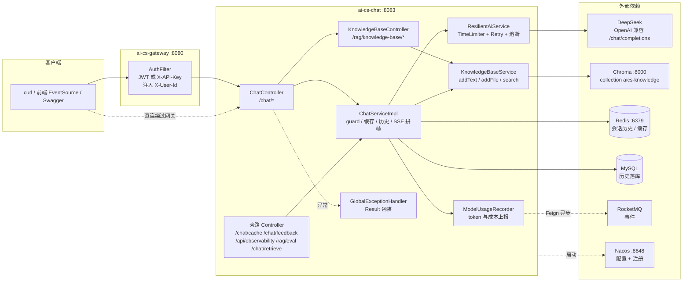
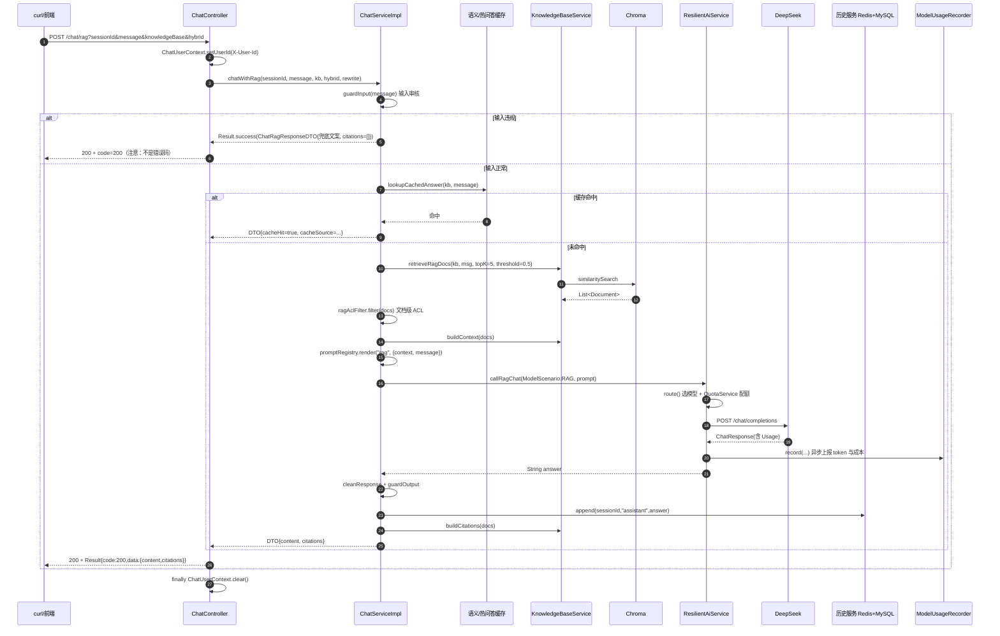

# ai-cs-chat 接口测试报告：把每个结论都做成别人能复跑的证据

> **一句话结论**：这份报告不只说"接口能用"，而是把 12 个端点的**HTTP 状态码判据、响应体字段判据、SSE 帧格式判据**逐条写成可复跑的形式，并明确标出哪些用例在本机（无 Docker / 无 Redis / 无 Chroma / 无模型 Key）根本跑不起来、替代验证手段是什么。
> **阅读前置**：需要读过 [01-SpringAI入门.md](01-SpringAI入门.md) 的 ChatClient 链式 API 部分；知道 `curl` 的 `-X/-d/-N/-i` 分别干什么；能分清"HTTP 状态码"和"响应体里的业务码"是两套东西。
> **证据基线**：Spring Boot 4.2.0 / Spring AI 2.1.0 / JDK 17.0.19（本机实测 `java -version`）/ ai-cs-chat 端口 8083、网关 8080；A 级源码摘录 6 处（`24-源码分析/assets/source/` 的 `Usage.java.md`、`StreamingChatModel.java.md`、`MockitoBean.java.md`、`WebMvcTest.java.md`、`SpringBootTest.java.md`，均带 `(src: …)` 锚点）、B 级本项目代码 20 个文件 / 30 处带行号引用（行号当次 read 核对）、C 级本机真实命令输出 12 处（javap ×5、jar 配置元数据 ×1、端口探测 ×2、node 复算 ×2、grep 空结果 ×1、golden 集解析 ×1）。**本机实测部分全部是静态核对，未启动任何服务**。预计阅读 35 分钟。

---

## 0. 先看现象

**测试范围先说清楚**，否则下面所有"通过"都是空的：

| 维度 | 本报告覆盖 | 本报告**不**覆盖 |
|---|---|---|
| 端点 | ai-cs-chat 的对话 / RAG / 流式 / 知识库 / 图片 / 评测旁路共 12 个 | 网关其他路由、user/order/product 服务 |
| 层次 | Controller 契约（参数、鉴权透传、状态码、响应包体）→ Service 行为（缓存、Guard、历史） | 前端联调、压测、模型效果评测（效果评测见 [05-LLM可观测性评估与成本治理实现文档.md](05-LLM可观测性评估与成本治理实现文档.md)） |
| 执行方式 | 静态核对（读码 + javap + jar 元数据）+ 可复跑的 curl 模板 | 真实 HTTP 抓包（本机 8083/8080 端口未监听，见 §9 探测输出） |

下面三个"失败现场"是两个来源拼起来的：**①代码里能被证明的结构性问题**（标注"静态可证"）；**②旧稿 2026-08-07 现场记录**（标注"旧稿现场"，只当线索，不当结论）。之所以要这样拆，是因为本机没有中间件与 API Key，任何"我跑通了"的说法都不可复现。

### 现场 1：上传 2 MB 的 PNG（在接口自己声明的 5 MB 白名单内）却返回 500

`ChatController` 里写得很清楚：允许 `jpg/jpeg/png/webp/gif`，上限 5 MB。

```java
// ai-cs-chat/src/main/java/com/aics/chat/controller/ChatController.java#L61-L64
private static final Set<String> ALLOWED_IMAGE_EXT = Set.of("jpg", "jpeg", "png", "webp", "gif");

/** 图片大小上限 5MB */
private static final long MAX_IMAGE_SIZE = 5 * 1024 * 1024L;
```

但 `ai-cs-chat/src/main/resources/application.yml` 里**没有任何** `spring.servlet.multipart.*` 配置（§9 给了 grep 命令，本机真实输出为空），于是 Spring Boot 的默认值生效——这个默认值不是猜的，是从 jar 内配置元数据里读出来的（C 级，见 §9）：

```text
spring.servlet.multipart.max-file-size = 1MB
spring.servlet.multipart.max-request-size = 10MB
```

所以 1 MB～5 MB 之间的图片**根本到不了** Controller 那两行校验：请求在 multipart 解析阶段就抛 `MaxUploadSizeExceededException`，而这个异常全仓**没有任何处理器**（§9 grep 输出"未找到任何处理点"），最终落到 `GlobalExceptionHandler` 的兜底分支：

```java
// ai-cs-common/src/main/java/com/aics/common/exception/GlobalExceptionHandler.java#L149-L154
@ExceptionHandler(Exception.class)
@ResponseStatus(HttpStatus.INTERNAL_SERVER_ERROR)
public Result<Void> handleException(Exception e, HttpServletRequest request) {
```

现象就是：客户端明明按接口文档传了 2 MB 图片，回的是 `HTTP 500` + `{"code":500,"message":"系统内部错误","data":null,"timestamp":...}`。**这条是静态可证的**（默认值 + 无处理器 + 兜底分支三段证据齐全），不需要真跑。

### 现场 2：同一件事，直连服务 200，过网关 401

两套鉴权语义同时存在，且**响应形态不一样**：

```text
# 直连服务：8083 端口不校验任何 token，请求直接进 Controller
curl -X POST "http://127.0.0.1:8083/chat/send?sessionId=s1&message=hi"
# 预期 200 + {"code":200,"message":"操作成功","data":"...","timestamp":...}

# 过网关：没有 Bearer Token，AuthFilter 直接写状态码 + 手写 JSON
curl -X POST "http://127.0.0.1:8080/chat/send?sessionId=s1&message=hi"
# 预期 401 + {"code":401,"message":"...","data":null,"timestamp":...}
```

网关这侧是真 401：

```java
// ai-cs-gateway/src/main/java/com/aics/gateway/filter/AuthFilter.java#L237-L242
// response.setStatusCode(HttpStatus.UNAUTHORIZED) + 手写 body
// {"code":401,"message":"...","data":null,"timestamp":...}
```

而服务内部只要是 `BusinessException`，就**没有** `@ResponseStatus`，也就是 HTTP 200 带业务错误码：

```java
// ai-cs-common/src/main/java/com/aics/common/exception/GlobalExceptionHandler.java#L35-L39
@ExceptionHandler(BusinessException.class)
public Result<Void> handleBusinessException(BusinessException e, HttpServletRequest request) {
```

同一份 `Result` 结构，`code` 字段可以是 200、3003（`CHAT_AI_SERVICE_UNAVAILABLE`）、3101（`AGENT_SAFETY_BLOCKED`），但外层 HTTP 状态码是 200。**只看 HTTP 状态码的用例，在这里必然假通过**——这是本报告反复强调"双判据"的由来。

### 现场 3：`curl` 调 `/chat/stream/sse` 一坨输出，前端 EventSource 又收不到

`/chat/stream/sse` 返回 `SseEmitter`，代码里所有推送都是这一个形状：

```java
// ai-cs-chat/src/main/java/com/aics/chat/service/impl/ChatServiceImpl.java#L695
emitter.send(SseEmitter.event().data(Map.of("content", chunk)));
```

`SseEmitter.event()` 返回的 `SseEventBuilder` 支持 `id/name/reconnectTime/comment/data` 六类信息（C 级 javap 实测，见 §9），**只有显式调 `.name()` 才会产生 `event:` 行**。本仓只调 `.data()`，所以线上帧长这样：

```text
data:{"content":"你"}

data:{"content":"好"}

data:{"done":true,"citations":[]}

```

于是出现两个方向的误判：

- **用 `curl` 不加 `-N`**：curl 默认按接收缓冲刷 stdout，看起来"服务端 30 秒才吐一次"，其实是客户端没关缓冲；
- **前端用 `addEventListener("message", ...)` 之外的命名事件监听**：因为压根没有 `event:` 行，监听永远不触发，表现为"流式没反应"。

> **这些现象指向同一件事**：这套接口的"响应形态"（HTTP 状态码、业务码、SSE 帧结构、上传上限）不是由接口契约某一处统一定义的，而是由**全局异常处理器的注解、Spring Boot 的默认配置、`SseEmitter` 的拼帧规则**三处临时决定的。不做成逐条可复跑的判据，下一次重构就会悄悄变化而没人发现。

---

## 1. 整体地图



> **读图说明**：实线是正常调用链，三条虚线是"不属于主链路但影响判据"的部分——`CURL -.直连绕过网关.-> CC` 是本机做接口测试时**最常用**的连法（跳过 8080），也正是现场 2 里"直连 200、过网关 401"的原因；`SVC --> MUR` 指向的用量上报是异步 Feign，失败只打 warn 不抛异常，所以"成本没数据"不会表现为测试失败，只会表现为报表为空；`CHAT -.启动.-> NACOS` 是配置中心，它决定了你测的是哪一套配置（`optional:nacos:ai-cs-chat.yml` 找不到就回落到本地默认值）。另外注意 `KBC` 与 `SVC` 是两条并行的支线：知识库三接口（写/检索）不经过 `ChatServiceImpl`，因此**不做** Guard、不做历史、不走熔断——测试时不能拿"对话接口的行为"去推断"知识库接口的行为"。

| 组件 | 责任（一句话） | 谁调它 / 它的调用方 | 证据 |
|---|---|---|---|
| `ChatController` | 5 个对话 + 上传 + 视觉共 8 个端点，只做参数装配、`X-User-Id` 透传 ThreadLocal、异常外抛 | 网关 / curl / 前端 | `ai-cs-chat/src/main/java/com/aics/chat/controller/ChatController.java#L35-L42` |
| `KnowledgeBaseController` | 3 个知识库端点：写文本、传文件、检索 | 运维 / 管理端 | `ai-cs-chat/src/main/java/com/aics/chat/controller/KnowledgeBaseController.java#L29` |
| `ChatServiceImpl` | 业务主干：输入/输出 Guard、缓存命中、历史压缩、检索拼接、SSE 订阅与拼帧 | `ChatController`、`AgentController`（复用 `streamReply`） | `ai-cs-chat/src/main/java/com/aics/chat/service/impl/ChatServiceImpl.java#L184-L241` |
| `KnowledgeBaseService` | `addText/addFile/search/buildContext`，向量库读写 | `KnowledgeBaseController`、`ChatServiceImpl` | `ai-cs-chat/src/main/java/com/aics/chat/service/KnowledgeBaseService.java#L112-L287` |
| `ResilientAiService` | 熔断 + 超时 + 重试 + fallback 链，把模型异常统一成 `[ERROR]xxx` 或异常 | `ChatServiceImpl` | `ai-cs-chat/src/main/java/com/aics/chat/service/impl/ResilientAiService.java#L172-L224` |
| `GlobalExceptionHandler` | 所有异常 → `Result`，决定 HTTP 状态码 | Spring MVC 自动装配 | `ai-cs-common/src/main/java/com/aics/common/exception/GlobalExceptionHandler.java#L35-L154` |
| `CommonWebAutoConfiguration` | 引入 common 就自动装配异常处理器（不用扫包） | Spring Boot 自动配置 | `ai-cs-common/src/main/java/com/aics/common/autoconfigure/CommonWebAutoConfiguration.java#L12-L20` |
| `AuthFilter` | 网关鉴权：校验 JWT 或 API Key，注入 `X-User-Id` | Spring Cloud Gateway | `ai-cs-gateway/src/main/java/com/aics/gateway/filter/AuthFilter.java#L83-L96` |
| `ModelUsageRecorder` | 记 token 用量、按 `pricingKey` 估成本，异步上报 | `ResilientAiService` | `ai-cs-chat/src/main/java/com/aics/chat/observability/ModelUsageRecorder.java#L74-L127` |

---

## 2. 关键概念与关键类

先把"判据要看的字段从哪来"对上号，后面每个用例的"该看哪几个字段"才有出处。

| 名称 | 位置 | 角色 | 关键方法 / 字段 |
|---|---|---|---|
| `Result<T>` | `ai-cs-common/src/main/java/com/aics/common/result/Result.java#L18-L27` | 统一响应包，**所有**端点返回值 | 字段 `int code` / `String message` / `T data` / `long timestamp`；`success(T)`、`fail(int,String)`、`isSuccess()` |
| `ResultCode` | `ai-cs-common/src/main/java/com/aics/common/result/ResultCode.java#L14-L24` | 业务码字典（200/400/401/429 + 3xxx 对话域 + 31xx Agent 域） | `SUCCESS(200)`、`TOO_MANY_REQUESTS(429)`、`CHAT_AI_SERVICE_UNAVAILABLE(3003)`、`CHAT_CONTEXT_OVERFLOW(3004)` |
| `BusinessException` | `ai-cs-common/src/main/java/com/aics/common/exception/BusinessException.java#L10-L37` | 业务异常载体，携带业务码 | 构造 `(ResultCode, String)`、`(int, String)` |
| `GlobalExceptionHandler` | `ai-cs-common/src/main/java/com/aics/common/exception/GlobalExceptionHandler.java#L44-L154` | 异常 → HTTP 状态码 + `Result` 的**唯一**决策点 | `handleConstraintViolation`(400)、`handleMissingServletRequestParameter`(400)、`handleBusinessException`(**无注解 → 200**)、`handleException`(500) |
| `ChatUserContext` | 由 `ChatController` 写入/清理 | ThreadLocal 承载当前用户 ID，供 `@Tool` 读 | `setUserId` / `clear`（`ChatController.java#L83-L90` 的 `try/finally`） |
| `SseEmitter` | `spring-webmvc-7.1.0.jar` | SSE 通道，`send` 后由 MVC 拼帧 | `SseEmitter(Long timeout)`、`event().data(...)`；`SseEventBuilder` 另有 `id/name/comment` |
| `Usage` | `24-源码分析/assets/source/Usage.java.md` | 模型返回的 token 计数，测试核对的**唯一权威数字来源** | `getPromptTokens()`、`getCompletionTokens()`、`default getTotalTokens()` |
| `StreamingChatModel` | `24-源码分析/assets/source/StreamingChatModel.java.md` | 流式模型抽象，`Flux<String>` 的来源 | `Flux<String> stream(String message)`、`Flux<ChatResponse> stream(Prompt)` |
| `@MockitoBean` | `24-源码分析/assets/source/MockitoBean.java.md` | Boot 4 替换容器里 bean 的注解（替代已删除的 `@MockBean`） | `value()` / `name()` / `types()` / `extraInterfaces()` |

两个术语先解释清楚，否则下面看不懂判据：

- **SSE（Server-Sent Events，服务器推送事件）**：一种"一次请求、多次响应"的 HTTP 用法，响应体是一行行 `data:xxx\n\n`，每条之间空行分隔；浏览器用 `EventSource` 消费。它**不是 WebSocket**，方向单向（服务端→客户端）。
- **TTFT（Time To First Token，首 token 延迟）**：从请求发出到收到第一个内容分片的耗时。流式接口"看起来卡住"和"真的没有内容"的唯一可靠区分指标。

---

## 3. 逐接口用例与核对结果

统一约定：所有用例都写"**发什么 → 看哪几个字段 → 通过判据**"。`$HOST` 直连时是 `http://127.0.0.1:8083`，过网关时是 `http://127.0.0.1:8080`。

**本机可执行性总表**（先看这张，避免逐条问"为什么没跑"）：

| 组 | 端点 | 需要的依赖 | 本机可执行？ | 替代验证手段 |
|---|---|---|---|---|
| A | `POST /chat/send` | 模型 API Key（`OPENAI_API_KEY`）+ Redis（历史） | ❌ 不可执行（无 Key、无 Redis） | 静态核对签名与异常映射；用 `ChatControllerRegressionTest` 的 standalone 手法复跑"路由 + 序列化"层 |
| B | `POST /chat/rag` | 上面 + Chroma | ❌ 不可执行 | 同上 + `RetrieveControllerTest` 证明检索旁路映射 |
| C | `POST /chat/stream` | 无（占位实现，不调模型） | ⚠️ 需要服务能起，但启动要 Nacos 配置中心可连（`optional:` 前缀可容忍缺失） | 纯静态判断：`ChatServiceImpl.java#L492-L506` 直接返回 Map |
| D | `POST /chat/stream/sse` | 模型 Key + Redis | ❌ 不可执行 | javap 证明帧结构 + 给出 `curl -N` 模板与判读方法 |
| E | `POST /rag/knowledge-base/text`、`/upload`、`GET /search` | Chroma（embedding 走远端 API） | ❌ 不可执行 | 静态核对参数名与返回 Map 的 key |
| F | `POST /chat/upload-image` | 本地磁盘目录（`FileStorageService`） | ❌ 不可执行（服务未起） | **静态可证 500 缺陷**（现场 1） |
| G | 旁路：`/chat/cache/stats`、`/chat/feedback`、`/api/observability/traces/{id}`、`/rag/eval/run`、`/chat/retrieve/test` | 视端点而定 | ❌ 本机不可执行 | `RetrieveControllerTest` 单测可离线跑（standalone，无容器） |

> 结论先摆明：**本报告没有任何一条用例是本机实测通过的**。所以下面每条的"核对结果"列只有三种值：`静态可证通过`（代码保证）、`静态可证缺陷`（代码矛盾）、`待环境就绪后实测`。

### 3.1 `POST /chat/send`（同步对话）

```bash
# 正向：最小可用请求（-o 落盘，便于之后用 pwsh 的 ConvertFrom-Json 逐字段核对）
curl -sS -X POST "$HOST/chat/send?sessionId=s-001&message=你好" \
  -H "X-User-Id: 1001" -o send.json

# 负向 1：缺 message（缺参数）
curl -sS -o /dev/null -w "%{http_code}\n" -X POST "$HOST/chat/send?sessionId=s-001"

# 负向 2：message 是空白串（有参数但违反 @NotBlank）
curl -sS -o /dev/null -w "%{http_code}\n" -X POST "$HOST/chat/send?sessionId=s-001&message=%20"
```

签名与判据来源：

```java
// ai-cs-chat/src/main/java/com/aics/chat/controller/ChatController.java#L78-L91
@PostMapping("/send")
@SentinelResource(value = SentinelRules.RESOURCE_CHAT_SEND, blockHandler = "chatSendBlocked")
public Result<String> chat(@RequestParam("sessionId") @NotBlank(message = "会话ID不能为空") String sessionId,
                           @RequestParam("message") @NotBlank(message = "消息内容不能为空") String message,
                           @RequestHeader(value = "X-User-Id", required = false) Long userId) {
```

| 看什么 | 正向期望 | 负向 1 期望 | 负向 2 期望 | 出处 |
|---|---|---|---|---|
| HTTP 状态码 | `200` | `400` | `400` | 由处理器注解决定 |
| `$.code` | `200` | `400` | `400` | `ResultCode.BAD_REQUEST` |
| `$.message` | `操作成功` | `缺少请求参数: message` | 含校验消息（`消息内容不能为空`） | `GlobalExceptionHandler.java#L109-L114` / `#L70-L78` |
| `$.data` | 非空字符串（AI 回复正文，已过 `cleanResponse`） | `null` | `null` | `ChatServiceImpl.java#L164` |
| `$.timestamp` | 13 位毫秒 | 13 位毫秒 | 13 位毫秒 | `Result.java#L27` |

**通过判据（三条同时满足才算过）**：① HTTP 200 且 `$.code=200`；② `$.data` 长度 > 0 且**不含** `抱歉，我无法回答这个问题。`（否则是输入 Guard 短路，`ChatServiceImpl.java#L216`）；③ 同一个 `sessionId` 连发两次，第二次的 `GET /chat/history?sessionKey=...` 里能查到两条 user + 一条 assistant（证明历史写入生效）。

判据可以写成一条可复跑的命令（把"三条同时满足"变成一行输出，避免人工看走眼）：

```powershell
$r = Get-Content send.json -Raw | ConvertFrom-Json
"code={0} dataLen={1} blocked={2}" -f $r.code, $r.data.Length, ($r.data -like '抱歉，我无法回答*')
# 通过的样子：code=200 dataLen=17 blocked=False
```

**核对结果：静态可证通过（参数层）/ 待环境就绪后实测（模型层）。**

一个必须写进报告的细节：负向 1 和负向 2 走的是**两个不同处理器**。缺参数在参数解析阶段就抛 `MissingServletRequestParameterException`；有参数但空白要等 `@Validated`（类上 L53）触发 `ConstraintViolationException`。这两个处理器都是 400，所以"400 通过"这句话背后其实是两条路径，重构时很容易只保住一条。

### 3.2 `POST /chat/rag`（RAG 对话 + 引用溯源）

```bash
curl -sS -X POST "$HOST/chat/rag?sessionId=s-002&message=退货怎么申请&knowledgeBase=product-manual&hybrid=true&rewrite=false" \
  -H "X-User-Id: 1001" | tee /tmp/rag.json
```

| 看什么 | 期望 | 判读要点 |
|---|---|---|
| `$.code` | `200` | — |
| `$.data.content` | 非空字符串 | 与 `citations[].content` 语义相关（人工抽检 3 条） |
| `$.data.citations` | 数组，长度 ≥ 1 | **为空数组 = 检索没命中**，此时 `content` 仍非空（提示语），**这是最典型的假通过** |
| `$.data.citations[].score` | > 0.5 | 同步 RAG 的阈值是 0.5（`retrieveRagDocs(kb, msg, 5, 0.5, ...)`，`ChatServiceImpl.java#L437`）；知识库检索接口用的却是 0.3（§3.5），两处阈值不同要分清 |
| `$.data.cacheHit` / `cacheSource` | 首次调用应缺失；同 questions 再发一次出现 | 命中缓存会**跳过**检索与模型（`ChatServiceImpl.java#L424-L433`） |

引用列表的字段来自 `buildCitations`，它按 `documentId/title/page_number/score/content` 组装（`ChatServiceImpl.java#L1041-L1078`）。所以"引用看起来对不对"的核对方式是：**拿 `citations[].documentId` 去 Chroma 里 `GET /api/v1/collections/aics-knowledge/get`，比对 metadata 里的 `documentId` 是否一致**——这一步本机不可执行（无 Chroma）。

**核对结果：待环境就绪后实测。** 本机替代：`ai-cs-chat/src/test/java/com/aics/chat/controller/RetrieveControllerTest.java#L35` 用 `MockMvcBuilders.standaloneSetup(new RetrieveController(hybridRetriever))` 证明"检索结果 → `{mode,degraded,documents[]}`"的映射与降级（非法 mode 降级为 `VECTOR` 仍返回 200），这类断言不需要任何外部依赖。

### 3.3 `POST /chat/stream`（占位接口，**最容易制造假通过**）

```bash
curl -sS -X POST "$HOST/chat/stream?sessionId=s-003&message=你好"
```

```java
// ai-cs-chat/src/main/java/com/aics/chat/service/impl/ChatServiceImpl.java#L492-L506（节选）
// 该实现不调用模型，只回一段提示
result.put("message", "流式对话已启动，请使用 /chat/stream/sse 端点接收 SSE 流式响应");
```

判据：`$.code=200`、`$.data.status="streaming"`、`$.data.message` 精确包含 `stream/sse` 字样。**这里必须写一句警告**：如果用例只断言"`/chat/stream` 返回 200 且带 message"，它会永远通过，且完全不能说明流式链路可用——真正的流式只有 `/chat/stream/sse`。旧稿里"流式接口是桩"的记录，在当前代码里**仍然成立**（占位实现还在）。

**核对结果：静态可证通过（占位行为符合预期）。**

### 3.4 `POST /chat/stream/sse`（SSE 流式，主力端点）

```bash
# -N 关闭 curl 缓冲；-i 保留响应头（用来确认 Content-Type 与 chunked）
curl -N -i -sS -X POST "$HOST/chat/stream/sse?sessionId=s-004&message=你好" \
  -H "Accept: text/event-stream" -o sse.log

# 只看数据帧，看清一共几帧、首帧什么时候来
Select-String -Path sse.log -Pattern '^data:'

# 带知识库的 RAG 流式（多传一个 knowledgeBase）
curl -N -sS -X POST "$HOST/chat/stream/sse?sessionId=s-005&message=退货流程&knowledgeBase=product-manual" \
  -H "Accept: text/event-stream"
```

该端点参数与帧结构：

```java
// ai-cs-chat/src/main/java/com/aics/chat/controller/ChatController.java#L166-L179
@PostMapping(value = "/stream/sse", produces = MediaType.TEXT_EVENT_STREAM_VALUE)
public SseEmitter chatStreamSse(@RequestParam("sessionId") @NotBlank(message = "会话ID不能为空") String sessionId,
                                @RequestParam("message") @NotBlank(message = "消息内容不能为空") String message,
                                @RequestParam(value = "knowledgeBase", required = false) String knowledgeBase,
                                @RequestParam(value = "hybrid", defaultValue = "false") boolean hybrid,
                                @RequestParam(value = "rewrite", defaultValue = "false") boolean rewrite,
                                @RequestHeader(value = "X-User-Id", required = false) Long userId) {
```

| 看什么 | 期望 | 出处 |
|---|---|---|
| 响应头 `Content-Type` | `text/event-stream` | `produces=` 声明 |
| 帧格式 | 每帧一行 `data:{json}`，帧间空行；**没有** `event:` / `id:` 行 | 代码只调 `.data()` |
| 内容帧 | `data:{"content":"<增量文本>"}`，多帧 | `ChatServiceImpl.java#L695` |
| 结束帧 | 最后一帧 `data:{"done":true,"citations":[...]}` | `ChatServiceImpl.java#L790-L796` |
| 错误帧 | `data:{"error":"<友好文案>"}` 后连接关闭，**没有** `done` 帧 | `ChatServiceImpl.java#L676` / `#L813` |
| 连接生命周期上限 | 5 分钟（`SSE_EMITTER_TIMEOUT = 5 * 60 * 1000L`，L156；`new SseEmitter(SSE_EMITTER_TIMEOUT)`，L525） | 超时回调只打日志 + `complete()`（L829-L832） |
| Guard 拦截帧 | 输入被拦时只有一帧 `content` + 一帧 `done`，无 `error`（`ChatServiceImpl.java#L530-L540`） | — |

**通过判据**：① 3 秒内收到第一帧（TTFT）；② `content` 帧 ≥ 2 且拼接后非空；③ 最后一帧 `done=true`；④ 帧间**没有**出现 `[ERROR]` 原文（`ResilientAiService` 会把熔断/超时降级成 `Flux.just("[ERROR]AI 助手暂时繁忙，请稍后重试。")`，`ResilientAiService.java#L261`，Service 层会把它转成 `error` 帧并提前 `complete()`，见 `ChatServiceImpl.java#L670-L687`）。

**核对结果：待环境就绪后实测。** 本机替代：§9 的 javap 输出已证明 `SseEventBuilder` 只有 `id/name/reconnectTime/comment/data/data/build` 七个方法，配合"代码只调 `.data()`"这一事实，"线上没有 `event:` 行"是**静态可证**的。

### 3.5 知识库三接口

```bash
# 写文本
curl -sS -X POST "$HOST/rag/knowledge-base/text?knowledgeBase=product-manual&text=保修期为一年"
# 传文件（注意 §3.6 的 1MB 陷阱同样适用于这里）
curl -sS -X POST "$HOST/rag/knowledge-base/upload?knowledgeBase=product-manual" -F "file=@./manual.pdf"
# 检索
curl -sS "$HOST/rag/knowledge-base/search?knowledgeBase=product-manual&query=保修期"
```

| 端点 | 看什么 | 期望 | 出处 |
|---|---|---|---|
| `/text` | `$.data.knowledgeBase` / `$.data.chunks` | 回显 kb 名；`chunks` 为切块数（> 0 才有意义） | `KnowledgeBaseController.java#L44-L48` |
| `/upload` | `$.data.fileName` / `$.data.chunks` | `fileName` 等于原始文件名（**不是**临时路径） | `KnowledgeBaseController.java#L59-L64` |
| `/search` | `$.data[]` 每项 `{text, score}` | `score` ≤ 1 且降序；`score` 为 `null` 时被填成 `0.0`（**这是接口的兜底行为，不是 bug**） | `KnowledgeBaseController.java#L75-L85` |

这三个方法**没有** `@NotBlank`，所以缺参走的是 `MissingServletRequestParameterException`（400，文案"缺少请求参数: xxx"），而不是 `ConstraintViolationException`——和 §3.1 的对话接口**不一样**。测试用例如果把两类接口的负向期望写成同一句，就会有一半是错的。

**核对结果：待环境就绪后实测（需 Chroma）。**

### 3.6 图片上传与视觉对话（静态可证缺陷）

```bash
# 造一个 2MB 的合法 PNG（本机可执行，不需要任何依赖）
node -e "const fs=require('fs');const b=Buffer.alloc(2*1024*1024);b[0]=0x89;fs.writeFileSync('big.png',b)"

# 上传（服务未起时会 connection refused，这本身就是"未实测"的证据）
curl -sS -o /dev/null -w "%{http_code}\n" -X POST "$HOST/chat/upload-image" -F "file=@big.png"
```

期望（按接口契约）：`200` + `$.data` 为可访问 URL。实际（静态推演）：`500` + `{"code":500,"message":"系统内部错误"}`，原因见§0 现场 1。修复动作与验收标准：

| 修复动作 | 落点 | 验收标准 |
|---|---|---|
| 显式声明 multipart 上限，使接口声明的 5 MB 真正生效 | `ai-cs-chat/src/main/resources/application.yml` 增加 `spring.servlet.multipart.max-file-size: 5MB` 与 `max-request-size: 6MB` | 2 MB PNG → 200；6 MB PNG → **400/413**（不是 500） |
| 或者把 `MAX_IMAGE_SIZE` 降到 1 MB 以内并在文档同步 | `ai-cs-chat/src/main/java/com/aics/chat/controller/ChatController.java#L64` | 与 yml 默认值一致，且注释写明"受 multipart 上限约束" |
| 兜底：为 `MaxUploadSizeExceededException` 单独加处理器 | `ai-cs-common/src/main/java/com/aics/common/exception/GlobalExceptionHandler.java` | 超大文件返回 400 + `缺少…`/`文件过大` 类业务文案，不再是 500 |

**核对结果：静态可证缺陷（❌ 未落地修复）。** 这条是本报告里最值得抄进 issue 的一条：接口注释与运行时默认值互相矛盾，且矛盾结果是 500。

### 3.7 旁路接口（用于交叉验证，不作为主链路验收）

| 端点 | 用途 | 核对方式 | 出处 |
|---|---|---|---|
| `GET /chat/retrieve/test?query=...&mode=...` | 单看混合检索，不进 LLM | `$.data.mode` ∈ {VECTOR, HYBRID}，非法 mode 降级 `VECTOR` 且 `degraded=true` 仍 200 | `ai-cs-chat/src/main/java/com/aics/chat/controller/RetrieveController.java#L47` |
| `GET /chat/cache/stats` | 看三级缓存命中统计 | `$.data` 含各层计数，字段名以实际返回为准 | `ai-cs-chat/src/main/java/com/aics/chat/controller/CacheStatsController.java#L36` |
| `POST /chat/feedback` / `GET /chat/feedback` | 收集点赞点踩，做效果基线 | 提交后能按 session 查回 | `ai-cs-chat/src/main/java/com/aics/chat/controller/ChatFeedbackController.java#L50` |
| `GET /api/observability/traces/{requestId}` | 按 `requestId` 取链路 span | 与日志里的 `requestId` 对齐 | `ai-cs-chat/src/main/java/com/aics/chat/controller/ObservabilityController.java#L42` |
| `POST /rag/eval/run` | 跑 golden 集算命中率/均分 | `$.data.passed` 与逐条明细 | `ai-cs-chat/src/main/java/com/aics/chat/controller/RagEvalController.java#L45-L48` |

golden 集的真实形状（C 级，本机 `node` 解析真实文件）：

```text
条数= 20
字段= id,question,knowledgeBase,expectedDocumentIds,referenceAnswer,expectedKeywords
示例= {"id":"gc-001","question":"型号 ABC-123 的保修期是多久？","knowledgeBase":"product-manual",
       "expectedDocumentIds":["101"],"referenceAnswer":"型号 ABC-123 保修期为 1 年。","expectedKeywords":["保修","1 年"]}
```

也就是说，`/rag/eval/run` 的判据不是"LLM 说得像不像人话"，而是**逐条比对 `expectedDocumentIds` 是否被召回**（够硬）+ `expectedKeywords` 是否出现在回答里（较软）。这也是为什么本报告把"效果评测"单独交给 [05-LLM可观测性评估与成本治理实现文档.md](05-LLM可观测性评估与成本治理实现文档.md)：接口测试负责契约，评测负责质量，两者判据不能混。

### 3.8 判据的源码依据（A 级精读：为什么这三条判据不能改成"看起来更严格"）

本报告里有三条判据是**反直觉**的——"token 总数不要自己算"、"缓存 token 可能永远是 null"、"空字符串分块是合法的"。它们不是看代码猜的，而是 Spring AI 2.1.0 的接口契约直接规定的。

#### 判据一：`totalTokens` 不该由被测自己相加

```java
// (src: Usage.java.md#L56-L62)
	default Integer getTotalTokens() {
		Integer promptTokens = getPromptTokens();
		promptTokens = promptTokens != null ? promptTokens : 0;
		Integer completionTokens = getCompletionTokens();
		completionTokens = completionTokens != null ? completionTokens : 0;
		return promptTokens + completionTokens;
	}
```

- **在干什么**：`Usage` 是"一次模型调用的用量 ADT"（接口声明见 `Usage.java.md#L29-L30`），`getTotalTokens()` 是 `default` 方法，直接由 prompt + completion 相加。
- **为什么这么设计**：总 token 是**派生值**而不是独立字段，避免厂商返回三个互相矛盾的数字；`null` 当 0，则允许"只有一边有数"的实现照常工作。
- **换写法会怎样**：如果用例写"自己算一遍再和返回值比对"，等于把同一条公式实现两遍——测出的是你的算术，不是链路。判据应是"取 `getTotalTokens()` 的值，并与厂商原始 usage 对得上"。
- **常见坑**：`getPromptTokens()` 返回 `Integer` 而非 `int`，**可能为 null**。直接断言 `getTotalTokens() == 1234` 时，某些厂商会静默变成"少算了 prompt 部分"，看起来像 bug，其实是数据缺失。

#### 判据二：不要断言"缓存 token > 0"

```java
// (src: Usage.java.md#L78-L92)
	default @Nullable Long getCacheReadInputTokens() {
		return null;
	}

	default @Nullable Long getCacheWriteInputTokens() {
		return null;
	}
```

- **在干什么**：2.0.0 起新增的**提示缓存**用量（方法上有 `@since 2.0.0`），默认实现返回 `null`，含义是"这个厂商/这条链路没有缓存信息"。
- **为什么这么设计**：提示缓存是可选能力，接口必须能在不支持的厂商上照常工作，所以给 `default` 返回 `null`，而不是抽象方法强制每个人都实现。
- **换写法会怎样**：若写成 `assertThat(usage.getCacheReadInputTokens()).isPositive()`，在 DeepSeek（走 OpenAI 兼容层、不填这两个字段）上必然失败，而链路是好的——典型的"用错判据把好代码判成烂代码"。
- **常见坑**：本仓 `ModelUsageRecorder` 也没读这两个字段（`ModelUsageRecorder.java#L100` 只按输入/输出是否为 null 置 `estimated`），所以"缓存省了多少钱"目前**没有数据支撑**，报告里不能下这个结论。

#### 判据三：SSE 里的 `{"content":""}` 不算故障

```java
// (src: StreamingChatModel.java.md#L32-L38)
	default Flux<String> stream(String message) {
		Prompt prompt = new Prompt(message);
		return stream(prompt).map(response -> Optional.ofNullable(response.getResult())
			.map(Generation::getOutput)
			.map(AssistantMessage::getText)
			.orElse(""));
	}
```

- **在干什么**：把 `Flux<ChatResponse>` 映射成 `Flux<String>`（纯文本增量），拿不到结果时给 `""` 而不是丢弃该元素。
- **为什么这么设计**：流式下游（`SseEmitter`、WebFlux）只关心文本增量；抽象层把"没有结果"归一成空字符串，调用方不必每处判 null。
- **换写法会怎样**：`ChatServiceImpl` 的 `onNext` 直接把 chunk 塞进 `{"content": chunk}`（`ChatServiceImpl.java#L695`），所以**空字符串帧会真的发出去**。若用例断言"每一帧 content 都必须非空"，一个空帧就让整条用例红掉，而链路是对的。
- **常见坑**：真正的故障判据是**帧序**而不是帧内容——最后一帧必须是 `{"done":true,...}`；中途出现 `{"error":...}` 即降级（`ChatServiceImpl.java#L670-L687` 把 `[ERROR]` 前缀的文本翻成 error 帧后 `complete()`，不会再有 `done` 帧）。

> 三条合起来只说明一件事：**判据要贴接口契约写，不要贴"看起来更严格"写**。§5 把"判据本身就是被测对象的规格"列为第二条理由，出处就是这里。

---

## 4. 一次完整执行时序

以最复杂的同步 RAG 为例（`POST /chat/rag`，直连 8083 不走网关；走网关时在 1 之前多一步 `AuthFilter`）。



> **读图说明**：三条分支是判据分叉点，务必分清——`输入违规` 分支返回的是 **`code=200` 的成功包**（只是 `content` 是兜底文案、`citations` 为空），不是错误码；`缓存命中` 分支**跳过**检索与模型，所以此时"回答正确"完全不能证明 RAG 链路健康；只有 `未命中` 分支才真正打到 Chroma 与 DeepSeek。另外 `ragAclFilter.filter(docs)` 之后可用文档数可能变少，**`citations` 数量与检索命中数不相等是正常的**，不要据此判定检索失败。

**哪一步最容易假通过：`未命中` 分支里的"模型返回"那一段。** 三种典型假通过：

1. 用 `@MockitoBean ChatService` 的切片测试 → 断言 `$.data.content` 非空就"通过"，但 `data` 是 mock 直接返回的常量，模型链路一次都没走（`ChatServiceImpl` 在测试里根本没被实例化）。
2. 只看 HTTP 200 → 输入 Guard 短路、缓存命中、熔断降级的友好文案都是 200。
3. 只看 `content` 非空不看 `citations` → 检索全空时回答照样有内容（提示语），这种"通过"最危险。

**每一步失败报什么（判据表）**：

| 失败步骤 | 客户端看到什么 | 根因线索 |
|---|---|---|
| 网关鉴权（走 8080 时） | HTTP `401` + `{"code":401,...}` | 网关手写 body（`AuthFilter.java#L237-L242`），不是 `Result` 的处理器 |
| 参数缺失/空白 | HTTP `400` + `code:400` | `MissingServletRequestParameterException` / `ConstraintViolationException` 两个处理器 |
| 输入 Guard 拦截 | HTTP `200` + `code:200` + 兜底文案 `抱歉，我无法回答这个问题。` | `ChatServiceImpl.java#L216` |
| Chroma 不可用 | HTTP `200` + `code:3003` + `AI服务调用失败: ...` | 检索异常被包进 `BusinessException`（`ChatServiceImpl.java#L365-L373` 同类路径） |
| 模型超时（>30s） | HTTP `200` + `code:3003` + `AI服务响应超时，请稍后重试` | `getFriendlyMessage` 命中 `TimeoutException`/`TimeLimiter`（`ChatServiceImpl.java#L1087-L1099`） |
| 熔断打开 | HTTP `200` + `code:3003` + `AI服务当前负载较高，已被熔断保护...` | `CallNotPermittedException`（同上） |
| 输出 Guard 拦截 | HTTP `200` + `code:200` + 兜底文案 `抱歉，该回答未通过安全审核...` | `ChatServiceImpl.java#L227` |
| SSE 端点内部异常 | 已 `200` 开始推流 → 收到 `data:{"error":...}` 后断流 | `completeWithError` 无法改状态码，见 `ChatServiceImpl.java#L723-L737` 注释 |

注意最后一行：**SSE 一旦开始推送，HTTP 状态码就固定为 200 了**，之后所有错误只能在 body 里表达。任何"流式接口返回 500"的期望都是错的。

---

## 5. 设计取舍

为什么最后交付的是一份"手写报告 + 可复跑 curl 模板"，而不是一堆自动化测试？先把四种手段的边界对齐：

| 手段 | 能管什么 | 管不了什么 | 本项目现状 | 本报告里承担什么 |
|---|---|---|---|---|
| Service 单元测试（Mockito） | 分支逻辑：Guard 短路、历史压缩、缓存键拼装 | 参数绑定、状态码、序列化、SSE 拼帧 | 全仓 ai-cs-chat 60 个测试类 / 252 个 `@Test` | 不负责接口契约 |
| Controller 切片（`standaloneSetup`） | 路由、参数名、`Result` 序列化、委托次数 | 全局异常处理器（standalone 不装配 `@RestControllerAdvice`）、鉴权过滤器 | 已用于 `ChatControllerRegressionTest`、`RetrieveControllerTest` | 提供"契约层可离线验证"的证据 |
| `@WebMvcTest` + `@MockitoBean` 全切片 | 上面 + 异常处理器 + 过滤器链（真实 MVC 基础设施） | 外部依赖行为；Bean 被替换后等于不再测实现 | 仅 ai-cs-user 有 2 处 | 说明"为什么 ai-cs-chat 没用它" |
| 契约测试（OpenAPI/JSON Schema） | 字段名、类型、必填 | 语义（`citations` 是否为空、token 数对不对） | 未落地（只有 Swagger 注解 `@Operation`） | 未落地，列为可扩展点 |
| 端到端（真模型 + 真中间件） | 全链路可用性、TTFT、token 成本 | 不可离线复跑、结果不稳定、要花钱 | 本机不具备（无 Key、无 Chroma、无 Redis） | 本报告只给命令行模板与判据，**明确标注未实测** |

选"手写报告"的三个理由，也就是这份文档的取舍：

1. **可复跑优先于可自动化**。本机连不上任何中间件，自动化测试写出来也是红的或全是 mock；而一份写清"发什么、看哪几个字段、通过判据是什么"的报告，换一台有 Key 的机器就能照做。
2. **判据本身就是被测对象的规格**。§4 那张"每一步失败报什么"的表，比 10 个断言更能暴露设计问题（例如"输入 Guard 返回 `code=200`"这件事，只有把判据写成表才会被发现并讨论）。
3. **报告能记录"未落地"**。测试代码很难表达"这个缺陷我知道但还没修"，报告的落地面标注可以。

**可扩展点清单**（按性价比排序，均标注落地面）：

| # | 可扩展点 | 落地面 | 具体动作 |
|---|---|---|---|
| 1 | 为 `MaxUploadSizeExceededException` 加处理器 + 显式 multipart 上限 | ❌ 未落地 | 见 §3.6 修复表 |
| 2 | `@WebMvcTest(ChatController.class)` + `@MockitoBean ChatService` 覆盖 8 个端点的状态码矩阵 | ❌ 未落地（ai-cs-chat 无一处 `@WebMvcTest`） | 抄 `ai-cs-user/src/test/java/com/aics/user/security/UserApiValidationIntegrationTest.java#L32-L47` 的范式 |
| 3 | 把 §3 的负向用例表变成参数化测试 | ❌ 未落地 | `@ParameterizedTest` + `@ValueSource` 覆盖空/空白/超长三类输入 |
| 4 | 契约测试：由 Swagger 导出 OpenAPI，比对 `Result` 与 `ChatRagResponseDTO` 字段 | ❌ 未落地 | 引入 springdoc 的 `openapi.json` 快照比对 |
| 5 | SSE 帧格式的断言（断言每个 `data:` 都是合法 JSON、最后一帧含 `done`） | ⚠️ 部分（仅 2 个测试文件提及 SSE） | 用 `MockMvc` 的异步 dispatch 拿 `MvcResult` 断言 body |
| 6 | 用 `/rag/eval/run` 的 `passed` 做 CI 门禁 | ⚠️ 部分（有 20 条 golden 集与评估器，未见 CI 接线） | 评估结果落库 + 阈值门禁 |

---

## 6. 踩坑与调试手法

### 6.1 怎么区分"AI 没返回"和"流被缓冲"

现象都是"看不到内容"。判别顺序（这条是本报告最实用的手法）：

```bash
# 第 1 步：看响应头有没有 chunked，有没有正确的 Content-Type
curl -sS -D - -o /dev/null --max-time 10 \
  -X POST "$HOST/chat/stream/sse?sessionId=s&message=hi"
#   期望看到：Content-Type: text/event-stream  +  Transfer-Encoding: chunked

# 第 2 步：加 -N 关缓冲，按到达顺序贴时间戳（bash / Git Bash / WSL）
curl -N -sS -X POST "$HOST/chat/stream/sse?sessionId=s&message=hi" | while IFS= read -r line; do
  printf '%s %s\n' "$(date +%H:%M:%S)" "$line"
done
```

判读口诀：**有 `chunked` 但加 `-N` 后仍长时间无首帧 → 服务端确实没内容（去看日志里的 TTFT 与模型调用）；加 `-N` 后立刻有帧、不加就"一坨" → 客户端缓冲问题。** 服务端侧的 TTFT 是可查的：`ResilientAiService` 专门记了首 chunk 时间（`ResilientAiService.java#L285-L287`），日志里能看到 `firstTokenMs`。

### 6.2 怎么用 `curl` 看 SSE 分块（含判读）

```bash
# 只要数据帧 + 行号，一屏看清一共几帧、有没有 done
curl -N -sS -X POST "$HOST/chat/stream/sse?sessionId=s&message=你好" | cat -n

# 只挑关键帧
curl -N -sS -X POST "$HOST/chat/stream/sse?sessionId=s&message=你好" \
  | Select-String -Pattern 'error|done|citations'
```

判读三条：① 帧以 `data:` 开头（**不是** `event:`，本仓没有命名事件）；② 相邻帧之间有一个空行；③ 最后必须是 `done` 帧，出现 `error` 帧说明中途降级（此时流被提前 `complete()`，不会有 `done`）。

### 6.3 怎么核对 token 数字（不许拍脑袋）

token 数字的唯一权威来源是模型响应里的 `Usage`（Spring AI 2.1.0 摘录 `24-源码分析/assets/source/Usage.java.md`，原文引用见 §3.8 判据一）：

```text
Usage.java.md  #L37  Integer getPromptTokens();
               #L46  Integer getCompletionTokens();
               #L56  default Integer getTotalTokens()      // prompt + completion，null 当 0
               #L78  default @Nullable Long getCacheReadInputTokens()   // 2.0.0 起，默认 null
```

链路是：`ChatResponse.getMetadata().getUsage()`（`ResilientAiService.java#L206-L207`）→ `ModelUsageRecorder.record(...)` 组装 DTO → 异步 Feign 上报。两个判读要点：

- **`estimated=true` 说明 token 数字缺失**，是"估算"而非"实测"（`ModelUsageRecorder.java#L100`：`inputTokens` 或 `outputTokens` 为 null 即置位）。看到 `estimated=true` 就不要拿它做成本结论。
- 成本公式可以本机复算（C 级真实输出）：

```bash
node -e "const i=1000,o=500,pi=2.0,po=8.0;console.log('cost =', ((i/1e6)*pi+(o/1e6)*po).toFixed(6))"
# cost = 0.006000
```

公式出处：`ModelUsageRecorder.java#L127` 的 `estimateCost`——`(输入tokens/1e6)×输入单价 + (输出tokens/1e6)×输出单价`，`setScale(6, HALF_UP)`。**单价以各厂商官方定价页为准，上面的 2.0/8.0 只是示例口径，不是本项目定价。**

### 6.4 "HTTP 200" 永远不等于通过

同一份 `Result`，`code` 可以是 `200 / 400 / 429 / 3003 / 3101`，但外层可能是 200。用例必须写双判据：`status == 200 && body.code == 200`。反过来也有陷阱：网关的 401 是真 HTTP 401 但 body 是**手写 JSON**（`AuthFilter.java#L237-L242`），字段顺序与 `Result` 一致只是巧合，不能假设它一定带 `timestamp`。

### 6.5 上传类用例的 1 MB 墙

任何"我传 2 MB 图片应该没问题"的假设，在没写 `spring.servlet.multipart.max-file-size` 的项目里都是错的。先用一条命令确认配置是否存在：

```bash
Select-String -Path ai-cs-chat/src/main/resources/application.yml -Pattern 'multipart'
# 本机真实输出：空（无任何 multipart 配置）
```

配置为空的结论是"Boot 默认 1 MB"，而不是"没有限制"。

### 6.6 切片测试的"假通过"陷阱

`MockMvcBuilders.standaloneSetup(controller)` 不会装配 `@RestControllerAdvice`，所以：

- 它能证明"参数名、路由、`Result` 序列化、委托次数"；
- 它**不能**证明"参数校验失败返回 400"——在 standalone 环境里，`ConstraintViolationException` 没有处理器，行为与线上不同（`ChatControllerRegressionTest.java#L40-L41` 就是这个范式）。

要覆盖状态码矩阵必须上 `@WebMvcTest`（真实 MVC 基础设施 + 可 `@Import` 异常处理器），范式见 `ai-cs-user/src/test/java/com/aics/user/security/UserApiValidationIntegrationTest.java#L37-L47`。

### 6.7 先确认"服务到底起没起"

```bash
Test-NetConnection 127.0.0.1 -Port 8083 | Select-Object RemotePort, TcpTestSucceeded
# 本机真实输出：TcpTestSucceeded = False（8080/8000/6379/3306/8848 同样 False）
```

这一步必须写在所有 curl 用例之前。否则 `curl: (7) Failed to connect` 会被误当成"接口 500"。

### 6.8 `X-User-Id` 可以被伪造吗

直连 8083 可以——服务端不校验任何 token，`@RequestHeader(required=false) Long userId` 直接采信。走网关时不行：网关会**先删掉**客户端传来的 `X-User-Id` 再注入自己解析出的值（`AuthFilter.java#L112-L121` 与 `#L152-L163`）。所以"用户隔离"类用例**必须经网关跑**，直连跑出来的通过没有安全意义。

---

## 7. ⚠️ 版本差异

测试这一层的 API 在 Boot 4 里改动很大，旧稿（Boot 3.2.5 / Spring AI 1.1.4）里的写法搬过来会直接编译不过。

| 旧写法（Boot 3.x / Spring AI 1.x） | 当前基线（Boot 4.2.0 / Spring AI 2.1.0） | 变化点 | 迁移动作 |
|---|---|---|---|
| `org.springframework.boot.test.mock.mockito.MockBean` | `org.springframework.test.context.bean.override.mockito.MockitoBean` | `MockBean` 在 Boot 4 已**删除**（C 级 javap：`spring-boot-test-4.2.0.jar` 里 `错误: 找不到类`） | 直接改 import；本仓 `@MockBean` 已 0 处、`@MockitoBean` 4 处 |
| `org.springframework.boot.test.autoconfigure.web.servlet.WebMvcTest` | `org.springframework.boot.webmvc.test.autoconfigure.WebMvcTest` | 测试切片搬到独立模块 `spring-boot-webmvc-test`（C 级 javap：旧路径 `错误: 找不到类`） | 改 import；`properties={...}` 用法不变 |
| 只排除 Nacos 就能跑 `@WebMvcTest` | 仍需 `properties={"spring.cloud.nacos.config.enabled=false","spring.cloud.nacos.discovery.enabled=false","spring.config.import="}` | 配置导入模式仍在，`spring.config.import=` 置空是关键 | 抄 `UserApiValidationIntegrationTest.java#L32` |
| 参数校验失败返回 500，靠 `scanBasePackages` 扫 common | 400，靠 `CommonWebAutoConfiguration` 自动装配处理器 | 不再需要 `scanBasePackages` 包含 common 包（`ChatApplication.java` 现在只扫 `com.aics.chat`） | 不要再加 `scanBasePackages`，加了反而可能扫进重复 Bean |
| `Usage` 只有 prompt/completion/total | 新增 `getCacheReadInputTokens()` / `getCacheWriteInputTokens()`（2.0.0 起，A 级 `Usage.java.md#L78-L90`） | 命中 prompt 缓存时 token 口径变化，成本会下降 | 核对成本时先看这两个字段是否非空 |
| 流式只有"桩接口"一条 | `/chat/stream`（占位）+ `/chat/stream/sse`（真流式）并存 | 判据要分开写，别把占位当流式 | 用例里两个端点各写一条，占位那条只断言提示文案 |
| embedding base-url 带 `/v1` 导致 `/v1/v1/embeddings` 404（旧稿现场） | `spring.ai.model.embedding: none` + `ChatApplication` 排除 `OpenAiEmbeddingAutoConfiguration` | 当前根本不自动装配 OpenAI embedding | 不要照抄旧稿的 base-url 修法；先看 yml 是否已关掉 embedding |

### 7.1 三个测试注解的源码签名（A 级，与 §9 练习 4 的 javap 输出互为印证）

版本迁移最怕"照抄博客"。下面每个签名都能在源码摘录里看到原文，也能在本机 m2 的 jar 上用 `javap` 复核一遍——两路对上，才敢写进报告。

```java
// (src: MockitoBean.java.md#L121-L126)
@Target({ElementType.FIELD, ElementType.PARAMETER, ElementType.TYPE})
@Retention(RetentionPolicy.RUNTIME)
@Documented
@Repeatable(MockitoBeans.class)
@BeanOverride(MockitoBeanOverrideProcessor.class)
public @interface MockitoBean {
```

- **在干什么**：`@MockitoBean` 是**测试上下文级**的 bean 覆盖注解，靠 `@BeanOverride` + `MockitoBeanOverrideProcessor` 在 `TestContext` 刷新 bean 定义时把目标替换成 Mockito mock。
- **为什么这么设计**：把"替换 bean"的机制从 Boot 的测试自动配置里抽到 Spring Test 的 generic bean-override 体系（`BeanOverrideStrategy#REPLACE_OR_CREATE` / `#REPLACE`），于是任何 Spring 测试切片都能用同一套覆盖语义，不再由 Boot 独有。
- **换写法会怎样**：若在 `standaloneSetup` 里手写 `mock(ChatService.class)`（本仓 `ChatControllerRegressionTest.java#L40-L41` 就是这么干的），测的是 Controller 的**方法调用**，不测 Spring 的参数解析、消息转换、异常处理——参数校验类用例在那种写法下永远测不到（没有 `@Validated` 代理与 `HandlerMethodArgumentResolver`）。
- **常见坑**：`@Target` 允许打在 `TYPE` 上，于是可以标注在测试类上作用于该类的所有测试方法；但它**要求目标 bean 已存在或允许创建**，对 `@ConditionalOnProperty` 关掉的 bean 用 `REPLACE` 策略会报"没有可替换的 bean"。

```java
// (src: WebMvcTest.java.md#L88-L96)
@Inherited
@BootstrapWith(WebMvcTestContextBootstrapper.class)
@ExtendWith(SpringExtension.class)
@OverrideAutoConfiguration(enabled = false)
@TypeExcludeFilters(WebMvcTypeExcludeFilter.class)
@AutoConfigureWebMvc
@AutoConfigureMockMvc
@ImportAutoConfiguration
public @interface WebMvcTest {
```

- **在干什么**：切片测试的入口，把 Spring 上下文裁剪到"只留 Web 层"（`@TypeExcludeFilters(WebMvcTypeExcludeFilter.class)` + `@OverrideAutoConfiguration(enabled = false)`）。
- **为什么这么设计**：`@AutoConfigureMockMvc` 直接内建在里面，所以切片测试里可以**直接注入 `MockMvc`**，不需要额外注解；`@ImportAutoConfiguration` 则允许用 `properties` 精确挑自动配置。
- **换写法会怎样**：用它替换本仓现有的 `standaloneSetup`，代价是启动一个裁剪过的 Spring 上下文（多几百毫秒），收益是**参数校验、异常处理器、`Result` 序列化全都真实生效**——§3 那批 400/405/415 用例只有在这种写法下才成立。
- **常见坑**：本仓 `ChatApplication` 引入了 Nacos 与 `spring.config.import`，切片测试必须像 `UserApiValidationIntegrationTest.java#L32` 那样把 `spring.config.import=` 置空，否则上下文启动阶段就去连 8848。

```java
// (src: SpringBootTest.java.md#L104-L108)
	WebEnvironment webEnvironment() default WebEnvironment.MOCK;
```

- **在干什么**：决定端到端测试用哪种 Web 环境，默认 `MOCK`（不启真实 Servlet 容器）。
- **为什么这么设计**：多数集成测试不需要占端口，`MOCK` 最快；需要真实容器的场景显式写 `RANDOM_PORT`（`SpringBootTest.java.md#L138` 的枚举值）。
- **换写法会怎样**：**这条直接决定"流式接口能不能测"**。`MOCK` 环境下 `MockMvc` 拿到的是完整响应体，看不到"边生成边推送"；要验证 §4 那张帧序表，必须 `RANDOM_PORT`（或真实部署）后用 `curl -N` 抓。
- **常见坑**：一旦改成 `RANDOM_PORT`，本仓的 Nacos/RocketMQ/Mongo 依赖就会真的去连，需要 `@DynamicPropertySource` 或 `properties` 全部关掉，否则"端口起来了但上下文没起来"。

> 一句话收束：**`@MockitoBean` 决定"能不能替掉外部依赖"，`@WebMvcTest` 决定"参数校验/异常映射真不真实"，`webEnvironment` 决定"能不能看见流"**——三者组合方式不同，能支撑的判据完全不同，这就是 §5 那张策略表的由来。

---

## 8. 面试高频问与答

只列问题，答案见文末自测题与各节正文。

1. 为什么这个项目里"接口返回 HTTP 200"不能作为测试通过的判据？
2. `GlobalExceptionHandler` 里哪个方法的返回值**故意**不带 `@ResponseStatus`，为什么这么设计，代价是什么？
3. 网关的 401 和服务内的 401 语义差别在哪？调试时怎么一眼区分是哪个环节拒绝了你？
4. `SseEmitter` 只调 `.data()` 和调 `.data().name("msg")`，线上帧有什么不同？前端消费方式要跟着改什么？
5. `curl` 不加 `-N` 时看到的"没输出"到底是谁在缓冲？
6. 为什么 SSE 一旦开始推流，后面出错就不能再返回 500 了？
7. `@MockitoBean` 与 `@MockBean` 的关系？为什么 Boot 4 要删掉后者？
8. `@WebMvcTest` 和 `standaloneSetup` 都能测 Controller，它们对"参数校验返回 400"这件事的能力差在哪？
9. `MAX_IMAGE_SIZE = 5MB` 与 Boot 默认的 `max-file-size = 1MB` 同时存在时，实际生效的是哪一个？为什么？
10. `MAX_IMAGE_SIZE` 这个缺陷如果只有接口测试、没有代码走查，能被发现吗？
11. `citations` 为空数组但 `content` 非空，这个响应说明什么？为什么它是最危险的假通过？
12. `estimated=true` 的用量记录能不能用来算成本？为什么公式能复算但单价不能拍脑袋？
13. 知识库三接口与对话接口的负向用例为什么不能用同一套期望？
14. 输入 Guard 拦截为什么返回 `code=200` 而不是 `3001`？这样设计对前端和监控各有什么影响？

---

## 9. 动手练习

每条都给了"跑什么"和"验收标准"，本机可执行的部分标了 ✅，需要环境的部分标了 🔒。

**练习 1（✅ 本机可执行）：证明"本机没有任何服务在跑"**

```powershell
8083,8080,8000,6379,3306,8848 | ForEach-Object {
  $r = Test-NetConnection 127.0.0.1 -Port $_ -InformationLevel Quiet -WarningAction SilentlyContinue
  "$_ => $r"
}
# 本机真实输出：6 行全部 "=> False"
```

验收标准：6 个端口全部 `False`，并且你能说清"因此本报告所有 curl 用例都不可执行"。

**练习 2（✅ 本机可执行）：证明 Boot 默认 multipart 上限是 1 MB**

```powershell
$jar = Join-Path $env:USERPROFILE '.m2\repository\org\springframework\boot\spring-boot-servlet\4.2.0\spring-boot-servlet-4.2.0.jar'
$tmp = Join-Path $env:TEMP 'mp-meta'; New-Item -ItemType Directory -Force $tmp | Out-Null
tar -xf $jar -C $tmp META-INF/spring-configuration-metadata.json
Select-String -Path (Join-Path $tmp 'META-INF\spring-configuration-metadata.json') -Pattern 'multipart.max-(file|request)' -Context 0,5
# 本机真实输出（节选，两个键各 5 行上下文）：
#   "name": "spring.servlet.multipart.max-file-size"    ...  "defaultValue": "1MB"
#   "name": "spring.servlet.multipart.max-request-size" ...  "defaultValue": "10MB"
```

验收标准：打印出 `max-file-size = 1MB`、`max-request-size = 10MB`；并指出本项目 yml 未覆盖它们。

**练习 3（✅ 本机可执行）：证明 `@MockBean` 在 Boot 4 已被删除**

```powershell
javap -cp "$env:USERPROFILE\.m2\repository\org\springframework\boot\spring-boot-test\4.2.0\spring-boot-test-4.2.0.jar" org.springframework.boot.test.mock.mockito.MockBean
# 本机真实输出：错误: 找不到类 org.springframework.boot.test.mock.mockito.MockBean
```

验收标准：得到 `错误: 找不到类`；再把同类命令跑在 `org.springframework.test.context.bean.override.mockito.MockitoBean` 上得到接口签名。

**练习 4（🔒 需服务 + 模型 Key）：把 §3.1 的三条用例跑成绿**

前置：`OPENAI_API_KEY` 已配置、Redis 可连（历史）；网关可跳过。
验收标准：正向 200 且 `$.data` 非空不含兜底文案；缺参 400 且 `$.message` 含 `缺少请求参数`；空白 400 且 `$.message` 含 `消息内容不能为空`；同一 `sessionId` 二次调用后 `/chat/history` 能看到 3 条消息。

**练习 5（🔒 需服务 + Chroma + Key）：给 `/chat/rag` 写"反假通过"判据**

验收标准：能构造出三种"看起来通过但实际失败"的响应（`citations=[]`、`cacheHit=true`、`content=兜底文案`），并各写一条能拦住它们的断言。

**练习 6（🔒 需服务 + Key）：用 `curl -N` 抓一次完整 SSE 会话并存档**

验收标准：`sse.log` 里 `data:` 帧 ≥ 3；最后一帧 `done=true`；能报出 TTFT（首帧时间戳 − 请求发出时间）与总时长；能说清日志里 `firstTokenMs` 与你的测量为什么会有差异（测量含 TCP 建连与首帧传输，`firstTokenMs` 只含服务端拿到首个 chunk 的时间）。

**练习 7（✅ 本机可执行）：写一个 SSE 帧校验脚本**

要求：输入一份抓包文本，输出"帧数 / 是否含 `event:` 行 / 是否含 `done` / 是否有非法 JSON 帧"。
验收标准：用 §3.4 的模板帧跑通；故意插一行 `event: msg` 后脚本要报"存在命名事件，与本仓实现不一致"。

---

## 小结

- 这份报告的**唯一价值**是"别人能复跑"：每条结论都带命令、字段清单与判据，而不是"接口测试通过"。
- **双判据是底线**：`HTTP status == 200 && body.code == 200`。少了后半句，输入 Guard、缓存命中、熔断降级三种情况会全部假通过。
- **状态码由三处临时决定**：`GlobalExceptionHandler` 的注解、Boot 的默认配置、`SseEmitter` 的拼帧规则。任何一处变了，契约就变了。
- 本报告发现并静态证实了一个真实缺陷：`MAX_IMAGE_SIZE=5MB` 实际被 Boot 默认的 1 MB multipart 上限截断，超限抛出未被处理的 `MaxUploadSizeExceededException` → **500**（❌ 未落地修复）。
- SSE 的帧里**没有** `event:` 行（证据：`SseEventBuilder` 需显式 `name()`，代码只调 `.data()`）；"流式没反应"优先怀疑客户端缓冲与命名事件监听，而不是模型。
- 本机没有 Docker / Redis / MySQL / Chroma / 模型 Key，**本报告所有 curl 用例均未实测**，全部以"静态核对 + 模板 + 判据"交付，替代验证手段逐条写在 §3 与 §5。
- 可操作归纳：**今天就做**——给 `MaxUploadSizeExceededException` 加处理器并在 yml 显式声明 `max-file-size: 5MB`；**本周做**——把 §3 的状态码矩阵抄成 `@WebMvcTest` + `@MockitoBean` 的参数化测试（范式在 `UserApiValidationIntegrationTest`），让"400/200/3003"这些结论从"报告里的表"变成"CI 里的断言"。

---

## 自测题

**1. 为什么在 ai-cs-chat 里，`curl -o /dev/null -w "%{http_code}"` 只能证明"HTTP 层活着"？**
<details><summary>参考答案</summary>因为 `GlobalExceptionHandler.handleBusinessException` 没有 `@ResponseStatus`，业务异常（如 `CHAT_AI_SERVICE_UNAVAILABLE=3003`）会以 HTTP 200 返回，业务码在 body 的 `code` 字段里。只有参数类异常（400）与兜底 `Exception`（500）才体现在状态码上。所以必须同时断言 `body.code`。</details>

**2. 直连 8083 和过网关 8080，同一个"未登录请求"的结果有什么不同？**
<details><summary>参考答案</summary>直连 8083 时服务端不校验任何 token，请求直接进 Controller 返回 200，`X-User-Id` 还可被客户端任意伪造；过网关时 `AuthFilter` 校验 JWT/API Key 失败会直接 `setStatusCode(401)` 并手写 JSON body。因此涉及用户隔离的用例必须经网关跑。</details>

**3. `MAX_IMAGE_SIZE = 5MB` 为什么在 1 MB～5 MB 区间不生效？**
<details><summary>参考答案</summary>因为 `application.yml` 没有配置 `spring.servlet.multipart.*`，Spring Boot 默认 `max-file-size=1MB`（从 jar 内 `spring-configuration-metadata.json` 可读出）。超过 1 MB 的文件在 multipart 解析阶段就抛 `MaxUploadSizeExceededException`，根本进不到 Controller 里那两行自定义校验。</details>

**4. 为什么现场 1 最终返回的是 500 而不是 400/413？**
<details><summary>参考答案</summary>全仓没有针对 `MaxUploadSizeExceededException` 的 `@ExceptionHandler`（grep 输出为空），它会被 `@ExceptionHandler(Exception.class) + @ResponseStatus(INTERNAL_SERVER_ERROR)` 的兜底分支接住，于是响应 `HTTP 500 + {"code":500,"message":"系统内部错误"}`。</details>

**5. `SseEmitter.event().data(...)` 与 `.data(...).name("msg")` 在线上报文的差别？**
<details><summary>参考答案</summary>前者只产生 `data:{json}` 行；后者会多一行 `event:msg`。本仓全部只调 `.data()`，所以浏览器若用 `source.addEventListener("msg", ...)` 或依赖 `event:` 行解析，就永远收不到。要改命名事件必须同时改服务端与前端。</details>

**6. 客户端 `curl` 不加 `-N` 看到"很久没输出"，可能的两类原因与区分方法？**
<details><summary>参考答案</summary>一是客户端 curl 缓冲（`-N` 或 `--no-buffer` 可关）；二是服务端确实没有内容（模型慢、TTFT 大）。区分方法：加 `-N` 后立刻有帧说明是缓冲问题；加 `-N` 仍长时间无首帧就要去看服务端日志里的 TTFT（`ResilientAiService` 记录 `firstTokenMs`）。</details>

**7. 为什么"流式接口返回 500"这个期望本身是错的？**
<details><summary>参考答案</summary>因为 SSE 响应一旦开始推送，HTTP 头（含 200 状态）已经发出，后续只能靠 `data:{"error":...}` 帧表达错误；`completeWithError` 也无法改状态码（`ChatServiceImpl` 的注释已说明）。所以流式错误必须断言 body 里的 `error` 帧，而非状态码。</details>

**8. 输入 Guard 拦截时为什么返回 `code=200`？这带来什么测试风险？**
<details><summary>参考答案</summary>因为短路实现返回的是 `Result.success(...)`，只是 `content` 换成兜底文案 `抱歉，我无法回答这个问题。`。测试风险是"200 + 非空 data"两条断言都能通过，所以判据必须额外断言 `data` 不等于兜底文案，否则安全拦截会被当成正常回答。</details>

**9. `citations` 为空但 `content` 非空，说明什么？**
<details><summary>参考答案</summary>说明检索没命中（或候选被 `ragAclFilter` 过滤干净），模型是在"未检索到相关资料"的上下文下作答，回答可能是幻觉。这是最典型的假通过，因此 RAG 用例必须断言 `citations.length >= 1` 且 `score > 0.5`。</details>

**10. `@WebMvcTest` 与 `standaloneSetup` 在"参数校验返回 400"这件事上的能力差别？**
<details><summary>参考答案</summary>`standaloneSetup` 只装配 Controller 与其直接依赖，不带 `@RestControllerAdvice`，所以校验异常没有处理器，行为与线上不同；`@WebMvcTest` 会装配真实 MVC 基础设施，并可用 `@Import` 显式引入 `CommonWebAutoConfiguration`/`GlobalExceptionHandler`，因此能断言 `status().isBadRequest()` 与 `$.code=400`。</details>

**11. 本仓 `@MockitoBean` 与 `@MockBean` 各有多少处，为什么？**
<details><summary>参考答案</summary>`@MockBean` 0 处、`@MockitoBean` 4 处。因为 Boot 4 删除了 `org.springframework.boot.test.mock.mockito.MockBean`（javap 实测"找不到类"），替代品在 `org.springframework.test.context.bean.override.mockito.MockitoBean`，属于 spring-test 的 bean override 机制。</details>

**12. `estimated=true` 的用量记录能不能用来算成本？**
<details><summary>参考答案</summary>不能直接当实测成本。`estimated=true` 表示 `inputTokens` 或 `outputTokens` 为 null（`ModelUsageRecorder` 的判定），也就是 token 数缺失后按估算填的。公式可以复算（`(in/1e6)×单价in + (out/1e6)×单价out`，保留 6 位小数），但单价必须取自官方定价页，不能拍脑袋。</details>

**13. 知识库三接口的负向用例为什么不能照抄对话接口的期望？**
<details><summary>参考答案</summary>因为 `KnowledgeBaseController` 的三个方法没有 `@NotBlank`，缺参走 `MissingServletRequestParameterException`（文案"缺少请求参数: xxx"）；而对话接口有 `@NotBlank` + 类上 `@Validated`，空白值走 `ConstraintViolationException`。两者都是 400，但触发的处理器与文案不同，用例断言必须区分。</details>

**14. 为什么本报告把"效果评测"和"接口测试"分开？**
<details><summary>参考答案</summary>判据不同：接口测试判契约（状态码、字段、帧结构），可用确定性断言；效果评测判质量（召回命中的 `expectedDocumentIds`、回答里的 `expectedKeywords`），需要 golden 集与 LLM 打分。混在一起会让"回答不通顺"和"接口返回 500"变成同一类失败，无法定位。效果侧见 [05-LLM可观测性评估与成本治理实现文档.md](05-LLM可观测性评估与成本治理实现文档.md)。</details>

**15. 如果要给这份报告加一条 CI 门禁，你会选哪条？为什么？**
<details><summary>参考答案</summary>选"§3 的状态码矩阵作为 `@WebMvcTest` 参数化测试"：它离线可跑、不依赖任何中间件与 API Key，且正好覆盖本报告发现的多数问题（缺参/空白/UUID 型参数类型错误）。效果类门禁（`/rag/eval/run` 的 `passed`）应另建流水线，因为它需要 Chroma 与模型 Key。</details>
