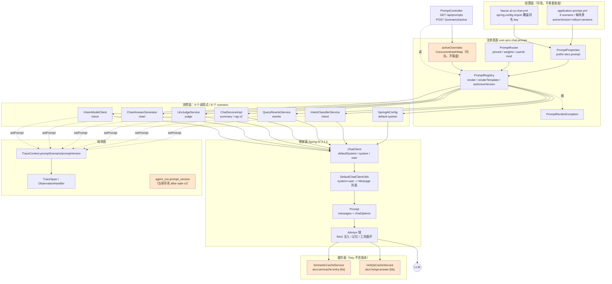
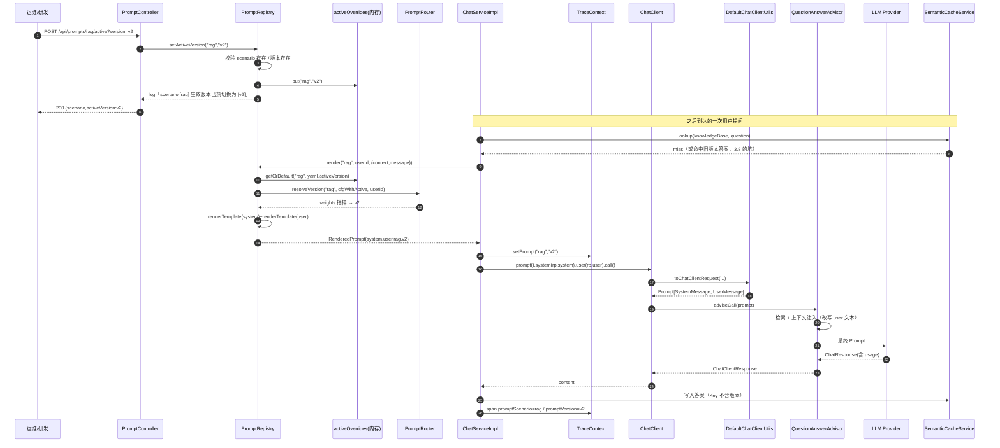

# 提示词版本管理与灰度发布实战

> **一句话结论**：提示词是这套系统里唯一"改了不过编译器、不过单测、却能直接改变线上输出"的资产。`ai-cs-chat` 已经把它从 Java 字符串搬进 `application-prompt.yml`，并做出了 `scenario + version` 的路由与热切换（`PromptRegistry` / `PromptRouter`），但**没有版本表、没有审计记录、没有按版本隔离的缓存与指标**——所以今天具备的是"热切换"这一种能力，还不构成"可 diff、可回滚、可灰度"的闭环。
> **阅读前置**：先读 [01-chatclient-链式api源码](../../24-源码分析/06-SpringAI/01-ChatClient与模型抽象/01-chatclient-链式api源码.md)（知道 `.system()/.user()` 如何变成 `Prompt`）与 [02-advisor-链与对话记忆](../../24-源码分析/06-SpringAI/01-ChatClient与模型抽象/02-advisor-链与对话记忆.md)（知道 advisor 会在调用前改写 prompt）。本文的分析对象是本仓库 `ai-cs-chat` 的 prompt 包，不要求事先读过它。
> **证据基线**：Spring AI 2.1.0（本机 `spring-ai-model-2.1.0.jar`）／Spring Boot 4.2.0／Spring Cloud 2026.0.0／JDK 17／Nacos 3.3 ｜ 预计阅读 42 分钟 ｜ A 级证据 = `24-源码分析/assets/source/` 已入库摘录，B 级 = 本仓库源码行号，C 级 = 本机可复现命令的真实输出。

## 0. 先看现象

先给三个真实形态的现场。**文中所有报错与日志文本都取自本仓库代码里的字面量**（不是编造的堆栈），标注了出处行号，方便你对照。

**现象一：只改了人设里的一句话，几条业务线一起变差。**

`default-system` 这个 scenario 在 `ai-cs-chat/src/main/resources/application-prompt.yml#L24` 里是一行 928 字符的单行字符串，里面同时写着人设（"你是AI客服平台的智能助手…"）、四条硬规则（不许透露模型名）、工具使用规范（订单查询、智能问数）、回答风格。它通过 `ChatClientCustomizer` 注入到**每个模型**的 `ChatClient` 上——命中面不是一条对话链，而是全部：

```java
// ai-cs-chat/src/main/java/com/aics/chat/config/SpringAiConfig.java#L282-L288
        String defaultSystem = promptRegistry
                .render("default-system", java.util.Map.of("dbSchema", DB_SCHEMA))
                .getSystem();
        return builder -> builder
                .defaultSystem(defaultSystem)
                .defaultAdvisors(ragAdvisor);
```

运营想加一句"遇到退款要安抚情绪"，改的是这一行；第二天 RAG 问答、意图识别之后的正式回复、智能问数（NL2SQL）三条线的口吻全变，其中两条还因为新加的句子挤占了上下文预算而开始丢工具调用。**一段文本，四种效果，却没有一条指标能告诉你"是它改的"。**

**现象二：线上效果回退，找不到"上一版"。**

想回滚的时候会遇到两个硬事实：

第一，配置里根本没有上一版。8 个 scenario 全部只有 `v1` 一个版本，`rollout.strategy` 全是 `pinned`（`ai-cs-chat/src/main/resources/application-prompt.yml#L17-L24`）。代码里多版本能力是完备的，**数据里没有第二个版本实例**——所谓"回滚"没有对象。

第二，就算手工造出 v2 并切过去，热切换只写内存。`ai-cs-chat/src/main/java/com/aics/chat/prompt/PromptRegistry.java#L40-L41`：

```java
    /** 内存态 activeVersion（支持热回滚，覆盖 YAML 初始值） */
    private final Map<String, String> activeOverrides = new ConcurrentHashMap<>();
```

服务一重启，`activeOverrides` 清空，生效版本**自己回到 YAML 里的 `v1`**。所以线上会出现这种对话：运维说"我十分钟前切到 v2 了"，重启过的实例说"我这儿是 v1"，两边日志都正常，只有用户感受到效果在跳。

**现象三：缺一个变量，请求 500。**

`PromptRegistry` 对缺变量是"炸"而不是"留空"，异常文本是：

```text
com.aics.chat.prompt.PromptRenderException: Prompt 模板缺少变量占位符 {{context}}
```

（来源：`ai-cs-chat/src/main/java/com/aics/chat/prompt/PromptRegistry.java#L141`。）这条设计是对的，但它把"提示词缺陷"从"上线前"推到了"某个特定请求"——因为启动期校验只检查 `activeVersion` 是否存在、权重和是否接近 1，**不检查模板占位符与调用点传参是否对齐**（`PromptRegistry.java#L59-L75`）。占位符对齐这件事，目前是 9 个调用点的人肉约定。

**这些现象指向同一件事**：提示词在这个系统里还不是"代码"——它有存放位置，却没有**身份**（prompt_id）、没有**版本历史**（可 diff 的 v1/v2/…）、没有**按版本隔离的副作用**（缓存 key、指标、审计都还是全局的）。没有这三样，"灰度"只是"改配置文件"，"回滚"只是"凭记忆改回去"。

**AI 概念速览**（本篇出现的术语，各一句人话）：

- **Prompt（提示词）**：发给模型的完整输入文本。在 Spring AI 里它是 `Prompt` 对象，内部是一个 `messages` 列表（system / user / assistant / tool 各一条）。
- **System Prompt（系统提示词）**：消息列表里的第一条"角色设定"，约束人设、规则、能力边界；和用户消息分开存放，优先级由模型侧实现决定，框架只是把它排在最前面。
- **Prompt Template（提示词模板）**：带占位符的文本（本项目用 `{{var}}`），渲染后才是真正发给模型的 prompt。模板是"代码"，渲染结果是"数据"——版本管理管的是模板。
- **灰度发布（Canary / Percentage Rollout）**：让一部分流量走新版本、其余走旧版本，用真实指标判优劣，再逐步放量。判据不是"没人报错"，而是分版本的业务指标（好评率、转人工率、JSON 解析成功率等）。
- **Embedding（把文本映射成高维向量的函数，输出是一个 float 数组，语义相近的文本向量距离更近）**：本项目语义缓存用它做"近似问句命中"，也正因为如此，缓存与提示词版本的关系比普通 KV 缓存更隐蔽（见 3.8）。

## 1. 整体地图

先把"提示词"这个词在这套系统里经过的 7 个位置画清楚：配置在哪、谁选版本、谁渲染、谁改写、谁记录、谁缓存、谁能改。



> **读图说明**：三处橙色是本文的全部问题所在，读图时请只盯它们。① `ADMIN --> OVERRIDE` 是唯一写路径，而 `OVERRIDE` 在内存里，箭头不指向 `YAML`——所以"热切换"和"持久化"是断开的。② `SEM/HOT` 只从 `ADV` 拿数据，**没有任何箭头从 `REGISTRY` 或 `TC` 指向缓存**——这就是"切了版本还在返回旧答案"的结构性原因（3.8）。③ `REGISTRY --> 调用点` 之后再往下是 `ChatClient -> DefaultChatClientUtils -> Prompt -> Advisor`，注意 `ADV` 在 `PROMPT` 之后：**版本决定的是"初始文本"，最终发给模型的文本还会被 advisor 再改一次**（3.2、3.6），所以只记录版本号并不能复现一次真实请求。

各组件责任与调用方：

| 组件 | 责任 | 谁会调用它 | 位置 |
| --- | --- | --- | --- |
| `application-prompt.yml` | 提示词唯一事实来源（8 scenario） | Spring 配置加载 | `ai-cs-chat/src/main/resources/application-prompt.yml` |
| `PromptProperties` | 绑定 `aics.prompt.*`，含 enabled 总开关 | Spring 绑定 | `ai-cs-chat/src/main/java/com/aics/chat/prompt/PromptProperties.java` |
| `PromptRegistry` | 启动校验 + 渲染 + 占位符替换 + 热切换内存态 | 9 个业务调用点、`PromptController` | `ai-cs-chat/src/main/java/com/aics/chat/prompt/PromptRegistry.java` |
| `PromptRouter` | 按 rollout 策略选版本，三级回退 | 仅 `PromptRegistry` | `ai-cs-chat/src/main/java/com/aics/chat/prompt/PromptRouter.java` |
| `PromptController` | 查询生效版本、列版本摘要、热切换 | 运维 / 测试 | `ai-cs-chat/src/main/java/com/aics/chat/controller/PromptController.java` |
| `TraceContext` | 承接 `promptScenario/promptVersion` 供 span 关联 | 业务调用点（render 之后立刻写） | `ai-cs-chat/src/main/java/com/aics/chat/observability/TraceContext.java` |
| `SemanticCacheService` / `HotQaCacheService` | 近似问答缓存 / 热问缓存 | RAG 主链路 | `ai-cs-chat/src/main/java/com/aics/chat/cache/SemanticCacheService.java` |
| `ChatClient` / `DefaultChatClientUtils` | 把 system/user 文本拼成 `Prompt` | 业务调用点 | Spring AI 2.1.0（A 级证据） |

## 2. 关键概念与关键类

| 名称 | 位置 | 角色 | 关键方法/字段 |
| --- | --- | --- | --- |
| `Prompt` | `spring-ai-model-2.1.0`（[[源码:Prompt.java.md#L47-L51]]） | 框架侧的"提示词对象"：只有消息列表 + 模型选项 | `getInstructions()`、`getSystemMessage()`、`augmentSystemMessage(Function)` |
| `SystemMessage` | `spring-ai-model-2.1.0` | 角色设定的载体，就是一段文本 + metadata | `builder().text(...).metadata(...).build()` |
| `PromptTemplate` / `TemplateRenderer` | `spring-ai-model-2.1.0`、`spring-ai-client-chat-2.1.0` | 框架自带的模板渲染（默认实现是 ST 模板） | `PromptTemplate.builder().template(t).variables(v).renderer(r).render()` |
| `ChatClient.Builder#defaultSystem` | `spring-ai-client-chat-2.1.0`（[[源码:ChatClient.java.md#L559-L567]]） | 给"所有请求"挂默认系统提示词，支持 `String` / `Resource` / spec 三种入参 | `defaultSystem(String)`、`defaultSystem(Resource)`、`defaultSystem(Consumer<PromptSystemSpec>)` |
| `DefaultChatClientUtils` | `spring-ai-client-chat-2.1.0`（[[源码:DefaultChatClientUtils.java.md#L57-L97]]） | system→`SystemMessage`、user→`UserMessage` 的组装点 | `toChatClientRequest(...)` |
| `PromptProperties` | `ai-cs-chat/src/main/java/com/aics/chat/prompt/PromptProperties.java#L27` | `aics.prompt` 配置模型，`enabled` 总开关 + 8 场景 | `scenarios`、`ScenarioConfig.activeVersion`、`RolloutConfig.strategy` |
| `PromptRegistry` | `.../prompt/PromptRegistry.java#L33` | 项目自建的"提示词注册表"：校验、渲染、热切换 | `render(...)`、`renderTemplate(...)`、`setActiveVersion(...)`、`activeSnapshot()` |
| `PromptRouter` | `.../prompt/PromptRouter.java#L42` | 灰度路由：决定这次请求用哪个版本 | `resolveVersion(scenario, config, userId)` |
| `PromptRenderException` | `.../prompt/PromptRenderException.java#L14` | 提示词缺陷的专用异常，继承 `RuntimeException` | 两个构造器：`(msg)`、`(msg, cause)` |
| `RenderedPrompt` | `.../prompt/PromptRegistry.java#L198-L220` | 渲染产物：`system/user/scenario/version` 四元组 | `text()` 返回 user 优先、否则 system |
| `PromptController` | `.../controller/PromptController.java#L28` | 管理接口：只回版本与长度，不回正文 | `GET /api/prompts`、`GET /api/prompts/{scenario}`、`POST /api/prompts/{scenario}/active` |
| `ContextualQueryAugmenter` | `spring-ai-rag-2.1.0`（[[源码:ContextualQueryAugmenter.java.md#L53-L70]]） | RAG 上下文注入器，**默认提示词硬编码在 jar 里** | `builder().promptTemplate(...)`、`augment(query, documents)` |
| `SessionMemoryAdvisor` | `spring-ai-session-advisor-2.1.0`（[[源码:SessionMemoryAdvisor.java.md#L191-L205]]） | 2.1 起的会话记忆 advisor，system 消息可能从会话里读回 | `adviseCall(...)` |

## 3. 原理与证据逐段精读

每一小节统一四层：**在干什么** → **为什么这么设计** → **换成别的写法会怎样** → **常见坑**。

### 3.1 框架只认识"消息"，不认识"版本"

```java (src: Prompt.java.md#L47-L51)
public class Prompt implements ModelRequest<List<Message>> {

	private final List<Message> messages;

	private final @Nullable ChatOptions chatOptions;
```

**在干什么**：这是 Spring AI 2.1.0 里 `Prompt` 的全部状态——一个消息列表加一组模型选项。构造器也只是把字符串包成 `UserMessage`（同文件 L53-L55）。

**为什么这么设计**：`Prompt` 是**请求形状**，不是**资产管理**。框架要适配 OpenAI、Anthropic、通义、MiniMax 等一堆 provider，它们的公共部分只有"消息 + 参数"，所以抽象就到此为止。把 id、版本、作者、灰度分组塞进 `Prompt` 会让框架层被迫理解你的发布流程，任何一个 provider 适配都得跟着改。

**换写法会怎样**：如果强行给 `Prompt` 加 `promptId/version` 字段，你得在每个模型适配器、每个 advisor、每次 `copy()`/`mutate()` 里传递它——而 advisor 链会 `new Prompt(...)` 造新对象（`augmentSystemMessage` 就是典型），字段极易在链中途丢失，形成"以为记了、其实丢了"的假审计。这就是为什么版本元数据最终都放在**请求上下文**（`ChatClientRequest.context`，见 [[源码:ChatClientRequest.java.md#L36]]）或自家 `TraceContext` 里。

**常见坑**：拿 `Prompt` 当"提示词对象"去找版本信息，会一无所获。用本机的 jar 可以直接验证（C 级，真实输出）：

```powershell
javap -p -classpath "$env:USERPROFILE\.m2\repository\org\springframework\ai\spring-ai-model\2.1.0\spring-ai-model-2.1.0.jar" org.springframework.ai.chat.prompt.Prompt
```

```text
Compiled from "Prompt.java"
public class org.springframework.ai.chat.prompt.Prompt implements org.springframework.ai.model.ModelRequest<java.util.List<org.springframework.ai.chat.messages.Message>> {
  private final java.util.List<org.springframework.ai.chat.messages.Message> messages;
  private final org.springframework.ai.chat.prompt.ChatOptions chatOptions;
  public org.springframework.ai.chat.prompt.Prompt(java.lang.String);
  ...
```

**怎么读这个输出**：类体只有两个 `private final` 字段。再补一条更狠的核对——对这份 javap 输出 grep `version|Version|template|Template|id\b`，唯一命中是 `lambda$instructionsCopy$0` 里的 `void`（`void` 结尾就是 `id`），**即没有版本、没有模板、没有 id**。结论要落到工程上：版本治理只能在框架**外面**做，`PromptRegistry` 这类组件不是"重复造轮子"，而是框架故意留白的地方。

### 3.2 一段 system 文本怎么变成 `Prompt`

```java (src: DefaultChatClientUtils.java.md#L57-L74)
		List<Message> processedMessages = new ArrayList<>();

		// System Text => First in the list
		String processedSystemText = inputRequest.getSystemText();
		if (StringUtils.hasText(processedSystemText)) {
			if (!CollectionUtils.isEmpty(inputRequest.getSystemParams())) {
				processedSystemText = PromptTemplate.builder()
					.template(processedSystemText)
					.variables(inputRequest.getSystemParams())
					.renderer(inputRequest.getTemplateRenderer())
					.build()
					.render();
			}
			processedMessages.add(SystemMessage.builder()
				.text(processedSystemText)
				.metadata(inputRequest.getSystemMetadata())
				.build());
		}
```

**在干什么**：把 system 文本（可选地先渲染）转成第一条 `SystemMessage`；user 文本同处理后被追加到最后（同文件 L81-L97）。中间夹的是历史消息与工具消息。整个"提示词"到这一步就定型了。

**为什么这么设计**：顺序（system 在最前、user 在最后）由协议约定决定，框架把它固化在这里，避免每个调用点自己拼消息列表时把顺序搞错。把渲染放在这里、并且**只有 `params` 非空才渲染**，是为了兼容"已经是成品文本"的调用方式——很多场景（比如本项目）在上游就把变量替换完了。

**换写法会怎样**：如果框架无条件渲染，那么任何包含 `{` 的成品文本（JSON 示例、SQL、代码片段）都会被模板引擎当占位符解析，轻则渲染失败、重则把正文吃掉。当前"有 params 才渲染"的折中，代价是**渲染责任被分散**：一部分在框架，一部分在应用侧。本项目就选了应用侧全包（3.3、3.9）。

**常见坑**：把模板原文直接 `defaultSystem(text)` 而不传 params，`{{dbSchema}}` 会**原样发给模型**——不报错、不异常，模型就把 `{{dbSchema}}` 当正文读，然后按你给的"表结构"去猜列名。本项目正是因为把渲染前置到 `PromptRegistry`（`render(...).getSystem()` 拿到的是成品），才没有踩这个坑；但这也意味着"谁负责渲染"必须写成约定，否则一旦有人改成 `defaultSystem(Resource)` 传原始文件，就会静默劣化。

### 3.3 项目补上的"身份层"：`PromptRegistry.render` 的四步

引用自 `ai-cs-chat/src/main/java/com/aics/chat/prompt/PromptRegistry.java#L86-L110`：

```java
    public RenderedPrompt render(String scenario, String userId,
                                Map<String, Object> variables, FallbackSupplier fallback) {
        if (!properties.isEnabled()) {
            if (fallback == null) {
                throw new PromptRenderException("Prompt 配置化已关闭且无 fallback: " + scenario);
            }
            return fallback.get();
        }
        ScenarioConfig config = properties.getScenarios().get(scenario);
        if (config == null) {
            if (fallback != null) {
                return fallback.get();
            }
            throw new PromptRenderException("未配置的 Prompt scenario: " + scenario);
        }
        String active = activeOverrides.getOrDefault(scenario, config.getActiveVersion());
        String version = router.resolveVersion(scenario, withActive(config, active), userId);
        VersionConfig vc = config.getVersions().get(version);
        if (vc == null) {
            throw new PromptRenderException("Prompt scenario [" + scenario + "] 版本 [" + version + "] 不存在");
        }
        String system = vc.getSystem() == null ? null : renderTemplate(vc.getSystem(), variables);
        String user = vc.getUser() == null ? null : renderTemplate(vc.getUser(), variables);
        return new RenderedPrompt(system, user, scenario, version);
    }
```

（`activeOverrides` 的声明见同文件 L40-L41；`RenderedPrompt` 的定义在同文件 L198-L220。）

**在干什么**：四步顺序固定——① 总开关；② scenario 是否存在；③ 先取"内存覆盖值"再问路由选版本；④ 逐字段渲染并把 `scenario/version` 塞进返回值。返回的 `RenderedPrompt` 因此携带了"这段文本是谁、哪一版"。

**为什么这么设计**：把版本号做成**返回值的属性**而不是全局变量，是关键取舍。调用点拿到 `rp.getVersion()` 就能立刻写进 `TraceContext`（见 3.7），不需要额外查询、也不会被并发请求串味——`TraceContext` 是线程/请求级的，`activeOverrides` 是全局的，两者分工明确。

**换写法会怎样**：如果渲染时不带版本、由调用点自己去查 `getActiveVersion(scenario)`，那么在"查版本"和"渲染"之间插入一次热切换，就会出现"用 v1 的文本、记 v2 的标签"——这正是很多团队 trace 对不上效果数据的根因。反过来，如果每次都把整份 prompt 正文写进 trace，存储会爆炸（928 字符 × 每请求）。

**常见坑**：`withActive`（同文件 L123-L132）在 `active` 与配置值不同时会**拷一份 `ScenarioConfig`** 再交给 router，目的是让 `pinned` 策略跟随热切换值。如果漏了这层拷贝、直接把 `active` 塞进 `config`，热切换就成了破坏性的全局写，多线程下会把"某个请求的临时覆盖"泄漏给所有人。这也是本文件里唯一一处"防御性拷贝"，读代码时容易被当成冗余删掉。

### 3.4 缺变量必须炸，不能留空

引用自 `ai-cs-chat/src/main/java/com/aics/chat/prompt/PromptRegistry.java#L134-L147`：

```java
    private String renderTemplate(String template, Map<String, Object> variables) {
        Matcher m = PLACEHOLDER.matcher(template);
        StringBuffer sb = new StringBuffer();
        while (m.find()) {
            String key = m.group(1);
            Object val = variables == null ? null : variables.get(key);
            if (val == null) {
                throw new PromptRenderException("Prompt 模板缺少变量占位符 {{" + key + "}}");
            }
            m.appendReplacement(sb, Matcher.quoteReplacement(String.valueOf(val)));
        }
        m.appendTail(sb);
        return sb.toString();
    }
```

占位符的识别规则在同文件 L35：`Pattern.compile("\\{\\{\\s*([\\w.]+)\\s*}}")`，即 `{{` + 字母数字下划线点 + `}}`。

**在干什么**：逐个占位符查变量表，**查不到就抛**，不做"空字符串兜底"。单测 `render_missingVariable_throws`（`ai-cs-chat/src/test/java/com/aics/chat/prompt/PromptConfigTest.java#L80-L86`）把这条行为钉住了：`assertThrows(PromptRenderException.class, () -> reg.render("intent", Map.of()))`，并断言异常消息里含 `input`。

**为什么这么设计**：留空是三种事故的源头。① 模型会把 `{{context}}` 当正文照抄，输出里出现双花括号；② RAG 场景下空上下文会让模型脱离资料"自由发挥"，即最典型的幻觉；③ 评测会把这种样本判成"格式合规但答错"，掩盖真实缺陷。抛异常虽然吵，但它把问题定位到"哪一次请求、哪个占位符"。

**换写法会怎样**：若改成 `variables.getOrDefault(key, "")`，上面三种事故都会变成静默劣化，而且**永远不会有人发现**——因为线上只看到回答变差，看不到任何异常。若改成"启动期报错"，则要求模板与调用点参数在启动时就可知，这对多租户/动态变量（如 `{{userName}}`）不成立。所以"运行时炸 + 启动期查版本"是当前折中。

**常见坑**：正则方案的固有代价——模板正文里出现 `{{`（比如给人看的 JSON 示例、SQL 模板说明）会被当成占位符吃掉或抛异常；本项目 928 字符的 `default-system` 里正好含 `{"intents":[{"type":...}]}` 这类 JSON，**单花括号安全、双花括号不安全**，这个边界没有任何测试保护。另外 `String.valueOf(val)` 对 `null` 之外的任何对象都能转，但 `Matcher.quoteReplacement` 必须保留——漏掉它，变量值里出现 `$` 或 `\` 会导致替换异常或错位。

### 3.5 版本怎么选：三条策略 + 三级回退

引用自 `ai-cs-chat/src/main/java/com/aics/chat/prompt/PromptRouter.java#L42-L64`：

```java
    public String resolveVersion(String scenario, ScenarioConfig config, String userId) {
        RolloutConfig rollout = config.getRollout();
        String strategy = rollout.getStrategy();
        Map<String, PromptProperties.VersionConfig> versions = config.getVersions();

        String chosen;
        if ("weights".equalsIgnoreCase(strategy)) {
            chosen = byWeights(rollout.getWeights());
        } else if ("userId-mod".equalsIgnoreCase(strategy)) {
            chosen = byUserIdMod(rollout.getUserIdMod(), userId, config.getActiveVersion());
        } else { // pinned
            chosen = StringUtils.hasText(rollout.getPinned()) ? rollout.getPinned() : config.getActiveVersion();
        }

        // 命中版本不存在 → 回退 activeVersion；activeVersion 也不存在则回退 versions 首个 key
        if (!versions.containsKey(chosen)) {
            chosen = config.getActiveVersion();
        }
        if (!versions.containsKey(chosen) && !versions.isEmpty()) {
            chosen = versions.keySet().iterator().next();
        }
        return chosen;
    }
```

三种策略的语义（对照 `ai-cs-chat/src/main/java/com/aics/chat/prompt/PromptProperties.java#L53` 的默认值 `pinned`）：

| 策略 | 选择依据 | 适合的灰度阶段 | 稳定性来源 |
| --- | --- | --- | --- |
| `pinned` | 固定用 `pinned`（缺省回 `activeVersion`） | 全量、回滚 | 完全确定 |
| `weights` | 每次请求按权重随机 | 1%→5%→50% 按比例放量 | 流量足够大时收敛，**同一用户每次可能不同** |
| `userId-mod` | `Math.floorMod(userId, mod) == remainder` | 按用户切片（同用户恒定） | 用户级稳定，可对照"同一批用户"的表现 |

**在干什么**：先按策略选，再做两次兜底（选中的版本不存在 → `activeVersion` → 版本表第一个 key）。权重策略的实现里有个容易被忽略的正确性细节：

引用自 `ai-cs-chat/src/main/java/com/aics/chat/prompt/PromptRouter.java#L74-L85`：

```java
        double r = random.getAsDouble() * total;
        double acc = 0.0;
        // 按 key 排序保证确定性：Map.of 等无序 map 迭代顺序不稳定，会破坏权重区间
        List<String> sortedKeys = weights.keySet().stream().sorted().toList();
        for (String key : sortedKeys) {
            acc += weights.get(key);
            if (r < acc) {
                return key;
            }
        }
        // 浮点兜底：返回最后一个
        return sortedKeys.get(sortedKeys.size() - 1);
```

**为什么这么设计**：三级回退是为了"永不因配置失误导致请求失败"——提示词错了顶多效果差，不能把对话打挂。排序是为了让"随机数落在哪个区间"可复现：`Map.of` 的迭代顺序不稳定，同一份权重表两次进程可能产生不同的区间划分，导致灰度比例在两个实例上不一致（你会看到 3% 和 7% 同时存在）。

**换写法会怎样**：把两次兜底去掉，一次 `activeVersion` 写错（比如发布时把 v2 删了）就会让整个 scenario 的请求全部 500——`render` 里那句 `版本 [v] 不存在` 就是这种设计下的异常。反过来，如果连"版本表为空"也兜底，`validate` 里的 `未配置任何版本` 就没机会报了，配置彻底写错也发现不了。

**常见坑**：① 策略名。代码里匹配的是 `"userId-mod"`，如果按命名习惯写成 `user_id_mod`，`equalsIgnoreCase` 不匹配 → 走 `else` 分支 → 变成 `pinned` → **灰度 0% 生效且完全静默**。② `byUserIdMod` 用 `Long.parseLong(userId)`，非数字 userId（比如 UUID、手机号掩码）会抛 `NumberFormatException` 并被 `catch` 吞掉（同文件 L97-L99），一律视为未命中——所以"灰度比例一直是 0"也可能是 userId 根本不是数字。③ `weights` 的权重和不为 1 时只 `log.warn`（`PromptRegistry.java#L71-L73`），不影响选版本，但会让你以为的 1% 变成 1/总权重。

### 3.6 框架自己也在硬编码提示词

```java (src: ContextualQueryAugmenter.java.md#L53-L70)
	private static final PromptTemplate DEFAULT_PROMPT_TEMPLATE = new PromptTemplate("""
			Context information is below.

			---------------------
			{context}
			---------------------

			Given the context information and no prior knowledge, answer the query.

			Follow these rules:

			1. If the answer is not in the context, just say that you don't know.
			2. Avoid statements like "Based on the context..." or "The provided information...".

			Query: {query}
```

**在干什么**：Spring AI 的 RAG 上下文注入器把"怎么把检索结果塞给模型"这件事，写成了一个 `static final` 的英文模板，放在 `spring-ai-rag-2.1.0.jar` 里。你没写这段提示词，但只要走了默认增强链，它就在你的请求里。

**为什么这么设计**：RAG 需要一个"合理默认值"才能开箱可用；把它做成 `static final` 保证了一致性与零配置成本。

**换写法会怎样**：这段文本有两个问题。① **不可治理**：它不在你的仓库、不在你的 YAML、也不会出现在你的 review 里，想改只能通过 `builder().promptTemplate(...)` 覆盖（同文件 L40-L43 的用法示例）。② **语言与人格冲突**：它是英文指令，而本项目的 `default-system` 是中文人设并要求"简洁、有亲和力"；两者同时存在时，模型会混用两种指令风格，表现是"答得对但语气突然变公文化"。所以"提示词全是我的资产"这个前提在 Spring AI 项目里并不成立——**框架内部还有一份你不管的提示词**。

**常见坑**：以为 `QuestionAnswerAdvisor`（`ai-cs-chat/src/main/java/com/aics/chat/config/SpringAiConfig.java#L267-L274`，本项目用的那个）与 `RetrievalAugmentationAdvisor + ContextualQueryAugmenter` 两条路径的提示词行为一致。它们是两套实现：本项目实际用的是 `QuestionAnswerAdvisor`（只配置了 `similarityThreshold=0.3`、`topK=5`），**没有显式指定注入模板**；要真正控制"上下文怎么拼进提示词"，必须显式覆盖模板，而不是只在 YAML 里改 `rag` scenario 的 user 模板——后者管的是"拼接完成之后的整段提问"，前者管的是"检索片段周围那些指令句"。

### 3.7 版本号必须进链路，否则审计是假的

版本号写进 trace 的路径是两跳：调用点写入 → ObservationHandler 搬到 span。

引用自 `ai-cs-chat/src/main/java/com/aics/chat/observability/TraceContext.java#L54-L73`：

```java
    // ===== Prompt 效果关联（OpenSpec change 2026-08-18-prompt-config）=====
    /** 本次请求当前生效的 Prompt 场景（由调用点在 render 后写入，供 LLM span 关联） */
    private volatile String promptScenario;

    /** 本次请求当前生效的 Prompt 版本 */
    private volatile String promptVersion;

    /** 写入本次 LLM 调用使用的 Prompt 场景与版本（效果关联：promptVersion → 评估质量分） */
    public void setPrompt(String scenario, String version) {
        this.promptScenario = scenario;
        this.promptVersion = version;
    }
```

（`TraceSpanObservationHandler` 在同仓 `ai-cs-chat/src/main/java/com/aics/chat/observability/TraceSpanObservationHandler.java#L67-L70` 把这两个值搬到 span 上；`TraceSpan` 的对应字段在同目录 `ai-cs-chat/src/main/java/com/aics/chat/observability/TraceSpan.java#L66-L69`。）

**在干什么**：`render(...)` 之后紧接着 `ctx.setPrompt(rp.getScenario(), rp.getVersion())`，全仓 7 处业务调用点都这么写（intent / rewrite / summary / rag / judge / chart / vision）。`volatile` + 请求级 `TraceContext` 保证异步线程也能读。

**为什么这么设计**：只有"版本"进了 trace，"这一版效果如何"才可算：按 `promptVersion` 分组算好评率、转人工率、JSON 解析失败率，才有 A/B 的分子分母。反过来，版本号只存在于 YAML 里，你只能看到"全局效果曲线"，无法归因。

**换写法会怎样**：如果只在日志里打一行 `使用提示词 v2`，你需要在日志系统里做正则抽取、再与业务指标 join，成本高且脆弱。如果只在数据库里记 `agent_run.prompt_version`，则拿到的是**事后审计**而非实时指标。

**常见坑（这是本篇最该记住的一条）**：审计链上有一处是**写死的**。`ai-cs-chat/src/main/java/com/aics/chat/agent/trace/AgentTraceRecorder.java#L48`：

```java
        dto.setPromptVersion("after-sale-v1");
```

（引用自 `ai-cs-chat/src/main/java/com/aics/chat/agent/trace/AgentTraceRecorder.java#L47-L48`，上一行注释是"记录提示词/规则版本，审计可追溯"。）这个版本号是字面量，跟 `PromptRegistry` 完全无关：你把 `after-sale` 相关提示词切到 v2，`agent_run` 表里仍旧写 `after-sale-v1`。**"审计可追溯"的注释与实现不一致**，这比没有审计更危险——因为它会让人相信一份错的证据。修法很小：把 `TraceContext.getPromptScenario()/getPromptVersion()` 注入 `AgentTraceRecorder`，取不到再退回默认值；验收标准见第 9 节练习 3。

### 3.8 缓存与版本的对撞：Key 里没有版本

引用自 `ai-cs-chat/src/main/java/com/aics/chat/cache/SemanticCacheService.java#L63-L69`：

```java
    public Optional<ChatRagResponseDTO> lookup(String knowledgeBase, String question) {
        if (!properties.getSemantic().isEnabled()) {
            return Optional.empty();
        }
        try {
            float[] queryVector = embeddingModel.embed(question);
            Map<Object, Object> entries = redisTemplate.opsForHash().entries(ENTRY_KEY + knowledgeBase);
```

Key 的定义在同文件 L49、L51：`"aics:semcache:entry:"` 与 `"aics:semcache:index:"`，写入时同样只拼 `knowledgeBase`（同文件 L129-L133）。`HotQaCacheService` 是同一个模式（`ai-cs-chat/src/main/java/com/aics/chat/cache/HotQaCacheService.java#L45-L47`，key 为 `aics:hotqa:answer:{knowledgeBase}`）。

**在干什么**：语义缓存用 embedding 相似度在"同一个知识库桶"里找历史问答，命中就直接返回旧答案，不调模型。**Key 的维度是"知识库"，不是"提示词版本 + 知识库"。**

**为什么这么设计**：缓存的初衷是省 token、降延迟；把版本加进 key 会让"每次版本变更等于缓存全失效"，命中率断崖下跌。当初只有 v1 一个版本，这个维度确实不存在。

**换写法会怎样**：一旦开始灰度，这个设计立刻产生两类错误。① **新版本拿到旧答案**：切到 v2 后，相似问句命中 v1 时期写入的答案，你会看到"v2 的效果指标里混着 v1 的回答"，A/B 直接失真。② **反向污染**：灰度期间 v2 写的答案落进同一个桶，v1 用户也会读到 v2 的产物。正确的 key 形态是 `entry:{knowledgeBase}:{promptScenario}:{promptVersion}`，成本是切换版本时该桶冷启动。

**代价怎么算（示例口径，不是实测）**：设某知识库桶日均 QPS 为 `q`、缓存命中率 `h`、预热恢复天数为 `T`（通常 1~3 天），则切版本后累计多出的模型调用次数 ≈ `q × h × 86400 × T`。以 `q=5`、`h=0.4`、`T=2` 计 ≈ `5 × 0.4 × 86400 × 2 ≈ 34.6 万`次额外调用；按"单次 RAG 约 1.5k 输入 token + 0.3k 输出 token"的量级（token 数需要用 `ModelUsageRecorder` 的真实账本核对，单价以官方定价页为准，此处只是示例口径）折算，这是一笔必须提前知情的成本。**所以灰度前要先决定：隔离缓存（准确但贵）还是共享缓存（便宜但污染指标）**——本文推荐隔离，因为灰度的目的就是拿到干净的分版本指标。

**常见坑**：以为"我切了版本、TTL 只有 10 分钟，等一下就好"。实际上语义缓存的索引是**按时间淘汰**的 ZSet（同文件 L145-L155 的 `zCard`/`range`/`remove`），只要条目没到期就一直在；灰度窗口（通常几小时）会完整覆盖 TTL，所以"等 TTL"并不成立。

### 3.9 两套模板引擎：框架的 `TemplateRenderer` 与项目的正则

框架侧本来就有渲染能力：`DefaultChatClient` 里有一个默认渲染器实例，`ChatClient` 也开放了三个层级的配置入口。

```java (src: DefaultChatClient.java.md#L100)
	private static final TemplateRenderer DEFAULT_TEMPLATE_RENDERER = StTemplateRenderer.builder().build();
```

```java (src: ChatClient.java.md#L559-L567)
		Builder defaultSystem(String text);
		Builder defaultSystem(Resource text, Charset charset);
		Builder defaultSystem(Resource text);
		Builder defaultSystem(Consumer<PromptSystemSpec> systemSpecConsumer);
		Builder defaultTemplateRenderer(TemplateRenderer templateRenderer);
```

**在干什么**：`defaultSystem(Resource)` 允许直接把 classpath 里的模板文件挂上；`defaultSystem(Consumer<PromptSystemSpec>)` 允许带 `params` 与 `metadata`；`defaultTemplateRenderer(...)` 允许换掉渲染器（默认 ST 模板）。也就是说，**"模板外置 + 变量渲染"这件事 Spring AI 原生就支持**。

**为什么这么设计**：渲染器可替换是为了适配不同团队的模板语法（ST、Mustache、Handlebars）；`Consumer<PromptSystemSpec>` 的写法让"文本 + 参数 + 元数据"成为一个原子配置。

**换写法会怎样（本项目为什么自己写正则）**：三个现实原因。① 交付顺序：`PromptRegistry` 需要支持"一个 scenario 同时有 system 和 user 两段模板、共用一组变量、还要返回版本号"，这是框架 API 表达不了的组合。② 语法：项目统一用 `{{var}}`，而默认渲染器是 ST（占位符是单花括号风格），直接换渲染器会影响所有已有模板。③ 失败语义：项目要"缺变量必炸"，而框架的模板引擎在没有 `params` 时**根本不渲染**（3.2），失败模式是"静默留原文"而不是异常。代价是：不支持条件/循环/嵌套、`{{` 无法转义、没有统一转义策略。

**常见坑**：两套渲染同时存在于一个请求里——`PromptRegistry` 先把 `{{var}}` 换成成品文本，再交给 `ChatClient.user(成品)`；此刻 `userParams` 为空，框架不再二次渲染，所以**看起来只有一套**。但只要有人给这个 `ChatClient` 加上 `defaultUser(u -> u.text(t).params(p))`，二次渲染就会触发，`{` 与 `{{` 的语义冲突会以"模板里出现了奇怪的空洞"的形式出现，而不是异常。定位方法：在 `DefaultChatClientUtils` 的渲染分支上打断点或加日志，确认 `getUserParams()` 是否为空。

### 3.10 人格一致性：人设其实是 N 段文本的合成物

绝大多数团队把"人格"理解成 `default-system` 那一段。实际上用户感知到的语气，由至少四段文本叠加而成，其中只有一段在 YAML 里：

| 文本来源 | 是否受 PromptRegistry 管 | 例子 |
| --- | --- | --- |
| `default-system`（YAML） | 是 | "回答风格：简洁、准确、有亲和力，适当使用emoji…" |
| RAG 上下文注入模板（框架 jar） | 否（需 `promptTemplate` 覆盖） | "Given the context information and no prior knowledge, answer the query." |
| 售后 Agent 状态机应答（Java 字面量） | **否** | 见下方代码块 |
| 通知/推送模板（其他模块） | 否 | 转人工提示、评价邀请 |

```java
// 引用自 ai-cs-chat/src/main/java/com/aics/chat/agent/workflow/AfterSaleAgentService.java#L648-L657
            case LOCATE_ORDER -> {
                return "您有多个可售后订单，请回复订单号选择其中一个：\n"
                        + String.join("\n", ctx.getCandidates().stream()
                        .map(o -> "• " + o.getOrderNo() + "（" + firstItemName(o) + " ¥" + o.getPayAmount() + "）")
                        .toList());
            }
            case COLLECT_EVIDENCE -> {
                return "好的，为您办理" + ctx.getActionType().getDesc()
                        + "。请简单描述一下商品的问题（例如：无法开机、声音异常、外观破损等），我为您记录。";
            }
```

**在干什么**：售后 Agent 的每个状态机分支都自带一句成品文案（另有 L684 的"请提供预算金额（例如「300 元以内」）…"、L686 的"您目前没有可售后的订单。"）。这些句子用户看到的是"客服在说话"，语气权重甚至高于 system prompt。

**为什么这么设计**：状态机应答是**确定性**的——它不需要模型，也不能让模型改（订单号、金额必须准确）。把它做成 Java 常量能保证格式正确、不怕模型幻觉。

**换写法会怎样**：如果把这些句子也搬进 YAML 走版本管理，好处是人格可整体调；代价是每次改文案都要经过渲染链路，且这些句子含业务数据拼接（`o.getOrderNo()`、`payAmount`），模板化后容易出现"占位符与代码变量对不齐"的同类问题（6.3）。折中做法：**只把"纯语气部分"外置**（如"我为您记录。"这种尾巴），业务字段保留在代码里。

**常见坑（多语言视角）**：如果一个 system prompt 同时承担"语言"和"人格"两个职责，做多语言就得复制整段 prompt，于是"中文 v1 / 英文 v1"变成两个互不相干的资产，灰度要跑两遍、评测要跑两套、人格漂移也无法对比。正确做法是把 locale 做成 scenario 的独立维度（`rag.zh`、`rag.en`），共享同一份 rollout 策略——但本项目当前**没有任何 locale 维度**，8 个 scenario 全是中文，接入多语言必须先改 `PromptProperties`（加 `locale` 或让 scenario 名带后缀），这属于未落地能力。

### 3.11 评测联动：版本变更必须重跑同一份 eval 集

```java
// 引用自 ai-cs-chat/src/main/java/com/aics/chat/rag/eval/EvalGateConfig.java#L32-L44
// prefix 绑定 aics.eval.gate.* 配置项：配置缺失时字段保持 null（而非抛绑定异常），
// 正是"未配置不判定"语义能成立的前提
@ConfigurationProperties(prefix = "aics.eval.gate")
public class EvalGateConfig {

    /** P95 延迟上限（毫秒，null=不校验） */
    // 为什么用 Long 而非 long：基本类型默认 0，会把"未配置"误判为"上限是 0ms"，
    // 包装类型 null 才能表达"未配置不判定"
    private Long p95LatencyMs;

    /** 单请求平均 Token 上限（null=不校验） */
    private Long avgTokensPerRequest;
}
```

**在干什么**：项目已经有一道"成本/延迟门禁"的雏形——`aics.eval.gate.p95-latency-ms` 与 `avg-tokens-per-request`，用包装类型刻意区分"没配"和"配成 0"。质量侧则有一份 `eval/golden-set.json`（20 条，`gc-001`~`gc-020`，字段 `id/question/knowledgeBase/expectedDocumentIds/referenceAnswer/expectedKeywords`，知识库均为 `product-manual`）。

**为什么这么设计**：提示词改动的风险是"效果漂移"而不是"功能报错"，所以门禁必须看**指标**而不是看异常。用包装类型表达"未配置不判定"是个经验性细节：如果默认 0，任何一次忘配都会把构建打红，最后大家会把门禁关掉。

**换写法会怎样（现存缺口）**：现在这三样东西——版本、eval 集、门禁——**彼此没有绑定**。改 YAML 不会触发 eval，eval 报告里也不写"用的是哪一版"，`EvalGateConfig` 只看延迟和 token，不看答对率。结果是"评测能跑，但不能用来判定某一版提示词该不该放量"。要补齐只需三步：① eval 入口接收 `promptVersion` 参数；② 报告里落 `scenario/version/content_hash`；③ 把"通过率不低于基线 v1 的 95%"写成门禁字段（与 `p95LatencyMs` 同级，同样用包装类型表达未配置）。

**常见坑**：把"20 条全过"当作放量依据。20 条的置信区间极宽——单条题目的权重是 5%，一个偶然波动就吃掉整份报告的可比性。真实灰度判定必须用线上指标（下一节），eval 集只负责"别把明显坏掉的版本放出去"。

### 3.12 文本资产实测：1152 处中文长字面量说明了什么

**在干什么**：上面所有讨论都指向一个前提——"提示词已经是外置资产了"。这个前提必须量化验证，否则治理范围会被严重低估。下面的统计扫全部业务模块的 Java 源码（排除 `target` 与 `test`），找出**长度 ≥40 字符且含中文的字符串字面量**：

```powershell
cd D:\Projects\Persion\ai-customer-service
$files = Get-ChildItem -Directory -Filter "ai-cs-*" |
  ForEach-Object { Get-ChildItem $_.FullName -Recurse -Filter *.java -File } |
  Where-Object { $_.FullName -notmatch '\\target\\' -and $_.FullName -notmatch '\\test\\' }
$hits = foreach ($f in $files) {
  $t = Get-Content $f.FullName -Raw -Encoding utf8
  foreach ($m in [regex]::Matches($t, '"((?:[^"\\]|\\.){40,})"')) {
    if ($m.Groups[1].Value -match '\p{IsCJKUnifiedIdeographs}') {
      [pscustomobject]@{ File = $f.Name; Mod = ($f.FullName -split '\\')[4]; Len = $m.Groups[1].Value.Length }
    }
  }
}
"java files          : " + $files.Count
"cjk literals >= 40  : " + $hits.Count
"files with hits     : " + ($hits.File | Sort-Object -Unique).Count
"--- by module ---"
$hits | Group-Object Mod | Sort-Object Count -Descending | ForEach-Object { "{0,-16} {1}" -f $_.Name, $_.Count }
"--- promptRegistry consumers ---"
(Select-String -Path ($files.FullName) -Pattern "promptRegistry\.render" -Encoding utf8 | Measure-Object).Count
```

```text
java files          : 521
cjk literals >= 40  : 1152
files with hits     : 253
--- by module ---
ai-cs-chat       639
ai-cs-message    140
ai-cs-product    59
ai-cs-order      53
ai-cs-gateway    48
ai-cs-pay        47
ai-cs-knowledge  44
ai-cs-common     39
ai-cs-mq         33
ai-cs-search     21
ai-cs-user       18
ai-cs-notify     11
--- promptRegistry consumers ---
8
```

**怎么读这个输出**：521 个业务 Java 文件里，253 个含有"中文长字面量"，共 1152 处；`ai-cs-chat` 一家占 639 处（55%），符合"AI 服务的文案密度最高"的直觉。最后一行 `8` 是 `promptRegistry.render` 的单行命中数——`SpringAiConfig` 那处因为 `.render(` 换行书写没被匹配，实际调用点是 9 处（3.3 与 6.3 已逐点列出）。

**这个数字意味着什么**：把一个"提示词治理覆盖率"算出来最直观——**受版本管理的提示词入口 9 个，而中文长文本资产 1152 处，覆盖率约 0.8%**。也就是说：改人设那 8 个 scenario 时你有版本、有回滚；但改一句"请提供预算金额（例如「300 元以内」）"（`AfterSaleAgentService.java#L684`）时，你走的是**发版**，没有版本表、没有灰度、没有 diff 语义。人格一致性问题在 3.10 已经出现过，这里给出它的量级：它不是个别遗漏，而是 100 倍量级的面积。

**边界（不要过度解读）**：这 1152 处**包含日志、异常消息、SQL 片段、HTTP 提示**，不等于"1152 条提示词"，它是"中文长字面量"的上界。但它足以支撑一个结论：文本资产的主体仍在 Java 里。反向核对也很关键——在同样的 521 个文件里搜 `你是`，命中 **0 个文件**，说明 8 个核心提示词**确实**已经从 Java 迁出到 YAML，残留的是应答模板与文案，不是 system prompt。两个数字合起来才是完整画面：核心提示词已外置，语气层没有。所以对外汇报别说"我们有 1152 处提示词要治理"，正确口径是"1152 处中文长文本，其中 system/user 提示词已外置 8 个 scenario，其余多为应答文案与日志"。

## 4. 一次完整执行时序

场景：把 `rag` 场景从 v1 灰度到 v2（5% 按权重），然后追踪一次命中 v2 的请求。



> **读图说明**：第 1~6 步是**管理面**，只在热切换时发生一次；第 7~26 步是**数据面**，每个请求都走一遍。看三个关键点：① 第 10 步读 `activeOverrides` 优先，所以 YAML 与内存可能不一致（重启后收敛，见 6.2）；② 第 14 步一次渲染产出 `system` 和 `user` 两段，**版本号是这一对的共同标签**；③ 第 20 步 advisor 又改了一次 user 文本——第 15 步记下的 `v2` 只标识"模板版本"，不等于"最终 prompt 的哈希"，要精确复现必须连检索结果一起存。

**哪一步失败会报什么错**（错误文本全部取自代码字面量）：

| 失败位置 | 触发条件 | 报错原文 | 表现 |
| --- | --- | --- | --- |
| 第 3 步 | scenario 名拼错 | `未配置的 Prompt scenario: rag` | POST 返回失败，YAML 未变 |
| 第 3 步 | 版本不存在于 versions | 版本校验异常（`setActiveVersion` 内抛） | 热切换被拒，但**不影响线上** |
| 第 4 步 | — | 无持久化 | 重启后回 YAML 值，无任何告警 |
| 第 7 步 | 语义缓存命中旧版本答案 | 无异常 | 指标串味（3.8） |
| 第 9 步 | `aics.prompt.enabled=false` 且未传 fallback | `Prompt 配置化已关闭且无 fallback: rag` | 整个 RAG 链路 500 |
| 第 13 步 | 模板占位符与变量没对齐 | `Prompt 模板缺少变量占位符 {{context}}` | 该请求 500，其余正常 |
| 第 15 步 | `TraceContext` 为空（无过滤器） | 无异常（代码 `if (ctx != null)`） | 该请求无版本标签 → 指标缺口 |
| 第 20 步 | 检索为空 | 无异常（`（未检索到相关资料）` 兜底） | 模型自由发挥 |

## 5. 设计取舍

### 5.1 提示词放哪里：五种位置的能力对比

| 位置 | 热更新 | 审计（谁改/何时/为什么） | 灰度能力 | 可 diff / 回滚粒度 | 本项目现状 |
| --- | --- | --- | --- | --- | --- |
| Java 字符串常量 | 否，必须发版 | 只有 git blame | 只能靠代码分支/开关 | 文件级 diff，混在业务逻辑里 | 已基本迁出（见 6.8） |
| 配置文件（`application-prompt.yml`） | 半：改文件要重启/刷新；调接口可切 `activeVersion` | 靠 git + 人工记录 | `weights`/`userId-mod` 已在代码里具备 | 行级 diff；**一行 928 字符时几乎不可读** | **当前唯一事实来源** |
| 数据库表（prompt/version/rollout） | 是 | 强（可写 `operator/change_reason`） | 天然支持（按租户/用户/比例查表） | 行级 + 字段级 | **未落地**（全库无 prompt 表） |
| 配置中心（Nacos 3.3） | 是 | 弱（有发布历史，无业务语义） | 靠多配置集/命名空间模拟 | 配置级回滚 | 通道已通（`spring.config.import`），未用于提示词版本 |
| 类 Git 的 Prompt Registry（带 PR 评审） | 是（保存即生效） | 最强（diff/评审/审批） | 与 DB 方案同等 | 版本级 + 内容哈希 | **未落地**，是本文推荐终态 |

关于"配置文件"这一行的判据，`ai-cs-chat/src/main/resources/application.yml#L28-L31` 已经给了通道：

```yaml
  import:
    - optional:classpath:application-prompt.yml
    - optional:nacos:aics-shared.yml
    - optional:nacos:ai-cs-chat.yml
```

意思是：同一个 `aics.prompt.*` 既能来自 classpath，也能被 Nacos 覆盖，且 `optional:` 让它**缺失也不报错**。这带来两个推论：① 想灰度可以先在 Nacos 里改 `rollout.weights`，无需发版（但需要 `@RefreshScope` 或重新绑定才会生效，本项目未验证这一点）；② `optional:` 的副作用是——如果有人误删/写错配置集名，启动**不会失败**，而是 `scenarios` 为空，第一个请求才炸 `未配置的 Prompt scenario: xxx`。

### 5.2 其余四处关键取舍

| 取舍点 | 当前选择 | 备选 | 代价 / 收益 |
| --- | --- | --- | --- |
| 热切换存哪里 | 内存 `ConcurrentHashMap` | 写回 YAML / 写 DB | 当前：秒级生效、零依赖；代价：重启丢失、多实例不一致 |
| 模板渲染 | 自建正则 | 框架 `TemplateRenderer`/ST | 当前：语法简单、缺参必炸；代价：无转义、无逻辑、与框架渲染冲突 |
| 版本如何标识 | `scenario + version` 字符串 | 内容哈希（sha256 前 8 位） | 当前：可读、可路由；代价：同版本号可能对应不同内容（手工改 YAML 不升版本就完全不可查） |
| 缓存与版本 | 共享（key 不含版本） | 按版本隔离 | 当前：命中率高；代价：灰度指标不可信 |
| 灰度维度 | weights 随机 / userId 取模 | 租户、渠道、设备、地域 | 当前够用；代价：同用户跨请求可能跳版本（`weights` 策略下） |

### 5.3 可扩展点清单

1. **覆盖框架硬编码提示词**：RAG 增强链用 `ContextualQueryAugmenter.builder().promptTemplate(new PromptTemplate(...))` 替换默认英文模板（[[源码:ContextualQueryAugmenter.java.md#L53-L70]] 就是被替换对象），把"检索片段周围的指令"也纳入版本管理。
2. **用框架能力承载渲染**：`defaultSystem(Resource)` + `defaultSystem(Consumer<PromptSystemSpec>)`（[[源码:ChatClient.java.md#L559-L567]]）可以让模板文件直接从 classpath 加载，省掉自建 I/O。
3. **把版本号铺到所有出口**：`TraceSpan`、`agent_run.prompt_version`（`deploy/mysql/all-init.sql#L362` 已有字段）、推送/通知模板，统一从 `RenderedPrompt` 取，不再手写字面量。
4. **给 `PromptController` 加审计与正文**：当前 `GET /{scenario}` 只回 `systemLength/userLength`（`ai-cs-chat/src/main/java/com/aics/chat/controller/PromptController.java#L48-L68`），可以按权限追加 `diff` 接口与"谁改的"。
5. **评测联动**：`eval/golden-set.json`（在 `ai-cs-chat` 的 resources 下）已有 20 条基线（gc-001~gc-020），可挂到"版本变更 → 触发同一 eval 集 → 分版本出报告"的流水线上（详见 3.11）。
6. **会话级版本钉住**：2.1 的 `SessionMemoryAdvisor` 会从会话里读回 system 消息（[[源码:SessionMemoryAdvisor.java.md#L191-L205]]），若要切版本后行为一致，需要把 `promptVersion` 纳入会话 key 或在切换时清理会话。

### 5.4 灰度阶梯：1% → 5% → 50% → 100%，每步看什么

提示词的灰度有个和代码灰度不同的地方：**它没有"编译失败"这种硬信号**，所有判据都是统计量。所以每一阶梯的"看什么"必须事先写死，否则放量会变成"看谁先叫"。

| 阶段 | 配置形态 | 观察窗口内看什么 | 晋升条件（示例，需按业务定） | 出事时的动作 |
| --- | --- | --- | --- | --- |
| 内部 1%（冒烟） | `strategy: userId-mod`，`mod: 100`，`remainder: 0` + 内部账号固定尾号 | 仅硬信号：5xx 率、`PromptRenderException` 次数、LLM 超时率、JSON 解析失败率、平均 token | 0 异常、格式合规率 ≥ 基线 | 立即 `POST /active` 回 v1（秒级） |
| 5%（初判） | `weights: {v1: 0.95, v2: 0.05}` 或 `userId-mod` `mod: 20` | 上述硬信号 + 分版本好评/差评率、转人工率 | 无显著劣化（见下方样本量估算） | 同上，并记录样本用于复盘 |
| 50%（对照） | `weights: {v1: 0.5, v2: 0.5}`（同池随机 = 最干净的 A/B） | 质量指标为主：答对率（结合 golden-set 同源问题）、用户追问率、会话轮次、缓存命中的"答案版本纯度" | 质量指标不劣于 v1，且成本/延迟在门禁内 | 回 5% 或回 v1；先冻住缓存写入 |
| 100%（收口） | `pinned: v2`，`activeVersion: v2`，并把 v2 内容固化进 YAML/DB | 全局指标 + 成本账本（`ModelUsageRecorder`） | 连续 N 天稳定 | 发版级回滚（见 5.5） |

**样本量怎么算（示例口径，不是实测）**：设基线好评率 `p=0.90`，希望检出 `δ=0.03` 的下降，双侧 `α=0.05`、`power=0.8`，则每组样本量近似 `n ≈ 2 × (1.96+0.84)² × p(1−p) / δ² = 2 × 7.85 × 0.09 / 0.0009 ≈ 1570`。这意味着：若某业务线日均 5 万请求，5% 灰度每天只能攒 2500 条，**一天就够判定**；但 1% 灰度每天仅 500 条，需要 3 天以上——**所以 1% 阶段只适合做硬信号冒烟，不适合判效果**。这条推论直接决定了阶梯的节奏：别在 1% 上等效果指标，等不到。

**指标口径必须先定义**（否则灰度结束也说不清谁赢）：好评率 = 点赞数 /（点赞+点踩）；转人工率 = `HUMAN_HANDOFF` 意图命中数 / 总会话数；格式合规率 = 结构化输出首次解析成功数 / 请求数。三个指标都要能按 `promptVersion` 分组——这依赖 3.7 的 `TraceContext` 链路，若 trace 里没有版本，上述表格全部无法落地。

### 5.5 两级回滚：配置级秒回 vs 发版级

| 级别 | 手段 | 生效速度 | 影响范围 | 持久性 | 适用场景 |
| --- | --- | --- | --- | --- | --- |
| 配置级（秒级止血） | `POST /api/prompts/{scenario}/active?version=v1`；或把 `rollout` 改回 `pinned: v1` | 单实例毫秒级；多实例需逐台调用（当前无广播机制） | 仅该 scenario | **不持久**，重启回 YAML（6.2） | 线上效果突然劣化、需要立刻停下 |
| 发版级（固化修复） | 改 `application-prompt.yml`（或 Nacos）→ 重新发布/刷新 | 分钟级 | 全实例一致 | 持久，可 git 追溯 | 事故已止血后的正式修复 |

**在干什么**：两级回滚对应两种时间尺度。"秒回"的判据是"用户正在受伤害"，它不追求证据完整；"发版级"的判据是"我要让这次变更进入历史"。

**为什么这么设计**：把热切换做成内存态（`activeOverrides`）恰恰是为了"快"——不写盘、不依赖 DB、不改文件，一次 `ConcurrentHashMap.put` 就生效。快和持久在这里是直接冲突的。

**换写法会怎样**：如果只有发版级回滚，一次提示词事故的最小恢复时间是"改配置 + 发布 + 灰度重启"，通常 5~15 分钟，期间所有用户受影响。如果只有配置级回滚，第二天重启时你会"复活"已回滚的版本——这是最容易造成二次事故的形态，因为没人记得内存里改过什么。

**常见坑**：执行"秒回"之后忘了发版级修复，等到某次例行重启，坏版本又回来了。防法是把"热切换"记进当天的变更单，或让 `setActiveVersion` 同时写一条审计表（5.6）。

### 5.6 审计与合规：要能回答四个问题

| 问题 | 现在能答吗 | 依据 | 缺口 |
| --- | --- | --- | --- |
| 谁改的 | 能 | `git blame` 于 `application-prompt.yml` | 热切换（走接口）不留操作人 |
| 什么时候改的 | 部分 | git 提交时间；接口调用只有应用日志 | 无独立审计日志表 |
| 改成什么（diff） | 弱 | 928 字符单行字符串的 git diff 只显示"一行变更" | 无字段级/句子级 diff |
| 为什么改 | 不能 | — | 无 `change_reason`/工单号字段 |

**在干什么**：合规场景（金融、医疗、政务客服）常被问"三个月前那次答复，用的是哪一版提示词、内容是什么"。`agent_run.prompt_version`（`deploy/mysql/all-init.sql#L362`）本来是为这个准备的，但因为 6.5 的硬编码问题，它现在回答不了。

**为什么这么设计**：审计要的是"可复现"，而版本号只是"可引用"。版本号 + 内容哈希才构成复现凭证：同一版本号被人手工改过内容（不升版本号）时，只有哈希能发现。

**换写法会怎样**：只记版本号 → 无法证明当时内容；只存渲染后的全文 → 存储成本高（928 字符 × 每请求），但可以只存"模板哈希 + 变量哈希"这一对，成本极低且足以复现。

**常见坑**：把"日志里有 `POST /api/prompts/...` 记录"当作审计。应用日志会滚动、会被采样、没有操作人身份（当前接口无鉴权绑定），保存期限通常远短于合规要求。

## 6. 踩坑与调试手法

以下 8 条按"踩中概率 × 排查难度"排序，其中 3 条给出可复现的调试手法（真命令 + 真输出）。

### 6.1 策略名写错 → 灰度 0% 生效且完全静默

`equalsIgnoreCase` 只认 `"weights"` 与 `"userId-mod"`（`ai-cs-chat/src/main/java/com/aics/chat/prompt/PromptRouter.java#L48-L53`），其余一切字符串都落进 `pinned` 分支。旧版本文档里就写过 `user_id_mod`——**写错不报错，只是灰度从来没生效过。**

**调试手法①（静态核对 YAML 与代码常量，30 秒内，不需起服务）**：

```powershell
cd D:\Projects\Persion\ai-customer-service
Select-String -Path "ai-cs-chat\src\main\resources\application-prompt.yml" -Pattern "strategy:" -Encoding utf8 |
  ForEach-Object { $_.Line.Trim() } | Sort-Object -Unique
Select-String -Path "ai-cs-chat\src\main\java\com\aics\chat\prompt\PromptRouter.java" -Pattern 'equalsIgnoreCase' -Encoding utf8 |
  ForEach-Object { $_.Line.Trim() }
```

```text
strategy: pinned
if ("weights".equalsIgnoreCase(strategy)) {
} else if ("userId-mod".equalsIgnoreCase(strategy)) {
```

**怎么读这个输出**：第一条命令 `Sort-Object -Unique` 之后只剩一行——说明 8 个 scenario 的 `strategy` **当前全是 `pinned`**，即"多版本 + 灰度"的能力存在但线上确实没开。后两行是代码里唯一被接受的合法取值集合。把 YAML 里出现的每个 strategy 与这两个字面量对照，不在集合内的一律等价于 `pinned`。

### 6.2 热切换不持久化：重启自己回滚

`activeOverrides` 是内存 Map（`PromptRegistry.java#L40-L41`），`setActiveVersion` 只写它（同文件 L160-L170），不写文件、不写 DB。**多实例部署时，你 POST 到 A 实例，B 实例完全不知道**；重启即全部回到 YAML 值。

**调试手法②（区分"内存态"与"配置态"，改用单测验证语义而非起服务）**：仓库里已有 `hotRollback_switchesActiveVersion`（`ai-cs-chat/src/test/java/com/aics/chat/prompt/PromptConfigTest.java#L111-L125`），它断言"切到 v2 → render 出 `user2-` 前缀 → 再切回 v1"。要验证"重启丢失"，不必起服务：写一个同类单测，`new PromptRegistry(...)` 两次（模拟两个进程），第一次 `setActiveVersion`，第二次直接 `getActiveVersion` 断言仍是 YAML 值——这比看日志可靠，因为它把"不持久化"这一事实固化成了断言。

### 6.3 缺变量炸在运行时，而不是启动期

`validate()` 只查"有没有版本、`activeVersion` 是否存在于 versions、权重和是否 ≈1"（`PromptRegistry.java#L59-L75`），**不查占位符与调用点参数是否匹配**。所以占位符对齐靠人工维持。

**调试手法③（占位符 × 调用点变量 的集合对齐检查，真输出）**：

```powershell
cd D:\Projects\Persion\ai-customer-service
$files = Get-ChildItem -Path "ai-cs-chat\src\main\java" -Recurse -Filter *.java
$rows = @()
foreach ($f in $files) {
  $lines = Get-Content $f.FullName -Encoding utf8
  for ($i = 0; $i -lt $lines.Count; $i++) {
    if ($lines[$i] -match '\.render\("([a-z\-]+)"') {
      $scen = $Matches[1]
      $win = ($lines[$i..([Math]::Min($i+3, $lines.Count-1))] -join ' ')
      $vars = [regex]::Matches($win, 'Map\.of\((.+?)\)\s*[;\)]') |
        ForEach-Object { [regex]::Matches($_.Groups[1].Value, '"(\w+)"\s*,') |
        ForEach-Object { $_.Groups[1].Value } }
      $rows += [pscustomobject]@{ Scenario = $scen; Vars = ($vars -join ','); Site = ($f.Name + ':' + ($i+1)) }
    }
  }
}
$rows | Sort-Object Scenario | Format-Table -AutoSize
```

```text
Scenario       Vars                      Site
--------       ----                      ----
chart          question,rows             ChartAnswerGenerator.java:106
default-system dbSchema                  SpringAiConfig.java:283
intent         input                     IntentClassifierService.java:124
judge          question,answer,reference LlmJudgeService.java:66
rag            context,message           ChatServiceImpl.java:444
rag            context,message           ChatServiceImpl.java:589
rewrite        count,question            QueryRewriteService.java:114
summary        history                   ChatServiceImpl.java:294
vision         instruction               VisionModelClient.java:179
```

**怎么读这个输出**：9 行 = 9 个调用点（`rag` 出现两次：同步与 SSE 两条链路）。把每一行的 `Vars` 与该 scenario 在 YAML 里的占位符逐一对齐，就是"渲染是否会炸"的完整判据。**当前结果是完全对齐的**——8 个 scenario 逐一核对无遗漏（`default-system`↔`dbSchema`、`intent`↔`input`、`rewrite`↔`count,question`、`rag`↔`context,message`、`summary`↔`history`、`judge`↔`question,answer,reference`、`chart`↔`question,rows`、`vision`↔`instruction`）。这既是好消息（现在不会缺参），也是风险提示（**这种一致性没有任何自动校验守护**，加一个占位符不会有任何东西拦住你）。

### 6.4 缓存串味：切了版本，答案还是旧的

语义缓存与热问缓存的 key 只有知识库维度（3.8）。灰度期间命中缓存 = 读到别的版本的答案。排查顺序：先在响应里看 `cacheHit/cacheSource` 标记（`SemanticCacheService#lookup` 的返回约定），再看该知识库桶的条目时间戳是否落在切换之前。

### 6.5 版本字段是写死的假审计

`AgentTraceRecorder.java#L48` 固定写 `"after-sale-v1"`。识别方法：拿 `agent_run` 里同一时间段的 `prompt_version` 去和 `PromptRegistry.activeSnapshot()` 对照，若前者恒定不变而后者变过，就是字面量。修法与验收见练习 3。

### 6.6 `{{` 出现在正常文本里被吃掉

正则 `\{\{\s*([\w.]+)\s*}}` 只认"字母数字下划线点 + 空白"，所以 `{{ user.name }}` 会被替换，而 `{{"a":1}}` 因为含引号/冒号**不会被匹配**——两种行为都没有测试覆盖。若提示词里要展示双花括号字面量，当前只能改成单花括号或拆开写。

### 6.7 `optional:` 让配置缺失变成运行时故障

`spring.config.import` 的每一行都带 `optional:`（`ai-cs-chat/src/main/resources/application.yml#L28-L31`）。配置集名写错、文件未打包，启动**照样成功**，`scenarios` 为空，第一个请求才炸 `未配置的 Prompt scenario: xxx`。上线前应当有一条"启动后自检"：断言 `activeSnapshot()` 覆盖预期的 8 个 scenario。

### 6.8 旧文档的三处说法要纠正

| 旧文档写法 | 代码/数据的真实情况 | 影响 |
| --- | --- | --- |
| 策略名写成 `user_id_mod` | 实际只认 `userId-mod`（`PromptRouter.java#L50`） | 按旧文档配置 → 灰度静默失效（6.1） |
| "8 个 scenario 多版本共存、已在跑灰度" | 8 个 scenario 全部只有 `v1`、全部 `pinned`（`application-prompt.yml#L17-L113`） | 误判"能力已上线"，实际只完成了"可承载" |
| "提示词已在跑版本管理" | 有 `render/setActiveVersion` 与 6 个单测（`PromptConfigTest.java`），但无版本表、无审计、无按版本缓存/指标 | 会把"热切换"当成"版本管理闭环" |

## 7. ⚠️ 版本差异

| 旧写法 / 旧认知 | 当前基线（Spring AI 2.1.0） | 变化点 | 迁移动作 |
| --- | --- | --- | --- |
| "提示词 = 一个字符串参数" | `Prompt` = `messages` + `chatOptions`，仍是纯数据结构（[[源码:Prompt.java.md#L47-L51]]，`javap` 复核无 version 字段） | 框架层没有引入版本概念，2.1 也没加 | 版本治理继续放在应用侧（3.1） |
| Spring AI 1.x 无会话记忆 | 2.1 起有 `PromptHistory`（`@since 2.1.0`，[[源码:PromptHistory.java.md#L39-L55]]）与 `SessionMemoryAdvisor` | **system 消息可能被存进会话并回读**（[[源码:SessionMemoryAdvisor.java.md#L191-L205]]） | 切版本时清会话或把 `promptVersion` 纳入会话 key，否则老会话粘旧提示词 |
| 用 `defaultSystem(String)` 手工拼好文本 | 2.1 提供 `defaultSystem(Resource)` 与 `defaultSystem(Consumer<PromptSystemSpec>)`（[[源码:ChatClient.java.md#L559-L567]]） | 模板可来自 classpath，变量走框架 params/metadata | 可把 `PromptRegistry` 的 I/O 与渲染逐步交给框架（3.9 的取舍要重新评估） |
| 默认 RAG 提示词"是框架的事" | `ContextualQueryAugmenter.DEFAULT_PROMPT_TEMPLATE` 是 `static final` 英文模板（[[源码:ContextualQueryAugmenter.java.md#L53-L70]]） | 框架内部有你看不见的提示词 | 用 `builder().promptTemplate(...)` 覆盖为中文受管模板 |
| 配置只在 classpath | `spring.config.import` 已接 Nacos（`ai-cs-chat/src/main/resources/application.yml#L28-L31`） | 配置中心可覆盖 classpath 同名 key | 灰度可先在 Nacos 改 `rollout`，但需确认刷新是否生效 |
| 旧文档：`user_id_mod` | `userId-mod`（`PromptRouter.java#L50`） | 命名不一致 | 全文替换并加单测断言（6.1） |
| 旧文档：多版本灰度已上线 | 数据只有 `v1` + `pinned` | 能力 vs 数据 | 先造 `v2` 实例与一条 `weights` 配置，才有灰度可谈 |

## 8. 面试高频问与答

1. 提示词为什么要版本管理？不用版本管理，具体会失去哪三种能力？
2. "热更新"和"可回滚"是同一件事吗？本项目做到了哪个？
3. 提示词放在配置文件和放在数据库表，能力差异体现在哪三个维度？
4. 灰度用 `weights` 随机和用 `userId-mod` 取模，各自适合什么场景？同一个用户会在两种策略下看到不同版本吗？
5. 为什么本项目要"缺变量必炸"而不是"留空字符串"？留空会引出哪三类事故？
6. Spring AI 的 `Prompt` 为什么不带版本字段？如果硬加会有什么后果？
7. 版本号进了 trace，但最终发给模型的 prompt 还被 advisor 改写过——这样记录的版本号还算"可复现"吗？怎么补？
8. 语义缓存的 key 里为什么要加提示词版本？不加会让 A/B 指标出现什么偏差？加了的成本怎么估？
9. 2.1 的 `SessionMemoryAdvisor` 对提示词灰度有什么隐藏影响？
10. 框架内部硬编码的提示词（如 `ContextualQueryAugmenter` 的默认模板）你怎么发现、怎么覆盖？
11. 一次提示词改动的完整发布流水线应该包含哪些卡点？（评审、启动自检、分版本 eval、灰度指标、回滚阈值）
12. 你会怎么设计 `prompt` 版本表？需要哪些字段才能回答"谁在什么时候把哪句话从什么改成什么，为什么"？

## 9. 动手练习

> 全部练习都只改 `ai-cs-chat` 与 `deploy/mysql` 下的文件，不触碰其他模块。每条都给了可判定的验收标准。

**练习 1：给 `intent` 造一个 v2 并真跑一次按用户灰度。**
改 `ai-cs-chat/src/main/resources/application-prompt.yml`，在 `intent` 下加 `versions.v2`，把 `rollout.strategy` 改成 `userId-mod`、`userIdMod` 设为 `{version: v2, mod: 10, remainder: 3}`。
验收：`node -e` 或单测断言 userId 尾号 3 命中 v2、尾号 1 命中 v1（可直接复用 `PromptConfigTest#router_userIdMod_stableBucketing` 的断言形状）；`POST /api/prompts/intent/active?version=v2` 后 `GET /api/prompts` 里 `intent` 的 `activeVersion` 变为 v2。

**练习 2：把"启动自检"补上。**
在 `PromptRegistry#afterPropertiesSet` 里增加"占位符白名单"校验：对每个 scenario 的每个版本，抽出 `{{var}}` 集合，与一份显式声明（可放在 `application-prompt.yml` 的 `variables:` 下）比对，不一致就抛 `PromptRenderException`。
验收：故意删掉 `rag` user 模板里的 `{{message}}` 或反过来多写一个 `{{foo}}`，应用启动失败并报出具体 scenario 与占位符名；正常配置启动成功。

**练习 3：把假审计改成真审计。**
改 `ai-cs-chat/src/main/java/com/aics/chat/agent/trace/AgentTraceRecorder.java#L47-L48`，从 `TraceContext` 取 `promptScenario/promptVersion`，取不到时保留原默认值 `after-sale-v1` 作为兜底。
验收：跑一次售后 Agent 流程，`agent_run.prompt_version` 能随 `POST /api/prompts/.../active` 的变化而变；单测覆盖"`TraceContext` 为空 → 兜底值"这一分支。

**练习 4：给语义缓存加版本维度。**
把 `ai-cs-chat/src/main/java/com/aics/chat/cache/SemanticCacheService.java#L49-L51` 的 key 改成 `aics:semcache:entry:{kb}:{scenario}:{version}` 形态，版本从 `TraceContext` 或参数传入；`HotQaCacheService` 同理。
验收：切版本前后各问同一个问题，第二次不会命中第一次的答案；`GET` 缓存条目数在切换后归零；原有单测（若涉及 key 拼接）同步更新并通过。

**练习 5：把"版本变更 → eval 回归"接起来。**
用现有的 `eval/golden-set.json`（20 条基线，位于 `ai-cs-chat` 的 resources 下）写一个测试或脚本入口，输入 `promptVersion`，输出该版本的通过率。
验收：同一份 golden-set 对 v1/v2 各跑一次，输出两份含 `passed/total` 与失败用例 id 的报告；报告中能明确写出"用的是哪一版提示词"。

**练习 6：补一张版本表（最小改造）。**
在 `deploy/mysql/` 新增一个 init 脚本，建表 `prompt_version`：`id`、`prompt_id`（scenario）、`version`、`system_text`、`user_text`、`content_hash`、`operator`、`change_reason`、`created_at`、`status`（draft/canary/active/rolled_back）；再把 `PromptProperties` 的读取改成"DB 优先、YAML 兜底"。
验收：插入一条 `v2` 后无需重启即可被 `render` 读到；`content_hash` 与文本不匹配时启动自检失败；表里有 `operator/change_reason` 能回答"谁、为什么"。

## 小结

- 提示词是代码：不进编译器、不进单测，却能直接改变线上输出，所以它必须拥有和代码一样的四项能力——**评审（diff）、历史（version）、回退（rollback）、放量（canary）**。
- Spring AI 2.1.0 的 `Prompt` 只有 `messages + chatOptions`（[[源码:Prompt.java.md#L47-L51]]，`javap` 复核无 version 字段）：**版本治理注定在框架之外**，`PromptRegistry` 是这个"之外"。
- 本项目已经落地的是"能承载"：8 个 scenario 外置到 YAML、9 个调用点全部走 `PromptRegistry`、三种灰度策略 + 三级回退、热切换接口、6 个单测、`promptScenario/promptVersion` 进了 trace。
- 明确没落地的是"能治理"：无版本表（8 个 scenario 只有 `v1`）、无审计（`AgentTraceRecorder` 写死 `after-sale-v1`）、无按版本隔离的缓存（`aics:semcache:entry:{kb}`）、无"版本变更触发 eval"的绑定。
- 热切换是内存态（`activeOverrides`），重启即回 YAML，多实例不共享——**它是运维开关，不是发布系统**。
- 最容易被忽略的两处"prompt"其实不受管：框架内部 `ContextualQueryAugmenter` 的英文默认模板，以及 `AfterSaleAgentService` 里那些人格化应答模板字面量（`ai-cs-chat/src/main/java/com/aics/chat/agent/workflow/AfterSaleAgentService.java#L634-L698`）。
- 可操作归纳：**下一次改提示词前，先做三件事**——① 在 YAML 里为它建 `v2` 而不是覆盖 `v1`；② 把 `rollout` 切到 `userId-mod` 并核对策略名就是 `userId-mod`；③ 改完立刻用 6.3 的脚本核对占位符与调用点参数，再跑一遍 `golden-set.json`。

## 自测题

**1. 为什么说"热更新"不等于"可回滚"？**
<details><summary>参考答案</summary>热更新只解决"改了立即生效"；可回滚要求"上一版仍然存在且能选中"。本项目 `setActiveVersion` 只写内存 `activeOverrides`（`PromptRegistry.java#L40-L41`），而 8 个 scenario 只有 `v1` 一个版本实例，重启后覆盖值丢失并回到 YAML——所以严格说只有"切回旧值"的可能，没有"回到旧内容"的对象。</details>

**2. Spring AI 的 `Prompt` 为什么不带版本字段，硬加会怎样？**
<details><summary>参考答案</summary>`Prompt` 是请求形状，不是资产管理：它只要覆盖各 provider 的公共部分（消息 + 选项）。硬加字段会在 advisor 链里丢失——链上会用 `augmentSystemMessage`/`new Prompt(...)` 造新对象，标量字段极易在中途不被传递，形成假审计。所以版本元数据应放在请求上下文或应用侧 `TraceContext`。</details>

**3. `defaultSystem(Resource)` 与项目自建 `{{var}}` 正则，各自的失败模式有什么不同？**
<details><summary>参考答案</summary>框架路径在 `params` 为空时**根本不渲染**（`DefaultChatClientUtils.java.md#L57-L74`），占位符会原样发给模型，属静默劣化；项目正则路径在缺变量时**直接抛** `PromptRenderException`，属快速失败。前者不吵但会污染输出，后者吵但定位精确。</details>

**4. 灰度配成 `user_id_mod` 会发生什么？为什么没有任何报警？**
<details><summary>参考答案</summary>`PromptRouter#resolveVersion` 只匹配 `"weights"` 与 `"userId-mod"`，其余字符串并入 `pinned` 分支（`PromptRouter.java#L48-L54`）。所以灰度比例恒为 0、所有流量走固定版本，而配置语法合法、启动校验不检查 strategy 取值，故无任何异常或告警。</details>

**5. `weights` 策略下为什么要对 key 排序？**
<details><summary>参考答案</summary>权重抽样的判据是"累加和区间"，而 `Map.of` 的迭代顺序不稳定。不排序会让同一份权重表在不同进程/不同次迭代得到不同区间划分，导致各实例灰度比例不一致。`PromptRouter.java#L76-L77` 排序并注明原因。</details>

**6. 缺变量留空字符串，会引出哪三类事故？**
<details><summary>参考答案</summary>① 模型把 `{{context}}` 当正文照抄，输出出现双花括号；② RAG 场景上下文为空，模型脱离资料自由发挥（幻觉）；③ 评测把这类样本判成"格式合规但答错"，掩盖真实缺陷。三者都不会抛异常，只能靠肉眼发现。</details>

**7. 为什么"渲染时带上版本号"比"事后查当前版本"更可靠？**
<details><summary>参考答案</summary>版本在 `render` 内部由 router 决定并与文本一起返回（`RenderedPrompt(scenario,version)`），事后查 `getActiveVersion` 会在"渲染"与"查询"之间被热切换插队，导致用 v1 文本却打 v2 标签。返回四元组把这个窗口消掉了。</details>

**8. 语义缓存不加版本维度的成本与风险各是什么？**
<details><summary>参考答案</summary>风险：灰度期间新旧版本共享桶，新版本会命中旧答案、旧版本用户会读到新产物，分版本指标失真。成本：加了版本维度后，每次切换该桶冷启动，需按 `q × h × T` 估算额外模型调用（示例口径见 3.8），并接受 1~3 天的命中率恢复期。</details>

**9. `AgentTraceRecorder` 里写死 `"after-sale-v1"` 为什么比"没有审计"更糟？**
<details><summary>参考答案</summary>没有审计时人会去找别的证据；而一个看起来正确、实际恒定的字段会让人相信"版本可通过审计复原"。当 registry 已切到 v2 时表里仍是 `after-sale-v1`，事后归因会系统性错误。修法是从 `TraceContext` 取值并保留兜底。</details>

**10. 2.1 的 `SessionMemoryAdvisor` 会让提示词灰度出现什么"粘滞"现象？**
<details><summary>参考答案</summary>它会把 system 消息存进会话并在后续轮次从会话读回（`SessionMemoryAdvisor.java.md#L191-L205`）。所以切版本后，进行中的会话可能继续用旧的 system prompt，导致"新版本已经全量、但老会话效果没变"的错觉。需要清会话或在会话 key 里带上 `promptVersion`。</details>

**11. `spring.config.import` 里的 `optional:` 有什么副作用？**
<details><summary>参考答案</summary>配置集缺失不会让启动失败，而是静默少一份配置。对提示词来说，`scenarios` 可能为空，第一个请求才炸 `未配置的 Prompt scenario: xxx`。所以需要启动后自检"8 个 scenario 是否都在"（`activeSnapshot()` 覆盖面断言）。</details>

**12. 要回答"谁在什么时候把哪句话改成什么、为什么"，最小表结构需要哪些字段？**
<details><summary>参考答案</summary>至少 `prompt_id(scenario)`、`version`、`system_text`、`user_text`、`content_hash`、`operator`、`change_reason`、`status(draft/canary/active/rolled_back)`、`created_at`，外加灰度配置（strategy/weights/pinned）。`content_hash` 用来防止"版本号没改但内容改了"这种最隐蔽的漂移。</details>
