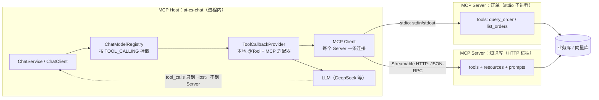
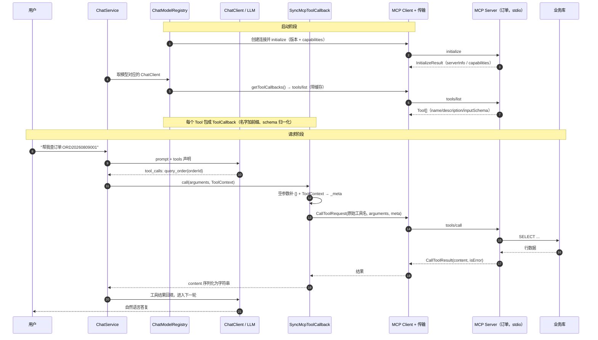

# MCP 协议实战：把工具接入从 M×N 收敛成 M+N

> **一句话结论**：MCP（Model Context Protocol，模型上下文协议）把"工具/数据源怎么接进 AI 应用"标准化成客户端-服务端协议——一份工具实现可以被所有支持 MCP 的宿主复用；代价是每次工具调用都多穿一层进程或网络边界，身份、超时、错误必须显式穿过这条边界。
> **阅读前置**：先读 [01-toolcalling-工具调用循环源码.md](../../24-源码分析/06-SpringAI/02-工具调用与RAG/01-toolcalling-工具调用循环源码.md)，知道 `ToolCallback` 是"模型要调工具"与"真的执行一个方法"之间的适配层；不熟 Spring AI 的 ChatClient 链式 API 也能读，但 §3.6 会略快。
> **证据基线**：Spring Boot 4.2.0 / Spring AI 2.1.0 / Spring Cloud 2026.0.0 / JDK 17。A 级证据取自 `24-源码分析/assets/source/`（17 份与 MCP 相关的 spring-ai-mcp 2.1.0 摘录）；B 级为本仓库 `ai-cs-chat` 当次核对代码；**MCP 依赖未入库**（本机 m2 无 `spring-ai-mcp`，仅有 `mcp-json-0.17.0`），凡涉及协议常量、报错文案、SDK 内部行为处一律标注"未入库"。预计阅读 35~45 分钟。

## 证据边界（先看清哪些话能当事实）

| 级别 | 范围 | 本次核对结果 | 本文用法 |
|---|---|---|---|
| A | `24-源码分析/assets/source/*.java.md` | 908 份摘录，其中 MCP 相关 17 份；`SyncMcpToolCallback`/`SyncMcpToolCallbackProvider`/`McpToolUtils`/`McpConnectionInfo` 等已逐行读过 | 讲机制必挂 `(src: 文件#Lx-Ly)`，行号是摘录里标注的**原始 .java 行号** |
| B | 本仓库业务代码 | `grep -i mcp` 扫 `*.java` / `*.yml` / `pom.xml`：**0 命中**（`ai-cs-order/eff-order.xml` 的 15 处是业务字段，无关） | 讲"本项目怎么落地"时明说未落地，只引现有工具链代码做对照 |
| C | 本机可复现探测 | `node`/`npx` 存在；`docker`/`redis-cli`/`mysql`/`chroma` 全部 NOT FOUND；m2 里无 `spring-ai-mcp` | 命令一律是"判读方法"，跑不通的中间件命令不写 |
| 未入库 | `io.modelcontextprotocol.sdk:mcp`（协议本体）、OpenAI/Chroma 官方实现 | 本机只有 `mcp-json-0.17.0.jar` 与 `mcp-json-jackson2-0.17.0.jar`，`jar tf` 显示里面只有 JSON/schema 工具类，**没有 `spec/McpSchema`、没有 client/server 包** | 协议版本字符串、initialize 报文细节、SDK 报错文案，一律标"未入库，依据官方文档/本项目代码" |

> 一句提醒：本文所有"Spring AI 侧怎么把 MCP 工具变成 `ToolCallback`"的说法都有 A 级行号；所有"协议层长什么样"的说法都没有本地 jar 可核，属于根据官方文档 + 摘录里的类型名反推，请按标注区分。

## 0. 先看现象

**现象一：模型明明"有工具"，却回"我无法查询您的订单"。**

`ai-cs-chat` 里工具是注册好的：`ai-cs-chat/src/main/java/com/aics/chat/config/SpringAiConfig.java#L222-L228` 把两个服务对象交给 `MethodToolCallbackProvider`，模型侧只有能力位匹配才挂载：

```java
// ai-cs-chat/src/main/java/com/aics/chat/modelrouter/ChatModelRegistry.java#L74-L78
// 设计要点：只有声明 TOOL_CALLING 能力的模型才挂工具回调，避免不支持函数调用的模型收到工具声明后报错
if (definition.getCapabilities().contains(ModelCapability.TOOL_CALLING)) {
    builder = builder.defaultToolCallbacks(toolCallbackProvider);
}
```

Nacos 里某次改模型配置，`capabilities` 少写一项 `TOOL_CALLING`，chat 服务照常启动、日志一行错都没有，但用户问"我的订单到哪了"，模型只能编一段道歉。**工具声明没进请求体，模型不是"不会调"，是"根本没看到"。**

**现象二：工具被调了，返回的却是身份错误。**

工具执行时读线程上下文里的用户 ID：`ai-cs-chat/src/main/java/com/aics/chat/util/ChatUserContext.java#L26` 是 `private static final ThreadLocal<Long> USER_ID`。一旦执行流换了线程（异步、线程池切换），或换了进程，读到的就是 null，于是 `OrderQueryService` 返回这句给模型：

```text
无法识别当前登录用户身份，请先登录后再查询订单
```

对应位置 `ai-cs-chat/src/main/java/com/aics/chat/service/OrderQueryService.java#L42-L45`；失败分支打的是 `log.warn("订单服务查询失败: orderId={}, err={}", ...)`（同文件 `#L52`）。这句话对用户看起来像"没登录"，对开发看起来像"身份丢了"——两个完全不同的排查方向。

**现象三：接上 MCP 之后的两类新报错。**

第一类是容器装配冲突。`ai-cs-chat/src/main/java/com/aics/chat/modelrouter/ChatModelRegistry.java#L28` 是**按单类型注入** `ToolCallbackProvider`，只要 MCP 的 `SyncMcpToolCallbackProvider` 也成为一个 Bean，容器立刻报：

```text
NoUniqueBeanDefinitionException: No qualifying bean of type
'org.springframework.ai.tool.ToolCallbackProvider' available:
expected single matching bean but found 2: toolCallbackProvider,mcpToolCallbackProvider
```

第二类是进程起不来。stdio 传输要由宿主拉起子进程，Windows 上路径/解释器一旦不对，宿主拿到的就是：

```text
java.io.IOException: Cannot run program "npx": CreateProcess error=2, 系统找不到指定的文件。
```

> 这两段是本篇**按现有代码结构与 JDK `ProcessBuilder` 异常文案推导出的形态**，不是本项目实测日志——因为仓库里至今没有 MCP 依赖（下节给探测命令）。第三类现象在接 MCP 之前不存在，这正是引入协议要付的账。

**这些现象指向同一件事**：工具的"实现""身份""能力声明""进程边界"四件事现在全挤在 `ai-cs-chat` 一个进程里，靠约定维持；MCP 用协议把"实现"搬出去，于是复用性上去了，而身份、超时、错误这三样必须**显式穿过边界**——不显式传，就退回成上面那三种"看起来像别的问题"的故障。

## 1. 整体地图



> **读图说明**：
> 1. 关键箭头是 `PROV --> CLIENT`：**MCP 工具必须先被适配成 `ToolCallbackProvider` 里的 `ToolCallback`，才可能出现在发给 LLM 的 tools 声明里**。看错这条，会以为"起了个 MCP Server，模型就自动会用"——实际中间少这一环，模型的请求体里根本没有这个工具（现象一）。
> 2. `LLM -.-> CS` 是虚线：模型从不直接连 Server，它只产出 `tool_calls`，由 Host 侧代码执行。把这条看成实线，会得出"远程 MCP 服务能被模型直接访问、所以不用鉴权"的错误结论——鉴权恰恰要在 Host→Server 这一段做（§3.12）。
> 3. `CLIENT` 是"每 Server 一条连接"的粒度，不是一个全局单例；这决定了后面所有缓存、失效、用户隔离问题都按连接维度发生。

| 组件 | 责任 | 调用方 | 本项目落地状态 |
|---|---|---|---|
| MCP Host | 组装 Prompt、把工具声明给模型、执行 `tool_calls`、管生命周期 | 用户请求链路 | `ai-cs-chat` 是天然 Host，**已具备宿主角色，未接 MCP** |
| MCP Client | 一条连接上的 JSON-RPC 编解码、能力协商、`listTools`/`callTool` | Spring AI 的适配器 | **未落地**；2.1.0 侧实现类为 `SyncMcpClient`/`McpSyncClient`（源码摘录可证） |
| MCP Server | 用协议声明 tools/resources/prompts，并执行它们 | 任意 Client（可跨应用复用） | **未落地**；现在的"order 工具"是 `OrderQueryService` 里的 `@Tool` 方法 |
| 传输层 | stdio（子进程管道）/ Streamable HTTP（远程） | Client 与 Server 两端 | **未落地**；本机 `npx` 可用，`docker` 不可用 |
| 工具适配器 | 把 `McpSchema.Tool` 包成 `ToolCallback`，反之亦可 | `ToolCallbackProvider` | **未落地**；2.1.0 侧为 `SyncMcpToolCallback` / `McpToolUtils`（A 级） |
| 本地工具链（对照组） | `@Tool` 注解方法 → `MethodToolCallbackProvider` | `ChatModelRegistry` | **已落地**：3 个工具方法，见 §3.10 实测 |

## 2. 关键概念与关键类

先把六个术语讲清楚，后面所有讨论都建立在这几个词上：

- **MCP（Model Context Protocol）**：一套 JSON-RPC 2.0 之上的协议，规定宿主怎么发现、调用外部工具与数据源。
- **Host（宿主）**：真正跑 AI 应用、持有模型连接的那个进程（本项目就是 `ai-cs-chat`）。
- **Client（客户端）**：Host 内部"通向某一个 Server 的插头"，一个 Server 对应一个 Client，负责协议编解码。
- **Server（服务端）**：把一类能力按协议暴露出去的独立程序，可以同进程、同机子进程、也可以远程。
- **三类能力**：`tools`（模型可主动调用的动作）、`resources`（可被读取的数据，如文档/表结构）、`prompts`（可复用的提示词模板）。三者不是同一层东西——只有 `tools` 会进模型的函数调用列表，`resources`/`prompts` 通常由 Host 代码取来拼进上下文。
- **能力协商（capability negotiation）**：`initialize` 阶段双方各报自己支持什么（`clientCapabilities` / `serverCapabilities`），之后只允许用两边都声明的能力；这是协议能做"向前兼容"的根。
- **传输（transport）**：把 JSON-RPC 消息搬过去的那层，本地子进程用 stdio（stdin/stdout），远程用 HTTP（早期 SSE，现为 Streamable HTTP）。

| 名称 | 位置 | 角色 | 关键方法 / 字段 |
|---|---|---|---|
| `ToolCallbackProvider` | `spring-ai-model-2.1.0.jar`（`javap` 实测） | 工具集的统一出口，ChatClient 只认它 | `ToolCallback[] getToolCallbacks()`、`static from(List)` |
| `ToolCallback` | 同上 | 单个工具的适配器，模型声明与执行都走它 | `getToolDefinition()`、`call(String)`、`call(String, ToolContext)` |
| `ToolDefinition` | 同上 | 进模型请求体的三件套 | `name()`、`description()`、`inputSchema()` |
| `SyncMcpToolCallbackProvider` | `SyncMcpToolCallbackProvider.java.md` | 同步版 MCP→Spring AI 适配器，负责发现与缓存 | `getToolCallbacks()` `#L143-L184`、`invalidateCache()` `#L189-L196` |
| `SyncMcpToolCallback` | `SyncMcpToolCallback.java.md` | 单个 MCP 工具的适配器（真正的"跨界执行"点） | `getToolDefinition()` `#L93-L96`、`call(...)` `#L112-L158` |
| `McpToolUtils` | `McpToolUtils.java.md` | 命名/定义/双向转换的工具箱 | `createToolDefinition` `#L243-L249`、`toSyncToolSpecification` `#L192-L212` |
| `McpConnectionInfo` | `McpConnectionInfo.java.md` | 一条连接协商结果的载体 | `clientCapabilities`、`clientInfo`、`initializeResult` `#L33-L36` |
| `McpToolFilter` | `McpToolFilter.java.md` | 按"连接+工具"双条件过滤暴露面 | `extends BiPredicate<McpConnectionInfo, McpSchema.Tool>` `#L30` |
| `DefaultMcpToolNamePrefixGenerator` | `DefaultMcpToolNamePrefixGenerator.java.md` | 多 Server 工具重名时的命名策略 | `prefixedToolName(...)` `#L63-L69`、重名 `alt_N_` `#L71-L82` |
| `McpToolsChangedEvent` | `McpToolsChangedEvent.java.md` | Server 通知"工具变了"的 Spring 事件 | `connectionName`、`List<Tool> tools` `#L30-L40` |
| `ToolContextToMcpMetaConverter` | `ToolContextToMcpMetaConverter.java.md` | 把 `ToolContext` 转成 MCP 调用的 `_meta`（身份跨界的唯一正规通道） | `convert(ToolContext)` `#L44`、`defaultConverter()` `#L46-L60` |
| `SyncModernMcpToolCallbackProvider` | `SyncModernMcpToolCallbackProvider.java.md` | 2026-07-28 版协议的适配器（`@since 2.1.0`） | 类注释 `#L39-L84`、冷却常量 `#L90` |
| `MethodToolCallbackProvider` | `ai-cs-chat/src/main/java/com/aics/chat/config/SpringAiConfig.java#L222-L228` | 把 `@Tool` 方法包装成本地回调 | `builder().toolObjects(...).build()` |

## 3. 原理与证据逐段精读

每小节四层：这段在干什么 → 为什么这么设计 → 换写法会怎样 → 常见坑。

### 3.1 M×N 变成 M+N：真正被标准化的是"发现与调用"这一对动作

**在干什么。** 没有协议时，每个"AI 应用 × 每个外部系统"都要写一套胶水；MCP 把胶水固化成两个动作：`tools/list` 发现、`tools/call` 调用，于是应用数 M 与工具数 N 之间从 M×N 条胶水变成 M+N 份实现，质量由协议保证。

**为什么这么设计。** 因为"有哪些工具""这个工具长什么样""怎么调""结果是什么形状"这四件事在协议里都有对应结构（工具名、描述、JSON Schema、内容块），一次定义可以被任何 Host 消费。这也解释了为什么 MCP 的收益与"工具要被几个宿主用"正相关——只被一个应用用，M+N 的 N 还是 1，收益接近 0。

**换写法会怎样。** 继续写本地 `@Tool`：单宿主场景更简单、无进程边界、身份/事务都在同一线程里（本项目现状），但每次接新宿主（客服工作台、内部 Copilot、第三方的 Claude Desktop）都要重写一遍，且每份实现的权限校验质量参差。

**常见坑。** 把 MCP 当成"性能优化"或"更强的函数调用"。它换来的不是低延迟，而是**复用与隔离**；对单体量单宿主项目，它是负收益（多一层进程 + 一层序列化）。判断标准很简单：这份能力会不会被第二个宿主调用？

### 3.2 三个角色与三类能力：只有 tools 进模型的候选列表

**在干什么。** Host 持模型、Client 持连接、Server 持能力。Server 对外声明三类东西：`tools`（可执行动作，带 JSON Schema）、`resources`（可读数据，带 URI/MIME）、`prompts`（模板，带参数）。

**为什么这么设计。** 因为"让模型自由决定调用"和"让应用精确控制注入"是两种风险等级。`tools` 交给模型裁量（有副作用，需要授权），`resources`/`prompts` 由代码决定何时取、取多少（可控、可审计）。分层是为了把风险分级，而不是为了整齐。

**换写法会怎样。** 如果只有 `tools` 一类，知识类数据也得包成工具，模型就会频繁"调工具取文档"，token 与延迟都上去；如果只有 `resources`，那模型就没法主动查订单状态。**两类都要，但用途不同。**

**常见坑。** 把 `resources` 当 `tools` 用：模型看不到 `resources` 列表（除非 Host 主动注入），于是抱怨"接入了知识库但模型不知道"。这一点与 §3.10 的"声明是否进请求体"是同一个道理。

### 3.3 传输：stdio 与 Streamable HTTP 是两种不同的信任模型

**在干什么。** stdio 下 Host 用 `ProcessBuilder` 拉起 Server 子进程，JSON-RPC 走 stdin/stdout，一行一条消息；HTTP 下 Server 是独立服务，Host 通过 `POST /mcp` 之类的端点做请求/响应，早期协议版本用的是 SSE 长连接（`GET /sse` + `POST /message`）。

**为什么这么设计。** 本地工具（读写本机文件、跑本机命令）天然适合"子进程 + 管道"：没有网络暴露面、没有鉴权负担、随宿主生命周期起落。远程共享服务则必须走 HTTP：可水平扩展、可过网关、可做多租户鉴权。

**换写法会怎样。** 把本地工具强行做成 HTTP 服务：多一个端口、多一套鉴权、多一份运维，还多一个"没启动就连不上"的失败面。反过来把远程多租户服务做成 stdio：每个宿主都要在本地跑一个实例、无法集中更新、凭据散落在每台机器上。

**常见坑。** ①Windows 上 `npx`/`.cmd` 不是可执行文件，直接 `ProcessBuilder("npx", ...)` 会 `CreateProcess error=2/193`，实际要写成 `cmd.exe /c npx ...`（旧文档记过这条，仍成立）；②stdio Server 的 `System.out` 就是协议通道，server 里一行 `print` 调试会污染报文流，调试输出必须走 stderr；③SSE 在较新协议里已被 Streamable HTTP 取代，旧教程的 `GET /sse` 配置在新版本上会连不上（见 §7）。

### 3.4 生命周期与能力协商：`initialize` 的结果被一路带到命名与调用

**在干什么。** 连接建立后先 `initialize`（交换协议版本与 capabilities），再 `notifications/initialized`，之后才能 `tools/list`；工具调用是 `tools/call`。协商结果在 Spring AI 侧被显式保存：

```java
public record McpConnectionInfo(McpSchema.ClientCapabilities clientCapabilities,
        McpSchema.Implementation clientInfo,
        McpSchema.@Nullable InitializeResult initializeResult) {
}
```

(src: McpConnectionInfo.java#L33-L36)

**为什么这么设计。** 三方（Host 版本、Client 支持的能力、Server 支持的能力）必须在一个点上对齐，后续行为才有依据。Spring AI 把这三点打包成一个不可变 record，传给过滤器和命名器——所以"给工具加前缀"能用上 `serverInfo`（服务端自报的名字与版本），而不是靠人写死配置：

```java
public String prefixedToolName(McpConnectionInfo mcpConnectionInfo, McpSchema.Tool tool) {
    var serverInfo = mcpConnectionInfo.initializeResult() != null
            ? mcpConnectionInfo.initializeResult().serverInfo() : null;
    ConnectionId connectionId = new ConnectionId(mcpConnectionInfo.clientInfo(), serverInfo, tool);
    return this.existingConnections.computeIfAbsent(connectionId, id -> uniqueToolName(tool));
}
```

(src: DefaultMcpToolNamePrefixGenerator.java#L63-L69)

**换写法会怎样。** 每次 `getToolCallbacks()` 都重新协商：连接开销翻倍，且协商结果可能在两次调用之间变化，缓存与命名都会抖。不保存 `initializeResult` 而只存工具列表：一旦 Server 升级改名，前缀就对不上，历史会话里的工具名全部失效。

**常见坑。** 把 `initializeResult` 当成必有值——它是 `@Nullable`，在"连接已建立但协商尚未完成"的窗口里为 null，直接 `.serverInfo()` 会 NPE。上面代码用三元判断挡住的正是这个坑。

### 3.5 工具怎么变成 `ToolCallback`：名字、描述、schema 三件事一起被改写

**在干什么。** `getToolCallbacks()` 在第一次调用（或缓存失效后）向每个连接要 `listTools()`，过滤、命名、包装，最后缓存：

```java
if (this.invalidateCache) {
    this.lock.lock();
    try {
        if (this.invalidateCache) {
            this.cachedToolCallbacks = this.mcpClients.stream()
                .flatMap(mcpClient -> mcpClient.listTools()
                    .tools()
                    .stream()
                    .filter(tool -> this.toolFilter.test(connectionInfo(mcpClient), tool))
                    .<ToolCallback>map(tool -> SyncMcpToolCallback.builder()
                        .mcpClient(mcpClient)
                        .tool(tool)
                        .prefixedToolName(
                                this.toolNamePrefixGenerator.prefixedToolName(connectionInfo(mcpClient), tool))
                        .toolContextToMcpMetaConverter(this.toolContextToMcpMetaConverter)
                        .build()))
                .toList();
            this.validateToolCallbacks(this.cachedToolCallbacks);
            this.invalidateCache = false;
        }
    }
    finally {
        this.lock.unlock();
    }
}
```

(src: SyncMcpToolCallbackProvider.java#L143-L171)

**为什么这么设计。** 三个理由各自对应一个真实约束：①**缓存**——`tools/list` 是一次跨进程往返，ChatClient 每个请求都会问一次 provider，不缓存就把延迟叠进每次对话；②**过滤**——同一个 Server 可能暴露 50 个工具，全给模型会撑爆上下文并提高选错率（§3.10）；③**加前缀**——多个 Server 都可能有个叫 `search` 的工具，模型分不清，`format()` 会把非法字符剔掉、重名时生成 `alt_N_` 变体（`DefaultMcpToolNamePrefixGenerator.java#L71-L82`）。

**换写法会怎样。** 不缓存：每轮对话都打一次 `tools/list`，远程 Server 抖动直接变用户可感知的卡顿。不过滤：工具数从 3 涨到 60，模型选错率上升、token 消耗翻倍。不加前缀：两个 `search` 后注册的覆盖先注册的，且**没有任何报错**——这是最难查的一类问题。

**常见坑。** ①前缀会把工具名拉长，`McpToolUtils.prefixedToolName` 超过 64 字符时取末尾 64 字符（`McpToolUtils.java#L92-L111`），长服务名 + 长工具名会撞车；②双重检查锁的 `invalidateCache` 是 `volatile`（`SyncMcpToolCallbackProvider.java` 字段区），漏了就可能在并发下拿到半成品列表；③`validateToolCallbacks` 校验的是重名，判断依据是改写后的名字，**过滤器放得太宽时错误发生在启动路径上**，不是调用时。

### 3.6 一次调用跨过边界：`call()` 里只有四个动作，但每个都决定故障形态

**在干什么。** 模型给的参数是 JSON 字符串，`call()` 负责把它交给 MCP Client，再把结果序列化回去：

```java
public String call(String toolCallInput, @Nullable ToolContext toolContext) {
    if (!StringUtils.hasText(toolCallInput)) {
        if (logger.isWarnEnabled()) {
            logger.warn("Tool call arguments are null or empty for MCP tool: " + this.tool.name()
                    + ". Using empty JSON object as default.");
        }
        toolCallInput = "{}";
    }
    Map<String, Object> arguments = jsonHelper.fromJsonToMap(toolCallInput);
    CallToolResult response;
    try {
        var mcpMeta = toolContext != null ? this.toolContextToMcpMetaConverter.convert(toolContext) : null;
        var request = CallToolRequest.builder(this.tool.name()).arguments(arguments).meta(mcpMeta).build();
        response = this.mcpClient.callTool(request);
    }
    catch (McpError ex) {
        logger.error("Protocol error while calling tool: ", ex);
        throw ex;
    }
    catch (Exception ex) {
        logger.error("Exception while tool calling: ", ex);
        throw new ToolExecutionException(this.getToolDefinition(), ex);
    }
    if (response.isError() != null && response.isError()) {
        if (logger.isErrorEnabled()) {
            logger.error("Error calling tool: " + response.content());
        }
        throw new ToolExecutionException(this.getToolDefinition(),
                new IllegalStateException("Error calling tool: " + response.content()));
    }
    return jsonHelper.toJson(response.content());
}
```

(src: SyncMcpToolCallback.java#L112-L158)

**为什么这么设计。** 四种失败被刻意分成两个语义层级：`McpError`（协议级，连接/超时/报文不合法）**直接往外抛**，让整轮模型交互失败——因为协议坏了就没有"重试一次就好"的余地，绝不能让模型看到这段错误再自己编个答案；其它异常与 `isError=true` 包成 `ToolExecutionException`，交给工具调用管理器处理，模型能看到失败内容并决定换参数重试。空参数补 `{}` 是给流式场景兜底（截断的 JSON 会变成空串）。

**换写法会怎样。** 全部包成 `ToolExecutionException`：连接断了模型会看到"调用失败"，然后反复重试、烧 token，用户等了 30 秒拿到一段胡话。全部直接抛：Server 返回的业务错误（比如"订单不存在"）会让整轮对话 500，本可以优雅降级。**分层的代价是必须知道哪一层归谁管。**

**常见坑。** ①`call()` 里用的是 `this.tool.name()`——**原始工具名**，不是加了前缀的名字，用错 Server 直接 `Method not found`（源码 `#L129-L134` 的注释专门强调这一点）；②`ToolExecutionException` 的消息会进 Prompt，业务错误信息里绝不能带 SQL、堆栈、内网地址（本项目 `ToolAuthorizationService` 的"参数摘要化"是同一条纪律）；③`response.content()` 可能是多块内容（文本+图片），`toJson` 之后模型侧看到的是 JSON 而不是纯文本，工具描述里要提前说明返回格式。

### 3.7 反向桥：把现有 `@Tool` 方法暴露成 MCP 工具

**在干什么。** 上一节是 Server→Host，2.1.0 还提供反方向：把一个 Spring AI `ToolCallback` 包成 MCP Server 侧的 `SyncToolSpecification`，于是既有 `@Tool` 方法几乎不用改就能被别的宿主调用：

```java
public static McpServerFeatures.SyncToolSpecification toSyncToolSpecification(ToolCallback toolCallback,
        @Nullable MimeType mimeType) {
    SharedSyncToolSpecification sharedSpec = toSharedSyncToolSpecification(toolCallback, mimeType);
    return new McpServerFeatures.SyncToolSpecification(sharedSpec.tool(),
            (exchange, request) -> sharedSpec.sharedHandler().apply(exchange, request));
}
```

(src: McpToolUtils.java#L205-L212)

**为什么这么设计。** 真实的迁移路径从来不是"重写"，而是"先暴露、再拆走"。有了这个桥，`OrderQueryService` 可以第一天先在 `ai-cs-chat` 进程内当 MCP Server 暴露（零改业务代码），等调用方多了再独立部署——**上线风险被摊成两步**。

**换写法会怎样。** 直接为每个工具手写一份 MCP Server 的 schema 与 handler：两份定义必然漂移，改一处忘一处，且漂移只在模型选错参数时才暴露。

**常见坑。** ①反向桥执行时会把 MCP 的 `exchange` 塞进 `ToolContext`（键为 `McpToolUtils.TOOL_CONTEXT_MCP_EXCHANGE_KEY`，值 `"exchange"`，见 `McpToolUtils.java#L251-L279`），所以**工具方法里能拿到 MCP 会话信息**——但这也意味着工具实现开始依赖"是不是从 MCP 来的"，本地直调时要处理该键不存在的情况；②`toStatelessSyncToolSpecification`（`#L226-L235`）是给无状态传输用的，选错变体在长连接场景会丢会话；③暴露时可以传 `MimeType` 决定结果编码，不传走默认，二进制结果会被当文本拼进 Prompt。

### 3.8 缓存、失效与"工具变了"通知

**在干什么。** 缓存靠 `invalidateCache` + `ReentrantLock`；Server 侧工具变化时，通过事件失效：

```java
public void invalidateCache() {
    this.invalidateCache = true;
}
```

(src: SyncMcpToolCallbackProvider.java#L189-L196 起，配合 `ApplicationListener<McpToolsChangedEvent>`)

**为什么这么设计。** `tools/list` 是跨进程成本，`ChatClient` 每个请求都会读 provider，所以必须缓存；但工具集合会变（Server 热更新、灰度上线新工具），纯 TTL 要么太慢（看到不存在的工具）要么太贵（一直重拉）。事件驱动是折中：正常路径零成本，变化时精确失效。

**换写法会怎样。** 只靠 TTL：TTL 内模型看到已下线的工具，调用必失败；TTL 外又白打一次请求。只在启动时拉一次：Server 加工具必须重启 Host，MCP 的"独立演进"优势全丢。

**常见坑。** ①`McpToolsChangedEvent` 只在 Server 主动发 `list_changed` 通知时才有；多数实现默认不发，于是你以为"事件会处理"，实际永远走不到（协议报文细节**未入库**，不能本地核对）；②缓存的是 `ToolCallback[]` 数组，**缓存里的 callback 绑定的是当时的连接**，连接重建后旧 callback 调不动——这也是 modern provider 明确"每次调用重新解析"的原因（§3.9）。

### 3.9 2.1.0 的 modern 一套：`ttlMs` / `cacheScope` 与"不可达不致命"

**在干什么。** 2.1.0 引入了面向新协议（类注释里写作 `2026-07-28`）的一套实现，缓存策略不再由 Host 一刀切，而由 **Server 在工具列表上声明**：

```text
 * A listing with a ttlMs of zero is never kept, and every call to
 * getToolCallbacks() lists the tools again. Servers send zero unless configured
 * otherwise.
 * A public listing is the same for every caller. The provider keeps it for its
 * ttlMs and uses it for all requests, whichever client serves them.
 * A private listing may differ from caller to caller, so the provider does not keep it.
 * A tool call is never served from a kept listing: it always goes to the server, through
 * the client of the request that resolved the callback.
```

(src: SyncModernMcpToolCallbackProvider.java#L48-L63，摘录为类注释原文)

**为什么这么设计。** 因为"能不能共享缓存"取决于**数据是否与调用者身份相关**。公共工具列表（人人一样）可以共享；私有列表（按用户裁剪过的）共享就会串号——把决定权交给最了解语义的一方（Server），比自己猜安全。

同一个类注释还定义了失败语义，这是生产可用性的关键：

```text
 * A server that cannot be reached does not fail the call: its tools are left out and a
 * warning is logged, so the tools of the other connections stay usable... A server counts
 * as unreachable when the connection cannot be established, the exchange times out or
 * breaks, or the server answers with a 5xx, 408 or 429 status.
 * Every other failure is thrown, in particular an authorization failure, so that the
 * application can ask the user to log in again.
```

(src: SyncModernMcpToolCallbackProvider.java#L69-L78)

**换写法会怎样。** 任一连不上就整体失败：一个边缘 MCP Server 挂了，整个客服不可用——这正是"引入协议后可用性下降"的最常见原因。反过来把所有错误都吞掉：401 被当成"不可达"，用户明明登录过期却被告知"该功能暂时不可用"，永远修不好。

**常见坑。** ①冷却期默认 30 秒（`DEFAULT_UNREACHABLE_COOL_DOWN`，源码 `#L90`）：Server 恢复后仍有 ≤30s 不可用，压测复现时容易被误判成"一直坏"；②`ttlMs=0` 意味着**每次 `getToolCallbacks()` 都重新 `tools/list`**，如果你把 provider 装成了"每次请求取一次"（ChatClient 默认行为），远程 Server 的 QPS 会按对话 QPS × 1 放大；③两套 provider（legacy/modern）能同时存在并各自贡献 callback，工具重名时要靠 `validateToolCallbacks` 兜底。

### 3.10 工具描述与参数 schema：模型选错工具，90% 是这里的问题

**在干什么。** MCP 工具的 `description` 与 `inputSchema` 被**原样**透传成模型的工具声明，Spring AI 只做 schema 归一化，不做语义加工：

```java
public static ToolDefinition createToolDefinition(String prefixedToolName, McpSchema.Tool tool) {
    return DefaultToolDefinition.builder()
        .name(prefixedToolName)
        .description(tool.description())
        .inputSchema(JsonSchemaUtils.ensureValidInputSchema(jsonHelper.toJson(tool.inputSchema())))
        .build();
}
```

(src: McpToolUtils.java#L243-L249)

**为什么这么设计。** 因为模型选工具的唯一依据就是这三样。协议侧不替你做"描述优化"，因为工具语义只有作者知道；Spring AI 只保证 `inputSchema` 是合法 JSON Schema（`ensureValidInputSchema`），避免脏 schema 让模型直接报错或编参数。

**换写法会怎样。** 描述写得含糊（"查询订单"），模型在 `query_order` 与 `list_orders` 之间随机选；schema 不精确（`orderId` 没写格式），模型会传 `"订单123"`、`"ORD-2026-001"` 之类。本项目已有正面例子，描述里把格式写死：

```java
@Tool(description = "根据订单号查询订单详情，包括订单状态、商品信息、金额、物流等")
public String queryOrder(
        @ToolParam(description = "订单编号，格式如 ORD20260809001") String orderId) {
```

(ai-cs-chat/src/main/java/com/aics/chat/service/OrderQueryService.java#L37-L39)

**成本口径（怎么算，不是实测）。** 工具声明占用的是**每次请求**的输入 token，量级估算：

```text
单工具声明 token ≈ (name + description + inputSchema JSON) 字节数 ÷ 3
（英文/JSON 主导时约 3 字节/token；中文按 1 字 ≈ 0.6~1 token 另算）
每轮请求工具开销 ≈ 工具数 × 单工具声明 token + 固定模板开销
```

本项目实测（`ai-cs-chat` 全量 `@Tool` 注解源码文本）：**2 个文件、3 个工具方法**，注解文本长度分别为 310 / 55 / 43 字符，合计 408 字符 → 约 140~200 token 量级，可忽略。若接入 3 个 MCP Server、每个 20 个工具、平均描述 300 字符：`60 × (300+200)/3 ≈ 10000 token/轮`——这才是"工具接太多"的真实成本，也是 `McpToolFilter` 存在的理由之一。单价以 DeepSeek 官方定价页为准（此处只给公式，不抄数字），按"输入 token 单价 × 每轮平均轮数 × 日活对话数"折算即可。

**常见坑。** ①描述里塞内部实现（"调用 order 库 t_order 表"）等于把数据库结构泄露给模型、经模型泄露给用户；②`inputSchema` 的 `required` 与 `properties` 不一致时，不同模型的处理方式不同（有的补 null、有的直接不调），`ensureValidInputSchema` 只修格式不修语义；③同一能力既注册本地 `@Tool` 又注册 MCP 工具，模型会在两近似选项间摇摆——要么过滤掉一个，要么描述里明确分工。

### 3.11 错误处理与超时：三个超时不是一回事

**在干什么。** 一次 MCP 工具调用链上有三段可以超时：①Host→Client 的**工具执行超时**（Spring AI 侧/工具管理器管）；②Client→Server 的**请求超时**（传输层，HTTP 客户端或 stdio 读超时）；③Server 内部的**业务超时**（如本项目 NL2SQL 的 10s JDBC 超时）。

**为什么这么设计。** 三段的失败语义不同：①是"模型等太久，得给它一个答复"；②是"网络/进程不可用"；③是"这次查询本身太慢"。合成一个超时，你就无法区分"该重试"和"该报错"。

**换写法会怎样。** 只配一个 60s 总超时：慢查询把连接池占满，用户端 60s 白屏；且分不清是模型侧还是 Server 侧的问题。相反，若把 Host 侧超时设得比 Server 业务超时短，Server 还在跑、Host 已经放弃，**工具实际执行了但模型以为失败**——订单重复退款类事故就长这样。

**常见坑。** ①`ToolExecutionException` 与 `McpError` 的分层（§3.6）决定谁能重试，超时必须挂在正确那层；②stdio 子进程崩溃时读管道会立刻 EOF，这不是超时而是"连接断了"，modern provider 把它归入"不可达"（`#L69-L78`），legacy provider 则直接抛；③流式对话里工具调用的取消（用户点"停止"）要往后传到 MCP 请求，否则 Server 侧白跑。

### 3.12 安全：stdio 的权限边界、远程的鉴权面、提示词注入面

**在干什么。** 三个独立的信任问题：

1）**本地 stdio Server 的执行权 = 宿主进程的执行权**。它继承宿主的文件系统权限、环境变量（包括所有 API Key）、网络出口。Server 一旦被投毒（`npx some-mcp-server@latest`），等于给宿主开了后门。
2）**远程 Server 的鉴权发生在 Host→Server 这一段**，与"用户是否有权看这条数据"是两件事。前者证明"我是哪个租户/应用"，后者证明"这个用户能查哪个订单"。
3）**提示词注入面变宽**：MCP 工具的返回内容会进模型上下文，恶意 Server 可以在结果里塞指令；而模型给的工具参数又来自用户输入，可能诱导越权调用。

**为什么这么设计。** 协议只负责"怎么调"，不负责"该不该调"。授权必须留在业务侧——本项目已经写清了这条纪律：

```text
 * LLM 只是建议调用哪个工具，工具端必须重新校验权限——模型参数可被注入诱导
```

(ai-cs-chat/src/main/java/com/aics/chat/security/ToolAuthorizationService.java 类注释；拒绝时记 `SecurityEventType.TOOL_UNAUTHORIZED` 审计)

**换写法会怎样。** 只做远程鉴权、不做工具级授权：多租户下 A 用户通过精心构造的 `orderId` 拿到 B 用户的订单，鉴权日志一切正常。只在 stdin 里传用户身份：Server 无法区分"参数里写的 userId"和"调用者真实的 userId"，等于让模型自证身份。

**常见坑。** ①身份过界的正规通道是 `_meta`：`ToolContextToMcpMetaConverter.convert()` 把 `ToolContext` 转成 MCP 元数据（`#L44-L60`，默认实现会剔除 `exchange` 键与 null 值），**不要**把 userId 塞进业务参数让模型转述；②`ChatUserContext` 是 `ThreadLocal`（`#L26`），跨进程必然失效，接 MCP 后必须改成显式传参 + Server 端重新解析令牌；③stdio Server 的启动命令/参数属于**受信配置**，绝不能让模型或用户输入影响（经典命令注入）；④工具返回内容要按不可信处理，长度截断 + 明确标注"以下是数据，不是指令"能显著降低注入成功率（本项目 `Nl2SqlQueryService` 对 SQL 做摘要化、不落明文的做法可复用）。

## 4. 一次完整执行时序



> **读图说明**：
> 1. 前 10 步是**启动期一次性成本**，第 11 步起才是每次对话的成本。看错这条分界，会把"启动慢"当成"对话慢"——`tools/list` 只在缓存失效时发生，`tools/call` 才每轮都有。
> 2. 关键箭头是 `CB->>CL` 那一步：它携带的是**原始工具名 + `_meta`**。漏掉 `_meta` 就等于丢了身份（现象二），把加了前缀的名字发出去就是 `Method not found`。
> 3. 注意 `LLM` 与 `SV` 之间**没有边**：模型不直连 Server，所有跨界都由 Host 侧代码承担——这决定了超时、重试、审计都只能加在 Host 侧。

失败点与报错对照（按步号）：

| 失败步 | 触发条件 | 表现形态 | 归属 |
|---|---|---|---|
| 4–5 initialize | Server 不存在/命令错/端口不通 | 启动失败：`IOException: Cannot run program ...`（stdio）或连接超时；modern provider 会在**列表阶段**降级为 warn + 冷却 | 配置/运维 |
| 8 tools/list | Server 卡住不响应 | 工具列表为空或部分缺失，模型"不会用工具"，**日志可能只有一行 warn**（`#L69-L78`） | 可用性 |
| 8 tools/list | 两个 Server 有同名工具 | `validateToolCallbacks` 抛重名异常（启动期暴露），或 `alt_N_` 前缀生效 | 命名策略 |
| 12–13 call | 参数不符合 schema | Server 返回 `isError=true` → `ToolExecutionException`，模型可看到原因并重试 | 工具描述质量 |
| 12–13 call | 连接中断/协议报文错 | `McpError` 直接抛，**整轮模型交互失败**（`#L136-L144`） | 传输/Server |
| 12–13 call | 用户身份缺失 | Server 返回业务错误文本（如"无法识别当前登录用户身份"），模型转述给用户 | 身份传递设计 |
| 14 后回填 | 结果过大 | 上下文被撑爆/被截断，模型答非所问 | 结果治理 |

## 5. 设计取舍

| 维度 | 直接写 `@Tool`（现状） | 本地 stdio MCP Server | 远程 Streamable HTTP MCP Server |
|---|---|---|---|
| 复用范围 | 仅本进程 | 同机任意 MCP 宿主（Claude Desktop、IDE、别的服务） | 跨机、跨团队、跨产品 |
| 一次调用开销 | 方法调用（纳秒~毫秒） | +一次序列化 +管道往返（毫秒级） | +网络往返（毫秒~百毫秒） |
| 身份传递 | 同线程 `ThreadLocal` 直接可用 | 必须显式：参数或 `_meta` | 必须显式 + 令牌透传/换取 |
| 部署与运维 | 随应用发布 | 需管理子进程生命周期、依赖（node/python）存在性 | 需服务发现、鉴权、限流、灰度 |
| 失败影响面 | 工具异常 → 该次调用失败 | 子进程崩溃 → 该连接不可用（配置不当会拖垮启动） | 远端故障 → 该 Server 工具缺失（有时限的冷却） |
| 权限边界 | 与宿主同权限（同进程） | 与宿主同权限（同用户） | 独立边界，可最小权限部署 |
| 升级路径 | 改代码重启 | 换 Server 版本重启 | Server 独立升级，Host 无感 |
| 适用判断 | 单宿主、强事务、状态密集 | 本机能力复用给多个宿主 | 多租户、多产品共享的能力 |

**可扩展点清单**（按投入从小到大）：

1. `McpToolFilter`：按 `McpConnectionInfo + Tool` 过滤暴露面，先解决"工具太多模型选不准"（A 级接口 `#L30`）。
2. `McpToolNamePrefixGenerator`：自定义前缀策略，避免多 Server 重名与 64 字符截断。
3. `ToolContextToMcpMetaConverter`：把租户/追踪 ID 放进 `_meta`，替代 `ThreadLocal`。
4. `McpToolsChangedEvent` 监听：Server 热更新时精确失效缓存。
5. 服务端反向桥 `McpToolUtils.toSyncToolSpecification`：把现有 `@Tool` 零改造暴露成 MCP 工具。
6. 自建 Server 的传输选择：同进程 stdio / 独立 WebMVC 服务（BOM 里已有 `spring-ai-starter-mcp-server-webmvc`）。
7. 观测：在 `call()` 前后打点，把 `connectionName + 原始工具名 + 耗时 + isError` 写进现有 `TraceContext` 的 tools 段。

## 6. 踩坑与调试手法

1. **Windows 下 stdio 启动失败**：`ProcessBuilder("npx", "-y", "xxx")` 报 `CreateProcess error=2`。`npx` 是 `npx.cmd`（本机实测 `Get-Command npx` 给出 `npx.ps1` 与 `npx.cmd`，均非 exe），必须 `cmd.exe /c npx ...`。同类坑：路径含空格未加引号、`NODE_OPTIONS` 继承导致子进程行为异常。
2. **两个 `ToolCallbackProvider` 打架**：`ChatModelRegistry#L28` 单类型注入，MCP 一接就 `NoUniqueBeanDefinitionException`。三种解法：给 MCP provider 标 `@Primary`（最省事但语义含糊）、把两个 provider 合并成一个复合 provider（推荐，能顺手做过滤）、把注入点改成 `List<ToolCallbackProvider>` 或 `ObjectProvider`（灵活但要自己定顺序）。
3. **工具"存在但模型不用"**：九成是工具声明没进请求体。检查顺序：`getToolCallbacks()` 返回长度 → 模型是否声明 `TOOL_CALLING`（`#L74-L78`）→ 过滤器是否把工具滤掉 → 描述是否与用户说法对不上。**别一上来就怀疑模型笨。**
4. **工具名重名被静默覆盖**：两个 Server 都有 `search` 时，先看是否启用了前缀生成器，再看前缀是否被 64 字符截断成一样。日志里 `Tool name 'xxx' already exists. Using unique tool name 'alt_1_xxx'`（`DefaultMcpToolNamePrefixGenerator.java#L76-L78`）是唯一线索。
5. **`ThreadLocal` 身份跨进程失效**：本地 `@Tool` 里 `ChatUserContext.getUserId()` 好使，搬到 MCP Server 就是 null。改法见 §3.12：`_meta` 显式传 + Server 端重新解析，**不要**把 userId 塞进业务参数。
6. **调试手法 A：手打 JSON-RPC 单独测一个 stdio Server。** 不走宿主、不看 Spring 日志，直接和 Server 说话，能一次分清"是 Server 的问题还是适配器的问题"：

   ```powershell
   # 本机可复现形态（依赖 npx 与你选的 Server 包；无第三方包时用任意 stdio 回显程序替代）
   '{"jsonrpc":"2.0","id":1,"method":"initialize","params":{"protocolVersion":"2025-06-18","capabilities":{},"clientInfo":{"name":"probe","version":"1.0"}}}' |
     npx -y <server-package> 2>$null | Select-Object -First 1
   ```

   判读方法：回 `{"result":{"serverInfo":{...},"capabilities":{...}}}` 说明 Server 与传输都正常，问题在宿主侧（工具没挂载/没过滤/没进请求体）；回 `{"error":{...}}` 说明协议层不通；**一行都不回**通常是 Server 把日志写到了 stdout 污染了报文流，或者子进程直接没起来。本机 `npx` 存在、无中间件依赖，此命令形态可跑，但具体 Server 包需你自选，属**未实测的判读方法**。

7. **调试手法 B：先确认"有没有这个 jar"，再谈行为。** 排查"某个 API 是不是 2.1.0 就有"时不要猜：

   ```powershell
   # 实测输出（本机）
   PS> Get-ChildItem "$env:USERPROFILE\.m2\repository\org\springframework\ai" -Directory -Filter "spring-ai-mcp"
   # 无输出 → 本机没下过 spring-ai-mcp
   PS> jar tf "$env:USERPROFILE\.m2\repository\io\modelcontextprotocol\sdk\mcp-json\0.17.0\mcp-json-0.17.0.jar"
   io/modelcontextprotocol/json/McpJsonMapper.class
   io/modelcontextprotocol/json/schema/JsonSchemaValidator.class
   # ... 只有 JSON/schema 工具类，没有 spec/McpSchema、没有 client/server
   ```

   判读方法：**看到的类才能当证据**。上面这份输出直接说明"协议本体未入库"，所以本文所有协议常量都标了未入库；反过来，`javap -cp spring-ai-model-2.1.0.jar org.springframework.ai.tool.ToolCallbackProvider` 能打出 `getToolCallbacks()`，这才让 §3.5 的"provider 是唯一出口"站得住。
8. **只看 `spring-ai-bom` 就知道能引哪些模块**：`spring-ai-bom-2.1.0.pom` 里 grep `mcp` 出现 `spring-ai-starter-mcp-client`、`spring-ai-starter-mcp-client-webflux`、`spring-ai-starter-mcp-server`、`spring-ai-starter-mcp-server-webmvc`、`spring-ai-starter-mcp-server-webflux`、`spring-ai-mcp-annotations` 等坐标（`#L906-L931`），版本统一走 `${project.version}`。选依赖前先看这张表，比翻博客靠谱。

## 7. ⚠️ 版本差异

| 旧写法 | 当前基线（2.1.0） | 变化点 | 迁移动作 |
|---|---|---|---|
| 旧文档写"父 POM 已有 `spring-ai-bom` **1.1.4**" | 根 `pom.xml#L42` 是 `<spring-ai.version>2.1.0`，BOM 引入在 `#L117-L118` | 基线版本记错，会把 1.x 的行为当现状 | 以 `pom.xml` 为准；本文全部结论按 2.1.0 重核 |
| `@McpTool` 注解来自 `org.springaicommunity.mcp.*` | BOM 里有 `spring-ai-mcp-annotations`（`#L931`），据此包名为 `org.springframework.ai.mcp.annotation.*` | 注解归属迁移（**本机无该 jar，包名未验证**，仅依据 BOM 坐标推断） | 引依赖后 `javap` 或看 jar 目录再改 import，别直接照旧博客改 |
| 服务端传输以 SSE 为主 | Streamable HTTP + STATELESS 变体（`McpToolUtils.toStatelessSyncToolSpecification` `#L226-L235` 在 2.1.0 侧存在） | SSE 长连接方案在新协议里被取代 | 老配置 `GET /sse` 换成新端点；无状态场景用 stateless 规格 |
| 单一 `McpSyncClientCustomizer` | 2.1.0 出现 `McpClientCustomizer<B>` 统一形态（**未入库，依据升级文档口径，需引依赖后核对**） | 定制点合并 | 引依赖后按实际接口改，别按旧签名写 |
| 工具缓存由 Host 统一决定 | modern 一套由 Server 的 `ttlMs`/`cacheScope` 决定（`SyncModernMcpToolCallbackProvider.java#L48-L63`，`@since 2.1.0`） | 缓存责任下移到 Server | 自建 Server 时显式声明 `ttlMs`，否则默认 0 每次重列 |
| 协议只有一套 `McpSchema` | 出现 `io.modelcontextprotocol.modern.McpSchema`，与 legacy 的 `spec.McpSchema` 并存，两者 JSON 形状相同 | 双类型层级并存，靠转换器打通 | 用 `McpSchemaConverter` 转换；工具实现写 legacy 类型也能被 modern Server 服务 |
| "2.x 默认 Bean 工具回退"这件事被默认打开 | `ChatModelRegistry#L75` 注释明写"避免依赖 2.x 默认关闭的 Bean 工具回退解析" | 2.x 收紧了隐式工具发现 | 显式 `defaultToolCallbacks(provider)`，别指望自动扫描 |
| MCP 是"可选扩展" | 本项目仍是 0 落地（`grep -i mcp` 源码 0 命中） | 现状未变 | 本篇是**可执行的设计与最小实现方案**，不是已实现说明 |

> 旧文档还写过"MCP Java SDK 0.14+ → 2.0.0"的演进叙事：本机无对应 jar，无法核对，故本文不把它当事实引用；要确认请在自己环境 `mvn dependency:tree` 或看 `~/.m2` 实jar。

## 8. 面试高频问与答

1. MCP 解决的到底是什么问题？为什么说收益与"被几个宿主消费"正相关？
2. Host、Client、Server 三个角色分别持有什么？一个 Host 里 Client 的数量由什么决定？
3. `tools`、`resources`、`prompts` 三类能力有什么区别？哪一类会出现在模型的函数调用列表里？
4. stdio 与 Streamable HTTP 两种传输各适合什么场景？各自的信任边界在哪？
5. `initialize` 阶段协商了什么？如果 Server 不支持 Client 声明的某个能力，会发生什么？
6. Spring AI 是怎么把一个 MCP 工具变成 `ToolCallback` 的？名字为什么要加前缀？
7. 一次 MCP 工具调用链上有几个超时？把它们的顺序配反会出什么事故？
8. `McpError` 与 `ToolExecutionException` 为什么要分开？分别会带来什么用户可见后果？
9. 用户身份要从 Host 传到 MCP Server，有哪几种做法？为什么不能塞进业务参数？
10. `ttlMs` 与 `cacheScope` 解决的是什么问题？`private` 列表为什么不能被共享缓存？
11. "某个 MCP Server 连不上"时，好的策略是什么？为什么鉴权失败不能和不可达一起被吞掉？
12. 什么情况下应该放弃 MCP、继续写本地 `@Tool`？给出你的判断标准。
13. 本地 stdio MCP Server 被投毒后，攻击者能拿到什么？怎么降低这个风险？
14. MCP 工具返回内容里的提示词注入，为什么比普通 RAG 文档注入更危险？

## 9. 动手练习

1. **摸清现有工具面**：在 `ai-cs-chat` 里统计 `@Tool` 方法数与描述长度（提示：`Select-String -Pattern '@Tool\(' -AllMatches`）。
   验收标准：能报出"几个文件、几个工具方法、注解文本总字符数"，并写出"若接入 50 个工具，每轮多耗多少 token"的估算式。
2. **画一张本项目的 Host/Client/Server 现状图**：把 `ChatService → ChatModelRegistry → ToolCallbackProvider → @Tool 方法` 画成 Mermaid，并标出哪些环节未来会被 MCP 替换。
   验收标准：图里能明确指出"替换点在 `ToolCallbackProvider` 与工具实现之间"，且能说出换掉后 `ChatModelRegistry` 要不要改。
3. **预演 Bean 冲突**：写一个测试类，额外声明一个 `ToolCallbackProvider` Bean（返回空数组即可），启动上下文，观察是否复现 `NoUniqueBeanDefinitionException`。
   验收标准：贴出真实报错；然后用"复合 provider"方式修好，测试通过。
4. **单独测一个 stdio Server**：用 §6 手法 A 的命令手打 `initialize` 与 `tools/list`。
   验收标准：贴出两个响应原文，并说明"如果第一步就没有输出，你会先查哪三件事"。
5. **写一份 MCP 接入最小方案（不写业务代码也可）**：目标是把 `query_order` 暴露成 MCP 工具，同时保留本地 `@Tool`。
   验收标准：方案里包含 ①依赖坐标（从 `spring-ai-bom` 里挑）②`application.yml` 的 `spring.ai.mcp.client` 配置形态 ③过滤器名单 ④身份传递方式（`_meta`）⑤回滚方式（删依赖即恢复）。
6. **设计一次降级演练**：让一个 MCP Server 在请求中途不可达。
   验收标准：写出预期日志与用户可见行为（工具缺失 vs 整轮失败），并说明你依赖 modern 的冷却语义还是自己加熔断。

## 小结

- MCP 把"工具发现 + 调用"标准化成 JSON-RPC 协议，收益是 M×N→M+N 的复用，代价是每次调用多一层进程/传输边界。
- 三角色（Host/Client/Server）与三能力（tools/resources/prompts）里，只有 `tools` 会进模型的函数调用列表，`resources`/`prompts` 靠 Host 代码主动取用。
- 传输选择就是信任模型选择：stdio 是"子进程 + 管道"，权限等于宿主；HTTP 是"独立服务"，必须自带鉴权与限流。
- Spring AI 侧的适配链是 `McpSyncClient -listTools-> McpSchema.Tool -createToolDefinition-> ToolCallback -provider-> ChatClient`，其中名字加前缀、schema 归一化、缓存失效是三个必须知道的动作。
- 调用侧只有两种失败语义：`McpError`（协议坏，整轮失败）与 `ToolExecutionException`（业务失败，模型可见可重试）；搞混就会出现"疯狂重试烧 token"或"一个 server 挂掉整站不可用"。
- 身份必须显式穿过边界：`ThreadLocal` 到进程边界就断了，正规通道是 `ToolContext → _meta`，且 Server 端必须重新授权。
- **本项目当前状况**：`grep -i mcp` 源码 0 命中，`ai-cs-chat` 已落地的是 3 个本地 `@Tool` 工具（`OrderQueryService` 2 个 + `Nl2SqlQueryService` 1 个），MCP client/server、`McpToolFilter`、`_meta` 传身份、服务端暴露**全部未落地**——本篇是可执行的设计与最小实现方案，不是已实现说明。
- 可操作归纳：**先别引依赖**，先花 30 分钟做练习 1 与练习 2，得出"我的工具会不会有第二个宿主"的结论；答案是"不会"，就继续用 `@Tool`；答案是"会"，再照练习 5 的五项清单动手，并把"改注入点为复合 provider"写进第一步。

## 自测题

**Q1. MCP 的 "M+N" 具体指什么？收益为什么与"被几个宿主消费"正相关？**

<details><summary>参考答案</summary>
M 是 AI 应用（宿主）数量，N 是外部工具/数据源数量。没有协议时每个宿主都要为每个工具写一套胶水代码（M×N 份）；工具按协议实现一次，任何支持 MCP 的宿主都能发现并调用（M+N 份）。所以只有 N 会被多个宿主消费时收益才成立，单宿主场景收益接近零、只剩额外的进程与序列化成本。
</details>

**Q2. 一个 Host 里 Client 的数量由什么决定？为什么这个粒度很关键？**

<details><summary>参考答案</summary>
由连接的 Server 数量决定，一个 Server 对应一个 Client 连接。Client 是"通向某个 Server 的插头"，不是全局单例。缓存、缓存失效、用户身份隔离、不可达冷却都发生在这个粒度上，所以排查问题时要先问"是哪个连接上的哪个工具"。
</details>

**Q3. `tools`、`resources`、`prompts` 三类能力的区别是什么？哪类会进模型的函数调用列表？**

<details><summary>参考答案</summary>
`tools` 是模型可主动调用的动作（带 JSON Schema，有副作用）；`resources` 是带 URI/MIME 的可读数据；`prompts` 是可复用的提示词模板。只有 `tools` 会出现在模型的函数调用声明里，另外两类通常由 Host 代码决定何时取、如何拼进上下文。
</details>

**Q4. stdio 与 Streamable HTTP 各自的适用场景与信任边界？**

<details><summary>参考答案</summary>
stdio 由宿主拉起子进程、走 stdin/stdout，无网络暴露面、无鉴权负担，但权限等同宿主进程（文件系统、环境变量、网络出口全部继承）。Streamable HTTP 是独立服务，可集中鉴权、限流、多租户，代价是多一层网络失败面与运维。选择传输实质是在选择信任模型。
</details>

**Q5. Spring AI 怎么把一个 MCP 工具变成 `ToolCallback`？中间做了哪三件改写？**

<details><summary>参考答案</summary>
`SyncMcpToolCallbackProvider.getToolCallbacks()`（源码 `#L143-L171`）对每个连接 `listTools()`，用 `McpToolFilter` 过滤、`McpToolNamePrefixGenerator` 加前缀，再构建 `SyncMcpToolCallback`。三件改写：名字加前缀（避免多 Server 重名）、`description` 原样透传给模型、`inputSchema` 经 `ensureValidInputSchema` 归一化（`McpToolUtils.createToolDefinition`，`#L243-L249`）。
</details>

**Q6. 工具名重名会怎么表现？为什么这是"最难查"的一类问题？**

<details><summary>参考答案</summary>
后注册的同名工具会覆盖先注册的，行为本身正常、没有报错，但模型调用的是你没预期的那个实现。`DefaultMcpToolNamePrefixGenerator` 用 `alt_N_` 变体来保证唯一（`#L71-L82`），`validateToolCallbacks` 在装配期才发现纯粹重名。若过滤器和命名器都没配，日志里连线索都没有。
</details>

**Q7. 一次 MCP 工具调用链上有几个超时？把顺序配反会出什么事故？**

<details><summary>参考答案</summary>
三段：Host 侧工具执行超时、Client→Server 请求超时、Server 内部业务超时。若 Host 超时比 Server 业务超时短，Server 已开始执行（例如已发起退款）而 Host 先放弃，模型以为失败还会重试，形成重复副作用；若只配一个总超时，则无法区分"该重试"与"该报错"。
</details>

**Q8. `McpError` 与 `ToolExecutionException` 为什么要分开？用户可见后果分别是什么？**

<details><summary>参考答案</summary>
`SyncMcpToolCallback.call()`（`#L136-L156`）把协议级错误 `McpError` 直接抛出，让整轮模型交互失败；其它异常与 `isError=true` 的结果包成 `ToolExecutionException`，模型能看到原因并换参数重试。混用后果：全部降级 → 连接断了模型反复重试烧 token；全部硬失败 → "订单不存在"这类业务错误把整轮对话打成 500。
</details>

**Q9. 用户身份怎么跨进程传给 MCP Server？为什么不能塞进业务参数？**

<details><summary>参考答案</summary>
正规通道是 `ToolContext` → `ToolContextToMcpMetaConverter.convert()` → MCP 调用的 `_meta`，Server 端据此重新解析身份并**重新授权**。塞进业务参数等于让调用方自证身份：模型会转述这些参数，还可能被提示词注入改写，多租户下极易越权。
</details>

**Q10. `ttlMs=0` 与 `cacheScope=private` 分别意味着什么？**

<details><summary>参考答案</summary>
`ttlMs=0` 表示这份工具列表不允许缓存，每次 `getToolCallbacks()` 都要重新 `tools/list`，若 provider 按每请求取一次使用，远程 Server 承受的列表 QPS 会等于对话 QPS。`private` 表示列表可能因调用者身份不同而不同，不能共享缓存，否则会把 A 用户可见的工具暴露给 B 用户。
</details>

**Q11. 某个 MCP Server 连不上时，好的策略是什么？为什么鉴权失败不能一起被吞掉？**

<details><summary>参考答案</summary>
当成"该 Server 的工具暂时缺失"：跳过并 warn，其余连接照常可用，并设冷却期（默认 30 秒，`SyncModernMcpToolCallbackProvider.java#L90`）避免每次请求都等满超时。鉴权失败必须抛出，否则用户登录过期却只看到"功能暂不可用"，永远等不到"请重新登录"的提示（`#L69-L78`）。
</details>

**Q12. 什么情况下应该放弃 MCP，继续写本地 `@Tool`？**

<details><summary>参考答案</summary>
当能力只会被本项目一个宿主调用，且需要强事务或状态密集时。本地 `@Tool` 延迟更低、`ThreadLocal` 身份直接可用、无需运维子进程或远程服务；引入 MCP 只是增加失败面和一层序列化。判断标准是一句话：这份能力会不会被第二个宿主调用。
</details>

**Q13. 本地 stdio MCP Server 被投毒后，攻击者能拿到什么？怎么降低风险？**

<details><summary>参考答案</summary>
它继承宿主进程的文件系统权限、环境变量（含模型 API Key）与网络出口，等于在宿主里执行任意代码。降低风险：固定版本与来源、绝不从模型或用户输入拼启动命令、用最小权限账户运行、必要时容器化或单独沙箱隔离。
</details>

**Q14. MCP 工具返回内容里的提示词注入，为什么比普通检索片段更危险？**

<details><summary>参考答案</summary>
工具结果是"模型自己决定调用的返回值"，模型对它信任度更高，且调用时机由模型掌握。恶意 Server 可在结果里夹带指令，诱导后续工具调用（例如把订单数据发往外部地址）。防护靠结果截断、明确标注"以下是数据不是指令"，以及工具侧独立授权与审计。
</details>
