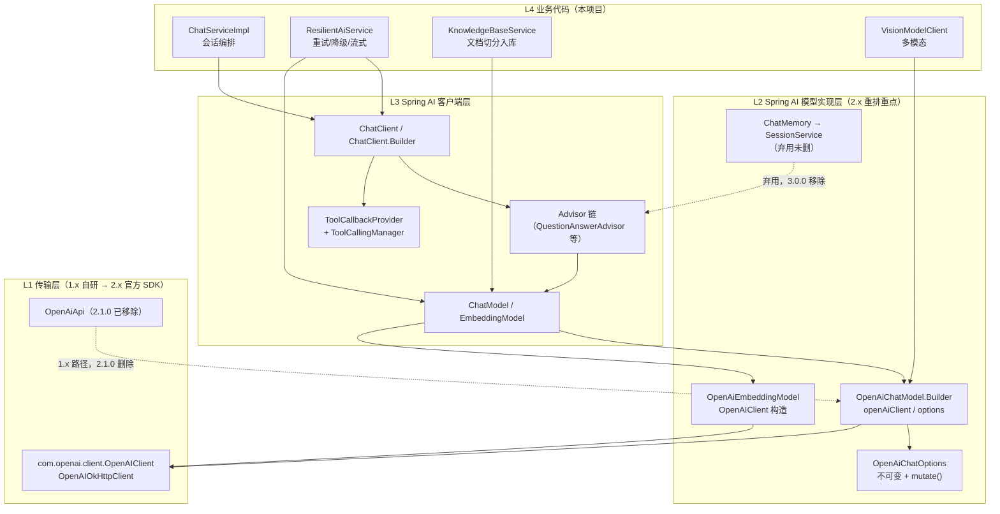
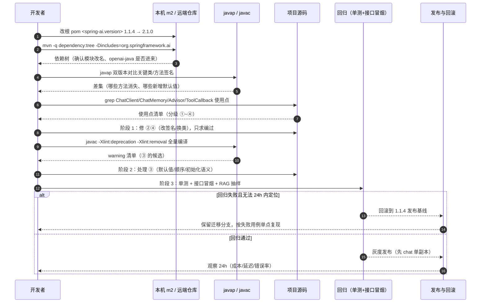

# Spring AI 2.0 升级评估与迁移指南：编译通过只是及格线

> **一句话结论**：Spring AI 1.x → 2.x 的破坏性改动有两种形态——"删类删方法"（编译器替你抓）和"留着类但改语义"（编译器完全抓不到）；本项目真实迁移（提交 `cceccf4`，33 个文件）的主战场是后者，所以升级不能按"能编译就上线"推进，只能按"先盘点、再分级、最后跑回归"推进。
> **阅读前置**：知道 ChatClient / Advisor / ChatOptions 的大致职责；会用 Maven 看依赖树；知道 `javap`、`javac` 是 JDK 自带工具。本文所有实测只需 JDK 17 + 一份本机 `~/.m2`，不启动服务、不联网、不连中间件。
> **证据基线**：Spring AI 2.1.0（A 级摘录来自 `24-源码分析/assets/source/`，可直接跳读原文）+ Spring Boot 4.2.0 项目现状（B 级逐行核对）+ 本机 `javap`/`javac` 双版本对比（C 级，命令与真实输出都在正文里）｜预计阅读 40 分钟

## 0. 先看现象

升级评估最容易被"`mvn clean install` 变绿"骗过去。下面三个场景都发生在"编译成功、启动成功"之后。

**现象一：多轮对话突然变单轮。**

```text
[2026-06-20 10:12:03.118] user: 我昨天买的那单还没到，帮我看看
[2026-06-20 10:12:05.402] assistant: 请提供订单号
[2026-06-20 10:12:22.771] user: 就刚才说的那单
[2026-06-20 10:12:24.905] assistant: 请提供订单号        ← 上下文没了，模型又把问题问了一遍
[2026-06-20 10:12:24.906] DEBUG c.a.c.a.MessageChatMemoryAdvisor - advisor invoked, order=200
```

日志里 Advisor 还在被调用，模型却没拿到历史。这在 2.x 里非常常见：`MessageChatMemoryAdvisor` 与 `ChatMemory` 两个类**都还在**（`javap` 能看见），但都带了 `@Deprecated(since = "2.1.0", forRemoval = true)`，官方替代品是 `org.springframework.ai.session.SessionService`；而新的 `SessionMemoryAdvisor` 默认序顺位是 `Ordered.HIGHEST_PRECEDENCE + 1000`，跟你原来那个 `+200` 的记忆 Advisor 完全不是一个位置——旧代码继续跑，顺序却变了，甚至可能被新链条绕开。

**现象二：Advisor 顺序变了，日志/限流顺序跟着错。**

```text
2026-06-20 10:15:41.203 DEBUG SimpleLoggerAdvisor      - request  = ...   order=2147483547
2026-06-20 10:15:41.204 DEBUG RateLimitAdvisor        - acquire token      order=2147483546
2026-06-20 10:15:41.980 DEBUG QuestionAnswerAdvisor   - retrieved 5 docs   order=2147483545
```

期望顺序是"先限流、再日志、最后检索"，实际打印出来是"先日志后限流"。原因是 `Advisor extends Ordered`（A 级：`Advisor.java.md#L31-L47`），链条按 `getOrder()` 升序排，谁的数字小谁先执行；而 2.x 给内置 Advisor 重新分配了默认序位（`ToolCallingAdvisor = HIGHEST + 300`，`SessionMemoryAdvisor = HIGHEST + 1000`），你自己的 Advisor 如果照抄旧文档的数字，就会和内置 Advisor 插到一起，顺序全乱。

**现象三：某个类编译不过，官方文档里也找不到"替代品"叫什么。**

把 1.x 的写法原样丢到 2.1.0 的 classpath 上编译，本机实测输出（命令见 §6.2）：

```text
Repro1.java:3: error: package org.springframework.ai.openai.api does not exist
import org.springframework.ai.openai.api.OpenAiApi;
                                        ^
Repro1.java:7: error: cannot find symbol
        OpenAiApi api = OpenAiApi.builder().baseUrl("https://api.deepseek.com").apiKey("k").build();
        ^
  symbol:   class OpenAiApi
  location: class Repro1
Repro1.java:7: error: cannot find symbol
        OpenAiApi api = OpenAiApi.builder().baseUrl("https://api.deepseek.com").apiKey("k").build();
                        ^
  symbol:   variable OpenAiApi
  location: class Repro1
3 errors
```

同一份文件在 1.1.4 的 classpath 上编译是 0 错误 0 输出。`OpenAiApi` 整个包在 2.1.0 里被移除了（`jar tf` 数出 1.1.4 有 46 个 `openai/api/OpenAiApi*` 条目，2.1.0 是 0 个）。而它的替代品名字叫 `com.openai.client.OpenAIClient`（来自官方 `openai-java` SDK，不是 Spring 自己的类），这条信息只能从 `OpenAiChatModel.Builder#openAiClient` 的签名里反推出来，官方迁移文档不会逐个类列。

**这些现象指向同一件事**：Spring AI 2.x 是「大版本重排」而不是「功能增量」——重排的对象包括模块名、包路径、类名、构造方式、默认值和执行顺序；其中只有一部分会变成编译错误，剩下那部分是**静默的语义漂移**。所以本篇不写"升级步骤 1234"，而是写"怎么把漂移找出来"。

## 1. 整体地图

升级评估要先看清"被升级的东西在系统里的位置"。下面这张图把本项目（`ai-cs-chat` 为主）的 Spring AI 依赖面拆成四层，并标出 2.x 影响点。



> **读图说明**：图从上往下是"调用方向"，从下往上是"升级时的改动方向"。先看 L1：`OpenAiApi` 到 `OpenAIClient` 的替换是**唯一会产生编译错误的**改动（节点用虚线标出），所以它最容易被发现；再看 L2：`OpenAiChatOptions` 从可变 POJO 变成不可变 + `mutate()`、`ChatMemory` 被弃用——这两处**不报错**，属于本篇要重点防的语义漂移；最后看 L3：`ChatClient.Builder` 的 `defaultToolCallbacks(...)` 三个重载全部标了 `@Deprecated(since="2.0.0")`，只产生 warning，编译器默认不拦。

各组件在升级中的责任与影响面：

| 组件 | 责任 | 谁调用它 | 2.x 影响面 | 是否阻塞编译 |
| --- | --- | --- | --- | --- |
| `OpenAiApi` | 1.x 自研的 OpenAI HTTP 客户端（请求/响应 POJO 全在这） | 各模块的 config 类手工 new | **整个移除** | 是 |
| `OpenAIOkHttpClient` / `OpenAIClient` | 2.x 改用官方 `openai-java` SDK 传输 | `ChatModelRegistry`、`VisionModelClient`、各 Embedding 装配 | 新增依赖 `openai-java-client-okhttp` | 否（新代码） |
| `OpenAiChatModel.Builder` | 装配模型实例 | `ChatModelRegistry`、`VisionModelClient` | `openAiApi()`/`defaultOptions()` 消失，换 `openAiClient()`/`openAiClientAsync()`/`options()` | 是 |
| `OpenAiChatOptions` | 单次请求参数载体 | 全部 `ChatClient` 调用方 | 可变 POJO → 不可变 + Builder，默认 `model` 变成 `gpt-5-mini` | 部分（setter 消失） |
| `ChatClient.Builder` | 声明默认系统提示/Advisor/工具 | `SpringAiConfig.chatClientCustomizer` | `defaultOptions` 只收 `ChatOptions.Builder`；工具三兄弟改走 `defaultTools` | 部分是、部分只是 warning |
| `Advisor` / `ToolAdvisor` | 拦截器 / 工具循环所有权标记 | `QuestionAnswerAdvisor`、`ToolCallingAdvisor` | 新增 `ToolAdvisor` 标记接口，工具循环从模型移到 Advisor | 否 |
| `ChatMemory` / `SessionService` | 多轮上下文存储 | 本项目**未使用**（见 §3.9） | 前者整体弃用，后者 2.1.0 新增 | 否 |
| `ChromaVectorStore` | 向量库客户端 | `VectorStoreConfig` | 变成 `InitializingBean`，`initialize-schema=false` 也会连远端 | 否 |
| `spring-ai-advisors-vector-store` | RAG Advisor 所在模块 | `ai-cs-chat/pom.xml` | 模块改名为 `spring-ai-vector-store-advisor` | 是（依赖解析失败） |

## 2. 关键概念与关键类

先把本篇文章会反复出现的东西摊平。"类位置"一列统一写「模块 / 包」，方便你 `grep` 时直接搜。

| 名称 | 位置 | 角色 | 关键方法（1.x 写法 → 2.x 写法） |
| --- | --- | --- | --- |
| `OpenAiApi` | `spring-ai-openai` / `org.springframework.ai.openai.api` | 1.x 的 OpenAI HTTP 客户端，连带全部请求/响应 POJO | `OpenAiApi.builder().baseUrl(..).apiKey(..).build()` → **已移除** |
| `OpenAIOkHttpClient` | `openai-java-client-okhttp` / `com.openai.client.okhttp` | 2.x 传输实现（官方 SDK） | `OpenAIOkHttpClient.builder().baseUrl(..).apiKey(..).build()` |
| `OpenAIClient` / `OpenAIClientAsync` | `openai-java-core` / `com.openai.client` | 官方 SDK 的同步/异步门面 | `client.async()` 拿异步实例 |
| `OpenAiChatModel.Builder` | `spring-ai-openai` / `org.springframework.ai.openai` | 装配 `ChatModel` | `openAiApi(api)`+`defaultOptions(o)` → `openAiClient(c)`+`openAiClientAsync(c.async())`+`options(o)` |
| `ChatOptions` | `spring-ai-model` / `org.springframework.ai.chat.prompt` | 请求参数的公共契约 | `copy()` 消失，只剩 `mutate()` 返回 `Builder` |
| `OpenAiChatOptions` | `spring-ai-openai` / `org.springframework.ai.openai` | OpenAI 专有参数 | 1.x：public 无参构造 + 一堆 `setXxx`；2.x：`protected` 构造 + 只有 getter，改值只能 `builder()`/`mutate()` |
| `ToolCallingChatOptions` | `spring-ai-model` / `org.springframework.ai.model.tool` | 工具相关参数的公共契约 | `getToolNames()`、`get/setInternalToolExecutionEnabled()` **全部移除** |
| `ChatClient.Builder` | `spring-ai-client-chat` / `org.springframework.ai.chat.client` | 客户端装配 | `defaultOptions(ChatOptions)` → `defaultOptions(ChatOptions.Builder)`；`defaultTools(Object...)` 收编工具注册 |
| `Advisor` | `spring-ai-client-chat` / `...advisor.api` | 拦截器，`extends Ordered` | `getOrder()` 决定链内位置 |
| `ToolAdvisor` | 同上 | **2.0 新增的标记接口**：谁实现它，谁负责跑工具循环 | 无方法，纯标记 |
| `ToolCallingAdvisor` | `...advisor` | 2.0 起的工具循环载体 | `DEFAULT_ORDER = Ordered.HIGHEST_PRECEDENCE + 300` |
| `ToolCallAdvisor` | 同上 | 旧名字，`extends ToolCallingAdvisor`，`@Deprecated(since="2.0.0", forRemoval=true)` | 直接改名即可 |
| `ToolCallingManager` | `spring-ai-model` / `...model.tool` | 执行工具调用、返回 `ToolExecutionResult` | 2.1.0 新增 `executeToolCalls(Prompt, ChatResponse, ToolCallDecisions)` 默认方法 |
| `ToolCallLimits` | 同上（**包级私有**） | 工具调用次数上限 | 2.x 新增；`DEFAULT_MAX_CALLS_PER_TOOL = 40`、`DEFAULT_MAX_TOTAL_TOOL_CALLS = 150` |
| `ChatMemory` | `spring-ai-model` / `...chat.memory` | 多轮记忆存储 | 常量 `DEFAULT_CONVERSATION_ID` 没了，只剩 `CONVERSATION_ID` |
| `SessionService` | `spring-ai-session` / `org.springframework.ai.session` | 2.1.0 起的会话存储抽象 | `appendMessage` / `getMessages` / `getActiveMessages` / `appendEvents(.., expectedVersion)` |
| `QuestionAnswerAdvisor` | `spring-ai-vector-store-advisor` / `...advisor.vectorstore` | 内置 RAG 顾问（模块改名，类名不变） | `builder(vectorStore).searchRequest(..).build()` 不变 |
| `Jackson2AutoConfiguration` | 本项目 `ai-cs-common` | 为 Jackson 2 业务代码保留 `ObjectMapper` | 自建 `@Bean ObjectMapper`（Boot 4 默认给的是 Jackson 3） |

## 3. 原理与证据逐段精读

本节每一小节都按同一个套路走：**在干什么 → 为什么这么设计 → 换写法会怎样 → 常见坑**。A 级证据一律给 `[[源码:文件#L行]]`，C 级证据给可复现命令 + 真实输出。

### 3.1 L1 层换血：`OpenAiApi` 被整体删除，装配改走官方 SDK

```java
// 2.1 使用官方 OpenAI Java SDK；同步/流式异步客户端必须共享同一份 base-url 与凭据。
// 仅传同步客户端会让 Builder 在流式路径回退到环境变量并丢失自定义供应商配置。
OpenAIClient client = OpenAIOkHttpClient.builder()
        .baseUrl(definition.getBaseUrl())
        .apiKey(definition.getApiKey())
        .build();
OpenAiChatModel chatModel = OpenAiChatModel.builder()
        .openAiClient(client)
        .openAiClientAsync(client.async())
        .options(OpenAiChatOptions.builder()
                .model(definition.getModel())
                .temperature(properties.getTemperature())
                .maxTokens(properties.getMaxTokens())
                .build())
        .build();
```

（B 级：`ai-cs-chat/src/main/java/com/aics/chat/modelrouter/ChatModelRegistry.java#L58-L72`，当前代码；迁移前这段是 `OpenAiApi.builder()` + `.openAiApi(api)` + `.defaultOptions(...)`，见提交 `cceccf4` 的 diff。）

**在干什么**：把"用自己的 `OpenAiApi` 发 HTTP"换成"用官方 `openai-java` SDK 发 HTTP"，Spring AI 只保留模型语义层（消息转换、工具循环、观测）。`OpenAIClient` 是 SDK 的门面，`client.async()` 拿到的异步实例必须一起交给 Builder。

**为什么这么设计**：`OpenAiApi` 要自己维护请求/响应 POJO（`ChatCompletionRequest`、`FunctionTool`、`StreamOptions`……），OpenAI 加字段就得跟着改，兼容成本全落在 Spring 这边。2.x 直接依赖官方 SDK，字段同步交给 SDK 维护。代价是 Spring AI 从此**绑定** `openai-java` 的版本（本项目根 `pom.xml#L43` 显式钉了 `<openai-java.version>4.101.0</openai-java.version>`）。

**换写法会怎样**：只传同步客户端（`openAiClient(client)` 但不传 `openAiClientAsync(...)`），流式路径会回退到环境变量里的 `OPENAI_API_KEY`/base-url——本地跑得好好的，一上生产就连到默认的 `api.openai.com`。这就是 `ChatModelRegistry.java#L59` 那句注释在防的事，也是本项目同时接 DeepSeek、硅基流动这类"OpenAI 兼容但不是 OpenAI"供应商时最容易踩的坑。

**常见坑**：
- `openai-java-client-okhttp` 不是传递依赖（`ai-cs-chat/pom.xml#L45` 单独声明，注释写明"core 不传递此模块"），漏了它编译能过、运行期 `NoClassDefFoundError`。
- SDK 的包名是 `com.openai.*`，和 Spring 的 `org.springframework.ai.*` 混在一起，`grep OpenAi` 会同时命中两边，盘点使用点时容易漏。
- 自定义 header 的写法整体搬到了 SDK 侧（`OpenAiChatOptions` 的 `getCustomHeaders()`，1.x 叫 `getHttpHeaders()`），旧配置项不会自动迁移。

### 3.2 L2 层语义：`ChatOptions` 从可变 POJO 变不可变 + `mutate()`

2.x 的 `ChatOptions` 只有一个"改值"入口：

```java (src: ChatOptions.java.md#L79-L86)
	/**
	 * Returns a new {@link Builder} initialized with the values of this
	 * {@link ChatOptions}.
	 *
	 * Concrete ChatOptions classes must implement this and return the most concrete
	 * builder implementation.
	 */
	ChatOptions.Builder<?> mutate();
```

**在干什么**：把 Options 变成**值对象**——构造完就不可改，想改就 `mutate()` 出一个新 Builder，改完 `build()` 出新的实例。1.x 里 `OpenAiChatOptions` 有 public 无参构造和一整套 `setTemperature()`/`setModel()`，2.x 全部消失（本机 `javap` 对差集确认，见 §7 表）。

**为什么这么设计**：Options 会被 Advisor 链、工具循环、多线程流式调用**共享**。1.x 那种可变 POJO 一旦被某处 `setXxx` 就地改掉，同一个 `ChatClient` 的并发请求会互相污染，且极难复现。不可变 + `mutate()` 把"改参数"变成"换一个新对象"，天然线程安全。

**换写法会怎样**：`ChatClient.Builder#defaultOptions` 在 2.x 只接受 `ChatOptions.Builder`（A 级：`ChatClient.java.md#L549` 的 `Builder defaultOptions(ChatOptions.Builder chatOptions)`），所以 1.x 里 `defaultOptions(openAiChatOptionsInstance)` 这种"传实例"的写法直接编译失败。反过来，如果你为了省事在请求期 `mutate()` 一把改温度，注意 `mutate()` 返回的是**浅拷贝副本**，`getToolCallbacks()` 这类集合字段是共享引用。

**常见坑（本篇最值钱的一条）**：默认值变了，而且不报错。本机实测：

```text
### 1.1.4 ###
temperature=null
maxTokens=null
model=null
### 2.1.0 ###
temperature=null
maxTokens=null
model=gpt-5-mini
```

`OpenAiChatOptions.builder().build().getModel()` 在 1.1.4 是 `null`，在 2.1.0 是 `gpt-5-mini`（对应 2.1.0 新增常量 `DEFAULT_CHAT_MODEL`）。也就是说：**1.x 里"没指定模型就报错"的路径，2.x 会静默用 `gpt-5-mini` 跑**。本项目因此做了硬性显式化——`ModelRouterProperties` 新增 `temperature = 0.7`、`maxTokens = 2048` 两个字段并注释"路由模型绕过 `spring.ai.openai` 自动配置，默认参数必须显式声明"，`ChatModelRegistry` 里逐个 `.temperature(...)`/`.maxTokens(...)` 传进去（B 级：`ai-cs-chat/src/main/java/com/aics/chat/modelrouter/ModelRouterProperties.java`、`ChatModelRegistry.java#L67-L71`）。

### 3.3 `ToolCallingChatOptions` 瘦身：工具循环从"模型内部"搬到"Advisor"

```java (src: ToolCallingChatOptions.java.md#L39-L60)
public interface ToolCallingChatOptions extends ChatOptions {

	/**
	 * ToolCallbacks to be registered with the ChatModel.
	 */
	@Nullable List<ToolCallback> getToolCallbacks();

	/**
	 * Get the configured tool context.
	 * @return the tool context map.
	 */
	@Nullable Map<String, Object> getToolContext();

	/**
	 * Returns a new {@link ToolCallingChatOptions.Builder} initialized with the values of
	 * this {@link ToolCallingChatOptions}.
	 *
	 * Narrows the return type of {@link ChatOptions#mutate()} so generic tool calling
	 * code can chain methods without casting.
	 */
	@Override
	ToolCallingChatOptions.Builder<?> mutate();
```

**在干什么**：这个契约被砍到只剩两个读取方法（`getToolCallbacks`、`getToolContext`）+ `mutate()`。1.x 里那套 `getToolNames()/setToolNames()`、`getInternalToolExecutionEnabled()/setInternalToolExecutionEnabled()`、静态工具方法 `isInternalToolExecutionEnabled(ChatOptions)` 在 2.1.0 全部消失（本机 `javap` 对差集确认）。

**为什么这么设计**：`internalToolExecutionEnabled=false` 在 1.x 里的语义是"别让模型自己跑工具，我手动跑"——这是把工具循环的所有权放在 `ChatModel` 内部开关上。2.x 把这个所有权整体搬进 Advisor 链：`ToolAdvisor` 是标记接口，"谁实现它谁负责工具调用生命周期"，源码注释写得非常直白：

```java (src: ToolAdvisor.java.md#L19-L33)
/**
 * Marker interface for advisors that own the tool-call lifecycle. An advisor implementing
 * this interface takes responsibility for executing tools and driving the tool-call loop,
 * replacing the model-internal tool execution path.
 *
 * <p>
 * {@link org.springframework.ai.chat.client.DefaultChatClient} uses this marker to detect
 * whether a tool-call handling advisor is already present in the chain, and to avoid
 * auto-registering a duplicate.
 *
 * @author Christian Tzolov
 * @since 2.0.0
 * @see org.springframework.ai.chat.client.advisor.ToolCallingAdvisor
 */
public interface ToolAdvisor extends Advisor {
```

**换写法会怎样**：既然所有权在链上，"关掉工具"就变成了"别把 `ToolCallingAdvisor` 放进链"或"这次请求不带 toolCallbacks"，而不是设一个布尔开关。反过来说，如果你在 2.x 里既挂了 `ToolCallingAdvisor` 又在某处期望"模型内部自动执行"，会出现**工具被执行两次**或**根本不执行**——取决于工具回调挂在哪里。

**常见坑**：`ToolCallingChatOptions` 名字里带 `ChatOptions`，但它已经不再是"开关集合"；从 1.x 抄过来的 `options.setInternalToolExecutionEnabled(false)` 这种代码不是"编译不过"，而是**方法不存在所以编译不过**——这条属于编译器能抓的，真正抓不到的是"你删了这行开关，逻辑却以为自己还掌控着工具执行"。

### 3.4 工具循环的载体与序位：`ToolCallingAdvisor` / `ToolCallAdvisor`

```java (src: ToolCallAdvisor.java.md#L24-L28)
 * @deprecated since 2.0.0 in favor of {@link ToolCallingAdvisor}
 * @since 1.0.0
 */
@Deprecated(since = "2.0.0", forRemoval = true)
public class ToolCallAdvisor extends ToolCallingAdvisor {
```

**在干什么**：`ToolCallAdvisor` 是 1.x 的名字，2.0 起改名 `ToolCallingAdvisor`；旧类**没有删**，而是变成"继承新类的空壳 + 打上 `@Deprecated(forRemoval = true)`"。新类的默认序位在源码里写死：

```java (src: ToolCallingAdvisor.java.md#L84-L96)
 * @since 2.0.0
 * ...
	public static final int DEFAULT_ORDER = Ordered.HIGHEST_PRECEDENCE + 300;
```

**为什么这么设计**：改名不删类是为了让 1.x 代码"能编过"，给一个大版本的迁移窗口（`forRemoval = true` 表示 3.0.0 会真删）。而序位写死成 `HIGHEST + 300` 是因为工具循环必须在**所有"改提示词/改消息"的 Advisor 之外层**：先让记忆 Advisor 拼上下文、RAG Advisor 插检索结果，最后才轮到工具循环决定要不要再问模型一轮。

**换写法会怎样**：自己实现一个 `ToolAdvisor` 并给个"顺手"的 order（比如 `HIGHEST + 100`），就会插到记忆 Advisor 里面，工具循环拿到的是"还没有历史上下文"的请求，工具入参容易缺字段。反过来，如果你沿用 1.x 的 `ToolCallAdvisor`（编过但已弃用），行为上暂时一致，但下一次升到 3.0.0 就断——这类"编过但欠债"的点必须进迁移清单，而不是留在代码里。

**常见坑**：一条链里只允许一个工具 Advisor。`DefaultChatClient` 用 `ToolAdvisor` 标记检测"链上是否已有工具执行者"以避免重复注册，手工再塞一个会抛 `IllegalStateException("At most one ToolAdvisor is allowed in the advisor chain...")`（见同目录 `02-advisor-链与对话记忆.md` 的实测记录）。

### 3.5 新增安全阀：工具调用上限 40 / 150

```java (src: ToolCallLimits.java.md#L30-L55)
/**
 * Tool call limit configuration for {@link DefaultToolCallingManager}, and the logic to
 * evaluate it against the number of times a tool has been called.
 *
 * @author Christian Tzolov
 * @since 2.0.1
 */
final class ToolCallLimits {

	/**
	 * Sentinel value meaning that no limit is enforced.
	 */
	static final int NO_LIMIT = -1;

	private final int defaultMaxCallsPerTool;

	private final Map<String, Integer> maxCallsPerTool;

	private final Set<String> toolsExcludedFromLimit;

	private final int maxTotalToolCalls;

	private final ToolCallLimitBehavior onLimitExceeded;
```

**在干什么**：给工具循环加了一个"熔断器"：单个工具默认最多调 40 次、整轮总计最多 150 次（A 级：`DefaultToolCallingManager.java.md#L103` 的 `DEFAULT_MAX_CALLS_PER_TOOL = 40`、`#L110` 的 `DEFAULT_MAX_TOTAL_TOOL_CALLS = 150`），超限行为由 `ToolCallLimitBehavior` 决定。这个类在 1.1.4 里**不存在**（本机 `javap`：1.1.4 `MISSING`、2.1.0 `OK`），`@since 2.0.1`。

**为什么这么设计**：工具循环从模型内部搬到 Advisor 之后，"模型反复调同一个工具直到 token 烧完"变成了框架的责任——没有上限就是一个能被用户输入触发的成本炸弹（本项目正好有 `Nl2SqlQueryService` 这种"可执行 SQL"的工具，风险更高）。

**换写法会怎样**：不设上限 = 接受"一次对话可能打 150 次工具"的尾部成本；把上限设成 3~5 = 复杂多跳查询会被截断，用户看到"查不到"。正确做法是按工具分级：读类工具放宽、写类/执行类工具收紧，并把 `onLimitExceeded` 配成"返回部分结果 + 明确提示"而不是抛异常。

**常见坑**：`ToolCallLimits` 是**包级私有**类，`javap` 不加 `-p` 只能看到构造器签名，你没法在业务代码里直接 new 它——配置入口在 `DefaultToolCallingManager.Builder` 上（`DefaultToolCallingManager.java.md#L136` 附近）。所以"我想给某个工具单独设上限"这件事，不能靠改 `OpenAiChatOptions`，只能改 `ToolCallingManager` 的装配。

### 3.6 记忆体系换血：`ChatMemory` 弃用，`SessionService` 接棒

```java (src: ChatMemory.java.md#L30-L40)
 * @since 1.0.0
 * @deprecated since 2.1.0, for removal in 3.0.0, in favor of session memory,
 * {@code org.springframework.ai.session.SessionService} in {@code spring-ai-session}; the
 * context key is {@code MemoryAdvisor.CONVERSATION_ID} in {@code spring-ai-client-chat}
 */
@Deprecated(since = "2.1.0", forRemoval = true)
public interface ChatMemory {

	/**
	 * The key to retrieve the chat memory conversation id from the context.
	 */
	String CONVERSATION_ID = "chat_memory_conversation_id";
```

**在干什么**：1.x 的"消息窗口记忆"三件套（`ChatMemory`、`MessageWindowChatMemory`、`MessageChatMemoryAdvisor`）在 2.1.0 全部打上 `@Deprecated(since="2.1.0", forRemoval=true)`，替代品是 `spring-ai-session` 模块里的 `SessionService`：

```java (src: SessionService.java.md#L39-L41)
 * @since 2.1.0
 */
public interface SessionService {
```

它跟 `ChatMemory` 的关键差别在于**事件化 + 乐观并发 + 活跃视图**：`appendEvent(SessionEvent)` 追加事件（`SessionService.java.md#L109`）、`appendEvents(sessionId, events, expectedVersion)` 做版本校验（`#L143`）、`getMessages()` 返回全量历史而 `getActiveMessages()` 返回"真正喂给模型的那部分"（`#L164-L175`，注释原文：*included: the full history, not a prompt. Use `getActiveMessages(String)`*）。

**为什么这么设计**：`ChatMemory.get(conversationId)` 只给你一个"当前窗口"，**窗口外被裁掉的历史永远拿不回来**——审计、回放、摘要压缩都做不到。事件化之后"裁剪"只是过滤器（`EventFilter`），原始事件还在；`expectedVersion` 则解决分布式下两个实例同时写同一会话的覆盖问题（本项目 `ai-cs-chat` 会多副本部署）。

**换写法会怎样**：继续用 `MessageChatMemoryAdvisor` 能编过、能跑，但两个后果：一是 3.0.0 直接断（`forRemoval`）；二是**和新的 `SessionMemoryAdvisor`（`DEFAULT_ORDER = HIGHEST + 1000`）混用时顺序不可控**——旧的记忆 Advisor 默认序位是 `HIGHEST + 200`，两者会各自往请求里插一份历史，表现为"上下文重复一遍"。

**常见坑（本项目现状）**：本项目**没有**用 Spring AI 的记忆体系。全仓 `main` 代码里 `ChatMemory|MessageChatMemoryAdvisor|ToolCallAdvisor|PromptChatMemoryAdvisor` 的唯一命中是 `ai-cs-chat/src/main/java/com/aics/chat/config/SpringAiConfig.java#L258` 的一行**注释**：

```java
 * <li><b>MessageChatMemoryAdvisor</b>：历史记忆管理（自动维护多轮对话上下文）</li>
```

生产代码里会话历史走的是 Redis + `chat_message` 表自管。所以"记忆失效"这类现象在本项目不会由升级直接触发——但**注释里的类名会让后来者以为用了**，这是升级盘点时最容易误判的地方：`grep` 到的命中必须区分"代码"还是"注释/文档字符串"。

### 3.7 `ChatClient.Builder` 的 API 面：一半报错，一半只 warn

```java (src: ChatClient.java.md#L606-L627)
		Builder defaultTools(Object... tools);

		/**
		 * @deprecated as of 2.0.0, in favor of {@link #defaultTools(Object...)}. To be
		 * removed in 3.0.0.
		 */
		@Deprecated(since = "2.0.0", forRemoval = true)
		Builder defaultToolCallbacks(ToolCallback... toolCallbacks);

		/**
		 * @deprecated as of 2.0.0, in favor of {@link #defaultTools(Object...)}. To be
		 * removed in 3.0.0.
		 */
		@Deprecated(since = "2.0.0", forRemoval = true)
		Builder defaultToolCallbacks(List<ToolCallback> toolCallbacks);

		/**
		 * @deprecated as of 2.0.0, in favor of {@link #defaultTools(Object...)}. To be
		 * removed in 3.0.0.
		 */
		@Deprecated(since = "2.0.0", forRemoval = true)
		Builder defaultToolCallbacks(ToolCallbackProvider... toolCallbackProviders);
```

**在干什么**：2.x 把"注册工具"统一到 `defaultTools(Object...)`（可以传 `@Tool` 标注的 POJO、也可以传 `ToolCallback`/`ToolCallbackProvider`），三个 `defaultToolCallbacks` 重载保留但全部 `forRemoval`。与此同时 `defaultOptions` 只收 `ChatOptions.Builder`（`ChatClient.java.md#L549`），`defaultToolNames(String...)` 在 2.1.0 **直接消失**（本机 `javap` 对差集）；`defaultAdvisors` 三个重载、`defaultSystem/defaultUser`、`clone()` 都没变。

**为什么这么设计**：1.x 的 `defaultToolNames` 依赖"Bean 名 → 工具"的隐式解析（`SpringBeanToolCallbackResolver`），这在"同名 Bean 有两个"或"工具在别的上下文"时行为不可预测。2.x 统一成显式对象注册，并且**默认关闭** Bean 工具回退解析。

**换写法会怎样**：本项目就是"没改"的样本——`ChatModelRegistry.java#L75-L78` 继续用 `defaultToolCallbacks(toolCallbackProvider)`，并且在注释里写明理由：

```java
// 【工具调用标注】显式保留现有 ToolCallbackProvider，避免依赖 2.x 默认关闭的 Bean 工具回退解析。
if (definition.getCapabilities().contains(ModelCapability.TOOL_CALLING)) {
    builder = builder.defaultToolCallbacks(toolCallbackProvider);
}
```

本机 `javac -Xlint:deprecation` 实测，这段代码在 2.1.0 上**编译成功但报 warning**：

```text
Repro4.java:6: warning: [removal] defaultToolCallbacks(ToolCallbackProvider...) in Builder has been deprecated and marked for removal
        builder.defaultToolCallbacks(provider);
               ^
1 warning
```

同一份代码在 1.1.4 上**零输出**。这就是"编译通过 ≠ 语义不变"的最干净证据：升级后 CI 全绿，但你的代码已经进入"3.0.0 必断"的名单。

**常见坑**：`-Werror` 或把 deprecation 当 error 的项目会因此构建失败；反过来如果项目里 `-Xlint` 全关（Maven 默认），这条债务会一直沉睡。建议在升级专项分支上单独跑一次 `-Xlint:deprecation -Xlint:removal` 的编译，把 warning 当"待办清单"收集。

### 3.8 模块改名与 `ChromaVectorStore` 的初始化语义

**模块级**：RAG Advisor 所在的构件从 `spring-ai-advisors-vector-store` 改名为 `spring-ai-vector-store-advisor`。本机 m2 的目录就是物证——`spring-ai-advisors-vector-store` 只有 `1.1.4` 目录、`spring-ai-vector-store-advisor` 只有 `2.1.0` 目录。项目侧对应改动（`git show cceccf4 -- ai-cs-chat/pom.xml` 原文）：

```text
-            <artifactId>spring-ai-advisors-vector-store</artifactId>
+            <artifactId>spring-ai-vector-store-advisor</artifactId>
-            <artifactId>resilience4j-spring-boot3</artifactId>
+            <artifactId>resilience4j-spring-boot4</artifactId>
-            <artifactId>spring-boot-starter-aop</artifactId>
+            <artifactId>spring-boot-starter-aspectj</artifactId>
```

类名 `QuestionAnswerAdvisor` 和它的 builder 用法**没变**（本机 `javap` 两版都有 `searchRequest(SearchRequest)`），变的只是"从哪个 jar 里来"。所以这条是纯粹的编译/解析期错误，最容易修，但也最容易在 `pom` 里留下两个重复声明。

**语义级**：`ChromaVectorStore` 在 2.1.0 变成 `InitializingBean`——即使配了 `initialize-schema: false`，Spring 创建这个 Bean 时**仍会去连远端**（本项目 `VectorStoreConfig` 的注释原话）。本项目的对策是"延迟到首次使用"：用一个 `@Bean @Primary VectorStore` 包一层 AOP 代理，真正的方法调用时才解析 `@Lazy ChromaVectorStore`（B 级：`ai-cs-chat/src/main/java/com/aics/chat/config/VectorStoreConfig.java#L58-L70`）。

**为什么这么设计**：`InitializingBean` 让"建表/建集合"这件事有了生命周期钩子，代价是 Bean 创建就产生 I/O。对于"向量库可能暂时不可达但仍要启动服务"的场景，这就从"能力"变成"故障点"。

**换写法会怎样 / 常见坑**：如果只是把 `initialize-schema` 从 `true` 改 `false` 就以为"不连了"，你会得到启动期超时——本项目 `application.yml#L48` 配了 `false`、`#L49` 配了 `collection-name: aics-knowledge`，但真正的"不连"是 Proxy 撑起来的。反过来说，用 Proxy 的代价是**启动期不再校验配置正确性**：`client.host` 写错要到第一次 RAG 请求才炸。

### 3.9 把原理落到文件：本项目 16 个调用点的改动分级

**在干什么**：把"A 级源码 + C 级 javap"得到的变化面，逐条对到本项目真实代码上，并按四档分级——① 无变化 ② 改签名（编译报错）③ 改语义（编译通过、行为变）④ 已移除（找不到替代品）。

**为什么这么分级**：因为只有 ②④ 会被 CI 抓住，③ 只能靠人读 + 回归测试。评估报告的价值就在"把 ③ 列全"。

| # | 调用点（B 级真实路径） | 用到的 API | 1.x → 2.1 变化 | 分级 | 处理状态 |
| --- | --- | --- | --- | --- | --- |
| 1 | `ai-cs-chat/src/main/java/com/aics/chat/modelrouter/ChatModelRegistry.java#L60-L63` | `OpenAiApi.builder()` → `OpenAIOkHttpClient.builder()` | 类移除 | ④ | 已改 |
| 2 | 同上 `#L64-L72` | `openAiApi/defaultOptions` → `openAiClient/openAiClientAsync/options` | 改签名 | ② | 已改 |
| 3 | 同上 `#L76-L78` | `defaultToolCallbacks(ToolCallbackProvider...)` | 弃用（warning） | ③ | **保留**，进 3.0 待办 |
| 4 | `ai-cs-chat/src/main/java/com/aics/chat/config/SpringAiConfig.java#L186` | `new OpenAiEmbeddingModel(client, MetadataMode.EMBED, options)` | 构造器签名换成 `OpenAIClient` | ② | 已改 |
| 5 | 同上 `#L222-L228` | `MethodToolCallbackProvider.builder().toolObjects(..)` | 无变化 | ① | — |
| 6 | 同上 `#L266-L274` | `QuestionAnswerAdvisor.builder(vectorStore).searchRequest(..)` | 模块改名、API 不变 | ① | 依赖坐标已改 |
| 7 | 同上 `#L278-L289` | `builder.defaultSystem(..).defaultAdvisors(ragAdvisor)` | 无变化（重载不变） | ① | — |
| 8 | 同上 `#L258` | 注释里提到 `MessageChatMemoryAdvisor` | 类弃用 | ③（仅文档） | 需订正注释 |
| 9 | `ai-cs-chat/src/main/java/com/aics/chat/service/impl/VisionModelClient.java#L117-L127` | `OpenAIClient` + `openAiClient/openAiClientAsync/options` | 同 1、2 | ② | 已改 |
| 10 | 同上 `#L188` | `.media(new Media(MimeTypeUtils.IMAGE_PNG, URI.create(imageUrl)))` | `Media(MimeType,URI)` 两版都有 | ① | 结案（旧稿曾标"待验证"） |
| 11 | `ai-cs-product/src/main/java/com/aics/product/service/impl/SiliconFlowImageDescriptionService.java#L83` | 同 10 | 无变化 | ① | — |
| 12 | `ai-cs-knowledge/src/main/java/com/aics/knowledge/config/KnowledgeAiConfig.java#L65`、`ai-cs-product/src/main/java/com/aics/product/config/OpenAiEmbeddingConfig.java#L46`、`ai-cs-search/src/main/java/com/aics/search/config/SpringAiConfig.java#L48` | `new OpenAiEmbeddingModel(client, ..)` | 同 4 | ② | 已改 |
| 13 | `ai-cs-chat/src/main/java/com/aics/chat/service/impl/ResilientAiService.java#L131` | `holder.getChatModel().call(prompt)`（绕过 Advisor 链） | `ChatModel#call` 不变，但**绕过链=绕过工具循环** | ③ | 需回归确认 |
| 14 | `ai-cs-chat/src/main/java/com/aics/chat/service/KnowledgeBaseService.java#L114`、`ai-cs-knowledge/src/main/java/com/aics/knowledge/service/KnowledgeVectorService.java#L77` | `new TokenTextSplitter().split(..)` | 无变化 | ① | — |
| 15 | `ai-cs-user/src/test/java/com/aics/user/security/UserSecurityIntegrationTest.java#L36`、`ai-cs-user/src/test/java/com/aics/user/security/UserApiValidationIntegrationTest.java#L44` | `@MockitoBean` | Boot 3 的 `@MockBean` 已在 Boot 3.4 弃用、Boot 4 删除 | ④（Boot 侧） | 已改 |
| 16 | `ai-cs-common/src/main/java/com/aics/common/autoconfigure/Jackson2AutoConfiguration.java#L13-L21` | 自建 Jackson 2 `ObjectMapper` | Boot 4 默认 Jackson 3，类型不同 | ③ | 已新增 |

**换写法会怎样**：如果只按"编译报错"打补丁，你会改完 ①②④ 就收工（本项目的 33 个文件里大部分是这类），而 ③ 的六条（`#3 #8 #13 #16` 以及默认值变化、Advisor 顺序）会被漏掉——它们正是"上线后才发现"的那批。

**常见坑**：盘点必须 `grep` 到**注释和 javadoc**（第 8 条就是），否则会误判"项目在用记忆体系"。另外 `grep ChatClient` 会同时命中"类引用"和"业务编排"（如 `RoutedChatClientFactory`），需要按 import 清单二次过滤：本项目 main 代码里 `spring-ai` 的 import 频次是 `Document 21`、`EmbeddingModel 11`、`VectorStore 10`、`SearchRequest 7`、`ChatClient 4`、`OpenAiChatModel 4`、`QuestionAnswerAdvisor 2`、`ToolCallbackProvider 2`、`Media 2`——数量很少，说明真正的耦集中在不到 10 个文件里，这是"评估工作量可控"的唯一乐观依据。

## 4. 一次完整执行时序

下面是**推荐的迁移时序**，与项目实际走过的路径（`9ea7ddb` = 1.1.4 → `cceccf4` = 2.1.0）一致。注意它的形状：**盘点在改代码之前，人工判定在 CI 之后**。



> **读图说明**：整条链有**两个不可跳过的"人读"节点**——第 3 步（`javap` 差集）和第 7 步（warning 清单），它们对应 ③ 类改动，机器不会替你判断。第 1 步改完版本号后**不要立刻跑全量构建**：依赖解析失败（模块改名）会掩盖后面真正的编译错误，先做第 2 步 `dependency:tree` 把坐标问题清干净。第 11 步的灰度只发 `ai-cs-chat` 单副本，因为 ③ 类问题（Advisor 顺序、默认模型）全部在 chat 的运行时路径上，网关/用户服务不需要陪着冒险。

每一步失败会看到什么（按本项目实际报错口径整理）：

| 步骤 | 失败时的报错 | 含义与处置 |
| --- | --- | --- |
| 1 改版本号 | `Could not resolve dependencies ... spring-ai-advisors-vector-store:jar:2.1.0` | 模块改名，改 `spring-ai-vector-store-advisor`（§3.8） |
| 2 依赖树 | 树里没有 `com.openai:openai-java-client-okhttp` | core 不传递，需在 `ai-cs-chat/pom.xml#L45` 显式声明 |
| 3 javap 差集 | `Error: class not found: org.springframework.ai.openai.api.OpenAiApi`（1.1.4 能查到、2.1.0 查不到） | 类被删，查 `OpenAiChatModel$Builder` 找替代（§3.1） |
| 5 阶段 1 编译 | `error: cannot find symbol ... symbol: variable DEFAULT_CONVERSATION_ID` | 常量删除，改用 `ChatMemory.CONVERSATION_ID` 或迁 `SessionService` |
| 5 阶段 1 编译 | `error: cannot find symbol ... method openAiApi(OpenAiApi)` | 换 `openAiClient(OpenAIClient)` + `options(..)` |
| 6 lint 编译 | `warning: [removal] defaultToolCallbacks(...) has been deprecated and marked for removal` | ③ 类债务，记入 3.0 待办；当前可保留 |
| 7 启动 | `Unable to connect to Chroma at http://...`（尽管 `initialize-schema: false`） | `ChromaVectorStore` 是 `InitializingBean`，用懒代理兜（§3.8） |
| 7 启动 | `NoSuchBeanDefinitionException: ObjectMapper` / 序列化行为异常 | Boot 4 默认 Jackson 3，Jackson 2 业务代码需 `Jackson2AutoConfiguration` |
| 8 运行时 | 回答质量下降、模型名变成 `gpt-5-mini` | `OpenAiChatOptions` 默认 model 变化，必须显式 `.model(..)`（§3.2） |
| 8 运行时 | 同一请求历史重复出现两遍 | 新旧记忆 Advisor 同时挂（顺序 `+200` vs `+1000`，§3.6） |
| 10 回归 | 工具不执行 / 执行两次 | 工具循环所有权在 `ToolAdvisor`，检查链上是否只有一个（§3.4） |

**回归验证清单**（阶段 3 必须逐条打勾，缺一条就别发）：

- [ ] 单轮问答：正常返回，`Usage` 里 `promptTokens` 非 0（证明真的调了模型而不是走了缓存/空返回）。
- [ ] 多轮问答：第二轮能引用第一轮信息（本项目走 Redis 会话历史，验证的是自研链路而非 Spring AI 记忆）。
- [ ] 流式：`.stream()` 能吐出增量 chunk，且最后一个 chunk 带 `finishReason`。
- [ ] 工具调用：`@Tool` 方法被真实调用一次（看日志或 DB 副作用），且**只一次**。
- [ ] RAG：命中相似度阈值 0.3 以上的文档时，回答里出现文档内容；无命中时不报错。
- [ ] 图片理解：`VisionModelClient` 能处理 `Media(URI)` 输入（`#L188` 路径）。
- [ ] 向量化：`ai-cs-knowledge` 入库后条数与 Chroma 集合条数一致（验证 Embedding 客户端换 SDK 后没接错 base-url）。
- [ ] 成本：单请求 token 数与升级前基线对比（同 prompt 同模型），偏差 >30% 要查默认 `temperature/maxTokens`。
- [ ] 降级：断开模型 API 后 `ResilientAiService` 走兜底而不是 500。

## 5. 设计取舍

| 取舍点 | 方案 A | 方案 B | 本项目选择 | 代价 |
| --- | --- | --- | --- | --- |
| 要不要升 | 留在 1.1.4（`forRemoval` 前的最后窗口） | 升 2.1.0 | **升** | 一次性 33 文件改动；不升则 3.0.0 时改动量翻倍 |
| 传输层 | 继续找 `OpenAiApi` 的兼容包 | 官方 `openai-java` SDK | **SDK** | 与 SDK 版本强绑定（`openai-java.version=4.101.0`） |
| 模型装配 | 用 `spring.ai.openai.*` 自动配置 | 手工 `@Bean` + 模型注册表 | **注册表**（多供应商/多模型路由） | 默认值必须自己显式声明（`ModelRouterProperties` 补 `temperature/maxTokens`） |
| 记忆 | 引入 `SessionService` | 继续自管 Redis + `chat_message` | **自管** | 拿不到 Spring AI 的窗口压缩/事件回放能力 |
| 工具注册 | 迁 `defaultTools(Object...)` | 留 `defaultToolCallbacks(...)` | **留**（+注释说明） | 3.0.0 必改；靠 deprecation warning 提醒 |
| 向量库连不上 | 启动即失败（快速暴露） | 懒代理，首次使用时连 | **懒代理** | 配置错误延后暴露 |
| Jackson | 全面迁 Jackson 3（`tools.jackson`） | Jackson 2/3 并存 | **并存**（`Jackson2AutoConfiguration`） | 两套 `ObjectMapper`，`@ConditionalOnMissingBean` 顺序要小心 |
| 评估深度 | 编过就发 | 编过 + lint + 回归清单 + 灰度观察 | **后者** | 每次升级多 1~2 人日 |

**可扩展点清单**（升级评估做完之后，这些是"顺手能补上"的护栏）：

1. 在 CI 里加一条 `mvn -q compile -Dmaven.compiler.showDeprecation=true` 的独立 job，把 deprecation/removal warning 当**报告**（不阻断），升级前先看报告。
2. 写一个 `scripts/` 下的 `check-spring-ai-api.ps1`：从 `m2` 里取新旧两个版本的 jar，对"clas 清单"做集合差，输出"新增/删除/保留但弃用"三张表（§6.2 的手法脚本化）。
3. 把 §3.9 的分级表变成 `docs/` 里的**升级台账**，每次大版本升级只增行不删行，形成 ③ 类债务的历史。
4. `ModelRouterProperties` 的 `temperature/maxTokens` 目前是全局默认，可细化为 per-model 覆盖，避免"路由到不同模型用同一套参数"。
5. `EvalGateConfig`（`aics.eval.gate.*`）当前所有阈值都是 `null`（=只记录不判定），升级后正好是"该配基线"的时机：把升级前的 p95 延迟与单请求 token 数落成基线文件，再打开门禁。
6. 工具调用上限（40/150）目前用默认值，可按工具分级（读类放宽、SQL/写类收紧），入口在 `DefaultToolCallingManager.Builder`。

**风险与工期估算**（口径：1 名熟悉该模块的后端，按下表拆分；数字是排期估算，不是实测工时）：

| 工作项 | 内容 | 估算 | 风险 | 依据 |
| --- | --- | --- | --- | --- |
| 依赖树与坐标修正 | 模块改名、`openai-java` 显式声明、Boot 4 相关 starter 改名 | 0.5 人日 | 低（编译器直接报） | `cceccf4` 改 `pom.xml` 36 行 |
| API 使用点盘点 | grep + javap 差集 + 分级表 | 1 人日 | 中（漏注释/漏反射） | §3.9 的 16 条 |
| 改签名（②④） | 模型装配、Embedding 装配、`@MockitoBean` | 1.5 人日 | 低（编过即完成） | 提交里 33 文件中的多数 |
| 改语义（③） | 默认参数、Advisor 顺序、Chroma 初始化、Jackson 2/3 | 2 人日 | **高**（编译不报） | §3.2/3.6/3.8 |
| 回归与灰度 | 上表 9 条清单 + 24h 观察 | 1.5 人日 | 中 | §4 清单 |
| 回滚预案演练 | 保留 1.1.4 分支、DB 无 schema 变更确认 | 0.5 人日 | 低 | 见下 |
| **合计** | | **≈7 人日** | | |

**回滚方案**（三条硬约束，缺一条就不能保证可回滚）：

1. **不改库表结构**：本次升级不涉及 DDL；如果顺手加了列，回滚就变成"数据迁移回退"，代价上升一个量级。
2. **依赖版本集中管理**：Spring AI 版本只在根 `pom.xml#L42` 一处，回滚就是改一行 + `mvn -U`；如果分散在各子模块，回滚必然漏。
3. **灰度只发 chat**：先 `ai-cs-chat` 单副本 → 观察 → 再全量；网关/用户服务不受影响，回滚面就是 chat 一个 Deployment。

## 6. 踩坑与调试手法

| # | 现象 | 根因 | 处置 |
| --- | --- | --- | --- |
| 1 | 升级后多轮变单轮，但 Advisor 日志都在 | `ChatMemory` 与 `MessageChatMemoryAdvisor` 已弃用；新旧记忆 Advisor 序位不同（`+200` vs `+1000`） | 只挂一套；要么全旧、要么全 `SessionAdvisors` |
| 2 | 限流/日志/RAG 顺序错乱 | `Advisor extends Ordered`，数字小的先跑；2.x 内置 Advisor 默认序位重排 | 自研 Advisor 显式 `getOrder()`，留出间隔（如间隔 100） |
| 3 | `cannot find symbol: class OpenAiApi`，搜不到替代 | 类整体移除；替代品在第三方包 `com.openai.client.OpenAIClient` | `javap OpenAiChatModel$Builder` 反推（§6.2） |
| 4 | 改完编过，但回答模型变成 `gpt-5-mini` | `OpenAiChatOptions.builder().build()` 默认 `model` 变了 | 每处 `.options(..)` 显式 `.model(..)` |
| 5 | 流式请求打到了 `api.openai.com` | 只传了同步 `openAiClient`，流式路径回退环境变量 | `openAiClientAsync(client.async())` 必须一起传 |
| 6 | `initialize-schema: false` 仍启动超时 | 2.1.0 `ChromaVectorStore` 是 `InitializingBean` | 懒代理 `@Bean @Primary VectorStore`（`VectorStoreConfig`） |
| 7 | `ObjectMapper` 注入失败或 JSON 格式变了 | Boot 4 默认 Jackson 3（`tools.jackson`），与 Jackson 2 不同类型 | `Jackson2AutoConfiguration` 补一个 `@ConditionalOnMissingBean(ObjectMapper)` |
| 8 | 单测全挂，报 `@MockBean` 找不到 | Boot 4 移除了 `@MockBean` | 改 `org.springframework.test.context.bean.override.mockito.MockitoBean` |
| 9 | 工具被调用两次 | 链上有两个 `ToolAdvisor` 实现 | 只留一个；框架也会抛 `IllegalStateException("At most one ToolAdvisor is allowed...")` |
| 10 | 工具完全不执行 | 模型没声明 `TOOL_CALLING` 能力，或工具回调没挂上 | 查 `ChatModelRegistry#L76-L78` 的条件分支 |
| 11 | 3.0.0 前夜才发现一堆 `forRemoval` 债务 | 项目关了 `-Xlint`，warning 从未被看见 | 专项分支跑一次 `-Xlint:deprecation -Xlint:removal` |
| 12 | 依赖里同时有 `spring-ai-advisors-vector-store` 和 `spring-ai-vector-store-advisor` | 改名后旧坐标残留（传递依赖） | `dependency:tree` 查来源，`<exclusions>` 掉 |

**调试手法一：用 `javap` 对两个版本的 jar 做差集，比读 release notes 可靠。**
release notes 只会写"某某 API 已调整"，不会告诉你"哪个方法还在、哪个真没了"。做法是把 m2 里两个版本的 spring-ai jar 全部拼进 classpath，逐个 `javap` 对比：

```powershell
$m2 = "$env:USERPROFILE\.m2\repository\org\springframework\ai"
$cp1 = (Get-ChildItem $m2 -Recurse -Filter "*-1.1.4.jar" | Where-Object {$_.Name -notmatch "sources|javadoc"} | % FullName) -join ';'
$cp2 = (Get-ChildItem $m2 -Recurse -Filter "*-2.1.0.jar" | Where-Object {$_.Name -notmatch "sources|javadoc"} | % FullName) -join ';'
# 类是否存在：判 "Compiled from" 是否出现（别信 $LASTEXITCODE，见手法三）
javap -classpath $cp1 org.springframework.ai.openai.api.OpenAiApi   # 有输出 → 1.1.4 存在
javap -classpath $cp2 org.springframework.ai.openai.api.OpenAiApi   # 无输出 → 2.1.0 已移除
# 方法差集：把两版 Builder 的方法列表各自贴成文本再 Compare-Object
javap -classpath $cp1 'org.springframework.ai.openai.OpenAiChatModel$Builder'
javap -classpath $cp2 'org.springframework.ai.openai.OpenAiChatModel$Builder'
```

本机真实结论（摘录）：`OpenAiApi` 1.1.4=OK / 2.1.0=MISSING；`ToolCallingAdvisor` 1.1.4=MISSING / 2.1.0=OK；`ToolCallLimits` 1.1.4=MISSING / 2.1.0=OK；`ChatMemory`、`MessageChatMemoryAdvisor`、`MessageWindowChatMemory` 两版都 OK，但 2.1.0 带 `Deprecated: true` 属性（`javap -v` 可查）。**"存在 + 已弃用"这一档正是本篇的主战场。**

**调试手法二：用 `javac` 在旧/新 classpath 上各编一份"探针类"，把语义差异变成可比较的输出。**
比"读文档猜行为"更硬的证据是**同一份源码，两个 classpath，看编译/运行结果**：

```powershell
# 探针 1：1.x 写法能否编译（结果：1.1.4 → 0 error；2.1.0 → 3 errors）
javac -J-Duser.language=en -nowarn -d out1 -classpath $cp1x Repro1.java
javac -J-Duser.language=en -nowarn -d out2 -classpath $cp2x Repro1.java

# 探针 2：只报 warning 的弃用（结果：2.1.0 输出 [removal] warning，1.1.4 零输出）
javac -J-Duser.language=en -Xlint:deprecation -d out2 -classpath $cp2x Repro4.java

# 探针 3：默认值差异（结果：1.1.4 model=null；2.1.0 model=gpt-5-mini）
java -cp "out1;$cp1x" Repro5     # 输出 temperature=null / maxTokens=null / model=null
java -cp "out2;$cp2x" Repro5     # 输出 temperature=null / maxTokens=null / model=gpt-5-mini
```

探针 3 是本篇最有用的手法：**"编译通过 + 运行结果不同"才是真正的升级风险**，而这种风险只能靠"跑一段最小代码"暴露，读 diff 看不出来。

**手法三：`pwsh` 里 `javap` 的 `$LASTEXITCODE` 不可靠，判存在性要看输出。**
本机实测：`javap` 正常输出类签名时 `$LASTEXITCODE` 仍然是 `-1`。用退出码判"MISSING"会把存在的类全判成缺失；而中文环境下错误信息是 `错误: 找不到类`，用 `Error:|not found` 匹配又会漏。可靠做法是匹配成功输出里的固定标记：

```powershell
function Chk($cp, $c) {
  $o = javap -classpath $cp $c 2>&1 | Out-String
  if ($o -match 'Compiled from') { 'OK' } else { 'MISSING' }
}
```

**手法四：m2 目录本身就是迁移物证。**
`spring-ai-advisors-vector-store` 目录下只有 `1.1.4`、`spring-ai-vector-store-advisor` 目录下只有 `2.1.0`——不需要读任何文档就能确认"模块改名发生在这一版"。同理 `spring-ai-session` 目录**不存在**，直接说明本项目没引入 2.1 的会话模块（别在文档里写"已迁 SessionService"）。

## 7. ⚠️ 版本差异

下表是本次升级的**完整差异表**，"证据"一列给出 A（源码摘录）或 C（本机 javap/javac 实测），"旧写法"一列是从 1.x 迁过来的代码。

| 旧写法（1.x） | 当前基线（2.1.0） | 变化点 | 迁移动作 | 证据 |
| --- | --- | --- | --- | --- |
| `OpenAiApi.builder()..build()` | `OpenAIOkHttpClient.builder()..build()` → `OpenAIClient` | 类整体移除 | 换 SDK 客户端，同步/异步都传 | C：`jar tf` 46 → 0 条目 |
| `.openAiApi(api)` | `.openAiClient(client)` + `.openAiClientAsync(client.async())` | Builder 方法改名 + 拆同步/异步 | 两个都要调 | C：`javap OpenAiChatModel$Builder` |
| `.defaultOptions(options)` | `.options(options)` | 方法改名 | 直改 | C：同上 |
| `toolExecutionEligibilityPredicate(...)` | 无（改由 `ToolAdvisor` 拥有工具循环） | 移除 | 删掉，检查链上工具 Advisor | A：`ToolAdvisor.java.md#L19-L33` |
| `retryTemplate(...)` | 无 | 移除 | 重试上移到 `Resilience4j`/调用方 | C：javap 差集 |
| `new OpenAiEmbeddingModel(api, mode, options)` | `new OpenAiEmbeddingModel(client, mode, options)` | 构造器参数换类型 | 换第一个参数 | C：javap 构造器列表 |
| `OpenAiChatOptions` 可变 + `setXxx` | 不可变，只有 `builder()` / `mutate()` | 值对象化 | 改成 Builder 写法 | A：`ChatOptions.java.md#L79-L86` |
| `options.copy()` | `options.mutate()` 返回 `Builder` | 复制语义改"派生 Builder" | 改方法名 + 重新 `build()` | C：javap 无 `copy()` |
| 默认 `model` = `null` | 默认 `model` = `gpt-5-mini` | **静默默认值变化** | 每处显式 `.model(..)` | C：探针 3 实测输出 |
| `ChatOptions` 传实例给 `defaultOptions` | 只接受 `ChatOptions.Builder` | 签名收紧 | 传 Builder | A：`ChatClient.java.md#L549` |
| `defaultToolNames(String...)` | 移除 | 移除 | 改 `defaultTools(Object...)` | C：javap 差集 |
| `defaultToolCallbacks(...)`（三个重载） | 保留但 `@Deprecated(forRemoval)` | 弃用（仅 warning） | 3.0 前迁 `defaultTools` | A：`ChatClient.java.md#L606-L627` |
| `ToolCallingChatOptions.getToolNames()` | 移除 | 移除 | 改用 `toolCallbacks` | C：javap 差集 |
| `get/setInternalToolExecutionEnabled()` | 移除 | 移除（所有权搬到 Advisor） | 删开关，检查链 | C：javap 差集 |
| `ToolCallAdvisor` | `ToolCallingAdvisor`（旧类保留为弃用子类） | 改名 | 换类名（同一行为） | A：`ToolCallAdvisor.java.md#L24-L28` |
| 无工具调用上限 | 每工具 40 / 总计 150 | 新增熔断 | 按工具分级配置 | A：`DefaultToolCallingManager.java.md#L103-L110`、`ToolCallLimits.java.md#L30-L42` |
| `ChatMemory.DEFAULT_CONVERSATION_ID` | 移除（只剩 `CONVERSATION_ID`） | 常量删除 | 换常量或迁 Session | C：探针实测 `cannot find symbol` |
| `ChatMemory` + `MessageChatMemoryAdvisor` | 弃用，替代 `SessionService` + `SessionAdvisors` | 弃用（`forRemoval`） | 3.0 前迁；本项目未用 | A：`ChatMemory.java.md#L30-L35`、`MessageChatMemoryAdvisor.java.md#L45-L51` |
| `spring-ai-advisors-vector-store` | `spring-ai-vector-store-advisor` | 模块改名 | 改 `artifactId` | C：m2 目录；B：`cceccf4` diff |
| `spring.ai.openai.embedding.enabled: false`（旧风格） | `spring.ai.model.embedding: none` | 配置风格统一（**两版都支持该 selector**） | 改配置键 | C：两版 `@ConditionalOnProperty(name="spring.ai.model.embedding")` |
| `initialize-schema: true` 才连库 | 即使 `false` 也在 Bean 初始化时连 | 生命周期语义变 | 懒代理 | B：`VectorStoreConfig.java#L58-L70` |
| `@MockBean`（Boot 3） | `@MockitoBean` | Boot 4 移除 | 换注解 + import | B：`UserSecurityIntegrationTest.java#L36` |
| Jackson 2 `ObjectMapper` 默认可注入 | Boot 4 默认 Jackson 3，需自行提供 | 依赖替换 | 加 `Jackson2AutoConfiguration` | B：`Jackson2AutoConfiguration.java#L13-L21` |
| `spring-boot-starter-aop` / `resilience4j-spring-boot3` | `spring-boot-starter-aspectj` / `resilience4j-spring-boot4` | 生态跟随 Boot 4 | 改坐标 | B：`cceccf4` diff |

## 8. 面试高频问与答

（只列问题，答案请自己按住本篇的四个层次讲：在干什么 → 为什么这么设计 → 换写法会怎样 → 常见坑。）

1. 大版本升级时，"编译通过"为什么不能当作"升级完成"的验收标准？请举一个你项目里的具体例子。
2. `@Deprecated(forRemoval = true)` 和直接删类，对升级方而言风险差别在哪？框架为什么选择前者？
3. Spring AI 2.x 为什么把 `OpenAiApi` 换成官方 `openai-java` SDK？这个决定把什么风险转移给了使用方？
4. `OpenAiChatModel.Builder` 为什么要求同时传 `openAiClient` 和 `openAiClientAsync`？只传同步会发生什么？
5. `ChatOptions` 从可变 POJO 改成不可变 + `mutate()`，解决了什么并发问题？`mutate()` 是深拷贝吗？
6. Spring AI 2.x 把工具执行循环从 `ChatModel` 内部搬到 Advisor，这个所有权转移带来了哪些新的配置维度？
7. `ToolAdvisor` 为什么设计成"标记接口"而不是"带方法的接口"？`DefaultChatClient` 用它做什么判断？
8. `ToolCallingAdvisor` 的默认序位是 `HIGHEST_PRECEDENCE + 300`，这个数字背后的排序约束是什么？
9. 工具调用上限（每工具 40 / 总 150）解决了什么工程问题？你会怎么给"可执行 SQL 的工 ��"配上限？
10. `ChatMemory` 换成 `SessionService`，除了 API 变化，能力上多了什么？（提示：事件化、乐观并发、活跃视图）
11. `SessionService#getMessages` 和 `getActiveMessages` 的区别是什么？为什么喂模型要用后者？
12. `spring-ai-advisors-vector-store` 改名成 `spring-ai-vector-store-advisor`，为什么类名却没变？模块名和包名的稳定性契约有何不同？
13. `ChromaVectorStore` 实现 `InitializingBean` 之后，`initialize-schema: false` 为什么还会去连远端？你怎么做到"启动不连、用时再连"？
14. 你会用哪几个命令，在没有 release notes 的情况下判断某个 API 在新版本里"还在不在"？（说出至少两条，并说明为什么不能只看退出码）
15. 升级这类改动，你怎么设计回滚方案？哪些前提条件一旦破坏就无法快速回滚？

## 9. 动手练习

1. **复现"编译通过但语义变了"**：写一个 8 行的 `Repro5.java`，打印 `OpenAiChatOptions.builder().build()` 的 `getModel()/getTemperature()`，分别用 1.1.4 与 2.1.0 的 m2 classpath 编译运行。
   验收标准：能贴出两份输出，并解释为什么 `model` 一份是 `null`、一份是 `gpt-5-mini`；能说出这个差异对本项目意味着什么（哪个配置文件必须显式化）。
2. **自己写一个 API 差集脚本**：`scripts/` 下新建 PowerShell 脚本，输入两个版本号，输出三张表（新增类、删除类、保留但 `Deprecated: true`）。
   验收标准：脚本对 `1.1.4` vs `2.1.0` 跑出的"删除类"表里包含 `org.springframework.ai.openai.api.OpenAiApi`，"保留但弃用"表里包含 `ChatMemory`；判存在性用 `Compiled from` 而不是 `$LASTEXITCODE`。
3. **把 §3.9 的 16 行清单变成可执行核对**：写一个 `grep` 脚本，扫 `ai-cs-*/src/main`，输出每个 `ChatClient|ChatMemory|Advisor|ToolCallback` 命中点，并**标记该行是代码还是注释**。
   验收标准：脚本能识别 `SpringAiConfig.java#L258` 是注释（因为它是 `<li>` javadoc 行），且 `ChatModelRegistry.java#L77` 是代码；输出总数与 §3.9 一致。
4. **演练回滚**：在本地建分支把根 `pom.xml#L42` 改回 `1.1.4`，只跑 `mvn -q -pl ai-cs-chat dependency:tree -Dincludes=org.springframework.ai`（不跑全量构建）。
   验收标准：能说清哪几个 artifact 坐标解析失败（`spring-ai-vector-store-advisor` 在 1.1.4 不存在），并写出"为什么回滚不是改一行就够"的两点原因。
5. **给工具调用加上限**：读 `DefaultToolCallingManager` 的 builder，尝试为 `Nl2SqlQueryService` 暴露的工具设置更严格的上限与 `ToolCallLimitBehavior`。
   验收标准：能说清配置入口在 `ToolCallingManager` 而不是 `OpenAiChatOptions`（`ToolCallLimits` 是包级私有），并给出"超限返回部分结果而不是抛异常"的理由。
6. **写一条 Advisor 顺序断言**：在 chat 的测试里断言链上 Advisor 的 `getOrder()` 严格递增。
   验收标准：故意把两个自研 Advisor 的 order 设成相同值，测试能失败并指出"顺序不确定"；恢复后通过。

## 小结

- 大版本升级的风险分布是**偏斜的**：能被编译器抓住的改动（删类、改签名、模块改名）只占总量的少数，真正致命的是"类还在、默认值变了、执行顺序变了"。
- Spring AI 2.x 的主线动作有三个：① 传输层换成官方 `openai-java` SDK（`OpenAiApi` 整体移除）；② 工具调用循环的所有权从 `ChatModel` 内部搬到 `ToolAdvisor`；③ 记忆体系从 `ChatMemory` 迁向 `SessionService`（弃用未删）。
- 判断"某 API 在不在"最可靠的手段是 `javap` 双版本 classpath 差集，不是 release notes；判断"语义变没变"最可靠的手段是"同一份探针源码在两个 classpath 上各跑一次"，本篇实测的 `model=null` → `model=gpt-5-mini` 就是这么抓到的。
- 迁移必须分三段：先清坐标（`dependency:tree`）→ 再改签名（只求编过）→ 再用 `-Xlint:deprecation/-Xlint:removal` 加回归清单处理语义。跳过任何一段，问题都会推到灰度阶段。
- 本项目已经落地的部分：`OpenAiApi` → `OpenAIClient` 全量替换（chat/knowledge/product/search 四个模块）、`OpenAiChatOptions` 显式默认参数、Chroma 懒代理、`@MockitoBean`、`Jackson2AutoConfiguration`；提交 `cceccf4` 共 33 文件。
- 本项目**明确未落地/欠债**的部分：`defaultToolCallbacks(...)` 仍在用（3.0.0 必改）；未引入 `SessionService`（自管 Redis）；`SpringAiConfig.java#L258` 注释仍写 `MessageChatMemoryAdvisor`（实际未用，会误导读代码的人）。
- 还有一批与升级无关、但会放大升级风险的能力缺口：提示词没有版本管理、`aics.eval.gate.*` 阈值全是 `null`（有 golden set 但没有可比对的历史基线）、无 MCP server 落地、Guardrails 只有部分实现、LLM 成本没有预算硬限——这些让"升级后质量是否退化"无法自动判定。
- 可操作归纳：**下次升级前，先跑三条命令——`dependency:tree`、`javap` 差集、`javac -Xlint:removal` 试编译——把结果填进 §3.9 那张表，再决定要不要动代码。** 表填不满就不要开始改。

## 自测题

<details><summary>1. 为什么"`mvn clean install` 变绿"不能作为 Spring AI 2.0 升级完成的判据？</summary>

因为 2.x 的破坏性改动里，只有"删类/改签名/模块改名"会变成编译错误；`ChatMemory`、`MessageChatMemoryAdvisor`、`ToolCallAdvisor`、`defaultToolCallbacks(...)` 这些是"保留类 + `@Deprecated(forRemoval=true)`"，编译最多给 warning（Maven 默认还不显示）。加上 `OpenAiChatOptions` 的默认 `model` 从 `null` 变成 `gpt-5-mini` 这类静默变化，编译通过完全不能代表行为一致。
</details>

<details><summary>2. 本机怎么证明 `OpenAiApi` 在 2.1.0 里被删了，而不是被移到了别的包？</summary>

用 `javap` 分别对两版全部 spring-ai jar 拼成的 classpath 查这个类：1.1.4 有 `Compiled from` 输出，2.1.0 没有任何输出。再用 `jar tf` 数条目：1.1.4 的 `spring-ai-openai` 里有 46 个 `openai/api/OpenAiApi*` 条目，2.1.0 是 0 个。两条证据合起来能排除"换包"的可能，替代品只能从 `OpenAiChatModel$Builder#openAiClient(com.openai.client.OpenAIClient)` 的签名反推。
</details>

<details><summary>3. `OpenAiChatModel.Builder` 为什么必须同时传同步和异步客户端？</summary>

因为 `.call()` 走同步、`.stream()` 走异步，两条路径各自取客户端。只传 `openAiClient(...)` 时，流式路径的客户商会回退到从环境变量读 base-url/api-key，于是自定义供应商（如 DeepSeek、硅基流动）的配置在流式请求里丢失。本项目把这条写进了注释（`ChatModelRegistry.java#L59`），代码里 `.openAiClient(client).openAiClientAsync(client.async())` 成对出现。
</details>

<details><summary>4. 2.1.0 的 `OpenAiChatOptions` 为什么不能再 `setTemperature(...)`？</summary>

它被改成了不可变值对象：构造函数变成 `protected`，公开 API 只剩 getter 加 `builder()`/`mutate()`，1.x 的一整套 `setXxx` 全部消失（`javap` 差集可见）。目的是避免同一个 Options 实例被 Advisor 链或多线程流式调用就地改写而互相污染。改值的正确方式是 `options.mutate().temperature(..).build()`，得到一个新实例。
</details>

<details><summary>5. 本机实测发现 1.1.4 和 2.1.0 的 `OpenAiChatOptions.builder().build().getModel()` 分别是什么？这意味着什么？</summary>

1.1.4 是 `null`，2.1.0 是 `gpt-5-mini`（对应 2.1.0 新增常量 `DEFAULT_CHAT_MODEL`）。意味着 1.x 里"忘配模型会立刻失败"的路径，在 2.x 会静默用 `gpt-5-mini` 跑起来——请求成功、账单变了、效果也变了。所以本项目在 `ModelRouterProperties` 里显式声明 `temperature/maxTokens` 并在每处 `.options(...)` 里写死 `model`。
</details>

<details><summary>6. `ToolAdvisor` 为什么是个空接口？它解决了什么问题？</summary>

它的源码注释写明：实现它的 Advisor"拥有工具调用生命周期"，负责执行工具并驱动工具循环，替代原来在模型内部的执行路径；`DefaultChatClient` 用这个标记检测"链上是否已有工具处理者"，避免自动注册重复的工具 Advisor。空接口是为了让"是不是工具执行者"成为一个纯类型判断，而不用约定某个方法名或返回值的语义。
</details>

<details><summary>7. 一条 Advisor 链里挂两个工具 Advisor 会怎样？</summary>

框架会抛 `IllegalStateException("At most one ToolAdvisor is allowed in the advisor chain...")`。设计上工具循环必须是"唯一所有者"，两个所有者会导致工具被执行两次，或者一个把另一个的结果当普通文本再喂回去。所以排错时先看链上是否重复挂了 `ToolCallingAdvisor`/`ToolCallAdvisor`。
</details>

<details><summary>8. 工具调用上限 40/150 是在哪个类里定义的？为什么业务代码里 new 不出来它？</summary>

在 `org.springframework.ai.model.tool.ToolCallLimits`（`@since 2.0.1`），默认值常量在 `DefaultToolCallingManager`：`DEFAULT_MAX_CALLS_PER_TOOL = 40`、`DEFAULT_MAX_TOTAL_TOOL_CALLS = 150`。`ToolCallLimits` 是**包级私有**类（`javap` 输出为 `final class`，无 `public`），所以只能在 `DefaultToolCallingManager.Builder` 上配置，不能直接实例化。
</details>

<details><summary>9. `ChatMemory` 已经被弃用，为什么很多项目升级后"看起来还能用"？</summary>

因为 2.x 选择"保留类 + 打 `@Deprecated(since="2.1.0", forRemoval=true)`"，而不是删除。代码能编过、能跑，行为在"只用旧 Advisor"时基本一致；但一旦和新的 `SessionMemoryAdvisor`（默认序位 `HIGHEST + 1000`，旧的记忆 Advisor 是 `HIGHEST + 200`）混用，就会出现上下文重复或顺序错乱，而且 3.0.0 会直接删除。
</details>

<details><summary>10. `SessionService#getMessages` 与 `getActiveMessages` 的区别是什么？</summary>

`getMessages(sessionId)` 返回该会话的**全量**历史（包括已经被压缩/裁剪掉的部分，源码注释写作 "the full history, not a prompt"），适合审计与回放；`getActiveMessages(sessionId)` 返回"活跃视图"，即当前真正应该拼进提示词喂给模型的那部分。喂模型用后者，否则会把被裁掉的历史又塞回去，token 直接爆掉。
</details>

<details><summary>11. 为什么 `initialize-schema: false` 之后 2.1.0 的 Chroma 还是会在启动时连远端？</summary>

因为 2.1.0 的 `ChromaVectorStore` 实现了 `InitializingBean`，容器创建这个 Bean 时就会走初始化逻辑并查询远端集合，`initialize-schema` 只控制"要不要建集合"而不控制"要不要连"。本项目的对策是用 `ProxyFactory` + `LazyInitTargetSource` 把真正的 `@Lazy ChromaVectorStore` 包一层，只在首次调用 `VectorStore` 方法时解析目标 Bean。
</details>

<details><summary>12. 为什么在 pwsh 里用 `$LASTEXITCODE` 判断 `javap` 结果会出错？正确做法是什么？</summary>

本机实测 `javap` 正常打印类签名时退出码仍是 `-1`，用它判"MISSING"会把所有存在的类判成缺失；反过来中文环境下的错误文本是 `错误: 找不到类`，用英文关键字匹配又会漏。可靠做法是匹配成功输出里的固定标记 `Compiled from`（`javap` 一定会打印这一行）。
</details>

<details><summary>13. 本项目在记忆体系上的真实状况是什么？怎么核实？</summary>

本项目**没有使用** Spring AI 的记忆体系，会话历史由 Redis + `chat_message` 表自管。核实方法：在 `main` 代码里 `grep ChatMemory|MessageChatMemoryAdvisor|ToolCallAdvisor`，唯一命中是 `SpringAiConfig.java#L258` 的一行 javadoc 注释（`<li><b>MessageChatMemoryAdvisor</b>...`）。这也提醒：升级盘点必须区分"代码命中"和"注释命中"。
</details>

<details><summary>14. `spring-ai-advisors-vector-store` 改成 `spring-ai-vector-store-advisor`，为什么类名没变？这对升级意味着什么？</summary>

模块（artifactId）承载"打包与依赖边界"，改名成本低、语义更准（它是 vector-store 相关的 advisor，而不是"给 advisors 用的 vector store"）；而类所在的包名 `org.springframework.ai.chat.client.advisor.vectorstore` 是给使用方 `import` 的稳定契约，改包名会造成大面积编译错误，所以保持不动。对升级意味着：你只需要改 `pom` 的坐标，`QuestionAnswerAdvisor` 的代码一行不用动；反之如果只改代码不改坐标，会解析失败。
</details>

<details><summary>15. 为什么升级评估必须包含"回滚方案"，而且回滚方案里有"不改库表"这一条硬约束？</summary>

因为这类升级的失败模式多为"运行时语义问题"（默认模型、排序、初始化），往往在灰度期才发现，处置手段就是回滚。回滚能否"改一行版本号 + 重新部署"取决于三件事：依赖版本集中管理、灰度范围可控、**没有 DDL 变更**。一旦顺手加了库表字段，回滚就要连带做数据回退，代价从"分钟级"变成"小时级"，属于不可接受的方案。
</details>
