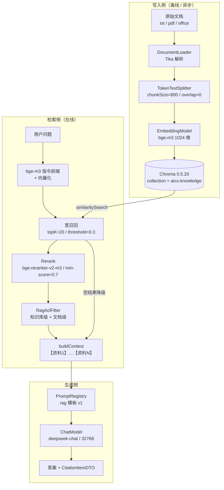
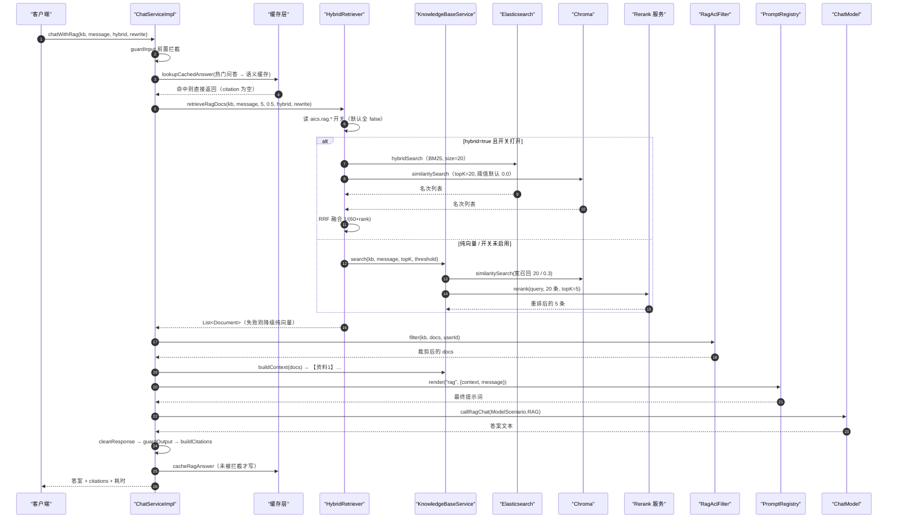

# RAG 检索增强生成：在正确的时机把正确的片段检索出来

> **一句话结论**：RAG 不是"把文档塞进提示词"，而是在正确的时机把正确的片段检索出来；这条链路上每个环节都有确定的失败模式，绝大多数"答非所问"发生在检索侧而不是生成侧。
> **阅读前置**：读过本模块 `01-SpringAI入门`（知道 `ChatModel` / `ChatClient` / `Advisor` 的分层），知道 Embedding 是把文本映射成定长浮点向量的模型，能在本机跑 `pwsh` 与 `node`。
> **证据基线**：A 级 = `learning-docs/24-源码分析/assets/source/` 已入库的 Spring AI 2.1.0 源码摘录（行号即原文件行号）；B 级 = 本项目 `ai-cs-chat` / `ai-cs-knowledge` / `ai-cs-search` 真实代码与配置，行号当次核对；C 级 = 本机可复现命令的真实输出。预计阅读 45 分钟。

**证据边界（先说清楚哪些是查过的，哪些是查不到的）**

| 级别 | 来源 | 本篇覆盖的类/文件 |
| --- | --- | --- |
| A | `assets/source/` 已入库摘录 | `SearchRequest`、`TokenTextSplitter`、`VectorStore`、`Document`、`EmbeddingModel`、`RetrievalAugmentationAdvisor`、`ContextualQueryAugmenter`、`ConcatenationDocumentJoiner`、`VectorStoreDocumentRetriever` |
| A（未入库，明确标注） | `QuestionAnswerAdvisor.java` | 摘录未入库 → 本篇**不引它的源码行号**，只用 `javap` 静态签名（C 级）+ 本项目配置（B 级）说明行为 |
| B | 本项目真实代码/配置 | `ChatServiceImpl`、`KnowledgeBaseService`、`HybridRetriever`、`KnowledgeVectorService`、`HybridSearchServiceImpl`、`SpringAiConfig`、`VectorStoreConfig`、`application.yml`、`application-prompt.yml`、`golden-set.json` |
| C | 本机命令真实输出 | `javap` / `jar tf` 静态核对 m2 里的 jar、`Select-String` 审计调用点、`node` 模拟推演切块三角 |

本机探测结果（真实输出，见 6.6）：`docker` 命令不存在，127.0.0.1 的 8000/9200/6379/8848 端口全部不通，即**没有 Chroma / Elasticsearch / Redis / Nacos 在跑**。因此本篇**不含任何实跑召回率、延迟、命中数统计**；所有数量关系都用「模拟推演」标注并写清假设。

---

## 0. 先看现象

三段日志模板都是**逐字取自源码的格式串**（`{}` 是真实占位符），占位值是为了说明问题而填的示意值，不是运行记录。之所以能这么用，是因为 RAG 的失败在日志里长得非常一致。

**现象一：日志说命中 0 条、引用 0 条，答案却有三百字且毫不含糊。**

```text
# 模板取自 ai-cs-chat/src/main/java/com/aics/chat/service/impl/ChatServiceImpl.java#L468
RAG对话完成: sessionId=s-8821, 检索命中0条, 引用0条
```

前端拿到的 `citations` 是空数组，答案却没有任何"我不知道"的迹象。链路是（B 级）：`retrieveRagDocs` 返回空 → `buildContext` 得到空串 → 拼 prompt 时把空上下文替换成固定占位串 `（未检索到相关资料）`（`ai-cs-chat/src/main/java/com/aics/chat/service/impl/ChatServiceImpl.java#L444-L450`）→ 而模板要求的是"*资料中*没有相关信息"才拒答（`ai-cs-chat/src/main/resources/application-prompt.yml#L63`）。占位串既不是资料、也不是指令，模型于是自由发挥。**这就是"检索不到 → 幻觉"的真实路径**：不是模型不听话，是提示词里的契约被占位串打破了。

**现象二：同一个问题，换个说法就检索不到了。**

```text
# 模板取自 ai-cs-chat/src/main/java/com/aics/chat/service/KnowledgeBaseService.java#L277
知识库[product-manual]宽召回完成: 命中0条
# 换个问法的对照组：
知识库[product-manual]宽召回完成: 命中3条
```

知识库没变、文档没变，变的只有提问用词。这说明问题不在"库里有没有"，而在"向量相似度有没有过阈值"。机制见 3.5、3.6。

**现象三：检索数量全对，答案却丢了一半。**

```text
# 模板取自 ChatServiceImpl.java#L948-L953 与 KnowledgeBaseService.java#L248
RAG增强检索: mode=HYBRID, degraded=true, hits=5
知识库[product-manual]Rerank精排完成: 召回20条 -> 返回5条
```

召回 20、精排返回 5，每一步都"正常"，但 5 个片段 × 800 token ≈ 3923 token（C 级模拟值，见 3.9），再叠加 system prompt、多轮历史和输出预留，窗口余量迅速见底。本项目模型元数据默认 `contextWindow = 32768`（`ai-cs-chat/src/main/java/com/aics/chat/modelrouter/ModelDefinition.java#L22`），而 fallback 链路里的小模型窗口更小；一旦超限，不同 provider 的处理并不一致——截断尾部（恰好丢掉最后一条最关键的资料）或直接 4xx。用户看到的就是"答到一半没了"。

这些现象指向同一件事：**RAG 的失败几乎从不发生在"生成"环节，而发生在"取片段"环节——取不到、取错、取太多，模型都会用同样流畅的语气把错误交付给你。**

---

## 1. 整体地图

RAG 是三条流水线拼起来的：写入侧把文档变成向量落库，检索侧把问题变成向量再取回片段，生成侧把片段塞进模板交给模型。三条线各自独立失败，且失败会向下游伪装成"模型能力问题"。



> **读图说明**：中间那条 `Q3 →|空结果降级| Q6` 是理解本项目 RAG 的关键——宽召回返回空时并不会报错，而是带着空上下文一路走到生成侧，于是有了现象一。`Q4`（Rerank）是检索侧唯一一个"会否决召回结果"的环节，也是检索侧唯一一个额外调用外部模型（硅基流动 `BAAI/bge-reranker-v2-m3`）的环节，所以它天然是可用性单点：它挂掉就退回"按向量相似度排序"（`ai-cs-chat/src/main/java/com/aics/chat/service/KnowledgeBaseService.java#L251-L253`）。写入侧的 `D5` 由 chat / knowledge / search **三个服务共用同一个 collection**，这是后面"维度必须一致""过滤必须带上 knowledgeBase"两条硬规则的根源。

| 组件 | 责任 | 本项目实现 | 调用方 |
| --- | --- | --- | --- |
| 切块器 | 把长文档切成可检索的语义单元 | `TokenTextSplitter` 默认构造（800/0/350/5/10000） | `KnowledgeBaseService`、`KnowledgeVectorService` |
| 向量化 | 文本 → 定长向量 | `bge-m3`（1024 维，`@Primary`）；本地 `HashEmbeddingModel`（768 维）兜底 | `VectorStore` 内部调用 |
| 向量库 | 存向量 + 元数据 + 相似度检索 | Chroma 0.5.20，collection `aics-knowledge` | chat / knowledge / search |
| 宽召回 | 用低阈值拿大候选集 | `searchRaw`（topK=20、threshold=0.3） | `KnowledgeBaseService.search` |
| 精排 | 用小模型给候选重新打分 | `SiliconFlowRerankService`（min-score=0.7） | `KnowledgeBaseService.search` |
| 混合检索 | ES BM25 + 向量两路 RRF 融合 | `HybridSearchServiceImpl` + `MultiQueryMerger` | `HybridRetriever` |
| 权限过滤 | 知识库级/文档级 ACL | `RagAclFilter.filter` | `ChatServiceImpl`（**仅非流式**） |
| 上下文拼接 | 片段 → 带编号的文本块 | `KnowledgeBaseService.buildContext` | `ChatServiceImpl` |
| 模板渲染 | 上下文 + 问题 → 提示词 | `PromptRegistry` 场景 `rag` v1 | `ChatServiceImpl` |
| 评估 | 召回/命中/MRR + golden 集 | `RetrievalMetrics`、`EvalGateConfig` | 在线评估/离线脚本 |

---

## 2. 关键概念与关键类

先说结论：**RAG 的架构复杂度不在"检索"这个动词上，而在"把检索结果变成提示词"的那一段**——Spring AI 把这段抽象成了 `Advisor`，而项目自己又写了一套更细的控制流，两套并存是本篇最容易迷路的地方。

| 名称 | 位置 | 角色 | 关键方法/字段 |
| --- | --- | --- | --- |
| `EmbeddingModel` | A 级：`EmbeddingModel.java.md` | 文本 → 向量的最小契约 | `embed(String)`、`embed(Document)`、`dimensions()` |
| `VectorStore` | A 级：`VectorStore.java.md` | 写入 + 检索的统一接口（组合 `DocumentWriter` 与 `VectorStoreRetriever`） | `add(List)`、`upsert(List)`、`delete(...)`、`similaritySearch(...)` |
| `SearchRequest` | A 级：`SearchRequest.java.md` | 一次检索请求的参数对象 | `query`、`topK`、`similarityThreshold`、`filterExpression` |
| `Document` | A 级：`Document.java.md` | 片段载体：文本 + metadata + `score` | `getText()`、`getMetadata()`、`getScore()`、`mutate()` |
| `TokenTextSplitter` | A 级：`TokenTextSplitter.java.md` | 按 token 切块 | `split(Document)`、`apply(List)`、`doSplit(...)` |
| `QuestionAnswerAdvisor` | **A 级未入库**（官方文档 + C 级 javap） | Advisor 版 RAG：`before` 里检索并把上下文注入用户消息 | `builder(VectorStore)`、`before/after` |
| `RetrievalAugmentationAdvisor` | A 级：`RetrievalAugmentationAdvisor.java.md` | 模块化 RAG 编排器（查询变换 → 检索 → 后处理 → 增强） | `before`（七步）、`after` |
| `VectorStoreDocumentRetriever` | A 级：`VectorStoreDocumentRetriever.java.md` | 把 `VectorStore` 适配成 `DocumentRetriever` | `retrieve(Query)` |
| `ContextualQueryAugmenter` | A 级：`ContextualQueryAugmenter.java.md` | 把文档拼进用户消息；空上下文时可拒答 | `augment(Query, List<Document>)` |
| `ConcatenationDocumentJoiner` | A 级：`ConcatenationDocumentJoiner.java.md` | 多路检索结果合并去重 | `join(List<List<Document>>)` |
| `KnowledgeBaseService` | B 级：`ai-cs-chat/src/main/java/com/aics/chat/service/KnowledgeBaseService.java` | 两阶段检索（宽召回 + 精排）与上下文拼接 | `search`、`searchRaw`、`addChunks`、`buildContext` |
| `HybridRetriever` | B 级：`ai-cs-chat/src/main/java/com/aics/chat/rag/retrieve/HybridRetriever.java` | 四种检索模式 + 两层降级 | `retrieve`、`hybrid`、`vector` |
| `KnowledgeVectorService` | B 级：`ai-cs-knowledge/src/main/java/com/aics/knowledge/service/KnowledgeVectorService.java` | knowledge 服务侧的独立入库/删除 | `vectorize`、`deleteByDocumentId` |
| `HybridSearchServiceImpl` | B 级：`ai-cs-search/src/main/java/com/aics/search/hybrid/HybridSearchServiceImpl.java` | ES BM25 + 向量双路 RRF | `hybridSearch`、`esSearch`、`vectorSearch` |
| `RagAclFilter` | B 级：`ai-cs-chat/src/main/java/com/aics/chat/security/RagAclFilter.java` | 检索后的权限裁剪 | `filter(kb, docs, userId)` |
| `RetrievalMetrics` | B 级：`ai-cs-chat/src/main/java/com/aics/chat/rag/eval/RetrievalMetrics.java` | 召回率/命中率/MRR 计算 | `compute(retrievedIds, expectedIds, topK)` |

---

## 3. 原理与证据逐段精读

### 3.1 三个硬约束里，RAG 只治其中一个半

**在干什么**：先明确 RAG 的适用边界，否则后面每个参数都调得没有依据。大模型的三个硬约束是：①知识截止（训练数据有时间上限）；②无法访问私有数据（企业内部文档、订单、工单）；③幻觉（会编造不存在的事实）。

**为什么这么设计**：RAG 的做法是"**不改模型参数，改输入**"。它在推理时把相关证据塞进上下文，因此天然解决②；对①只有"你把新资料入库"才有效，模型本身的截止时间没变；对③是**缓解**而非消除——给错证据时幻觉反而更"有据可依"。

| 方案 | 解决①知识截止 | 解决②私有数据 | 抑制③幻觉 | 成本 | 本项目是否采用 |
| --- | --- | --- | --- | --- | --- |
| RAG | 间接（新资料入库即生效） | ✅ 核心手段 | 部分（取决于召回质量） | 每次请求多一次检索 + 更多输入 token | ✅ 主线 |
| 微调（SFT/LoRA） | 间接（重训即生效） | 部分（能记住，但难更新、难溯源） | 弱（仍会编） | 训练 + 数据标注，更新周期以天计 | ❌ 未做 |
| 长上下文（把整库塞进去） | 不解决 | 能"看到"，但塞不下、成本高、中间信息易被忽略 | 弱 | 输入 token 线性涨 | ❌ 未做 |

**换写法会怎样**：如果指望"微调一个懂公司业务的模型"，你会立刻遇到三个问题：文档天天变（微调跟不上）、答案无法给出处（客服场景不能溯源就不可用）、权限没法在推理时按人裁剪。RAG 的 `filterExpression` + `RagAclFilter` 才是能按用户裁剪的正解。

**常见坑**：把"RAG 上线了"理解为"幻觉没了"。本项目 `application-prompt.yml` 里那句"如果资料中没有相关信息，请如实告知"就是防幻觉的第二道闸；而一旦上下文被占位串替换掉（现象一），这道闸就失效了。

### 3.2 五阶段各自的作用与失败模式

**在干什么**：切块 → 向量化 → 索引 → 检索 → 增强生成。五个阶段里，**前三个决定了效果上限，后两个决定了你能兑现多少上限**。

| 阶段 | 作用 | 典型失败模式 | 本项目的可见症状 |
| --- | --- | --- | --- |
| 切块 | 把长文档切成"一个块能讲清一件事"的单元 | 块太大：语义被稀释、命中后噪声多；块太小：答案被切断、上下文不完整 | 检索到但答不全 / 答案只覆盖一半 |
| 向量化 | 把语义压进定长向量 | 维度不一致、指令前缀漏加、多语言模型选错 | 召回 0 条 / 召回全不相干 |
| 索引 | 持久化 + 元数据打标 | 重复写入、元数据缺失导致过滤失效、维度不匹配 | 同一文档被引用多次 / 过滤条件查不到东西 |
| 检索 | 按相似度取回候选 | 阈值过高 → 空结果；topK 过小 → 少召回；只按向量 → 关键词精确匹配失败 | 现象二 |
| 增强生成 | 把片段变成提示词并生成 | 拼法丢失结构、超窗截断、无编号导致无法引用 | 现象三 |

**为什么这么设计**：这五阶段不是任意的划分，而是**信息损失逐级累积**的必然结果。切块丢掉块间关系，向量化丢掉字面形态，检索丢掉未被召回的候选，拼接丢掉超预算的部分——每一步都是单向的，下游无法补救上游。这就是"切块策略决定效果上限"的真正含义：切块决定了库里存在什么样的"语义原子"，后面所有环节都只能在这些原子之间做选择。

**换写法会怎样**：先调 topK 再调切块，是最常见的错误顺序。topK 从 5 调到 20 只是在更多坏候选里挑，而把 800 token 的块改成 300 token 的语义块，是把候选池本身换掉。

**常见坑**：把失败归因到"模型不够强"。生成模型只看到你给的片段，它没有能力补偿你根本没召回的段落。

### 3.3 切块的硬参数：默认值比你想的更保守

**在干什么**：`TokenTextSplitter` 用 `CL100K_BASE` 编码按 token 计数切块，遇到标点尝试在句子边界断开，并保留分隔符。

**为什么这么设计**：按 token 而非字符切，是为了让"块大小"与模型的计费/窗口单位一致；按标点断句是为了避免把一个句子从中间劈开（那样两个块都不可读）。

**源码事实**（A 级，默认值全部来自常量）：

```java
// (src: TokenTextSplitter.java.md#L41-L57)
public static final int DEFAULT_CHUNK_SIZE = 800;
public static final int DEFAULT_CHUNK_OVERLAP = 0;
public static final int MIN_CHUNK_SIZE_CHARS = 350;
public static final int MIN_CHUNK_LENGTH_TO_EMBED = 5;
public static final int MAX_NUM_CHUNKS = 10000;
public static final boolean KEEP_SEPARATOR = true;
public static final List<Character> DEFAULT_PUNCTUATION_MARKS = List.of('.', '?', '!', '\n');
public static final EncodingType DEFAULT_ENCODING_TYPE = EncodingType.CL100K_BASE;
```

四个参数里，**`chunkOverlap = 0` 是最容易被忽略的那个**：重叠为 0 意味着跨块边界的答案会被硬切断，而项目里所有入库入口都用无参构造（`ai-cs-chat/src/main/java/com/aics/chat/service/KnowledgeBaseService.java#L159-L181`、`ai-cs-knowledge/src/main/java/com/aics/knowledge/service/KnowledgeVectorService.java#L69-L92`），也就是说**线上没有任何重叠**。`MIN_CHUNK_LENGTH_TO_EMBED = 5` 是另一道静默闸门：太短的碎片不会成为可检索块。构造器对这些参数有强校验（`chunkOverlap < chunkSize`、`maxNumChunks > 0` 等，见 [[源码:TokenTextSplitter.java.md#L129-L136]]），非法值在启动时就炸，不会拖到运行期。

**换写法会怎样**：改成 `chunkSize=400, overlap=100` 是常见做法，代价是块数涨到 2 倍以上、向量库体积和 embedding 调用次数同步翻倍，而召回片段的 token 总量反而可能上升（因为要覆盖同样长度的答案需要更多块）。

**常见坑**：以为"重叠越大越安全"。重叠会让同一段话出现在多个块里，检索时命中多块、答案重复啰唆；本项目 `VectorStore.add` + 无去重入库的组合下，重复块还会被当成不同文档累加，见 3.4 与 6.4。

### 3.4 向量化的三个性质：距离、归一化、维度

**在干什么**：`EmbeddingModel` 把文本映射成浮点数组；检索时用向量距离衡量语义相近程度。

**为什么这么设计**：语义近似的核心假设是"意思相近的说法在向量空间里方向相近"。因此对**余弦相似度**而言，向量的模长是噪声，方向才是信息——这就是归一化的作用。

项目里的本地兜底模型把这件事写得很直白（B 级）：

```java
// ai-cs-common/src/main/java/com/aics/common/ai/embedding/HashEmbeddingModel.java#L29-L50
public class HashEmbeddingModel implements EmbeddingModel {
    public static final int DIMENSIONS = 768;
```

它用双哈希（`Math.floorMod(token.hashCode(), DIMENSIONS)` + fnv1a）把 token 打到固定维度上累加，再做 L2 归一化；token 切分是"英文单词 + 中文二元字符组"（`HashEmbeddingModel.java#L77-L96`）。类注释自己写明了定位：**零依赖兜底，没有语义泛化能力，生产必须换 bge-m3**（`ai-cs-common/src/main/java/com/aics/common/ai/embedding/HashEmbeddingModel.java#L15-L27`）。

而线上主用的是硅基流动的 `BAAI/bge-m3`，1024 维，`@Primary` 声明（`ai-cs-chat/src/main/java/com/aics/chat/config/SpringAiConfig.java#L172-L203`），配置项 `spring.ai.model.embedding: none`（`ai-cs-chat/src/main/resources/application.yml#L35-L38`）的意思是**关掉自动装配、由本项目手工 `new OpenAiEmbeddingModel(...)` 指定模型名**（`SpringAiConfig.java#L186-L187`）。

**换写法会怎样**：两套 provider 的维度不同（768 vs 1024），而 Chroma 的一个 collection 只有一个固定维度。**在同一个 collection 里混用两个 provider 不会"效果差一点"，而是直接写入/检索报错**。这既是硬约束，也是本项目"双 provider 只能二选一，不能灰度混跑"的原因。

**常见坑**：
- 忘了维度一致性检查，开发机用 local（768）建了 collection，上线切 bge-m3（1024）当场炸；
- 以为 `score` 一定是"越大越像"。`Document.score` 的官方定义是"与查询向量的相似度，越大越相似"（[[源码:Document.java.md#L146-L160]]），但向量库底层有的按距离（越小越好）。所以本项目 RRF 融合**故意只看名次不看分数**（3.8），就是为了绕开跨量纲问题。

### 3.5 相似度阈值的真正含义：客户端后处理，不是服务端过滤

**在干什么**：`SearchRequest.similarityThreshold` 用来丢弃"不够像"的结果。

**为什么这么设计**：默认值是 0.0，含义是"全接受"。这个默认值的语义在源码里写得很清楚：

```java
// (src: SearchRequest.java.md#L39-L49)
public static final double SIMILARITY_THRESHOLD_ACCEPT_ALL = 0.0;
public static final int DEFAULT_TOP_K = 4;
```

更关键的是 setter 上的 javadoc：**只有相似度 ≥ 阈值的文档才会返回，而这是一个"在客户端做的后处理步骤"，不是服务端过滤**（`SearchRequest.java.md#L164-L178`，原文 "this is a post-processing step performed on the client not the server side"）。这句话有两个工程后果：

1. 服务端仍然会把 topK 条全部取回来，阈值只是"取回后再扔"。所以**阈值不能降低服务端负载**，只能减少进入 prompt 的条数。
2. 阈值取值范围被 `Assert.isTrue(threshold >= 0 && threshold <= 1, ...)` 限死，传 1.5 会直接抛参数异常——这是启动即可发现的错，不是静默降级。

**换写法会怎样**：如果以为阈值是服务端 WHERE 条件，就会期望"阈值调高能省钱"，实际省不了；真正省钱的是 topK。

**常见坑**：把"阈值"当绝对质量标准。不同 embedding 模型、不同领域语料的分数分布完全不同（bge-m3 的中文短问句与长文档块的余弦相似度普遍偏低）。本项目宽召回阈值取 0.3 而不是 0.7，正是因为"召回优先，质量交给 Rerank"（`tools/nacos-config/ai-cs-chat.yml#L21-L25`，原注释 "Broad recall threshold: recall first, quality left to Rerank"）。

### 3.6 阈值和 topK 是一对旋钮：阈值高 + topK 小 = 空结果

**在干什么**：两个参数相乘，决定了"进 prompt 的片段数"。它们的交互是**非线性**的：阈值是筛选，topK 是截断，先筛后截。

**为什么这么设计**：如果阈值卡得很紧，候选数可能已经小于 topK，此时 topK 形同虚设；反过来阈值很松而 topK 很小，topK 起决定作用。**只有两个都宽松，召回才不缺料**。

C 级模拟推演（假设的分数序列，用于展示两个旋钮的耦合，不是实测）：

| 假设分数序列 | threshold=0.3, topK=5 | threshold=0.5, topK=5 | threshold=0.7, topK=5 |
| --- | --- | --- | --- |
| 问法A（与文档用词一致：0.86, 0.74, 0.66, 0.58, 0.51…） | 5 条 | 5 条 | **2 条** |
| 问法B（同义改写：0.46, 0.41, 0.38, 0.35, 0.33…） | 5 条 | **0 条（空）** | **0 条（空）** |

**读法**：问法B 在阈值 0.3 时能拿到 5 条，一旦阈值提到 0.5 就归零——**同一批文档、同一个 topK，只因为阈值多要了 0.2，检索结果从 5 条变 0 条**。这正是现象二的算术解释：同义改写的问句整体分数下滑，撞上阈值墙。

**换写法会怎样**：用 `threshold=0.7 + topK=3` 的"高精度配置"，在长尾问法上命中率会掉得很惨（上表第 3 列），而用户看到的是"知识库明明有这篇文档，它就是不知道"。

**常见坑**：本项目代码里有**两套阈值同时在跑**，容易看错：
- 宽召回：`recallTopK=20` / `recallThreshold=0.3`（`ai-cs-chat/src/main/java/com/aics/chat/service/KnowledgeBaseService.java#L94-L99`），这是 `searchRaw` 真正用的（`KnowledgeBaseService.java#L230`）；
- 调用方传入的 `topK/threshold`：`ChatServiceImpl` 传的是 `5` 和 `0.5`（`ai-cs-chat/src/main/java/com/aics/chat/service/impl/ChatServiceImpl.java#L437`）。

也就是说，**调用方传的 `threshold=0.5` 在 `search()` 里根本没用上**：它既没有转发给 `searchRaw`（宽召回用的是字段 `recallThreshold`），也没有参与后续筛选，方法体最后只用 `subList(0, topK)` 做条数截断（`KnowledgeBaseService.java#L228-L260`）。这是本篇最值得记住的一个真实缺陷，第 6 节会作为头号坑展开。

### 3.7 两阶段检索：宽召回 + 精排，用外部模型换质量

**在干什么**：第一阶段用向量相似度低阈值拿 20 条；第二阶段把 20 条交给 rerank 模型（`BAAI/bge-reranker-v2-m3`）逐条重打分，只留 `min-score=0.7` 以上、按分数取前 topK。

**为什么这么设计**：**双塔检索（embedding + 余弦）本质上无法建模"问题与文档的交互"**——问题和文档各自独立编码，缺少 token 级对齐。Cross-encoder 精排把两者拼一起送进模型，精度显著更高，代价是每条候选都要一次推理，所以只能用于少量候选。于是形成标准分工：**便宜的方法负责"不漏"，贵的方法负责"排准"**。

**B 级证据**（`ai-cs-chat/src/main/java/com/aics/chat/service/KnowledgeBaseService.java#L228-L260` 的结构）：

```java
// 结构示意（据 KnowledgeBaseService.java#L228-L260 整理：省略日志参数与部分分支）
public List<Document> search(String knowledgeBase, String query, int topK, double threshold) {
    List<Document> recallDocs = searchRaw(knowledgeBase, query, recallTopK, recallThreshold);
    if (recallDocs.isEmpty()) {
        return recallDocs;
    }
    RerankService rerankService = rerankServiceProvider.getIfAvailable();
    if (rerankService != null) {
        try {
            List<RerankResultItem> items = rerankService.rerank(query, recallDocs, topK).block();
            // 按 item.getIndex() 从 recallDocs 里取回原文档
        } catch (Exception e) {
            log.warn("知识库[{}]Rerank调用异常，降级为相似度排序: {}", knowledgeBase, e.getMessage());
        }
    }
    return recallDocs.size() <= topK ? recallDocs : recallDocs.subList(0, topK);
}
```

**换写法会怎样**：不要精排、直接把 20 条塞给生成模型，token 从约 3923 涨到约 15692（C 级模拟值，见 3.9），质量却未必更好——长上下文里的中段信息容易被忽略（"lost in the middle"效应），且成本翻 4 倍。

**常见坑**：
- `rerankServiceProvider.getIfAvailable()` 说明**精排是可选的**：Bean 不在、网络不通、超时（`timeout-ms: 5000`），都会静默走"按相似度排序"。线上如果没监控这条 warn 日志，你会以为精排在生效。
- `min-score: 0.7` 与宽召回阈值 0.3 是**两套尺度**：前者是 rerank 模型的打分（通常 0~1 的 logit 归一化），后者是余弦相似度，**数值不可互相比较**。

### 3.8 混合检索：RRF 只按名次融合，故意不看分数

**在干什么**：ES 一路 BM25 关键词检索（`size=RETRIEVE_TOP_K=20`），Chroma 一路向量检索（`topK=20`），两边各出一份排序，再用 RRF 融合。

**为什么这么设计**：BM25 擅长精确词（型号、编号、专有名词），向量擅长同义改写。融合时最麻烦的是**分数不可比**——BM25 分数无上界，余弦相似度在 [-1,1]。RRF（Reciprocal Rank Fusion）的解法是彻底放弃分数，只用名次：`score(doc) = Σ 1/(k + rank_i)`，`k` 通常 60（`ai-cs-chat/src/main/java/com/aics/chat/rag/retrieve/HybridRetriever.java#L25-L94` 的类注释里写明了公式；`ai-cs-search/src/main/java/com/aics/search/hybrid/HybridSearchServiceImpl.java#L41-L44` 里 `RETRIEVE_TOP_K = 20`、`RRF_K = 60`）。

**C 级验算**（纯算术，公式取自类注释，名次为假设值）：

```text
k = 60, score = 1/(60+rank_es) + 1/(60+rank_vec)
A(es=1, vec=1) = 1/61 + 1/61 = 0.03279
B(es=2, vec=8) = 1/62 + 1/68 = 0.03083
C(es=12, vec=2) = 1/72 + 1/62 = 0.03002
D(es=1, vec=-) = 1/61            = 0.01639
E(es=-, vec=1) = 1/61            = 0.01639
融合序：A > B > C > D = E
```

**读法**：两路都靠前的 A 稳居第一；只在单路出现的 D、E 分数只有双路的一半——**RRF 天然偏好"两路都认同"的文档**，这正是它抗单路噪声的原因。同时注意 B(es=2,vec=8) 高于 C(es=12,vec=2)，说明名次信息被压缩后，具体名次差值的影响有限，这对长尾召回是有利的（不会因为某一路排第 8 就被判死）。

**换写法会怎样**：改成加权分数融合（如 `0.5*向量 + 0.5*BM25`），你首先要做归一化，而归一化方式一变结果就变，线上极难复现；RRF 的粗糙恰恰是它可运维的原因。

**常见坑**：
- 单路失败会被静默降级：ES 空或向量空 → 只用另一路（`HybridSearchServiceImpl.java#L61-L68`）；两路都空 → 返回空列表，不报错。
- `vectorSearch` 里**没有设置 `similarityThreshold`**（`HybridSearchServiceImpl.java#L123-L153`、`HybridRetriever.java#L287-L306`），即默认 0.0 全接受——混合链路的"精度"完全依赖后面的融合与精排，而不是阈值。

### 3.9 把片段拼进 prompt：顺序、去重、长度预算、引用编号

**在干什么**：把 N 个 `Document` 变成一段带编号的文本，再套进模板。

**为什么这么设计**：拼接方式直接决定三件事——模型能不能引用（编号）、会不会被重复内容干扰（去重）、有没有超出窗口（预算）。

项目实现非常朴素（B 级）：

```java
// ai-cs-chat/src/main/java/com/aics/chat/service/KnowledgeBaseService.java#L287-L293
public String buildContext(List<Document> documents) {
    StringBuilder sb = new StringBuilder();
    for (int i = 0; i < documents.size(); i++) {
        sb.append("【资料").append(i + 1).append("】").append(documents.get(i).getText()).append("\n\n");
    }
    return sb.toString().trim();
}
```

编号 `【资料1】` 正好对应 `CitationItemDTO` 的引用溯源（`ChatServiceImpl.java#L462` 的 `buildCitations(docs)`），模板里也明确规定了使用方式（`ai-cs-chat/src/main/resources/application-prompt.yml#L55-L63`）：

```text
请严格基于下面的【知识库资料】回答用户问题。
重要规则：
1. 如果资料中没有相关信息，请如实告知："我暂时没有这方面的资料"，不要编造内容
2. 回答时优先引用资料中的内容，不要提及"根据资料/检索结果"之类的表述

【知识库资料】
{{context}}

【用户问题】
{{message}}
```

Spring AI 的 Advisor 路线则在框架层做了去重与排序（A 级）：`ConcatenationDocumentJoiner` 用 `toMap(Document::getId, identity, (existing, duplicate) -> existing)` **按 id 去重**，再按 score 降序排列、`null` 当 0.0 处理（[[源码:ConcatenationDocumentJoiner.java.md#L46-L64]]）。注意它的两个隐含前提：文档 id 唯一、score 越大越相似。

**换写法会怎样**：不做长度预算，就是现象三。用 C 级模拟量化"片段数 → token 占用"的关系（假设：块均 785 token，尚未计入 system prompt 与历史）：

| topK | 上下文 token（≈） | 占 8K 窗口 | 占 32K 窗口 |
| --- | --- | --- | --- |
| 3 | 2354 | 28.7% | 7.2% |
| 5 | 3923 | 47.9% | 12.0% |
| 10 | 7846 | 95.8% | 23.9% |
| 20 | 15692 | **191.6%（必爆）** | 47.9% |

**读法**：宽召回的 20 条如果直接进 prompt，8K 窗口根本放不下，32K 窗口也要吃掉近一半；本项目把 20 条精排成 5 条，才把上下文压到约 12%——**两阶段检索不只是提精度，也是长度预算的第一道闸**。真正危险的是没有预算概念、"能塞几条塞几条"的实现。

**常见坑**：
- 顺序错了没人发现：`subList(0, topK)` 的退化路径依赖"前 topK 更相关"，一旦上游换了排序（比如 rerank 返回的 index 没重排回去），这个假设就不再成立。
- 编号与 citation 数组必须**同源同序**，否则用户点开引用看到的是另一段文字——这类错在测试里很难发现，在客服场景里却是致命的可信度问题。

### 3.10 "检索到但不相关"比"检索不到"更危险

**在干什么**：比较两种失败。检索不到 → 上下文空 → 模板要求拒答（只要占位串处理正确）；检索到但不相关 → 上下文有内容、有编号、有 citation → 模型据此作答。

**为什么这么设计**：模型的行为是"基于给定资料作答"。**当你给它错资料时，它没有理由怀疑资料**——而提示词里那句"优先引用资料中的内容"反而在强化这个错误。于是产出一个格式完美、引用齐全、内容错误的答案。相比之下，"检索不到"至少还留着一条拒答通路。

**换写法会怎样**：如果只监控"检索命中数"，你会把"命中 5 条全不相关"记为成功。这就是本项目埋点的局限：`rag.retrieval` span 里记录的是 `hitCount` 与文档 id 列表（`ChatServiceImpl.java#L969-L973`），**它们只能证明"取到了东西"，不能证明"取对了"**。真正的质量信号要么来自 rerank 分数分布，要么来自评估集的 `expectedDocumentIds` 比对（3.12）。

**常见坑**：用"命中率 100%"汇报 RAG 质量。命中率（hitRate）只要求至少有一条出现在期望集合里（`RetrievalMetrics.java#L69` 的 `hitCount > 0 ? 1.0 : 0.0`），它衡量的是"沾边"，不衡量"够用"。

### 3.11 Spring AI 的两代抽象：Advisor 与模块化 RAG

**在干什么**：Spring AI 把"检索 + 拼 prompt"封装成 Advisor，在 `ChatClient` 调用链里自动执行。两个层次：

1. `QuestionAnswerAdvisor`：一体式，`before` 里检索并把结果写进用户消息，`after` 里把文档挂到响应 metadata。
2. `RetrievalAugmentationAdvisor`：模块化，把查询变换、检索、后处理、增强拆成可替换组件。

**为什么这么设计**：一体式好用但不可调；模块化难用但每个环节都能换。`RetrievalAugmentationAdvisor.before` 是七步流水线（[[源码:RetrievalAugmentationAdvisor.java.md#L107-L154]]）：查询变换链（`RewriteQueryTransformer` / `MultiQueryExpander`，见 [[源码:RetrievalAugmentationAdvisor.java.md#L118-L126]]）→ 并行检索（`CompletableFuture` 多 query 并发 + joiner 合并，[[源码:RetrievalAugmentationAdvisor.java.md#L128-L138]]）→ 文档后处理 → 写入 `context.put(DOCUMENT_CONTEXT, ...)` → `augment` 生成新用户消息 → `mutate().augmentUserMessage(...)`（[[源码:RetrievalAugmentationAdvisor.java.md#L140-L154]]）。`after` 再把文档搬进响应 metadata，key 是 `"rag_document_context"`（[[源码:RetrievalAugmentationAdvisor.java.md#L166-L182]]）。

默认线程池也值得知道：`ai-advisor-` 前缀、core 4 / max 16，并包了 `ContextPropagatingTaskDecorator` 让 traceId 等上下文能传进异步线程（[[源码:RetrievalAugmentationAdvisor.java.md#L194-L202]]）。

**空上下文的处理**是最能体现设计取舍的一处：`ContextualQueryAugmenter` 的默认模板以 "Context information is below." 开头，并且 `allowEmptyContext=false`（[[源码:ContextualQueryAugmenter.java.md#L49-L77]]）；`augment` 在 `documents.isEmpty()` 时走 `augmentQueryWhenEmptyContext`（[[源码:ContextualQueryAugmenter.java.md#L105-L133]]）——**框架的默认行为是"没证据就不答"**，这跟"塞一个占位串继续答"（现象一）正好相反。项目手工拼 prompt 的路线丢掉了这个默认保护，是值得警觉的落差。

**未入库说明**：`QuestionAnswerAdvisor.java` 不在 `assets/source/` 里，本篇不给它的行号。可用的静态证据是 C 级 `javap`（命令与输出见 6.6）：`org.springframework.ai.chat.client.advisor.vectorstore.QuestionAnswerAdvisor implements BaseAdvisor`，有 `public static Builder builder(VectorStore)`、`before/after(ChatClientRequest, AdvisorChain)`、`protected Filter.Expression doGetFilterExpression(Map)`。项目里的用法因此可以确认是"builder + VectorStore"这条路径（`ai-cs-chat/src/main/java/com/aics/chat/config/SpringAiConfig.java#L233-L271`，`similarityThreshold(0.3d)` 在 L270、`topK(5)` 在 L271）。

**换写法会怎样**：用 `RetrievalAugmentationAdvisor` 能白拿查询重写、多查询、空上下文拒答，但要接受它的线程池与模板不可见（默认英文模板、默认 topK=4 见 [[源码:SearchRequest.java.md#L46-L49]]）；手工拼则相反，一切可见但每个保护都要自己实现。项目选了后者（`ChatServiceImpl` 手工链路），`ragAdvisor` 作为 Advisor 存在但不在主链路里——这是可以讨论的架构分裂，第 5 节会列。

**常见坑**：`VectorStoreDocumentRetriever` 的 `filterExpression` 是 `Supplier`（[[源码:VectorStoreDocumentRetriever.java.md#L61-L83]]），构造期还要做非空校验；它在 `retrieve` 里才拼 `SearchRequest` 并调用 `similaritySearch`（[[源码:VectorStoreDocumentRetriever.java.md#L85-L96]]）。所以**过滤条件写错不会在启动时报错**，而是在第一次检索时静默返回空——这是"知识库过滤写错 → 召回 0 条"的常见来源。

### 3.12 评估：召回率、命中率、忠实度各自怎么测

**在干什么**：RAG 有三层可测对象——检索层（取回的对不对）、生成层（答案有没有依据）、系统层（延迟/成本）。三层要用不同指标。

**为什么这么设计**：混在一起测会导致"改了切块但指标没动"这类假象。检索层用集合指标（不依赖模型），生成层必须用模型或人工判分（有成本）。

项目已有的检索层实现是一个纯函数（B 级）：

```java
// ai-cs-chat/src/main/java/com/aics/chat/rag/eval/RetrievalMetrics.java#L46-L70（节选）
public static RetrievalMetrics compute(List<String> retrievedIds, List<String> expectedIds, int topK) {
    int k = Math.min(topK, retrievedIds == null ? 0 : retrievedIds.size());
    // ... 统计 hitCount 与 firstHitRank ...
    metrics.recallAtK = (double) hitCount / expectedIds.size();
    metrics.hitRate = hitCount > 0 ? 1.0 : 0.0;
    metrics.mrr = firstHitRank > 0 ? 1.0 / firstHitRank : 0.0;
}
```

三个指标的分工：

| 指标 | 定义 | 回答什么问题 | 本项目实现要点 |
| --- | --- | --- | --- |
| 召回率 recall@K | 命中数 / 期望数 | 该拿的都拿到了吗 | `hitCount / expectedIds.size()`，期望为空时返回全 0（`RetrievalMetrics.java#L52`） |
| 命中率 hitRate | 至少命中一条即 1 | 有没有沾边 | `hitCount > 0 ? 1.0 : 0.0`，粒度粗，容易虚高 |
| MRR | 第一个命中名次的倒数 | 好结果排得够前吗 | `1.0 / firstHitRank`，衡量排序质量 |
| 答案忠实度 faithfulness | 答案是否可由给定资料支撑 | 有没有编 | 项目用 judge 场景（`application-prompt.yml#L80-L88`，1-5 分，维度准确性/完整性/简洁性），**不是严格意义的 faithfulness 指标** |

数据集：`ai-cs-chat/src/main/resources/eval/` 目录下的 `golden-set.json` 共 20 条（`gc-001`…`gc-020`），每条带 `question`、`knowledgeBase`（`product-manual`）、`expectedDocumentIds`（`101`…`120`）、`referenceAnswer`、`expectedKeywords`。

**换写法会怎样**：只测端到端"答案对不对"，你无法区分"检索没召回"和"召回了但没用好"，调参数只能靠猜。

**常见坑（本项目的真实状态）**：门禁阈值虽然定义了字段，但**没有任何配置值**——`ai-cs-chat/src/main/java/com/aics/chat/rag/eval/EvalGateConfig.java#L34-L43` 用的是包装类型 `Long`，注释明说"用 Long 而非 long：基本类型默认 0 会把未配置误判为上限 0ms"，于是当前 `p95LatencyMs` 与 `avgTokensPerRequest` 都是 `null` → 不判定。也就是说：**评估代码在，评估门禁没开，CI 也没有接**。这是"指标存在 ≠ 质量被守住"的典型。

---

## 4. 一次完整执行时序

以非流式 `chatWithRag` 为主线（B 级行号都在 `ChatServiceImpl`），把每一步的失败后果标出来。



> **读图说明**：第 5 步 `lookupCachedAnswer` 在检索之前，所以**缓存命中时 `citations` 是空的**——这是缓存换来的成本，也是"引用突然消失"的常见疑问来源。第 8 步的 `alt` 分支是全篇最容易看错的地方：**混合检索是否启用由 `aics.rag.hybrid-enabled` 决定，而该开关默认 `false`，并且仓库里的 Nacos 配置副本也没有打开它**（`ai-cs-chat/src/main/java/com/aics/chat/rag/retrieve/RagRetrieveProperties.java#L13-L23`），所以线上实际走的是 `else` 分支（纯向量 + 精排），`hybrid=true` 只是把请求标记带下去而已。第 16 步的降级是**静默**的：`catch` 里 `log.warn` 然后改走纯向量（`ChatServiceImpl.java#L954-L960`）——用户视角完全无感，只有日志与 `degraded` 字段能证明它发生过。

**哪一步失败会报什么错**：

| 失败步骤 | 现象 | 错误/日志 | 用户感知 |
| --- | --- | --- | --- |
| 向量库不可达 | 检索抛异常 → 被 catch 降级纯向量 → 纯向量也失败则抛出 | `RAG增强检索失败，降级纯向量: mode=…`；最终 `BusinessException(CHAT_AI_SERVICE_UNAVAILABLE)`（`ChatServiceImpl.java#L478-L483`） | "AI 服务暂时不可用" |
| ES 不可达（混合链路） | 单路降级，只用向量 | `混合检索失败，降级纯向量: kb=…, query=…, err=…`（`HybridRetriever.java#L208-L212`） | 无感，但关键词精确匹配能力下降 |
| ES 返回空 | 降级 1，只用向量 | `搜索服务无数据`（`HybridRetriever.java#L180-L184`） | 无感 |
| Rerank 超时（5s） | 退回相似度排序 | `Rerank调用异常，降级为相似度排序`（`KnowledgeBaseService.java#L251-L253`） | 无感，答案质量悄悄下降 |
| 检索命中 0 条 | **不报错**，占位串进 prompt | `检索命中0条, 引用0条` | 现象一：自信的胡答 |
| 上下文超窗 | 不同 provider 行为不同：截断或 4xx | provider 侧错误或答案中断 | 现象三：答案丢一半 |
| LLM 调用失败 | 走 resilience4j 重试/超时（30s） | `resilience4j.timelimiter.chatService.timeout-duration: 30s`（`ai-cs-chat/src/main/resources/application.yml#L76-L83`） | 超时提示 |

---

## 5. 设计取舍

RAG 没有"最优配置"，只有"在什么约束下选什么"。下表是本项目的真实选择及其代价。

| 决策点 | 本项目选择 | 换来什么 | 付了什么代价 | 证据 |
| --- | --- | --- | --- | --- |
| 向量库 | Chroma 0.5.20，collection `aics-knowledge` | 独立、轻量、三服务共用一份知识向量 | 多一个有状态依赖；`initialize-schema: false` 时仍需真连接 | `ai-cs-chat/src/main/resources/application.yml#L45-L52` |
| 冷启动容忍 | `LazyInitTargetSource` 代理 `ChromaVectorStore` | Chroma 没起服务也能启动（首个 RAG 调用才失败） | 故障推迟到运行期，启动自检失去意义 | `ai-cs-chat/src/main/java/com/aics/chat/config/VectorStoreConfig.java#L58-L71` |
| Embedding | bge-m3（1024，`@Primary`）+ 本地哈希（768）兜底 | 生产有语义能力，开发零依赖 | 两套维度不能混用同一 collection；本地兜底"没有语义泛化" | `SpringAiConfig.java#L172-L203`、`HashEmbeddingModel.java#L29-L50` |
| 检索架构 | 两阶段：宽召回 20/0.3 → 精排 5/min-score 0.7 | 精度与 token 预算同时优化 | 多一次外部模型调用（5s 超时），且失败静默降级 | `KnowledgeBaseService.java#L228-L260`、`tools/nacos-config/ai-cs-chat.yml#L11-L25` |
| 混合检索 | 能力齐备但**默认关闭** | 上线风险可控，可随时打开 | `hybrid=true` 的请求其实是纯向量，语义与直觉不符 | `RagRetrieveProperties.java#L13-L23` |
| 融合算法 | RRF，只看名次不看分数 | 跨量纲、鲁棒、易复现 | 丢掉分数幅度信息，无法表达"这个明显更相关" | `HybridSearchServiceImpl.java#L50-L74` |
| 切块 | `TokenTextSplitter` 默认（800/0/标点断句） | 与 token 单位一致、无调参成本 | overlap=0，跨块答案被硬切 | `KnowledgeBaseService.java#L159-L181` |
| 上下文拼接 | 手工 `【资料N】` + 模板变量 | 完全可控，编号天然对齐 citation | 丢掉框架的"空上下文拒答"默认保护 | `KnowledgeBaseService.java#L287-L293` |
| 权限 | 检索后 `RagAclFilter` 裁剪 | 不改向量库结构，规则集中 | 检索本身不做权限下推；**流式分支漏了这一步** | `RagAclFilter.java#L39-L69`、`ChatServiceImpl.java#L439` vs `#L587-L588` |
| 缓存 | 三层（热门问答 → 语义缓存 0.92 → RAG） | 常见问题近乎零成本 | 命中即无 citation；0.92 太松会串答案 | `application.yml#L170-L193`、`SemanticCacheService.java#L35` |
| 评估 | 20 条 golden + 指标计算 + **门禁未配** | 指标可算、可扩 | 没有 CI 门禁 → 回归无人拦 | `EvalGateConfig.java#L34-L43` |

**可扩展点清单**（按"改了会不会动别人"排序）：

1. **开门禁（最小改动、最高收益）**：给 `aics.eval.gate.p95-latency-ms` / `avg-tokens-per-request` 一个真实基线值，让 `EvalGateConfig` 从"不判定"变成"判定"。
2. **补流式 ACL**：在流式分支 `retrieveRagDocs` 之后补一次 `ragAclFilter.filter`，与 `ChatServiceImpl.java#L439` 对齐。
3. **换 `add` 为 `upsert`**：`VectorStore.upsert` 是 2.1.0 新增的 replace-by-id 语义（[[源码:VectorStore.java.md#L58-L82]]），能直接消掉"重复入库留重复 chunk"。
4. **补偿队列**：`KnowledgeVectorService.vectorize` 失败只 `return 0`（3.10 提到的静默失败），需要一个失败重试入口。
5. **把埋点从"条数"升级为"分数分布"**：`rag.retrieval` span 现在只记 `hitCount` 与 id，加精排分数分位数才能发现"检索到但不相关"。
6. **开语义切块/父子块**：把 800 token 的粗块换成"子块检索、父块喂模型"，直接抬效果上限。
7. **启用 `rewrite` 模式**：`HybridRetriever` 已实现 `HYBRID_QUERY_REWRITE`（含 HyDE），但开关默认关。

---

## 6. 踩坑与调试手法

### 6.1 坑：传进来的 `threshold` 被无视，参数调了等于没调

`KnowledgeBaseService.search(kb, query, topK, threshold)` 的方法体里，**宽召回用的是字段 `recallTopK` / `recallThreshold`，入参 `threshold` 从未参与检索**（`ai-cs-chat/src/main/java/com/aics/chat/service/KnowledgeBaseService.java#L228-L260`）。而 `ChatServiceImpl` 传的是 `5, 0.5`（`ChatServiceImpl.java#L437`）。

后果：你在配置中心把某个调用的阈值从 0.5 调到 0.6，**线上毫无变化**；如果恰好是走 `HybridRetriever.vector()` 的路径，那里传的是 `0.0`（`HybridRetriever.java#L153-L157`），更是全接受。同一个项目里"阈值"实际生效值有三种：0.3（宽召回）、0.5（入参，无效）、0.0（降级路径）。

**调试手法**：不要读注释判断行为，直接看 `SearchRequest` 的真实参数。`SearchRequest.toString()` 会打印 `query='…', topK=…, similarityThreshold=…`（[[源码:SearchRequest.java.md#L105-L108]]），在 `searchRaw` 打一行 `log.debug("{}", searchRequest)` 就能一锤定音。

### 6.2 坑：`similarityThreshold` 是客户端后处理，不是"减少服务端计算"

如 3.5 所述（[[源码:SearchRequest.java.md#L164-L178]]）。误以为阈值能省算力/省网络，实际上服务端照样返回 topK 条，客户端才丢弃。**真正省 token 的是 topK**。这个误解会导致"调高阈值后延迟没降、召回反而掉了"的困惑。

### 6.3 坑：两套 embedding 维度不同，切 provider 就把 collection 写坏

本地 `HashEmbeddingModel` 是 768 维（`ai-cs-common/src/main/java/com/aics/common/ai/embedding/HashEmbeddingModel.java#L31`），线上 bge-m3 是 1024 维（`SpringAiConfig.java#L70` 的注释亦写明）。Chroma 的 collection 维度固定，**先 local 建库再切 bge-m3，或反之，都会在写入/检索时炸**，而且报错信息通常只说维度不匹配，不会告诉你"因为你换了 provider"。

**调试手法**：核对 `spring.ai.model.embedding: none`（`application.yml#L35-L38`）确认走的是手工 Bean；再用 `EmbeddingModel.dimensions()`（[[源码:EmbeddingModel.java.md#L131-L137]]，默认会真的调一次远端 endpoint 取维度，已知维度建议覆写）打印真实维度，和 Chroma collection 的维度对账。

### 6.4 坑：重复入库留重复 chunk，`add` 不会替你去重

`VectorStore.add(List)` 的 javadoc 明说：**如果底层 provider 对重复 id 有检查，它会抛异常**（[[源码:VectorStore.java.md#L46-L51]]）——也就是说重复 id 的行为被推给了 provider，`add` 本身不保证 replace。而 2.1.0 新增的 `upsert` 才是 replace-by-id 语义（[[源码:VectorStore.java.md#L58-L82]]）。项目两个入库入口都用 `vectorStore.add(chunks)`（`KnowledgeBaseService.java#L178`、`KnowledgeVectorService.java#L69-L92`），所以同一文档重复导入/重试，就会出现同一段话被检索到多次、`buildContext` 里出现两遍、citation 重复。

**调试手法**：按 `metadata.documentId` 统计同一文档在库内的 chunk 数，与 `addChunks` 返回的 `chunks.size()`（`KnowledgeBaseService.java#L180`）比对；不一致就是重复写入。

### 6.5 坑：knowledge 侧向量化失败静默 `return 0`

`KnowledgeVectorService.vectorize` 的 catch 里只 `log.error` 然后 `return 0`（`ai-cs-knowledge/src/main/java/com/aics/knowledge/service/KnowledgeVectorService.java#L69-L92`），而类注释声称"异步解耦、天然可重试"（同文件 `#L43`）——但**没有补偿队列，没有任何重试记录**，返回 0 对调用方而言和"文档本来就是空"无法区分。用户看到的是"文档上传成功但永远检索不到"。

**调试手法**：入库后必须做一次"写后读"校验——`vectorize` 返回值 == 0 且文档内容非空 → 直接报错并进补偿队列，而不是当成功。

### 6.6 真调试手法合集：离线可复现的三条命令

**(1) 审计所有检索入口**（一条命令找出全部 `SearchRequest` 构造点，避免只改了一处）：

```powershell
Get-ChildItem -Recurse -Include *.java | Select-String -Pattern "SearchRequest\.builder\(\)" | ForEach-Object { "$($_.Path):$($_.LineNumber)" }
```

真实输出（7 处，路径已截断为文件名）：

```text
ai-cs-chat\...\config\SpringAiConfig.java:269
ai-cs-chat\...\rag\retrieve\HybridRetriever.java:289
ai-cs-chat\...\service\KnowledgeBaseService.java:269
ai-cs-knowledge\...\ops\KnowledgeGapDetector.java:71
ai-cs-product\...\service\impl\ProductVectorService.java:84
ai-cs-search\...\hybrid\HybridSearchServiceImpl.java:125
ai-cs-search\...\service\impl\SearchServiceImpl.java:54
```

**怎么读**：7 个入口里只有 2 个显式设了阈值（`KnowledgeBaseService:269` 与 `SpringAiConfig:269`），其余 5 个都吃默认 0.0。这就是"换个接口问同一件事，召回结果不一样"的结构性原因——**排查召回问题先定位是哪个入口**。

**(2) 用 `javap` 核对依赖里到底有没有那个类/方法**（避免被不同版本的 artifact 名骗）：

```powershell
javap -classpath "$env:USERPROFILE\.m2\repository\org\springframework\ai\spring-ai-vector-store-advisor\2.1.0\spring-ai-vector-store-advisor-2.1.0.jar" `
  org.springframework.ai.chat.client.advisor.vectorstore.QuestionAnswerAdvisor
```

真实输出（节选）：

```text
public class org.springframework.ai.chat.client.advisor.vectorstore.QuestionAnswerAdvisor
        implements org.springframework.ai.chat.client.advisor.api.BaseAdvisor {
  public static final java.lang.String RETRIEVED_DOCUMENTS;
  public static final java.lang.String FILTER_EXPRESSION;
  public static org.springframework.ai.chat.client.advisor.vectorstore.QuestionAnswerAdvisor$Builder builder(org.springframework.ai.vectorstore.VectorStore);
  public org.springframework.ai.chat.client.ChatClientRequest before(org.springframework.ai.chat.client.ChatClientRequest, org.springframework.ai.chat.client.advisor.api.AdvisorChain);
  protected org.springframework.ai.vectorstore.filter.Filter$Expression doGetFilterExpression(java.util.Map);
```

**怎么读**：`builder(VectorStore)` 的存在直接印证了 `SpringAiConfig.ragAdvisor` 的写法；`RETRIEVED_DOCUMENTS` 常量说明检索结果是塞进 response metadata 的——**如果你在业务代码里找不到文档，先去 metadata 拿，而不是重新检索一遍**。

**(3) 探测依赖环境（先证明"跑不了实测"，再谈"模拟推演"）**：

```powershell
(Get-Command docker -ErrorAction SilentlyContinue) ?? "<缺失>"
foreach ($p in 8000,9200,6379,8848) { "{0} -> {1}" -f $p, (Test-NetConnection 127.0.0.1 -Port $p -InformationLevel Quiet) }
```

真实输出：

```text
<缺失>
8000 -> False
9200 -> False
6379 -> False
8848 -> False
```

**怎么读**：`8000` 是 Chroma、`9200` 是 ES、`6379` 是 Redis、`8848` 是 Nacos。四个全 False 就意味着**不能声称任何端到端实测**，只能做静态核对与算术推演——这也是本篇所有数字都标"模拟推演"的原因。

### 6.7 坑：流式 RAG 没有 ACL 过滤

非流式在 `ChatServiceImpl.java#L439` 调了 `ragAclFilter.filter(kb, docs, userId)`；流式分支在 `ChatServiceImpl.java#L587-L588` 检索完**直接 `buildContext`**，全文 `ragAclFilter` 只出现两次（字段声明 L142 + 非流式 L439）。而类注释（`ChatServiceImpl.java#L172-L173`）明确写了"RAG 结果经 ACL 过滤，缓存必须按用户隔离，否则 A 的文档回答被 B 从缓存取走"——**设计意识到了，实现漏了一条分支**。

**调试手法**：把"敏感知识库 + 低权限用户 + 流式接口"作为固定测试用例；改完 ACL 不要只测非流式。

### 6.8 坑：语义缓存 0.92 是旋钮，不是常量

`SemanticCacheService` 用"最高分 ≥ 阈值即视为相似问题，直接返回缓存答案"（`ai-cs-chat/src/main/java/com/aics/chat/cache/SemanticCacheService.java#L26`），阈值默认 0.92（`ai-cs-chat/src/main/java/com/aics/chat/cache/CacheProperties.java#L31`）。源码注释把它定位得很准：**"阈值是'省钱 vs 答非所问'的权衡旋钮"**，0.92 起步偏保守（同文件 `#L35`）。把它调到 0.85 会显著提高命中率，同时开始出现"问 A 答 B"。

**调试手法**：缓存命中率与"缓存命中但用户追问"两个指标一起看；只看前者一定会把阈值越调越低。

---

## 7. ⚠️ 版本差异

RAG 这块是 Spring AI 1.x → 2.0 → 2.1 变化最剧烈的地方之一，网上大量教程是 1.0 写法。

| 旧写法 | 当前基线（2.1.0） | 变化点 | 迁移动作 |
| --- | --- | --- | --- |
| `spring-ai-advisors-vector-store` 依赖（m2 中为 1.1.4） | `spring-ai-vector-store-advisor`（2.1.0） | artifactId 改名，包名仍是 `org.springframework.ai.chat.client.advisor.vectorstore`（两版 `jar tf` 均可见该类，C 级核对） | 换依赖坐标即可，import 不用改 |
| `new QuestionAnswerAdvisor(vectorStore)` / `SearchRequest.query(...)` 直接构造 | `QuestionAnswerAdvisor.builder(vectorStore)…` + `SearchRequest.builder()` | 2.x 全面转向 builder；摘录中已无 `SearchRequest.query(...)` 静态工厂（[[源码:SearchRequest.java.md#L37-L60]]、`#L67-L72` 只保留 `Builder.from`） | 所有 `SearchRequest.query(...)` 改 `SearchRequest.builder().query(...).topK(...).build()` |
| `Document.setScore(x)` | `Document.builder().score(x)` 或 `doc.mutate().score(x).build()` | score 改为不可变字段，getter javadoc 明确指向 Builder/mutate（[[源码:Document.java.md#L326-L334]]） | 全局搜 `setScore` 清理；重排序时用 `mutate()` |
| `vectorStore.add()` 后不管重复 | 2.1.0 新增 `upsert`（replace-by-id），并明确"批量失败可整体重试"（[[源码:VectorStore.java.md#L58-L82]]） | 写入语义第一次被标准化 | 幂等入库改 `upsert`；重试策略可以放心做整批重试 |
| 以为 `similarityThreshold` 在服务端过滤 | javadoc 明确是**客户端后处理**（[[源码:SearchRequest.java.md#L164-L178]]） | 语义澄清（不是新 API，是老误解） | 别再指望它降延迟；用 topK 控成本 |
| 靠自动装配配 Embedding | 本项目 `spring.ai.model.embedding: none` + 手工 `@Primary` Bean（`application.yml#L35-L38`、`SpringAiConfig.java#L172-L203`） | 新版自动装配按 `spring.ai.model.*` 开关决策，关掉后必须自己提供 `EmbeddingModel` | 换模型时改 `aics.embedding.model`，不要去找 starter 的默认值 |
| `ChromaVectorStore` 直接注入，启动即连远端 | 用 `LazyInitTargetSource` 代理延迟解析（`VectorStoreConfig.java#L58-L71`；原因见同文件 `#L33-L36`：2.1 的 `ChromaVectorStore` 实现 `InitializingBean`，即使 `initialize-schema: false` 创建时仍会查远端集合） | 2.1 的初始化时机变化 | 无 Chroma 也要启动的服务，照抄这个代理写法 |
| 网上大量教程写"本项目用 `ElasticsearchVectorStore`" | 实际是 **Chroma 0.5.20**，collection `aics-knowledge`（`application.yml#L45-L52`） | 项目自身演进 | 读旧笔记/旧稿时注意这条已过时 |

---

## 8. 面试高频问与答

只列问题——每题都值得先在纸上写出自己的答案，再对照第 3、4 节核对。

1. 大模型的三个硬约束是什么？RAG 分别能解决哪些、解决到什么程度？
2. RAG 五个阶段里，哪一步决定了效果上限？为什么？
3. `chunkSize` 和 `chunkOverlap` 各自影响什么？overlap=0 会带来什么问题？
4. 为什么切块要按 token 而不是按字符？
5. 余弦相似度为什么要先做 L2 归一化？不做会怎样？
6. `similarityThreshold` 是服务端过滤还是客户端后处理？这个区别有什么工程后果？
7. "阈值高 + topK 小 = 空结果"的机理是什么？举一个同义改写导致召回归零的例子。
8. 两阶段检索（宽召回 + 精排）为什么能同时提升精度和降低 token？精排挂了怎么办？
9. RRF 为什么只看名次不看分数？只在一路出现的文档，得分为什么约等于双路的一半？
10. "检索到但不相关"为什么比"检索不到"更危险？你会用什么指标把它和"检索不到"区分开？
11. 检索结果拼进 prompt 时，要处理哪四件事？引用编号为什么必须和 citation 数组同源同序？
12. `QuestionAnswerAdvisor` 和 `RetrievalAugmentationAdvisor` 的取舍是什么？后者七步流水线里哪一步最容易出问题？
13. `ContextualQueryAugmenter` 的 `allowEmptyContext=false` 是干什么的？为什么"占位串"方案更差？
14. `VectorStore.add` 和 `upsert` 的语义差别是什么？为什么"批量失败可整体重试"依赖 replace-by-id？
15. 召回率、命中率、MRR 分别衡量什么？为什么命中率容易虚高？
16. 上下文超窗时，不同 provider 的行为差异会怎样伪装成"模型能力问题"？

---

## 9. 动手练习

每个练习都给了验收标准——**不满足验收标准的"跑通了"不算完成**。所有练习都可以在没有 Chroma/ES/Redis 的机器上完成，或明确标注需要什么。

### 练习 1：算清切块三角（纯离线）

用 node 复现 3.9 的表：给定一篇真实文档（建议就用 `learning-docs/24-源码分析/06-SpringAI/02-工具调用与RAG/02-rag-questionanswer-与-检索增强.md`），按 200/400/800/1600 四种 `chunkSize` 切块（可以在 `。？！\n` 处断句），输出「块数 / 平均块长 / topK=5 与 topK=20 的 token 占用 / 占 8K 与 32K 窗口的比例」。

**验收标准**：① 脚本里写清 token 估算假设（CJK 1 token/字、ASCII 0.25 token/字符）；② 输出表格与 3.9 的表量级一致（块数随 chunkSize 单调下降、topK=20 在 8K 窗口超 100%）；③ 能解释"为什么 800 是默认值"。

### 练习 2：验证阈值语义（读源码，不跑服务）

读 [[源码:SearchRequest.java.md#L164-L178]]，回答：把阈值从 0.3 提到 0.7，(a) 服务端返回条数会变吗？(b) 网络传输量会变吗？(c) prompt 里的片段数会变吗？

**验收标准**：三个答案都有源码依据，并且能说清"客户端后处理"具体发生在哪一侧。

### 练习 3：审计本项目的检索入口（一条命令）

跑 6.6 的第 (1) 条命令，列出全部 `SearchRequest.builder()` 调用点，逐个记录：谁调的、topK 多少、有没有显式阈值。

**验收标准**：至少 7 个入口全部列出（含 `ai-cs-product` / `ai-cs-search` 里那些不属于 chat 的）；能指出哪几个吃默认 0.0；能解释为什么这会造"同一问题不同接口召回不同"。

### 练习 4：给宽召回加一条可观测断言

在 `KnowledgeBaseService.search` 的降级路径（`#L257`）和 rerank 成功路径（`#L248`）各加一次结构化日志，记录"召回数、返回数、是否降级、rerank 耗时"。

**验收标准**：不改动方法签名与返回值；日志能回答"这次请求到底走了精排还是退化路径"；`degraded` 维度出现在日志里（对齐 `ChatServiceImpl.java#L948-L953` 的既有风格）。**注意：只读代码写日志，不需要真的跑起来。**

### 练习 5：补上流式分支的 ACL（改代码 + 写测试）

对照 `ChatServiceImpl.java#L439`，在流式分支 `#L587-L588` 之后补 `ragAclFilter.filter(...)`。

**验收标准**：① 流式与非流式的过滤点位置对称；② 至少一条单测覆盖"低权限用户 + 含敏感文档的检索结果 → 返回列表被裁空"；③ 不改变 `done` 事件里 citations 的结构（`#L792`）。

### 练习 6：把 `add` 换成 `upsert` 并验证幂等

把 `KnowledgeBaseService.addChunks` 的 `vectorStore.add(chunks)` 改成 `upsert`，思考并写下：chunk id 从哪来、为什么这决定了 upsert 能不能真正幂等。

**验收标准**：① 能指出 `Document` 的 id 生成时机（构造还是切块）；② 能说明"同一文档重复导入两次"前后库内条数应如何变化；③ 如果当前实现无法保证幂等，明确写出缺什么（例如缺少稳定的文档级 id）。参考依据：[[源码:VectorStore.java.md#L58-L82]]。

### 练习 7：让评估门禁真的能拦住回归

给 `EvalGateConfig` 的两个字段填真实基线值（不要编数字——先用现有 20 条 golden 集跑一次拿到真实分布，再取略宽松阈值），并写一条注释说明取值依据。

**验收标准**：① 两个字段不再是 `null`；② 阈值有"从哪次统计来的"记录；③ 说明为什么用包装类型 `Long`（`EvalGateConfig.java#L38-L39`）；④ 明确指出这与"接入 CI 门禁"还差哪一步。

---

## 小结

- **RAG 治的是"模型不知道你的私有数据"，不治知识截止，对幻觉只是缓解**；给错证据时幻觉会更"有据可依"。
- **五阶段的信息损失是单向的**：切块丢块间关系、向量化丢字面、检索丢未召回候选、拼接丢超预算部分，下游无法补上游——**切块决定效果上限**。
- **两阶段检索是本项目的主干**：宽召回 `topK=20 / threshold=0.3`，精排 `topK=5 / min-score=0.7`，既提精度又把上下文从 ~15692 token 压到 ~3923 token（模拟推演值）。
- **`similarityThreshold` 是客户端后处理**（源头 javadoc 明确），调高它不省服务端算力，只能减少进 prompt 的条数；**阈值高 + topK 小 = 空结果**。
- **混合检索的 RRF 只看名次**，因为分数跨量纲；本项目能力齐备但开关默认关（`hybrid-enabled=false`），线上实际走纯向量 + 精排。
- **"检索到但不相关"比"检索不到"更危险**：它绕过了拒答通路，产出格式完美、引用齐全的错误答案；现有埋点只记 `hitCount`，无法识别这种失败。
- **真实缺陷比设计更值得记**：入参 `threshold` 被无视、流式分支漏 ACL、`vectorize` 静默 `return 0`、`add` 不去重、评估门禁字段全为 `null`。
- **可操作归纳**：下次遇到"AI 答得不对"，先别改 prompt、别换模型，按这个顺序查三样——(1) 这次请求的 `rag.retrieval` span 里 `hitCount` 是多少；(2) 实际生效的阈值是 0.3 / 0.5 / 0.0 中的哪一个（7 个入口里只有 2 个显式设了阈值）；(3) 召回的文档 id 是否等于 `golden-set.json` 里的 `expectedDocumentIds`。三样查完，绝大多数问题都能定位到具体环节，而不是笼统地"模型不行"。

---

## 自测题

<details>
<summary>1. 大模型的三个硬约束分别是什么？RAG 对各自的作用是什么？</summary>

**参考答案**：知识截止、无法访问私有数据、幻觉。RAG 核心解决私有数据（推理时把证据塞进上下文）；对知识截止是间接的（新资料入库即生效，模型自身截止时间没变）；对幻觉是缓解而非消除，给错证据时会加重。
</details>

<details>
<summary>2. 为什么说切块策略决定 RAG 的效果上限？</summary>

**参考答案**：切块决定库里存在哪些"语义原子"，后面所有环节（向量化、召回、精排、拼接）都只能在这些原子之间做选择，信息损失单向累积、下游无法补救。块太大语义被稀释，块太小答案被切断。
</details>

<details>
<summary>3. `TokenTextSplitter` 的 `chunkOverlap` 默认值是多少？本项目的入库入口用它吗？</summary>

**参考答案**：默认 0（源码常量 `DEFAULT_CHUNK_OVERLAP = 0`，见 `TokenTextSplitter.java.md#L43`）。本项目 `KnowledgeBaseService` 与 `KnowledgeVectorService` 都用无参构造，所以线上没有任何重叠，跨块边界的答案会被硬切断。
</details>

<details>
<summary>4. 为什么切块按 token 计数而不按字符？</summary>

**参考答案**：token 是模型的计费与窗口单位，按 token 切才能让"块大小"直接换算成上下文占用；按字符切在中文/代码混排时换算关系不稳定，且不同 tokenizer 差异大。
</details>

<details>
<summary>5. `similarityThreshold` 是服务端过滤还是客户端后处理？有什么工程后果？</summary>

**参考答案**：客户端后处理——`SearchRequest.similarityThreshold` 的 javadoc 原文写明 "this is a post-processing step performed on the client not the server side"。后果是服务端仍会取回 topK 条，调高阈值不降延迟也不降网络开销，只减少进 prompt 的条数。
</details>

<details>
<summary>6. 阈值和 topK 怎么会把检索"掐死"到空结果？</summary>

**参考答案**：阈值是筛选、topK 是截断，先筛后截。同义改写的问句整体分数偏低（例如最高只有 0.46），阈值一旦提到 0.5，候选集先被清空，topK 再大也没用——模拟推演里问法B 从 5 条直接归零。
</details>

<details>
<summary>7. 两阶段检索中，精排段挂了会发生什么？怎么发现？</summary>

**参考答案**：走 `catch` 后降级为"按相似度排序"，只打一条 `log.warn`（`KnowledgeBaseService.java#L251-L253`），用户完全无感，只是答案质量悄悄下降。要靠日志或独立的 `degraded` 维度指标来发现，否则监控上看不出异常。
</details>

<details>
<summary>8. RRF 为什么只按名次融合？两路都出现的文档得分为什么更高？</summary>

**参考答案**：BM25 分数无上界、余弦相似度在 [-1,1]，跨量纲不可直接相加；RRF 用 `1/(k+rank)` 只取名次，天然免疫量纲问题。公式是求和，两路都靠前的文档拿到两份贡献，单路出现的只有一份，所以前者约为后者的两倍。
</details>

<details>
<summary>9. "检索到但不相关"为什么比"检索不到"更危险？</summary>

**参考答案**："检索不到"还能走"如实告知没有资料"的拒答通路；"检索到但不相关"给了模型看似有据的错误证据，加上模板要求"优先引用资料"，会产出格式完美、引用齐全的错误答案，用户更难识破。
</details>

<details>
<summary>10. 本项目评估代码里，`recallAtK`、`hitRate`、`mrr` 各怎么算？</summary>

**参考答案**：`recallAtK = hitCount / expectedIds.size()`；`hitRate = hitCount > 0 ? 1.0 : 0.0`；`mrr = firstHitRank > 0 ? 1.0 / firstHitRank : 0.0`（`RetrievalMetrics.java#L68-L70`）。命中率只要求沾边，粒度最粗、最容易虚高。
</details>

<details>
<summary>11. 本项目评估门禁现在处于什么状态？为什么用 `Long` 而不是 `long`？</summary>

**参考答案**：字段存在但没有任何配置值，两个阈值都是 `null` → 不判定，CI 也没接。用 `Long` 是因为基本类型默认 0 会把"未配置"误判成"上限 0ms"，一上线就全量失败（`EvalGateConfig.java#L38-L39`）。
</details>

<details>
<summary>12. `VectorStore.add` 与 `upsert` 的语义差别？为什么本项目会留重复 chunk？</summary>

**参考答案**：`add` 对重复 id 的行为"留给 provider 决定"，可能抛异常也可能产生重复；`upsert` 是 2.1.0 新增的 replace-by-id 语义，且明确"批量失败可整体重试"。项目两个入库入口都用 `add`，重复导入或重试就会留下重复 chunk，检索时同一段话出现多次。
</details>

<details>
<summary>13. `ContextualQueryAugmenter` 的 `allowEmptyContext=false` 意味着什么？</summary>

**参考答案**：默认不允许空上下文继续作答——`augment` 在 `documents.isEmpty()` 时走 `augmentQueryWhenEmptyContext`，等于"没证据就不答"。项目手工拼 prompt 时把空上下文替换成占位串继续问模型，恰好丢掉了这个保护，于是有了"命中 0 条却很自信"的现象。
</details>

<details>
<summary>14. 混合检索默认关着，怎么确认线上到底走的哪条路？</summary>

**参考答案**：看 `aics.rag.hybrid-enabled`（默认 `false`，见 `RagRetrieveProperties.java#L13-L23`，且仓库的 Nacos 配置副本也没打开），开关为 false 时 `HybridRetriever.retrieve` 直接 `vector(..., "hybrid 全局未启用")`。另外日志里的 `mode` 与 `degraded` 字段（`ChatServiceImpl.java#L948-L953`）可以证明实际走的是哪条路。
</details>

<details>
<summary>15. 如果只能加一个监控指标来提升 RAG 质量，你加什么？</summary>

**参考答案**：加"精排分数分布"（如 top1/top5 分数的分位数），而不是 `hitCount`。因为 `hitCount` 无法区分"取到对的"和"取到一堆不相关的"，而分数分布能直接暴露"阈值不合适 / 语料不匹配 / 召回质量下滑"，且不需要人工标注。
</details>
