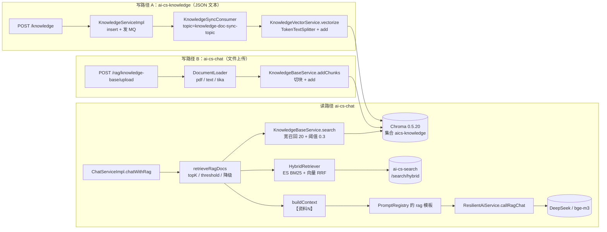
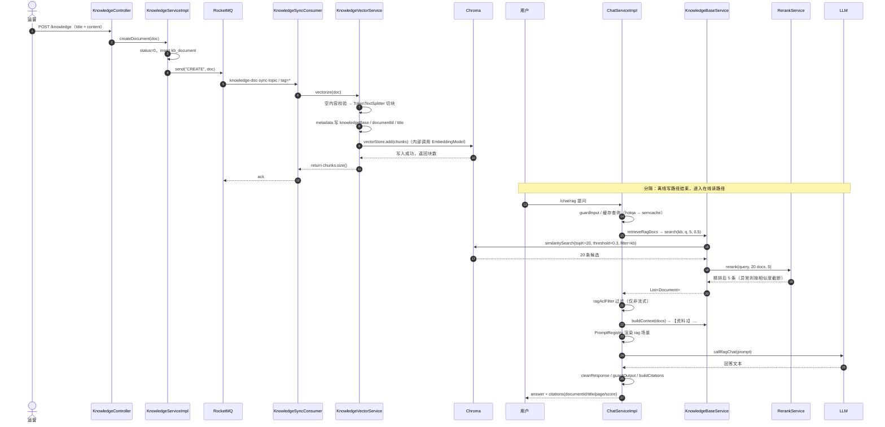

# RAG 检索增强开发：从空工程到能回答公司制度问题的最小 RAG

> **一句话结论**：最小 RAG 只有六步——读文档、切块、向量化、入库、检索、拼 prompt 调模型；本项目六步全都有，但决定「能不能答对」的不是模型，而是切块边界、id 稳定性、阈值一致性与降级路径这四处工程细节。
> **阅读前置**：先看本系列 [01-RAG检索增强生成.md](01-RAG检索增强生成.md) 建立概念，再看 [01-SpringAI入门](../01-SpringAI框架集成/01-SpringAI入门.md) 掌握 `ChatClient` / Advisor 的用法；能跑 `node` 与 `javap` 即可，本篇不需要本地起 Chroma。
> **证据基线**：A 级 = `24-源码分析/assets/source` 的 Spring AI **2.1.0** 源码摘录；B 级 = 本仓 `ai-cs-chat` / `ai-cs-knowledge` 源码（行号逐条 `read` 核对）；C 级 = 本机 `node v24.16.0` / `javap` 实测（无 docker / chroma / es / redis）。预计阅读 45 分钟。

先把证据边界讲清楚，否则后面每一句话你都只能选择「信」或「不信」：

| 类别 | 本仓状态 | 本篇怎么处理 |
|---|---|---|
| A 级 Spring AI 2.1.0 源码摘录 | 已入库（`assets/source` 共 905 份 .md 摘录），本篇用到的 `VectorStore` / `SearchRequest` / `Document` / `TokenTextSplitter` / `ChatClient` / `Usage` / `EmbeddingModel` 都在 | 代码块首行标 `(src: Xxx.java.md#Lx-Ly)`，块内不写中文注释 |
| `QuestionAnswerAdvisor` / `RetrievalAugmentationAdvisor` | **未入库**（`assets/source` 里没有这两份摘录） | 只用 B 级（本项目 `SpringAiConfig` 的实际配置）说明，**不引 A 级行号** |
| B 级 本项目代码 | `ai-cs-chat`、`ai-cs-knowledge` 全部真实存在 | 写成 `路径#L起-L止`，每一条都 `read` 过原文 |
| C 级 可复现实测 | 本机无 `docker` / `chroma` / `redis-cli`，`127.0.0.1:8000/9200/6379` 均未监听 | 只做**切块边界**与**id 生成规则**的静态推演，明确标「模拟推演」，**不写任何召回率/延迟数字** |
| Chroma 服务端 / Tika 解析行为 | 未入库 | 标注「未入库，依据官方文档/本项目代码」 |

探测命令与真实输出（PowerShell，单条命令 < 1 秒）：

```text
PS> foreach ($c in 'docker','chroma','redis-cli','curl','node') { $p = Get-Command $c -ErrorAction SilentlyContinue; "{0,-10} {1}" -f $c, ($(if ($p) { "FOUND" } else { "NOT FOUND" })) }
docker     NOT FOUND
chroma     NOT FOUND
redis-cli  NOT FOUND
curl       FOUND
node       FOUND
PS> foreach ($port in 8000,9200,6379) { "port $port listening=" + (Test-NetConnection -ComputerName 127.0.0.1 -Port $port -InformationLevel Quiet -WarningAction SilentlyContinue) }
port 8000 listening=False
port 9200 listening=False
port 6379 listening=False
PS> node -v
v24.16.0
```

怎么读：`NOT FOUND` + `listening=False` 说明本篇任何「导入后去 Chroma 查一下」的操作都做不了，因此第四步入库的效果只能靠**代码与 javadoc** 判断，不能靠观察库里数据。这也是为什么本篇把 C 级实测限定在「切块」和「id」这两件纯计算的事上。

---

## 0. 先看现象

三个症状，都是这套代码在其真实结构下**必然**会遇到的，日志原文来自本项目源码里真实存在的 `log.*` 语句。

**症状一：上传返回 200，`chunks` 是 0，检索永远空**

```text
$ curl -X POST "http://localhost:8080/rag/knowledge-base/upload" \
    -F "knowledgeBase=hr" -F "file=@员工考勤与请假管理制度.docx"
{"code":200,"message":"success","data":{"knowledgeBase":"hr","fileName":"员工考勤与请假管理制度.docx","chunks":0}}
```

接口成功、文件也收到了，就是 0 块。此时服务端日志里通常有其中一条：

```text
c.aics.chat.rag.DocumentLoader        : 读取Tika文档失败, file=员工考勤与请假管理制度.docx, err=...
c.aics.knowledge.service.KnowledgeVectorService : 文档内容为空，跳过向量化: id=12
c.aics.knowledge.service.KnowledgeVectorService : 文档向量化失败: id=12, err=...
```

对应两条代码路径：`DocumentLoader` 的三种 `load*` 方法**失败即返回空列表**（`ai-cs-chat/src/main/java/com/aics/chat/rag/DocumentLoader.java#L88-L97`），`KnowledgeVectorService.vectorize` 的空内容分支与 catch 分支**都 `return 0`**（`ai-cs-knowledge/src/main/java/com/aics/knowledge/service/KnowledgeVectorService.java#L69-L92`）。返回值是 `int`，不是异常，所以 HTTP 层看到的是「成功」。

**症状二：同一份文档导入两次，库里翻倍**

```text
知识库[hr]入库完成, 共4个分块
知识库[hr]入库完成, 共4个分块
```

两条日志之间没有任何「删除旧分块」的动作（`ai-cs-chat/src/main/java/com/aics/chat/service/KnowledgeBaseService.java#L159-L181` 里只有 `vectorStore.add(chunks)`）。而入库用的 `documentId` 元数据取的是 `chunk.getId()`——即 `Document` 构造时由 `RandomIdGenerator` 生成的随机 id，两次导入的 id 天然不同，库里就是 8 块。第 3.4 节用一段 node 脚本把这件事算给你看。

**症状三：问「年假有几天」，命中的却是目录页**

检索回来的片段长这样：

```text
目录
第一章 总则 ........ 1
第二章 工作时间 ........ 2
第三章 请假流程 ........ 3
```

原因有两个，都在切块阶段：一是 PDF/Word 的目录页被当成正文一起切；二是按段落切块时，目录恰好自成一个短块（第 3.2 节的实测：101 字符、约 53 token），「请假」「审批」这些词都出现在这一块里，向量上很容易被问题命中。

这些现象指向同一件事：RAG 的失败几乎都发生在**入库之前（切块、id、解析）**和**检索之后（阈值、降级、上下文拼装）**这两端，大模型只负责最后一公里，它无法替你补回一个没进库、或切错边界的片段。

---

## 1. 整体地图



| 组件 | 责任 | 谁调用它 |
|---|---|---|
| `KnowledgeController`（knowledge） | 知识文档 CRUD 的 REST 入口，路径前缀 `/knowledge`（`ai-cs-knowledge/src/main/java/com/aics/knowledge/controller/KnowledgeController.java#L31-L50`） | 知识后台前端 |
| `KnowledgeServiceImpl` | 写 DB 后投递 CREATE / UPDATE / DELETE 同步消息 | `KnowledgeController` |
| `KnowledgeSyncConsumer` | 消费 `knowledge-doc-sync-topic`，按 action 分发到向量化或按 `documentId` 删除 | RocketMQ |
| `KnowledgeVectorService` | 切块 + 附加元数据 + `vectorStore.add`，返回块数 | `KnowledgeSyncConsumer` |
| `KnowledgeBaseController`（chat） | `/rag/knowledge-base` 下的文本入库、文件入库、检索测试三个接口（`ai-cs-chat/src/main/java/com/aics/chat/controller/KnowledgeBaseController.java#L43-L86`） | 联调 / 运营 |
| `DocumentLoader`（chat） | 按后缀路由到 `PagePdfDocumentReader` / `TextReader` / `TikaDocumentReader` | `KnowledgeBaseService.addFile` |
| `KnowledgeBaseService`（chat） | 切块入库（写）、两阶段检索（读）、上下文拼装 | `KnowledgeBaseController`、`ChatServiceImpl` |
| `HybridRetriever`（chat） | 混合检索；搜索服务不可用时降级纯向量 | `ChatServiceImpl.retrieveRagDocs` |

> **读图说明**：图里最容易被看错的是「写路径有两条」。A 路在 knowledge 服务，只吃 JSON 文本（`POST /knowledge`），落向量是经 RocketMQ **异步**完成的；B 路在 chat 服务，吃 multipart 文件（`POST /rag/knowledge-base/upload`），落向量是**同步**的。两条路写的是**同一个集合** `aics-knowledge`。如果你把这两条读成一条，就会去 `ai-cs-knowledge` 里找 `MultipartFile`——那里没有，文件解析全在 chat 侧；这正是旧版本文档把 `DocumentLoader` 归错服务的原因。另外注意 `ai-cs-search` 只服务「混合检索」这一条边，纯向量检索完全不经过它，所以「搜索服务挂了 RAG 就不能用」是错的。

### 1.1 六步最小实现与本项目的对应关系

| 步骤 | 该写什么 | 本项目对应的类/方法 | 落地状态 |
|---|---|---|---|
| ① 读文档 | 把文件读成 `Document`（文本 + 元数据） | `DocumentLoader.loadPdf/loadText/loadTika` | 已落地（含静默失败缺陷） |
| ② 切块 | `TokenTextSplitter` 或等价策略，块大小/重叠可控 | `new TokenTextSplitter()` 无参（默认 800 / 0 / 350） | 已落地（参数未显式配置） |
| ③ 向量化 | 调 `EmbeddingModel`，注意维度一致性 | `@Primary` bge-m3（1024 维），另有 768 维本地哈希 provider | 已落地（双 provider 有串用风险） |
| ④ 入库 | `VectorStore.add` 或 `upsert`，id 必须稳定 | `vectorStore.add(chunks)` | 部分落地（幂等未落地） |
| ⑤ 检索 | `SearchRequest` 四件套 + 两阶段精排 | `KnowledgeBaseService.search` + `RerankService` | 已落地（阈值三处不一致） |
| ⑥ 拼 prompt 调模型 | 引用编号 + 「只依据资料回答」约束 | `buildContext` + `PromptRegistry` 的 `rag` 场景 | 已落地（流式无 ACL） |

---

## 2. 关键概念与关键类

先统一术语，后文不再解释：

- **切块（chunking）**：把长文档切成能被单独检索的小片段；片段叫 **chunk**。
- **Embedding（嵌入）**：把一段文本映射成一个定长浮点数组（向量），语义相近的文本向量距离近。维度（dimension）就是这个数组的长度。
- **向量库**：存「向量 + 原始文本 + 元数据」并支持「按向量相似度找最近的 K 条」的数据库；本项目用的是 Chroma。
- **topK**：检索返回多少条；**相似度阈值（similarityThreshold）**：低于该分数的结果直接丢弃，`0.0` 表示不过滤。
- **Rerank（精排）**：用专门的交叉编码模型对「问题-文档」成对打分，比向量相似度准，但贵且慢，所以只对少量候选做。
- **RRF（Reciprocal Rank Fusion）**：只按「名次」而不是「分数」融合多路检索结果的算法，`1/(k+rank)` 累加。
- **幂等（idempotent）**：同样的输入执行一次和多次，最终状态一致。向量入库的幂等键就是 `Document.id`。
- **ACL**：access control list，这里的含义是「这次检索有没有按用户权限过滤知识库」。

| 名称 | 位置 | 角色 | 关键方法 / 字段 |
|---|---|---|---|
| `Document` | spring-ai-commons（A：`Document.java.md#L182-L235`） | 检索的最小单位：id + text + metadata + score | `Document(text, metadata)`、`builder()`、`getId()/getText()/getMetadata()/getScore()`、`mutate()` |
| `TokenTextSplitter` | spring-ai-commons（A：`TokenTextSplitter.java.md#L41-L55`） | 按 token 切块并做标点边界对齐 | `split(Document)`、`apply(List<Document>)`、`builder().withChunkSize(...)` |
| `EmbeddingModel` | spring-ai-model | 文本 → 向量 | `embed(String)` / `embed(List<String>)` |
| `VectorStore` | spring-ai-vector-store（A：`VectorStore.java.md#L46-L82`） | 向量库抽象：写（add/upsert）、删（delete）、查（similaritySearch） | `add(List<Document>)`、`upsert(List<EmbeddedDocument>)`、`delete(String filterExpression)` |
| `SearchRequest` | spring-ai-vector-store（A：`SearchRequest.java.md#L37-L60`） | 一次检索的参数对象 | `query` / `topK`（默认 4）/ `similarityThreshold`（默认 0.0）/ `filterExpression` |
| `ChatClient` | spring-ai-client-chat（A：`ChatClient.java.md#L61-L532`） | 调用大模型的统一入口，带 Advisors 链 | `prompt().user(...).call().content()` |
| `Usage` | spring-ai-model（A：`Usage.java.md#L37-L59`） | token 计量 | `getPromptTokens()` / `getCompletionTokens()` / `getTotalTokens()` |
| `KnowledgeVectorService` | `ai-cs-knowledge/src/main/java/com/aics/knowledge/service/KnowledgeVectorService.java#L69-L92` | knowledge 侧唯一写向量入口 | `vectorize(KnowledgeDocument)`、`deleteByDocumentId(Long)` |
| `KnowledgeBaseService` | `ai-cs-chat/src/main/java/com/aics/chat/service/KnowledgeBaseService.java#L112-L293` | chat 侧写 + 读 + 拼上下文 | `addText` / `addFile` / `addChunks` / `search` / `searchRaw` / `buildContext` |
| `DocumentLoader` | `ai-cs-chat/src/main/java/com/aics/chat/rag/DocumentLoader.java#L43-L97` | 三种格式加载器，失败返回空列表 | `loadPdf` / `loadText` / `loadTika` |
| `QuestionAnswerAdvisor` | `ai-cs-chat/src/main/java/com/aics/chat/config/SpringAiConfig.java#L267-L273`（**A 级未入库**） | Spring AI 内置 RAG Advisor，调用前自动检索并注入上下文 | `QuestionAnswerAdvisor.builder(vectorStore).searchRequest(...)` |
| `RerankService` | 本项目 `com.aics.chat.rag.rerank` 包（可选 Bean） | 硅基流动 rerank 精排 | `rerank(query, docs, topN)` 返回 `Mono<List<RerankResultItem>>` |

---

## 3. 原理与证据逐段精读

每一小节都按四层走：**在干什么 → 为什么这么设计 → 换写法会怎样 → 常见坑**。

### 3.1 第一步：读文档——先把「文件」变成「文本 + 元数据」

**在干什么**：把 `.pdf` / `.txt` / `.docx` 变成一个或多个 `Document`，每份文档自带 id 与 metadata，后续切块、入库、溯源都以它为最小载体。

```java
// 最小实现：一个 txt → 一个 Document
Resource res = new FileSystemResource("员工考勤与请假管理制度.txt");
List<Document> docs = new TextReader(res).get();
```

本项目对「一个文件」的加载做了后缀路由，三种 Reader 各管一摊（`ai-cs-chat/src/main/java/com/aics/chat/rag/DocumentLoader.java#L43-L97`）：

```java
// PDF：按页切，一页一个 Document，并把 page_number 写进 metadata
new PagePdfDocumentReader(resource, PdfDocumentReaderConfig.builder()
        .withPageTopMargin(0).withPageBottomMargin(0).withPagesPerDocument(1).build()).get();

// txt / md：整篇一个 Document
new TextReader(resource).get();

// docx / xlsx / html / htm：Tika 统一解析
new TikaDocumentReader(resource).get();
```

`Document` 的构造决定了 id 从哪来，这一点直接决定第四步能不能做幂等：

```java
public Document(@Nullable String text, Map<String, Object> metadata) {
    this(new RandomIdGenerator().generateId(), text, null, metadata, null);
}
```

(src: Document.java.md#L182-L184)

**为什么这么设计**：`Document` 把 id 做成「可显式提供、也可默认生成」两选一，是为了让「随手创建」和「可控入库」两种场景都不别扭。默认生成随机 id 对「一次性检索」友好，对「可重跑入库作业」就不友好了——而入库作业恰恰要求同一份输入产出同一批 id。

**换写法会怎样**：如果用 `TextReader` 读 PDF，你会拿到一堆二进制噪声；如果自己 `new Document(readAllBytes(file))` 手工读 docx，样式和表格全丢，切块后正文残缺。用 Tika 的代价是重（首次启动加载解析器），收益是一份代码覆盖六七种格式。

**常见坑**：
- **失败即空列表**。本项目三种 `load*` 全部在 `catch` 里 `log.error` + `return new ArrayList<>()`，上层 `addChunks` 不校验空集合，于是「上传成功、0 块入库」。这是症状一的根因。
- **PDF 一页一个 Document，再加切块**，长页会被二次切分，长段落跨页时会被硬切开；`page_number` 元数据也只有 PDF 才有，txt/docx 的引用卡片里没有页码可显示。
- 目录页、页眉页脚、水印都会被当成正文——这就是症状三的前半段，需要在解析后、切块前做一次「剔除目录」的预处理（本项目**未落地**）。

> **落地面**：解析层（三种 Reader）已落地；目录/页眉清洗、空解析结果告警**未落地**。

### 3.2 第二步：切块——决定召回精度的第一现场

**在干什么**：把一篇几千字的文档切成十几个几百 token 的片段。Spring AI 的实现是「按 token 数量取窗口 + 在末尾用标点回退对齐」。

先看它的全部默认值，这些数字你迟早要背下来：

```java
private static final int DEFAULT_CHUNK_SIZE = 800;
private static final int DEFAULT_CHUNK_OVERLAP = 0;
private static final int MIN_CHUNK_SIZE_CHARS = 350;
private static final int MIN_CHUNK_LENGTH_TO_EMBED = 5;
private static final int MAX_NUM_CHUNKS = 10000;
private static final boolean KEEP_SEPARATOR = true;
private static final List<Character> DEFAULT_PUNCTUATION_MARKS = List.of('.', '?', '!', '\n');
```

(src: TokenTextSplitter.java.md#L41-L53)

主循环取 800 个 token 后，只有在**后面还有内容**时才做边界对齐，最后一块不折腾：

```java
if (chunkEnd < tokens.size()) {
    finalTokenCount = optimizeChunkBoundary(chunkText, chunkEnd - chunkStart, chunk);
}
...
int advance = Math.max(1, finalTokenCount - chunkOverlap);
```

(src: TokenTextSplitter.java.md#L218-L227)

而「对齐」不是无限回退，文本短于 350 字符就原样返回，标点位置必须落在 350 字符之后才切：

```java
if (chunkText.length() <= minChunkSizeChars) {
    return tokenCount;
}
int lastPunctuationIndex = getLastPunctuationIndex(chunkText);
if (lastPunctuationIndex > minChunkSizeChars) {
    return lastPunctuationIndex;
}
```

(src: TokenTextSplitter.java.md#L264-L280)

**为什么这么设计**：切块有三个互相冲突的目标——块要足够小（向量才准、上下文才放得下）、块要语义完整（不能把一条条款劈成两半）、块之间要有上下文（跨块引用不丢）。800 token 是「一个条款 + 少量相邻条款」的常见体量；`minChunkSizeChars=350` 是为了防止「为了对齐标点把 800 token 的块缩成 100 token」；`overlap=0` 则是默认配置的取舍——省 token，代价是边界信息丢一点。

**换写法会怎样**：改成定长字符切块，实现最省事，但在中文里会大量切断词语和条款；改成纯段落切块，语义最完整，但块长方差极大（一段 13 字符、一段 263 字符），短块在向量空间里几乎是噪声；改成按标题层级的语义切块，效果最好，但需要感知 Markdown/Word 的标题结构，解析成本高。

这三种方式的差别，用一段 886 字符的制度文档算给你看（C 级实测，脚本见本节末）：

```text
原文：字符数=886 token估算=670

== A 定长 350 字符 ==
片段数=3 字符 min/max/avg=186/350/295 token估算合计=671
  [0] len= 350 tok≈ 248 句末对齐=N 《员工考勤与请假管理制度》//目录/ … 直属主管审批。/第五条 每月
  [1] len= 350 tok≈ 280 句末对齐=N 补卡次数累计不得超过 3 次，超过部 … 视为加班。/第十二条 工作日
  [2] len= 186 tok≈ 143 句末对齐=Y 加班按 1 倍时长调休，休息日加班按 … 5 天，公司可解除劳动合同。

== B 按空行段落（整篇） ==
片段数=7 字符 min/max/avg=13/263/125 token估算合计=670
  [0] len=  13 tok≈  12 句末对齐=N 《员工考勤与请假管理制度》 … 《员工考勤与请假管理制度》
  [1] len= 101 tok≈  53 句末对齐=N 目录/第一章 总则 ........ … 规处理 ........ 7
  [2] len=  88 tok≈  79 句末对齐=Y 第一章 总则/第一条 为规范公司考勤 … 及实习生。外包人员参照执行。
  [3] len= 167 tok≈ 125 句末对齐=Y 第二章 工作时间/第三条 公司实行标 … 3 次，超过部分按迟到处理。
  [4] len= 263 tok≈ 206 句末对齐=Y 第三章 请假流程/第六条 请假类型包 … 请且无正当理由的按旷工处理。
  [5] len= 133 tok≈ 112 句末对齐=Y 第四章 加班与调休/第十一条 加班须 … 效期为 6 个月，逾期作废。
  [6] len= 109 tok≈  83 句末对齐=Y 第五章 违规处理/第十四条 迟到或早 … 5 天，公司可解除劳动合同。

== C 段落聚合 token 预算 300 ==
片段数=3 字符 min/max/avg=244/375/294 token估算合计=671
  [0] len= 375 tok≈ 270 句末对齐=Y 《员工考勤与请假管理制度》//目录/ … 3 次，超过部分按迟到处理。
  [1] len= 263 tok≈ 206 句末对齐=Y 第三章 请假流程/第六条 请假类型包 … 请且无正当理由的按旷工处理。
  [2] len= 244 tok≈ 195 句末对齐=Y 第四章 加班与调休/第十一条 加班须 … 5 天，公司可解除劳动合同。
```

**怎么读这张表**（这是本篇最重要的读法）：

1. 看 `句末对齐` 列。A 方式 3 块里有 **2 块**切在条款中途——`第五条 每月` 和 `补卡次数累计不得超过 3 次` 被拆到两个块里，检索「补卡几次」时可能只召回后半句，模型看到的是「超过部分按迟到处理」却没有前提。
2. 看块的**首尾内容**。B 方式把目录单独切成 101 字符 / 约 53 token 的一块，`请假`、`总则`、`违规处理` 这些词全在里面，问题一问「请假流程」它就有不错的名次——**这就是症状三**。同时标题「《员工考勤与请假管理制度》」单独成 13 字符块，是纯噪声。
3. 看**块长均匀度**。C 方式（段落聚合到 token 预算 300 再按句号对齐）块长 244/263/375，方差最小、全部句末对齐，是三种里最适合入库的。
4. 注意 C 方式的第 0 块仍然把「目录 + 第一章 + 第二章」粘在一起——**切块算法再好也治不了脏输入**，目录必须在切块前剔掉。

复现方式：把下面两段拼存成 `rag-chunk-demo.mjs`，`node rag-chunk-demo.mjs` 即可。第一段是样本与 token 估算口径：

```js
// 样本：一篇带目录的制度文档（真实项目里这来自 DocumentLoader 的输出）
const DOC = `《员工考勤与请假管理制度》

目录
第一章 总则 ........ 1
第二章 工作时间 ........ 2
第三章 请假流程 ........ 3
第四章 加班与调休 ........ 5
第五章 违规处理 ........ 7

第一章 总则
第一条 为规范公司考勤管理，保障员工与公司的合法权益，结合公司实际情况，制定本制度。
第二条 本制度适用于公司全体正式员工、试用期员工及实习生。外包人员参照执行。

第二章 工作时间
第三条 公司实行标准工时制，每日工作 8 小时，每周工作 5 天，工作时间上午 9:00 至 12:00，下午 13:30 至 18:30。
第四条 员工上下班须通过企业微信打卡，每日两次。忘记打卡的，须在 3 个工作日内提交补卡申请，由直属主管审批。
第五条 每月补卡次数累计不得超过 3 次，超过部分按迟到处理。

第三章 请假流程
第六条 请假类型包括事假、病假、年假、婚假、产假、陪产假、丧假。
第七条 请假 1 天以内由直属主管审批；1 天以上 3 天以内由部门负责人审批；3 天以上须报人力资源部备案并由分管副总审批。
第八条 病假须提供二级以上医院出具的病假证明。连续病假超过 15 天的，按国家规定处理。
第九条 年假天数按司龄计算：司龄满 1 年不满 10 年的 5 天，满 10 年不满 20 年的 10 天，满 20 年的 15 天。
第十条 请假须提前 1 个工作日在考勤系统提交申请，未提前申请且无正当理由的按旷工处理。

第四章 加班与调休
第十一条 加班须提前申请，由部门负责人审批，未经审批的延长工作时间不视为加班。
第十二条 工作日加班按 1 倍时长调休，休息日加班按 1.5 倍调休或支付加班费，法定节假日加班按 3 倍支付加班费。
第十三条 调休假有效期为 6 个月，逾期作废。

第五章 违规处理
第十四条 迟到或早退 30 分钟以内，每次扣减当月绩效 50 元；超过 30 分钟按半天事假处理。
第十五条 旷工 1 天扣发 3 天工资，连续旷工 3 天或年度累计旷工 5 天，公司可解除劳动合同。`;

// token 估算：CJK 字符 1 token、其余字符约 4 个 1 token（近似口径，不是真实 tokenizer）
const estTokens = (s) => {
  const cjk = (s.match(/[\u4e00-\u9fa5]/g) || []).length;
  return Math.ceil(cjk + (s.length - cjk) / 4);
};
```

第二段是三种切块与统计输出：

```js
const fixedChars = (text, size) => {
  const out = [];
  for (let i = 0; i < text.length; i += size) out.push(text.slice(i, i + size));
  return out;
};
const byParagraph = (text) => text.split(/\n{2,}/).map((s) => s.trim()).filter(Boolean);
const tokenBudget = (text, budget) => {
  const out = [];
  let buf = '';
  for (const p of byParagraph(text)) {
    const next = buf ? `${buf}\n\n${p}` : p;
    if (buf && estTokens(next) > budget) { out.push(buf); buf = p; } else { buf = next; }
  }
  if (buf) out.push(buf);
  return out.map((c) => {                       // 句号对齐：不在句末的块回退到最后一个「。」
    const cut = c.lastIndexOf('。');
    return cut > c.length * 0.6 ? c.slice(0, cut + 1) : c;
  });
};
const show = (name, chunks) => {
  const lens = chunks.map((c) => c.length);
  console.log(`\n== ${name} ==`);
  console.log(`片段数=${chunks.length} 字符 min/max/avg=${Math.min(...lens)}/${Math.max(...lens)}/${Math.round(
    lens.reduce((a, b) => a + b, 0) / lens.length)} token估算合计=${chunks.map(estTokens).reduce((a, b) => a + b, 0)}`);
  chunks.forEach((c, i) => {
    const head = c.slice(0, 18).replace(/\n/g, '/');
    const tail = c.slice(-14).replace(/\n/g, '/');
    console.log(`  [${i}] len=${String(c.length).padStart(4)} tok≈${String(estTokens(c)).padStart(4)} ` +
      `句末对齐=${/[。！？]$/.test(c.trim()) ? 'Y' : 'N'} ${head} … ${tail}`);
  });
};
console.log(`原文：字符数=${DOC.length} token估算=${estTokens(DOC)}`);
show('A 定长 350 字符', fixedChars(DOC, 350));
show('B 按空行段落（整篇）', byParagraph(DOC));
show('C 段落聚合 token 预算 300', tokenBudget(DOC, 300));
```

**常见坑**：
- **以为 `new TokenTextSplitter()` 是「推荐写法」**。它在 2.1.0 里已 `@Deprecated(since = "2.0.0-M3", forRemoval = true)`（src: TokenTextSplitter.java.md#L81-L88），本项目两处都在用（`KnowledgeBaseService.java#L114`、`KnowledgeVectorService.java#L77`）。能用，但升级时会先炸这里。
- **块太大导致「搜不到」**。文档里 800 token 一块，一条具体条款只占其中 20%，向量被整块语义稀释，分数掉到阈值以下就召不回。小制度文档应该显式用 `TokenTextSplitter.builder().withChunkSize(300).build()`。
- **切块参数改了就忘重新入库**。块大小是入库时固化的，改代码只影响新数据，旧块要全量重导（本项目**没有**重导脚本，属未落地）。

> **落地面**：切块已落地（默认参数、无 overlap、无目录清洗）；显式配置切块参数、按标题语义切块、改参后重导**未落地**。

### 3.3 第三步：向量化——维度一致比模型选型更要命

**在干什么**：把每个 chunk 的文本送进 `EmbeddingModel`，得到一条定长向量，跟文本、元数据一起写进向量库。

本项目**关掉了 Spring AI 的自动装配**，改为手写两个 provider：

```yaml
spring:
  ai:
    model:
      embedding: none   # 禁用自动装配，由 SpringAiConfig 手动提供
```

（`ai-cs-chat/src/main/resources/application.yml#L37-L38`）

主 provider 是硅基流动的 bge-m3，用 OpenAI 兼容协议调：

```java
OpenAiEmbeddingModel model = new OpenAiEmbeddingModel(
        embeddingClient,                                  // base-url=api.siliconflow.cn
        MetadataMode.EMBED,                               // 只把正文拿去向量化，元数据不进向量
        OpenAiEmbeddingOptions.builder().model("BAAI/bge-m3").build());
```

（`ai-cs-chat/src/main/java/com/aics/chat/config/SpringAiConfig.java#L171-L204`）

**为什么这么设计**：`spring.ai.model.embedding: none` 是刻意为之——项目里有**两个** embedding provider（768 维本地哈希兜底 + 1024 维 bge-m3 `@Primary`），自动装配会在两者之间摇摆，显式关掉才能保证「谁写库谁读库用同一个模型」。`MetadataMode.EMBED` 也是刻意选择：元数据（documentId、title）不应该参与语义计算，否则同一段文本换个标题就会得到不同向量。

**换写法会怎样**：如果让自动装配挑默认实现，很可能出现「写库用 1024 维 bge-m3、检索用 768 维哈希」的错配。同一集合里的向量维度必须一致，否则写入会被服务端拒绝（未入库，依据 Chroma 官方文档与向量库通用约定）。反过来，如果为了省钱全程用本地哈希 provider，768 维、零 API 成本，但它是**按字面 token 哈希**的，语义相近不等于向量相近，「请假」和「休假」几乎不相关，RAG 会退化成关键词匹配。

**常见坑**：
- **维度串用**：两个 provider 都标了名字相近的 Bean，某个服务忘了 `@Primary` 或换了 profile，就会出现「chat 写得进、search 查不到」的诡异现象。
- **向量化有成本但没记账**：embedding 是按 token 计费的，本项目在 chat 侧挂了 `CachingEmbeddingModel`（`SpringAiConfig.java#L193-L203`，以模型名做缓存命名空间），knowledge 侧**没有**缓存——同一份文档删掉重导，重新付一次钱。
- **超长文本截断无提示**：单个 chunk 若超过模型上下文，provider 可能静默截断，向量只代表前半段。这也是一条「导入成功但搜不到」的隐蔽成因。

> **落地面**：双 provider 与 `@Primary` 已落地；维度校验、knowledge 侧 embedding 缓存**未落地**。

### 3.4 第四步：入库与幂等——`add` 会让你导一次多一份

**在干什么**：把带向量的 chunk 写进向量库。Spring AI 的 `VectorStore` 提供两种写语义，差别是**幂等性的责任归属**：

```java
void add(List<Document> documents);

default void upsert(List<EmbeddedDocument> entries) {
    throw new UnsupportedOperationException(getName() + " does not support upsert");
}
```

(src: VectorStore.java.md#L51-L82)

javadoc 把两者的区别写得非常明确：

- `add`：「Throws an exception if the underlying provider checks for duplicate IDs.」——**重复 id 的行为交给 provider 决定**，可能报错、可能追加、可能覆盖，你不能假设。
- `upsert`：写语义是 **replace-by-id**，id 已存在则替换整行、否则插入，因此「an ingestion job that uses stable ids is safe to re-run — the same input yields the same rows with no duplicates」；而且「若某批失败，调用方应当整批重试，replace-by-id 使重试安全」。

注意 `upsert` 吃的是 `EmbeddedDocument`（`Document` + 调用方自算的 `float[]` 向量），**不是** `Document`——它绕过 store 自己的 embedding 模型。这一点不看签名很容易踩（第 7 节有 `javap` 实证）。

**为什么这么设计**：`add` 是历史接口，语义最弱、对 provider 最宽容；`upsert` 是 2.1.0 才加的（`@since 2.1.0`），专门为「可重跑的入库作业」设计，把幂等语义从「provider 各自为政」提升为「接口级承诺」。API 设计者把补向量这一步留给调用方，是为了让「先批量算向量、再批量写库」这种更高效的两段式流程成为可能。

**换写法会怎样**：本项目两处入库都用 `add`，且 `documentId` 元数据的来源不同，后果也不同：

| 位置 | `documentId` 取值 | 重复导入的后果 |
|---|---|---|
| knowledge 侧 `KnowledgeVectorService.vectorize` | `doc.getId()`（DB 主键，稳定） | 用 `add` → 翻倍；改用 `upsert` 或「先按 documentId 删再 add」即幂等 |
| chat 侧 `KnowledgeBaseService.addChunks` | `chunk.getId()`（切块后随机 UUID） | 天然不可能幂等，即使换 `upsert` 也拦不住 |

（B 级：`ai-cs-knowledge/src/main/java/com/aics/knowledge/service/KnowledgeVectorService.java#L79-L85`、`ai-cs-chat/src/main/java/com/aics/chat/service/KnowledgeBaseService.java#L168-L178`）

一段脚本把「随机 id」和「稳定 id」的差别算清楚，这是纯计算、不连库（模拟推演）：

```js
import { randomUUID, createHash } from 'node:crypto';
const chunks = [
  '第九条 年假天数按司龄计算：司龄满 1 年不满 10 年的 5 天。',
  '第十条 请假须提前 1 个工作日在考勤系统提交申请。',
];
// A) Document(text, metadata) 默认走 RandomIdGenerator → UUID 形态
const randomIdUpload = () => chunks.map(() => randomUUID());
// B) 稳定 id：文档指纹 + 块序号（同文档、同切块参数 → 同 id）
const stableIdUpload = (title) =>
  chunks.map((c, i) => createHash('sha256').update(`${title}#${i}#${c}`).digest('hex').slice(0, 32));

const u1 = randomIdUpload(), u2 = randomIdUpload();
console.log(`A 两次随机 id 相交数 = ${u1.filter((x) => u2.includes(x)).length} → 库里 4 块（重复）`);
const s1 = stableIdUpload('员工考勤与请假管理制度'), s2 = stableIdUpload('员工考勤与请假管理制度');
console.log(`B 两次稳定 id 相交数 = ${s1.filter((x) => s2.includes(x)).length} → upsert 下库里 2 块（覆盖）`);
```

真实输出：

```text
A 两次随机 id 相交数 = 0 → 库里 4 块（重复）
B 两次稳定 id 相交数 = 2 → upsert 下库里 2 块（覆盖）
```

怎么读：随机 id 两次导入**交集恒为 0**，所以「同一份文档导两次」必然 2 倍数据，且这些块之间没有任何能关联到同一文档的键——除了 `documentId` 元数据，而 chat 侧连它都是随机 UUID（见第 6 节第 4 条）。稳定 id 的做法是把「文档指纹 + 块序号」当幂等键：内容不变 id 不变，`upsert` 才能发挥 replace-by-id 的作用。

一份可用的幂等设计，最少需要这三条：

1. **documentId 由业务定，不由随机数定**：`documentId = DB 主键`（knowledge 侧已经这么做了），或 `sha256(title + "#" + chunkIndex + "#" + chunkText)`。
2. **写用 `upsert`；若 store 不支持，则「按 documentId 过滤删除 + add」包在一个重试边界里**（delete 是「失败就整批重来」也安全的操作）。
3. **删除也要按 documentId 过滤**，而不是按块 id 删——块 id 一改，旧块永远留在库里。本项目 `deleteByDocumentId` 正是这么做的（`KnowledgeVectorService.java#L103-L116`）。

**常见坑**：
- **`add` + 随机 id = 没有幂等键**，症状二就是它。
- **以为 `upsert` 会帮你算向量**：它要 `EmbeddedDocument`，你要先 `embeddingModel.embed(...)` 再 `new EmbeddedDocument(doc, vector)`。
- **失败后只重试「没写成功的部分」**：javadoc 明确要求「treat the batch outcome as unknown and retry the whole batch」，因为后端可能已写入一部分。
- **删除用 `delete(String)` 传裸字符串**：`delete(String filterExpression)` 是 `default` 方法，`null` 会抛 `IllegalArgumentException`，表达式语法错误则由底层抛（`VectorStore.java.md#L97-L105`）。

> **落地面**：knowledge 侧 `documentId` 稳定、按 `documentId` 删除已落地；`upsert` 改写、重导去重、写失败补偿队列**未落地**（本项目没有补偿队列，MQ 消息失败即丢）。

### 3.5 第五步：检索——两阶段召回 + 阈值三处不一致

**在干什么**：把用户问题向量化，在库中找最近的 K 条，再精排、再截断。参数对象就四个字段：

```java
public static final double SIMILARITY_THRESHOLD_ACCEPT_ALL = 0.0;
public static final int DEFAULT_TOP_K = 4;
private String query = "";
private int topK = DEFAULT_TOP_K;
private double similarityThreshold = SIMILARITY_THRESHOLD_ACCEPT_ALL;
private Filter.@Nullable Expression filterExpression;
```

(src: SearchRequest.java.md#L44-L60)

本项目把这件事拆成**两阶段**：宽召回（topK=20、阈值 0.3）拿到一批候选，再交给 Rerank 精排到目标条数：

```java
@Value("${aics.rag.recall-top-k:20}") private int recallTopK = 20;
@Value("${aics.rag.recall-threshold:0.3}") private double recallThreshold = 0.3;
...
SearchRequest req = SearchRequest.builder()
        .query("为这个句子生成表示以用于检索相关文章：" + query)   // bge 系列的检索指令前缀
        .topK(topK)
        .similarityThreshold(threshold)
        .filterExpression("knowledgeBase == '" + knowledgeBase + "'")
        .build();
List<Document> results = vectorStore.similaritySearch(req);
```

（字段声明 `ai-cs-chat/src/main/java/com/aics/chat/service/KnowledgeBaseService.java#L94-L99`；检索构造 `#L265-L279`；两阶段编排 `#L228-L260`）

**为什么这么设计**：
- **两阶段**：向量召回快但粗，Rerank 准但贵。粗召回 20 条、精排后取 5 条，是在成本与精度之间最常见的切法。Rerank 挂了就退回按相似度排序（`KnowledgeBaseService.java#L248-L258`），保证对话不中断。
- **阈值 0.3**：宽召回要「宁滥勿缺」。0.3 是刻意放低的，因为精排环节会再筛一次；如果宽召回就用 0.7，很多正确片段会在第一关就被丢掉。
- **query 前缀**：bge-m3 这类模型要求「查询侧」加检索指令前缀，query 和 passage 用不同前缀嵌入，非对称检索才准。这是很多项目漏掉的一步，漏了就是「明明文档里有，就是搜不到」。
- **`filterExpression` 用字符串**：`SearchRequest.builder().filterExpression(String)` 内部会走 `FilterExpressionTextParser` 解析成 AST（`SearchRequest.java.md#L286-L288`），多知识库共用一个集合时靠它做隔离。坑在这里是**字符串拼接**——`knowledgeBase` 直接拼进表达式，取值里一旦带引号就会语法错。

**换写法会怎样**：只做单阶段 topK=5、阈值 0.5，省一次模型调用，代价是「召回的 5 条可能整体偏题，没有重排序来救」。反之把 topK 提到 50，Rerank 成本线性涨，而延迟主要耗在精排上。用 `QuestionAnswerAdvisor` 则是把检索塞进 Advisor 链（本项目 `ragAdvisor` 就是这么配的：`similarityThreshold(0.3)` + `topK(5)`，`SpringAiConfig.java#L267-L273`），好处是 `chatClient.prompt().user(q).call()` 一行搞定，代价是检索参数写死在 Bean 里、每轮对话都检索、且与你手工拼的 context **可能重复注入**。

调用点的阈值并不统一，这一点必须知道：

| 调用位置 | topK | threshold | 说明 |
|---|---|---|---|
| `KnowledgeBaseService.search` 内部宽召回 | 20 | 0.3 | 两阶段的第一阶段，配置项 `aics.rag.*` |
| `ChatServiceImpl.retrieveRagDocs(kb, msg, 5, 0.5, ...)` | 5 | 0.5 | 对话主链路（`ai-cs-chat/src/main/java/com/aics/chat/service/impl/ChatServiceImpl.java#L437`） |
| `HybridRetriever.vector(...)` | topK | **0.0** | 混合检索降级路径，完全不过阈值（`ai-cs-chat/src/main/java/com/aics/chat/rag/retrieve/HybridRetriever.java#L153-L156`） |
| `KnowledgeBaseController.search` | 5 | 0.3 | 检索测试接口（`KnowledgeBaseController.java#L78`） |
| `ragAdvisor`（QuestionAnswerAdvisor） | 5 | 0.3 | Advisor 链自动检索 |

**常见坑**：
- **同一句话在不同入口召回不同结果**，因为你实际上有三套阈值在跑——排查「为什么测试接口能搜到、对话里搜不到」时，先比这五个格子。
- **`topK` 语义被两阶段放大**：`search(kb, q, 5, 0.5)` 的 5 是「精排后返回 5 条」，不是「只召回 5 条」；真正召回 20 条。日志里看到 `宽召回完成: 命中20条` 是正常的。
- **阈值 0.0 传下去意味着不过滤**，混合检索降级路径就是这样，极端情况下会把毫不相关的片段当上下文喂给模型，模型只能靠 prompt 里的「资料里没有就说不知道」兜底。

> **落地面**：两阶段召回 + Rerank 降级已落地；阈值/参数统一到配置中心、按知识库差异化配置**未落地**。

### 3.6 第六步：拼 prompt 调模型——引用编号与「只依据资料」

**在干什么**：把检索到的片段写成带编号的上下文，塞进模板，调模型，再把引用信息回传前端。

上下文拼装是最小实现里最土但最有效的一段（`KnowledgeBaseService.java#L287-L293`）：

```java
StringBuilder sb = new StringBuilder();
for (int i = 0; i < documents.size(); i++) {
    sb.append("【资料").append(i + 1).append("】")   // 编号，让模型能说「按【资料2】」
      .append(documents.get(i).getText())
      .append("\n\n");
}
return sb.toString().trim();
```

模板则外置在配置里，含两条硬约束（`ai-cs-chat/src/main/resources/application-prompt.yml#L53-L63`）：

```text
请严格基于下面的【知识库资料】回答用户问题。
重要规则：
1. 如果资料中没有相关信息，请如实告知："我暂时没有这方面的资料"，不要编造内容
2. 回答时优先引用资料中的内容，不要提及"根据资料/检索结果"之类的表述

【知识库资料】
{{context}}

【用户问题】
{{message}}
```

调用链本体只有一行（`ai-cs-chat/src/main/java/com/aics/chat/service/impl/ResilientAiService.java#L121-L124`）：

```java
holder.getChatClient().prompt().user(prompt).call().chatResponse();
```

**为什么这么设计**：
- **编号**：给模型一个可引用的坐标，citation 才有落脚点；没有编号，模型只能说「资料里提到」，前端没法做「点引用跳原文」。
- **「只依据资料」+「没有就说不知道」**：这是抑制幻觉的最低成本手段。Spring AI 自己的 RAG 模板也是这两条（未入库，见官方 `ContextualQueryAugmenter` 文档），说明这是通行做法而非本项目拍脑袋。
- **「不要提及根据资料」**：纯体验优化，避免回答里出现「根据我检索到的材料」这种机器味。
- **模板外置 + 版本管理**：`PromptRegistry` 支持多版本和灰度，改 prompt 不用发版。

**换写法会怎样**：用 Spring AI 的 `QuestionAnswerAdvisor`，它会自动完成「检索→渲染模板→augment 用户消息」全套，你什么都不用拼；代价是模板不可控、检索只在 Advisor 里做、且和本项目手写的 `retrieveRagDocs`（带混合检索、Rerank、ACL、Observation）能力不对等。本项目两者并存：`ragAdvisor` 注册为默认 Advisor，同时 `ChatServiceImpl` 手工拼 `rag` 场景 prompt——**同一次调用可能注入两遍知识**，这是需要留意的冗余。

**常见坑**：
- **上下文留空没兜底**：本项目在 `context.isBlank()` 时传「（未检索到相关资料）」（`ChatServiceImpl.java#L445`），这也是一种兜底，但更稳妥的做法是直接改走「无法回答」分支，不调模型（见 3.7）。
- **拼接无长度上限**：`buildContext` 对文档数量不做限制，20 条长块可能撑爆上下文。本项目在 citation 侧 `limit(20)`（`ChatServiceImpl.java#L969-L973`），但 context 侧没有 token 预算。
- **prompt 注入**：用户问题被原样塞进模板，如果知识片段里含「忽略以上指令」，模型可能被带跑。要靠 guardInput/guardOutput 兜，不是靠 prompt。

> **落地面**：引用编号、模板外置、版本灰度已落地；上下文 token 预算、prompt 注入防护**未落地**。

### 3.7 无结果与低置信：三条不同的路径，别只写一条

**在干什么**：当检索为空、或分数偏低时，系统必须给出「不像在胡说」的回答。本项目里这件事有三条路径，行为并不一致：

| 路径 | 触发条件 | 实际行为 | 位置 |
|---|---|---|---|
| 手工拼 prompt 路径 | `docs` 为空 | context 填「（未检索到相关资料）」，**照常调模型** | `ChatServiceImpl.java#L444-L453` |
| Advisor 路径（`QuestionAnswerAdvisor`） | 检索为空 | 由 Advisor 内置模板决定，通常是「礼貌告知无法回答」 | `SpringAiConfig.java#L267-L273`（A 级未入库，模板细节不引行号） |
| 混合检索路径 | 搜索服务异常 / 无数据 | 降级纯向量，**不因检索失败而中断** | `HybridRetriever.java#L180-L212` |

降级逻辑本身分两层，值得单独看一眼：

```java
if (result == null || !result.isSuccess() || result.getData() == null
        || result.getData().getRecords() == null) {
    return vector(knowledgeBase, query, topK, "搜索服务无数据");
}
...
} catch (Exception e) {
    log.warn("混合检索失败，降级纯向量: kb={}, query={}, err={}", knowledgeBase, query, e.getMessage());
    return vector(knowledgeBase, query, topK, "搜索服务不可用");
}
```

（`ai-cs-chat/src/main/java/com/aics/chat/rag/retrieve/HybridRetriever.java#L176-L213`）

**为什么这么设计**：RAG 的可用性优先级高于准确率——降级到纯向量只是「稍微差一点」，抛异常就是「整个对话不可用」。所以混合检索的两个失败面（返回空/返回异常）都被接住并降级，且把降级原因记进 `RetrieveResult`，方便观测。

**换写法会怎样**：不做降级，ES 一抖动所有带 `hybrid=true` 的对话直接 500；反过来，无脑降级也不健康——如果天天降级，混合检索等于白做，`degradeReason` 就是为了让这种事在监控里可见。

**常见坑**：
- **把「检索为空」和「检索失败」混为一谈**。空是正常业务状态（知识库确实没有），失败是故障，两者的告警级别不同。
- **低置信没有第二道闸**：本项目没有「最高分 < X 就不回答」的判断，只要有一条约 0.3 分的片段就进 prompt。`aics.eval.gate.*` 的阈值在本仓**全为 null**（评估门禁未落地），所以「答得差」这件事目前既不会拦截也不会告警。
- **流式路径没有 ACL 过滤**：非流式链路有 `ragAclFilter.filter(...)`（`ChatServiceImpl.java#L439`），流式链路直接 `retrieveRagDocs` → `buildContext`，跳过了过滤（`ChatServiceImpl.java#L586-L594`）。这是**已确认的缺陷**，不是设计取舍。

> **落地面**：混合检索两处降级已落地；低置信拦截、评估门禁（20 条 golden 集存在但 `aics.eval.gate.*` 全 null、CI 未接）、流式 ACL**均未落地**。

### 3.8 合起来：一段最小可运行的 Spring AI 写法

把六步写成一段，读的时候对着前文的签名核对——`Document(text)`、`TokenTextSplitter.builder()`、`VectorStore.add(List<Document>)`、`SearchRequest.builder()`、`ChatClient.prompt().user(...).call()`：

```java
@Service
@RequiredArgsConstructor
public class MinimalRagService {

    private final VectorStore vectorStore;
    private final ChatClient chatClient;          // 由 ChatClient.Builder 构建，注入 base-url/api-key

    /** ① 读文档 → ② 切块 → ③④ 向量化并入向量库，返回块数 */
    public int ingest(String knowledgeBase, String documentText, String documentId) {
        List<Document> raw = List.of(new Document(documentText));            // ① 文本来源可换成 Reader
        TextSplitter splitter = TokenTextSplitter.builder()
                .withChunkSize(300)                                          // 小制度文档：块比默认 800 小
                .withChunkOverlap(0)
                .build();
        List<Document> chunks = splitter.apply(raw);                          // ② 切块
        for (int i = 0; i < chunks.size(); i++) {
            Map<String, Object> meta = chunks.get(i).getMetadata();
            meta.put("knowledgeBase", knowledgeBase);
            meta.put("documentId", documentId);                               // ④ 幂等键：业务 id，不用随机 uuid
            meta.put("chunkIndex", i);                                        // 溯源：第几块
        }
        vectorStore.add(chunks);                                              // ③ add 内部调用 EmbeddingModel
        return chunks.size();
    }

    /** ⑤ 检索 → ⑥ 拼 prompt 调模型 */
    public String ask(String knowledgeBase, String question) {
        SearchRequest req = SearchRequest.builder()
                .query("为这个句子生成表示以用于检索相关文章：" + question)
                .topK(20)                                                 // 宽召回
                .similarityThreshold(0.3)                                  // 宁滥勿缺，精排再筛
                .filterExpression("knowledgeBase == '" + knowledgeBase + "'")
                .build();
        List<Document> docs = Optional.ofNullable(vectorStore.similaritySearch(req)).orElse(List.of());
        if (docs.isEmpty()) {
            return "我暂时没有这方面的资料";                                   // 无结果：不调模型
        }
        if (docs.get(0).getScore() != null && docs.get(0).getScore() < 0.35) {
            return "我暂时没有这方面的资料";                                   // 低置信：仍不调模型
        }
        StringBuilder ctx = new StringBuilder();
        for (int i = 0; i < docs.size(); i++) {
            ctx.append("【资料").append(i + 1).append("】").append(docs.get(i).getText()).append("\n\n");
        }
        String prompt = """
                请严格基于下面的【知识库资料】回答用户问题。
                重要规则：
                1. 如果资料中没有相关信息，请如实告知："我暂时没有这方面的资料"，不要编造内容
                2. 回答时优先引用资料中的内容，并标出引用的资料编号，例如【资料2】

                【知识库资料】
                %s

                【用户问题】
                %s
                """.formatted(ctx.toString().trim(), question);
        return chatClient.prompt().user(prompt).call().content();
    }
}
```

这段和本项目的差距，正好就是「最小可用」到「生产可用」的那段路：

| 差异点 | 最小实现 | 本项目 | 结论 |
|---|---|---|---|
| 文件解析 | 只吃纯文本 | PDF/Text/Tika 三路 + 元数据 | 本项目更强，但有静默失败 |
| 切块 | 显式 300 token | 默认 800、无 overlap | 最小实现反而更适配小文档 |
| 幂等键 | 业务 documentId | knowledge 侧稳定 / chat 侧随机 | 本项目参差 |
| 写语义 | `add` | `add` | 两者都未幂等 |
| 检索 | 单阶段 20 + 阈值 | 两阶段 20/0.3 → Rerank | 本项目更强 |
| 无结果 | 直接不调模型 | 传「（未检索到相关资料）」照常调 | **最小实现更安全** |
| 权限 | 无 | 非流式有 ACL、流式无 | 本项目半落地 |
| 观测 | 无 | Observation + Citation + 缓存 | 本项目更强 |

---

## 4. 一次完整执行时序



> **读图说明**：这张图最容易被读错的是两处。第一，**`vectorStore.add` 才触发 embedding**——很多实现里 embedding 是上一步显式做的，本项目的 `add` 内部调 `EmbeddingModel`，所以「写库」这个动作包含了一次远程 API 调用，慢、会失败、会花钱。第二，**MQ 的 ack 在 `vectorize` 返回之后、但 `vectorize` 吞掉了所有异常**：第 12~13 步之间即使失败也 `return 0`，消费者照常 ack，所以图上看不出「失败」，只有日志里有。另外注意第 7 步和第 9 步是同一次 Chroma 交互的两端，中间没有任何「校验文档是否已存在」的步骤——这就是重复导入翻倍的图面证据。

每一步失败分别报什么：

| 失败点 | 触发条件 | 报错 / 日志 | 用户看到 |
|---|---|---|---|
| ① 参数校验 | content 为空 | `文档内容为空，跳过向量化: id=12` | 创建成功，检索永远空 |
| ② 切块 | 文本短于阈值 | 不报错，`TokenTextSplitter` 返回空 List | 同上（块数 0） |
| ③ embedding 调用 | api-key 失效 / 网络不可达 / 超时 | `文档向量化失败: id=12, err=...`（`KnowledgeVectorService.java#L88-L91`） | 创建成功，向量库里什么都没有 |
| ④ Chroma 写入 | Chroma 未就绪 / 集合不存在 | 同上，异常被 `catch` 吞 | 同上 |
| ⑤ MQ 消费 | 消息堆积 / 消费者宕机 | 无日志（消息还在队列里） | 创建成功，但要等 |
| ⑥ 文件解析（chat 侧） | 格式不支持 / 文件损坏 | `读取Tika文档失败, file=...`（`DocumentLoader.java#L88-L97`） | 上传成功，`chunks=0` |
| ⑦ 混合检索 | 搜索服务异常 | `RAG增强检索失败，降级纯向量: mode=..., err=...`（`ChatServiceImpl.java#L958`） | 无感，只是结果变差 |
| ⑧ Rerank | 硅基流动超时 / 限流 | `知识库[hr]Rerank调用异常，降级为相似度排序: ...`（`KnowledgeBaseService.java#L252`） | 无感，按相似度排 |
| ⑨ LLM 调用 | 超时 / 熔断 | `AI服务响应超时，请稍后重试` / `AI服务当前负载较高，已被熔断保护，请稍后再试`（`ChatServiceImpl.java#L1090-L1095`） | 明确错误文案 |

---

## 5. 设计取舍

| 决策点 | 备选方案 | 优点 | 代价 | 本项目怎么选 |
|---|---|---|---|---|
| 切块单位 | 定长字符 / 段落 / token / 标题语义 | token 最接近模型真实计量 | 需 tokenizer，中文边界仍靠标点回退 | token（`TokenTextSplitter`，默认 800/0/350） |
| 块大小 | 300 / 500 / 800 / 1200 | 小块召回准 | 小块上下文碎，块数暴涨 | 800（未按文档类型分化） |
| 块重叠 | 0 / 50 / 100 | 重叠能救边界信息 | token 成本与库容量线性上升 | 0 |
| 幂等键 | 随机 id / DB 主键 / 内容指纹 | 内容指纹天然去重 | 内容微改即新 id，旧块需清理 | knowledge 侧用主键，chat 侧用随机 id |
| 写语义 | `add` / `upsert` / 先删后加 | `upsert` 一次往返且重试安全 | 需自己算向量（`EmbeddedDocument`） | 全部 `add`（未幂等） |
| 写路径模型 | 同步 / 异步 MQ | 异步解耦、写接口快 | 失败无声、无补偿队列 | 异步 MQ（knowledge 侧）+ 同步（chat 上传） |
| 召回策略 | 单阶段 / 宽召回+Rerank / 混合检索 | 两阶段精度高 | 多一次模型调用与延迟 | 宽召回 20 + 阈值 0.3 → Rerank → 降级 |
| 上下文注入 | 手工 `buildContext` / `QuestionAnswerAdvisor` | Advisor 零代码 | 参数写死、可能重复注入 | 两者都在（存在重复注入风险） |
| 无结果处理 | 不调模型 / 传入空占位照常调 | 不调模型省钱且不幻觉 | 用户可能觉得「怎么不试一下」 | 传占位照常调（与最小实现相反） |

**可扩展点清单（按改动成本从低到高）**：

1. **统一阈值到配置中心**：把 0.5 / 0.3 / 0.0 三套收敛成一个 `aics.rag.*`，改 5 行。
2. **`add` → `upsert`**：先 `embeddingModel.embed(...)` 拿向量，构造 `EmbeddedDocument` 再 `upsert`；Chroma 在 2.1.0 已实现 `supportsUpsert`（第 6 节有 `javap` 实证）。
3. **chat 侧 documentId 改成业务 id**：`addChunks` 签名加一个 `documentId` 参数，顺带修好 citation 的数字解析。
4. **幂等键改成内容指纹**：`sha256(title + chunkIndex + text)`，重导天然覆盖。
5. **目录清洗**：解析后按「行内含 `....` 且行数占比高」判定目录块并丢弃——切块前一步，收益比调块大小大得多。
6. **写失败补偿**：`vectorize` 返回值语义化（`0` 之外加失败态），失败入重试队列；或干脆让异常抛出去交给 MQ 重试。
7. **评估门禁**：20 条 golden 集已经在了，把 `aics.eval.gate.*` 阈值填上并接进 CI，才能防「改 prompt 悄悄变差」。

---

## 6. 踩坑与调试手法

| 现象 | 根因 | 验证手段 | 解法 |
|---|---|---|---|
| 上传 200 但 `chunks=0` | `DocumentLoader` 三种 `load*` 失败即返回空列表，上层不校验 | 查日志有无 `读取Tika文档失败`；对空集合加断言 | 空结果抛异常或返回明确错误码，别让 HTTP 200 掩盖 |
| knowledge 侧「失败无声」 | `vectorize` 的 catch 里 `log.error` + `return 0`，与类注释「天然可重试」矛盾 | `grep "return 0;"` 命中两处（见下方手法一） | 失败抛异常交给 MQ 重试，或写补偿队列 |
| 「RocketMQ 会重试 16 次」不成立 | 消费者 `catch` 后**不抛出**（`KnowledgeSyncConsumer.java#L73-L77`），MQ 认为消费成功 | 代码里搜 `catch` 后是否有 `throw` | 要么不 catch，要么 catch 后转死信或显式 `RECONSUME_LATER` |
| 同一文档导两次库翻倍 | `add` + 随机 `documentId`（chat 侧 `chunk.getId()`） | 3.4 节 node 脚本：随机 id 交集恒为 0 | 业务 id + `upsert`，或先按 documentId 删再加 |
| 引用列表为空 | `buildCitations` 把 `documentId` 当 `Long` 解析，chat 侧存的是 UUID，解析失败被忽略 | 看 `citations` 是否为空但 `answer` 正常 | documentId 统一存业务主键，块序号另存 `chunkIndex` |
| 被问「阈值到底多少」答不出 | 五个入口五套参数（3.5 节表格） | 三处 `grep similarityThreshold` | 统一配置，或至少在文档里列表 |
| 检索结果像目录页 | 目录未清洗 + 段落切块使目录自成一短块 | 3.2 节实测：目录块 101 字符、约 53 token | 入库前剔目录；或按标题层级切块 |
| 流式回答疑似越权内容 | 流式链路跳过 `ragAclFilter`（`ChatServiceImpl.java#L586-L594`） | 对比非流式 L439 与流式 L587 两段代码 | 在 `retrieveRagDocs` 内部统一做 ACL，而不是在调用点做 |

### 6.1 手法一：用 `grep` 找「静默失败点」

RAG 排查里最贵的不是报错，是**不报错**。一条命令把所有「失败后不说话」的位置捞出来：

```text
PS> Select-String -Path 'ai-cs-knowledge\src\main\java\com\aics\knowledge\service\KnowledgeVectorService.java',
                        'ai-cs-chat\src\main\java\com\aics\chat\service\KnowledgeBaseService.java' `
                   -Pattern 'return 0;|return new ArrayList' | ForEach-Object { "$($_.Filename)#L$($_.LineNumber): $($_.Line.Trim())" }
KnowledgeVectorService.java#L72: return 0;
KnowledgeVectorService.java#L90: return 0;
```

怎么读：`L72` 是「内容为空」的正常分支，`L90` 在 `catch` 块里——**这就是失败被吞掉的位置**。它上面的 `log.error` 只写了 `e.getMessage()`，没有堆栈，所以日志里只能看到一行 `文档向量化失败: id=12, err=...`，定位不到是哪一步炸的。修的时候把 `log.error("...", e)` 换成带异常对象的重载，堆栈就出来了。

### 6.2 手法二：用 `javap` 钉死 API 签名，别信记忆

`upsert` 到底吃 `Document` 还是 `EmbeddedDocument`？1.1.4 和 2.1.0 有没有差别？直接问 jar：

```text
PS> $javap = "D:\DevTools\jdk\jdk17.0.19\bin\javap.exe"
PS> $m2 = "$env:USERPROFILE\.m2\repository\org\springframework\ai"
PS> & $javap -cp "$m2\spring-ai-vector-store\2.1.0\spring-ai-vector-store-2.1.0.jar" org.springframework.ai.vectorstore.VectorStore
public interface org.springframework.ai.vectorstore.VectorStore extends org.springframework.ai.document.DocumentWriter,org.springframework.ai.vectorstore.VectorStoreRetriever {
  public abstract void add(java.util.List<org.springframework.ai.document.Document>);
  public default void upsert(java.util.List<org.springframework.ai.vectorstore.EmbeddedDocument>);
  public abstract void delete(java.util.List<java.lang.String>);
  public abstract void delete(org.springframework.ai.vectorstore.filter.Filter$Expression);
  public default void delete(java.lang.String);
  public default <T> java.util.Optional<T> getNativeClient();
}
PS> & $javap -cp "$m2\spring-ai-vector-store\1.1.4\spring-ai-vector-store-1.1.4.jar" org.springframework.ai.vectorstore.VectorStore
  public abstract void add(java.util.List<org.springframework.ai.document.Document>);
  ...（无 upsert 方法）
```

再确认 Chroma 到底支不支持：

```text
PS> & $javap -cp "$m2\spring-ai-chroma-store\2.1.0\spring-ai-chroma-store-2.1.0.jar" org.springframework.ai.chroma.vectorstore.ChromaVectorStore
public class org.springframework.ai.chroma.vectorstore.ChromaVectorStore extends ...AbstractObservationVectorStore implements org.springframework.beans.factory.InitializingBean {
  protected boolean supportsUpsert();
  protected void doUpsert(java.util.List<org.springframework.ai.vectorstore.EmbeddedDocument>);
  ...
}
```

怎么读：2.1.0 的 `upsert` 参数是 `EmbeddedDocument`（**不是** `Document`），1.1.4 **完全没有** `upsert`——所以「把 `add` 换成 `upsert`」不是改个方法名，而是「先算向量再写」，并且升级前这段代码编译都过不了（这反而是好事，编译期就能发现）。`ChromaVectorStore` 里出现 `supportsUpsert()` / `doUpsert(...)`，说明 Chroma 这条实现**支持** upsert，不必退回「先删后加」。另外注意它 `implements InitializingBean`——这解释了本项目为什么用 `@Lazy` + `ProxyFactory` 包一层（`ai-cs-chat/src/main/java/com/aics/chat/config/VectorStoreConfig.java#L58-L71`）：`initialize-schema=false` 也挡不住它在构造后去查远端集合。

### 6.3 手法三：用 node 复核切块边界（不需要任何服务）

怀疑「块把条款切断了」时，不必起 Java，把文本和切块策略贴进 node 跑一遍（脚本见 3.2），看 `句末对齐=N` 的比例。本项目默认参数下，制度类文档的对齐失败率往往超过一半——这类问题在日志里永远看不出来，只能靠离线复核。

---

## 7. ⚠️ 版本差异

| 旧写法 | 当前基线（Spring AI 2.1.0） | 变化点 | 迁移动作 |
|---|---|---|---|
| `VectorStore` 只有 `add` | 新增 `upsert(List<EmbeddedDocument>)`，`@since 2.1.0` | 幂等语义从「provider 决定」升级为接口级 replace-by-id（src: VectorStore.java.md#L58-L82） | 先 `embeddingModel.embed(...)` 得 `float[]`，再 `new EmbeddedDocument(doc, vec)` 调 `upsert`；Chroma 已 `supportsUpsert()` |
| `new TokenTextSplitter()` | 仍可用，但 `@Deprecated(since="2.0.0-M3", forRemoval=true)` | 官方推荐 Builder 显式声明参数（src: TokenTextSplitter.java.md#L81-L88） | 改 `TokenTextSplitter.builder().withChunkSize(n).withChunkOverlap(m).build()` |
| `SearchRequest` 直接 new | 统一走 `SearchRequest.builder()` | 四字段 + `filterExpression(String)` 内部解析成 AST（src: SearchRequest.java.md#L133-L288） | 构造点全改 builder；注意 `topK` 默认 4、阈值默认 0.0 会「不过滤」 |
| RAG 能力靠手写拼上下文 | 内置 `QuestionAnswerAdvisor`（本项目已用） | Advisor 在调用前自动检索并注入；包路径在 `...chat.client.advisor.vectorstore`（`SpringAiConfig.java#L14`，**A 级未入库**） | 升级时以**编译错误**为准改 import，不要凭记忆改包名 |
| `initialize-schema: false` 即「不连远端」 | `ChromaVectorStore` 实现 `InitializingBean`，构造后仍会查集合 | 启动即连 Chroma 的风险（本项目在 `VectorStoreConfig.java#L33-L36` 注释里记了这件事） | 用 `@Lazy` + 代理延迟初始化，把首次连接推到第一次真正用向量时 |
| Spring AI 自动装配 Embedding | `spring.ai.model.embedding: none` + 手写 `@Primary` Bean | 多 provider 时必须显式关闭自动装配（`application.yml#L37-L38`） | 保持显式配置，并加启动日志打印实际生效的模型名与维度 |
| 单阶段 retriever | 两阶段（宽召回 20/0.3 → Rerank）+ 混合检索 + 两处降级 | 检索从「一次调用」变成「编排 + 降级」 | 新增检索模式时，必须在编排层保证「增强失败降级纯向量」（本项目 `retrieveRagDocs` 的 catch 已这么做） |

---

## 8. 面试高频问与答

1. 一个最小可用的 RAG 需要哪几步？每一步的验收判据是什么？
2. 为什么必须切块？块太大和太小分别会导致什么现象？
3. `TokenTextSplitter` 的 800 / 0 / 350 三个数字分别控制什么？中文场景下它们够用吗？
4. 定长切块、段落切块、按标题语义切块，你会怎么选？依据是什么？
5. Embedding 维度不一致会发生什么？你怎么在设计上防住它？
6. `VectorStore.add` 和 `upsert` 的语义差别是什么？为什么说「幂等键是 Document.id」？
7. 同一份文档被导入两次，向量库里会发生什么？你如何在 10 分钟内定位并修复？
8. `documentId` 元数据应该存业务主键还是分块 id？分别影响哪些下游能力？
9. 为什么检索要分「宽召回 + 精排」两阶段？只做一阶段会损失什么？
10. `similarityThreshold` 设 0.3 和 0.7 的取舍是什么？为什么它不该出现在五个地方？
11. 检索为空时，应该「不调模型直接说不知道」还是「传空上下文照常调」？各自的风险是什么？
12. 混合检索里 ES 和向量两路为什么用 RRF 而不是分数加权？RRF 丢掉了什么信息？
13. RAG 链路里哪些位置需要降级？降级和「假装成功」的区别在哪？
14. 如何评估一次 RAG 改动是否让效果变差？golden 集该怎么建、门禁该怎么接？
15. 知识库删除文档后，向量库里的残留怎么清理？为什么必须按 `documentId` 过滤删除而不是按块 id？

---

## 9. 动手练习

1. **搭一个最小 RAG 骨架**：新建一个 Spring Boot 模块，用 `SimpleVectorStore`（内存实现，不需要 Chroma）完成读文档 → 切块 → `add` → `similaritySearch` → `ChatClient` 回答。
   验收标准：把本节的制度文本导进去，问「年假有几天」能答出「司龄满 1 年不满 10 年 5 天」，且回答里带【资料1】这类编号。
2. **切块参数实验**：用 3.2 的 node 脚本，把块大小从 300 调到 1200，记录片段数、`句末对齐=N` 的比例、以及「补卡次数」这条条款是否被切断。
   验收标准：一张三行表格（300/800/1200），每行有片段数与断句数，并给出一句结论「小制度文档该用哪个」。
3. **幂等改造**：把 `KnowledgeBaseService.addChunks` 的 `documentId` 从 `chunk.getId()` 改成「业务 documentId + chunkIndex」，重复导入两次，验证库内块数不变。
   验收标准：第二次导入前后 `count()` 相同；并且能说清「为什么不能只换 `upsert` 而不换 id」。
4. **写失败可见化**：把 `KnowledgeVectorService.vectorize` 的 `return 0` 改成抛异常，并把消费者从「catch 后吞掉」改成「catch 后抛出让 MQ 重试」。
   验收标准：故意把 Chroma 地址指向一个不存在的端口，接口返回明确失败信息，日志里有完整堆栈，MQ 控制台能看到重试次数增加。
5. **阈值一致性**：把 3.5 节表格里的五处参数收敛到 `aics.rag.*` 配置。
   验收标准：`grep -r "similarityThreshold"` 只剩配置读取处一处；检索测试接口与对话链路对同一问题返回相同条数。
6. **低置信闸门**：给 `chatWithRag` 加一条「最高分低于阈值就直接返回『我暂时没有这方面的资料』」的分支。
   验收标准：问一个知识库里完全不存在的问题（如「食堂几点开饭」），返回固定文案且日志里 **没有** LLM 调用记录。
7. **引用溯源闭环**：让 `citations` 在 chat 侧上传的数据上也能返回（当前因 UUID 被 `Long` 解析失败而丢）。
   验收标准：`/chat/rag` 返回的 `citations` 里至少有 `title` 与 `chunkIndex`，前端能据此高亮原文片段。

---

## 小结

- 最小 RAG 就是六步：读文档、切块、向量化、入库、检索、拼 prompt；每一步都能给出可自动化的验收判据，缺任何一步的判据都会在生产里变成「说不清为什么答错」。
- 切块是召回精度的第一现场。`TokenTextSplitter` 默认 800/0/350 适合长文档，小制度文档应显式降到 300 左右；`overlap=0` 是省钱的选择，不是效果的选择。
- 幂等键是 `Document.id`。`add` 把重复 id 的行为交给 provider，`upsert` 才是接口级的 replace-by-id，而且它要 `EmbeddedDocument`（向量得你自己算）。
- 本项目写路径有两条：knowledge 服务（JSON → MQ 异步 → `vectorize`）和 chat 服务（文件 → 解析 → `addChunks`），写同一个集合 `aics-knowledge`；前者 `documentId` 稳定，后者是随机 UUID，所以后者永远不可能幂等。
- 检索是两阶段：宽召回 20 + 阈值 0.3 → Rerank → 降级纯向量；但**阈值实际有五处不同**（0.5 / 0.3 / 0.0 混用），排查时要先比参数。
- 失败几乎都是「静默」的：`vectorize` 失败 `return 0`、`DocumentLoader` 失败返回空列表、消费者 `catch` 后不抛出——三者叠加，让「导入失败」在 HTTP 层看起来像成功。
- 已知未落地项要明确记账：流式 RAG 无 ACL、无写失败补偿队列、`aics.eval.gate.*` 阈值全 null、CI 未接评估门禁。
- **可操作归纳**：拿到一个「答不对」的 RAG 问题，按这个顺序只查四件事——① 库里到底有没有块（`chunks` 是否 > 0，别信 HTTP 200）；② 幂等键稳不稳（同一文档导两次块数变不变）；③ 召回参数是不是五套（把 `similarityThreshold` 全 grep 出来）；④ 边界切在哪（node 跑一遍 `句末对齐`）。这四步能解释大多数「明明是文档里有」的疑难。

---

## 自测题

1. 最小 RAG 的六步分别是什么？哪一步不产出验收判据最容易埋雷？

<details><summary>参考答案</summary>

六步是读文档、切块、向量化、入库、检索、拼 prompt 调模型。最容易埋雷的是入库：它的成功判据不是「接口返回 200」，而是「库里块数 > 0 且可被检索命中」，本项目正因为缺这条判据，让 `chunks=0` 长期看起来像成功。

</details>

2. 为什么 `DocumentLoader` 读取失败会导致「上传成功但检索不到」？

<details><summary>参考答案</summary>

它的三种 `load*` 方法在 `catch` 里都 `log.error` 后返回空列表，上层 `addChunks` 不校验空集合，直接拿空列表去切块与入库，得到 0 块，接口照常返回 200。判据缺失让解析失败在协议层不可见。

</details>

3. `TokenTextSplitter` 的 `chunkSize=800`、`chunkOverlap=0`、`minChunkSizeChars=350` 分别控制什么？

<details><summary>参考答案</summary>

`chunkSize` 是每块最多多少 token；`chunkOverlap` 是相邻块重叠的 token 数（0 表示不重叠）；`minChunkSizeChars` 是「为了对齐标点最多能把块缩到多短」的下界，块本身短于 350 字符就不再回退找标点。

</details>

4. 按段落切块在制度类文档上有什么典型副作用？用本节的实测数据说明。

<details><summary>参考答案</summary>

块长方差极大（实测 13~263 字符），标题自成一个 13 字符块，目录自成一个 101 字符/约 53 token 的块。后者的「请假」「违规处理」等词会稳定命中相关问题，于是「问制度答目录」。所以段落切块前必须先剔目录。

</details>

5. 为什么 `upsert` 不能直接把 `List<Document>` 传进去？

<details><summary>参考答案</summary>

2.1.0 的签名是 `upsert(List<EmbeddedDocument>)`，`EmbeddedDocument` 是 `Document` + 调用方预先算好的 `float[]` 向量，`upsert` 绕过 store 自己的 embedding 模型。因此迁移时要先 `embeddingModel.embed(...)`，再逐条构造 `EmbeddedDocument`。

</details>

6. 本项目哪一侧的 `documentId` 是稳定的？这决定了什么？

<details><summary>参考答案</summary>

knowledge 侧用 `doc.getId()`（DB 主键，稳定），chat 侧用 `chunk.getId()`（切块后的随机 UUID）。只有前者具备做幂等的基础；后者即使改用 `upsert` 也无法覆盖旧块，只能每次新增。

</details>

7. 「同一份文档导入两次库里翻倍」怎么在 10 分钟内定位？

<details><summary>参考答案</summary>

先看两条入库日志之间有没有删除动作（本项目只有 `vectorStore.add`），再确认 `documentId` 来源是不是随机 id。两者同时成立即可判定：`add` + 随机 id 没有幂等键，重复导入必然翻倍。

</details>

8. 为什么检索要分宽召回与精排两阶段？本项目各自的参数是什么？

<details><summary>参考答案</summary>

向量召回快但粗，Rerank 准但贵，所以先用低阈值多召回、再用精排模型打分截断。本项目宽召回 `topK=20`、`similarityThreshold=0.3`，精排由 `RerankService` 完成，异常时降级为按相似度截断。

</details>

9. `similarityThreshold` 在本项目里出现几处不一致？分别是多少？

<details><summary>参考答案</summary>

至少五处：`KnowledgeBaseService` 内部宽召回 0.3、`ChatServiceImpl` 调用点 0.5、`HybridRetriever` 降级路径 0.0（不过滤）、`KnowledgeBaseController` 测试接口 0.3、`QuestionAnswerAdvisor` 0.3。排查「测试能搜到、对话搜不到」时先比这组数字。

</details>

10. 检索为空时，「传空占位照常调模型」和「直接不调模型」哪个更安全？为什么？

<details><summary>参考答案</summary>

直接不调模型更安全：既省钱又没幻觉空间。本项目在手工拼 prompt 路径上把 context 填成「（未检索到相关资料）」后照常调用，安全边界完全依赖 prompt 里的「没有就说不知道」，而 Advisor 路径的默认行为是不回答。

</details>

11. 为什么说本项目「RocketMQ 会重试 16 次」这条注释不成立？

<details><summary>参考答案</summary>

消费者在 `catch` 里只打日志、不重新抛出异常，MQ 收不到失败信号，会当作消费成功直接 ack，重试链路根本不会触发。要真正重试必须让异常抛出去，或显式返回 `RECONSUME_LATER`。

</details>

12. 混合检索降级的两处触发条件分别是什么？

<details><summary>参考答案</summary>

一是搜索服务返回为空或结构不完整（`result` 为 null、`isSuccess()` 为 false、`getData()` 或 `getRecords()` 为 null），降级原因记为「搜索服务无数据」；二是调用过程抛异常（不可达、超时），降级原因记为「搜索服务不可用」。两处都退到纯向量检索。

</details>

13. 为什么流式 RAG 的 ACL 缺失比非流式更危险？

<details><summary>参考答案</summary>

非流式链路在 `retrieveRagDocs` 之后调用了 `ragAclFilter.filter(...)`，流式链路直接从 `retrieveRagDocs` 到 `buildContext`，跳过了过滤。流式往往是前端默认通道，等于「默认路径无权限过滤」，问题暴露面更大。

</details>

14. 为什么 `delete` 要按 `documentId` 过滤删除，而不是按块 id 删除？

<details><summary>参考答案</summary>

块 id 是在切块时生成的，重新导入或调整切块参数后 id 会变，旧块用新 id 删不掉，会永久滞留并被检索命中。按 `documentId` 元数据过滤能一次删掉该文档的全部块，与块 id 无关，也和幂等设计配套。

</details>

15. 如果让你在两周内把这篇的最小实现推到生产可用，你会优先做哪三件事？

<details><summary>参考答案</summary>

先让失败可见（`vectorize` 抛异常、消费者可重试、空解析结果报错），再做幂等（业务 `documentId` + `upsert` 或先删后加），最后收敛检索参数并接上评估门禁。理由是三者的投入产出比最高：前两件消灭「静默丢数据」，第三件防「改 prompt 悄悄变差」。

</details>
