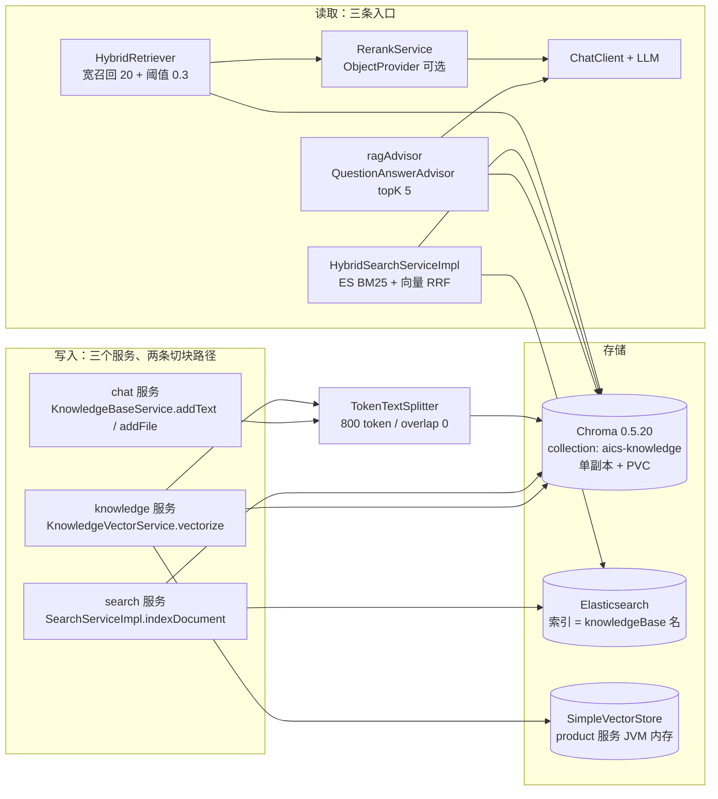
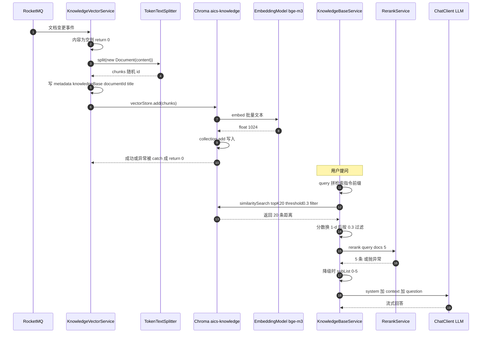

# RAG 向量检索实战：效果 80% 在入库前就定了

> **一句话结论**：向量库不校验你的语义，它只忠实返回"你当初写进去的东西"——切块粒度、Embedding 维度、metadata 契约、ID 语义这四件事决定了检索效果的上限，`topK` 与相似度阈值只能在剩下的空间里微调。
> **阅读前置**：已读过同模块 [01-SpringAI入门.md](../01-SpringAI框架集成/01-SpringAI入门.md)（ChatClient / Advisor 链），知道 `EmbeddingModel`、`VectorStore` 分别是什么角色即可；不要求读过 Chroma 官方文档。
> **证据基线**：Spring AI 2.1.0 / Spring Boot 4.2.0 / Spring Framework 7.1.0 / JDK 17；A 级 = `24-源码分析/assets/source/` 已入库源码摘录，B 级 = 本项目 `ai-cs-*` 真实源码与配置（行号已逐个核对），C 级 = 本机可复现的实算与静态核对（模拟推演一律标注）。本机无 docker / Chroma / Elasticsearch / Redis（已探测：`docker`、`chroma`、`redis-cli` 均不在 PATH，`127.0.0.1` 的 8000 / 9200 / 6379 端口均未开放），全文不连真实向量库，靠源码、配置、jar 静态核对与 node 实算取证。预计阅读 35~45 分钟。

---

## 0. 先看现象

### 现象一：向量库明明有数据，检索却恒为空

日志模板如下（语句与格式来自 `ai-cs-search/src/main/java/com/aics/search/service/impl/SearchServiceImpl.java#L52` 与 `#L76`，是项目里的真实代码；`结果数=0` 是按代码分支推断的形态，不是抓取的真实日志）：

```text
全文搜索(Chroma): knowledgeBase=knowledge, query=如何申请退款, page=1, size=10
搜索完成: knowledgeBase=knowledge, 结果数=0
```

它不抛异常、不进 catch、也不打 warn，只安静地返回空列表。工程上这意味着三种完全不同的病：集合名/主机指错（三个服务各自的 `spring.ai.vectorstore.chroma.*` 配置不完全一致）、metadata 值类型不匹配（写入 `documentId` 是 `Long`，过滤时拼成 `'123'` 字符串）、或者阈值把结果全筛掉了（相似度阈值是**客户端在 topK 之后**执行的，见 3.5）。

### 现象二：只换了 Embedding 模型，检索"还能用"，但回答开始答非所问

`ai-cs-common/src/main/java/com/aics/common/ai/embedding/HashEmbeddingModel.java#L31` 的本地哈希模型是 768 维，而 `ai-cs-chat/src/main/java/com/aics/chat/config/SpringAiConfig.java#L171-L204` 接的 bge-m3 是 1024 维。集合的维度在创建时就锁死，写入维度不符时 Chroma 侧会拒绝（错误形态如 `Collection expecting embedding with dimension of 1024, got 768`——**未实测、未入库**，依据 Chroma 官方文档），但更常见的是另一种：新模型写入失败被 catch 吞掉，旧向量还在，于是"库里一半是新空间的向量、一半是旧空间的向量"，检索分数全体下移，模型看起来"变笨了"。

项目自己在缓存层留过一条预警注释，说明作者想到过这件事——`SpringAiConfig.java#L202`：

```text
缓存键以模型名做命名空间：换模型后向量空间不同，旧缓存必须失效
```

### 现象三：文档删了，AI 还能拿它回答

`ai-cs-knowledge/src/main/java/com/aics/knowledge/service/KnowledgeVectorService.java#L109` 按业务文档 ID 删向量：

```java
vectorStore.delete("documentId == '" + documentId + "'");
```

但 chat 侧写入时，`documentId` 填的不是业务文档 ID，而是**分块自己的随机 UUID**——`ai-cs-chat/src/main/java/com/aics/chat/service/KnowledgeBaseService.java#L171`：

```java
meta.put("documentId", chunk.getId());
```

两边对同一个字段名给了不同语义，删除条件天然永不命中：关系库删了、向量还在、检索照样命中、LLM 照样引用。

这些现象指向同一件事：**RAG 的检索质量不在检索调用里，而在入库契约里**——契约（集合名、维度、metadata 语义、ID 来源）一致时，默认参数就能用；不一致时，调 `topK`、调阈值、换 Rerank 都只是把误差摊薄。

---

## 1. 整体地图



**读图说明**

| 看图位置 | 说明 |
|---|---|
| 左半区（写入） | 三条写入路径，但只有两条经过 `TokenTextSplitter`；`SearchServiceImpl.indexDocument` 是"一段文本 = 一个 Document"直接入库，粒度完全不同 |
| 中间（存储） | Chroma 里只有**一个**集合 `aics-knowledge`，靠 metadata 字段 `knowledgeBase` 区分租户；ES 用"一个知识库一个索引"表达同样的隔离 |
| 右半区（读取） | 三条读取入口互不复用：`HybridRetriever` 走两阶段（宽召回+精排），`HybridSearchServiceImpl` 走双路 RRF，`ragAdvisor` 只有 `topK=5`+阈值且**不带任何 metadata 过滤** |
| 最下（旁路） | product 服务的 `SimpleVectorStore` 是内存实现，与 Chroma 无关：重启即空，也不共享任何 metadata 契约 |

**组件与责任**

| 组件 | 位置 | 责任 | 谁调用 |
|---|---|---|---|
| `KnowledgeVectorService` | `ai-cs-knowledge/src/main/java/com/aics/knowledge/service/KnowledgeVectorService.java#L69-L92` | 切块 + 写 metadata + 入库，失败静默 `return 0` | RocketMQ 消费（文档变更事件） |
| `KnowledgeBaseService` | `ai-cs-chat/src/main/java/com/aics/chat/service/KnowledgeBaseService.java#L159-L181` | 切块 + 写 metadata + 入库（chat 侧写入入口） | 聊天前端的"知识库上传"接口 |
| `SearchServiceImpl` | `ai-cs-search/src/main/java/com/aics/search/service/impl/SearchServiceImpl.java#L51-L138` | 全文检索（向量）+ 索引/删除 + 同步 ES | 搜索接口、知识库增删 |
| `HybridRetriever` | `ai-cs-chat/src/main/java/com/aics/chat/rag/retrieve/HybridRetriever.java#L119-L306` | 检索编排：VECTOR / HYBRID / REWRITE / GRAPH_RAG 四种模式 + 降级 | 聊天链路 |
| `HybridSearchServiceImpl` | `ai-cs-search/src/main/java/com/aics/search/hybrid/HybridSearchServiceImpl.java#L61-L153` | ES BM25 与向量两路召回 + JVM 内 RRF 融合 | chat 通过 Feign 调用 |
| `ragAdvisor` | `ai-cs-chat/src/main/java/com/aics/chat/config/SpringAiConfig.java#L266-L289` | Advisor 方式自动检索并注入上下文 | 每个 ChatClient 请求 |
| `ChromaVectorStore` | 由 `spring-ai-starter-vector-store-chroma` 装配，chat 侧在 `ai-cs-chat/src/main/java/com/aics/chat/config/VectorStoreConfig.java#L55-L90` 用懒代理包装 | 真正的向量库客户端（未入库，无源码摘录） | 上述四个 Bean |
| `SimpleVectorStore` | `ai-cs-product/src/main/java/com/aics/product/config/VectorStoreConfig.java#L17-L20` | 内存向量库（商品相似检索） | `ProductVectorService` |

---

## 2. 关键概念与关键类

### 2.1 概念速览（术语首现即解释）

| 概念 | 解释 | 在本项目里的落点 |
|---|---|---|
| 语义检索 | 把文本压成向量点，用"距离近"代表"意思像"，不要求字面重合 | Chroma 中 `aics-knowledge` 集合 |
| 关键词检索（BM25） | 用词频/逆文档频率打分，要求字面（或分词单元）重合 | `HybridSearchServiceImpl.java#L80-L117` 的 `multiMatch(title^2, content)` |
| Embedding | 把文本映射成定长浮点数组的过程；同一模型产出的向量构成一个"向量空间" | 768 维 `HashEmbeddingModel` / 1024 维 bge-m3 |
| 维度（dimension） | 向量长度；**同一集合内必须一致**，建集合时确定 | `HashEmbeddingModel.java#L31`、bge-m3 默认 1024 |
| 切块（chunking） | 长文按 token/标点切成短段再分别向量化；检索命中的是块，不是文档 | `TokenTextSplitter`（800 token，overlap 0） |
| 归一化 | 把向量缩放到单位长度（L2 norm = 1）；归一化后"内积 = 余弦" | `HashEmbeddingModel.java#L48`、`#L107-L119` |
| 余弦 / 内积 / L2 | 三种距离度量：余弦只看方向，内积看方向+长度，L2 两者都看 | 见 3.4 的实算 |
| `metadata` | 挂在每个 Document 上的键值对，是向量库唯一的"结构化字段"，过滤全靠它 | `knowledgeBase` / `documentId` / `title` |
| collection | Chroma 的顶层容器（≈ 关系库的 table），名字 + 维度 + 距离度量在创建时固定 | `aics-knowledge`（三个服务共用） |
| RRF | Reciprocal Rank Fusion，只按名次融合多路结果，可跨量纲 | `HybridSearchServiceImpl.java#L70-L71` |
| 软删除 | 业务上"删除"但物理行保留（`status=0`）；向量库不会自动跟随 | 向量侧无 `status` 过滤（未落地，见 3.7） |

### 2.2 关键类

| 名称 | 位置 | 角色 | 关键方法 |
|---|---|---|---|
| `VectorStore` | `VectorStore.java.md`（A 级） [[源码:VectorStore.java.md#L40-L40]] | 向量库门面接口，继承 `DocumentWriter` + `VectorStoreRetriever` | `add` / `upsert` / `delete` / `similaritySearch` / `getName` |
| `SearchRequest` | `SearchRequest.java.md`（A 级） [[源码:SearchRequest.java.md#L44-L60]] | 检索请求参数对象 | `builder().query()/topK()/similarityThreshold()/filterExpression()` |
| `Document` | `Document.java.md`（A 级） [[源码:Document.java.md#L169-L183]] | 文本 + metadata + 分数 + ID 的载体 | `getId` / `getMetadata` / `getScore` / `mutate` / `builder` |
| `TokenTextSplitter` | `TokenTextSplitter.java.md`（A 级） [[源码:TokenTextSplitter.java.md#L41-L55]] | 基于 token 的切块器 | `apply(List)` / `split(Document)` / `builder` |
| `EmbeddingModel` | `EmbeddingModel.java.md`（A 级） [[源码:EmbeddingModel.java.md#L137-L137]] | 文本 → 向量 | `embed(String)` / `embed(List)` / `dimensions()` |
| `FilterExpressionBuilder` | `FilterExpressionBuilder.java.md`（A 级） [[源码:FilterExpressionBuilder.java.md#L60-L126]] | 类型安全的过滤 DSL | `eq/ne/in/nin/and/or/not/build` |
| `HashEmbeddingModel` | `ai-cs-common/src/main/java/com/aics/common/ai/embedding/HashEmbeddingModel.java#L31-L50` | 项目自研的本地兜底 Embedding（特征哈希 + L2 归一化） | `embed` / `dimensions` / `normalize` |
| `ChromaVectorStore` | 由 starter 装配；本项目用 `VectorStoreConfig.java#L55-L90` 懒代理包装 | 真实的 Chroma 客户端（**未入库**，无源码摘录，行为以官方文档 + javap 静态核对为准） | `doAdd` / `doUpsert` / `doDelete` / `doSimilaritySearch` |
| `SimpleVectorStore` | `ai-cs-product/src/main/java/com/aics/product/config/VectorStoreConfig.java#L17-L20` | 内存向量库，进程内相似度计算 | `builder(embeddingModel).build()` |
| `KnowledgeBaseService` | `ai-cs-chat/src/main/java/com/aics/chat/service/KnowledgeBaseService.java#L112-L293` | chat 侧的入库 + 两阶段检索门面 | `addText` / `addChunks` / `search` / `searchRaw` / `buildContext` |

---

## 3. 原理与证据逐段精读

### 3.1 语义匹配与字面匹配：两条不同的失效曲线

**在干什么**：同一个问题可以走两条完全不同的召回路径。向量路把 query 和块各压成一个点，用距离表示"意思像不像"；关键词路（ES BM25）用词频统计表示"字面重合多少"。本项目两条路都在：`HybridSearchServiceImpl.java#L123-L153` 是向量路，`#L80-L117` 是 BM25 路，最后由 `#L70-L71` 用 RRF 融合。

**为什么这么设计**：两条路的失效场景几乎正交，所以混合才划算。

| 用户问法 | 向量路（语义） | 关键词路（字面） | 谁更该赢 |
|---|---|---|---|
| "东西不想要了怎么退钱" vs 文档写"退款申请流程" | 命中（同义改写） | 大概率漏（"退钱"≠"退款"） | 向量 |
| 型号 "A1234-B" 保修多久 | 可能漂到"A1235-B"（字符接近、语义接近） | 精确命中 | BM25 |
| 跨语言（中文问、英文文档） | bge-m3 多语言可命中 | 完全不命中 | 向量 |
| 数字/日期/版本号（"v2.1.0 的变更"） | 向量对数字几乎不敏感 | 精确命中 | BM25 |
| 长口语问题（80 字） | 向量能压缩长句主旨 | BM25 词项太多、权重被摊平 | 向量 |

**换写法会怎样**：只用向量，型号/编号类查询会出现"看起来有结果但都不对"；只用 BM25，口语化提问直接空手。项目在 `HybridRetriever.java#L176-L213` 有两处降级（搜索服务无数据 / 抛异常 → 回退纯向量），一旦降级，上表第 2、4 行就永远拿不到了。

**常见坑**：把 RRF 分数当相似度用。项目注释写得很清楚——`HybridSearchServiceImpl.java#L70-L71` 的融合"只看排名不看分数，跨量纲"，所以 RRF 分（典型 0.016 起）**绝不能**拿去和 `similarityThreshold=0.3` 比较。

**落地面**：双路 + RRF 已落地（`HybridSearchServiceImpl`）；但 `HybridRetriever.java#L124-L145` 默认模式是 VECTOR，混合检索要显式传 `mode=HYBRID` 且 `properties.isHybridEnabled()` 为真，**默认链路仍是纯向量**——这一条是设计意图，不是缺陷，但要清楚"默认不是混合"。

### 3.2 切块：入库前的第一道闸，也是最贵的一道

**在干什么**：`TokenTextSplitter` 先把文本按 CL100K 词表切成 token 序列，再按 `chunkSize` 滑窗切片，尽量落在标点处。默认参数在源码里一目了然 [[源码:TokenTextSplitter.java.md#L41-L55]]：

```java (src: TokenTextSplitter.java.md#L41-L55)
public static final int DEFAULT_CHUNK_SIZE = 800;
public static final int DEFAULT_CHUNK_OVERLAP = 0;
public static final int MIN_CHUNK_SIZE_CHARS = 350;
public static final int MIN_CHUNK_LENGTH_TO_EMBED = 5;
public static final int MAX_NUM_CHUNKS = 10000;
public static final boolean KEEP_SEPARATOR = true;
public static final List<Character> DEFAULT_PUNCTUATION_MARKS = List.of('.', '?', '!', '\n');
public static final EncodingType DEFAULT_ENCODING_TYPE = EncodingType.CL100K_BASE;
```

切块主循环里有一条容易被忽略的规则：**只有"后面还有文本"时才做边界优化**，且只有块长超过 350 字符才在块内最后一个标点处截断 [[源码:TokenTextSplitter.java.md#L183-L198]] [[源码:TokenTextSplitter.java.md#L264-L280]]。也就是说短块（<350 字符）几乎不做语义边界对齐，长文才享受"按句切"的待遇。

**为什么这么设计**：800 token 大致能装下"一个完整答案"，又不至于把多个主题揉进一个向量；`overlap=0` 最省 token 和存储；标点对齐是为了不把句子拦腰砍断。

**换写法会怎样**：

| 参数改动 | 直接后果 |
|---|---|
| `chunkSize` 调到 4000 | 一个块混多个主题，向量变成"什么都像一点"，相似度区分度下降，阈值 0.3 频段挤满噪声 |
| `chunkSize` 调到 200 | 上下文不足，"退款期限是"与"7 天"被切到两块，检索命中但 LLM 拼不出完整答案 |
| `chunkOverlap` 从 0 调到 100 | 跨块答案能接上，代价是存储与 embedding 调用量上升 10%~20% |
| 关掉标点截断（`withPunctuationMarks(List.of())`） | 句子被硬切，同一语义被劈成两个半句向量 |
| 换 `EncodingType` | 同一段中文的 token 数变化 → 实际块长变化 → 所有既有向量分布改变（等价于换模型） |

**常见坑**：

1. **中文别用字符数估 token**。CL100K 对中文约 1 汉字 ≈ 1~2 token，用"800 字"当 `chunkSize` 会得到远超预期的块。
2. `minChunkLengthToEmbed=5` 会静默丢弃极短块（例如只有标题行"退款政策"），造成"文档切了但某些块从没进库"。
3. `overlap=0` 时标题只落在第一块，后续块丢失主体信息——项目用 metadata 补：`KnowledgeBaseService.java#L172` 往每个块的 metadata 写 `title`。
4. 项目里三处切块全是**无参构造**：`KnowledgeBaseService.java#L114`、`#L161`、`KnowledgeVectorService.java#L77`，而 2.1.0 的无参构造已经 `@Deprecated(since="2.0.0-M3", forRemoval=true)`（A 级锚点 [[源码:TokenTextSplitter.java.md#L80-L88]]，javap 复核见 6.2）。

**落地面**：切块参数**全部是默认值**，"按中文语料调 chunkSize/overlap"这件事在产品里**未落地**；三处调用仍用已标记删除的构造函数——可编译（只是警告），但升级即断。

### 3.3 Embedding 模型选择：维度是一条不能改的契约

**在干什么**：`EmbeddingModel` 把文本映射成定长向量，接口只有四个关键动作 [[源码:EmbeddingModel.java.md#L39-L83]]，其中 `dimensions()` 的默认实现会真的去调远端端点取维度：

```java (src: EmbeddingModel.java.md#L131-L137)
 * Get the number of dimensions of the embedded vectors. Note that by default, this
 * method will call the remote Embedding endpoint to get the dimensions of the
 * embedded vectors. If the dimensions are known ahead of time, it is recommended
```

项目里有**两个 provider**同时存在：

| provider | 实现 | 维度 | 怎么启用 | 语言/领域能力 |
|---|---|---|---|---|
| 本地哈希 | `HashEmbeddingModel`（`ai-cs-common/src/main/java/com/aics/common/ai/embedding/HashEmbeddingModel.java#L31-L50`） | 768 | `aics.ai.embedding.provider=local`（缺省即 local，见 `EmbeddingAutoConfig`） | 英文按整词、中文按**二元组**（`"c:"+char[i]+char[i+1]`，`#L77-L96`）；只做字面相似，无语义泛化，零成本零延迟 |
| 远程 bge-m3 | `OpenAiEmbeddingModel`（`SpringAiConfig.java#L171-L204`、`KnowledgeAiConfig.java#L56-L66`、`ai-cs-search/src/main/java/com/aics/search/config/SpringAiConfig.java#L41-L50`） | 1024 | 各服务自己声明 `@Bean @Primary EmbeddingModel` | 多语言语义、中英混排可用；走硅基流动，按量计费，一次网络往返 |

**为什么这么设计**：本地哈希是"零依赖兜底"——没有 API key 也能把链路跑通；bge-m3 是生产可用的语义模型。两者用同一个 `EmbeddingModel` 接口，配置切换不影响业务代码。

**换写法会怎样**：维度不只是数字，它是集合的属性。把 768 的写入 1024 的集合（或反之）会被 provider 拒绝；而"换模型但不重建集合"更阴险——旧向量留在库里，新查询落在新空间的点上，两者距离没有意义，检索变成随机挑几条。项目的缓存层替你想过一半：`SpringAiConfig.java#L193-L203` 把 `EmbeddingModel` 包了一层 `CachingEmbeddingModel`，键的命名空间带模型名，`#L202` 注释明确"换模型后向量空间不同，旧缓存必须失效"。**但向量库本身没人替你重建**。

**常见坑**：

1. `spring.ai.model.embedding: none`（`ai-cs-chat/src/main/resources/application.yml#L35-L38`）关掉的是 Spring AI 的**自动装配** Bean，靠手写 `@Bean @Primary` 顶上；少写一个 `@Primary` 就会有两个 `EmbeddingModel` 候选，注入点直接启动失败。search 服务写的是 `spring.ai.model.embedding.enabled: false`（`ai-cs-search/src/main/resources/application.yml#L37-L39`），两种写法是否严格等价**未入库核实**。
2. query 侧和 doc 侧不对称：`KnowledgeBaseService.java#L268` 给查询加了 bge-m3 的检索指令前缀 `"为这个句子生成表示以用于检索相关文章："`，而两处入库（`KnowledgeVectorService.java#L77-L85`、`KnowledgeBaseService.java#L161-L178`）**不加**前缀。这是符合 BGE 族模型"指令只给 query"的做法的，但一旦换到要求两侧同格式的模型（如某些 E5 变体），效果会断崖。
3. chat 侧有 `CachingEmbeddingModel` 包装、knowledge 侧（`KnowledgeAiConfig.java#L56-L66`）没有——同一段文本两侧算出同一个向量，但命中率、延迟完全不同；排查"为什么入库慢"时容易找错地方。

**落地面**：双 provider + `@Primary` 覆盖**已落地**；"换模型后自动重建集合"**未落地**（无脚本、无版本标记）；`aics.ai.embedding.provider` 这个开关在本仓库的 yml 里**没有出现**，实际取值来自 Nacos（各服务 `spring.config.import` 了 `aics-shared.yml`），因此"生产到底用 768 还是 1024"**未核实**。

### 3.4 归一化与距离度量必须一致：一个阈值，三种含义

**在干什么**：向量相似度有三种常见算法，混用会让"阈值"这个词失去意义：余弦只比方向（对长度不敏感）、内积等于"方向 × 长度"、L2 距离对长度最敏感。**当所有向量都被 L2 归一化成单位长度时，内积恒等于余弦**，三种度量才彼此等价。`HashEmbeddingModel` 正是这么做的：`HashEmbeddingModel.java#L48` 调用 `normalize(vector)`，`#L107-L119` 做 L2 归一化。

**实测一（C 级，模拟推演：构造 1024 维向量，"余弦 0.70/0.60、模长 2/6"是先设定的假设，计算过程真实）**。复现命令 `node c1.mjs`：

```javascript
// c1.mjs
const D = 1024;
const vecOf = (c, n) => { const v = new Array(D).fill(0); v[0] = c * n; v[1] = Math.sqrt(1 - c * c) * n; return v; };
const q = vecOf(1, 1), shortChunk = vecOf(0.70, 2), longChunk = vecOf(0.60, 6);
const dot = (a, b) => a.reduce((s, x, i) => s + x * b[i], 0);
const nrm = (a) => Math.sqrt(dot(a, a));
const cos = (a, b) => dot(a, b) / (nrm(a) * nrm(b));
console.log('dim =', D);
console.log('raw dot  q·short =', dot(q, shortChunk).toFixed(4), ' q·long =', dot(q, longChunk).toFixed(4));
console.log('cosine   q·short =', cos(q, shortChunk).toFixed(4), ' q·long =', cos(q, longChunk).toFixed(4));
console.log('内积排序 :', dot(q, shortChunk) > dot(q, longChunk) ? 'short 第1' : 'long 第1');
console.log('余弦排序 :', cos(q, shortChunk) > cos(q, longChunk) ? 'short 第1' : 'long 第1');
const n1 = shortChunk.map(x => x / nrm(shortChunk)), n2 = longChunk.map(x => x / nrm(longChunk));
console.log('各自L2归一化后 dot q·short =', dot(q, n1).toFixed(4), ' q·long =', dot(q, n2).toFixed(4));
```

```text
dim = 1024
raw dot  q·short = 1.4000  q·long = 3.6000
cosine   q·short = 0.7000  q·long = 0.6000
内积排序 : long 第1
余弦排序 : short 第1
各自L2归一化后 dot q·short = 0.7000  q·long = 0.6000
```

怎么读：短块与查询的余弦更高（0.70 > 0.60），但长块向量模长更大，**未归一化时内积把它顶到第一名**。这就是"长文本天然霸榜"的数学原因——不是模型差，是度量选错。归一化之后内积与余弦对齐，排序回到正确顺序。

**实测二（C 级，模拟推演：假设单位向量、Chroma 侧 L2 距离、Spring AI 侧用 `1 - distance` 当相似度；换算公式真实）**：

```text
cosine |  L2距离 | 1-L2(=SpringAI分数) | 阈值0.3通过?
0.300  | 1.1832  | -0.1832              | no
0.500  | 1.0000  | 0.0000               | no
0.700  | 0.7746  | 0.2254               | no
0.755  | 0.7000  | 0.3000               | YES
0.800  | 0.6325  | 0.3675               | YES
0.900  | 0.4472  | 0.5528               | YES
0.950  | 0.3162  | 0.6838               | YES
阈值0.3 在 L2 度量下等价余弦 = 0.7550
余弦0.70 时: 内积(单位向量)= 0.7000  1-L2 = 0.2254
```

复现命令 `node c2.mjs`：

```javascript
// c2.mjs
const cases = [0.300, 0.500, 0.700, 0.755, 0.800, 0.900, 0.950];
console.log('cosine |  L2距离 | 1-L2(=SpringAI分数) | 阈值0.3通过?');
for (const c of cases) {
  const l2 = Math.sqrt(2 - 2 * c);
  const score = 1 - l2;
  console.log(`${c.toFixed(3)}  | ${l2.toFixed(4)}  | ${score.toFixed(4)}              | ${score >= 0.3 ? 'YES' : 'no'}`);
}
console.log('阈值0.3 在 L2 度量下等价余弦 =', ((2 - Math.pow(1 - 0.3, 2)) / 2).toFixed(4));
console.log('余弦0.70 时: 内积(单位向量)= 0.7000  1-L2 =', (1 - Math.sqrt(2 - 2 * 0.7)).toFixed(4));
```

怎么读：项目里用的是 `similarityThreshold(0.3)`。这个 0.3 不是"余弦 0.3"——在 L2 度量下它等价于**余弦 0.755**，余弦 0.70 的匹配会被判为不合格。这条换算不是我猜的：`javap` 反查 `spring-ai-chroma-store:2.1.0` 的 `ChromaVectorStore#doSimilaritySearch`，字节码里先取 `Embedding.distances()`、再 `dconst_1` + `dsub`，即分数 = `1.0 - distance`，随后用 `SearchRequest.getSimilarityThreshold()` 过滤（命令与输出见 6.2）。

**为什么这么设计**：Chroma 集合的距离度量在**建集合时**由 `hnsw:space` 决定（**未入库**，依据 Chroma 官方文档），Spring AI 在查询时改不了它，只能把 distance 换算成"越大越像"，`1 - d` 是最省事的单调换算。

**换写法会怎样**：把 `HashEmbeddingModel` 换成"不归一化"的模型（多数 /embeddings 接口返回未归一化向量），在 L2 度量下长块天然更远，短块霸榜；反过来，若集合用 cosine 空间而你在客户端按内积语义解释阈值，阈值含义会整体漂移一截。

**常见坑**：把 0.3 当"余弦 0.3"写进设计文档，然后据此解释"为什么召回这么少"——真实原因是 0.3 在这套度量里等于 0.755，宽召回一点都不宽。`KnowledgeBaseService.java#L230` 的"宽召回 topK=20 + 阈值 0.3"就是这样一组**看起来宽、实际很窄**的参数。

**落地面**：`HashEmbeddingModel` 的 L2 归一化**已落地**；"集合距离度量显式声明（cosine/l2）并写进文档"**未落地**——没有任何地方显式设置 `hnsw:space`，全靠 Chroma 默认值。

### 3.5 metadata 过滤：语法、下推、以及"过滤发生在哪一步"

**在干什么**：向量库里的结构化过滤只有一个入口——metadata。Spring AI 支持两种写法：类型安全的 DSL（`FilterExpressionBuilder`，锚点 [[源码:FilterExpressionBuilder.java.md#L60-L126]]，提供 `eq/ne/gt/gte/lt/lte/and/or/in/nin/isNull/isNotNull/group/not`），和"SQL 风格字符串"（`SearchRequest.Builder#filterExpression(String)`，内部交给 `FilterExpressionTextParser` 解析）[[源码:SearchRequest.java.md#L280-L290]]：

```java (src: SearchRequest.java.md#L280-L290)
		/**
		 * The {@link FilterExpressionTextParser} is used to convert the text filter
		 */
		public Builder filterExpression(@Nullable String textExpression) {
			this.searchRequest.filterExpression = (textExpression != null)
					? new FilterExpressionTextParser().parse(textExpression) : null;
		}
```

源码注释还提醒了性能点：文本表达式**每次都要解析**，常驻场景应缓存或直接用 DSL。

**项目里的 5 处过滤**（全部是字符串拼接 + 单等值，没有一处用 DSL、没有一处做转义）：

| # | 位置 | 表达式 | 换个写法会怎样 |
|---|---|---|---|
| 1 | `ai-cs-chat/src/main/java/com/aics/chat/service/KnowledgeBaseService.java#L273` | `knowledgeBase == '<入参>'` | 改成 `in('a','b')` 即可支持多库联合检索；改成 DSL 可避免每次解析 + 避免入参含单引号时解析失败 |
| 2 | `ai-cs-chat/src/main/java/com/aics/chat/rag/retrieve/HybridRetriever.java#L292` | 同上 | 同上；这里还额外要求调用方保证入参不带 `'`，否则整条链路 throw 后被 catch 成空列表 |
| 3 | `ai-cs-search/src/main/java/com/aics/search/hybrid/HybridSearchServiceImpl.java#L128` | 同上 | 若改成不带过滤，向量路会把其它知识库的块混进 RRF，名次融合后更难解释 |
| 4 | `ai-cs-search/src/main/java/com/aics/search/service/impl/SearchServiceImpl.java#L57` | 把 `index` 当 `knowledgeBase` 用 | 语义上"索引名 = 知识库名"，改名不迁移 metadata 就会全空 |
| 5 | `ai-cs-knowledge/src/main/java/com/aics/knowledge/ops/KnowledgeGapDetector.java#L74` | `knowledgeBase == '<kb>'` | 缺口检测按库统计，缺了这条会把别的库的块算进统计 |

**"谁先谁后"是这一节的核心**：这里其实有**两层**顺序问题。

1. **metadata 过滤 vs 向量近邻搜索**：过滤必须在近邻搜索之前生效（即下推给 Chroma 的 `where`），否则就是从全集合 topK 里再筛，命中率会塌方式下降。Chroma `where` 的下推细节**未入库**（依据官方文档）。
2. **相似度阈值 vs topK**：这一点项目里没人写，但字节码能证明——`similarityThreshold` 是 **Spring AI 客户端在拿到 topK 之后**才过滤的（见 3.4 的 javap 核对）。所以"阈值太低导致结果少"是错判，真相是"topK 太小，先被截断，再被阈值砍"。

**实测三（C 级，模拟推演：假设集合 1000 个块、目标知识库只占 60 个（6%）、每个块与查询的相似度 i.i.d. U(0,1)，试验 1000 次；分布假设是人为的，算法与统计真实）**：

```text
集合=1000 目标库=60(6.0%) topK=5 试验=1000
后置过滤 平均命中 = 0.306  空检索率 = 72.2%
前置过滤 平均命中 = 5.000  空检索率 = 0.0%
理论值 5*6% = 0.300
```

怎么读：如果过滤发生在 topK 之后，目标库只占 6% 时，**72% 的查询会一条都拿不到**（与理论值 5×6%=0.3 吻合）；前置过滤则稳定拿满 5 条。这就是"向量库有数据但检索恒为空"最隐蔽的一种成因——数据没错、集合没错，只是过滤位置错了。

复现命令 `node c3.mjs`：

```javascript
// c3.mjs
const TOTAL = 1000, TARGET = 60, TOPK = 5, TRIALS = 1000;
let s = 42;
const rnd = () => (s = (s * 1103515245 + 12345) % 2147483648) / 2147483648;
let postSum = 0, preSum = 0, postEmpty = 0, preEmpty = 0;
for (let t = 0; t < TRIALS; t++) {
  const docs = Array.from({ length: TOTAL }, (_, i) => ({ inTarget: i < TARGET, score: rnd() }));
  const byScore = (a, b) => b.score - a.score;
  const post = docs.slice().sort(byScore).slice(0, TOPK).filter(d => d.inTarget).length;
  const pre = docs.filter(d => d.inTarget).sort(byScore).slice(0, TOPK).length;
  postSum += post; preSum += pre;
  if (post === 0) postEmpty++;
  if (pre === 0) preEmpty++;
}
console.log('集合=1000 目标库=60(6.0%) topK=5 试验=1000');
console.log('后置过滤 平均命中 =', (postSum / TRIALS).toFixed(3), ' 空检索率 =', (postEmpty / TRIALS * 100).toFixed(1) + '%');
console.log('前置过滤 平均命中 =', (preSum / TRIALS).toFixed(3), ' 空检索率 =', (preEmpty / TRIALS * 100).toFixed(1) + '%');
console.log('理论值 5*6% =', (TOPK * TARGET / TOTAL).toFixed(3));
```

**常见坑**：

1. 值里带单引号（用户输入 `O'Brien`）→ 文本表达式解析报错，异常在 `HybridRetriever.java#L300-L306` 被 catch 成 warn + 空列表，前端只看到"没找到"。
2. 类型不一致：`documentId` 写入时是 `Long`（`KnowledgeVectorService.java#L81`），删除时拼成带引号的字符串（`#L109`）。这些键在不同 provider 里的类型匹配语义**未入库核实**，但"写入 Long、过滤 '123'"这种不一致，是"删不掉/查不到"最常见的一类根因。
3. 过滤字段没写进 metadata 就等于不存在：`ProductVectorService.java#L58-L61` 只写了 `productId`/`name`，于是它的检索只能全集合扫（见 3.6）。

**落地面**：5 处 metadata 过滤**已落地**且都生效；用 `FilterExpressionBuilder` 替代字符串拼接、入参转义、`status` 软删除过滤**均未落地**。

### 3.6 id、upsert 与 delete：三种删除语义，只有一种是安全的

**在干什么**：`VectorStore` 的写删接口很小，但语义差别很大 [[源码:VectorStore.java.md#L59-L110]]。`upsert` 在接口上是**默认抛异常**的：

```java (src: VectorStore.java.md#L59-L82)
	/**
	 * The default implementation throws {@link UnsupportedOperationException}; each store
	 * ...
	 * @throws UnsupportedOperationException if the store does not support upsert
	 */
	default void upsert(List<EmbeddedDocument> entries) {
		throw new UnsupportedOperationException(getName() + " does not support upsert");
	}
```

而 `delete(String)` 只是一个语法糖，内部解析成表达式后转调 `delete(Filter.Expression)` [[源码:VectorStore.java.md#L98-L110]]；`delete(Filter.Expression)` 的 javadoc 明确"底层删除出错时抛 `IllegalStateException`" [[源码:VectorStore.java.md#L91-L95]]。

**为什么这么设计**：向量库的"add 重复 ID"行为各家不同（有的报错、有的静默忽略、有的产生两条），所以 Spring AI 不替 provider 决定，另开一个 `upsert` 表达"按 ID 替换"的确定语义。本项目用的 Chroma 2.1.0 **实现了 upsert**：`javap -p` 能看到 `protected boolean supportsUpsert()` 与 `protected void doUpsert(List<EmbeddedDocument>)`（输出见 6.2）。

**项目里的 3 处 `vectorStore.delete`**：

| # | 位置 | 删除粒度 | 换个写法会怎样 |
|---|---|---|---|
| 1 | `ai-cs-knowledge/src/main/java/com/aics/knowledge/service/KnowledgeVectorService.java#L109` | 按 `documentId` 过滤（本意：删一篇文档的全部块） | 这是唯一"正确形态"的删除；但它依赖写入侧把 `documentId` 写成业务 ID，而 chat 侧写的是 chunk UUID（见下），于是对 chat 写入的数据**恒不命中** |
| 2 | `ai-cs-search/src/main/java/com/aics/search/service/impl/SearchServiceImpl.java#L129` | 按 `knowledgeBase` 整库删 | 幂等但破坏性极大：传错一个库名就清空整个租户；应改为按 `documentId` 批量删 |
| 3 | `ai-cs-product/src/main/java/com/aics/product/service/impl/ProductVectorService.java#L70` | 按 id 列表删（`delete(List.of(...))`） | 最精确的一种，要求写入时用了**显式 ID**——`ProductVectorService.java#L58-L61` 确实用了 `String.valueOf(product.getId())` |

**两处 `documentId` 语义冲突（本项目最值得记住的一处坑）**：

| 写入方 | metadata `documentId` 实际值 | 后果 |
|---|---|---|
| `KnowledgeVectorService.java#L81` | 业务文档主键（`doc.getId()`） | 按文档删、按文档溯源都可行 |
| `KnowledgeBaseService.java#L171` | **分块自己的随机 UUID**（`chunk.getId()`） | ① 按业务 ID 删永远不命中；② 同一文档重新入库时每块都换了新 ID，旧块永久残留；③ 前端拿到的 `documentId` 无法回查关系库 |

**重复 chunk 是怎么产生的**：`new Document(text)` 未指定 ID 时，构造器用 `RandomIdGenerator` 生成 ID [[源码:Document.java.md#L169-L183]]：

```java (src: Document.java.md#L169-L183)
	/**
	 * Creates a text document with a generated ID and empty metadata.
	 */
	public Document(@Nullable String text) {
	...
		this(new RandomIdGenerator().generateId(), text, null, metadata, null);
	}
```

切块器产出的每块都是"新 Document"，于是**同一份文件入库两次 = 两套全新 ID = 集合里两份内容完全相同的块**。项目里 4 处写入全是 `vectorStore.add`（`KnowledgeBaseService.java#L178`、`KnowledgeVectorService.java#L85`、`SearchServiceImpl.java#L112`、`ProductVectorService.java#L62`），**没有一处用 `upsert`**；而 `ProductVectorService.java#L57` 的注释写着"同 ID 重复索引会覆盖，天然幂等"——这句话在 `SimpleVectorStore`/`Chroma` 的 `add` 语义下**不能保证**：`add` 的重复 ID 行为由 provider 决定（A 级注释原文），"replace-by-id"是 `upsert` 的语义。

**软删除陷阱**：关系库把文档置 `status=0` 后，向量库这一侧没有任何东西会跟着变——没有触发器、没有补偿任务，5 处过滤条件里也没有一处过滤 `status`。要让下架文档不被检索到，只有两条路：删向量，或在向量侧也带上 `status` 并加过滤。

**落地面**：显式业务 ID（product 侧）**已落地**；`upsert` 幂等写入、写入失败补偿队列、软删除同步**均未落地**；`vectorStore.add` 遗留重复 chunk 的风险**已存在且未处理**。

### 3.7 一个 collection，三个服务：metadata 契约与多租户隔离

**在干什么**：Chroma 里只有一个集合 `aics-knowledge`，由三个服务共同读写：`ai-cs-chat/src/main/resources/application.yml#L45-L52`、`ai-cs-knowledge/src/main/resources/application.yml#L28-L35`（注释直白写着"与 ai-cs-chat 共用 aics-knowledge 集合"）、`ai-cs-search/src/main/resources/application.yml#L41-L46`。租户隔离落在 metadata 的 `knowledgeBase` 字段上。

| 写入方 | `knowledgeBase` 取值 | 其它 metadata | 契约风险 |
|---|---|---|---|
| `KnowledgeVectorService.java#L79-L83` | 常量 `"knowledge"`（`#L52`） | `documentId`(业务 ID) / `title` | 与其它写入方的 `documentId` 语义不一致 |
| `KnowledgeBaseService.java#L168-L175` | 入参 `knowledgeBase` | `documentId`(块 UUID) / `title` | 同上，且块级 ID 让"按文档删"失效 |
| `SearchServiceImpl.java#L103-L111` | 入参 `index` | 上游传入的字段**全量复制**（含 `documentId`/`status`/`tags` 等） | 字段集随调用方漂移，没有 schema |
| `ProductVectorService.java#L58-L61` | 不写（内存库，不进 Chroma） | `productId` / `name` | 换实现接入 Chroma 就会污染检索（缺 `knowledgeBase` 的块会被任何不带过滤的检索命中） |

**为什么这么设计**：集合是**运维单位**（建一次、锁维度、留一个 HNSW 索引），租户是**逻辑单位**（一个字段）。一个集合省资源、跨库检索零成本；每租户一集合物理隔离更彻底，但集合数会爆炸、每个集合都要各自建索引。

**换写法会怎样**：改成"每租户一个 collection"，`collectionName` 就必须从请求里来——而 `VectorStoreConfig.java#L73-L90` 的 `ChromaVectorStore` 是单例 Bean、集合名来自配置；要支持动态集合，得自己管理 `ChromaVectorStore` 实例池，这和 3.9 的懒代理设计直接冲突。

**多租户/权限的真空**：`knowledgeBase` 只是**过滤条件**，不是**权限**——谁能控制入参，谁就能查任意库。更关键的是 Advisor 这条路：`SpringAiConfig.java#L266-L274` 构造 `QuestionAnswerAdvisor` 时只给了 `similarityThreshold(0.3)` 与 `topK(5)`，**`filterExpression` 为空**，即流式 RAG 是对整个 `aics-knowledge` 集合检索（`QuestionAnswerAdvisor` 内部实现**未入库核实**，但其入参可确认无过滤）。这就是"流式 RAG 无 ACL 过滤"这个已知缺陷的代码现场。

**落地面**：单集合 + `knowledgeBase` 字段**已落地**；租户级 ACL、按用户的库授权、Advisor 路径带过滤**均未落地**。

### 3.8 重排与截断：宽召回之后还有两步

**在干什么**：`KnowledgeBaseService.search` 是两阶段——先用 `topK` + `similarityThreshold` 做一次"宁多勿缺"的宽召回（这两个参数的默认值见 [[源码:SearchRequest.java.md#L44-L49]]：`DEFAULT_TOP_K = 4`、`SIMILARITY_THRESHOLD_ACCEPT_ALL = 0.0`），再对少量候选精排。参数与流程在 `ai-cs-chat/src/main/java/com/aics/chat/service/KnowledgeBaseService.java#L94-L99`、`#L228-L260`：

- 宽召回：`recallTopK=20`、`recallThreshold=0.3`；
- 精排：`rerankServiceProvider.getIfAvailable()` 可用则 `rerank(query, recallDocs, topK)`，按 `item.getIndex()` 映射回原文档；
- 降级：Rerank 抛异常 → `log.warn("...Rerank调用异常，降级为相似度排序")` → `recallDocs.subList(0, topK)`。

**为什么这么设计**：向量召回擅长"别漏"，精排（cross-encoder）擅长"排准"，但精排贵，所以只对少量候选做。

**换写法会怎样**：

| 改动 | 后果 |
|---|---|
| 去掉 rerank，直接取 top5 | 噪声块进上下文，LLM 被带偏；这是默认形态（Rerank 实现缺席时静默降级） |
| `recallTopK` 20 → 50 | 每次多 30 条跨网络 payload + 精排成本翻倍，收益递减 |
| 阈值 0.3 → 0.1 | 召回变多，但按 3.4 的换算，0.1 仍等价余弦 ~0.68，改善有限，说明瓶颈不在阈值 |
| 只用 `topK=5`（ragAdvisor 的配置） | 没有精排、没有宽召回，等于"一次赌 5 条" |

**常见坑**：`ObjectProvider.getIfAvailable()` 返回 `null` 时是**静默**降级——没有日志。只有 Rerank **抛异常**才有 warn。于是"精排到底有没有生效"在生产上无法从日志判断，只能靠埋点或看 `topK` 结果是否等于纯相似度排序。这是本项目最容易被误判为"模型不行"的一处。

**落地面**：两阶段检索**已落地**（chat 链路）；Rerank 服务实现是否在容器里**未核实**（`ObjectProvider` 说明它是可选依赖）；RRF 权重与精排模型的评估**未落地**。

### 3.9 Chroma 的工程边界：单机、持久化目录、没有备份

**在干什么**：Chroma 在本项目是**单个有状态副本**。部署清单 `deploy/k8s/chroma.yaml` 写得很清楚：`replicas: 1`（`#L33`，"学习环境，数据一致性简单"）、`image: chromadb/chroma:0.5.20`（`#L44`）、数据目录挂 PVC（`#L47-L49`、`#L69-L77`，`local-path` + `ReadWriteOnce` + `10Gi`）、健康检查只打 `/api/v1/heartbeat`（`#L50-L61`）、资源上限 `memory: 1Gi`（`#L66-L68`）。

**为什么这么设计**：单机 + 本地卷是学习环境最省事的选择，向量数据可重建（原始文档在 MySQL/MinIO，重新向量化即可），所以没做高可用。

**换写法会怎样**（按重要性排序）：

1. **内存 1Gi 上限 + 单副本**：集合规模涨上去后 OOMKill，重启后 PVC 还在但服务有中断窗口；检索链路靠 `HybridRetriever` 的降级"看起来没坏"，实际退化成纯 BM25。
2. **没有副本、没有快照**：`deploy/` 下只有这一份清单，没有备份/恢复/迁移脚本（在 `deploy/` 下 grep `chroma` 只命中 `deploy/k8s/chroma.yaml` 与 `deploy/k8s/services/knowledge-service.yaml#L5` 的注释）。丢了 PVC＝全量重建，重建时间 ≈ 全库 embedding 费用。
3. **没有鉴权**：容器只有端口与探针，Chroma 侧无认证配置（**未入库**，依据官方文档：0.5.x 默认无鉴权），只能靠集群网络边界。
4. **`initialize-schema` 三个服务三种取值**：chat 与 knowledge 是 `false`（`application.yml#L48` / `#L30`），search 是 `true`（`#L42`）。search 侧的 `true` 意味着它会尝试建集合——集合已存在时行为由 provider 决定（**未入库**），至少是"多了一个能自己改元数据的服务"。
5. **连接地址跟 MySQL 主机变量绑在一起**：`client.host: http://${aics.mysql.host:localhost}`（chat `#L50`、knowledge `#L33`），search 则是 `http://${aics.mysql.host:123.60.31.79}`（`#L44`）。也就是说 Chroma 地址跟着 MySQL 主机的环境变量走，两个服务完全可能指向两个不同的 Chroma 实例——这正是现象一的成因之一。

**常见坑**：把 Chroma 当"配置好就不用管"的组件。它是有状态单点：数据目录、维度、集合名、距离度量四项任一变化都要走迁移流程，而项目里这四项**都没有版本标记**。

**落地面**：K8s 单机部署 + PVC **已落地**；备份/恢复脚本、Chroma 版本升级流程、集合维度/度量元数据记录、Chroma 鉴权**均未落地**。

---

## 4. 一次完整执行时序



**读图说明**

| 步骤段 | 发生了什么 | 关键点 |
|---|---|---|
| 1~5 | 事件驱动 → 切块 → 补 metadata | 切块与 metadata 是**唯一**决定"以后能查到什么"的两步；这里错了，后面所有步骤都是错的 |
| 6~9 | `add` → 批量 embedding → 写入集合 | embedding 是**批量**调用（`EmbeddingModel#embed(List)`），失败整批丢；异常被 catch 成 `return 0`，调用方只看到"处理了 0 个块" |
| 10~13 | 查询侧加前缀后发起检索 | 查询与入库的文本处理不对称（3.3）；`filterExpression` 在检索请求里下发 |
| 14~16 | 分数换算与阈值过滤 | 阈值在**客户端**、在 topK **之后**执行（3.4/3.5 已核实），所以"阈值调低一点"救不了 topK 截断 |
| 17~19 | 精排 + 降级 | `getIfAvailable()` 缺席时静默降级，无日志 |
| 20~21 | 拼上下文 → LLM | 上下文只有 5 段（`buildContext` 拼 `【资料N】`），检索错了这里无救 |

**哪一步失败报什么错**

| 步骤 | 失败条件 | 报错/日志原文 |
|---|---|---|
| 3~4 | 内容过短（<5 token）被丢弃 | 无异常；`KnowledgeVectorService.java#L70-L73` 打 `文档内容为空，跳过向量化: id=...`；chat 侧则打 `知识库[x]入库完成, 共0个分块`（`#L179` 格式） |
| 6~9 | 维度不符 / Chroma 不可达 | 异常被 `KnowledgeVectorService.java#L88-L91` 吞掉：`文档向量化失败: id=..., err=...` 后 `return 0`；上层看不到失败 |
| 6 | 实现不支持 upsert（若改用它） | `UnsupportedOperationException: <storeName> does not support upsert`（A 级 [[源码:VectorStore.java.md#L80-L82]]） |
| 13 | `topK` 传负数 | `IllegalArgumentException: TopK should be positive.`（A 级 `SearchRequest.Builder#topK`，[[源码:SearchRequest.java.md#L158-L160]]） |
| 13~14 | 过滤表达式无法解析（值里有单引号） | `HybridRetriever.java#L300-L306` catch 成 `向量检索失败: ...` + 空列表 |
| 12 | Chroma 不可达 | 同上，降级为空 → LLM 无上下文但**照常回答**（最危险的一种"静默失败"） |
| 删除路径 | 底层删除抛错 | `IllegalStateException`（A 级 `VectorStore#delete(Filter.Expression)` 的 javadoc，[[源码:VectorStore.java.md#L91-L95]]）；`KnowledgeVectorService.java#L110-L115` 捕获后 `return false` |

---

## 5. 设计取舍

| 决策点 | 项目当前选择 | 代价 | 更合适的场景 |
|---|---|---|---|
| 切块粒度 | 800 token / overlap 0（全默认） | 跨块答案被切断、标题只进第一块 | 长文档问答应调 overlap 或按标题层级切 |
| 切块入口 | chat 与 knowledge 各写一遍，metadata 语义不同 | `documentId` 契约破裂（3.6） | 收敛成一个"入库网关"服务 |
| Embedding | 双 provider：768 本地哈希 + 1024 bge-m3 | 维度不可混用、换模型要重建 | 生产只保留一个，且维度写进部署文档 |
| 集合组织 | 单集合 `aics-knowledge` + `knowledgeBase` 字段 | 无物理隔离，靠过滤；无 ACL | 多租户强隔离场景应"集合级隔离 + 网关鉴权" |
| 过滤写法 | 5 处字符串拼接 | 无转义、每次解析、类型易错 | 用 `FilterExpressionBuilder` + 强类型字段常量 |
| 幂等写入 | 全部 `add`（随机 ID） | 重复入库留重复块，无法覆盖 | 用 `upsert` + 稳定 chunk ID（如 `docId:chunkIndex`） |
| 召回策略 | 默认 VECTOR；两阶段 20→5；混合需显式开启 | 型号类查询弱、精排缺席时静默降级 | 默认 HYBRID + 精排必备 |
| 向量库选型 | Chroma 0.5.20 单机（chat/knowledge/search） | 单点、无备份、1Gi 内存上限 | 已有 ES 通道的服务可直接换 ES 向量检索 |

**可扩展点清单**（按投入产出排序）

1. **统一入库网关**：一个服务负责切块 + metadata + `upsert`，落地 3.6 的全部修复（稳定 chunk ID = `documentId + ':' + index`）。
2. **metadata schema 化**：定义 `knowledgeBase/documentId/chunkIndex/title/status/updatedAt` 六个必填字段，写入前校验，过滤时用常量而非字符串字面量。
3. **软删除同步**：`status` 进 metadata + 5 处过滤条件统一加 `status == 'ACTIVE'`；或删关系库时发事件删向量。
4. **写入失败补偿队列**：`KnowledgeVectorService.vectorize` 的 `return 0` 改成抛业务异常 + 重试主题，兑现类注释里"天然可重试"的承诺。
5. **检索链路的 ACL**：`ragAdvisor` 的 `SearchRequest` 加 `filterExpression`（用户可访问的 `knowledgeBase` 白名单）。
6. **评估门禁**：20 条 golden 集已有，但 `aics.eval.gate.*` 阈值全为 `null`、CI 未接评估——补齐阈值并让 CI 拦截"改切块/换模型"这类 PR。
7. **集合元数据登记**：把 `collection / dimension / distance / embedding model / 创建时间` 写进一份可 diff 的文件，换模型时强制走"新建集合 + 双写 + 灰度切换"。

---

## 6. 踩坑与调试手法

| # | 症状 | 根因 | 修复方向 |
|---|---|---|---|
| 1 | 检索恒空，无异常 | 集合名/主机不一致（`client.host` 复用 `${aics.mysql.host}`）、metadata 类型不一致、阈值后置 | 先核对三份 yml 的 `collection-name`/`client.host`，再核对 metadata 类型 |
| 2 | 换 embedding 后答非所问 | 维度锁死 + 旧向量残留，混空间检索 | 新建集合全量重建；不要原地换模型 |
| 3 | 删了文档还能被引用 | `documentId` 语义冲突（chunk UUID vs 业务 ID）、`add` 重复块、软删除未同步 | 统一 ID 契约 + `upsert` + `status` 过滤 |
| 4 | 精排"没感觉" | `ObjectProvider.getIfAvailable()` 静默降级，无日志 | 加启动期日志/健康检查，标明 rerank 是否装配 |
| 5 | 阈值调了没效果 | 阈值是客户端在 topK 之后过滤；0.3 在 L2 度量下等价余弦 0.755 | 先调 `topK`/召回，再谈阈值 |
| 6 | 编译一堆 deprecation 警告 | 三处 `new TokenTextSplitter()`，2.1.0 全部构造器 `forRemoval` | 改 `TokenTextSplitter.builder()` |
| 7 | AI 答非所问但不报错 | Chroma 不可达 → `HybridRetriever` catch 成空列表 → LLM 无上下文照答 | 在降级点打 metric（不是只打 warn），并让上游感知"零召回" |

### 6.1 真调试手法一：静态盘点"谁写了什么 metadata、谁按什么过滤"

向量检索的分歧全部体现在 metadata 上，而 metadata 在代码里是散落的字符串字面量——先盘点，再怀疑模型。

```powershell
cd D:\Projects\Persion\ai-customer-service
Get-ChildItem -Recurse -Path ai-cs-*\src\main\java -Filter *.java |
  Select-String -Pattern 'filterExpression|vectorStore\.add|vectorStore\.delete|\.upsert\(' |
  ForEach-Object { "$($_.Path.Replace((Get-Location).Path + '\',''))#$($_.LineNumber): $($_.Line.Trim())" }
```

真实输出（截取与本文相关的行）：

```text
ai-cs-chat\src\main\java\com\aics\chat\service\KnowledgeBaseService.java#178: vectorStore.add(chunks);
ai-cs-knowledge\src\main\java\com\aics\knowledge\service\KnowledgeVectorService.java#85: vectorStore.add(chunks);
ai-cs-knowledge\src\main\java\com\aics\knowledge\service\KnowledgeVectorService.java#109: vectorStore.delete("documentId == '" + documentId + "'");
ai-cs-product\src\main\java\com\aics\product\service\impl\ProductVectorService.java#62: vectorStore.add(List.of(document));
ai-cs-product\src\main\java\com\aics\product\service\impl\ProductVectorService.java#70: vectorStore.delete(List.of(String.valueOf(productId)));
ai-cs-search\src\main\java\com\aics\search\service\impl\SearchServiceImpl.java#112: vectorStore.add(List.of(doc));
ai-cs-search\src\main\java\com\aics\search\service\impl\SearchServiceImpl.java#129: vectorStore.delete("knowledgeBase == '" + index + "'");
```

**怎么读**：① 4 处 `add`、0 处 `upsert` → 幂等写入这件事根本没做；② 3 处 `delete` 是三种粒度（按文档字段、按整库、按 ID 列表）→ 一旦某处传错参数，破坏范围完全不同；③ 过滤条件只有两个键（`documentId` / `knowledgeBase`）→ 任何"按状态/时间/来源过滤"的需求都必须先补 metadata。

### 6.2 真调试手法二：用 javap 反查依赖 jar，确认"这个类到底支持什么"

线上行为和博客/文档经常对不上，最快的确定性来源是手里的 jar。

```powershell
$m2 = "C:\Users\16680\.m2\repository\org\springframework\ai"
# 1) 切块器构造器是否已弃用
javap -v -cp "$m2\spring-ai-commons\2.1.0\spring-ai-commons-2.1.0.jar" `
  org.springframework.ai.transformer.splitter.TokenTextSplitter |
  Select-String -Pattern 'public org.springframework.ai.transformer.splitter.TokenTextSplitter|since=|forRemoval'
# 2) Chroma 到底支不支持 upsert / 按表达式删除
javap -p -cp "$m2\spring-ai-chroma-store\2.1.0\spring-ai-chroma-store-2.1.0.jar" `
  org.springframework.ai.chroma.vectorstore.ChromaVectorStore |
  Select-String -Pattern 'doDelete|doUpsert|supportsUpsert'
```

真实输出（节选）：

```text
  public org.springframework.ai.transformer.splitter.TokenTextSplitter();
    Deprecated: true
        java.lang.Deprecated(
          since="2.0.0-M3"
          forRemoval=true
  public org.springframework.ai.transformer.splitter.TokenTextSplitter(com.knuddels.jtokkit.api.EncodingType);
    Deprecated: true
        java.lang.Deprecated(
          since="2.0.0-M3"
          forRemoval=true
  protected boolean supportsUpsert();
  protected void doUpsert(java.util.List<org.springframework.ai.vectorstore.EmbeddedDocument>);
  public void doDelete(java.util.List<java.lang.String>);
  protected void doDelete(org.springframework.ai.vectorstore.filter.Filter$Expression);
```

**怎么读**：① `new TokenTextSplitter()` 在 2.1.0 上所有构造器都标了 `forRemoval=true`，项目三处调用是"能编译但下次升级即断"；② `ChromaVectorStore` 有 `supportsUpsert()`/`doUpsert()`/`doDelete(Filter$Expression)` → "改用 upsert 消除重复块"和"按 documentId 过滤删除"这两条修复在当前依赖上是**可行**的，不是空谈。对比 1.1.4 同名类只有 `doDelete(List)`/`doDelete(Filter)`、没有 `doUpsert`，这就是 3.6/3.7 那些修复的版本前提。

（说明：本机无 docker/Chroma，无法对真实集合执行 `collection.get()` 或 `query()`；以上为静态核对，不是运行时验证。）

---

## 7. ⚠️ 版本差异

| 旧写法 | 当前基线（Spring AI 2.1.0） | 变化点 | 迁移动作 |
|---|---|---|---|
| `new TokenTextSplitter()` | `TokenTextSplitter.builder()....build()` | 全部构造器 `@Deprecated(since="2.0.0-M3", forRemoval=true)`（javap 已核对）；新增 `EncodingType` 构造器与 `builder()` | 三处调用改 builder，顺手显式写 `chunkSize`/`chunkOverlap` |
| `SearchRequest.query("...").withTopK(5)`（旧稿写法） | `SearchRequest.builder().query(...).topK(...)` | 统一 builder；`topK` 加 `Assert.isTrue(topK >= 0)` | 改 builder；`topK<=0` 的入参在调用方兜底 |
| `org.springframework.ai.chat.client.advisor.QuestionAnswerAdvisor`（旧稿 import） | `org.springframework.ai.chat.client.advisor.vectorstore.QuestionAnswerAdvisor`（`SpringAiConfig.java#L14`） | 包路径迁到 `advisor.vectorstore` 子包 | 改 import；2.1.0 内部实现**未入库核实** |
| 期望 `vectorStore.add()` 覆盖同 ID 文档（`ProductVectorService.java#L57` 注释的口径） | `add` 的重复 ID 行为由 provider 决定；`upsert` 才是 replace-by-id（`VectorStore#L59-L82`） | 2.1.0 新增 `upsert` API，Chroma 实现 `supportsUpsert()=true` | 需要幂等的写入全部改 `upsert` |
| `@Bean` 里直接 `new ChromaVectorStore(...)` 返回 | `@Lazy` + `ProxyFactory` 接口代理（`VectorStoreConfig.java#L55-L90`） | 2.1.0 的 `ChromaVectorStore` 实现 `InitializingBean`，**创建即访问远端**，`initialize-schema=false` 也拦不住（`VectorStoreConfig.java#L33-L36` 注释） | 保留懒代理；或显式设置连接超时并接受启动依赖 |
| `initialize-schema: true` 当"自动建集合"用 | 三服务并存 `false`（chat `#L48`、knowledge `#L30`）/`true`（search `#L42`） | 语义退化为"是否尝试初始化"，不再保证不连远端 | 统一为 `false`，集合由部署脚本创建 |
| Chroma 1.1.4 | Chroma 0.5.20（`deploy/k8s/chroma.yaml#L44`）+ `spring-ai-chroma-store` 1.1.4→2.1.0 | 2.1.0 才有 `doUpsert`；1.1.4 无 `supportsUpsert()`（javap 对比） | 升级前确认 Chroma 服务端版本与客户端 API 对齐 |
| 单 provider（只有本地哈希 768） | 双 provider：768 本地哈希 / 1024 bge-m3（`@Primary`） | `spring.ai.model.embedding: none` 关自动装配，靠手写 Bean 顶上 | 换 provider 必须"新建集合 + 全量重建"，不能原地切 |
| 相似度阈值当余弦理解 | 分数 = `1 - Chroma distance`，阈值在客户端 topK 之后过滤 | L2 度量下 0.3 ≈ 余弦 0.755（C 级换算） | 阈值与召回量一起调；文档里写明"不是余弦" |

---

## 8. 面试高频问与答

> 只列问题，答案在自测题与正文里。

1. 语义检索和 BM25 的失效场景为什么不重叠？混合检索为什么用 RRF 而不是加权平均分数？
2. 为什么说"向量检索的效果 80% 取决于入库前"？入库前具体有哪几个可调决策？
3. 切块大小怎么定？overlap 该不该开？中文语料有什么特别的坑？
4. 为什么换 embedding 模型必须重建集合？能不能只重算新文档？
5. 余弦相似度、内积、L2 距离在什么条件下等价？混用会出什么错？
6. 相似度阈值 0.3 到底筛掉了什么？它是服务端过滤还是客户端过滤？
7. metadata 过滤应该在向量近邻搜索之前还是之后？Chroma 是怎么处理的？
8. `VectorStore.add` 和 `upsert` 的区别是什么？什么时候必须用 upsert？
9. 你们的向量库里 `documentId` 是谁生成的？删除一篇文档时怎么保证删干净？
10. 一个 Chroma 集合被多个服务共用，会引出哪些契约问题？多租户隔离还有哪些做法？
11. 软删除（`status=0`）为什么在向量检索里会失效？怎么补？
12. 宽召回 + 精排的两阶段检索，各自解决什么问题？精排缺席时会怎样？
13. Chroma 作为单机向量库，上生产要准备什么？（持久化、备份、容量、升级）
14. 如果检索结果是空列表，你会按什么顺序排查？

---

## 9. 动手练习

1. **盘点入库契约**（不启动任何服务）：用 6.1 的命令列出全仓 4 处 `add`、3 处 `delete`、5 处 `filterExpression`，画一张"写入方 × metadata 键"的矩阵。
   验收标准：矩阵里能指出至少两处 `documentId` 语义冲突，并写出对应文件#行号。
2. **复现归一化差异**：把 3.4 实测一的脚本改成"构造 3 个向量，其中一个模长 ×10"，观察内积排序与余弦排序何时分叉。
   验收标准：能给出"排序分叉"的最小条件（模长比 > 余弦比），并说明 `HashEmbeddingModel` 为什么不会踩这个坑。
3. **量化阈值含义**：写脚本画出"余弦 → 1-L2 分数"曲线，标出阈值 0.3 / 0.5 / 0.7 各等价余弦多少。
   验收标准：给出三个数字（对应 0.755 / 0.874 / 0.955 附近），并解释为什么"调低阈值"收益有限。
4. **模拟过滤位置**：把 3.5 实测三改成"目标库占比 6% / 20% / 50%"三档，各跑 1000 次，记录空检索率。
   验收标准：得到一条随占比上升而下降的曲线，并解释为什么 topK=20 时后置过滤的空检索率会显著低于 topK=5。
5. **改造一处写入**：把 `KnowledgeVectorService.vectorize` 里 `catch` 后的 `return 0` 改成"抛业务异常 + 记录可重试标记"，并给 `add` 换成 `upsert` + 稳定 chunk ID（`documentId:index`）。
   验收标准：编译通过；用 `grep` 能证明该文件不再有"静默 return 0"；能说清稳定 ID 带来的幂等边界（同内容重切块仍会产生新 ID）。
6. **给 Advisor 检索加过滤**：在 `ragAdvisor` 的 `SearchRequest` 上加一个"用户可访问知识库白名单"的 `filterExpression`。
   验收标准：写出 `in(...)` 形式的表达式或 DSL 版本，并说明"空白名单"应该是"拒绝"还是"全放行"（给出你的取舍理由）。

---

## 小结

- 向量检索不是"智能搜索"，它是"按写入时的样子忠实回放"：集合、维度、度量、metadata、ID 五条契约任一不一致，返回的就是沉默的空列表或无声的错答案。
- 入库前决定效果的四个决策是：切块粒度与 overlap、Embedding 模型与维度、metadata 字段集与语义、chunk ID 的来源与稳定性。参数（`topK`、阈值）只能在这四者划定的范围内微调。
- 语义检索和字面检索的失效场景正交，两者都该有；但要有 RRF 这种"只看名次"的融合，而不是把两路分数直接相加。
- 归一化是"余弦=内积"的前提；本项目 0.3 的阈值在 L2 度量下等价余弦 0.755——一个看起来宽、实际很窄的召回配置。
- metadata 过滤的顺序比表达式的写法更重要：后置过滤在 6% 占比下会带来 72% 的空检索率（实测三）；而 `similarityThreshold` 本身也是 topK 之后的客户端过滤。
- `add` 不等于 `upsert`：随机 ID + `add` = 重复块；本项目 4 处写入全是 `add`、0 处 `upsert`，而 Chroma 2.1.0 已支持 `upsert`——这是一处"能力已有、尚未落地"的低成本改进。
- **可操作归纳**：接手任何 RAG 项目，先做三件事——(1) 打印一份 metadata 键清单与过滤条件清单（6.1 一条命令）；(2) 用 javap 确认当前依赖里 `VectorStore` 实现到底支持 `upsert` 与按表达式删除（6.2）；(3) 把"集合名 / 维度 / 距离度量 / embedding 模型"四元组写进部署文档并加版本标记。做完这三件事，再谈调参。

---

## 自测题

**1. 为什么"向量库有数据但检索恒为空"是最难排查的一类故障？**

<details>
<summary>参考答案</summary>
因为它不抛异常：过滤条件不匹配、集合名指错、阈值后置过滤都会正常返回空列表，日志里只有"结果数=0"。排查必须从契约入手（集合名/主机、metadata 键与值类型、topK 与阈值），而不是从"模型准不准"入手。
</details>

**2. 同一个问题，向量路命中而 BM25 漏掉，最典型的原因是什么？**

<details>
<summary>参考答案</summary>
同义改写或跨语言表达——用户说"退钱"，文档写"退款"。BM25 依赖字面（分词）重合，同义词不重合就漏；向量路比较的是语义方向，因此能命中。反过来型号、版本号这类精确字符串，BM25 更可靠。
</details>

**3. `TokenTextSplitter` 默认 `chunkOverlap=0` 在中长文档上会带来什么问题？**

<details>
<summary>参考答案</summary>
跨块答案会被切断：答案的前半句落在上一块、后半句落在下一块，检索命中其中一块时 LLM 拼不出完整信息。另外标题行只落在第一块，后续块丢失主体，本项目用 metadata 的 `title` 补偿。
</details>

**4. 项目里三处 `new TokenTextSplitter()` 有什么风险？**

<details>
<summary>参考答案</summary>
在 2.1.0 上所有构造器都标了 `@Deprecated(since="2.0.0-M3", forRemoval=true)`，能编译但下次升级会直接编译失败。应改用 `TokenTextSplitter.builder()`，同时把 `chunkSize`/`chunkOverlap` 显式写出来形成可评审的配置。
</details>

**5. 768 维和 1024 维向量能放进同一个 Chroma 集合吗？**

<details>
<summary>参考答案</summary>
不能。维度是集合创建时固定的属性，写入维度不符会被拒绝。即使绕过校验写进去，两个向量空间的距离也没有意义，检索等于随机。换模型只能新建集合并全量重建。
</details>

**6. 为什么说 0.3 这个阈值"看起来宽、实际很窄"？**

<details>
<summary>参考答案</summary>
Spring AI 侧分数是 `1 - Chroma distance`（javap 已核对）。若集合度量是 L2，`1 - L2 >= 0.3` 反解出余弦需 ≥ 0.755。所以 0.3 的门槛实际要求相当高的语义相似度，宽召回并不宽。
</details>

**7. 相似度阈值是在向量库服务端过滤，还是 Spring AI 客户端过滤？**

<details>
<summary>参考答案</summary>
客户端、且在拿到 topK 结果之后过滤：`ChromaVectorStore#doSimilaritySearch` 里先取 distance、换算成 `1-d`，再用 `SearchRequest.getSimilarityThreshold()` 筛。所以 topK 先截断、阈值后筛，条数不够时应先加 topK。
</details>

**8. metadata 过滤"前置"与"后置"差别有多大？**

<details>
<summary>参考答案</summary>
很大。模拟推演：集合 1000 块、目标库占 6%、topK=5 时，后置过滤平均只命中 0.306 条、72.2% 的查询为空；前置过滤稳定命中 5 条。所以过滤要下推到向量库的 `where`，不能在应用层后筛。
</details>

**9. `vectorStore.add` 与 `upsert` 的本质区别是什么？**

<details>
<summary>参考答案</summary>
`add` 的重复 ID 行为由 provider 决定（报错/忽略/重复存都合法）；`upsert` 明确是"按 ID 替换"。本项目 4 处写入全是 `add`、0 处 `upsert`，而 Chroma 2.1.0 已实现 `supportsUpsert()/doUpsert()`，所以幂等写入是"能力已有、尚未落地"。
</details>

**10. 为什么本项目"删了文档还能被检索到"？**

<details>
<summary>参考答案</summary>
三处原因叠加：① `documentId` 语义不一致（knowledge 侧写业务 ID，chat 侧写 chunk 随机 UUID），按业务 ID 删永不命中；② `add` 每次生成新随机 ID，重复入库留下重复块；③ 软删除只改关系库 `status`，向量侧没有 status 过滤。
</details>

**11. 一个 Chroma 集合被三个服务共用，最需要钉死的是什么？**

<details>
<summary>参考答案</summary>
metadata 契约：字段名、字段语义、值类型、必填性。本项目 `documentId` 在两侧语义不同、`knowledgeBase` 有三种来源、`status` 时有时无，导致过滤与删除行为不可预测。要么统一网关写入，要么定义 schema 并校验。
</details>

**12. `ragAdvisor` 那条链路的检索有什么安全缺口？**

<details>
<summary>参考答案</summary>
`SpringAiConfig.java#L266-L274` 构造 `QuestionAnswerAdvisor` 时只设了 `topK=5` 和阈值，没有 `filterExpression`，等于对整个 `aics-knowledge` 集合检索，任何租户的块都可能进上下文——这就是"流式 RAG 无 ACL 过滤"的代码现场。
</details>

**13. 精排（Rerank）静默降级为什么危险？**

<details>
<summary>参考答案</summary>
`rerankServiceProvider.getIfAvailable()` 返回空时直接走 `subList(0, topK)`，且没有日志（只有抛异常才 warn）。于是"精排没生效"在生产上不可见，效果变差会被误判成模型能力问题。应在启动期打印装配状态或暴露指标。
</details>

**14. Chroma 单机部署上生产，至少要补哪几件事？**

<details>
<summary>参考答案</summary>
按 `deploy/k8s/chroma.yaml` 现状（`replicas: 1`、`local-path` 10Gi PVC、1Gi 内存上限、无鉴权、只有心跳探针）：补备份与恢复流程、补集合四元组（集合名/维度/度量/模型）登记、规划容量与升级路径、加访问控制。全仓 grep 显示目前没有任何备份脚本。
</details>

**15. 如果只能改一处来提升检索效果，你会改哪里？**

<details>
<summary>参考答案</summary>
先修 metadata/ID 契约（统一 `documentId` + 稳定 chunk ID + `upsert`），因为它是"重复块与删不掉"两类顽疾的共同根因，且改动集中在入库侧、风险可控。其次才是切块参数与召回策略；调阈值收益最有限。
</details>
