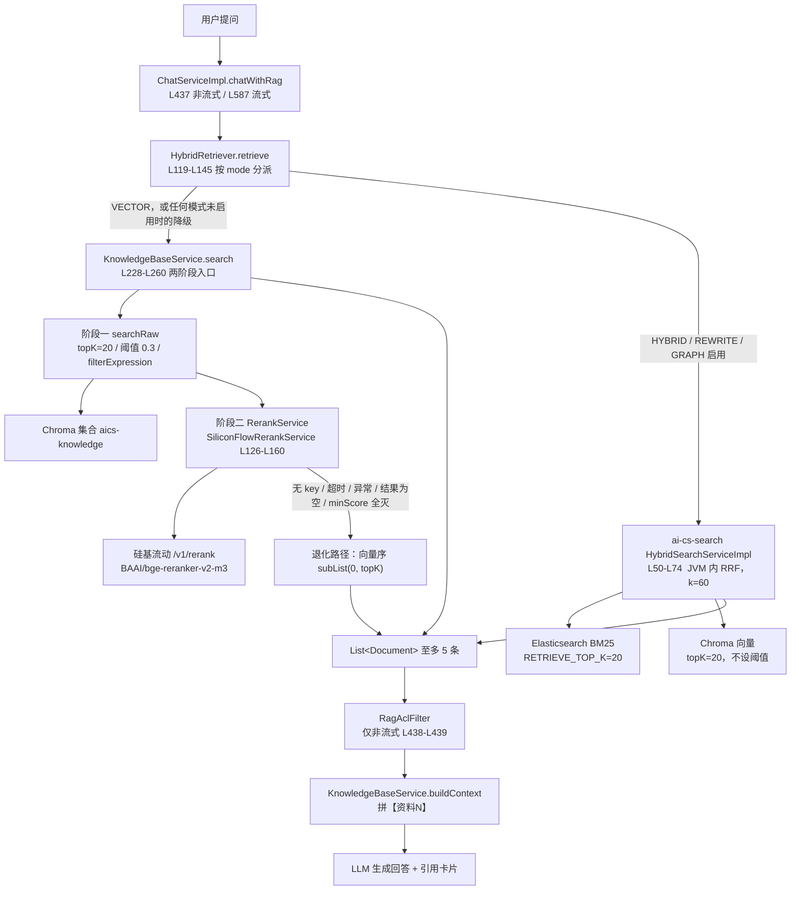
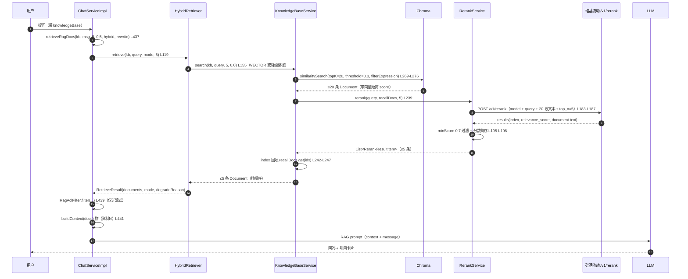

# RAG 进阶实战：Rerank 重排序 —— 召回负责不漏，重排负责排得准

> **一句话结论**：向量召回（bi-encoder）回答的是"这段像不像这个问题"，重排（cross-encoder）回答的是"这段到底能不能答这个问题"；本项目用"宽召回 20 条（阈值 0.3）→ bge-reranker-v2-m3 精排（minScore 0.7）→ 5 条进上下文"把效果和成本拆成两个旋钮分开调，而重排一旦缺席，整条链路**不报错**，只会安静地退化成"按向量相似度取前 5"。
> **阅读前置**：先读 [03-RAG向量检索实战.md](03-RAG向量检索实战.md)（Embedding + Chroma + `SearchRequest` 的用法）和 [05-混合检索实战-ES-BM25与向量RRF融合.md](05-混合检索实战-ES-BM25与向量RRF融合.md)（RRF 只看名次、不看分数）。本文承接这两篇，只讲"排序"这一刀。
> **证据基线**：Spring AI 2.1.0 / Spring Boot 4.2.0 / JDK 17（本地 21）；代码以 `ai-cs-chat` 现行源码为准，配置以 Nacos `ai-cs-chat.yml` 为准。A 级 9 处、B 级 14 处、C 级 4 处（含 2 个 node 模拟推演）。预计阅读 35~45 分钟。

本文的证据边界先讲清楚，避免把"框架能力"和"本项目实现"混为一谈：

| 证据类别 | 本仓状态 | 本篇怎么处理 |
|---|---|---|
| Spring AI 源码摘录（A 级） | 24-源码分析 的 assets/source 已入库 | 只引 `SearchRequest` / `VectorStore` / `Document` / `DocumentPostProcessor` / `DocumentJoiner` / `RetrievalAugmentationAdvisor` / `TokenTextSplitter`，锚点带行号 |
| 硅基流动 Rerank HTTP 契约 | 未入库（第三方 API） | 依据项目 `SiliconFlowRerankService` 的请求/响应模型 + 官方文档口径，不冒充 A 级 |
| Chroma / Elasticsearch 内部行为 | 未入库（第三方组件） | 未入库，依据官方文档/本项目代码 |
| Spring AI 2.1.0 内置"重排"实现 | 未入库 assets/source，但可从 sources jar 静态核对 | 第 3.1 节按 C 级「jar 静态核对」引用，明确不是 A 级锚点 |
| 延迟、召回率、命中率 | 本项目无压测与评估数据 | 只给成本结构与可复现模拟推演，**不编造任何实测数字** |

---

## 0. 先看现象

下面三段都是**代码里的日志格式串**（B 级可核对，不是我去线上捞的），线上出现时形态就是这些——区别只在参数被填成具体值。

**现象一：答案引用的是"相关但答非所问"的片段。**

```text
知识库[product-manual]宽召回完成: 命中20条
知识库[product-manual]Rerank精排完成: 召回20条 -> 返回5条
```

日志一切"正常"：召回了 20 条、精排后返回 5 条。但用户问"退款多久到账"，引用卡片里 5 条全是《售后政策.pdf》里讲"退款申请条件"的段落。片段确实和"退款"高度相关，只是它答的是另一个问题。这是 bi-encoder 的固有盲区：它比较的是两个独立向量的余弦距离，**从来没有真正读过"问题+片段"这一对文本**。

**现象二：检索延迟从 800ms 涨到 2.5s，偶尔直接降级。**

```text
Rerank降级: apiKey为空或无待重排文档
Rerank调用失败，降级为向量相似度排序: java.util.concurrent.TimeoutException: Did not observe any item or terminal signal within 5000ms
知识库[product-manual]检索完成(相似度排序): 召回20条 -> 返回5条
```

三行日志是三种不同的病：第一行是没配 key（配置问题，永远不重排）；第二行是重排服务 5 秒没回（外部依赖问题，这次退化成向量序）；第三行说明**退化后日志换了措辞**——"Rerank精排完成"变成"检索完成(相似度排序)"。延迟涨的那 1.7s，就是一次串行的外部模型调用。

**现象三：同一个文档的 5 个片段占满整个上下文。**

```text
知识库[product-manual]Rerank精排完成: 召回20条 -> 返回5条
```

重排把"最相关的 5 个"选出来了，问题是这 5 个全是同一份 PDF 的相邻分块（第 3.9 节的模拟会量化为 `{"d1":3}`）。模型看到的上下文有 60% 在重复同一段话，另外 3 份真正有用的资料被挤掉了。

**这些现象指向同一件事：召回阶段的分数衡量的是"像不像"，不衡量"答不答得上"；而重排是链路里唯一看 query-doc 交互的环节，它要么不参与（降级/未启用）、要么参与不了（同源碎片垄断、阈值全灭），效果就会静默回退——没有任何异常、没有 5xx，只有质量悄悄掉一档。**

---

## 1. 整体地图

先给结论：本项目有两套排序机制，**它们不是串联的，而是互斥的分支**——向量路走「Chroma 相似度 → Rerank」，混合路走「ES + Chroma → RRF」，混合路**不经过 Rerank**。这不是设计瑕疵，是历史演进的接缝，也是本文最需要讲清的一件事。



> **读图说明**：从上往下看是"谁来排序"。中间 `KnowledgeBaseService.search` 是唯一的**两阶段**入口（阶段一宽召回、阶段二 Rerank），右侧 `HybridSearchServiceImpl` 是**单阶段**融合入口（RRF 只按名次合并两路，没有模型打分）。两条路在 `List<Document>` 处汇合，之后只做 ACL 过滤和上下文拼装，不再有第二次排序。注意 `RerankService` 只在左侧这条路挂载：一旦 `aics.rag.hybrid-enabled=true`，请求走右侧，外部重排模型**完全不参与**。

| 组件 | 责任 | 谁调用它 | 参与打分吗 |
|---|---|---|---|
| `ChatServiceImpl` | 编排：检索 → ACL → 拼上下文 → 调模型 | Controller / SSE 入口 | 否 |
| `HybridRetriever` | 按 `RetrievalMode` 分派，负责各种降级 | `ChatServiceImpl.retrieveRagDocs` | 否 |
| `KnowledgeBaseService` | 两阶段检索的唯一实现 + 分块入库 + 拼上下文 | `HybridRetriever.vector()` 等 | **是**（决定候选池与最终截断） |
| `VectorStore`（Chroma 客户端） | ANN 相似度检索、按 metadata 过滤 | `KnowledgeBaseService.searchRaw` | 只算向量距离 |
| `RerankService` / `SiliconFlowRerankService` | 调外部 cross-encoder 打分、过滤、降序 | `KnowledgeBaseService.search` | **是**（唯一的模型级排序） |
| `HybridSearchServiceImpl` | ES + 向量两路召回 + RRF 融合 | `HybridRetriever`（Feign） | 只按名次融合 |
| `RrfMerger` | `1/(k+rank)` 累加，写 `rrfScore` | `HybridSearchServiceImpl` | 只按名次 |
| `RagAclFilter` | 按租户/角色/文档 ACL 剔除文档 | `ChatServiceImpl`（**仅非流式**） | 否（但会改变最终集合） |
| 硅基流动 `/v1/rerank` | cross-encoder 推理，返回 relevance_score | `SiliconFlowRerankService` | **是**（外部） |

> **表怎么读**：把"参与打分"这一列当成"谁能改变顺序"。只有三行能改变顺序：Chroma（距离）、Rerank（模型分）、RRF（名次）。`RagAclFilter` 虽然不打分，但它删文档，等于在重排之后又砍了一刀——这就是为什么流式路径漏了它，会变成"越权内容被引用"的安全问题，而不是排序问题。

---

## 2. 关键概念与关键类

先把术语钉死，后面才不打架：

| 概念 | 一句话解释 | 在本项目里的具体形态 |
|---|---|---|
| bi-encoder（双塔编码器） | 问题和文档**各自独立**编码成一个向量，再算余弦/内积；文档向量可离线预算、可建 ANN 索引 | Chroma 里的 `aics-knowledge` 集合，768 维哈希或 1024 维 bge-m3 |
| cross-encoder（交叉编码器） | 把 (query, doc) **拼成一个序列**喂进模型，逐 token 交互后输出一个相关性分数；不能预计算、不能建索引 | 硅基流动 `BAAI/bge-reranker-v2-m3`，走 `/v1/rerank` |
| 宽召回（recall） | 用低阈值、大 topK 把"可能有用"的都捞出来，目标是**不漏** | `aics.rag.recall-top-k: 20` + `recall-threshold: 0.3` |
| 精排（rerank） | 对候选池逐个打分重排，目标是**排得准**，并把条数压到上下文预算内 | `aics.rerank.top-n: 5` + `min-score: 0.7` |
| topN 截断 | 只把前 N 条送去打分/送去上下文，N 是成本与效果的旋钮 | 请求体 `top_n`，服务端还会与候选数取 min |
| 名次回填（index） | 重排服务只回"你发给我的第几条"，不回你的文档 id | `RerankResultItem.getIndex()` → `recallDocs.get(idx)` |
| RRF | Reciprocal Rank Fusion，`Σ 1/(k+rank)`，只用名次不用分数 | `RrfMerger.merge(...)`，k=60 |
| MMR | Maximal Marginal Relevance，在"相关"和"别重复"之间加权 | **未落地**，本篇给公式与模拟 |

| 类 / 接口 | 位置 | 角色 | 关键方法 |
|---|---|---|---|
| `RerankService` | `ai-cs-chat/src/main/java/com/aics/chat/rag/rerank/RerankService.java` | 重排抽象（可换供应商） | `rerank(query, documents, topN)` → `Mono<List<RerankResultItem>>` |
| `SiliconFlowRerankService` | `ai-cs-chat/src/main/java/com/aics/chat/rag/rerank/SiliconFlowRerankService.java` | 硅基流动实现：组请求、超时、降级、过滤、降序 | `rerank()` L126-L160、`doRerank()` L170-L202 |
| `RerankProperties` | `ai-cs-chat/src/main/java/com/aics/chat/rag/rerank/RerankProperties.java` | `aics.rerank` 配置绑定 | `getTopN/getMinScore/getTimeoutMs/getModel` |
| `RerankResultItem` | `ai-cs-chat/src/main/java/com/aics/chat/rag/rerank/RerankResultItem.java` | 响应条目（index + 分数 + 原文对象） | `getIndex()/getRelevanceScore()/getText()` |
| `KnowledgeBaseService` | `ai-cs-chat/src/main/java/com/aics/chat/service/KnowledgeBaseService.java` | 两阶段编排者 | `search()` L228-L260、`searchRaw()` L265-L279 |
| `SearchRequest` | Spring AI（A 级） | 检索参数载体（query/topK/阈值/过滤表达式） | `builder().query().topK().similarityThreshold().filterExpression()` |
| `Document` | Spring AI（A 级） | 片段载体，`score` 可为 null | `getText()/getScore()/getMetadata()` |
| `DocumentPostProcessor` | Spring AI（A 级） | 框架给的"检索后处理"扩展槽位 | `process(Query, List<Document>)` |
| `DocumentJoiner` | Spring AI（A 级） | 多查询/多路结果的合并与去重层 | `join(Map<Query, List<List<Document>>>)` |
| `HybridSearchServiceImpl` | `ai-cs-search/src/main/java/com/aics/search/hybrid/HybridSearchServiceImpl.java` | ES + 向量两路召回、RRF 融合 | `hybridSearch()` L50-L74 |
| `RrfMerger` | `ai-cs-search/src/main/java/com/aics/search/hybrid/RrfMerger.java` | RRF 数学实现 | `merge(list1, list2, topK, k)` L35、`1.0/(k+rank)` L66 |
| `HybridRetriever` | `ai-cs-chat/src/main/java/com/aics/chat/rag/retrieve/HybridRetriever.java` | 检索模式分派与降级 | `retrieve()` L119-L145、`vector()` L153-L157、`hybrid()` L176-L213 |

---

## 3. 原理与证据逐段精读

### 3.1 为什么"向量召回完事"不够：两种编码器的计算图差异

**在干什么**：对比两阶段各自的模型形态，说清"快"和"准"为什么不可能同时给到。

bi-encoder 把 query 和 doc 分别过一遍编码器，得到两个定长向量，相似度是余弦或内积。doc 侧的向量**可以离线算好、写进向量库、建 ANN 索引**，在线只需要给 query 算一次向量，然后做近似最近邻搜索——所以它是毫秒级、可扩展到百万级的。代价是：query 和 doc 在模型内部**从未相遇**，所有交互信息必须被压缩进那一个固定维度的向量里。这种压缩天然丢失"这段有没有直接回答问题"这类细粒度信号。

cross-encoder 把 (query, doc) 拼成一个序列一次前向，token 之间做完整 self-attention，输出一个标量。它准，但它**无法预计算**：doc 换了 query 就要重算，也不可能给全库建索引——给 20 万条文档算分就是 20 万次前向。所以它只能对"已经筛过一遍的小候选集"使用。

Spring AI 自己在 2.1.0 的新实现里把这件事说破了——下面这段 javadoc 出自 `spring-ai-rag-2.1.0-sources.jar` 里的 `DecisionDocumentReranker.java`（L39-L70）。**该文件未入 `assets/source`，此处属于 C 级"jar 静态核对"，不是 A 级锚点**：

```text
Vector search ranks by embedding distance. That is a good way to find candidates
and a poor way to order them, because a passage can be on the right subject and
still not contain the answer.
```

**为什么这么设计**：成本结构决定了分工。bi-encoder 的复杂度是 O(1) 次编码 + 一次 ANN 查询，cross-encoder 是 O(N) 次前向。所以工业界的标准解是"廉价的负责召回、昂贵的负责排序"，N 从 20 万降到 20，cross-encoder 才用得起。本项目 `SiliconFlowRerankService` 的类注释（L30-L55）已经把这条推理写在代码里了，不是事后总结。

框架层面也承认"排序"和"去重合并"是两件事：`DocumentPostProcessor` 是"逐条打分/过滤"的槽位，`DocumentJoiner` 是"多路合并去重"的槽位，后者 javadoc 明确提到它负责 reciprocal ranking strategies [[源码:DocumentJoiner.java.md#L29-L45]]。**RRF 属于 joiner 层，不是重排层**——这个分工后面第 3.7 节会用到。

**换成别的写法会怎样**：只保留 bi-encoder，就是第 0 节现象一，永远拿不到"是否回答问题"这个判断；只保留 cross-encoder，检索延迟从毫秒变成分钟级，线上不可用；想用一个大模型（LLM 打分）替代 cross-encoder，也能拿到"是否回答问题"，但一次请求要对 N 条各调一次 LLM，成本比专用 reranker 高一个量级（第 5 节对比）。

**常见坑**：把两个阶段的分数当成同一量纲。向量距离（越大越相似）和 `relevance_score`（越大越相关）语义不同、分布不同，绝不能共用同一个阈值；更要命的是 `Document.getScore()` 允许为 null——javadoc 原话 "the relevance score, may be null" [[源码:Document.java.md#L58-L58]]，字段声明就是 `private final @Nullable Double score;` [[源码:Document.java.md#L146-L160]]，排序时不做 null 判断会直接 NPE。

### 3.2 阶段一：宽召回要"漏得少"，参数只有两个

**在干什么**：用一次 Chroma 相似度检索把候选池从全库砍到 20 条，阈值故意设低。

```java
// KnowledgeBaseService.searchRaw() 的核心四行（L265-L279 精简）
String retrievalQuery = "为这个句子生成表示以用于检索相关文章：" + query;
SearchRequest searchRequest = SearchRequest.builder()
        .query(retrievalQuery)
        .topK(topK)
        .similarityThreshold(threshold)
        .filterExpression("knowledgeBase == '" + knowledgeBase + "'")
        .build();
List<Document> results = vectorStore.similaritySearch(searchRequest);
```

（`ai-cs-chat/src/main/java/com/aics/chat/service/KnowledgeBaseService.java#L265-L279`）

调用方传进来的是 `recallTopK=20`、`recallThreshold=0.3`（L230），两个字段来自 `@Value` 注解、默认值 20 / 0.3（L93-L99），Nacos 里也配了同样的值：

```yaml
aics:
  rag:
    # Broad recall threshold: recall first, quality left to Rerank (min-score 0.7)
    recall-top-k: 20
    recall-threshold: 0.3
```

（`tools/nacos-config/ai-cs-chat.yml#L21-L25`，注释原文就是这么写的）

**为什么这么设计**：0.3 不是一个"质量阈值"，而是一个"别漏"的下限。它把明显不相关的（比如 0.1）丢掉，剩下的噪声交给第二阶段。20 是因为 cross-encoder 的成本随 N 线性涨，20 是"够重排挑"和"钱够花"之间的经验折中。这里必须知道框架的默认值不是你的默认值——`SearchRequest` 的默认 topK 只有 4，默认阈值 0.0 表示"接受任何相似度、关闭阈值过滤" [[源码:SearchRequest.java.md#L39-L60]]：

```java
(src: SearchRequest.java.md#L39-L60)
public static final double SIMILARITY_THRESHOLD_ACCEPT_ALL = 0.0;

public static final int DEFAULT_TOP_K = 4;

private String query = "";

private int topK;

private double similarityThreshold;

private String filterExpression;
```

**换成别的写法会怎样**：把召回 topK 也设成 5，重排就变成"给 5 个候选排个序"，它没有任何选择余地——第一阶段漏掉的，第二阶段永远救不回来，这是两阶段最容易被误解的一点。反过来把召回阈值提到 0.7，等于在第一阶段就做了第二阶段的判断，噪声是少了，但"相关但答非所问"这类会被一起砍掉，且精排彻底失去作用。`VectorStoreDocumentRetriever` 的用法示例里 `.similarityThreshold(0.73).topK(5)` 是"单阶段"的写法，本项目**没有**走这条捷径 [[源码:VectorStoreDocumentRetriever.java.md#L38-L46]]。

**常见坑（真坑，务必记住）**：`search()` 的第 4 个参数 `threshold` 是**死参数**。签名里有（L228），方法体里根本没用——L230 传给 `searchRaw` 的是字段 `recallThreshold`，不是形参 `threshold`。所以：

```text
ChatServiceImpl.java:437: ... retrieveRagDocs(knowledgeBase, message, 5, 0.5, hybrid, rewrite);
ChatServiceImpl.java:587: ... retrieveRagDocs(knowledgeBase, message, 5, 0.5, hybrid, rewrite);
HybridRetriever.java:155:  ... knowledgeBaseService.search(knowledgeBase, query, topK, 0.0);
--- 定义与使用 ---
228: public List<Document> search(String knowledgeBase, String query, int topK, double threshold) {
229:     // 阶段一：宽召回
230:     List<Document> recallDocs = searchRaw(knowledgeBase, query, recallTopK, recallThreshold);
```

上层传 0.5、传 0.0、传 1.0，**行为完全一样**，实际阈值恒为 Nacos 的 0.3。改阈值只能改 Nacos，改调用点没有任何效果。这类"看起来能配、其实不生效"的参数，是排查召回质量时最常见的假线索（第 6 节给了专门的定位手法）。

### 3.3 阶段二：Rerank 的输入输出契约

**在干什么**：把候选池转成外部 API 的请求体，发一次 HTTP，拿回"第几条 + 多少分"，再过滤、降序、截断。

请求侧只有一个模型名、一个问题、一堆纯文本：

```java
// doRerank() 组包与调用（SiliconFlowRerankService 内，L170-L202 精简）
RerankRequest request = new RerankRequest();
request.setModel(properties.getModel());                       // BAAI/bge-reranker-v2-m3
request.setQuery(query);
request.setDocuments(documents.stream().map(Document::getText).toList()); // 只发正文
request.setTopN(Math.min(topN, documents.size()));             // 截断：不多要
request.setReturnDocuments(true);                              // 要回原文，便于核对
RerankResponse response = client.post().uri("/v1/rerank")
        .body(request).retrieve().body(RerankResponse.class);
```

（`ai-cs-chat/src/main/java/com/aics/chat/rag/rerank/SiliconFlowRerankService.java#L170-L202`）

请求体字段映射得很直白：`top_n`、`return_documents` 两个 snake_case 字段用 `@JsonProperty` 标在原字段上（`RerankRequest` L207-L218）。响应侧只认三个字段：

```java
// RerankResultItem（L21-L37）
private int index;                     // 对应"我发给你的 documents 列表"的下标
private double relevanceScore;         // @JsonProperty("relevance_score")，0~1
private DocumentPayload document;      // 服务端回显的 {"text": "..."}
```

（`ai-cs-chat/src/main/java/com/aics/chat/rag/rerank/RerankResultItem.java#L21-L37`）

拿到结果后两道处理：先按 `minScore` 过滤，再按分数降序（L195-L198），日志打的是"输入多少、过滤后多少、配置超时多少"（L199-L200）——**注意它打的是"耗时配置"而不是"实际耗时"**，因为这一层根本没测真实耗时，全靠外层 observation span 记。

**为什么这么设计**：`index` 而不是文档 id，是因为服务端要"无状态"：它不认识你的 `documentId`，只认识"第几个"。代价是**调用方必须保证"发出去的顺序"和"回填用的基准列表"是同一个列表**。这也是 `top_n` 要取 `min(topN, size)` 的原因：候选比 topN 少时，直接要 10 条会让服务端报参数错误或返回空。

**换成别的写法会怎样**：如果框架能替你管这件事，就不用自己维护契约了——Spring AI 2.1.0 就是给了这么个槽位 [[源码:DocumentPostProcessor.java.md#L37-L43]]：

```java
(src: DocumentPostProcessor.java.md#L37-L43)
public interface DocumentPostProcessor extends BiFunction<Query, List<Document>, List<Document>> {

	List<Document> process(Query query, List<Document> documents);
```

但**槽位不等于能力**：静态核对 `spring-ai-rag-2.1.0-sources.jar` 里 `org/springframework/ai/rag/postretrieval/document/` 只有 `DocumentPostProcessor`、`DecisionDocumentFilter`、`DecisionDocumentReranker`、`DecisionFanOut` 四个文件（jar 内无 cross-encoder 实现，该 jar 不在本机 `~/.m2`，来源见第 9 节练习 5）。也就是说：想白嫖一个"外挂 reranker 的官方实现"，2.1.0 里没有；官方给的是 **LLM 逐条打分**的 `DecisionDocumentReranker`（`@since 2.1.0`），它把模型输出的"是/否"概率当分数，成本远高于专用 reranker。

**常见坑**：①`document` 字段在硅基流动的响应里是**对象** `{"text": ...}` 而不是字符串，直接用 `String` 接会反序列化失败——`RerankResultItem` 专门写了 `getText()` 做兼容；②返回的 `results` 顺序**不保证**是输入顺序，也不保证已经是降序，必须自己排序（L198 就在排）；③`return_documents` 设为 false 时 `document` 为 null，任何依赖它的日志或回填都会 NPE。

### 3.4 名次回填与四条降级：为什么"失败"看起来像"正常"

**在干什么**：把服务端给的 `index` 换回真实 `Document`，同时给所有失败路径准备一条退路。

```java
// KnowledgeBaseService.search() 阶段二（L236-L259 精简）
RerankService rerankService = rerankServiceProvider.getIfAvailable();   // 降级点①：bean 不存在
if (rerankService != null) {
    try {
        List<RerankResultItem> reranked = rerankService.rerank(query, recallDocs, topK).block();
        if (reranked != null && !reranked.isEmpty()) {                  // 降级点④：结果为空
            List<Document> result = new ArrayList<>(reranked.size());
            for (RerankResultItem item : reranked) {
                int idx = item.getIndex();
                if (idx >= 0 && idx < recallDocs.size()) {               // 越界保护
                    result.add(recallDocs.get(idx));
                }
            }
            return result;
        }
    } catch (Exception e) {                                             // 降级点③：异常
        log.warn("知识库[{}]Rerank调用异常，降级为相似度排序: {}", knowledgeBase, e.getMessage());
    }
}
List<Document> fallback = recallDocs.size() <= topK ? recallDocs : recallDocs.subList(0, topK);
```

（`ai-cs-chat/src/main/java/com/aics/chat/service/KnowledgeBaseService.java#L236-L259`）

四条降级/退化路径汇总：

| # | 降级点 | 触发条件 | 代码位置 | 日志特征 | 结果 |
|---|---|---|---|---|---|
| ① | 依赖缺失 | 容器里没有 `RerankService` bean | L236 `getIfAvailable()` | 无（静默） | 向量序前 topK |
| ② | 配置缺失 | `aics.rerank.api-key` 为空 | L129-L133 | `Rerank降级: apiKey为空或无待重排文档` | 向量序前 topK |
| ③ | 超时/异常 | 5s 超时、4xx/5xx、网络错误 | L155、L156-L159 | `Rerank调用失败，降级为向量相似度排序: ...` | 向量序前 topK |
| ④ | 结果为空 | 响应没 results（L189-L192）**或** minScore 把全部条目过滤掉 | L240 `!isEmpty()` | `Rerank响应为空` 或直接 `检索完成(相似度排序)` | 向量序前 topK |

**为什么这么设计**：RAG 检索是"增强"环节，不能因为它自己挂了就让整轮对话失败。所以策略是可用性优先——**宁可返回向量序，也不返回错误**。这在 SRE 视角是对的，在效果视角是危险的：降级是静默的，用户和老板只看到"回答变差了"，看不到任何错误。

**关键洞察（本文最重要的一段）**：降级点 ④ 把"宁缺勿滥"这条策略悄悄取消了。设想 `minScore=0.7` 把所有候选都判成不合格——设计意图应该是"没有够格的资料就不要硬编"，但 L240 的 `!reranked.isEmpty()` 为假，代码直接落到 L257，把**被重排判为不合格的那 5 条又捡回来**送去给模型。也就是说：**过滤得再狠，最终仍然会塞 5 条进去**，模型拿到的上下文里没有任何"我不确定"的信号。第 3.8 节的模拟表会量化这个边界。

**换成别的写法会怎样**：把失败变成显式错误（`Mono.error` 上抛），能让调用方 500，用户立刻看到"检索不可用"——可用性换透明度；或者给 `search()` 换一个返回结构体，把"是否降级 / 降级原因"带出去。项目里其实已经有这个先例：`HybridRetriever.buildResult(query, docs, mode, degradeReason)` 的 `RetrieveResult` 就带了降级原因（L156、L183、L211 都在填），只是 `KnowledgeBaseService.search()` 返回的是裸 `List<Document>`，把这份信息丢了。

**常见坑**：①`.block()` 拿到的可能是 `null`，必须判 `reranked != null`（L240 已判，写新代码别忘）；②`recallDocs.get(idx)` 一定要做越界保护——服务端换实现后 `index` 语义可能从 0 基变 1 基，一行 `idx >= 0 && idx < size` 能防住一次线上事故；③`block()` 在响应式线程上调用会抛 `IllegalStateException`（`block()/blockFirst()/blockLast() are blocking, which is not supported in thread reactor-http-nio-x`），本项目跑在 Servlet 栈上所以安全，一旦迁 WebFlux 就必须改造。

### 3.5 两阶段参数联动：20 → 5（→ 3 还是未落地的建议）

**在干什么**：把三个看起来独立的参数拉到一张表里，看清它们怎么互相锁死。

| 层 | 参数 | 当前值 | 定义位置 | 作用 |
|---|---|---|---|---|
| 阶段一 召回池 | `aics.rag.recall-top-k` | 20 | Nacos L22 + `@Value` 默认 20 | 决定候选池大小 = 重排的成本 |
| 阶段一 门槛 | `aics.rag.recall-threshold` | 0.3 | Nacos L24 + `@Value` 默认 0.3 | 决定"别漏"的下限 |
| 阶段二 精排条数 | `aics.rerank.top-n` | 5 | Nacos L16 + `RerankProperties` 默认 5 | 只对前 N 条要分数 |
| 阶段二 合格线 | `aics.rerank.min-score` | 0.7 | Nacos L17 + `RerankProperties` 默认 7 | 不合格的丢掉（但见 3.4 的④） |
| 阶段二 超时 | `aics.rerank.timeout-ms` | 5000 | Nacos L18 + `RerankProperties` 默认 5000 | 外部调用的硬上限 |
| 送模型条数 | `retrieveRagDocs(..., 5, 0.5, ...)` 的 `topK` | 5 | ChatServiceImpl L437 / L587 | 同时是 rerank 的 topN、降级截断条数、送进上下文的条数 |

**为什么这么设计**：`20 → 5` 是一个"候选池 / 上下文预算"的比值，20:5 = 4:1，重排有 4 倍的选择空间。这个比值太小（比如 8→5）重排几乎无法改变结果；太大（50→5）重排成本翻倍但收益递减。

**现状要说清的两件事**：

1. **同一个 `5` 被复用了三种语义**。`ChatServiceImpl` 传下去的 `topK=5`，在 `search()` 里既当 rerank 的 `topN`，又当降级路径 `subList(0, topK)` 的截断数，最后又是送进上下文条数。改 5 → 3 会同时改三处行为，这正是"参数耦合"的典型。
2. **"送 3 条给模型"目前没有落地**。代码里没有任何地方把 5 再截成 3；`buildContext()`（L287-L293）拿到几条就拼几条。想落地只有两条路：改 `ChatServiceImpl` L437/L587 的 `5`（顺带把精排 topN 和降级条数一起改，副作用明显），或者在 `buildContext()` 前加一层"按 token 预算裁剪"（推荐，代价是新增一个可观测点）。**本篇把 5→3 标注为建议值，不是现状。**

**换成别的写法会怎样**：想"多给模型一点资料"就把 5 改成 10，看似只是上下文变长，实际是重排 topN 变大（成本↑）、降级时塞更多向量序噪声（质量↓）、prompt token 变多（延迟与费用↑），三重副作用。正确顺序是先加 `recall-top-k`，观察精排后的分数分布，再决定 topN。

**常见坑**：只调 `min-score` 不调 `recall-top-k`。候选池只有 20 条且阈值 0.3 已经砍过一遍，`min-score` 提到 0.8 时很可能只剩 2~3 条，然后触发 3.4 的降级点 ④，你会以为"`min-score` 没用"。

### 3.6 重排的成本与延迟核算

**在干什么**：把一个 RAG 请求拆成串行阶段，标出哪些阶段随 N 线性增长、哪些是固定开销。

| 阶段 | 随什么增长 | 是否可通过配置裁剪 | 本项目对应证据 |
|---|---|---|---|
| query 向量化（embedding） | 固定 1 次 | 否 | 检索前缀 + bge-m3，`searchRaw` L268 |
| Chroma ANN 检索 | 亚线性（索引决定） | `recall-top-k` | L269-L276 |
| **外部重排（1 次 HTTP + N 个 pair 前向）** | **线性于候选条数** | `top-n`、`timeout-ms` | L170-L202 |
| LLM 生成 | 线性于上下文 token | 送模型条数 | `buildContext` L287-L293 |

成本公式（不写单价，避免编造，只给结构）：

```text
单次 RAG 增量成本 ≈ C_rerank × N_pairs + C_llm × (上下文token + prompt)
N_pairs = min(top_n, 候选数)            ← 本项目 = min(5, 20) = 5？
```

**这里有个容易看错的点**：`top_n` 只截断"返回几条"，`documents` 数组仍然是全部候选——L179 把 `documents` 全量发过去，L180 只是把 `top_n` 设成 `min(topN, size)`。也就是说**送进去打分的是 20 条，只是服务端只回前 5 条**。所以 N_pairs = 20，不是 5。想真正省算力，要去裁剪 `documents` 列表本身，而不是只调 `top_n`。

延迟结构同理：外部调用是**串行而且阻塞**的。`rerank()` 里 `.subscribeOn(Schedulers.boundedElastic())` + `.timeout(5000ms)`（L154-L155），调用方 `.block()`（L239）同步等结果。所以最坏情况就是**硬等 5 秒**，然后才降级——第 0 节现象二里"延迟涨到 2.5s"属于正常调用耗时，而"偶尔 5s 然后降级"就是碰到了 timeout 天花板。这里有个坑：`subscribeOn` 是 `timeout` 生效的前提，代码注释（L136-L137）写得很直白——**不切到别的调度器，`.timeout()` 不会打断阻塞的 HTTP 调用**，超时就形同虚设。

**为什么这么设计**：这就是"两阶段是效果与成本的折中"的字面含义——你想让第一阶段更宽（召回 50），第二阶段的钱就按 2.5 倍付；你想让第二阶段更严（min-score 提到 0.8），第一阶段必须更宽来补偿候选数，否则就走进降级。

**换成别的写法会怎样**：不做重排，全部成本压给 LLM（塞 20 条进上下文让它自己找）——prompt token 涨 4 倍，且长上下文里"中间信息丢失"（lost in the middle）比排序错更致命；或者把重排换成 LLM 打分（第 5 节），单条成本更高但可复用同一份 prompt 缓存。

**常见坑**：拿"日志里的耗时配置 5000ms"当实际耗时（L199-L200 打的就是配置值）；以及用平均延迟评估重排开销——尾部延迟才是灾难，因为超时配置是 5s，一旦外部服务抖动，P99 直接被钉在 5s。要测只能看 `rag.rerank` 的 observation span（L145-L149 `TraceSpans.observeReturn(..., "rag.rerank", ...)`），**本篇没有做压测，不给任何延迟实测数字**。

### 3.7 RRF 与 Rerank 的分工：混合模式为什么绕过精排

**在干什么**：说清项目里两个"排序器"的边界，以及一个真实存在的能力盲区。

混合检索在 `ai-cs-search` 内部完成两路召回 + 融合：

```java
// HybridSearchServiceImpl.hybridSearch()（L50-L74 精简）
List<RankedItem> esItems = esSearch(knowledgeBase, query);        // BM25，size = RETRIEVE_TOP_K(20)
List<RankedItem> vectorItems = vectorSearch(knowledgeBase, query); // Chroma，topK=20，不设阈值
// ... 任一路为空时降级单路 ...
// 两路都有结果：只看排名不看分数，跨量纲
return RrfMerger.merge(esItems, vectorItems, topK, RRF_K);        // RRF_K = 60
```

（`ai-cs-search/src/main/java/com/aics/search/hybrid/HybridSearchServiceImpl.java#L50-L74`）

RRF 的数学就一行：`scores.merge(item.getId(), 1.0 / (k + rank), Double::sum)`（`RrfMerger` L66）。它**只吃名次，不吃分数**，所以天生解决了"BM25 分和余弦距离不同量纲"的问题——这也是它能成为工业默认选项的原因，也是框架把它放在 `DocumentJoiner`（合并去重层）而不是 `DocumentPostProcessor`（打分重排层）的原因。

**盲区（真实且重要）**：`HybridRetriever` 全文 **0 处**出现 `rerank`。也就是说 `retrieve()` 分派到 `HYBRID` / `HYBRID_QUERY_REWRITE` / `GRAPH_RAG` 时，结果是 RRF（或改写后的多查询 RRF）直接返回，**RerankService 完全不参与**（L119-L145 + L176-L213 可核对）。启用混合检索后，排序质量就只剩"名次融合"这一层——它比单路好，但依然不知道"这段能不能回答问题"。想让混合路也吃到精排，得在 `hybrid()` / `rewriteHybrid()` 返回前补一次 `rerankService.rerank(...)`，这是本文列出的头号可扩展点。

**替代方案对比（这是选型的核心表）**：

| 方案 | 输入信号 | 能否判断"答不答得上" | 增量成本 | 增量延迟 | 可解释性 | 在本项目的位置 |
|---|---|---|---|---|---|---|
| 只用向量相似度 | 余弦距离 | 不能（只判断"像不像"） | 0 | 0 | 高（有分数） | 现状的降级路径 |
| **RRF 名次融合** | 两路名次 | 不能（名次里没有语义判断） | 0 | 0 | 中（能看出两路名次） | **已落地**：`RrfMerger` |
| 加权分数融合 | 归一化后的两路分数 | 不能 | 0 | 0 | 中 | 未落地（跨量纲，需 min-max 归一化） |
| **cross-encoder 重排** | (query, doc) 全文交互 | **能**，且最便宜 | 1 次 HTTP + N 次前向 | 百毫秒~秒级 | 中（有 0~1 分，但不可解释原因） | **已落地**：`SiliconFlowRerankService`（仅向量路） |
| LLM 逐条打分 | (query, doc) + 指令 | 能，且可定制判据（"是否直接回答"） | N 次 LLM 调用 | 秒级~十秒级 | 低（分数是"是"概率） | 框架有实现（`DecisionDocumentReranker`，@since 2.1.0），项目未用（jar 静态核对，未入库） |
| 规则加权 | 标题命中、时间新近、来源权威、文档类型 | 不能（业务先验） | 0 | 0 | **最高** | 未落地（可作为最终 tie-breaker） |

> **怎么选**：能不能判断"答不答得上"是分水岭。前四行都做不到，只有 cross-encoder 和 LLM 打分能。而 RRF 的价值不在"判断"，在"把两个各有盲区的召回器合成一个候选池"——它的正确位置是**在重排之前**。项目现在的问题不是"RRF 不对"，而是"混合路缺了重排这一层"。

**常见坑**：直接把两路分数加权相加（0.5×余弦 + 0.5×BM25），没做归一化会让量纲大的那路完全主导；RRF 的 `k` 取太小（比如 1）会让第 1 名绝对垄断，取 60 是让名次差异平滑的常用值（项目 `RRF_K=60`，`MultiQueryMerger` 的 javadoc 也解释了这点）。

### 3.8 重排失效场景：什么时候"排得准"也会失灵

**在干什么**：把 cross-encoder 的失效边界逐条摊开，避免把重排当银弹。

| 失效场景 | 机理 | 本项目相关证据 | 对策 |
|---|---|---|---|
| 长文档被截断 | cross-encoder 有最大输入长度，超长会被服务端截断，只对前半段打分 | `doRerank` L179 把**整段文本原样发送，既不截断也不分片**；chunk 由 `TokenTextSplitter` 默认 800 token 切（[[源码:TokenTextSplitter.java.md#L41-L41]]），常规不会超长 | 保证写入路径统一走 splitter；若允许长 chunk，先截断再打分并在元数据里标记 |
| 领域词汇/内部黑话 | 通用 reranker 没见过产品型号、内部缩写，语义交互判不准 | 型号、订单号这类"精确串"本就不是 cross-encoder 的强项 | 精确串交给 BM25（混合检索）；query 做同义词/型号扩展 |
| 阈值全灭 → 静默退化 | `minScore` 过滤后为空，L240 判定为空 → 走 fallback 捡回被淘汰的条目 | L195-L198 过滤、L240 `!isEmpty()`、L257 fallback（第 3.4 节④） | 把"空结果"和"调用失败"分开处理：空结果应返回空列表给上层决策 |
| 同源碎片垄断 | 重排只按单条相关性排序，同文档的相邻分块天然都高分 | 第 3.9 节模拟：重排 Top3 文档分布 `{"d1":3}` | MMR 或"每文档最多 N 条"配额 |
| 分数不可比 | 向量距离、RRF 分、relevance_score 三个量纲混用同一阈值 | `Document.getScore()` 可为 null [[源码:Document.java.md#L326-L334]] | 一个阶段一个阈值，绝不跨阶段复用 |
| 中文长句 + 编号混排 | 分词/编号切分影响 cross-encoder 的 token 对齐 | 项目 query 前缀是为 bge-m3 **检索**加的（L268），不是为重排加的 | 重排侧不要把检索指令前缀拼进 query |

**为什么这么设计（项目现状的取舍）**：`minScore=0.7` 这个值在 bge-reranker 的分数分布里偏严。下面的模拟（第 9 节练习 3 可复现）显示：20 条候选里只有 5 条 ≥0.7，恰好等于 `top-n`——也就是说这个配置**刚好卡在"候选不够就退化成向量序"的边界上**：

```text
minScore | 存活条数 | min(5,存活) 实际返回 | 结果为空触发退化
     0.5        11                    5             false
     0.6         8                    5             false
     0.7         5                    5             false
     0.8         4                    4             false
     0.9         1                    1             false
```

> **模拟推演**：上表用一组"假设的" relevance_score 分布（20 条，max 0.93 / min 0.29，≥0.7 占比 25%）算出不同 `minScore` 下的存活数，不是线上实测。怎么读：`minScore=0.7` 时存活 5 条、刚好用满 topN，说明这条线上**任何一点分布波动都会让它掉到 4 条以下**；而一旦存活 0 条，按 L240 的逻辑会退化到向量序，`宁缺勿滥` 变成 `宁滥勿缺`。

**换成别的写法会怎样**：把"合格线"从固定分数改成"配额 + 相对线"（例如：取分数最高的 5 条，但如果最高分 < 0.5 才判为"无相关内容"并返回空），既避免固定阈值的脆弱性，也能保住"宁缺勿滥"的语义。这需要改 `SiliconFlowRerankService` 的过滤逻辑和 `search()` 的空结果处理，属于行为变更，不是调参。

**常见坑**：在 `yaml` 里把 `min-score` 调小"让结果多一些"，看起来返回条数变多，其实是把噪声也放进上下文；`min-score` 调大"提高准确率"，实际在踩 3.4 的降级点 ④，最后效果反而更差——这就是"参数看起来生效，实际走了另一条分支"的经典陷阱。

### 3.9 用 MMR 解决"全是一个文档的片段"

**在干什么**：在最相关和最多样之间做加权，把"同一份 PDF 的 5 个相邻分块"打散。

MMR（Maximal Marginal Relevance）的目标函数：

```text
MMR(d) = λ × sim(query, d) − (1 − λ) × max_{s ∈ 已选} sim(d, s)
```

第一项保证"相关"，第二项惩罚"和已选内容重复"，`λ=1` 退化成纯相关性排序，`λ=0` 退化成纯多样性。下面的模拟把第 3.7 节的 RRF 名次和第 3.3 节的打分串起来（**模拟推演**，rel 为假设值）：

```text
RRF名次 | 片段 | ES名次 | 向量名次 | RRF分 | 重排分
#1 | d1-ch4 | 3 | 1 | 0.03227 | rel=0.41 (minScore 过滤)
#2 | d1-ch3 | 6 | 2 | 0.03128 | rel=0.93 -> 重排#1
#3 | d2-ch2 | 2 | 11 | 0.03021 | rel=0.38 (minScore 过滤)
#4 | d4-ch1 | 1 | 13 | 0.03009 | rel=0.52 (minScore 过滤)
#5 | d1-ch7 | 9 | 5 | 0.02988 | rel=0.35 (minScore 过滤)
#6 | d1-ch5 | 12 | 3 | 0.02976 | rel=0.88 -> 重排#2
#7 | d6-ch2 | 5 | 10 | 0.02967 | rel=0.66 (minScore 过滤)
#8 | d3-ch1 | 4 | 12 | 0.02951 | rel=0.44 (minScore 过滤)
#9 | d5-ch3 | 8 | 9 | 0.02920 | rel=0.72 -> 重排#5
#10 | d10-ch1 | 10 | 8 | 0.02899 | rel=0.51 (minScore 过滤)

直接按RRF取Top3: d1-ch4, d1-ch3, d2-ch2
重排后Top5: d1-ch3, d1-ch5, d1-ch6, d7-ch1, d5-ch3
重排后取Top3: d1-ch3, d1-ch5, d1-ch6
直接Top3 文档分布: {"d1":2,"d2":1}   重排Top3 文档分布: {"d1":3}
MMR(lambda=0.7) 取3: d1-ch3, d7-ch1, d5-ch3   文档分布: {"d1":1,"d7":1,"d5":1}

RRF Top5 里被重排淘汰: d1-ch4, d2-ch2, d4-ch1, d1-ch7
重排Top3 里来自 RRF 第6名之后: d1-ch5(RRF #6), d1-ch6(RRF #11)
```

> **模拟推演**：脚本用 20 条候选（10 条已知两路名次 + 10 条填充）、`k=60` 的 RRF、一组假设的 cross-encoder 分和 `minScore=0.7` / `topN=5`。三行结论值得逐个读：
> ① **重排确实在干活**：RRF 第 1 名 `d1-ch4`（两路都靠前、RRF 分最高）被打了 0.41 直接淘汰——这正是"名次高但答非所问"的典型，纯 RRF 无法发现。
> ② **重排能捞回深候选**：最终 Top3 里的 `d1-ch5`、`d1-ch6` 在 RRF 里分别是第 6、第 11 名，靠 cross-encoder 的 0.88 / 0.84 翻上来。这证明"宽召回 20 条"是必要的：候选池不够深，这两条根本不在。
> ③ **重排反而加剧同源垄断**：直接取 RRF Top3 是 `{"d1":2,"d2":1}`，重排后变成 `{"d1":3}`——因为同一份文档的分块语义天然互相相似，cross-encoder 会给它们一致的高分。MMR（λ=0.7）把它拉回 `{"d1":1,"d7":1,"d5":1}`。

**为什么这么设计**：上下文窗口是稀缺资源，5 个槽位里有 3 个在重复同一段话，等于把有效信息量砍到 2/5。MMR 用"已选集合"做边际惩罚，不需要额外模型调用——相似度可以复用已有的向量或直接用 rerank 分数的差值近似。

**换成别的写法会怎样**：最简单的是"每文档最多 N 条"硬配额（按 `metadata.documentId` 分组），实现十几行、效果接近 MMR 的 80%，代价是可能错过"某文档确实有三段互补内容"的情况；再复杂一点可以在 prompt 层去重（把重复片段折成一条），但那时 token 已经花掉了。

**常见坑**：①`λ` 调太低（0.3）会让"相关但不那么准"的片段挤掉真正的最佳答案，检索质量肉眼可见地掉；②MMR 的 `sim(d, s)` 如果也用 cross-encoder 分，就需要额外的 pair 打分，成本翻倍——实践里用向量余弦即可；③**项目现状：MMR 未落地**（全仓 grep `MMR|maximal marginal` 零命中），别在文档或注释里把它当既有能力写。

---

## 4. 一次完整执行时序

以"向量路 + 有 api-key + 重排成功"为主线，把每一步的类和方法钉住：



> **读图说明**：三条时间线最关键。① 第 4~5 步是**唯一**的向量检索，第 6~11 步是**唯一**的外部模型调用，两者串行，延迟直接相加；② 第 12 步的"回填"是纯内存操作，但它的正确性依赖第 4 步那份 `recallDocs` 列表**没有被中间步骤改动**——一旦有人在两阶段之间插了过滤/排序，`index` 就会错位；③ 第 14~15 步是整个链路里唯一"知道哪些片段被淘汰"的地方，但这个信息在 `search()` 返回时就丢了（只返回 `List<Document>`），所以线上排查"为什么这条没被引用"只能靠日志。

**每一步失败分别报什么错**

| 失败点 | 触发条件 | 报错/日志原文 | 用户看到 |
|---|---|---|---|
| 第 3 步 Chroma 不可用 | 集合不存在、连接失败 | 向量库客户端异常向上抛（`similaritySearch` 无本地 catch） | 检索抛异常，取决于上层 try/catch，通常是"服务繁忙" |
| 第 6 步 bean 缺失 | 容器里没有 `RerankService` | 无日志（`getIfAvailable()` 返回 null） | 静默按向量序取 5 条 |
| 第 6 步 无 api-key | `aics.rerank.api-key` 空 | `Rerank降级: apiKey为空或无待重排文档` | 静默按向量序取 5 条 |
| 第 7 步 超时 | 外部调用 > 5000ms | `java.util.concurrent.TimeoutException: Did not observe any item or terminal signal within 5000ms` + `Rerank调用失败，降级为向量相似度排序: ...` | 延迟多 5s 后按向量序回答 |
| 第 7 步 鉴权/限流 | 401 / 429 / 5xx | `Rerank调用失败，降级为向量相似度排序: 401 Unauthorized`（`getMessage()` 内容） | 静默按向量序取 5 条 |
| 第 9 步 响应空 | 服务端返回空 results | `Rerank响应为空: query=...` + `检索完成(相似度排序)` | 静默按向量序取 5 条 |
| 第 9 步 全被过滤 | 所有分数 < minScore | `检索完成(相似度排序)`（注意日志已换成"相似度排序"） | 静默按向量序取 5 条（"宁缺勿滥"失效） |
| 第 16 步 检索为空 | 召回 0 条 | `宽召回完成: 命中0条` | `（未检索到相关资料）` 兜底文案（ChatServiceImpl L445） |

> **读这张表的方法**：只有第一行会让用户"看到错误"，其余七行全部是"成功但变差"。判断当前请求有没有吃上重排，唯一可靠的方法是看日志里出现的是 `Rerank精排完成` 还是 `检索完成(相似度排序)`——这两个字符串就是本篇的"体温计"。

---

## 5. 设计取舍

| 决策 | 取了什么 | 舍了什么 | 依据 | 代价 |
|---|---|---|---|---|
| 两阶段而非单阶段 | 效果（能判断"答不答得上"） | 一次外部调用与几十到几百毫秒延迟 | 3.1 的复杂度分析 | 多一个外部依赖、多一类故障 |
| Rerank 外挂（自研 HTTP 客户端）而非框架内实现 | 可换供应商、可控降级语义 | 与框架抽象脱节（2.1.0 已有 `DocumentPostProcessor` 槽位） | 3.3 的 jar 静态核对 | 与 Advisor 体系不兼容，未来迁移要包一层 |
| 失败一律降级为向量序 | 可用性（检索永不阻断对话） | 可观测性（质量回退无告警） | L236-L259 | 线上"变差"很难被发现 |
| 固定 `minScore=0.7` | 简单、可解释 | 分数分布漂移时阈值失效 | 3.8 的模拟表 | 容易踩"全灭 → 退化" |
| RRF 只看名次（k=60） | 跨量纲无需归一化 | 丢了"两路各自有多确信" | `RrfMerger` L66 | 单路强信号被抹平 |
| 重排只挂在向量路 | 混合路延迟不增加 | 混合路没有语义级排序 | `HybridRetriever` 无 rerank 引用 | 排序质量取决于分支选择 |
| topN 截断用 `min(topN, size)` | 少一类参数错误 | 无法表达"少于 N 条就不要" | L180 | 退化时仍然返回内容 |

**可扩展点清单**（按"性价比 / 风险"排序，前三条建议先做）：

1. **把 Rerank 收编成 `DocumentPostProcessor`**：实现一个 `process(Query, List<Document>)` 包住现有 `RerankService`，注入 `RetrievalAugmentationAdvisor.documentPostProcessors`（框架槽位见 [[源码:RetrievalAugmentationAdvisor.java.md#L70-L76]]，循环调用在 [[源码:RetrievalAugmentationAdvisor.java.md#L141-L147]]）。收益：与框架的 joiner/post-processor 体系对齐；风险：需改造检索入口。
2. **混合路补一次精排**：在 `HybridRetriever.hybrid()` / `rewriteHybrid()` 返回前调用 `rerankService`。收益：启用混合检索时不再丢语义排序；代价：Feign 之外再加一次外部调用。
3. **把降级原因透出到返回结构**：`search()` 改返回 `RetrieveResult`（`HybridRetriever` 已有先例），让调用方能区分"重排成功 / 降级 / 无结果"。收益：可观测性从 0 到 1；风险：改签名，涉及所有调用点。
4. **MMR 或每文档配额去重**：在 `search()` 返回前做，按 `metadata.documentId` 分组。收益：解决同源垄断（第 3.9 节）；代价：改变条数分布。
5. **阈值策略从固定分改成"配额 + 相对线"**：避免 `minScore` 全灭静默退化（第 3.4 节④）。
6. **重排结果缓存**：三层缓存（hotqa / semcache / veccache）里没有 rerank 结果，同一 query 重复问会重复付重排成本。
7. **评估门禁**：项目有 20 条 golden 集，但 `aics.eval.gate.*` 阈值全为 `null`、CI 未接评估门禁——**调参（换 model、改 minScore、改 topN）目前完全靠人眼**，这是本篇最想推动的工程改进。

---

## 6. 踩坑与调试手法

| # | 现象 | 根因 | 验证手段 | 解法 |
|---|---|---|---|---|
| 1 | 改了阈值"没反应" | `search()` 的 `threshold` 形参是死参数，实际用字段 `recallThreshold` | 读 L228-L230 + grep 所有调用点 | 改 Nacos 的 `recall-threshold`；或删掉形参（推荐，消除误导） |
| 2 | `min-score` 调大后效果更差 | 过滤全灭 → L240 判空 → L257 fallback 捡回被淘汰的条目 | 看日志措辞是否变成 `检索完成(相似度排序)` | 空结果应返回空列表；或改"配额 + 相对线" |
| 3 | 混合检索开启后重排"消失" | `HybridRetriever` 无 rerank 引用，HYBRID 分支直接返回 RRF 结果 | 第 6 节手法一（grep 计数） | 在 `hybrid()` 返回前补精排 |
| 4 | 精排后引用全是同一份文档 | cross-encoder 只按单条相关性打分，同源分块天然同高 | 第 3.9 节模拟的文档分布 | MMR / 每文档配额 |
| 5 | 上下文里有重复片段（同文多次入库） | `VectorStore.add` 的重复 id 行为"由 provider 决定"，replace-by-id 要用 `upsert` | 对照 javadoc [[源码:VectorStore.java.md#L46-L81]] | 写入改 `upsert`；或入库前按 id 去重 |
| 6 | 流式回答引用了无权限文档 | 流式路径（L587-L588）缺 `RagAclFilter`，非流式有（L438-L439） | 对比两处代码 | 流式路径补同一行过滤（安全优先级最高） |
| 7 | 某文档"永远检索不到" | knowledge 侧 `vectorize` 失败静默 `return 0`（无重试、无补偿队列），分块压根没入库 | 查 `文档向量化失败` 日志 + 核对集合条数 | 加重试/补偿队列；失败要显式可观测 |
| 8 | 超时配置"不生效" | 缺 `subscribeOn(Schedulers.boundedElastic())` 时 `.timeout()` 打断不了阻塞调用 | 读 L136-L137 注释 + L154-L155 | 保持 `subscribeOn` 在 `timeout` 左侧 |

**三个真调试手法（都可在 30 秒内跑完，不需要任何中间件）**：

**手法一：顺着参数找"它到底用没用"**。怀疑某个配置不生效时，先证明数据流，再改代码。

```powershell
cd D:\Projects\Persion\ai-customer-service
Select-String -Path "ai-cs-chat\src\main\java\com\aics\chat\service\impl\ChatServiceImpl.java","ai-cs-chat\src\main\java\com\aics\chat\rag\retrieve\HybridRetriever.java" -Pattern "\.search\(knowledgeBase|retrieveRagDocs\(knowledgeBase, message" -Encoding UTF8 | ForEach-Object { "{0}:{1}: {2}" -f $_.Filename, $_.LineNumber, $_.Line.Trim() }
Get-Content "ai-cs-chat\src\main\java\com\aics\chat\service\KnowledgeBaseService.java" -Encoding UTF8 | Select-Object -Skip 227 -First 3 | ForEach-Object -Begin {$i=228} -Process { "{0}: {1}" -f $i, $_.Trim(); $i++ }
```

```text
ChatServiceImpl.java:437: ... retrieveRagDocs(knowledgeBase, message, 5, 0.5, hybrid, rewrite);
ChatServiceImpl.java:587: ... retrieveRagDocs(knowledgeBase, message, 5, 0.5, hybrid, rewrite);
HybridRetriever.java:155:  ... knowledgeBaseService.search(knowledgeBase, query, topK, 0.0);
--- 定义与使用 ---
228: public List<Document> search(String knowledgeBase, String query, int topK, double threshold) {
229:     // 阶段一：宽召回
230:     List<Document> recallDocs = searchRaw(knowledgeBase, query, recallTopK, recallThreshold);
```

> 怎么读：三个调用点传的值分别是 `0.5`、`0.5`、`0.0`，而定义处第 230 行压根没用 `threshold`——**同一个参数三个值、哪个都不生效**。这就是"配置改了没反应"的完整证据链，不用起服务。

**手法二：用脚本复算阈值边界，而不是线上试**。调 `min-score` 之前，先看分数分布下"存活几条"，避免一改就撞上降级。

```powershell
cd $env:TEMP
node -e "
const rel={'d1-ch3':0.93,'d1-ch5':0.88,'d1-ch6':0.84,'d7-ch1':0.81,'d5-ch3':0.72,'d6-ch2':0.66,'d9-ch2':0.64,'d16-ch1':0.61,'d15-ch2':0.58,'d4-ch1':0.52,'d10-ch1':0.51,'d13-ch3':0.47,'d3-ch1':0.44,'d11-ch2':0.42,'d1-ch4':0.41,'d2-ch2':0.38,'d1-ch7':0.35,'d14-ch1':0.33,'d8-ch1':0.30,'d12-ch1':0.29};
const v=Object.values(rel);console.log('minScore | 存活条数 | min(5,存活) 实际返回 | 结果为空触发退化');
for(const ms of [0.5,0.6,0.7,0.8,0.9]){const k=v.filter(x=>x>=ms);console.log(ms.toFixed(1).padStart(8),String(k.length).padStart(9),String(Math.min(5,k.length)).padStart(20),String(k.length===0).padStart(17));}
"
```

```text
minScore | 存活条数 | min(5,存活) 实际返回 | 结果为空触发退化
     0.5        11                    5             false
     0.6         8                    5             false
     0.7         5                    5             false
     0.8         4                    4             false
     0.9         1                    1             false
```

> 怎么读：这是**模拟推演**（分数是假设分布），但推论是真的：`minScore=0.7` 恰好把存活数压到等于 `top-n`，没有冗余。真实调参时把 `rel` 换成日志里 `Rerank完成: 输入20条, 过滤后N条` 反推的分布，就能算出每个候选阈值的风险。

**手法三：静态盘点框架到底给了什么，别凭印象猜**。想知道 2.1.0 有没有现成的 cross-encoder 重排：

```powershell
& "D:\DevTools\jdk\jdk17.0.19\bin\jar.exe" tf "<sources-jar-path>\spring-ai-rag-2.1.0-sources.jar" | Select-String "postretrieval|/join/"
```

```text
org/springframework/ai/rag/postretrieval/document/DecisionDocumentFilter.java
org/springframework/ai/rag/postretrieval/document/DecisionDocumentReranker.java
org/springframework/ai/rag/postretrieval/document/DecisionFanOut.java
org/springframework/ai/rag/postretrieval/document/DocumentPostProcessor.java
org/springframework/ai/rag/postretrieval/document/package-info.java
org/springframework/ai/rag/postretrieval/join/ConcatenationDocumentJoiner.java
org/springframework/ai/rag/postretrieval/join/DocumentJoiner.java
```

> 怎么读：`document` 包下只有 `Decision*`（LLM 判分）系列，**没有任何 embedding-based / cross-encoder 的 reranker**。所以"项目为什么自己写 HTTP 客户端"有了答案：不是不想用框架的，是框架到这版为止只给了槽位和 LLM 方案。注意这个 jar 不在本机 `~/.m2`（`.m2` 下无 `spring-ai` 目录），我是从 24-源码分析 的 `.source-cache` 取的，路径必须在文档里写清，否则别人复现不了。

---

## 7. ⚠️ 版本差异

| # | 旧写法（旧稿 / 旧基线） | 当前基线（本仓可核对） | 变化点 | 迁移动作 |
|---|---|---|---|---|
| 1 | 自研 reranker 挂在业务 Service 里，框架无对应抽象 | Spring AI 2.1.0 提供 `DocumentPostProcessor` 槽位 + `RetrievalAugmentationAdvisor.documentPostProcessors` [[源码:RetrievalAugmentationAdvisor.java.md#L70-L76]] | 框架把"检索后处理"抽象出来了 | 想把自研 reranker 收编：包一层 `process(Query, List<Document>)` 注入 Advisor |
| 2 | 旧基线用 `QuestionAnswerAdvisor` 做 RAG | 现基线推荐 `RetrievalAugmentationAdvisor`（retriever + joiner + post-processors + queryAugmenter 四段可换） | Advisor 体系重构，RAG 模块拆成 retriever / joiner / postretrieval 三块 | 新代码优先用 RAA；旧 Advisor 保留兼容 |
| 3 | 每次调用 `new RestClient(...)` / `new RestTemplate()` | 注入 `RestClient.Builder` 后 `clone().baseUrl().defaultHeader(...)`（L171-L174） | Spring Framework 7 的 Builder 是原型 bean，clone 才安全 | 禁止 `new`；共享超时/拦截器依赖 Builder |
| 4 | 只写 `.timeout(Duration)` 就以为超时生效 | 必须配 `.subscribeOn(Schedulers.boundedElastic())`，否则阻塞调用打不断（L136-L137 注释、L154-L155） | Reactor 语义：`timeout` 只能打断"能响应取消"的源 | 检查所有 `.timeout()` 左侧是否切了调度器 |
| 5 | 把 `topK=20` 当"框架默认" | 框架默认 `DEFAULT_TOP_K = 4`、阈值 `0.0` 表示不设阈值 [[源码:SearchRequest.java.md#L39-L49]] | 项目值来自 `@Value`/Nacos，不是框架默认 | 别用"默认值"解释线上行为，先看配置源 |
| 6 | 配置写在 `application.yml` | `ai-cs-chat` 的 `application.yml` 里**没有** `aics.rerank` / `aics.rag` 段，实际生效在 Nacos 的 `ai-cs-chat.yml`（L11-L25） | 外置配置中心接管 | 排查配置先去 Nacos；本地起服务要带 `spring.config.import` 或 profile |
| 7 | 旧稿写"四层降级"（配置/超时/异常/依赖） | 可核对的是 3 个降级点（依赖、配置、超时异常）+ **1 个静默退化**（空结果/全过滤 → fallback） | 旧稿漏了最隐蔽的那条 | 排查时以日志措辞为准（`精排完成` vs `相似度排序`） |
| 8 | 旧稿未提向量写入去重 | `add()` 的重复 id 行为"由 provider 决定"，replace-by-id 要用 `upsert()` [[源码:VectorStore.java.md#L46-L81]] | 2.x 把 `add` / `upsert` 语义在接口层写清了 | 重复入库场景改 `upsert`；Chroma provider 未入库，行为以其实现为准 |
| 9 | 旧稿未提混合检索与重排的关系 | `HybridRetriever` 无 rerank 引用：HYBRID 启用时重排不参与，排序只剩 RRF | 新增混合检索分支后出现的接缝 | 需要重排 → 在 `hybrid()` 返回前补一次 |
| 10 | 旧基线 Spring AI 1.0.x 语境 | Spring AI 2.1.0 / Spring Boot 4.2.0 / Spring Framework 7.1.0 / JDK 17（本地 21） | 大版本跃迁，破坏性改动见升级评估篇 | 迁移清单见 01-SpringAI框架集成 下的 12-SpringAI-2.0升级评估与迁移指南 |

> **读表说明**：第 4、5、7 行是"看起来一样、其实不一样"的三处语义坑，最容易在迁移时踩；第 8、9 行是旧稿完全没覆盖的新事实，也是本篇相对旧稿的主要增量。

---

## 8. 面试高频问与答

只列问题，答案在第 3 节的对应小节和自测题里。

1. 已经有了向量检索，为什么还要 Rerank？不做会怎样？
2. bi-encoder 和 cross-encoder 的计算图差别是什么？为什么一个能建索引、一个不能？
3. 你们的召回 topK 和重排 topN 分别是多少？为什么是这个比例？调大召回会有什么连锁反应？
4. Rerank 服务的输入输出长什么样？为什么返回的是 `index` 而不是文档 id？回填时最容易出什么错？
5. `minScore` 设成 0.7 的依据是什么？如果所有候选都被过滤掉，系统会发生什么？
6. Rerank 挂了会怎样？四条降级路径分别是哪些？降级有没有告警？
7. RRF 和 Rerank 能不能互相替代？为什么 RRF 被放在 joiner 层而不是 post-processor 层？
8. 混合检索开启后，重排还生效吗？为什么？
9. 重排一次的成本和延迟怎么核算？`top_n` 调小能省钱吗？
10. 为什么上下文里会出现同一份文档的多个片段？MMR 是怎么解决的？λ 怎么取？
11. cross-encoder 在什么情况下会判错？长文档超长怎么办？
12. 向量距离、RRF 分、relevance_score 三个分数能不能共用同一个阈值？
13. 你会怎么把这个自研 reranker 接进 Spring AI 的 Advisor 体系？
14. 怎么在不改代码的前提下，判断线上这次请求到底有没有吃到重排？
15. 如果让你给这套两阶段加一个评估门禁，你会怎么设计指标和阈值？

---

## 9. 动手练习

**练习 1（读代码，10 分钟）**：打开 `KnowledgeBaseService.search()`，把 `threshold` 形参的所有引用标出来，确认它是死参数；然后把 `ChatServiceImpl` L437 的 `0.5` 改成 `0.95`，说明为什么行为不变。
> 验收标准：能指出 L230 用的是字段 `recallThreshold` 而不是形参；能说明"改这个值不生效，只有改 Nacos 的 `aics.rag.recall-threshold` 才有用"；若给出"删掉形参"的重构建议并列出所有调用点，加分。

**练习 2（读日志，10 分钟）**：设计一个 3 行日志组合，用来在一次请求中证明"重排成功且真的改变了顺序"。
> 验收标准：必须包含 `宽召回完成: 命中20条`、`Rerank完成: 输入20条, 过滤后N条`、`Rerank精排完成: 召回20条 -> 返回5条` 三类信息；能说明"只有 `精排完成` 出现才代表吃上重排"，并能说出降级时这行会变成 `检索完成(相似度排序)`。

**练习 3（复现模拟，15 分钟）**：用 node 复现第 3.9 节的名次变化表，把 `minScore` 从 0.7 改成 0.5、`topN` 改成 3，输出新的 Top3 与文档分布。
> 验收标准：脚本能打印 RRF 名次、ES/向量名次、RRF 分、重排分四列；改参数后能说明"为什么 `minScore=0.5` 时会有 11 条存活、最终仍只返回 3 条"；结论里必须标注"模拟推演，rel 为假设值"。

**练习 4（设计降级语义，20 分钟）**：把 `minScore` 全灭时的行为从"fallback 到向量序"改成"返回空列表"，写出改动点和影响面。
> 验收标准：能定位到 L240 的 `!reranked.isEmpty()` 与 L256-L258 的 fallback；能列出受影响的上游（`ChatServiceImpl` L445 的 `（未检索到相关资料）` 文案、引用卡片为空、用户感知）；能说明这次改动是"行为变更"而非"调参"，需要回归测试。

**练习 5（静态核对，10 分钟）**：用 `jar tf` 盘点 `spring-ai-rag-2.1.0-sources.jar` 的 `postretrieval` 包，回答"框架有没有现成的 cross-encoder 重排"。
> 验收标准：能列出 `document` 包下的 5 个文件与 `join` 包下的 2 个文件；能指出只有 `DecisionDocumentReranker`（LLM 判分）而没有 cross-encoder 实现；能写清 jar 的完整来源路径（不是 `~/.m2`）。

**练习 6（扩展设计，30 分钟）**：给混合检索路补一次精排，写出改动方案（含降级、超时、日志）。
> 验收标准：方案必须说明在 `hybrid()` / `rewriteHybrid()` 的哪个位置插入、`recallDocs` 与 `index` 回填如何对应、`topK` 语义是否变化、新增哪条日志、失败时是否仍保留 RRF 结果；能指出"混合路补精排会让延迟再涨一次外部调用"这一代价。

---

## 小结

- **两阶段不是优化项，是正确性分工**：bi-encoder 只会算"像不像"，只有 cross-encoder 才看 (query, doc) 的交互、才可能判断"答不答得上"。
- **本项目两阶段的具体形态**：宽召回 `topK=20` + 阈值 `0.3`（不让漏）→ `BAAI/bge-reranker-v2-m3` 精排 + `minScore=0.7` → `topN=5` 进上下文；参数全在 Nacos 的 `ai-cs-chat.yml`，不在本地 `application.yml`。
- **降级是静默的，日志措辞是唯一的体温计**：`Rerank精排完成` = 吃上重排；`检索完成(相似度排序)` = 已退化（无 key / 超时 / 异常 / 空结果 / 全被过滤，五条路径殊途同归）。
- **最隐蔽的一处语义反转**：`minScore` 全灭时 L240 判空 → L257 fallback 把被淘汰的条目捡回来，"宁缺勿滥"实际上变成了"宁滥勿缺"。
- **一个真实盲区**：`HybridRetriever` 全文无 `rerank` 引用——混合检索开启时重排不参与，排序只剩 RRF 名次融合（`1/(k+rank)`，k=60）。
- **一个真实死参数**：`search()` 的 `threshold` 形参从未被使用，实际用字段 `recallThreshold`；上层传 0.5 / 0.0 都不生效。
- **不落地的东西要敢说没落地**：MMR（全仓零命中）、"送 3 条给模型"（代码里只到 5）、重排结果缓存、评估门禁（20 条 golden 集有，`aics.eval.gate.*` 全 null，CI 未接）——这四项都还是建议，不是现状。
- **可操作的一条**：下次怀疑"检索变差"，先 grep 日志里有没有 `精排完成`；没有就去 Nacos 查 `aics.rerank.api-key` 与 `aics.rag.hybrid-enabled`——这两项就能解释 80% 的"重排没生效"。

---

## 自测题

**1. 为什么向量召回之后还需要一次重排？一句话说清这层分工。**

<details><summary>参考答案</summary>

因为 bi-encoder 把 query 和 doc 各自压成一个向量再算距离，两者在模型内部从未交互，只能判断"像不像"；cross-encoder 把两者拼成一个序列做完整 attention，才能判断"这段是否真的回答了这个问题"。所以廉价的负责召回（不漏），昂贵的负责排序（排得准）。

</details>

**2. `aics.rag.recall-top-k: 20` 和 `aics.rerank.top-n: 5` 分别控制什么？把 topK 改成 5 会怎样？**

<details><summary>参考答案</summary>

前者控制第一阶段候选池大小（决定重排的成本与选择空间），后者控制只把前 N 条送去打分/进上下文。改成 5 后重排几乎没有选择余地，第一阶段漏掉的内容第二阶段永远救不回来——这正是两阶段最容易被误解的地方。

</details>

**3. Rerank 返回的 `index` 是什么语义？回填时最容易出什么错？**

<details><summary>参考答案</summary>

`index` 是"我发给服务端的 documents 数组里的下标"，不是文档 id（服务端是无状态的）。`KnowledgeBaseService.search()` L242-L247 用 `recallDocs.get(idx)` 回填，因此发出去的列表与回填基准必须是同一份、且中间不能插入过滤或重排，否则下标错位；同时必须做 `idx >= 0 && idx < size` 的越界保护。

</details>

**4. 项目里 Rerank 一共有几条降级/退化路径？哪一条最隐蔽？**

<details><summary>参考答案</summary>

四条：bean 缺失（L236 `getIfAvailable()`，无日志）、api-key 为空（L129-L133，日志 `Rerank降级: apiKey为空或无待重排文档`）、超时或异常（L155/L156-L159）、结果为空（L189-L192 响应无 results，或 minScore 把全部条目过滤掉）。最隐蔽的是第四条：日志只剩 `检索完成(相似度排序)`，而实际上它把被重排判为不合格的条目又捡回来了。

</details>

**5. `minScore=0.7` 把候选全部过滤掉时，最终会发生什么？**

<details><summary>参考答案</summary>

`rerank()` 返回空 list，L240 的 `!reranked.isEmpty()` 为假，代码落到 L256-L258 的 fallback，用 `recallDocs.subList(0, topK)` 取向量序前 5 条。也就是说"宁缺勿滥"被静默取消，模型仍会拿到 5 条它自己都判定不合格的资料，且没有任何信号告诉它"这批资料不可靠"。

</details>

**6. 为什么 Rerank 只在向量路生效？混合检索开启后排序靠什么？**

<details><summary>参考答案</summary>

`HybridRetriever` 全文没有 `rerank` 引用，`retrieve()` 分派到 HYBRID / HYBRID_QUERY_REWRITE 时直接返回 `hybrid()` / `rewriteHybrid()` 的结果。此时排序只剩 `ai-cs-search` 内的 RRF（`RrfMerger.merge`，`1/(k+rank)`，k=60）——它按名次融合两路，能提升候选质量，但没有任何"是否回答问题"的语义判断。

</details>

**7. RRF 与传统重排的本质区别是什么？为什么 RRF 不能替代 reranker？**

<details><summary>参考答案</summary>

RRF 只吃名次（`Σ 1/(k+rank)`），不吃分数，所以能跨量纲融合异构召回器，但它的输入信息里没有 query-doc 的语义交互，无法判断"答不答得上"。reranker 是对每个 (query, doc) 做模型推理后给标量分。框架把前者放在 `DocumentJoiner`（合并去重层）、后者放在 `DocumentPostProcessor`（打分重排层），就是这个分工。

</details>

**8. `KnowledgeBaseService.search()` 的 `threshold` 形参有什么问题？怎么证明？**

<details><summary>参考答案</summary>

它是死参数：签名 L228 声明了 `double threshold`，但 L230 传给 `searchRaw` 的是字段 `recallThreshold`（`@Value` 默认 0.3），方法体内从未使用形参。证明方法是 grep 所有调用点：`ChatServiceImpl` L946/L959 传调用方给的 0.5、`HybridRetriever` L155 传 0.0，而行为完全一致，说明改这个参数没有任何效果。

</details>

**9. 重排一次的成本和延迟该怎么核算？`top_n` 调小能省算力吗？**

<details><summary>参考答案</summary>

成本 ≈ `C_rerank × N_pairs`，其中 N_pairs 是发过去打分的文档条数。不能只调 `top_n`：`doRerank` L179 把全部候选的正文都放进 `documents`，L180 只是把 `top_n` 设为 `min(topN, size)`，所以送进去打分的仍是 20 条，`top_n` 只影响"回几条"。要真正省算力得裁剪 `documents` 列表本身。延迟则是串行阻塞：`subscribeOn(boundedElastic)` + `timeout(5000ms)` + 调用方 `.block()`，最坏硬等 5 秒。

</details>

**10. 为什么 `subscribeOn(Schedulers.boundedElastic())` 是超时生效的前提？**

<details><summary>参考答案</summary>

`Mono.fromCallable(...)` 里的 HTTP 调用是阻塞的，如果它跑在调用线程上，`.timeout()` 无法打断一个不响应取消的阻塞任务。切到 `boundedElastic` 后，超时信号可以在另一个线程上触发取消并让 `onErrorResume` 接管。代码注释 L136-L137 就是这个意思——漏了 `subscribeOn`，超时形同虚设。

</details>

**11. 上下文里出现同一份文档的 5 个相邻片段，根因是什么？MMR 怎么缓解？**

<details><summary>参考答案</summary>

根因是重排只按单条相关性打分，同一文档的相邻分块语义高度相似，会一起拿到高分（第 3.9 节模拟里重排 Top3 的文档分布是 `{"d1":3}`）。MMR 用 `λ·sim(q,d) − (1−λ)·max sim(d, 已选)` 惩罚与已选内容重复的候选，λ=0.7 时分布变成 `{"d1":1,"d7":1,"d5":1}`。项目里 MMR 尚未落地，全仓 grep 零命中。

</details>

**12. 三个分数——向量距离、RRF 分、`relevance_score`——能共用同一个阈值吗？**

<details><summary>参考答案</summary>

不能。三者量纲和语义都不同：向量距离（Chroma 相似度，越大越相似）、RRF 分（`Σ1/(k+rank)`，量级约 0.03）、`relevance_score`（0~1 相关性）。同一个阈值跨阶段复用会把某一阶段直接打空。另外 `Document.getScore()` 允许为 null（javadoc "the relevance score, may be null"），排序时必须做 null 判断。

</details>

**13. 如果要把这个自研 reranker 接进 Spring AI 体系，该接在哪？框架给了什么？**

<details><summary>参考答案</summary>

接在 `DocumentPostProcessor`：实现 `process(Query, List<Document>)` 把现有 `RerankService` 包一层，注入 `RetrievalAugmentationAdvisor.documentPostProcessors`（字段 L70-L76，循环调用在 L141-L147）。框架 2.1.0 只给了槽位和 LLM 判分实现（`DecisionDocumentReranker`，`@since 2.1.0`），没有 cross-encoder 实现，所以"外挂 HTTP 客户端"这件事仍然要做，只是位置可以从业务 Service 挪到框架抽象里。

</details>

**14. 线上怀疑"重排没生效"，不改代码怎么判断？**

<details><summary>参考答案</summary>

看日志措辞：出现 `知识库[x]Rerank精排完成: 召回20条 -> 返回5条` 说明吃上重排；出现 `知识库[x]检索完成(相似度排序): 召回20条 -> 返回5条` 说明已退化。再往上找具体原因，按顺序查 `Rerank降级: apiKey为空或无待重排文档`（配置）、`Rerank调用失败，降级为向量相似度排序`（外部依赖）、`Rerank响应为空`（服务端返回空），以及 Nacos 的 `aics.rag.hybrid-enabled`（混合路绕开重排）。

</details>

**15. 这套两阶段目前缺什么工程保障？**

<details><summary>参考答案</summary>

缺评估门禁：项目有 20 条 golden 集，但 `aics.eval.gate.*` 的阈值全为 `null`、CI 未接评估门禁，换 model / 改 minScore / 改 topN 全靠人眼判断，且重排失败是静默降级、没有告警。此外还缺重排结果缓存（三层缓存里没有 rerank 这一层）、缺"降级原因"透出（`search()` 返回裸 `List<Document>`，把 `RetrieveResult.degradeReason` 那份信息丢了）。

</details>
