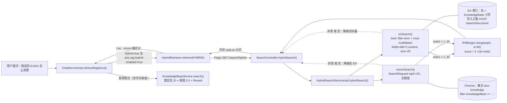
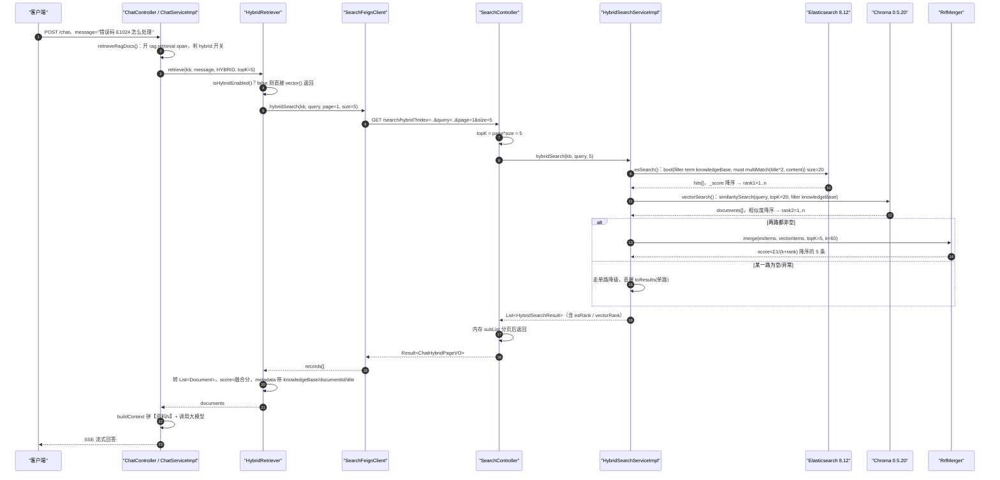

# 05. 混合检索实战：ES BM25 与向量 RRF 融合

> **一句话结论**：BM25 记得住型号、订单号、错误码这类"字面精确串"，向量检索懂同义改写，而把两路合起来的关键不是分数相加、而是**名次相加**——本项目用 RRF（k=60）只吃排名不吃分数，代价是原始分被覆盖、两路召回条数写死 20、同一文档能不能对上还取决于 `documentId` 是否一致；而且这条链路默认不在主路径上：Nacos 开关 `aics.rag.hybrid-enabled` 缺省 false，ES 侧在仓库内没有任何写入通路。
> **阅读前置**：知道 TF/IDF 大概是什么；读过同目录 `01-RAG检索增强生成.md` 或 24-源码分析里 `VectorStore`/`SearchRequest` 的相似度检索篇；能读 Java lambda 形式的 ES 查询 DSL（`q -> q.bool(b -> ...)`）。
> **证据基线**：Spring AI 2.1.0 源码摘录（`VectorStore.java`/`SearchRequest.java`/`DocumentJoiner.java` 等，A 级）＋本项目 `ai-cs-search` 与 `ai-cs-chat` 当前代码（B 级，行号按本仓此刻文件逐条 `read` 核对）＋本机 node 24.16.0 的名次融合模拟推演（C 级，数据为构造，不是线上日志）。预计阅读 45~55 分钟。

## 证据边界（先说清哪些话有据、哪些没有）

| 类别 | 本仓状态 | 本篇怎么处理 |
| --- | --- | --- |
| Spring AI 2.1.0 源码 | `learning-docs/24-源码分析/assets/source/` 下有按类名归档的摘录（本篇用到 `VectorStore.java.md`、`SearchRequest.java.md`、`Document.java.md`、`DocumentJoiner.java.md`、`ConcatenationDocumentJoiner.java.md`、`TokenTextSplitter.java.md`） | 唯一 A 级来源，锚点写成 `[[源码:VectorStore.java.md#L80-L82]]` 或代码块首行 `(src: ...)` |
| 本项目混合检索代码 | 真实存在（`ai-cs-search` 的 `hybrid` 包 + `ai-cs-chat` 的 `rag/retrieve`） | B 级，路径 + 行号，写之前逐条 `read` 过 |
| Elasticsearch 8.12 的 BM25 实现、`ik` 分词、`search_after`、别名 | **未入库** | 一律写"未入库，依据官方文档/本项目代码"，不冒充源码证据 |
| Chroma 0.5.20 的相似度语义 | **未入库** | 同上；涉及分数尺度时只讲"不可跨后端比较"这一结论层面的东西 |
| 本机能不能跑真检索 | 已探测：`node -v` → `v24.16.0`；`docker` → 未安装；`127.0.0.1:9200`、`:8000`、`:6379` 三个端口全部 closed | 本篇不启动服务、不连 ES/Chroma/Redis，所有"实测"都是**静态核对**或**名次融合的模拟推演**，并逐处标注 |
| 召回率/延迟数字 | 本机没有可用检索环境 | 不编造。凡是出现"谁赢"的表格，要么是构造数据推演，要么是定性判断并说明理由 |

## 0. 先看现象

**现象 1：开着混合检索，日志里却写"ES 路无结果"，融合其实一直是单路在跑。**

`HybridSearchServiceImpl` 在 ES 路返回空时不会报错，只留一行 info：

```text
ES 路无结果/异常，降级为仅向量结果: knowledgeBase=knowledge, 命中=20
```

（这行日志的源码在 `ai-cs-search/src/main/java/com/aics/search/hybrid/HybridSearchServiceImpl.java#L61-L64`，格式串是 `"ES 路无结果/异常，降级为仅向量结果: knowledgeBase={}, 命中={}"`。）

用户侧完全无感：搜索"成功"、结果"有 20 条"。为什么 ES 路会空？把全仓调用点捞一遍就明白——知识库分块入库走的是 `ai-cs-chat` 的 `KnowledgeBaseService.addChunks()`，它只写 Chroma（`vectorStore.add(chunks)`）；往 ES 写文档的唯一入口是 `POST /search/document/{index}`（`ai-cs-search/src/main/java/com/aics/search/controller/SearchController.java#L65-L79`），而这个接口在**仓库内没有任何调用方**。

```powershell
# 全仓找谁调用 /search/document
Get-ChildItem -Recurse -Include *.java -File | Where-Object { $_.FullName -notmatch "target" } |
  Select-String -Pattern "indexDocument|/search/document" |
  ForEach-Object { "{0}:{1}: {2}" -f $_.Path.Replace("$PWD\",""), $_.LineNumber, $_.Line.Trim() }
```

```text
ai-cs-search\src\main\java\com\aics\search\controller\SearchController.java:75: public Result<Void> indexDocument(
ai-cs-search\src\main\java\com\aics\search\controller\SearchController.java:78:     return searchService.indexDocument(index, document);
ai-cs-search\src\main\java\com\aics\search\service\SearchService.java:40: Result<Void> indexDocument(String index, Map<String, Object> document);
ai-cs-search\src\main\java\com\aics\search\service\impl\SearchServiceImpl.java:92: public Result<Void> indexDocument(String index, Map<String, Object> document) {
```

怎么读：命中全在 `ai-cs-search` 自己内部（Controller → Service → ServiceImpl），加一个接口声明，**没有 chat / knowledge 侧的任何 Feign 调用**。所以：ES 索引要么空、要么靠外部手工灌。这条路一空，RRF 就退化成"向量结果原样返回"，`RrfMerger` 那段代码一行都没执行。

**现象 2：搜"错误码 E1024"，向量路凑满 20 条，无关文档混进来。**

向量路构造 `SearchRequest` 时只给了 `query`、`topK=20`、`filterExpression`，**没有设 `similarityThreshold`**：

```java
SearchRequest searchRequest = SearchRequest.builder()
        .query(query)
        .topK(RETRIEVE_TOP_K)
        .filterExpression("knowledgeBase == '" + knowledgeBase + "'")
        .build();
```

（`ai-cs-search/src/main/java/com/aics/search/hybrid/HybridSearchServiceImpl.java#L125-L129`，`RETRIEVE_TOP_K` 在同文件 `#L41` 定义为 `20`。）

未设阈值意味着什么？Spring AI 里 `SearchRequest` 的默认值就是"全收"：

```java
public static final double SIMILARITY_THRESHOLD_ACCEPT_ALL = 0.0;
...
private double similarityThreshold = SIMILARITY_THRESHOLD_ACCEPT_ALL;
```

(src: SearchRequest.java.md#L44-L58)

于是向量路永远"命中 20"，日志长这样：

```text
向量检索完成: knowledgeBase=knowledge, 命中=20
```

这 20 条里余弦 0.5 的"账号登录失败怎么办"、"系统提示异常如何处理"都会进来。对"E1024"这种精确串，向量模型给出的相似度分布本来就很平（top1 与 top20 差不了多少），阈值缺失时名次信息几乎全是噪声，而 RRF 恰恰只吃名次。

**现象 3：把两路分数直接相加，融合结果和纯 BM25 一模一样——向量路等于白算。**

下面这张表是**模拟推演**（构造数据，见第 3.4 节的脚本与命令），但比例关系就是真实量纲关系：BM25 分是无上界的绝对分（十几到几十），余弦相似度被压在 `[0,1]`。

| 融合方式 | Top-5 顺序 |
| --- | --- |
| 原始分数直接相加（`bm25 + cos`） | `D7 > D2 > D9 > D5 > D11 > D3 > D1 > D8` |
| RRF（k=60） | `D7 > D2 > D3 > D1 > D9` |

第一行和纯 BM25 排序完全一致：`cos` 顶多贡献 0.91，而 `D7` 与 `D11` 的 BM25 差就有 12.3，向量路的排序信息被彻底淹没。这就是"两路都接了、融合也写了、效果等于没接"的典型事故。

这些现象指向同一件事：**混合检索的成败不在"接没接两路"，而在"两路是否都在给有效信号"以及"合并时用的是不是可比的东西"**——ES 侧没数据、向量侧没阈值，是输入坏了；分数直接相加，是把不可比的量硬比。

## 1. 整体地图



> **读图说明**：三条虚线不是数据流，是**降级路径**——它们直接回到 `SearchController` 而不是继续往下融合，这是最容易看错的地方；如果你把虚线读成"两路互为兜底后仍会融合"，就会以为"ES 挂了还能靠向量保住质量"，实际是"ES 挂了就没有融合这件事了，输出就是纯向量 top-k"。第二个关键边是 `HR -->|Feign| SC` 上的条件：`RagRetrieveProperties` 里 `hybridEnabled` 默认 `false`（`ai-cs-chat/src/main/java/com/aics/chat/rag/retrieve/RagRetrieveProperties.java#L13-L14`），所以不带 Nacos 配置时，右边整个子图根本不会被访问——图里看着像主干道，实际是默认关闭的旁路。

| 组件 | 责任（一句话） | 谁调用它 |
| --- | --- | --- |
| `ChatServiceImpl.retrieveRagDocs()` | 按 `hybrid/rewrite` 两个布尔决定走哪条检索，并打 `rag.retrieval` span | `ChatController` 的对话链路、`RetrieveController` 之外的 RAG 调用 |
| `HybridRetriever` | 模式分派 + 跨服务调用 + 两处降级 + 把 VO 转成 `Document` | `ChatServiceImpl`、`RetrieveController` |
| `SearchFeignClient` | 声明 `GET /search/hybrid` 的 Feign 客户端 | 只被 `HybridRetriever` 使用 |
| `SearchController.hybridSearch()` | 参数校验、`topK = page * size`、内存分页 | Feign（以及手工 curl） |
| `HybridSearchServiceImpl` | 串行跑两路、判空降级、调 `RrfMerger`、转 VO | `SearchController` |
| `esSearch()`（私有） | 拼 ES `bool` 查询：`term` 过滤知识库 + `multiMatch(title^2, content)` | `hybridSearch()` |
| `vectorSearch()`（私有） | 拼 `SearchRequest` 打 Chroma，返回 `Document` 列表 | `hybridSearch()` |
| `RrfMerger` | 纯函数：两路有序列表 → 按 `Σ1/(k+rank)` 融合并截断 | `HybridSearchServiceImpl`、单测 |
| `RankedItem` / `HybridSearchResult` | 内部 DTO / 对外 VO，都带 `rank1`(ES) 与 `rank2`(向量) | 上述两者 |
| `SearchServiceImpl`（ES 侧） | 建索引 mapping、`indexToEs`、`deleteByQuery` | `SearchController` 的索引维护接口 |
| `ElasticsearchConfig` | 用 `spring.elasticsearch.uris` 建 `ElasticsearchClient` | Spring 容器 |

## 2. 关键概念与关键类

| 名称 | 位置 | 角色 | 关键方法 / 关键点 |
| --- | --- | --- | --- |
| 稀疏检索（sparse retrieval） | 概念 | 基于词表匹配打分，代表是 BM25 | 词不在表里就永远匹配不上：`E1024` 必须是字面出现 |
| 稠密检索（dense retrieval） | 概念 | 把整段文本压成一个定长向量算相似度 | 同义改写友好；但对"无实义的精确串"不敏感 |
| BM25 | ES 内部打分器（未入库，依据官方文档） | 稀疏检索的默认打分函数 | `IDF` × `TF 饱和` × `长度归一化`，默认 `k1=1.2, b=0.75` |
| RRF（Reciprocal Rank Fusion，倒数名次融合） | 概念 + `RrfMerger` | 跨检索源合并**名次**，不碰分数 | `score(d) = Σ 1/(k + rank_i(d))`，`k` 起平滑作用 |
| 名次 vs 分数 | 概念 | 融合层的核心取舍 | 名次跨量纲可比；分数跨量纲不可比，但名次丢掉了"领先多少" |
| `HybridSearchServiceImpl` | `ai-cs-search/src/main/java/com/aics/search/hybrid/HybridSearchServiceImpl.java` | 混合检索总调度 | `hybridSearch(kb, query, topK)`；`esSearch()`；`vectorSearch()` |
| `RrfMerger` | `ai-cs-search/src/main/java/com/aics/search/hybrid/RrfMerger.java` | 融合算法（静态工具类） | `merge(list1, list2, topK, k)`、`addScores(...)` |
| `RankedItem` | `ai-cs-search/src/main/java/com/aics/search/hybrid/RankedItem.java` | 路内中间对象 | `id/score/rank1/rank2/title/content/...` |
| `HybridSearchResult` | `ai-cs-search/src/main/java/com/aics/search/hybrid/HybridSearchResult.java` | 对外 VO | 多带 `esRank` 与 `vectorRank`（0 表示该路未命中） |
| `HybridRetriever` | `ai-cs-chat/src/main/java/com/aics/chat/rag/retrieve/HybridRetriever.java` | chat 侧检索门面 | `retrieve(kb, query, mode, topK)`，内部 `switch (mode)` |
| `RetrievalMode` | 同包枚举 | 检索模式 | `HYBRID` / `HYBRID_QUERY_REWRITE` / `GRAPH_RAG` / 默认向量 |
| `RagRetrieveProperties` | `ai-cs-chat/src/main/java/com/aics/chat/rag/retrieve/RagRetrieveProperties.java` | 开关与 `rrfK` | `hybridEnabled=false`（缺省关闭）、`rrfK=60` |
| `SearchRequest` | A 级 `SearchRequest.java.md` | 向量检索的请求参数对象 | `query/topK/similarityThreshold/filterExpression`；`topK>=0` 才合法 |
| `VectorStore` | A 级 `VectorStore.java.md` | 向量库抽象 | `add()`（重复 id 行为交给 provider）、2.1.0 新增 `upsert()` |
| `DocumentJoiner` | A 级 `DocumentJoiner.java.md` | **Spring AI 提供的"多路合并"扩展点** | 只承诺"能处理重复与 reciprocal ranking 策略"，没有内建 RRF 实现 |
| `TokenTextSplitter` | A 级 `TokenTextSplitter.java.md` | 分块器，间接决定 BM25 的文档长度 | `DEFAULT_CHUNK_SIZE=800`、`DEFAULT_CHUNK_OVERLAP=0` |

一句话记住分工：**`HybridSearchServiceImpl` 负责"把两路都拿到"，`RrfMerger` 负责"只按名次合成一个名次"，`HybridRetriever` 负责"开关、降级与类型转换"**——三件事分开，才好在任一环退化时收场。

## 3. 原理与证据逐段精读

### 3.1 BM25 为什么记得住型号与错误码

**在干什么**：BM25 给"文档 D 与查询 Q 的相关性"打分，本质是对每个查询词算三件事的乘积再求和：

```text
score(D, Q) = Σ_i IDF(q_i) · [ f(q_i, D) · (k1 + 1) ] / [ f(q_i, D) + k1 · (1 - b + b · |D| / avgdl) ]
其中：f = 词 q_i 在 D 中的出现次数（TF），|D| = 文档长度，avgdl = 平均文档长度
```

**为什么这么设计**：三项各治一个病。`IDF` 治"停用词"——"的、了、是"到处都有，权重必须趋近 0；`f·(k1+1)/(f + k1·…)` 治"刷词"——第 2 次出现远没有第 1 次值钱，这叫 TF 饱和；`b` 项治"长文档天然占便宜"，把长度拉回到平均线上比较。

这里用 node 把这三个性质算了一遍（**模拟推演**：公式照上面写，参数取 ES 默认 `k1=1.2, b=0.75`，`avgdl=200`，只算 TF 与长度项，不含 IDF）：

```js
// bm25_toy.mjs —— 只算 TF 饱和与长度归一化那一段
const bm25 = (tf, dl, k1 = 1.2, b = 0.75, avgdl = 200) => tf / (tf + k1 * (1 - b + b * dl / avgdl));
console.log("tf 短doc(80) 均长(200) 长doc(800)");
for (const tf of [1, 2, 3, 5, 10, 20]) {
  console.log(tf, bm25(tf, 80).toFixed(4), bm25(tf, 200).toFixed(4), bm25(tf, 800).toFixed(4));
}
```

```powershell
node $env:TEMP\bm25_toy.mjs
```

```text
tf 短doc(80) 均长(200) 长doc(800)
1 0.6024 0.4545 0.2041
2 0.7519 0.6250 0.3390
3 0.8197 0.7143 0.4348
5 0.8834 0.8065 0.5618
10 0.9381 0.8929 0.7194
20 0.9681 0.9434 0.8368
```

怎么读：横着看是 TF 饱和——`tf` 从 1 到 20 涨了 20 倍，均长文档的分数只从 0.4545 涨到 0.9434（不到 2.1 倍），再多刷也没用；竖着看是长度归一化——同样 `tf=1`，80 字的短块拿 0.6024，800 字的长块只有 0.2041，差 3 倍。这就是为什么"错误码 E1024 表示鉴权失败"这种短块，在 `E1024` 这个查询上很容易冲上来：**词命中 + 文档短**，两个杠杆同时占。

**换成别的写法会怎样**：如果把 TF 项改成线性（`score += tf`），长文档与刷词会同时失控；如果去掉 `b`（即 `b=0`），一段 800 字的产品说明书只要提到一次 `E1024` 就能压过 30 字的错误码表；如果去掉 IDF，`的/是/怎么` 这些词会把排序搅乱（中文里更严重，见 3.9）。BM25 之所以在 2026 年还是稀疏检索的默认答案，就是因为它把这三个病都写进了同一个公式里。

**常见坑**：

1. `title^2` 这类字段权重是**加分项**，不是"只搜标题"。本项目 `multiMatch` 同时搜 `title` 与 `content`，标题命中一次算两次——这会让"标题里写了 E1024、正文其实无关"的文档排得很高。
2. BM25 分是**无上界的绝对分**，换 query、换索引、换数据量都会整体漂移，任何"阈值 5 分以上就相关"的写法都会在数据增长后失效。
3. 词表里没有的东西永远匹配不上：`E1024` 若在文档里写作 `E-1024`、`e1024`，BM25 一分不给（分词见 3.9）。

### 3.2 向量检索懂改写，但栽在"无实义的精确串"上

**在干什么**：把 query 与每个分块分别过一遍 Embedding 模型，得到两个定长向量，取相似度最高的一批。Spring AI 侧的统一入口就是 `VectorStore.similaritySearch(SearchRequest)`，参数对象只有四个字段：

```java
private String query = "";
private int topK = DEFAULT_TOP_K;
private double similarityThreshold = SIMILARITY_THRESHOLD_ACCEPT_ALL;
private Filter.@Nullable Expression filterExpression;
```

(src: SearchRequest.java.md#L54-L60)

**为什么这么设计**：把"查什么（query）""查几条（topK）""多相关才算（threshold）""在哪个子集里查（filter）"四个正交维度拆开，后端（Chroma / PGVector / Milvus）只负责实现，调用方代码不用换。注意候选集必须先被 `filterExpression` 圈定，再做相似度排序——这就是本项目用 `knowledgeBase == '...'` 隔离多知识库的方式。

**换成别的写法会怎样**：若不加 `filterExpression` 而在应用层过滤，`topK=20` 可能被别的知识库占满，等于这个知识库"查不到"；若把 `topK` 设得很大来"保证不漏"，延迟和后处理成本随 `topK` 线性上涨，且噪声全进融合层。

**常见坑**：

1. **阈值缺省就是 0.0**（`SIMILARITY_THRESHOLD_ACCEPT_ALL`），也就是"全收"。本项目向量路没调 `.similarityThreshold(...)`，于是 `topK=20` 必然凑满 20 条——这是现象 2 的直接原因。
2. 阈值是**客户端后处理**，不是服务端过滤，官方注释写得很明确：

```java
/**
 * Similarity threshold score to filter the search response by. Only documents
 * with similarity score equal or greater than the 'threshold' will be returned.
 * Note that this is a post-processing step performed on the client not the server
 * side. A threshold value of 0.0 means any similarity is accepted or disable the
 * similarity threshold filtering.
 */
```

(src: SearchRequest.java.md#L164-L173)

这意味着 `topK` 条先被取回、再被丢弃，`topK` 不会因为阈值变严而"多取几条补位"。

3. **查询侧文本必须和入库侧一致**。本项目纯向量链路给 bge-m3 加了指令前缀，混合链路的向量路没加：

```java
String retrievalQuery = "为这个句子生成表示以用于检索相关文章：" + query;
SearchRequest nrequest = SearchRequest.builder()
        .query(retrievalQuery)
        .topK(topK)
        .similarityThreshold(threshold)
        .filterExpression("knowledgeBase == '" + knowledgeBase + "'")
        .build();
```

（`ai-cs-chat/src/main/java/com/aics/chat/service/KnowledgeBaseService.java#L265-L279`；对比混合路的 `ai-cs-search/src/main/java/com/aics/search/hybrid/HybridSearchServiceImpl.java#L125-L129` 直接用裸 `query`。）

同一个模型、同一份数据，两条链路的向量召回结果就不一致：纯向量路召回 20 条、混合路向量分支召回另外 20 条。这不是"谁对谁错"的问题，而是**A/B 对比时会得出错误结论**——你以为在比"融合 vs 单路"，其实还混进了"指令前缀 vs 无前缀"。

### 3.3 两路分数不可比：这是融合环节所有事故的母题

**在干什么**：把 ES 的 `_score`（BM25）与 Chroma 返回的相似度放在一起看，会发现它们连"方向"和"范围"都不一致：BM25 无上界、越大越相关；余弦相似度 `[-1,1]`（多数实现裁到 `[0,1]`）、越大越相关；而有些向量库返回的是**距离**，越小越相关。

**为什么这么设计**：没有统一标准，是因为两者本来就不是一个数学对象。BM25 是词频统计量，天然随语料规模漂移；余弦是几何夹角，与语料无关。ES 官方文档、Chroma 文档各说各的（**未入库，依据官方文档/本项目代码**），任何"统一分数"的框架都只能靠**归一化**硬凑，而归一化依赖当批次的最大最小值，换一批数据排序就变。

**换成别的写法会怎样**：这就是三种做法的分水岭（3.4 全表对比）：

- **直接相加**：量纲大的那路独裁。本项目实际比例下（BM25 十几到几十、余弦 0~0.9），等于只用了 BM25。
- **各自归一化再加权**：分数进 `[0,1]`，但极值随批次漂移，且权重 `α` 要人肉调；一批 query 调好，换 query 类型又歪。
- **只用名次（RRF）**：彻底不问分数，只问"排第几"，天然跨量纲。

**常见坑**：

1. 把 Chroma 的"距离"当"相似度"直接取 `top1`，会得到最不相关的那条——方向反了。
2. 归一化时用**当前这一批**的 min/max：融合结果会随同批其他文档变化，"同一 query 重复查两次排序不同"。
3. 两路 `topK` 不同（比如 ES 20、向量 50）时，两路的"第 5 名"含金量不同，RRF 却一视同仁——这会系统性偏向召回条数多的那一路。

### 3.4 三种融合做法：线性加权 / RRF / 学习排序

**在干什么**：给定两路有序列表，产出一个统一的 top-k。

| 做法 | 公式 | 需要什么 | 主要风险 |
| --- | --- | --- | --- |
| 线性加权（不归一化） | `s(d) = α·s_es(d) + β·s_vec(d)` | 两路分数同尺度 | 量纲大的一路独裁；本项目等于纯 BM25 |
| 线性加权（先 min-max 归一化） | `s'(d) = α·norm(s_es) + β·norm(s_vec)` | 每批的 min/max + 权重 α | 极值漂移；α 敏感；一路缺分数时补 0 会造出"半个相关" |
| RRF | `s(d) = Σ_i 1/(k + rank_i(d))` | 只要两路**有序** | 丢掉"领先多少"；对 topK 配比敏感 |
| 学习排序（LTR） | `s(d) = f(特征向量)`，`f` 由标注数据训练 | 点击/人工标注 + 特征工程 + 线上服务 | 冷启动没有标注；模型与特征一起漂移；迭代成本高 |

**为什么这么设计**：RRF 的厉害之处是"用最少的假设换最大的覆盖面"——它假设两路各自"排得靠前就更可能相关"，仅此而已。所以它能同时接纳 BM25、向量、图检索、甚至人工规则的结果，不需要任何分数对齐工作。LTR 是天花板最高、代价也最高的那一条，没有真实点击日志时不用考虑。

**换成别的写法会怎样**：下面这段脚本把三种做法在同一份构造数据上跑了一遍（**模拟推演**：两路名次数组、分数均为手工构造，只为展示量纲与权重敏感性，不代表线上分布）：

```js
// rrf_demo.mjs（节选）
const esLeg  = [{id:"D7",bm25:18.6},{id:"D2",bm25:15.2},{id:"D9",bm25:11.4},{id:"D5",bm25:8.1},{id:"D11",bm25:6.3}];
const vecLeg = [{id:"D3",cos:0.91},{id:"D1",cos:0.88},{id:"D7",cos:0.86},{id:"D8",cos:0.83},{id:"D2",cos:0.81}];

// 1) 原始分数直接相加
const sum = new Map();
esLeg.forEach(e => sum.set(e.id, e.bm25));
vecLeg.forEach(v => sum.set(v.id, (sum.get(v.id) ?? 0) + v.cos));

// 2) 各自 min-max 后加权
const minmax = (arr, k) => { const vs = arr.map(x => x[k]); const lo = Math.min(...vs), hi = Math.max(...vs);
  return new Map(arr.map(x => [x.id, hi === lo ? 1 : (x[k] - lo) / (hi - lo)])); };
const nEs = minmax(esLeg, "bm25"), nVec = minmax(vecLeg, "cos");
const weighted = a => [...new Set([...nEs.keys(), ...nVec.keys()])]
  .map(id => [id, a * (nEs.get(id) ?? 0) + (1 - a) * (nVec.get(id) ?? 0)])
  .sort((x, y) => y[1] - x[1]).map(([id]) => id);

// 3) RRF
const K = 60, rrf = new Map();
esLeg.forEach((e, i) => rrf.set(e.id, (rrf.get(e.id) ?? 0) + 1 / (K + i + 1)));
vecLeg.forEach((v, i) => rrf.set(v.id, (rrf.get(v.id) ?? 0) + 1 / (K + i + 1)));

console.log("直接相加      :", [...sum.entries()].sort((a, b) => b[1] - a[1]).map(([id]) => id).join(" > "));
console.log("min-max α=0.5 :", weighted(0.5).join(" > "));
console.log("min-max α=0.3 :", weighted(0.3).join(" > "));
console.log("RRF k=60      :", [...rrf.entries()].sort((a, b) => b[1] - a[1]).map(([id]) => id).join(" > "));
```

```powershell
node $env:TEMP\rrf_demo.mjs
```

```text
直接相加      : D7 > D2 > D9 > D5 > D11 > D3 > D1 > D8
min-max α=0.5 : D7 > D3 > D2 > D1 > D9 > D8 > D5 > D11
min-max α=0.3 : D3 > D7 > D1 > D2 > D8 > D9 > D5 > D11
RRF k=60      : D7 > D2 > D3 > D1 > D9 > D5 > D8 > D11
```

怎么读：三句话。

1. 第一行和纯 BM25 排序（`D7 > D2 > D9 > D5 > D11`）逐位相同——**直接相加时向量路等于白算**，这就是现象 3。
2. 第二、三行只把 `α` 从 0.5 挪到 0.3，冠军从 `D7`（唯一在两路都出现的相关文档）变成 `D3`（只在向量路出现、且是向量路第 1 的无关文档）。**α 是"谁赢"的开关**，而它没有任何客观依据。
3. 第四行 RRF 把两个"两路共识"的文档（`D7` 第 1、`D2` 第 2）顶到最前，把"单路第 1"的 `D3` 压到第 3——这正是我们想要的语义：**被两路同时认可 > 被一路极力推荐**。

**常见坑**：

1. 用 `α` 手调融合，线上换 query 类型（短词 vs 长句）后效果回退，但没人知道是 `α` 的问题，因为它藏在配置文件里。
2. 两路里有一路返回的是"距离"（越小越好），做线性加权时忘了取反，融合结果等于"最差优先"。
3. 学习排序在没有标注数据时强行上：先用规则造标注（"点击了算正例"）→ 学到的是位置偏差，不是相关性。

### 3.5 RRF 公式与 k 的作用

**在干什么**：`RrfMerger.merge()` 是纯函数，把两路 `List<RankedItem>` 变成一路：

```java
public static List<RankedItem> merge(List<RankedItem> list1, List<RankedItem> list2, int topK, int k) {
    Map<String, Double> scores = new HashMap<>();
    Map<String, RankedItem> items = new HashMap<>();
    // list1 排名：对每个 item，scores[id] += 1/(k + rank)
    addScores(scores, items, list1, k, true);
    addScores(scores, items, list2, k, false);
    // 回填融合分数
    items.values().forEach(item -> item.setScore(scores.getOrDefault(item.getId(), 0.0)));
    return items.values().stream()
            .sorted((a, b) -> Double.compare(b.getScore(), a.getScore()))
            .limit(topK)
            .collect(Collectors.toList());
}
```

（`ai-cs-search/src/main/java/com/aics/search/hybrid/RrfMerger.java#L35-L47`。）

累加逻辑在 `addScores`，注意 `rank` 用的是**列表下标 + 1**，而不是条目里自带的 `rank1/rank2`：

```java
for (int i = 0; i < list.size(); i++) {
    RankedItem item = list.get(i);
    if (item.getId() == null || item.getId().isBlank()) {
        continue;
    }
    int rank = i + 1;
    scores.merge(item.getId(), 1.0 / (k + rank), Double::sum);
```

（同文件 `ai-cs-search/src/main/java/com/aics/search/hybrid/RrfMerger.java#L58-L74`。）

**为什么这么设计**：只要两路**有序**就能融合，跳过所有分数对齐工作；`k` 的存在是为了**压住 top1 的绝对统治力**——若用 `1/rank`（等价 `k=0`），第 1 名贡献 1.0、第 2 名 0.5，一个单路第 1 就能轻松打败"两路都排第 3"的共识文档。

**换成别的写法会怎样**：把 `k` 拿掉（`k=0`）或设得很大（`k=1000`），排序性格完全不同。下面是把 `1/(k+rank)` 直接算出来的结果（**模拟推演**，纯算术）：

```powershell
node -e "for (const k of [1,60,1000]) console.log('k='+k, [1,2,3,4,5].map(r=>(1/(k+r)).toFixed(6)).join('  '))"
```

```text
k=1    0.500000  0.333333  0.250000  0.200000  0.166667
k=60   0.016393  0.016129  0.015873  0.015625  0.015385
k=1000 0.000999  0.000998  0.000997  0.000996  0.000995
```

怎么读：`k` 越小，名次之间的**区分度**越大（`k=1` 时第 1 名是第 5 名的 3 倍；`k=60` 时只差 6%；`k=1000` 时几乎相等）。`k` 越大，RRF 越退化成"投票"——数的是"你在几路里出现过"，几乎不管排第几。业界普遍取 `k=60`，本项目也是：

```java
/** RRF 平滑常数（越大排名靠后的结果权重差异越小） */
private static final int RRF_K = 60;
```

（`ai-cs-search/src/main/java/com/aics/search/hybrid/HybridSearchServiceImpl.java#L43-L44`。`ai-cs-chat` 侧还有一个同款的 60：`ai-cs-chat/src/main/java/com/aics/chat/rag/retrieve/RagRetrieveProperties.java#L23`。）

**常见坑**：

1. `k` 与"每路返回多少条"是耦合的：`k=60` 配 `topK=20`，第 1 名 1/61 与第 20 名 1/80 只差 24%，把 `topK` 从 20 提到 50，长尾条目更容易靠"多路命中"翻上来。
2. 融合分不是相似度，却常常被当相似度用（本项目会把它塞进 `Document.score`，见 3.7）——下游任何"score < 0.3 就丢弃"的判断都会把结果全砍掉。
3. 重复 id 会被 `scores.merge` 正确累加，但**同一个文档被切成多块时 id 不同**，RRF 无从知道它们来自同一篇（3.8）。

### 3.6 名次从哪来：本项目的两路 rank 赋值

**在干什么**：ES 路与向量路都只用"遍历顺序"生成名次，不使用任何分数排序——因为 ES 返回的 `hits` 本身已按 BM25 降序、`similaritySearch` 返回的列表本身已按相似度降序。

```java
List<RankedItem> items = new ArrayList<>();
int rank = 1;
for (Hit<Map<String, Object>> hit : response.hits().hits()) {
    Map<String, Object> source = hit.source();
    if (source == null) {
        continue;
    }
    RankedItem item = new RankedItem();
    item.setId(hit.id());
    item.setRank1(rank++);
    item.setScore(hit.score() != null ? hit.score() : 0.0);
```

（`ai-cs-search/src/main/java/com/aics/search/hybrid/HybridSearchServiceImpl.java#L93-L103`。）

**为什么这么设计**：既然融合只看名次，就没必要在路内再做一次排序；直接把"第几条"当名次，代码最短、也最不容易出错。注意 `continue`（`source == null`）会让 `rank` **跳过**该条不递增——真出现 `_source` 缺失时，两路的名次会出现空档，但 RRF 用的是列表下标（3.5），所以这里的不一致不会传染到融合分，只会影响 `rank1` 字段的可读性。

**换成别的写法会怎样**：若让每路"先按分数重排再赋名次"，遇到分数相等（ES 的 `_score` 很容易并列，尤其在多分片时）就会出现不稳定排序，同一 query 两次结果不同。

**常见坑**：

1. ES 侧写了 `.size(20)` 但**没写 `from`**，也没有 `search_after`：深分页根本不存在，`page*size` 的分页其实是"先取 20 条再在内存里 `subList`"（`ai-cs-search/src/main/java/com/aics/search/controller/SearchController.java#L48-L56`）。`page=3&size=10` 时 `topK=30`，但每路只回 20 条，第 21~30 位永远是空的。
2. 单路名次跨 query 不可比，别把 `rank1` 当离线指标用。
3. 两路 `topK` 都写死成同一个常量 `RETRIEVE_TOP_K=20`，无法按 query 类型倾斜（短词 query 该让 BM25 多召回、长句该让向量多召回），这属于设计上的硬约束，不是配置缺失。

### 3.7 融合点：分数被覆盖，原始分就没了

**在干什么**：`merge()` 最后一步把融合分写回 `RankedItem.score`，覆盖掉 ES 的 BM25 分或 Chroma 的余弦值：

```java
items.values().forEach(item -> item.setScore(scores.getOrDefault(item.getId(), 0.0)));
```

（`ai-cs-search/src/main/java/com/aics/search/hybrid/RrfMerger.java#L42`。）

**为什么这么设计**：对外只暴露一个"最终排序分"，下游（`SearchController` 排序、`HybridSearchResult.score`、`Document.score`）就不用关心融合细节。但代价是：**排序可解释性归零**——线上有人问"为什么这条排第 3"，你只能答"因为它两路排名相加最靠前"，拿不出"它 BM25 得了 18.6 分"这样的证据。

**换成别的写法会怎样**：把 `RrfMerger` 写成"保留 `esScore`/`vecScore`/`rrfScore` 三个字段"，那么 `HybridSearchResult` 多两个字段、`search_after` 之外的解释链路都能做，排查效率显著提升。这也是同一份代码里 `rank1/rank2` 被保留下来的原因——**名次留了，分数没留**，取舍并不一致。

**常见坑**：

1. 融合分数量级是 `0.0x`（`k=60`、两路命中约 0.032），任何按"相似度 < 0.3 过滤"的通用逻辑都会把融合结果全部丢光。本项目 `HybridRetriever` 在转 `Document` 时确实是把融合分写进 `score` 的（`ai-cs-chat/src/main/java/com/aics/chat/rag/retrieve/HybridRetriever.java#L187-L206`），所以混合链路**必须绕过**向量链路的阈值过滤（它确实绕过了，见 3.10）。
2. `Sorted` 只按分数比较，分数相等时顺序由 `HashMap` 的迭代顺序决定，不稳定。`RrfMergerTest` 里 `D5` 与 `D8` 同为 `1/64`（见 3.5 的推演表第 6、7 行），真实场景下这两条谁在前是不确定的。
3. 融合后的 `title/content` 来自"先到者"：`addScores` 先跑 `list1`（ES 路），所以 `fillMissing` 会让 ES 侧的字段优先（`ai-cs-search/src/main/java/com/aics/search/hybrid/RrfMerger.java#L67-L74` 与 `#L78-L97`）。某条只在向量路命中时，字段来自 Chroma metadata，两条路的 `docType/page` 语义要自己保证一致。

### 3.8 对齐键：RRF 能不能产生"共识"，全看 id 是不是同一个

**在干什么**：RRF 把"同一个 id 在两路都出现"识别为共识。id 的来源是：

```java
Object documentId = metadata.get("documentId");
item.setId(documentId != null ? String.valueOf(documentId) : doc.getId());
```

（`ai-cs-search/src/main/java/com/aics/search/hybrid/HybridSearchServiceImpl.java#L136-L137`；ES 侧对应 `item.setId(hit.id())`，即 ES 文档的 `_id`。）

**为什么这么设计**：用业务 id（`documentId`）而不是向量库内部 id，才能让"同一份内容存在两处"被识别成一条。ES 侧写入时也特意用了同一个字段：`indexToEs()` 里 `docId` 就是待写文档的 `documentId`，为空才兜底 `UUID.randomUUID()`（`ai-cs-search/src/main/java/com/aics/search/service/impl/SearchServiceImpl.java#L146-L172`）。

**换成别的写法会怎样**：如果一边用 `documentId`、另一边用 Chroma 的 `doc.getId()`，同一条内容在融合层就是两个不同条目，各拿一份 `1/(k+rank)`，**永远形成不了共识**，RRF 退化成"两路轮流插入"。这种 bug 不会报错，只会让效果比单路差一点点——最难查的那一类。

**常见坑**：

1. 知识库侧 `documentId` 实际是**分块 id**：`meta.put("documentId", chunk.getId())`（`ai-cs-chat/src/main/java/com/aics/chat/service/KnowledgeBaseService.java#L159-L181`）。同一篇文档被切成 N 块就有 N 个不同 `documentId`，**融合层看不到"同一篇文档的多个片段"这层关系**。
2. 重新入库会产生新的 chunk id（`VectorStore.add` 对重复 id 的行为"由 provider 决定"，见 [[源码:VectorStore.java.md#L46-L51]]），旧 chunk 不会被自动替换——同一篇文档的 v1/v2 分块同时在库里，融合结果里两版都可能出现。
3. `filterExpression` 是字符串拼接（`"knowledgeBase == '" + knowledgeBase + "'"`，同文件 `#L125-L129`），知识库名里带单引号就会拼出非法表达式；ES 侧则是 `term` 查询原值、索引名却 `toLowerCase`（`#L175-L177`），大小写不一致的知识库名会在两路产生不同的匹配结果。

### 3.9 中文分词：没有 ik 的 BM25 到底在算什么

**在干什么**：BM25 的分母是"词的统计"，而"词"由 analyzer 决定。ES 默认的 `standard` 分词器对中文是**按字切**，`错误码` 会变成 `错`、`误`、`码` 三个 term；`ik_max_word` 才会切出 `错误码`/`错误`/`码` 这类有意义的词。

**为什么这么设计**：本项目建索引时只声明了字段类型，没有指定 analyzer：

```java
// mapping 关键部分（原文见下方路径）
documentId: keyword, title: text, content: text, summary: text,
tags: keyword, knowledgeBase: keyword, docType: keyword, page: integer
```

（`ai-cs-search/src/main/java/com/aics/search/service/impl/SearchServiceImpl.java#L196-L222`，`createEsIndexIfNeeded()` 内。）

**换成别的写法会怎样**：按字切之后，`IDF` 完全失真——`错`、`误` 这些字在客服语料里出现频率极高，IDF 趋近 0，于是"错误码 E1024"这个查询里唯一有区分度的只剩 `E1024` 这个整体 token（它被当作一个连续字母数字串）。好消息是：**这恰好是我们要的强精确匹配**；坏消息是：任何没有 `E1024` 字面的相关问题（"鉴权失败怎么排查"）拿不到分，且中文化的短语匹配（"退款失败" vs "退款 不成功"）全都靠向量那一路兜。

**常见坑**：

1. 加 `ik` 要装插件（`analysis-ik`），且**装完必须重建索引**（mapping 的 analyzer 不能原地改）。本项目刻意没这么做（**依据本项目代码静态核对**，见第 6 节手法 1），所以"上 ik 提升中文召回"是一个待办，不是一个开关。
2. 折中方案是 `ngram`（`min_gram=2, max_gram=3`）做双字/三字切分，不需要插件，代价是索引膨胀 2~3 倍。
3. 分块器也会间接影响 BM25：`TokenTextSplitter` 默认 `DEFAULT_CHUNK_SIZE=800`、`DEFAULT_CHUNK_OVERLAP=0`（[[源码:TokenTextSplitter.java.md#L41-L45]]），块越长，长度归一化越惩罚它；重叠为 0 又意味着跨块的上下文断裂——"错误码表"被从中间切开时，两半都缺关键行。

### 3.10 融合结果之后的去重与同文档多片段

**在干什么**：融合只保证"id 唯一"，不保证"文档唯一"。Spring AI 自带的合并器只做到前者：

```java
return new ArrayList<>(documentsForQuery.values()
    .stream()
    .flatMap(List::stream)
    .flatMap(List::stream)
    .collect(Collectors.toMap(Document::getId, Function.identity(), (existing, duplicate) -> existing))
    .values()
    .stream()
    .sorted(Comparator.comparingDouble((Document doc) -> doc.getScore() != null ? doc.getScore() : 0.0)
        .reversed())
    .toList());
```

(src: ConcatenationDocumentJoiner.java.md#L47-L64)

**为什么这么设计**：官方这版 joiner 的定位是"多 query 合并"，所以只做两件事：**去重（第一次出现者胜）** 和 **按原始分数降序**。它不知道也不该知道 ES 的 BM25 分和余弦分不可比——所以跨数据源时直接用它就是把 3.3 的坑再踩一遍。Spring AI 只在接口注释里承诺了这个扩展点，没有内建实现：

```java
/**
 * A component for combining documents retrieved based on multiple queries and from
 * multiple data sources into a single collection of documents. As part of the joining
 * process, it can also handle duplicate documents and reciprocal ranking strategies.
 */
public interface DocumentJoiner extends Function<Map<Query, List<List<Document>>>, List<Document>> {
```

(src: DocumentJoiner.java.md#L26-L34)

这就是本项目为什么自己写了一版 `RrfMerger`，而不是复用 `ConcatenationDocumentJoiner`——**接口留了坑位，实现留给你**。

**换成别的写法会怎样**：若直接复用官方 joiner，`List<Document>` 的排序会变成"BM25 分与余弦混排"，即现象 3。

**常见坑**：

1. 同一篇文档的 5 个分块都进了 top-20，融合后可能 5 条全在 top-5，导致 prompt 里塞满同一段内容的碎片，把真正不同的知识挤出上下文。本项目没有做"按文档聚簇"（`documentId` 就是块 id，也没法聚），属于已知缺口。
2. 去重键选 `Document.getId()`（向量库内部 id）而融合层用 `documentId`，两层去重标准不一致，可能出现"融合层认为两条不同、Documents 层又认为相同"的错位。
3. 官方 joiner 的 `toMap` 保留**第一次出现**的字段，但分数却被后来的排序用同一份 `score`——两路的 `score` 语义不同，这是它只适合"多 query 同源"的根本原因。

### 3.11 降级：两处 catch、三处判空，谁救谁

**在干什么**：`hybridSearch()` 里先用三个 if 判空，两路各自内部用 catch 兜住异常：

```java
if (esItems.isEmpty() && vectorItems.isEmpty()) {
    log.warn("混合检索两路均无结果: knowledgeBase={}, query={}", knowledgeBase, query);
    return Collections.emptyList();
}
// 单路降级：ES 挂 -> 只给向量结果；向量挂 -> 只给 ES 结果（搜索不整体失效）
if (esItems.isEmpty()) {
    log.info("ES 路无结果/异常，降级为仅向量结果: knowledgeBase={}, 命中={}", knowledgeBase, vectorItems.size());
    return toResults(vectorItems);
}
if (vectorItems.isEmpty()) {
    log.info("向量路无结果/异常，降级为仅 ES 结果: knowledgeBase={}, 命中={}", knowledgeBase, esItems.size());
    return toResults(esItems);
}
```

（`ai-cs-search/src/main/java/com/aics/search/hybrid/HybridSearchServiceImpl.java#L55-L68`。两条路的 catch 分别在 `#L113-L116` 与 `#L149-L152`，日志前缀是 `ES 检索失败（降级为仅向量检索）` 与 `向量检索失败（降级为仅 ES 检索）`。）

chat 侧还有第二层降级（`ai-cs-chat/src/main/java/com/aics/chat/rag/retrieve/HybridRetriever.java#L176-L213`）：Feign 返回 null / 不成功 / 无 records → `return vector(..., "搜索服务无数据")`；抛异常 → `log.warn("混合检索失败，降级纯向量: kb={}, query={}, err={}", ...)` 后 `return vector(..., "搜索服务不可用")`。

**为什么这么设计**：检索是"尽力而为"的服务，整体失败比降级失败严重得多。三层兜底（搜索服务内单路降级 → Feign 层降级 → chat 层再降级纯向量）保证"检索永远有结果返回"，最差退回纯向量。判断"降级了没"的唯一途径就是那几行日志。

**换成别的写法会怎样**：若两路任一异常就抛，一次 ES 抖动会让整条 RAG 链路 500；若两路都空时也返回空列表而不是报错，上游会认为"知识库里确实没有"——这两种 fail 语义完全不同，本项目选了"空列表 + warn 日志"，代价是**监控上分不清"知识库没内容"和"ES 挂了"**。

**常见坑**：

1. 单路降级是 info 级别（`log.info`），不是 warn。按 `WARN` 关键字做告警的系统里，"ES 全天挂了、每天都退化成纯向量"这件事**完全不会触发告警**——这是本项目一个真实的观测盲区。
2. `esSearch()` 的 catch 捕获 `Exception` 后 `return Collections.emptyList()`，异常栈不打印（只打 `e.getMessage()`），排查时拿不到 401 还是 timeout 的区别。
3. 降级后返回的是"单路结果"，但 `HybridSearchResult` 里另一路的 rank 字段是 0——下游若按"两路都要有 rank"判断有效，会全部判成无效。

## 4. 一次完整执行时序



> **读图说明**：第 8、9 步是**串行**的（`esSearch` 返回后才开始 `vectorSearch`），不是并行——两路各自 20 条、还要各打一次网络往返，总延迟是两者之和；图里两条箭头看着像同时出发，实际是排队。第二个要点是 `alt` 分支：一旦某一路空了，第 10 步的 `RrfMerger` 就是死代码，整个链路退化成"单路 top-k"，而日志级别只是 info（3.11）。

**失败点与报错对照**（全部为源码里的原文日志或异常语义）：

| 失败点 | 触发条件 | 报错 / 日志原文 | 用户看到 |
| --- | --- | --- | --- |
| ES 连接不通 / 索引不存在 | `spring.elasticsearch.uris` 指向的节点不可用，或索引名与 `knowledgeBase` 小写不匹配 | `ES 检索失败（降级为仅向量检索）: knowledgeBase={}, err={}`（`#L113-L116`） | 无感，拿到纯向量结果（无融合） |
| ES 索引存在但没数据 | 没人调 `POST /search/document`（现象 1） | `ES 路无结果/异常，降级为仅向量结果: knowledgeBase={}, 命中={}`（`#L61-L64`） | 无感，同上 |
| Chroma 不可达 / 集合不存在 | `aics.mysql.host` 兜底的 Chroma 主机不可用 | `向量检索失败（降级为仅 ES 检索）: knowledgeBase={}, err={}`（`#L149-L152`） | 无感，拿到纯 BM25 结果 |
| 两路都空 | 知识库空、或两路都挂 | `混合检索两路均无结果: knowledgeBase={}, query={}`（`#L56-L59`） | 答"根据现有资料无法回答" |
| Feign 超时 / 搜索服务未注册 | `ai-cs-search` 不在 Nacos，或熔断打开 | `混合检索失败，降级纯向量: kb={}, query={}, err={}`（`ai-cs-chat/src/main/java/com/aics/chat/rag/retrieve/HybridRetriever.java#L208-L212`） | 无感，纯向量兜底 |
| 搜索服务返回空 records | 两路都空（上一条的返回值） | `return vector(..., "搜索服务无数据")`（同文件 `#L180-L184`） | 同上 |
| `mode` 参数非法 | 请求传 `mode=xxx` | `RetrievalMode.valueOf` 抛 `IllegalArgumentException` 被抓，静默回退 `VECTOR`（`ai-cs-chat/src/main/java/com/aics/chat/controller/RetrieveController.java#L50-L58`） | 静默变成纯向量 |
| `topK` 传 0 或负 | `SearchController` 已 `Math.max(1, ...)` 兜住；直接调服务层则 `RrfMerger.merge(..., 0, ...)` 返回空 | `TopK should be positive.` 只在 `SearchRequest.Builder.topK()` 里断言（[[源码:SearchRequest.java.md#L158-L162]]），融合层没有同类断言 | 空结果列表 |

## 5. 设计取舍

| 决策点 | 备选方案 | 优点 | 代价 | 本项目怎么选 |
| --- | --- | --- | --- | --- |
| 融合依据 | 分数相加 / 归一化加权 / RRF / LTR | RRF 跨量纲、无需标注、实现 40 行 | 丢掉"领先多少"；对两路 topK 配比敏感 | RRF，`k=60`（`RrfMerger` + `RRF_K`） |
| 融合位置 | 在 chat 里融合 / 在搜索服务里融合 | 搜索服务融合：chat 只拿现成排序，逻辑集中 | 搜索服务必须能同时访问 ES 与 Chroma，且要理解业务知识库语义 | 搜索服务内（`HybridSearchServiceImpl`） |
| 每路召回条数 | 固定 20 / 按 query 类型动态 | 固定：简单、延迟可预测 | 无法对短词 query 倾斜 BM25，也无法压长句的向量噪声 | 固定 `RETRIEVE_TOP_K=20`，写死常量 |
| 向量路阈值 | 不设 / 设 0.3 / 按知识库设 | 不设：宽召回、不漏 | top-20 必然凑满，噪声全进融合 | 不设（`SearchRequest` 未调 `similarityThreshold`） |
| 与 Rerank 的关系 | 混合后接 Rerank / 混合即终态 | 简单：混合后直接给 chat | 混合链路绕过"阈值 0.3 + Rerank 精排"两阶段，与纯向量链路质量口径不一致 | 混合即终态（`HybridRetriever.hybrid()` 不做 rerank） |
| 失败策略 | 整体失败 / 单路降级 / 再降纯向量 | 可用性优先，永不空手而归 | 质量退化不可见（info 日志） | 三层降级 |
| 开关默认值 | 默认开 / 默认关 | 默认关：存量纯向量行为零变化 | 新部署不知道要开，误以为已生效 | 默认关（`hybridEnabled=false`），由 Nacos `aics.rag.*` 打开 |

**可扩展点清单（按改动成本从低到高）**：

1. **给向量路补阈值**：`ai-cs-search/src/main/java/com/aics/search/hybrid/HybridSearchServiceImpl.java#L125-L129` 加 `.similarityThreshold(...)`，让 top-20 不再必然凑满；注意阈值是客户端后处理（3.2 坑 2）。
2. **把两个常量变成配置**：`RETRIEVE_TOP_K`（`#L41`）与 `RRF_K`（`#L44`）提成 `@ConfigurationProperties`，才有"A/B 两路配比"的实验空间。
3. **保留原始分**：`RankedItem` 加 `esScore`/`vecScore`，`RrfMerger` 回填时三个分都留（`ai-cs-search/src/main/java/com/aics/search/hybrid/RrfMerger.java#L42`），换回可解释性。
4. **把 info 升成 warn + 指标**：`#L61-L68` 与 `#L149-L152` 的降级日志加 Micrometer counter，否则"融合常年单路"没有任何可观测性。
5. **给 ES mapping 加 `ik_max_word`（或 `ngram`）**：`ai-cs-search/src/main/java/com/aics/search/service/impl/SearchServiceImpl.java#L196-L222` + 重建索引，这是中文 BM25 效果最大的一枪。
6. **补齐 ES 写入通路**：让 `addChunks` 之后同步/异步写 ES（现成的 `indexDocument` 已在 `SearchServiceImpl#L92-L123` 里写好，只差调用方），否则 1、5 全都白做。
7. **换成可插拔的融合策略**：把 `RrfMerger` 抽成 `FusionStrategy` 接口（RRF / 加权 / 学习排序），按知识库或 query 类型选择。
8. **接学习排序**：用 `rag/eval` 的 20 条 golden 集先做离线评估（评估链路现状见同目录评估篇），有标注再谈 LTR。

## 6. 踩坑与调试手法

| 现象 | 根因 | 验证手段 | 解法 |
| --- | --- | --- | --- |
| 混合检索"成功"但效果等于纯向量 | ES 索引为空：仓库内无人调用 `POST /search/document/{index}` | 全仓 grep `indexDocument`，命中只在 `ai-cs-search` 内部（现象 1） | 打通知识库入库 → ES 的写入（`addChunks` 后调 `indexDocument`，或发领域事件） |
| 融合后比单路还差一点点 | 两路 id 不是同一个（`documentId` vs 向量库内部 id），共识永远形成不了 | 检查向量侧 metadata 有没有 `documentId`；对比 `rank1/rank2` 是否有同时非 0 的条目 | 统一对齐键，写库与检索两侧用同一字段 |
| 同一篇文档 5 个分块占满 top-5 | `documentId` 就是分块 id，融合层不知道"同一篇" | 统计融合结果的 `documentId` 前 8 位/文档标题重复率 | 按文档聚簇后再截断；或写入时带 `docId`+`chunkNo` 两个字段 |
| 中文短词搜索效果差、长尾召回低 | mapping 没有指定 analyzer，`standard` 对中文按字切 | 第 1 个调试手法（下方） | 装 `analysis-ik` 或换 `ngram` 后重建索引 |
| 重复入库后结果里出现旧版本内容 | `VectorStore.add` 对重复 id 的行为"由 provider 决定"（[[源码:VectorStore.java.md#L46-L51]]），不是 upsert | 查同一 `documentId` 的条数与创建时间 | 改用 2.1.0 的 `upsert`（replace-by-id，[[源码:VectorStore.java.md#L58-L82]]）或先 `delete` 再 `add` |
| 分页翻到第 2 页开始重复/丢结果 | ES 侧只有 `size` 没有 `from`/`search_after`，页内是内存 `subList` | 读 `ai-cs-search/src/main/java/com/aics/search/controller/SearchController.java#L48-L56` | 融合层做真正的游标（把 `rrfScore+id` 作为游标）或限制 `page*size<=20` |
| 想按 docType 做筛选/统计，做不了 | 没有 `aggregation`/`alias`，也没有 `highlight` | 第 1 个调试手法 | 加聚合查询与别名；否则前端只能拉全量内存过滤 |
| 换索引要停写 | 无 index alias，索引名直接绑定 `knowledgeBase` | 读 `esIndexName()`（`#L175-L177`） | 引入 `<kb>-read` 别名 → 重建后原子切换 |

**两个真调试手法（本篇亲测可跑，都不需要启动任何服务）**

**手法 1：静态审计 ES 能力面**——先确认"这个模块到底有没有分词/深分页/聚合/别名"，比在代码里翻十分钟快得多。

```powershell
cd D:\Projects\Persion\ai-customer-service\ai-cs-search
foreach ($p in "ik_max_word","ik_smart","analyzer","search_after","aggregat","alias","highlight","boost") {
  $n = (Get-ChildItem -Recurse -Include *.java,*.yml -File |
        Where-Object { $_.FullName -notmatch "target" } |
        Select-String -Pattern $p -SimpleMatch).Count
  "{0,-12} {1}" -f $p, $n
}
```

```text
ik_max_word  0
ik_smart     0
analyzer     0
search_after 0
aggregat     0
alias        0
highlight    0
boost        0
```

怎么读：八个关键词全部 0 命中，等于一次性确认了四件事——**没有中文分词器、没有深分页游标、没有聚合、没有别名**（`boost` 也是 0，说明字段加权只用了 `multiMatch` 里的 `title^2` 语法，没有 `function_score`）。这三个"没有"直接对应 3.9 的分词坑、3.6 的分页坑和本节表格最后两行。

**手法 2：把两路名次数组抠出来，用 node 复算融合**——融合逻辑是纯函数，不需要 ES/Chroma 就能验证"当前参数下谁会赢"。做法是把线上两路的 `id` 顺序（只要顺序）贴进脚本：

```js
// 只要两路「有序 id 数组」，就能复算 RRF；换成线上真实顺序即可
const esIds  = ["D7","D2","D9","D5","D11"];   // ES 路：按 _score 降序
const vecIds = ["D3","D1","D7","D8","D2"];    // 向量路：按相似度降序
const K = 60, s = new Map();
esIds.forEach((id, i) => s.set(id, (s.get(id) ?? 0) + 1 / (K + i + 1)));
vecIds.forEach((id, i) => s.set(id, (s.get(id) ?? 0) + 1 / (K + i + 1)));
[...s.entries()].sort((a, b) => b[1] - a[1])
  .forEach(([id, v], i) => console.log(i + 1, id, "es=" + (esIds.indexOf(id) + 1 || "-"),
    "vec=" + (vecIds.indexOf(id) + 1 || "-"), v.toFixed(6)));
```

```powershell
node $env:TEMP\rrf_verify.mjs
```

```text
1 D7 es=1 vec=3 0.032266
2 D2 es=2 vec=5 0.031514
3 D3 es=- vec=1 0.016393
4 D1 es=- vec=2 0.016129
5 D9 es=3 vec=- 0.015873
6 D5 es=4 vec=- 0.015625
7 D8 es=- vec=4 0.015625
8 D11 es=5 vec=- 0.015385
```

怎么读：第 1、2 行是"两路共识"（双命中 → 分数翻倍），第 3 行是"只在向量路第 1"——按纯向量排序它是冠军，按 RRF 是第 3。如果你期望的结果是"语义上最像的那条排第一"，那 RRF 会和你预期不符；这是**算法性格**而不是 bug，说明这个场景更适合加权融合或有监督融合。（数据为手工构造，仅演示复算方法。）

## 7. ⚠️ 版本差异

| 旧写法（1.x / 旧文档） | 当前基线（Spring AI 2.1.0 + 本仓当前代码） | 变化点 | 迁移动作 |
| --- | --- | --- | --- |
| 两路结果"分数相加"或"按分排序合并" | RRF 只看名次（`RrfMerger`），Spring AI 的 `ConcatenationDocumentJoiner` 只做"拼接去重 + 按原始分排序" | 跨数据源时分数不可比已是共识，官方只提供扩展点 | 自建 `DocumentJoiner` 实现或继续用 `RrfMerger`，**不要**拿官方 joiner 当跨源融合 |
| 以为 Spring AI 有内建混合检索 / EnsembleRetriever | 无。`DocumentJoiner` 接口注释只说"可以处理重复与 reciprocal ranking 策略"（[[源码:DocumentJoiner.java.md#L26-L34]]），实现要自己写 | 扩展点 != 实现 | 保留自研 `RrfMerger`，或包成 `DocumentJoiner` 以便接入 `RetrievalAugmentationAdvisor`（A 级 `RetrievalAugmentationAdvisor.java.md`） |
| `VectorStore.add()` 重复 id 当"覆盖" | 2.1.0 明确：`add` 对重复 id 的行为**由 provider 决定**（[[源码:VectorStore.java.md#L46-L51]]），要 replace-by-id 得用 `upsert`（[[源码:VectorStore.java.md#L58-L82]]，默认实现抛 `UnsupportedOperationException`） | 新增 `upsert` 语义 | 知识库入库改 `upsert`，或入库前按 `documentId` 先删 |
| 认为 `similarityThreshold` 是服务端过滤、"阈值高就少查点" | 官方注释：threshold 是**客户端后处理**（[[源码:SearchRequest.java.md#L164-L173]]），`topK` 不会因为阈值变严而补位 | 语义澄清 | 设阈值时同时放大 `topK`，否则阈值一严就剩几条 |
| 全量检索走 Elasticsearch | 本项目普通检索已切到 Chroma（`search()` 里是 `vectorStore.similaritySearch`，`ai-cs-search/src/main/java/com/aics/search/service/impl/SearchServiceImpl.java#L54-L58`），ES 只服务混合检索的 BM25 路 | 存储与检索解耦 | 别再按"ES 是主检索"去理解 `SearchService` |
| 旧文档写"双路**并行**召回" | 实际是**串行**：先 `esSearch()` 再 `vectorSearch()`（`#L52-L53`） | 延迟是两路之和 | 要并行就把两路包 `CompletableFuture` 并共享同一超时预算 |
| 旧文档写"降级为 WARN 级日志" | 单路降级是 `log.info`（`#L62`、`#L66`），只有"两路均空"是 `log.warn`（`#L57`） | 观测语义变化 | 告警规则改用关键词 `降级为仅` |
| `spring.elasticsearch.uris` 支持多节点（配置类注释如此写） | 代码 `.findFirst()` 只取第一个 URI（`ai-cs-search/src/main/java/com/aics/search/config/ElasticsearchConfig.java#L36-L49`） | 注释与实现不符 | 真要多节点必须自己建 `HttpHost[]` |

## 8. 面试高频问与答

1. BM25 里 `k1` 和 `b` 各管什么？把 `b` 设为 0 会发生什么？
2. 为什么"错误码 E1024"这类查询上向量检索会失效？换 embedding 模型能解决吗？
3. RRF 的公式是什么？`k` 取 60 是为了什么？取 0 或取 1000 排序会怎么变？
4. RRF 只使用名次，丢掉了什么信息？什么场景下这个损失是致命的？
5. 两路分数尺度不同，为什么不能直接相加？min-max 归一化再加权有什么隐患？
6. 两路召回的 `topK` 该怎么配？配比失衡会给 RRF 带来什么系统性偏差？
7. 融合结果的去重键应该选什么？同一篇文档被切成多块时怎么处理？
8. 中文 BM25 为什么需要 `ik` 分词器？`ngram` 方案与 `ik` 各有什么代价？
9. 混合检索怎么评估"谁赢"？给你 20 条 golden query，你会怎么设计对比实验？
10. 学习排序（LTR）相比 RRF 多需要什么？没有点击日志能不能上？
11. `RrfMerger` 融合后会覆盖原始分数，这会给线上排查带来什么困难？怎么改？
12. 单路降级应该打什么日志级别、配什么指标？只在 `catch` 里 `log.info` 有什么问题？
13. ES 索引没有别名、没有 `search_after`，会限制哪些产品能力？
14. 如果让你把这条链路改成并行两路 + 统一超时，你会怎么改？

## 9. 动手练习

1. **复算一遍融合**：把 `RrfMergerTest` 里 `list1=[1,2,3]`、`list2=[2,4]` 的用例手算出每条 RRF 分，再跑单测核对。
   验收标准：`merged` 顺序为 `["2","1","4","3"]`，`id2` 的分数等于 `1/61 + 1/62 ≈ 0.032522`，`id1` 为 `1/61`。

2. **给向量路补阈值**：在 `ai-cs-search/src/main/java/com/aics/search/hybrid/HybridSearchServiceImpl.java#L125-L129` 的 `SearchRequest` 上加 `.similarityThreshold(0.3)`（或提到配置里），并说明为什么要同步放大 `topK`。
   验收标准：代码里出现 `.similarityThreshold(`；能口头/书面解释"阈值是客户端后处理，topK 不会补位"并给出 `topK` 从 20 调到 50 的理由。

3. **让降级可观测**：把 `#L61-L68` 与 `#L149-L152` 的降级分支改成 `log.warn` 并加一个 Micrometer counter（如 `rag.hybrid.degraded{mode=vector_only}`）。
   验收标准：日志关键字可被 `Select-String "降级为仅"` 命中；counter 名称与标签在 `MeterRegistry` 中可见。

4. **打通 ES 写入**：让知识库分块写入后同步（或经 MQ 异步）调用 `SearchService.indexDocument(kb, doc)`，`documentId` 必须与向量 metadata 里的 `documentId` 同源。
   验收标准：同一篇文档入库后，ES 里 `_id` 与向量库 metadata 的 `documentId` 一一对应；混合检索日志不再出现 `ES 路无结果/异常`。

5. **加中文分词并重建索引**：给 `createEsIndexIfNeeded()` 的 mapping 加 `"analyzer": "ik_max_word"`（需装插件）或改用 `ngram`（`min_gram=2,max_gram=3`），然后重建索引重灌数据。
   验收标准：mapping 里能看到 analyzer 配置；用 `_analyze`（有 ES 环境时）验证 `错误码` 被切成 `错误码/错误/码` 或双字 n-gram；同一批 query 的 `ES 检索完成: 命中=` 数量变化有记录。

6. **做一次"谁赢"的对比实验**：取 20 条 query，按"含精确串（型号/错误码）"与"同义改写"两类各 10 条，分别跑纯向量、纯 BM25、RRF 三种，记录 top-5 命中情况。
   验收标准：产出一张三行（三种策略）× 两列（两类 query）的命中统计表；能给出结论"哪一类 query 该让哪一路占优"，并说明没有真实点击数据时这是离线人工判定。

7. **把融合策略抽成接口**：定义 `FusionStrategy`，实现 `RrfFusion`（现逻辑）与 `WeightedFusion`，用配置选择。
   验收标准：`HybridSearchServiceImpl` 不再直接 `import` `RrfMerger`；`RrfMergerTest` 全部通过；切换配置后 `混合检索完成` 日志能体现所用策略。

## 小结

- **稀疏 vs 稠密的分工是能力边界，不是效果优劣**：BM25 靠"词面命中 × TF 饱和 × 长度归一化"抓型号/订单号/错误码；向量靠"整段语义压缩"抓同义改写。两者失败的场景正好互补，这才是混合检索的前提。
- **融合的对象必须是可比的量**。BM25 无上界、余弦 `[0,1]`，直接相加等于让量纲大的那一路独裁（本项目会退化成纯 BM25）。RRF 的 `Σ1/(k+rank)` 用"名次"绕开了整个量纲问题。
- **RRF 的代价是丢掉"领先多少"**。`k=60` 时第 1 名与第 5 名只差 6%，`k` 越大越接近"投票"。这个参数决定了算法是"重视头部"还是"重视共识"。
- **融合能不能产生共识，取决于对齐键**。本项目用 `documentId` 对齐，但知识库侧 `documentId` 实际是分块 id，同一篇文档的多个片段在融合层互不相识。
- **输入没对齐时，融合代码就是死代码**。ES 侧在仓库内没有写入通路、向量路没有阈值，两个缺陷任一成立，"两路融合"都会退化成"单路 top-k"，且只在 info 日志里留一行痕迹。
- **降级设计得好，可观测性却跟不上**。三层降级保证"永远有结果"，但单路降级用 info 记录，导致"长期单路运行"这种全局性质量退化在监控上完全不可见。
- **可操作归纳**：接手一个混合检索实现，按这个顺序查——①两路是否都真在返回数据（看 `命中=` 与降级日志）；②对齐键是否同源（看 `rank1/rank2` 有没有同时非 0 的条目）；③融合有没有覆盖原始分（有就先补回来，否则无法归因）；④两路 `topK` 是否写死、配比是否失衡；⑤中文 analyzer 与 `search_after`/`alias` 这些"能力型缺口"是否挡住产品需求。五步里前两步不通，后面全是空谈。

## 自测题

1. 为什么"错误码 E1024"这类查询上，BM25 往往比向量检索更靠谱？

<details>
<summary>参考答案</summary>

因为 `E1024` 是一个几乎没有语义、只有字面信息的 token，Embedding 模型把它压进向量后与"鉴权失败""登录异常"等文本的向量距离差别很小，排序接近随机；而 BM25 要求词面命中，`E1024` 在文档里出现就直接贡献 IDF×TF 命中分，且短小的错误码表块还受长度归一化奖励（见 3.1 的 `tf=1` 时长短块 0.6024 vs 长块 0.2041）。
</details>

2. 本项目向量检索路为什么"永远能命中 20 条"？

<details>
<summary>参考答案</summary>

因为 `HybridSearchServiceImpl.vectorSearch()` 构造 `SearchRequest` 时只设了 `query`、`topK=20`、`filterExpression`，没有调 `similarityThreshold`，而 `SearchRequest` 的缺省值就是 `SIMILARITY_THRESHOLD_ACCEPT_ALL = 0.0`（[[源码:SearchRequest.java.md#L44-L58]]）。0.0 表示"任何相似度都接受"，所以只要集合里有 ≥20 条同知识库文档就会返回 20 条。
</details>

3. RRF 的公式是什么？`k=60` 和 `k=1` 相比，排序性格有什么不同？

<details>
<summary>参考答案</summary>

`score(d) = Σ_i 1/(k + rank_i(d))`，`rank` 从 1 开始（`RrfMerger.addScores` 用列表下标 `i+1`）。`k=1` 时第 1 名贡献 0.5、第 5 名 0.167（3 倍差），头部独裁明显；`k=60` 时第 1 名 0.016393、第 5 名 0.015385（只差 6%），更看重"两路都出现"而不是"某一路排第一"。
</details>

4. 两路分数直接相加会发生什么？请用本项目的量纲解释。

<details>
<summary>参考答案</summary>

BM25 分是无上界的绝对分（十几到几十），Chroma 余弦在 0~1。相加后 BM25 的组内差距远大于余弦的组内差距，排序几乎完全由 BM25 决定——本篇模拟推演里"直接相加"的顺序 `D7 > D2 > D9 > D5 > D11 > D3 > D1 > D8` 与纯 BM25 排序逐位相同，等于向量路白算。
</details>

5. `RrfMerger.addScores()` 用的是条目自带的 `rank1/rank2` 吗？

<details>
<summary>参考答案</summary>

不是。它用遍历下标 `int rank = i + 1`（`ai-cs-search/src/main/java/com/aics/search/hybrid/RrfMerger.java#L58-L74`），而 `rank1/rank2` 只是被回填进合并条目的展示字段，供 `HybridSearchResult` 对外说明"该条在各自路里排第几，0 表示未命中"。
</details>

6. 融合之后为什么"原始分数"就查不到了？会带来什么后果？

<details>
<summary>参考答案</summary>

`merge()` 最后用 `item.setScore(scores.getOrDefault(...))` 把融合分写回 `RankedItem.score`（`ai-cs-search/src/main/java/com/aics/search/hybrid/RrfMerger.java#L42`），覆盖了 BM25 分/余弦值。后果是无法解释单条结果的排序来源，且融合分只有 0.0x 量级，任何"score < 0.3 丢弃"的通用逻辑会把结果全砍掉。
</details>

7. 本项目为什么没有复用 Spring AI 的 `ConcatenationDocumentJoiner` 做融合？

<details>
<summary>参考答案</summary>

它只做两件事：按 `Document::getId` 去重（先到者胜）和按 `getScore()` 原始值降序排序（[[源码:ConcatenationDocumentJoiner.java.md#L47-L64]]）。跨数据源时 BM25 分与余弦分不可比，直接排序等于踩 3.3 的量纲坑。Spring AI 只在 `DocumentJoiner` 接口注释里承诺"能处理重复文档与 reciprocal ranking 策略"（[[源码:DocumentJoiner.java.md#L26-L34]]），没有内建实现，所以要自研 `RrfMerger`。
</details>

8. 混合检索的 ES 路在本仓为什么可能一条数据都没有？

<details>
<summary>参考答案</summary>

因为知识库分块入库走 `KnowledgeBaseService.addChunks()` 只写 Chroma（`vectorStore.add(chunks)`），而写 ES 的唯一入口 `POST /search/document/{index}`（`SearchController#indexDocument`）在仓库内没有任何调用方。ES 索引因此要么为空、要么靠外部手工灌，于是 `esSearch()` 返回空、日志打 `ES 路无结果/异常，降级为仅向量结果`。
</details>

9. 单路降级为什么用 `log.info` 而不是 `log.warn`？这会造成什么问题？

<details>
<summary>参考答案</summary>

代码上单路降级被当成"正常兜底路径"（`#L61-L68`），只有两路都空才 `log.warn`（`#L56-L59`）。问题在于若按 WARN 关键字做告警，那么"ES 全天挂、混合检索长期退化为纯向量"这种全局质量退化完全不会触发告警，监控上是盲区。
</details>

10. 两路结果要形成"共识"，前提条件是什么？本项目有没有满足？

<details>
<summary>参考答案</summary>

前提是同一个文档在两路里用**同一个 id**（本项目是 `documentId`：向量侧取 metadata 的 `documentId`，ES 侧取 `_id`）。部分满足：字段名对齐了，但知识库侧 `documentId` 实际写入的是分块 id（`KnowledgeBaseService#L159-L181`），所以同一篇文档的不同分块无法形成共识，融合层看不到"同文档"关系。
</details>

11. 中文 BM25 为什么需要 `ik`？不装插件有替代方案吗？

<details>
<summary>参考答案</summary>

ES 默认 `standard` 分词器对中文按字切分，`错误码` 变成 `错/误/码` 三个高频字，IDF 趋近 0、语义丢失。装 `analysis-ik` 可得 `错误码/错误/码` 这类词级切分；不能装插件时可用 `ngram`（`min_gram=2,max_gram=3`）做双字/三字切分，代价是索引膨胀 2~3 倍。本项目 mapping 目前只声明了 `text` 类型，没有 analyzer（`SearchServiceImpl#L196-L222`）。
</details>

12. 如果两路各取 top-20，但业务要翻到第 3 页（`page=3&size=10`），会发生什么？

<details>
<summary>参考答案</summary>

`SearchController` 把 `topK` 算成 `page*size=30`（`#L51`），但每路固定只回 20 条，第 21~30 位永远是空的；而且 ES 侧只有 `.size(20)`，没有 `from`/`search_after`，分页实际是"取 20 条后在内存里 `subList`"。所以第 3 页要么空、要么重复，取决于融合后条数与 `subList` 边界。
</details>

13. 混合检索链路和纯向量链路的质量口径为什么可能不一致？

<details>
<summary>参考答案</summary>

两个原因：一是纯向量链路走 `KnowledgeBaseService.search()` 的两阶段（宽召回 20 + 阈值 0.3 → `RerankService` 精排），而混合链路在 `HybridRetriever.hybrid()` 里拿到融合结果直接转 `Document` 返回，不接 rerank；二是查询侧文本不同，纯向量链路加了 bge-m3 的指令前缀（`#L268`），混合链路的向量分支用裸 `query`（`HybridSearchServiceImpl#L125-L129`）。
</details>

14. 要把这条链路改成"两路并行 + 统一超时"，最小改动是什么？

<details>
<summary>参考答案</summary>

在 `HybridSearchServiceImpl.hybridSearch()` 里把 `esSearch()` 与 `vectorSearch()` 各自提交到一个带统一超时的线程池（如 `CompletableFuture.supplyAsync` + `orTimeout`），超时或异常一律返回空列表以复用现有降级逻辑（`#L55-L68`）；两个方法内部的 catch 语义不变，因此无需改动 `RrfMerger` 与下游契约。副作用是要新增线程池与超时配置，避免阻塞请求线程耗尽。
</details>
