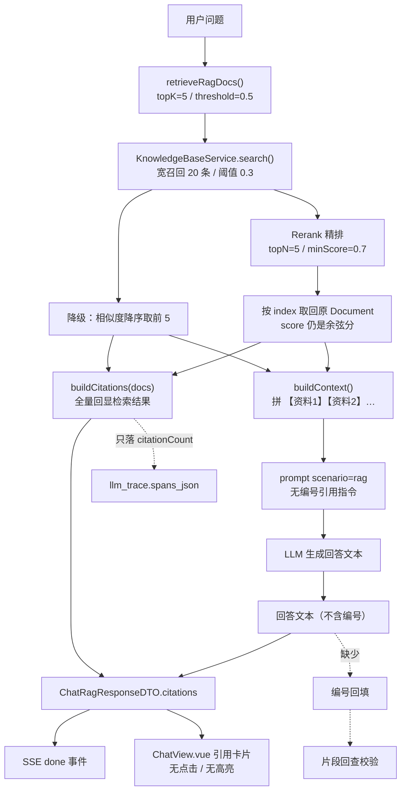
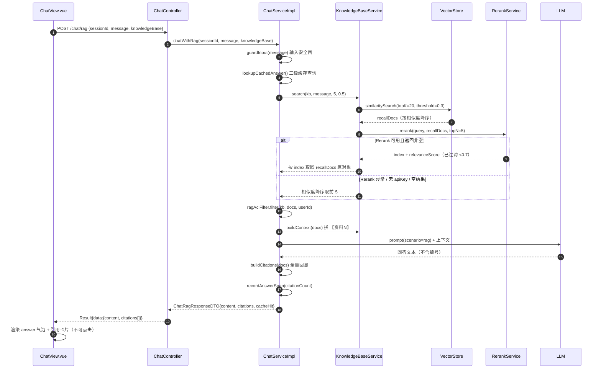

# 引用溯源实战：让每一句回答都能被审计

> **一句话结论**：引用溯源不是给回答加装饰，而是把"这句话凭什么这么说"落成一条可回查的数据链——编号生成 / 编号回填 / 片段校验 / 点击定位 / 事后留痕五段全通，幻觉才可能被发现；断在任何一段，引用就退化成装饰。
> **阅读前置**：读过《03-RAG向量检索实战》与《05-混合检索实战-ES-BM25与向量RRF融合》；知道 `Document`（一个文本片段 + metadata + score 的载体）、`VectorStore.similaritySearch`、topK 与相似度阈值分别卡什么；知道 chat 服务有 `/chat/rag`（同步）与 `/chat/stream/sse`（流式）两条链路。
> **证据基线**：Spring AI **2.1.0** / Spring Boot **4.2.0**（A 级摘录来自 `learning-docs/24-源码分析/assets/source/`）；本项目 ai-cs-chat、ai-cs-frontend 真实代码（B 级，行号已当次 read 核对）；node **24.16.0** 可复现推演（C 级）。预计阅读 **45~60 分钟**。

在开始抠细节之前，先把这篇的证据边界摊开，省得你读到一半怀疑哪句话是我编的：

| 类别 | 本仓状态 | 本篇怎么处理 |
|---|---|---|
| `ContextualQueryAugmenter` / `RetrievalAugmentationAdvisor` / `VectorStore` / `Document` | 已入库 `assets/source/*.java.md`（带原始行号） | A 级，行内锚点 + 代码块 src 标注，可逐行对源码 |
| `QuestionAnswerAdvisor` | **未入库**（`assets/source/` 下没有该文件） | 不引用它；官方"检索增强"能力改用 `RetrievalAugmentationAdvisor` 做对照 |
| `TextSplitter`（`TokenTextSplitter` 的父类） | 未入库 | 用 `javap` 对着 m2 里的 jar 做静态核对（C 级，字节码可复现） |
| Chroma 0.5.20 / ES 8.12 / Redis 7 / Tika | 未入库，本机也没装 | 涉及处一律写"未入库，依据官方文档/本项目代码" |
| 端到端"发一次请求看引用长什么样" | 本机**无 docker / Chroma / ES / Redis**（探测命令与输出见 §3.9） | 不做运行时实测；只做代码级静态核对 + node 模拟推演 |
| 引用质量的量化指标（faithfulness、引用精确率） | 本项目**未落地**（`RetrievalMetrics` 只有召回类指标） | 只给设计建议，明确标注"未落地" |

---

## 0. 先看现象

### 现象 1：卡片上明明写着"引用来源 2 条"，用户点不动、也看不到出自哪份文件

后端返回的引用条目长这样（字段就这五个）：

```java
// ai-cs-chat/src/main/java/com/aics/chat/dto/CitationItemDTO.java#L18-L31
private Long documentId;
private String title;
private Integer page;
private Double score;
private String content;
```

前端也确实把它们渲染成了卡片，但整块模板里**没有一个点击事件**：`ai-cs-frontend/src/views/ChatView.vue#L48-L53` 是 `v-for="(cit, ci) in msg.citations"` 直接铺开，`#L56` 输出标题、`#L57` 输出页码、`#L59-L67` 输出相关度进度条、`#L68-L72` 输出原文前 3 行，到此为止。`documentId` 从头到尾没被使用。

也就是说：**卡片上有"出处"这个字样，却没有"能跳过去的出处"**。更麻烦的是 `documentId` 这条字段本身也不一定可靠，见现象 2 的第一段代码。

### 现象 2：引用文档确实存在，但"内容对不上"、"相关度永远是红的"

两个独立的错位，都出在"引用的元数据"上。

第一个错位是 `documentId` 的语义在两条入库路径上不一样：

```java
// ai-cs-chat/src/main/java/com/aics/chat/service/KnowledgeBaseService.java#L168-L178
chunks.forEach(chunk -> {
    Map<String, Object> meta = chunk.getMetadata();
    meta.put("knowledgeBase", knowledgeBase);
    meta.put("documentId", chunk.getId());
    if (title != null) {
        meta.put("title", title);
    }
});
vectorStore.add(chunks);
```

`chunk.getId()` 是切块时新生成的随机串（`Document` 未显式给 id 时由 `RandomIdGenerator` 生成 [[源码:Document.java.md#L183-L183]]），而 `ai-cs-knowledge/src/main/java/com/aics/knowledge/service/KnowledgeVectorService.java#L79-L83` 那条写路径填的是 `doc.getId()`（数据库里的真文档 id）。同名不同义，于是 `buildCitations` 里这句 `Long.valueOf` 只能靠 catch 兜住：

```java
// ai-cs-chat/src/main/java/com/aics/chat/service/impl/ChatServiceImpl.java#L1050-L1058
Object docId = meta.get("documentId");
if (docId != null) {
    try {
        item.setDocumentId(Long.valueOf(String.valueOf(docId)));
    }
    catch (NumberFormatException ignore) {
    }
}
```

随机 UUID 串转 `Long` 必然抛 `NumberFormatException`，被 `ignore` 静默吞掉 → 前端拿到的 `documentId` 是 `null`。**用户看到的"引用"其实只剩一个标题字符串。**

第二个错位是 `score` 的含义在三条检索路径下有三种口径（纯向量是余弦相似度、走 Rerank 时是召回阶段的余弦分、走混合检索时是 RRF 名次分），而前端色带按 `>=0.7 绿 / >=0.5 黄 / 否则红` 判断（`ai-cs-frontend/src/views/ChatView.vue#L59-L67`）。用 node 把 RRF 公式算一遍就知道有多荒谬——输出见 §3.8，两路都排第 1 的片段 score 只有 `0.0328`，进度条 3%，**永远是红的**。

### 现象 3：用户投诉"你们客服乱说"，事后谁也说不清它当时读了哪几段

审计留痕这条链上只有"计数"，没有"内容"：

```java
// ai-cs-chat/src/main/java/com/aics/chat/service/impl/ChatServiceImpl.java#L989-L1004
TraceSpans.observe(observationRegistry, "ANSWER", "chat.answer", Map.of(),
        Map.of("citationCount", String.valueOf(citationCount),
                "answerLength", String.valueOf(answerLength)),
        () -> {
        });
```

落库的表也没有引用列——`deploy/mysql/llm-observability-init.sql#L12-L26` 建的是 `llm_trace(request_id, user_id, session_id, scenario, status, total_duration_ms, spans_json, error_summary, create_time)`，只有 `spans_json` 一个自由文本。历史消息更彻底：`ai-cs-chat/src/main/java/com/aics/chat/dto/ChatHistoryMessage.java#L14-L20` 只有 `role` 和 `content` 两个字段，连 citations 都不存。

于是复盘一次投诉时你能拿到的是：一次 `requestId`、一段回答文本、一个"引用条数 = 3"。**但第 3 条到底是哪份文档的哪一块、原文写了什么，已经没了。**

> 这些现象指向同一件事：**引用链只做了"检索结果 → 卡片"这一跳，中间的"编号生成 / 编号回填 / 生成后校验 / 片段级留痕"四跳全缺**——所以引用既点不开、也验不了、更没法事后复现。

---

## 1. 整体地图



> **读图说明**：这张图最关键的一条边，是 `CITE → DTO` 和 `OUT → DTO` 是**两条互不相交的边**：引用条目完全由 `docs`（检索结果）生成，与 `LLM` 吐出的回答文本没有任何数据交换。如果把这两条边读成"从回答里解析出引用"，就会误判本系统已经具备句子级溯源能力——那正是本文要纠正的第一个误解。第二条要注意的是虚线：`trace` 只收一个计数值，`编号回填`/`片段回查校验` 两个方框在本仓是空的。

| 组件 | 责任（一句话） | 谁调用它 |
|---|---|---|
| `ChatController` | 暴露 `/chat/rag`、`/chat/stream/sse`，把 DTO 包进统一 `Result` | 前端 `ChatView.vue` |
| `ChatServiceImpl#chatWithRag` | 同步链路编排：缓存 → 检索 → 拼上下文 → 生成 → 造引用 | `ChatController` |
| `ChatServiceImpl#chatStreamSse` | 流式链路编排：检索期就先 `buildCitations`，等 `done` 事件一次性带出 | `ChatController` |
| `KnowledgeBaseService#search` | 两阶段检索：宽召回 20 条（阈值 0.3）→ Rerank 精排 topN=5（minScore 0.7）→ 失败降级 | `ChatServiceImpl#retrieveRagDocs` |
| `KnowledgeBaseService#buildContext` | 把 `List<Document>` 拼成 `【资料N】+正文` 的 prompt 上下文 | `ChatServiceImpl` |
| `ChatServiceImpl#buildCitations` | 把 `List<Document>` 的 metadata 抄成 `CitationItemDTO` 列表 | 两条链路都调 |
| `CitationItemDTO` | 引用条目载体：documentId / title / page / score / content | 前后端契约 |
| `ChatRagResponseDTO` | 一次 RAG 回答的完整返回：content + citations + 缓存标记 | 前后端契约 |
| `ChatView.vue` | SSE 分帧解析、把 `citations` 整体覆盖到消息、渲染卡片 | 浏览器 |
| `LlmTraceDTO` / `TraceRecorder` | 把 span 列表序列化进 `spans_json`，无引用字段 | `TraceInterceptor` |

---

## 2. 关键概念与关键类

| 名称 | 位置 | 角色 | 关键方法/字段 |
|---|---|---|---|
| `Document` | `Document.java.md`（A 级） | 检索与入库的最小单元：id + text + metadata + score | `getId()` L246、`getText()` L255、`getMetadata()` L321、`getScore()` L333 |
| `VectorStore` | `VectorStore.java.md`（A 级） | 向量库抽象：写（add/upsert）、搜（similaritySearch）、删 | `add(List)` L51、`upsert(List)` L59-L84 |
| `ContextualQueryAugmenter` | `ContextualQueryAugmenter.java.md`（A 级） | 官方"把 documents 塞进 prompt"的实现，含空上下文话术 | `augment(Query, List)` L106-L124、`DEFAULT_DOCUMENT_FORMATTER` L82-L84 |
| `RetrievalAugmentationAdvisor` | `RetrievalAugmentationAdvisor.java.md`（A 级） | 官方 RAG Advisor：检索 → 拼上下文 → 生成 → **把 documents 回填进响应 metadata** | `before()` L107-L153、`after()` L166-L182、`DOCUMENT_CONTEXT` L64 |
| `CitationItemDTO` | `ai-cs-chat/src/main/java/com/aics/chat/dto/CitationItemDTO.java` | 一条引用（B 级契约） | 五字段 L18-L31 |
| `ChatRagResponseDTO` | `ai-cs-chat/src/main/java/com/aics/chat/dto/ChatRagResponseDTO.java` | 一次回答的完整载荷 | `content` L22、`citations` L25、`cacheHit` L28、`cacheSource` L31 |
| `ChatServiceImpl#buildCitations` | `.../service/impl/ChatServiceImpl.java#L1034-L1078` | **造引用的唯一入口**：metadata → DTO，全量回显 | 逐条 `meta.get(...)` |
| `KnowledgeBaseService#buildContext` | `.../service/KnowledgeBaseService.java#L287-L293` | 生成 `【资料N】` 编号（只进 prompt，不回填） | 下标 + 1 |
| `KnowledgeBaseService#search` | `.../service/KnowledgeBaseService.java#L228-L260` | 两阶段检索 + 降级 | 宽召回 → Rerank → fallback |
| `SiliconFlowRerankService` | `.../rag/rerank/SiliconFlowRerankService.java#L170-L202` | Rerank 实现：只回 index + relevanceScore，不回新 Document | `doRerank` L170-L202 |
| `HybridRetriever` | `.../rag/retrieve/HybridRetriever.java#L176-L213` | 混合检索：ES BM25 + Chroma 向量，RRF 融合，两处降级 | `hybrid()` L176 |
| `ChatView.vue` | `ai-cs-frontend/src/views/ChatView.vue#L42-L75` | 前端引用卡片（纯展示） | 无 `@click` |

口诀：**`Document` 是原料，`buildContext` 编坐标，`buildCitations` 是原料的复印件，`CitationItemDTO` 是复印件上的五个格子**——复印件和回答之间没有桥。

---

## 3. 原理与证据逐段精讲

### 3.1 引用的三种粒度，以及各自的实现成本

**在干什么**：先说清"引用"到底指到哪一级。同一个词在三层意思上被混用：

| 粒度 | 回答要能证明到 | 需要的数据 | 生成侧额外动作 | 校验成本 | 本项目状态 |
|---|---|---|---|---|---|
| 文档级 | "这句出自《退款政策 v3》" | documentId + title | 无 | 无 | 部分（documentId 可能是 null） |
| 片段级 | "出自该文档第 3 块，原文如下" | chunkId + text + score | 无 | 可选（子串回查） | 已落地（五字段） |
| 句子级 | "回答第 2 句的依据是片段第 2 行" | 上述 + 回答内字符偏移 + 被引用的原句 | prompt 要求输出 `[N]` | 每句一次回查 | **未落地** |

**为什么这么设计**：粒度决定成本结构。文档级只需要一条 `documentId`，但它把"翻找"的负担推给了用户；片段级需要"检索结果自包含"——`ai-cs-chat/src/main/java/com/aics/chat/service/impl/ChatServiceImpl.java#L1042-L1044` 的注释把这件事说得非常直白："检索结果自包含设计…代价是入库时要把展示字段写全（KnowledgeBaseService.addChunks），缺字段的检索源会降级为无溯源"。句子级则要模型配合，成本翻倍。

**换成别的写法会怎样**：如果只做文档级，用户点开要自己在几十页 PDF 里找——"可审计"退化成"可追溯"；如果直接上句子级而不做片段级，你连"这句话对应哪一块"都算不出来，因为偏移是相对于片段的，不是相对于原始文件的。

**常见坑**：把"卡片上显示了原文"当成句子级。`buildCitations` 塞进 `content` 的是 `doc.getText()`（整块片段，`#L1074`），不是"回答里那句话"；用户看到的一大段原文里，可能只有一句跟回答有关。

### 3.2 上下文编号是谁编的、编给谁看

**在干什么**：`buildContext` 给每条片段编号：

```java
// ai-cs-chat/src/main/java/com/aics/chat/service/KnowledgeBaseService.java#L287-L293
public String buildContext(List<Document> documents) {
    StringBuilder sb = new StringBuilder();
    for (int i = 0; i < documents.size(); i++) {
        sb.append("【资料").append(i + 1).append("】").append(documents.get(i).getText()).append("\n\n");
    }
    return sb.toString().trim();
}
```

编号就是"列表下标 + 1"。这个坐标**只存在于 prompt 文本里**，`List<Document>` 本身没有编号字段。

官方同类实现更"裸"——默认 formatter 连编号都不加，纯换行拼接：

```java
(src: ContextualQueryAugmenter.java.md#L82-L84)
private static final Function<List<Document>, String> DEFAULT_DOCUMENT_FORMATTER = documents -> documents.stream()
	.map(Document::getText)
	.collect(Collectors.joining(System.lineSeparator()));
```

**为什么这么设计**：编号是给模型看的坐标系，不是给用户看的引用。框架默认不编号，是因为一旦编号，就等于向模型承诺"你可以在回答里回指第 N 条"——而回指要求解析、校验、降级三件事配套，框架不想默认背这个包袱（它把这个责任交给了 `documentFormatter` 这个可替换函数）。

**换成别的写法会怎样**：编号必须在**最终送给模型的顺序**上生成。本项目里 `buildContext(docs)` 的入参 `docs` 已经是 Rerank 重排后的顺序（`KnowledgeBaseService#search` 返回的就是重排结果），所以编号与顺序自洽；但如果你在 Rerank 之前编号、Rerank 之后再用，回填必然错位——这是自建 RAG 最常见的引用错位来源。

**常见坑**：编号有了，但 prompt 里没有"请输出编号"的指令。本项目 `ai-cs-chat/src/main/resources/application-prompt.yml#L63` 的 rag 模板原文是：

```text
请严格基于下面的【知识库资料】回答用户问题。
重要规则：
1. 如果资料中没有相关信息，请如实告知："我暂时没有这方面的资料"，不要编造内容
2. 回答时优先引用资料中的内容，不要提及"根据资料/检索结果"之类的表述

【知识库资料】
{{context}}

【用户问题】
{{message}}
```

规则 2 明确要求**不要提"根据资料"**，规则里也没有"用 [N] 标注出处"。也就是说：系统给了模型坐标，却没要求它报坐标——这是引用链断在第一跳的直接原因。

### 3.3 让模型把编号说出来：三种回填方案的取舍

**在干什么**：把"哪句话依据哪条资料"变成一段可解析的文本，事后能反查。

| 方案 | prompt 怎么写 | 解析难度 | 流式友好度 | 校验能力 | 风险 |
|---|---|---|---|---|---|
| 尾注清单 | "最后列出用到的资料编号" | 低（抓最后一段） | 好（结尾才输出） | 弱（对不到句子） | 模型可能列全 5 条 |
| 内联标记 | "每个结论后用 [N] 标注" | 中（正则） | 好 | 中（能对到句） | 编号越界、格式漂移 |
| 结构化 JSON | "输出 {\"answer\":…,\"citations\":[…]}" | 高（要 JSON 修复） | **差**（token 流里 JSON 不完整） | 强 | 破坏 SSE 增量渲染 |

**为什么这么设计**：三种方案的差别不在"哪个更准"，而在"失败时你怎么兜"。内联标记是最优点：模型漏标你还能降级成片段级，模型标错你能用越界校验挡下来，而 JSON 方案一旦解析失败，整段回答都渲染不出来。

**换成别的写法会怎样**：把引用做成"让模型在回答里复述原文"（quote-then-answer）——最抗幻觉，但会让回答变长 2~3 倍，且中文长句复述极易篡改标点，反而制造新的"内容对不上"。

**常见坑**：只写"请标注出处"却不给**编号上限**。上下文只有 2 条时，模型仍可能写出 `【资料3】`——下一节就是实测。

### 3.4 解析回填：把编号映射回片段，并挡住越界

**在干什么**：拿到回答后，用正则抓出所有引用标记，映射到 `docs` 列表，凡越界即判失败。

C 级实测（脚本 47 行，下面只截核心解析；fixtures 与打印部分见输出）：

```javascript
const docs = [
  { idx: 1, chunkId: 'a5647b9e-1f0c-4c1a-9a3e-0b1f2c3d4e5f', title: '退款政策' },
  { idx: 2, chunkId: '7c2d9a10-8b3e-4f77-b0aa-2d6e5f4c3b21', title: '发票说明' }
];
const answer = '退款需在签收后 7 天内申请【资料1】，运费由买家承担【资料3】。发票可补开[2]，超过 90 天不再支持【资料9】。';

const PAREN = /【资料\s*(\d+)】/g;
const BRACKET = /\[(\d+)\]/g;
const found = [];
for (const m of answer.matchAll(PAREN)) found.push({ n: Number(m[1]), style: '【资料N】', at: m.index });
for (const m of answer.matchAll(BRACKET)) found.push({ n: Number(m[1]), style: '[N]', at: m.index });
found.sort((a, b) => a.at - b.at);

let ok = 0;
const bad = [];
const cited = new Set();
for (const f of found) {
  const valid = f.n >= 1 && f.n <= docs.length;
  const doc = docs.find(d => d.idx === f.n);
  if (valid) {
    ok++;
    cited.add(f.n);
    console.log(`[PASS] ${f.style} 编号 ${f.n} @偏移 ${f.at} -> 命中 chunkId=${doc.chunkId} title=${doc.title}`);
  } else {
    bad.push(f);
    console.log(`[FAIL] ${f.style} 编号 ${f.n} @偏移 ${f.at} -> 越界：上下文只有 ${docs.length} 条，编号必须落在 1..${docs.length}`);
  }
}
process.exitCode = bad.length > 0 ? 2 : 0;
```

跑法只有一条命令（无网络、无依赖、秒级）：

```powershell
node citation-parse-check.mjs
```

真实输出（节选，脚本另有汇总行）：

```text
上下文实际条目数 = 2
模型回答 = 退款需在签收后 7 天内申请【资料1】，运费由买家承担【资料3】。发票可补开[2]，超过 90 天不再支持【资料9】。

[PASS] 【资料N】 编号 1 @偏移 14 -> 命中 chunkId=a5647b9e-1f0c-4c1a-9a3e-0b1f2c3d4e5f title=退款政策
[FAIL] 【资料N】 编号 3 @偏移 27 -> 越界：上下文只有 2 条，编号必须落在 1..2
[PASS] [N] 编号 2 @偏移 38 -> 命中 chunkId=7c2d9a10-8b3e-4f77-b0aa-2d6e5f4c3b21 title=发票说明
[FAIL] 【资料N】 编号 9 @偏移 53 -> 越界：上下文只有 2 条，编号必须落在 1..2

--- 汇总 ---
引用标记总数 = 4，合法 = 2，越界 = 2
被引用的资料编号 = [1, 2]
未被引用的资料编号 = []
处置建议 = 丢弃越界标记并标注"第3/9条来源无法定位"，禁止直接渲染成可点击引用
```

**怎么读这段输出**：

1. `@偏移 27` 是 `【资料3】` 在回答文本里的字符下标——它就是做"句子级溯源"时需要的那个偏移量，`String.indexOf` 的返回值，不用模型配合就能拿到。
2. 两行 `[FAIL]` 是**同一类错误**：编号落在了 `1..docs.length` 之外。注意它们不是"检索错了"，而是"模型编了一个不存在的坐标"——这类错误在纯文本回答里完全看不出来，用户只会觉得"回答看起来挺有依据"。
3. `未被引用的资料编号 = []` 说明这条回答把 2 条资料都用上了；如果一个非空的知识库里 `未被引用` 恒等于全集，那说明模型根本没在看上下文（值得单独告警）。
4. `process.exitCode = 2` 让它能直接进 CI：解析失败即红灯。**这是"引用可被机器审计"的最小可运行形态。**

**为什么这么设计**：校验必须在渲染之前。若直接把编号当下标（`docs[n-1]`），越界编号要么抛 `IndexOutOfBoundsException`、要么（更糟）在列表更长时**静默指到另一条片段**——那就成了"张冠李戴"的假引用，比没有引用更危险。

**换成别的写法会怎样**：不做越界校验、只做"有标记就算有引用"，你的引用精确率会被越界标记直接拉低，而且这些错误只在人工抽查时暴露。

**常见坑**：

- 标记格式因模型而异：`[1]`、`【资料1】`、`(来源1)`、上标 `¹`。只写一种正则会在换模型当天全线失效。
- 中文全角括号 `【】` 与半角 `[]` 混用，正则要两条都覆盖（上面的脚本站好两种）。
- 同一句里出现多个标记（`[1][3]`）时，要拆成多条引用而不是取第一个。
- 千万别用 `answer.includes(n)` 这种"全文搜数字"的偷懒办法：回答里的"7 天"会把编号 7 也算成引用。

### 3.5 生成后回查：把"编造出处"挡在渲染之前

**在干什么**：越界校验只证明"编号存在"，不证明"这条片段真的支持这句话"。第二道闸是把回答拆成断言，逐条回到它声明的片段里查。

C 级实测：4 条断言、前 3 条能在片段里找到原句、第 4 条是模型顺手加的，真实输出：

```text
待校验断言数 = 4

[SUPPORTED] 「签收后 7 天内可申请无理由退货」
    声明来源 = 资料1 (a5647b9e…)
    子串回查 = 命中；数字回查 = 全部出现在片段中
[SUPPORTED] 「仅支持补开 30 天内的订单」
    声明来源 = 资料2 (7c2d9a10…)
    子串回查 = 命中；数字回查 = 全部出现在片段中
[SUPPORTED] 「退款审核通过后 3 个工作日内退回原支付账户」
    声明来源 = 资料1 (a5647b9e…)
    子串回查 = 命中；数字回查 = 全部出现在片段中
[UNSUPPORTED] 「超过 90 天不再支持补开发票」
    声明来源 = 资料2 (7c2d9a10…)
    子串回查 = 未命中；数字回查 = 数字未出现在片段中 90
    处置 = 该句降级为"无出处"，或整条回答重生成（引用不可信）

--- 汇总 ---
可验证断言 = 3/4，无据断言 = 1
片段级引用通过率 = 75.0%
```

**怎么读这段输出**：

1. 判定用了两条独立证据：**归一化子串回查**（去标点空白后 `includes`）和**数字回查**（断言里的每个数字都要在片段里出现）。后者专门抓"7 天 → 90 天"这类数字漂移，是客服场景最容易出事的地方。
2. `[UNSUPPORTED]` 那条的片段原文是"仅支持补开 30 天内的订单"，回答却说"超过 90 天不再支持"——**语义上像是合理的推断，但确实无据**。这正是幻觉最典型的形态：不是胡说八道，而是"合理的加戏"。
3. `片段级引用通过率 = 75.0%` 是本文最推荐的一个指标名：分母是"声明了出处的断言数"，分子是"回查命中的数"。它比"引用条数"有意义得多。

**为什么这么设计**：子串回查是这个价位上性价比最高的闸——零模型调用、毫秒级、可解释。它的弱点也很明确：模型同义改写（"7 天"写成"一周"）会被误判成无据。

**三档校验策略**（按成本从低到高，建议按业务重要性分级启用）：

| 档位 | 方法 | 成本 | 误杀率 | 能抓什么 |
|---|---|---|---|---|
| 一档 | 归一化子串 + 数字回查 | 微秒级，无模型 | 中（改写型回答） | 数字漂移、凭空加句 |
| 二档 | 断言与片段的 embedding 余弦 | 一次向量化 | 低 | 同义改写、语义偏移 |
| 三档 | NLI / LLM entailment（"这段能否推出这句"） | 每句一次 LLM | 最低 | 因果倒置、条件删减 |

**换成别的写法会怎样**：一步到位上三档，每次回答多 3~5 次 LLM 调用，延迟与成本都不可接受；只做一档且不区分"改写型 vs 编造型"，会把大量正确回答误判，最后运营干脆关掉告警——**误杀率高的校验等于没有校验**。

**常见坑**：把 `content` 直接当"被引用的句子"去比对。`doc.getText()` 是整块片段（可能 500 token），断言的子串当然能找到——校验必然 100% 通过，等于没校验。必须比"断言 vs 片段"，且断言要真的从回答里切出来。

### 3.6 多文档冲突与"资料中未提及"的表达

**在干什么**：当同一个问题命中的两条片段互相矛盾（旧版政策 vs 新版政策），或者干脆什么都没命中时，回答该怎么长。

**项目现状**（如实说）：没有任何冲突检测。`buildContext` 按 `docs` 顺序平铺，`citations` 按同一顺序全量回显，`ChatView.vue` 一条条铺卡片。两份政策谁新谁旧、谁覆盖谁，系统不知道也不表达。

三种可选策略与代价：

| 策略 | 做法 | 优点 | 代价 |
|---|---|---|---|
| 取最高分 | 只送 top-1 进上下文 | 回答干净、不会自相矛盾 | 高分片段若是旧版，错得更"自信" |
| 并列呈现 | 上下文里分组标注来源与分页，回答要求"分别说明" | 诚实，用户自己判断 | 回答变长，用户体验重 |
| 显式声明冲突 | 生成后比对多条片段的关键数字/日期，不一致就提示 | 最可审计 | 需要业务字段级的比对逻辑，误报要人兜 |

**无据可依怎么表达**：项目现在只靠 prompt 的自然语言约束（`application-prompt.yml#L63` 规则 1 让模型说"我暂时没有这方面的资料"）；`ChatServiceImpl#L444-L450` 在 `context` 为空时塞入占位符 `（未检索到相关资料）`。两条都是"请求模型配合"，**没有任何生成后校验去检查"模型是不是真的说了没资料"**——所以模型硬答时你拦不住。

官方的做法值得对照，它把"无据"变成了模板而不是让模型自由发挥：

```java
(src: ContextualQueryAugmenter.java.md#L72-L77)
private static final PromptTemplate DEFAULT_EMPTY_CONTEXT_PROMPT_TEMPLATE = new PromptTemplate("""
		The user query is outside your knowledge base.
		Politely inform the user that you can't answer it.
		""");

private static final boolean DEFAULT_ALLOW_EMPTY_CONTEXT = false;
```

`allowEmptyContext` 默认 `false`，于是 `augment()` 里只要 `documents.isEmpty()` 就直接返回这段固定话术：

```java
(src: ContextualQueryAugmenter.java.md#L112-L114)
		if (documents.isEmpty()) {
			return augmentQueryWhenEmptyContext(query);
		}
```

**为什么这么设计**：把"无据"从"模型可能编"变成"框架确定不编"——空上下文根本不会走到模型面前，模型没有机会硬答。这是**结构性约束**，比 prompt 里的恳求可靠一个量级。

**换成别的写法会怎样**：`allowEmptyContext=true` 时把空上下文照常送给模型，就等于把"要不要编"的决定权交还给模型，你会看到"根据资料，退款需要……"这种信心十足的空话。

**常见坑**：`documents.isEmpty()` 只覆盖"检索为空"，不覆盖"检索到 3 条但全都跟问题无关"（阈值太松时经常发生）。后者要靠 3.5 的回查闸来兜，别指望这个分支。

### 3.7 点击溯源要什么数据：五个字段缺了什么

**在干什么**：把"点一下跳到原文并高亮"拆成数据需求。

| 字段 | 现状 | 点击溯源还需要 | 说明 |
|---|---|---|---|
| `documentId` | `Long`，来自 metadata | 全局唯一且稳定的文档 id + 取原文的接口 | 现在可能是 `null`（见 §0 现象 2） |
| `title` | 有 | 够用 | 纯展示 |
| `page` | `Integer`，`page_number` | PDF 需要，Office/文本没有 | `buildCitations#L1065-L1068` 只在 `Number` 时赋值 |
| `score` | `Double`，语义随路径变 | 明确的"分数类型"字段 | 见 §3.8 |
| `content` | 整块片段全文 | `chunkId` + 回答里的字符偏移 + 被引用原句 | 没有 chunkId 就无法定位到"哪一块" |
| — | **缺** | `knowledgeBase`、原文获取 URL、chunk 序号（第几块/共几块） | 冲突呈现与高亮都依赖它们 |

**框架其实已经给了这些锚点，只是没人接**。`TextSplitter` 未入库，用 `javap` 直接看字节码（C 级）：

```powershell
javap -p -c -classpath "$env:USERPROFILE\.m2\repository\org\springframework\ai\spring-ai-commons\2.1.0\spring-ai-commons-2.1.0.jar" org.springframework.ai.transformer.splitter.TextSplitter
```

在 `createDocuments(...)` 里能看到常量池字符串被逐条 `Map.put` 进 metadata：

```text
   203: ldc           #xx  // String parent_document_id
   212: ldc           #xx  // String chunk_index
   227: ldc           #xx  // String total_chunks
```

也就是说：**框架切块时已经给每块写了"原文档 id / 第几块 / 共几块"**，而本项目的 `addChunks` 只覆盖了 `documentId = chunk.getId()`（把"块 id"塞进了"文档 id"的槽位），`parent_document_id`、`chunk_index`、`total_chunks` 三个现成锚点全部闲置。

另一个会毁掉"点击定位"的坑是重复块。`VectorStore.add` 的语义是"重复 id 行为由 provider 决定"：

```java
(src: VectorStore.java.md#L46-L51)
	/**
	 * Adds list of {@link Document}s to the vector store.
	 * @param documents the list of documents to store. Throws an exception if the
	 * underlying provider checks for duplicate IDs.
	 */
	void add(List<Document> documents);
```

而 `upsert` 明确是 replace-by-id：

```java
(src: VectorStore.java.md#L58-L72)
	/**
	 * Upserts a list of {@link EmbeddedDocument}s into the vector store using
	 * caller-supplied embeddings, bypassing the store's own embedding model.
	 * <p>
	 * Write semantics are replace-by-id: if an entry's document id already exists, the
	 * existing row is replaced; otherwise a new row is inserted. As a result, an
	 * ingestion job that uses stable ids is safe to re-run — the same input yields the
	 * same rows with no duplicates. This is in contrast to {@link #add(List)}, whose
	 * behavior for a repeated id is left to the underlying provider.
```

本项目 `KnowledgeBaseService#L178` 用的是 `vectorStore.add(chunks)`，而块 id 是随机生成的新串（`RandomIdGenerator`），所以**同一份文档重复入库就会留下重复块**——用户会看到两张一模一样的引用卡片，点开是同一段原文，页码也一样。这不是 UI bug，是写路径的语义选择。

**落地形态（未落地，给出设计）**：`GET /knowledge/chunk/{chunkId}` 返回 `{text, title, page, parentDocumentId, chunkIndex}`；前端在卡片上加 `@click`，用返回的 `text.indexOf(quote)` 定位后 `<mark>` 高亮。**当前这个接口不存在**——`ai-cs-chat/src/main/java/com/aics/chat/controller/ChatController.java` 暴露的只有 `/chat/rag`、`/chat/stream`、`/chat/stream/sse`、`/chat/history`、`/chat/upload-image`、`/chat/vision*`，没有任何"按引用取原文"的入口。

### 3.8 `score` 到底是什么分

**在干什么**：搞清楚前端进度条背后那个数字的语义。

三条路径三种口径：

| 路径 | `score` 实际含义 | 取值范围 | 谁写的 |
|---|---|---|---|
| 纯向量（Rerank 不可用 / 降级） | 余弦相似度 | 0.3 ~ 1（受宽召回阈值 0.3 截断） | `VectorStore.similaritySearch` |
| Rerank 精排后 | **仍是余弦相似度**（Rerank 分只用于过滤和排序） | 同上 | `KnowledgeBaseService#L241-L247` 用 `recallDocs.get(idx)` 取回原 Document |
| 混合检索 | RRF 名次分 `Σ 1/(60+rank)` | 上限 `2/61 ≈ 0.0328` | `HybridRetriever#L187-L206` |

第二行值得强调：`SiliconFlowRerankService#doRerank` 只返回 `index + relevanceScore`，`KnowledgeBaseService#L241-L247` 拿 index 去原列表里取 Document，因此 `doc.getScore()` **没有被 rerank 分覆盖**；rerank 分只用于 `filter(r -> r.getRelevanceScore() >= minScore)` 和排序（`#L194-L198`，`minScore` 默认 0.7，见 `ai-cs-chat/src/main/java/com/aics/chat/rag/rerank/RerankProperties.java`）。

C 级实测 RRF 的取值范围（k=60，两路）：

```text
RRF 公式 score = Σ 1/(60+rank)，前端色带阈值 0.7 / 0.5

两路都排第 1                  ranks=[1,1]    score=0.0328  进度条=3% 颜色=红(低)
两路都排第 2                  ranks=[2,2]    score=0.0323  进度条=3% 颜色=红(低)
只有一路命中且排第 1              ranks=[1]      score=0.0164  进度条=2% 颜色=红(低)
两路都排第 20（宽召回尾部）          ranks=[20,20]  score=0.0250  进度条=3% 颜色=红(低)

两路融合的理论上限 score = 2/61 = 0.0328，仅达到前端"绿色"阈值的 4.7%
```

**怎么读这段输出**：混合检索路径下 `score` 的**理论上限**是 0.0328，而前端最低档红色阈值是 0.5——所以走混合检索时进度条永远在红色区间，用户看到的是"系统自己都认为这条引用不靠谱"。这不是数据差，是**同一个字段承载了两种量纲**。

顺带一个更隐蔽的同源问题：`KnowledgeBaseService#search(knowledgeBase, query, topK, threshold)` 的 `threshold` 形参在方法体内**从未被使用**——方法只把 `recallTopK` / `recallThreshold`（`#L95` / `#L99`，默认 20 / 0.3）传给 `searchRaw`，`topK` 用于 Rerank 的 `topN` 和降级时 `subList`。所以 `ChatServiceImpl#L437` 传进去的 `0.5` 是不生效的，实际生效阈值是 `aics.rag.recall-threshold`。

**为什么这么设计**：字段被复用的初衷是"前端只关心一个相关度数字"，但一旦引入混合检索，名次分与相似度分就不是一个量纲。**换写法**：给 DTO 加 `scoreType: cosine | rrf | rerank`，前端按类型选色带，或后端统一换算成 0~1 的百分位。**常见坑**：把 `score` 当"置信度"直接展示成百分比——用户看到 3% 只会觉得系统在敷衍他。

### 3.9 审计留痕：事后能不能复现这次引用

**在干什么**：把"一次回答 ↔ 哪些片段"落成可长期查询的记录。

现状盘点：

| 留痕点 | 位置 | 是否含片段级信息 |
|---|---|---|
| `llm_trace` 表 | `deploy/mysql/llm-observability-init.sql#L12-L26` | 否（只有 `spans_json` 自由文本 + 无引用列） |
| ANSWER span 属性 | `ChatServiceImpl#L989-L1004` | 否（只有 `citationCount`、`answerLength`） |
| 检索 span 属性 | `ChatServiceImpl#L969-L973` | **部分**：`detail` 里放 `documentId` 列表，但 `limit(20)` 截断 |
| 历史消息 | `ai-cs-chat/src/main/java/com/aics/chat/dto/ChatHistoryMessage.java#L14-L20` | 否（仅 role/content） |
| 三级缓存 | `ai-cs-chat/src/main/java/com/aics/chat/cache/SemanticCacheService.java#L120-L122` | **是**（citations 随回答一起存 Redis） |

最后一行是把双刃剑：缓存 TTL 默认 168 小时（`ai-cs-chat/src/main/java/com/aics/chat/cache/CacheProperties.java#L34-L35`），命中时 `citations` 原样复用。好处是引用不会因为缓存而丢；坏处是**文档更新/删除后，缓存里的引用最长可以陈旧 7 天**——用户点开一份已经改过的政策，看到的是旧原文。

一条能"事后复现"的记录，最低要包含四件事：

1. `requestId`（已经有了，是 `llm_trace` 主键）
2. 本次 `docIds` / `chunkIds` 全量（现在截断 20 且只有 documentId）
3. 每个 chunk 的 `text` 快照或其内容哈希（文档一变，哈希就对不上，正好能发现"引用已过期"）
4. 回答里每条引用标记的 `偏移 + quote`

**为什么这么设计**：只存 id 不存快照，等于把可审计性外包给了"文档永不修改"这个不可能成立的前提。

本机环境探测（决定本文不做端到端实测的依据）：

```powershell
node -v
Get-Command docker -ErrorAction SilentlyContinue
Test-NetConnection 127.0.0.1 -Port 8000 -InformationLevel Quiet   # Chroma
Test-NetConnection 127.0.0.1 -Port 9200 -InformationLevel Quiet   # ES
Test-NetConnection 127.0.0.1 -Port 6379 -InformationLevel Quiet   # Redis
```

真实输出（`node -v` → `v24.16.0`；`docker` 无输出即未安装；三个端口探测均为 `False`）：**本机无 docker / Chroma / ES / Redis**，任何"发一次请求看看引用"的示范都跑不起来，所以本篇的引用链行为全部来自代码静态核对与 node 模拟推演（模拟推演的假设已在各脚本注释里写明）。

---

## 4. 一次完整执行时序

以同步 `/chat/rag` 为例（流式链路在检索阶段就把 `citations` 造好了，尾部差异见下面的说明）：



> **读图说明**：注意第 15~19 步之间那条"断桥"——`L` 只回了一次纯文本 `回答文本（不含编号）`，随后 `S` 直接从 `docs` 造 `citations`，两段数据在图上没有任何交汇箭头。所以这张图最容易被读错的地方是"以为第 17 步在解析回答"：它没有解析，它在复制。另一处值得盯的是 `alt` 分支——**只有走 Rerank 成功那条路，`score` 才有机会 ≥0.7**；降级路径的分数是召回阈值 0.3 以上的余弦分，前端多半显示黄/红。

流式链路的三个差异（`ChatServiceImpl#L585-L601`）：

1. `final List<CitationItemDTO> citations;` 在**检索阶段就赋值**（`#L594`），不等生成结束；
2. 检索分支里**没有** `ragAclFilter.filter` 调用——同步链路 `#L439` 有，流式 `#L587-L594` 没有，这是流式 RAG 缺 ACL 过滤的代码位置；
3. `citations` 只在 `done` 事件里一次性带出（`#L792`），前端整体覆盖（`ChatView.vue#L428-L430`），不做增量合并。

哪一步失败会报什么：

| 失败点 | 触发条件 | 日志 / 异常原文 | 用户看到 |
|---|---|---|---|
| Rerank 调用失败 | 网络错误 / 超时（默认 5000ms）/ apiKey 为空 | `Rerank调用失败，降级为向量相似度排序`（`SiliconFlowRerankService#L156-L158`）；`知识库[..]Rerank调用异常，降级为相似度排序`（`KnowledgeBaseService#L251-L253`） | 无感，只是排序质量下降、`score` 变低 |
| 检索全空 | Chroma 里没有过阈值片段 | `知识库[..]宽召回完成: 命中0条`（`KnowledgeBaseService#L277`） | `citations: []`，回答由模型自由发挥（有硬答风险） |
| 混合检索失败 | ES 或融合异常 | `RAG增强检索失败，降级纯向量`（`ChatServiceImpl#L954-L960`） | 无感，但 `score` 口径从 RRF 变成余弦 |
| LLM 调用失败 | 超时 / 上游 5xx | `AI服务调用失败: ...` + `ResultCode.CHAT_AI_SERVICE_UNAVAILABLE`（`ChatServiceImpl#L478-L485`） | 错误提示，无回答无引用 |
| `documentId` 非数字 | 写路径存的是 chunk 的 UUID | **静默**（`NumberFormatException` 被 `ignore`，`#L1057-L1058`） | 卡片可见但 `documentId` 为 null |
| 流式 emitter 超时 | 超过 `SSE_EMITTER_TIMEOUT` | `onTimeout` 打日志 | 连接中断，可能既没 `done` 也没 `citations` |

---

## 5. 设计取舍

| 决策点 | 备选方案 | 优点 | 代价 | 本项目怎么选 |
|---|---|---|---|---|
| 引用由谁生成 | 模型在回答里写 vs 系统从 docs 复制 | 前者能对到句子；后者零失败、零解析 | 后者完全不知"哪句用了哪条" | **从 docs 复制**（`buildCitations`），无回填 |
| 上下文是否编号 | 编号 vs 纯拼接 | 编号才能回指 | 编号就得校验越界 | 编号（`【资料N】`），但 prompt 没要求回指 |
| 检索结果是否塞回响应 metadata | 官方 `RetrievalAugmentationAdvisor.after()` 做法 | 引用与本次生成强绑定、无需二次查库 | 需要走 Advisor 管线 | **没走**：手写 pipeline，`citations` 由业务层造 |
| 无据时行为 | 让模型自由说 vs 框架拦死 | 后者不会硬答 | 失去"部分相关也能聊"的柔性 | 只靠 prompt 约束 + 空串占位符 |
| 重复入库 | `add` vs `upsert` | `upsert` replace-by-id，重跑幂等 | 需要稳定 id 策略 | `add`（`#L178`），会留重复块 |
| 分数怎么给前端 | 原样给 vs 归一化 / 加类型 | 原样最省事 | 混量纲，色带失真 | 原样给（三种口径混用） |

可扩展点清单（按改动成本从低到高）：

1. **prompt 加一行引用指令**（改 1 个 yml 字符串）：`application-prompt.yml#L63` 加"每条结论后用 [N] 标注来源，N 不得超过资料条数"。
2. **`buildCitations` 补 `chunkId`**（改 1 个 DTO + 1 个方法）：把 `doc.getId()` 写进新字段，前端可显示短 id。
3. **写路径改 `upsert` + 稳定 id**（改 `addChunks`）：用 `parent_document_id + chunk_index` 拼稳定 id，根治重复块。
4. **解析与越界校验做成服务**（新增 1 个类 + 1 个测试）：把 §3.4 的脚本逻辑搬成 `CitationResolver`，回答文本进、`List<CitationItemDTO>` 出，越界即降级。
5. **请求范围化留痕**（改表 + 改 span）：`llm_trace` 加 `citation_json` 列，落 `chunkId + quote + 偏移`。
6. **走官方 Advisor 管线**（架构级）：把检索与拼上下文搬进 `RetrievalAugmentationAdvisor`，引用从 `ChatResponse.metadata` 里拿 `rag_document_context`——这是官方给的正确插座。
7. **引用质量门禁**（评估级）：在 `golden` 集上加 `expectedCitationIds`，把"片段级引用通过率"纳入现有评估报告。

第 6 条值得多说一句：官方 `RetrievalAugmentationAdvisor#after()` 已经把"本次用到的 documents"回填进响应 metadata：

```java
(src: RetrievalAugmentationAdvisor.java.md#L166-L177)
	public ChatClientResponse after(ChatClientResponse chatClientResponse, @Nullable AdvisorChain advisorChain) {
		ChatResponse.Builder chatResponseBuilder;
		if (chatClientResponse.chatResponse() == null) {
			chatResponseBuilder = ChatResponse.builder();
		}
		else {
			chatResponseBuilder = ChatResponse.builder().from(chatClientResponse.chatResponse());
		}
		Object ctx = chatClientResponse.context().get(DOCUMENT_CONTEXT);
		if (ctx != null) {
			chatResponseBuilder.metadata(DOCUMENT_CONTEXT, ctx);
		}
```

`DOCUMENT_CONTEXT = "rag_document_context"`（`#L64`），且 `before()` 里 `context.put(DOCUMENT_CONTEXT, documents)`（`#L144`）。也就是说，**引用数据与"这一次生成"在框架层是绑定的**；本项目绕过 Advisor 自己拼上下文，才需要业务层再复制一遍 docs——这正是 `#L1042-L1044` 那条"检索结果自包含"注释背后的架构原因。

---

## 6. 踩坑与调试手法

| 现象 | 根因 | 验证手段 | 解法 |
|---|---|---|---|
| 引用卡片 `documentId` 恒为 null | 写路径把 chunk UUID 存进 `documentId`，`Long.valueOf` 抛异常被吞 | 对 `addChunks` 与 `buildCitations` 各下一处断点/打日志，看 meta 里到底是数字还是 UUID 串 | 写路径改存真文档 id，块 id 另开字段 |
| 引用条数与"真正用上的资料"不一致 | `citations` 是 `docs` 全量复制，模型根本没用到的也列出来 | 用 §3.4 的解析脚本统计"未被引用的资料编号" | 只回显被引用的编号 |
| 换了模型后引用突然全丢 | 正则只认 `[N]`，新模型输出 `【资料N】` | 把一条真实回答丢进解析脚本，看 `引用标记总数` 是不是 0 | 正则覆盖多种风格 |
| 相关度进度条永远是红的 | 混合路径 `score` 是 RRF 名次分（≤0.0328） | 跑 §3.8 的 RRF 脚本算上限，对比前端阈值 0.7 | 加 `scoreType` 或后端归一化 |
| 传了 `threshold=0.5` 却仍召回低分片段 | `search` 的 `threshold` 形参未被使用 | 在 `search` 方法体里 grep `threshold`，只有签名与 `searchRaw` 的 `recallThreshold` | 用 `aics.rag.recall-threshold` 配置，或修形参 |
| 同一文档出现多张相同引用卡片 | `vectorStore.add` 留下重复块 + 随机块 id | 检索结果里数 `content` 完全相同的条数 | 改 `upsert` + 稳定 id |
| 文档更新后引用指向旧原文 | 语义缓存 TTL 168 小时，citations 一起缓存 | 看 `CacheProperties#L34-L35` 与命中日志的 `cacheSource` | 文档变更时按知识库失效缓存 |

**真调试手法一：用字段流向反证"有没有消费方"**

不要凭感觉判断"系统有没有校验引用"。直接查这个字段被谁读写：

```powershell
cd D:\Projects\Persion\ai-customer-service
Get-ChildItem -Recurse -Filter *.java ai-cs-chat\src\main\java |
  Select-String -Pattern "setCitations|getCitations|citationCount" |
  ForEach-Object { "{0}:{1}" -f $_.Filename, $_.LineNumber }
```

真实输出：

```text
HotQaCacheService.java:116
SemanticCacheService.java:122
ChatServiceImpl.java:420
ChatServiceImpl.java:431
ChatServiceImpl.java:473
ChatServiceImpl.java:557
ChatServiceImpl.java:782
ChatServiceImpl.java:997
ChatServiceImpl.java:1000
VisionChatServiceImpl.java:108
VisionChatServiceImpl.java:112
```

**怎么读**：11 处命中里，只有 `997` / `1000` 是"读出来当指标"（`citationCount`），其余全是"造出来 / 存进缓存 / 塞进响应"。**没有任何一处把 citations 读回来做内容校验**——这一条查询就足以证明"生成后回查"在本仓不存在，比读十个类更快。

（顺便一个反例教训：第一次我用 `-Path "ai-cs-chat\...\chat\**\*.java"` 跑同样模式，只回了 2 行 `cache/*.java`——因为 PowerShell 的 `-Path` 通配不会跨层递归，`service\impl` 被漏掉了。**看到"只有两处"就下结论会得出完全相反的结论**；`Get-ChildItem -Recurse | Select-String` 才是可靠写法。）

**真调试手法二：用 javap 确认"框架到底写了哪些 metadata"**

怀疑"是不是没字段可用"时，不要猜，直接看字节码里的常量池字符串：

```powershell
javap -p -c -classpath "$env:USERPROFILE\.m2\repository\org\springframework\ai\spring-ai-commons\2.1.0\spring-ai-commons-2.1.0.jar" org.springframework.ai.transformer.splitter.TextSplitter |
  Select-String -Pattern "ldc.*String (parent_document_id|chunk_index|total_chunks)"
```

**怎么读**：`ldc` 后面跟的字符串常量，紧接着一条 `Map.put`，就是"往 metadata 里塞了一个键"。看到 `parent_document_id` / `chunk_index` / `total_chunks` 三个键，就能确定"锚点其实存在，是本项目没用"，而不是"框架没提供"。这类核对不需要启动任何服务，属于五分钟就能定性。

**第三种便宜手法**：把解析器当成纯函数单独跑。像 §3.4 那样把正则和越界逻辑抽成 47 行 node 脚本，用"模型编了 3 和 9"的真实形状做 fixture——比启动 Spring 上下文快两个数量级，而且能直接进 CI 当单测。

---

## 7. ⚠️ 版本差异

| 旧写法 | 当前基线（2.1.0 / 本仓） | 变化点 | 迁移动作 |
|---|---|---|---|
| `QuestionAnswerAdvisor.builder().searchRequest(...)` 一站式拿引用 | 本仓未使用该 Advisor；检索走 `KnowledgeBaseService#search`（手写两阶段），引用走 `buildCitations` | Spring AI 1.x 时代 `QuestionAnswerAdvisor` 常被当成"引用卡片工厂"，2.x 的 RAG 能力重心移到 `RetrievalAugmentationAdvisor` + `DocumentRetriever` 管线 | 若要"官方引用"，迁到 `RetrievalAugmentationAdvisor`，从 `ChatResponse.metadata` 取 `rag_document_context` |
| 旧稿写"检索用 `knowledgeBaseService.search(knowledgeBase, message, 5, 0.5)` 直接命中知识库" | 现签名仍是五参，但内部是"宽召回 20 / 阈值 0.3 → Rerank topN=5 / minScore=0.7 → 降级"，且 `threshold` 形参未生效 | 引入 Rerank 后，"阈值"从单一入口变成两段各一个 | 用 `aics.rag.recall-top-k` / `aics.rag.recall-threshold` / `aics.rerank.min-score` 三个配置表达意图 |
| 旧稿"未命中时回答也会如实告知暂无资料" | prompt 里只有自然语言规则 + `（未检索到相关资料）` 占位，无生成后校验 | 事实是"请求模型配合"，不是"框架保证" | 需要硬保证就引入 `allowEmptyContext=false` 式的结构性拦截 |
| 旧稿只讲"检索结果 → 卡片" | 现在有 `ragAclFilter`（仅同步链路）、Observation span、online eval | 引用链上游多了 ACL、下游多了观测，但**中间四跳（编号/回填/校验/留痕）仍缺** | 按 §5 可扩展点 1→5 顺序补 |
| 流式链路"检索阶段先缓存 citations" | 仍然如此（`#L585-L601`），但缺 ACL 过滤 | 同一条业务规则在两条链路上实现不一致 | 把 `ragAclFilter` 提到 `retrieveRagDocs` 内部，两条链路共用 |

---

## 8. 面试高频问与答

1. 引用溯源有哪三种粒度？各自的实现成本和校验成本差在哪里？
2. 为什么 RAG 的上下文里要给片段编号？编号的坐标系是相对什么建立的？
3. 让模型回填引用编号，有哪几种方案？流式场景下你会选哪种，为什么？
4. 模型给出了 `【资料3】` 但上下文只有 2 条，你的系统应该在哪个环节、以什么方式挡住它？
5. 引用编号解析出来之后，为什么不能直接 `docs[n-1]`？
6. "编号合法"和"引用真实"是两件事，第二件事你怎么校验？三档策略的成本与误杀率怎么权衡？
7. 子串回查会不会误杀同义改写的正确回答？你会怎么降低误杀率？
8. 检索到的两份文档说法冲突，回答应该怎么呈现？三种策略各自的风险是什么？
9. "资料中未提及"这种表达，靠 prompt 约束和靠框架拦截，可靠性差几个量级？为什么？
10. 要做到"点击引用跳到原文并高亮"，数据结构至少要有哪几个字段？你现在缺哪几个？
11. `VectorStore.add` 和 `upsert` 在重复 id 上的行为差异是什么？这个差异会怎样污染引用卡片？
12. 同一个 `score` 字段在纯向量、Rerank、混合检索三条路径下分别是什么含义？
13. 用户投诉"客服乱说"，你需要哪些留痕才能定位到具体片段？只存 `citationCount` 够不够？
14. 引用质量的评估指标你会选哪几个？为什么"引用条数"不是好指标？
15. 如果让你把引用溯源接进现有评估门禁，你会先加哪个指标、阈值怎么定？

---

## 9. 动手练习

**练习 1：把越界校验跑起来并改成"容错模式"**
把 §3.4 的脚本复制到本地，把越界标记的处置从"丢弃"改成"降级为片段级引用（保留 chunkId、标 `verified=false`）"。
验收标准：`node` 输出里 4 条标记全部有归属，其中 2 条 `verified=false`；`process.exitCode` 仍为 2（有越界就要能被 CI 抓到）。

**练习 2：给 prompt 加引用指令，评估它对回答长度的影响**
在 `ai-cs-chat/src/main/resources/application-prompt.yml#L63` 的 rag 模板里加一条"每条结论后用 [N] 标注，N 不得超过资料条数"，然后对同一批 20 条测试问题比较加前/加后的回答平均长度与标记覆盖率。
验收标准：给出两张表（平均字符数、标记覆盖率），并说明标记覆盖率低于多少时你会认为这条指令不划算。

**练习 3：给 `CitationItemDTO` 补 chunkId 并让前端显示**
新增字段 `chunkId`，在 `buildCitations` 里从 `doc.getId()` 赋值；`ChatView.vue` 卡片上显示前 8 位短 id。
验收标准：一张真实返回的 JSON 截图里 `citations[0].chunkId` 非空；前端卡片出现短 id；旧前端（不认新字段）不报错。

**练习 4：算清三条路径的 score 分布**
用 node 造 100 组 `(cosineScore, rrfsScore)` 假数据，按前端阈值 0.7/0.5 分档统计，输出"纯向量路径绿/黄/红各多少条、混合路径各多少条"。
验收标准：输出一张 2×3 的计数表 + 一句结论；明确写出"假数据，仅用于验证色带逻辑，非真实分布"。

**练习 5：设计并实现"按 chunkId 取原文"的接口契约**
只写接口定义与 DTO（不实现），字段至少含 `chunkId / parentDocumentId / chunkIndex / title / page / text`。
验收标准：给出 Java 接口签名 + 一个示例 JSON；说明当 `chunkId` 不存在时返回什么（不要返回 500）；说明该接口需要什么权限校验，为什么它不能和 `/chat/rag` 共用同一套 ACL。

**练习 6：把"引用通过率"加进现有评估**
给 `ai-cs-chat/src/main/java/com/aics/chat/rag/eval/RagEvalCaseResult.java` 提一个改造方案：新增 `citationPassRate` 字段，并在报告里输出。
验收标准：给出字段定义、计算口径（分母/分子各是什么）、以及"阈值设为多少会拦下当前 20 条 golden 集里的几条"的推理过程（允许标注为估算）。

---

## 小结

- 引用溯源的价值不在 UI，而在**把"凭什么这么说"变成可查的数据**；五段链（编号/回填/校验/定位/留痕）断一段，引用就只是装饰。
- 粒度决定成本：文档级≈零成本但把翻找推给用户；片段级要"检索结果自包含"；句子级要模型配合 + 每句回查。
- 坐标是 `buildContext` 用下标编出来的 `【资料N】`，但本项目的 prompt **没有要求回指**，所以模型即便想引用也被劝退。
- 越界校验是必做项：`【资料3】` 在 2 条上下文里是"编造坐标"，直接 `docs[n-1]` 会静默指向别的片段——比没有引用更危险。
- "编号合法"≠"引用真实"：第二道闸要做断言级回查（子串 + 数字最便宜），并接受它会对同义改写产生误杀。
- 官方插座是把 documents 回填进 `ChatResponse.metadata`（`rag_document_context`，[[源码:RetrievalAugmentationAdvisor.java.md#L166-L182]]）；本项目手写 pipeline 才需要在业务层复制 docs。
- 留痕的现状是"有计数、无片段"：`citationCount` 救不了投诉复盘，至少要有 `requestId ↔ chunkId ↔ quote ↔ 快照哈希`。
- 下一次动手先做这三件（成本从低到高）：① 在 `application-prompt.yml` 的 rag 模板加一行引用指令并验证标记覆盖率；② 用 §3.4 的脚本把回答里的越界标记统计出来，作为上线前基线；③ 给 `CitationItemDTO` 补 `chunkId`，为"点击定位"留出插座。

---

## 自测题

**1. 为什么说"引用卡片上有标题和原文"不等于已经做了引用溯源？**
<details><summary>参考答案</summary>

因为 `buildCitations` 复制的是整块片段 `doc.getText()`，与回答里具体哪句话无关，卡片上也没有可点击的定位信息。真正的溯源要能回答"回答的第 2 句依据哪一块的哪一段原文"，本仓连 `chunkId` 都没有落进 DTO。
</details>

**2. 上下文编号 `【资料N】` 是谁、按什么规则生成的？它存在于哪里？**
<details><summary>参考答案</summary>

由 `KnowledgeBaseService#buildContext` 按 `documents` 列表下标 + 1 生成，只存在于拼出来的 prompt 文本里。`List<Document>` 本身没有编号字段，所以编号只在"这一次送给模型的顺序"上有效。
</details>

**3. 本项目 `application-prompt.yml` 的 rag 模板为什么会让引用链在第一跳就断掉？**
<details><summary>参考答案</summary>

模板只要求"基于资料回答、没资料就说没有"，并明确"不要提及根据资料/检索结果"，但没有任何"用 [N] 标注来源"的指令。模型没有被要求报坐标，后端也就没有可解析的引用标记。
</details>

**4. 模型输出 `【资料3】` 而上下文只有 2 条，正确处置是什么？为什么不能 `docs[n-1]`？**
<details><summary>参考答案</summary>

应当判为越界、丢弃该标记并标注"来源无法定位"，绝不允许渲染成可点击引用。直接 `docs[n-1]` 在列表更长时会静默取到另一条片段，造成张冠李戴的假引用，比没有引用更危险。
</details>

**5. 越界校验通过之后，为什么还需要"生成后回查"？**
<details><summary>参考答案</summary>

越界校验只证明"编号存在"，不证明"这条片段支持这句话"。回查要把回答拆成断言，回到它声明的片段做子串/数字匹配，才能发现"合理的加戏"这类幻觉（例如片段写 30 天、回答说 90 天）。
</details>

**6. 子串回查的主要弱点是什么？怎么缓解？**
<details><summary>参考答案</summary>

模型同义改写（"7 天"写成"一周"）会让正确回答被判成无据，误杀率高。缓解办法是归一化、数字单独校验、并在必要时升级到 embedding 相似度或 LLM entailment 二/三档校验。
</details>

**7. `search(knowledgeBase, query, topK, threshold)` 里传的 `threshold=0.5` 为什么可能不生效？**
<details><summary>参考答案</summary>

该方法体内从未使用 `threshold` 形参，只把字段 `recallTopK` / `recallThreshold`（默认 20 / 0.3）传给 `searchRaw`；`topK` 则用于 Rerank 的 topN 和降级时取前 N。所以实际的召回阈值由 `aics.rag.recall-threshold` 决定。
</details>

**8. 为什么混合检索路径下前端相关度进度条永远是红的？**
<details><summary>参考答案</summary>

混合路径的 `score` 是 RRF 名次分 `Σ1/(60+rank)`，两路上限仅 `2/61 ≈ 0.0328`，而前端按 `>=0.7 绿 / >=0.5 黄` 分档。同一个字段在纯向量路径是余弦相似度、在混合路径是名次分，量纲不一致导致色带失真。
</details>

**9. 走 Rerank 精排后，`CitationItemDTO.score` 是 Rerank 分吗？**
<details><summary>参考答案</summary>

不是。`SiliconFlowRerankService` 只返回 `index + relevanceScore`，`KnowledgeBaseService#L241-L247` 用 index 从 `recallDocs` 取回原 `Document`，所以 `doc.getScore()` 仍是召回阶段的余弦相似度；Rerank 分只用于 `minScore=0.7` 过滤与排序。
</details>

**10. 要做到"点击引用跳到原文并高亮"，缺哪几个关键字段？**
<details><summary>参考答案</summary>

缺 `chunkId`（定位到具体块）、回答里的引用字符偏移、被引用的原句 `quote`，以及按 chunk 取原文的接口。框架其实已写 `parent_document_id` / `chunk_index` / `total_chunks`，是本项目 `addChunks` 把 `documentId` 覆盖成块 id 后闲置了这些锚点。
</details>

**11. `add` 与 `upsert` 的语义差异会怎样污染引用卡片？**
<details><summary>参考答案</summary>

`add` 对重复 id 的行为由 provider 决定，而块 id 是随机生成的，所以同一文档重复入库会留下重复块；检索时同一段原文命中多次，前端就出现多张相同卡片。`upsert` 是 replace-by-id，配合稳定 id 才能保证重跑幂等。
</details>

**12. 用户投诉"客服乱说"，仅靠 `llm_trace` 和 `citationCount` 能定位到片段吗？**
<details><summary>参考答案</summary>

不能。`llm_trace` 只有 `spans_json` 自由文本，ANSWER span 只落 `citationCount`/`answerLength`，历史消息只存 role/content。要定位必须补 `chunkId + quote + 偏移`，并保存片段快照或内容哈希，才能应对"文档已更新"的情况。
</details>

**13. 为什么"引用条数"不是好的引用质量指标？应该用什么替代？**
<details><summary>参考答案</summary>

因为它是"输出侧计数"：`citations` 是 `docs` 全量复制，与模型是否真的使用了这些片段无关，模型一条没用也照样是 5 条。替代指标是"片段级引用通过率"（声明了出处的断言里回查命中的比例）和"未被引用的资料编号比例"。
</details>

**14. 文档更新后引用指向旧原文，最可能的原因是什么？**
<details><summary>参考答案</summary>

语义缓存把 `citations` 随回答一起存进 Redis，TTL 默认 168 小时（`CacheProperties`），命中时原样复用。若文档在这期间被修改或删除，缓存里的引用就会指向已过期内容；需要在文档变更时按知识库失效缓存。
</details>
