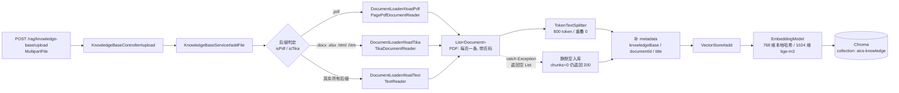
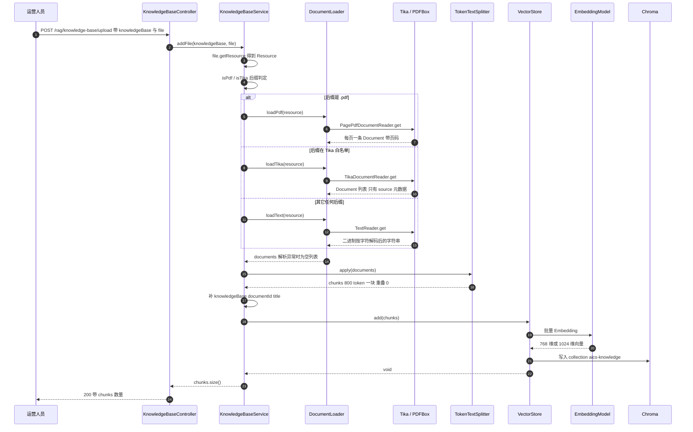

# 文档格式扩展实战：Tika 多格式解析与 PDF/Word/Excel 的"文本化"取舍

> **一句话结论**：RAG 的上限在解析这一步就被钉死了 —— 本项目用一条后缀白名单把上传文件分给三个读取器（`PagePdfDocumentReader` / `TikaDocumentReader` / `TextReader`），白名单外的格式（`.doc`、`.pptx`、`.xls`、`.eml`、`.rtf`）会静默落到"按纯文本读"，把二进制当字符解码后照样入向量库，于是"上传成功、检索乱码"。
>
> **阅读前置**：读过 [03-RAG向量检索实战.md](./03-RAG向量检索实战.md) 与 [04-RAG进阶实战-Rerank重排序.md](./04-RAG进阶实战-Rerank重排序.md)；知道 `Document`（文本 + 元数据的载体）、`VectorStore`（向量库抽象）、chunk（切块后的一段文本）分别是什么；能看懂 Mermaid 流程图与时序图。
>
> **证据基线**：Spring AI 2.1.0 / Apache Tika 4.0.0 / POI 5.5.1 / PDFBox 3.0.x / JDK 17.0.19；本机**没有** docker、Chroma、ES、Redis（下文第 3.8 节给了实测命令与真实输出），所以本篇不启动服务、不连任何中间件，全部结论来自 A 级源码摘录 + B 级项目代码 + C 级静态核对与可复现推演。预计阅读 45~55 分钟。

**证据边界**（先看清哪句话有几分证据，再往下读）：

| 级别 | 来源 | 本篇怎么用它 |
| --- | --- | --- |
| A 级 | `learning-docs/24-源码分析/assets/source/`（908 份 Spring AI 摘录，文件名形如 `Xxx.java.md`） | `TokenTextSplitter` / `Document` / `VectorStore` 三个类的原文与行号。**注意：`TikaDocumentReader`、`TextReader`、`PagePdfDocumentReader`、`PdfDocumentReaderConfig`、`ExtractedTextFormatter` 都不在摘录库里**，用到它们的地方只给 `javap` 静态核对结果（C 级），并明确标注"未入库" |
| B 级 | 本项目 `ai-cs-chat` 源码、`pom.xml`、测试类 | 解析入口、后缀白名单、切块与入库的真实代码，行号均为当次 `read` 核对 |
| C 级 | 本机可复现的静态核对：`node` 读字节、`node` 复刻判定逻辑、`javap` 看类签名与常量、`jar tf` 列 jar 内容、`m2` 版本清单 | 每条都给完整命令 + 真实输出 + "怎么读"。凡不是跑真实服务得到的结论，一律标「模拟推演」 |

---

## 0. 先看现象

先摆三个真实症状。它们的共同点是：接口都返回成功，坏掉的是"文本质量"，而文本质量在接口层完全不可见。

### 现象 1：Word 上传成功，检索出来全是乱码

运营同学上传 `老版合同.doc`，接口 200，日志里只有"入库完成"：

```text
INFO ... KnowledgeBaseService : 知识库[product-manual]入库完成, 共37个分块
```

这行日志来自 ai-cs-chat/src/main/java/com/aics/chat/service/KnowledgeBaseService.java#L179，是**唯一**能证明"文件被解析过"的证据。但它只回答了"写入多少个分块"，没回答"分块里是什么内容"。真正的分岔在这段判定里：

```java
    private boolean isTika(MultipartFile file) {
        String name = file.getOriginalFilename();
        if (name == null) {
            return false;
        }
        String lower = name.toLowerCase();
        return lower.endsWith(".docx")
                || lower.endsWith(".xlsx")
                || lower.endsWith(".html")
                || lower.endsWith(".htm");
    }
```

（ai-cs-chat/src/main/java/com/aics/chat/service/KnowledgeBaseService.java#L306-L316）

`.doc` 不在白名单里，于是它走第三条分支 `loadText`，用 `TextReader` 把 Word 的二进制流当字符解码。C 级实测（完整命令见 3.8 节）：把一个真 ZIP 结构的文件按 UTF-8 解码，518 个字符里有 **78 个 U+FFFD**（替换字符，即"这个字节序列不是合法文本"），开头一段是 `"PK\u0003\u0004\u0014\u0000\b\b..."`。乱码不是模型看错了，是入库的文本本来就长这样。

### 现象 2：PDF 每页变成一个超长段落，切块从句子中间断开

PDF 走的是另一条路，读完之后会打印页数：

```java
            List<Document> documents = pdfReader.get();
            log.info("PDF文档加载完成, 共{}页", documents.size());
```

（ai-cs-chat/src/main/java/com/aics/chat/rag/DocumentLoader.java#L54-L55）

配置是"一页一个 `Document`"（`withPagesPerDocument(1)`，同文件 #L48-L52）。紧接着 `TokenTextSplitter` 再按 800 token 切。问题在于：切块器"找句号"这一步只认四个字符 —— `.` `?` `!` 和换行，中文句号 `。` 根本不在表里：

```java
	private static final List<Character> DEFAULT_PUNCTUATION_MARKS = List.of('.', '?', '!', '\n');
```

（[[源码:TokenTextSplitter.java.md#L53-L53]]）

C 级复刻实测（3.9 节给完整脚本）：一段 351 字、全用 `。` 结尾的中文，`lastPunctuationIndex = -1`，**一次也没截断**，整段原样保留；而英文段落 539 字在 `lastPunctuationIndex = 537` 处被干净地切开。同一份知识库，中文资料的块边界是随机的，英文资料是整齐的。

### 现象 3：Excel 第二张表"根本没入库"

客服反馈"价格表里第二个 sheet 的内容搜不到"。把代码顺着看一遍会发现，更准确的说法是**它入库了，但它没有身份**：`addChunks` 给每个分块补的元数据只有三项 —— 知识库、`documentId`（就是分块自己的 id）、标题：

```java
        chunks.forEach(chunk -> {
            Map<String, Object> meta = chunk.getMetadata();
            meta.put("knowledgeBase", knowledgeBase);
            meta.put("documentId", chunk.getId());
            if (title != null) {
                meta.put("title", title);
            }
        });
```

（ai-cs-chat/src/main/java/com/aics/chat/service/KnowledgeBaseService.java#L168-L175）

没有 `sheetName`、没有页码、没有行号。Tika 抽 xlsx 时按行按格往下扫（`jar tf` 里能看到 `TikaSheetXMLHandler` 这类 SAX 处理器），多张表的内容会连成同一股文本流，再被切块器打散。于是"第二张表没入库"的真实形态是：**它和第一张表糊在同一个知识库里，检索命中了也说不清来自哪张表、哪一行**。

> 这些现象指向同一件事：解析层没有"格式 → 结构化中间表示"这一层模型，只有"后缀 → 读取器 → 一个字符串"的三岔口。格式判错、结构丢失、异常被吞，三种事故都会原封不动地穿过切块与向量化，最后以"检索结果不好"的形式暴露在用户面前。

---

## 1. 整体地图

先把"一个文件怎么变成 Chroma 里的一行向量"画出来。这张图只画一条上传主链路，不画检索。



**读图说明**：

- 最容易被看错的是左边那个菱形。它不是"格式识别"，只是两个 `String.endsWith` 比较 —— 判的是**文件名**，不是文件内容。把 PDF 改名成 `.docx`，它会走 Tika；把 `.docx` 改名成 `.txt`，它会被当纯文本读。这一点决定了整章后面所有"丢内容"的场景。
- 第二个容易看错的是那条**虚线**。三个 `load*` 方法都不是"抛异常让请求失败"，而是 `catch (Exception) → log.error → return new ArrayList<>()`。解析失败在图上表现为"一条空列表继续往下走"，最终落成"写入了 0 个分块但接口成功"。
- `PDF` 这条路**不经过 Tika**。项目同时引了两个读取器（`spring-ai-pdf-document-reader` 与 `spring-ai-tika-document-reader`，见 ai-cs-chat/pom.xml#L48-L58），但 `isPdf` 分支优先，PDF 永远走 PDFBox 那一路。所以"Tika 能解析 PDF"这件事在本项目里没有生效。
- `metadata` 里的三项不是解析器给的，是 `addChunks` 事后补的。解析器原生的页码信息能不能活到分块上，取决于切块器是否复制父 `Document` 的 metadata —— 这一点本篇**没有核实**（摘录库里没有 `TextSplitter` 源码），第 3.11 节会专门讲这个不确定性。

**组件与责任**：

| 组件 | 责任 | 调用方 |
| --- | --- | --- |
| `KnowledgeBaseController` | 暴露 `/upload`、`/text`、`/search` 三个 HTTP 入口；**不做**后缀白名单、大小、Content-Type 校验 | 前端 / Swagger |
| `KnowledgeBaseService` | 后缀路由、切块、补元数据、写库 | Controller |
| `DocumentLoader` | 把一个 `Resource` 变成 `List<Document>`，三种策略各一个方法 | `KnowledgeBaseService#addFile` |
| `PagePdfDocumentReader` | PDFBox 逐页抽文本，一页一条 `Document` | `DocumentLoader#loadPdf` |
| `TikaDocumentReader` | Apache Tika 统一解析 Office/HTML/邮件等格式 | `DocumentLoader#loadTika` |
| `TextReader` | 按字符集读取纯文本 | `DocumentLoader#loadText` |
| `TokenTextSplitter` | 按 token 切块（默认 800 / 重叠 0），并在标点处微调边界 | `KnowledgeBaseService#addText` / `#addChunks` |
| `VectorStore` | 触发 Embedding 并写入向量库 | `KnowledgeBaseService#addChunks` |

---

## 2. 关键概念与关键类

| 名称 | 位置 | 角色 | 关键方法 |
| --- | --- | --- | --- |
| `DocumentReader` | Spring AI 接口（未入库） | 一切"文件→文档"的抽象，`TextReader` / PDF 读取器 / Tika 读取器都实现它 | `List<Document> get()` |
| `TikaDocumentReader` | `org.springframework.ai.reader.tika`（jar 实测存在；未入库） | 把任意 Tika 认识的文件抽成文本 | `get()`；构造 `(Resource, int maxCharacters, ExtractedTextFormatter)`；常量 `METADATA_SOURCE="source"`、`DEFAULT_MAX_CHARACTERS=10000000` |
| `PagePdfDocumentReader` | `org.springframework.ai.reader.pdf`（未入库） | PDFBox 逐页抽文本 | `get()`；`toDocument(String, int, int)`；常量 `METADATA_START_PAGE_NUMBER` / `METADATA_END_PAGE_NUMBER` / `METADATA_FILE_NAME` |
| `ParagraphPdfDocumentReader` | 同 jar（未入库） | 按 PDF 书签（outline，即目录结构）切段读取 | `get()`；`getTextBetweenParagraphs(Paragraph, Paragraph)` |
| `PdfDocumentReaderConfig` | `org.springframework.ai.reader.pdf.config`（未入库） | 页范围、上下边距、每文档页数、页级文本格式化 | `builder()`、`defaultConfig()`、`isPageSelected(int)`、`addPageRange(int,int)` |
| `ExtractedTextFormatter` | `org.springframework.ai.reader`（spring-ai-commons；未入库） | 抽取后文本清理：去页眉页脚、对齐、压空行 | `deleteTopTextLines`、`deleteBottomTextLines`、`alignToLeft`、`format(String,int)` |
| `Document` | [[源码:Document.java.md#L182-L184]] | 文本 + metadata 的载体，metadata 值仅限 string/int/float/boolean 等简单类型 | `getId()` / `getText()` / `getMetadata()` / `getScore()` |
| `TokenTextSplitter` | [[源码:TokenTextSplitter.java.md#L41-L55]] | 按 token 切块 + 标点边界优化 | `apply(List)`、`split(Document)`、`builder()` |
| `VectorStore` | [[源码:VectorStore.java.md#L46-L51]] | 向量库写入与检索；`add` 的重复 id 行为交给 provider，`upsert` 才是 replace-by-id | `add(List)`、`upsert(List)`、`similaritySearch(SearchRequest)` |
| `DocumentLoader` | ai-cs-chat/src/main/java/com/aics/chat/rag/DocumentLoader.java#L43-L97 | 项目自写的三策略加载器 | `loadPdf` / `loadText` / `loadTika` |
| `KnowledgeBaseService` | ai-cs-chat/src/main/java/com/aics/chat/service/KnowledgeBaseService.java#L125-L181 | 路由 + 切块 + 补元数据 + 写库 | `addFile`、`addChunks`、`extractTitle` |

一句话记住分工：**`DocumentLoader` 决定"文件能不能变成文本"，`KnowledgeBaseService` 决定"文本怎么变成可检索、可引用的分块"**。解析质量的问题几乎都在前者，可追溯性的问题几乎都在后者。

---

## 3. 原理与证据逐段精读

下面每一小节都按四层展开：**在干什么 → 为什么这么设计 → 换成别的写法会怎样 → 常见坑**。凡是涉及读取器内部实现的地方，只要摘录库里没有原文，都会明确写"未入库"。

### 3.1 为什么不能"把文件当文本读"

**在干什么**：`loadText` 只有三行有效代码 —— `new TextReader(resource)` 然后 `get()`（ai-cs-chat/src/main/java/com/aics/chat/rag/DocumentLoader.java#L69-L80）。`TextReader` 的语义是"这段字节流是某种字符集编码的文本"，它不判断格式、不看魔数（magic number，文件头几个字节的固定特征，比如 ZIP 是 `50 4B 03 04`），只负责按字符集解码。

**为什么这么设计**：这是单一职责的正确划分。`.txt` / `.md` 这类文件本来就没有容器结构，用重量级的 Tika 去解析是浪费；而 `TextReader` 一旦开始"猜格式"，它就不再是纯文本读取器了。

**换成别的写法会怎样**：如果把 `else` 分支从 `loadText` 改成 `loadTika`，`TikaDocumentReader` 对 `.doc` / `.pptx` / `.xls` / `.eml` / `.rtf` 多数能正确识别（Tika 认魔数也认扩展名，官方口径），代价是每条上传都要走 Tika 的格式探测，CPU 与内存成本上升，而且 `.txt` 里的中文编码要靠 Tika 的编码检测兜底 —— 检测是有错判率的。

**常见坑**：

- 把"读取器选错"当成"编码选错"来修。乱码的根因是**用文解码器解二进制**，改字符集（UTF-8 换 GBK）只会得到另一种乱码。下文 3.8 节有实测数据。
- 以为 `catch (Exception)` 能兜住"格式不支持"。`TextReader` 读二进制通常**不抛异常**，它只是产出不可读的字符串，所以这类错误永远不会出现在日志的 ERROR 行里。

### 3.2 后缀白名单：路由就是全部

**在干什么**：`isPdf` 与 `isTika` 两个方法（ai-cs-chat/src/main/java/com/aics/chat/service/KnowledgeBaseService.java#L298-L316）把上传文件分成三条路，`addFile` 按顺序判定（同文件 #L129-L138）：

```java
        Resource resource = file.getResource();
        List<Document> documents;
        if (isPdf(file)) {
            documents = documentLoader.loadPdf(resource);
        } else if (isTika(file)) {
            documents = documentLoader.loadTika(resource);
        } else {
            documents = documentLoader.loadText(resource);
        }
        return addChunks(knowledgeBase, documents);
```

（ai-cs-chat/src/main/java/com/aics/chat/service/KnowledgeBaseService.java#L127-L139）

**为什么这么设计**：零依赖、零配置、可预测。白名单只有 5 个后缀（`.pdf` + `.docx/.xlsx/.html/.htm`），覆盖了绝大多数企业知识库的真实资料，`else` 兜底给纯文本，实现成本最低。

**换成别的写法会怎样**：三种常见替代 —— ① 看 `Content-Type`：浏览器/客户端可伪造，且 `.docx` 常被报成 `application/octet-stream`；② 看魔数：最稳，`PK\x03\x04` 是 OOXML，`%PDF-` 是 PDF，但要自己维护映射表；③ 直接把 `Resource` 丢给 `TikaDocumentReader`，让它内部 `Tika.detect()` 判断 —— 这也是 Spring AI 官方 ETL 示例的写法。

**常见坑**：

- 白名单**只增不减**是有代价的：一旦把 `.pptx` 加进 `isTika`，就得接受 Tika 抽 PPT 时"备注、动画、图表数据全丢"的现实（3.3 节）。
- `toLowerCase()` 之后才比较，所以 `.PDF`、`.Pdf` 都能进 `loadPdf`（C 级实测见下表），但 `.DOCX `（带尾空格）会掉进 `loadText`。
- 这条判定在 Controller 之后、解析之前，**中间没有任何格式合法性校验**：ai-cs-chat/src/main/java/com/aics/chat/controller/KnowledgeBaseController.java#L59-L65 只接收 `knowledgeBase` 和 `file` 两个参数。

C 级实测：把白名单逻辑从源码逐行复刻成 `node` 脚本（模拟推演，判的是文件名而非真实文件）：

```js
// 逐行复刻 ai-cs-chat/src/main/java/com/aics/chat/service/KnowledgeBaseService.java#L298-L316
const isPdf = (name) => name != null && name.toLowerCase().endsWith('.pdf');
const isTika = (name) => {
  if (name == null) return false;
  const lower = name.toLowerCase();
  return lower.endsWith('.docx') || lower.endsWith('.xlsx') || lower.endsWith('.html') || lower.endsWith('.htm');
};
const route = (name) => (isPdf(name) ? 'loadPdf' : isTika(name) ? 'loadTika' : 'loadText');
```

```text
loadTika  <- 退货政策.docx
loadTika  <- 价格表.xlsx
loadTika  <- FAQ.html
loadTika  <- 公告.htm
loadText  <- README.md
loadText  <- 说明.txt
loadText  <- 老版合同.doc
loadText  <- 培训.pptx
loadText  <- 对账单.xls
loadText  <- 邮件导出.eml
loadText  <- 报告.rtf
loadText  <- 无扩展名
loadPdf   <- 报告.PDF
loadPdf   <- 报告.Pdf
```

怎么读：**中间那一整段 `loadText` 就是"乱码制造机"**。`.md` / `.txt` 掉进去是对的，`.doc` / `.pptx` / `.xls` / `.eml` / `.rtf` 掉进去是事故 —— 这五种格式在企业知识库里都很常见，而它们此刻的入库结果都是"二进制被当 UTF-8 解码后的字符串"。

### 3.3 Tika 能力矩阵：能解析 ≠ 解析得好

**在干什么**：`TikaDocumentReader` 构造时只需要一个 `Resource`（本项目就是这么用的，ai-cs-chat/src/main/java/com/aics/chat/rag/DocumentLoader.java#L88-L97），Tika 内部按魔数 + 扩展名选出对应的 Parser（解析器），把文件抽成纯文本，再包成一到多个 `Document`。抽取结果只有一个元数据键：`source` —— `javap -constants` 实测常量 `METADATA_SOURCE = "source"`，而 `javap -c` 打出的字符串常量池里也只有 `"source"` 这一个元数据键（可复现：`javap -c -p -classpath <reader-jar> org.springframework.ai.reader.tika.TikaDocumentReader`）。

**为什么这么设计**：Tika 的定位是"内容抽取的统一门面"，它不承诺保留结构。所以它对表格只保证"文字都在"，不保证"行列还是行列"；对 Word 只保证"正文在"，不保证"标题层级在"。

**换成别的写法会怎样**：要结构就得按格式分别用底层库 —— `python-docx`/POI `XWPFDocument` 读 Word 的段落样式与表格对象、POI `XSSFWorkbook` 读 Excel 的 sheet/行/单元格、`PyMuPDF`/PDFBox 读 PDF 的坐标与字体。代价是每种格式一套代码，收益是"标题/表格/页码"这些结构能进元数据。

**常见坑**：把"支持这个后缀"当成"这个后缀的内容都能入库"。能力矩阵必须按"能抽到什么、会丢什么"来读：

| 格式 | 本项目当前路径 | Tika 侧抽取器（`jar tf` 实测存在） | 已知会丢的内容 |
| --- | --- | --- | --- |
| `.docx` | `loadTika` | `ooxml/OOXMLParser` → `xwpf/XWPFEventBasedWordExtractor` | 标题样式层级（Heading 1/2）、批注、脚注尾注、文本框、SmartArt、图表数据、页眉页脚（除非显式开启）、图片里的文字 |
| `.xlsx` | `loadTika` | `ooxml/OOXMLParser` + `TikaSheetXMLHandler`（SAX 逐格扫） | 合并单元格只留左上角的值、公式只留缓存结果、多 sheet 之间没有边界标记、隐藏 sheet/图表/批注 |
| `.pptx` | **`loadText`（乱码）** | `ooxml/xslf/XSLFEventBasedPowerPointExtractor` | 本项目未接入；即便接入，备注页、演讲者备注之外的版式元素、图表数据也会丢 |
| `.pdf` | `loadPdf`（不经 Tika） | `pdf/PDFParser`（在 `tika-parser-pdf-module` 里，实测存在） | 扫描件没有文本层时抽不到任何字；双栏排版常被按行合并；表格退化为文本流 |
| `.html` / `.htm` | `loadTika` | `html/JSoupParser` | 导航栏/页脚/广告等模板噪声、`<script>`/`<style>` 之外的隐藏元素、表格层次 |
| `.eml` | **`loadText`（乱码）** | `mail/RFC822Parser`（`MboxParser` 同模块） | 本项目未接入；接入后附件默认不展开 |
| `.csv` / `.md` | `loadText` | `text/TextAndCSVParser`、`markdown/MarkdownParser` | 现在是纯文本读取，`.csv` 的逗号与引号转义不会被处理 |
| 图片 `.png`/`.jpg` | **`loadText`（乱码）** | `image/ImageParser`（只抽 EXIF 等元数据）、`ocr/TesseractOCRParser`（需外部 tesseract） | 图片里的文字在当前链路里等于不存在 |

（表中"抽取器"一列是本机 `m2` 里 `tika-parser-*-module:4.0.0` 的 `jar tf` 结果，属 C 级静态核对；"会丢什么"一列依据 Tika 官方文档口径 + 本项目实际未配置项，**未入库核实到具体代码行**，读的时候请按"官方文档口径"打折。）

### 3.4 PDF 的三种类型与 OCR 兜底

**在干什么**：`loadPdf` 用 `PagePdfDocumentReader` + 一个只设了三个参数的配置（上下边距 0、每文档 1 页）：

```java
            PagePdfDocumentReader pdfReader = new PagePdfDocumentReader(
                    resource,
                    PdfDocumentReaderConfig.builder()
                            .withPageTopMargin(0)
                            .withPageBottomMargin(0)
                            .withPagesPerDocument(1)
                            .build()
            );
```

（ai-cs-chat/src/main/java/com/aics/chat/rag/DocumentLoader.java#L46-L53）

**为什么这么设计**：`pagesPerDocument(1)` 让"页码"这一维元数据天然存在（每个 `Document` 对应一页），这是后面引用溯源的前提；边距设 0 是"宁多留不留少"的保守选择。`javap` 实测该类有三个页码常量：`METADATA_START_PAGE_NUMBER`、`METADATA_END_PAGE_NUMBER`、`METADATA_FILE_NAME`。

**换成别的写法会怎样**：`PdfDocumentReaderConfig.Builder` 还有两个本项目没用上的能力 —— `addPageRange(int,int)`（只读某几页，做增量或抽样时有用）与 `withPageExtractedTextFormatter(...)`（抽取后清理页眉页脚）。另外同 jar 里有个 `ParagraphPdfDocumentReader`，它按 PDF 书签切段，能拿到"章节级"粒度（3.5 节展开）。

**常见坑**：PDF 分三类，而这三类在**代码上完全一样**，只能靠现象区分：

| PDF 类型 | 内容形态 | 本项目路径的实际结果 |
| --- | --- | --- |
| **文本型**（电子生成） | 有文本层，PDFBox 能抽到字 | 正常。唯一风险是双栏/表头合并导致的语序错乱 |
| **扫描型**（图片扫描） | 只有图像，没有文本层 | 每页抽出的文本为空或极少 → 被 `TokenTextSplitter` 过滤（长度 ≤ 5 的块直接丢弃，见 [[源码:TokenTextSplitter.java.md#L243-L245]]）→ 最终 `chunks` 为空 → **静默 0 入库** |
| **混合型**（部分页扫描） | 有的页有文本层、有的没有 | 部分页丢失，没有任何告警。这是最难发现的一类 |

OCR 兜底是存在的：`tika-parser-ocr-module:4.0.0` 里有 `TesseractOCRParser`（`jar tf` 实测）。但它要外部安装 `tesseract` 可执行文件并显式启用，本项目没有任何相关配置 —— 所以**当前扫描版 PDF 的结局是"上传成功、0 分块、检索永远不命中"**。这是本篇最该记住的一条落地缺口。

### 3.5 段落与标题层级：切块质量的真正来源

**在干什么**：切块器的工作单位是"字符/token 数"，不是"语义单元"。它先按 800 token 硬切，再试图在标点处回退一点点（[[源码:TokenTextSplitter.java.md#L264-L290]]）。

**为什么这么设计**：token 数是唯一与模型上下文、Embedding 成本直接挂钩的单位，按 token 切是刚需；标点回退是"尽量别把句子切断"的低成本补丁，不做语法分析、不建标题树。

**换成别的写法会怎样**：保留结构才能按语义切 —— 比如 Word 里 `Heading 1/2` 的段落先归到对应章节，再在章节内部切；PDF 用 `ParagraphPdfDocumentReader` 按书签切（`javap` 实测它有 `getTextBetweenParagraphs(Paragraph, Paragraph)` 方法，说明内部确实有"段落"概念）。代价是：没有书签的 PDF 无法按段落读，格式覆盖面变窄。

**常见坑**：

- 标题与正文被切进两个 chunk 是最常见的"检索到了但答非所问"：标题所在块没有任何答案，答案所在块没有主语。
- `MIN_CHUNK_SIZE_CHARS = 350` 意味着**回退点必须落在第 350 个字符之后**（[[源码:TokenTextSplitter.java.md#L274-L276]]）。一段 320 字的段落即使有句号也不会被用来切分，因为它本身已经短于这个门槛。
- 中文字符串里若一个 `\n` 都没有（PDF 抽取常把换行吃成空格），回退逻辑等于失效 —— 这就是 3.9 节实测的场景。

### 3.6 表格解析：合并单元格与跨页表

**在干什么**：`.xlsx` 交给 Tika 后，表格被"扫"成文本：SAX 处理器一格一格往下走（`TikaSheetXMLHandler` 在 `jar tf` 里实测存在），遇到换行/分隔符就断，不保留列坐标信息给下游。

**为什么这么设计**：Tika 的输出契约是 `ContentHandler` 事件流（SAX），本来就不是"电子表格对象"。要行列结构，得用 POI 的 `XSSFWorkbook` 模型 API，那是另一个层次的抽象。

**换成别的写法会怎样**：把每个 sheet 抽成一张 Markdown 表或一段 JSON，作为 chunk 文本；或者在 metadata 里写 `sheetName` + `rowRange`。这样"X 的价格是多少"这类问题才能命中带行列关系的片段。代价是表格转文本后的字符量会膨胀，token 成本上升。

**常见坑**：

- **合并单元格只有左上角有值**，这是 SAX 模型的必然结果。一张"按区域合并"的价格表抽出来会变成大量空洞。
- **跨页表在 PDF 里是两次抽取**：`pagesPerDocument(1)` 让第 1 页和第 2 页变成两个 `Document`，表头只存在于第一个块里，第二块变成"没有表头的一堆数字"。
- 旧版本本项目文档里写过"xlsx 每格内容按行拼接" —— 这个描述会让人误以为列是对齐的。真实输出更像"行内用分隔符串起来的一段文本"，**不要基于列对齐去做后处理**。

### 3.7 图片与图表：文字在图片里就是不存在

**在干什么**：Office 文档里的图片在 Tika 抽取正文时被跳过（抽取器只处理文本部件），上传的独立图片文件则落到 `loadText` 变成乱码字节流。

**为什么这么设计**：文本抽取与图像理解是两条技术路线，`TikaDocumentReader` 只负责前者。

**换成别的写法会怎样**：两条路 —— ① OCR（`TesseractOCRParser`）：便宜、可离线、对表格线/艺术字容易崩；② VLM（视觉语言模型）：本项目已经有 `VisionModelClient` 这套视觉能力（见 [01-SpringAI入门.md](../01-SpringAI框架集成/01-SpringAI入门.md)），理论上可以"图片 → 描述文本 → 入库"，但解析链路里没有任何代码调用它。

**常见坑**：用户问"图上写的免责条款是什么"，向量库里根本没有那段文字，召回必然失败，而失败表现是"模型答得很自信但是错的"——比报错更难查。这属于**明确未落地**的能力，写方案时不要假设它存在。

### 3.8 编码与乱码：用实测把这件事钉死

**在干什么**：`loadText` 走 `TextReader`，把二进制按某个字符集解码。用一次可复现的静态核对，直接看"二进制被当文本"长什么样。

先探测本机有没有中间件（避免写出"实测通过"的假结论）：

```pwsh
foreach ($c in 'docker','chroma','redis-cli','es','mysql') {
  $p = Get-Command $c -ErrorAction SilentlyContinue
  "$c = " + $(if ($p) { 'FOUND' } else { 'NOT FOUND' })
}
foreach ($pt in 8000,9200,6379) {
  "$pt = " + (Test-NetConnection -ComputerName 127.0.0.1 -Port $pt -InformationLevel Quiet -WarningAction SilentlyContinue)
}
```

```text
docker = NOT FOUND
chroma = NOT FOUND
redis-cli = NOT FOUND
es = NOT FOUND
mysql = NOT FOUND
8000 = False
9200 = False
6379 = False
```

结论：本机没有 docker / Chroma / ES / Redis，端口全不通，所以本篇不含任何"连库实测"的结论。

接着造两个最小样本：一个**真 ZIP 外壳**的伪 `.docx`（用 JDK 自带 `jar` 生成，等同 `Compress-Archive` 的效果），一个**纯文本改名**的伪 `.docx`：

```pwsh
$d = "$env:TEMP\tika-probe"; New-Item -ItemType Directory -Force -Path $d | Out-Null; cd $d
'退货政策：支持7天无理由退货，运费由商家承担。' | Set-Content -Encoding utf8 body.txt
& "D:\DevTools\jdk\jdk17.0.19\bin\jar.exe" --create --file "真壳.docx" body.txt
Copy-Item body.txt "纯文本改名.docx"
```

`probe-a.mjs` 只做三件事：读前 8 字节判 ZIP 魔数、按 UTF-8 整篇解码、数替换字符 `\uFFFD` 的个数：

```js
import { readFileSync } from 'node:fs';
const files = process.argv.slice(2);
const out = files.map((f) => {
  const buf = readFileSync(f);
  const head = [...buf.subarray(0, 8)].map((b) => b.toString(16).toUpperCase().padStart(2, '0')).join(' ');
  const isZip = buf.length > 3 && buf[0] === 0x50 && buf[1] === 0x4b && buf[2] === 0x03 && buf[3] === 0x04;
  const text = buf.toString('utf8');
  return { file: f, bytes: buf.length, head8: head, zipMagic: isZip,
           decodedChars: text.length, replacementChars: (text.match(/\uFFFD/g) || []).length,
           first40: JSON.stringify(text.slice(0, 40)) };
});
console.log(JSON.stringify(out, null, 2));
```

`node probe-a.mjs "真壳.docx" "纯文本改名.docx"` 的真实输出：

```json
[
  {
    "file": "真壳.docx",
    "bytes": 523,
    "head8": "50 4B 03 04 14 00 08 08",
    "zipMagic": true,
    "decodedChars": 518,
    "replacementChars": 78,
    "first40": "\"PK\\u0003\\u0004\\u0014\\u0000\\b\\b\\b\\u0000�;{]\\u0000\\u0000\\u0000\\u0000\\u0000\\u0000\\u0000\\u0000\\u0000\\u0000\\u0000\\u0000\\t\\u0000\\u0004\\u0000META-INF/�\""
  },
  {
    "file": "纯文本改名.docx",
    "bytes": 72,
    "head8": "EF BB BF E9 80 80 E8 B4",
    "zipMagic": false,
    "decodedChars": 26,
    "replacementChars": 0,
    "first40": "\"退货政策：支持7天无理由退货，运费由商家承担。\\r\\n\""
  }
]
```

**怎么读这张表**：

1. `头部8` 是判定格式的硬证据：`50 4B 03 04` = ZIP 容器（所有 OOXML 格式都是 ZIP），`EF BB BF` = UTF-8 BOM（字节顺序标记）。这两个文件的后缀都是 `.docx`，但**内容完全不同种类**。
2. `replacementChars: 78` 是"乱码"的量化定义：78 个字节序列在 UTF-8 下无法解释。真实 Word 文档里这个数字会大得多。
3. `first40` 里出现的 `PK\u0003\u0004`、`META-INF/` 就是 `TextReader` 会产出的文本开头 —— 它把压缩包的目录结构当文字读出来了。这正是现象 1 里"检索结果全是乱码"的原料。
4. 第二个样本说明另一件事：**文件后缀完全可以是假的**。一个纯文本改名成 `.docx`，会走 `loadTika` 并大概率解析失败（回到空列表），而真正的 Word 文档改名成 `.txt`，会走 `loadText` 变成乱码。所以"后缀白名单"这条路，两端都能被骗。

顺便纠正一个常见误解：旧版文档写过"Tika 自动检测编码（含 UTF-8/GBK）"。Tika 确实有编码检测（`tika-parser-text-module` 里 `TXTParser` 那一支，官方文档口径），但这跟本节的乱码**不是同一件事** —— 这里的乱码来自"选了错误的读取器"，任何字符集都救不回来。

### 3.9 超大文件与内存：三个真实上限

**在干什么**：一条上传链路上有三道闸，但本项目只显式设了其中一道的失败处理。

**为什么这么设计 / 证据**：

| 闸门 | 当前值 | 证据 |
| --- | --- | --- |
| Spring 上传上限 | 单文件 1MB、单请求 10MB（Spring Boot 默认值，全仓无覆盖） | 全仓 `grep max-file-size` 零命中；`ai-cs-chat` 与 `ai-cs-knowledge` 的 `application.yml` 里都没有 `spring.servlet.multipart` 段 → 走默认 |
| 抽取文本长度上限 | 1000 万字符 | `javap -constants` 实测 `TikaDocumentReader.DEFAULT_MAX_CHARACTERS = 10000000`；构造器 `(Resource, int maxCharacters, ExtractedTextFormatter)` 可覆盖，本项目只用单参构造 → 走默认。`javap -c` 的字符串常量池里躺着两条超限提示：`Text extracted from '%s' exceeds the maximum of %d characters` 与 `Text extracted from '%s' exceeds the content handler write limit` —— 可见**超限是抛异常、带上这两条消息之一，而不是静默截断** |
| 切块数量上限 | 单份文档最多 10000 块 | [[源码:TokenTextSplitter.java.md#L49-L49]] `MAX_NUM_CHUNKS = 10000` |

**换成别的写法会怎样**：把 `max-file-size` 调到 50MB 只是把压力从"上传被拒"转移到"解析 + 切块 + 批量 Embedding 全在堆里"。`loadPdf` 会一次性把整份 PDF 读进内存（`javap` 实测 `PagePdfDocumentReader` 有一个 `protected final PDDocument document` 字段），大 PDF 是典型的堆压力来源。

**常见坑**：

- 遇到"上传大文件报错"先分清是 413（Spring 的 `MaxUploadSizeExceededException`，根本没进业务代码）还是 200 但 `chunks=0`（进了解析但抽空了）。
- `MAX_NUM_CHUNKS = 10000` 是**静默截断**：超长文档会被砍掉尾部，日志里只会看到分块数正好 10000。

### 3.10 解析失败的降级：部分抽取 vs 全失败

**在干什么**：三个 `load*` 方法的异常处理是同一个模板：

```java
        } catch (Exception e) {
            log.error("PDF文档加载失败: {}", resource.getFilename(), e);
            return new ArrayList<>();
        }
```

（ai-cs-chat/src/main/java/com/aics/chat/rag/DocumentLoader.java#L57-L60；`loadText` 与 `loadTika` 在 #L76-L79、#L93-L96 是完全相同的写法）

**为什么这么设计**：一个坏文件不应该让整批导入失败 —— 批量导 100 份资料，1 份解析不了就中断，运维体验很差。返回空列表让流程"继续往下走"。

**换成别的写法会怎样**：`catch` 里返回一个带 `error` 标记的空结果，让上层 Controller 返回 200 + `chunks=0` + `warnings[]`；或者干脆抛业务异常让这一条失败、其它条继续。前者对前端友好，后者对监控友好。

**常见坑**：

- 空列表进 `addChunks` 后，`vectorStore.add(emptyList)` 不会报错（`VectorStore` 接口没有对空列表做断言），日志打出"共0个分块"，接口返回 `{"chunks":0}` —— **在调用方眼里这就是成功**。这就是"解析失败静默入库"的完整机制。
- 部分抽取是真实存在的第三种状态：Tika 是流式解析，遇到坏块可能已经吐出部分文本。此时 `get()` 正常返回、`chunks` 大于 0，但内容残缺。**你无法从 code 或日志上区分"成功"与"残缺成功"** —— 只能抽样回读文本。

### 3.11 元数据抽取：页码、作者、时间都去哪了

**在干什么**：三个读取器提供的原生元数据完全不对等：

| 读取器 | 原生元数据 | 证据 |
| --- | --- | --- |
| `PagePdfDocumentReader` | 起始页、结束页、文件名三个键 | `javap` 实测常量 `METADATA_START_PAGE_NUMBER`、`METADATA_END_PAGE_NUMBER`、`METADATA_FILE_NAME` |
| `TikaDocumentReader` | 只有 `source` | `javap -constants` 实测 `METADATA_SOURCE = "source"`；Tika 自己抽到的作者/创建时间/页数等放在 Tika 的 metadata 对象里，**是否被带进 `Document.metadata` 未入库核实** |
| `TextReader` | 未入库核实 | 摘录库无该类 |

项目自己的类注释里明确写了"metadata 带 `page_number`"（ai-cs-chat/src/main/java/com/aics/chat/rag/DocumentLoader.java#L20-L23），`addFile` 里也有对应注释（同仓 ai-cs-chat/src/main/java/com/aics/chat/service/KnowledgeBaseService.java#L129-L134）。

**为什么这么设计**：`metadata` 是 `Document` 上唯一的"结构信息"通道，且值只支持简单类型（string/int/float/boolean，[[源码:Document.java.md#L317-L322]]），所以能放的东西很有限 —— 放页码可以，放"章节树"不行。

**换成别的写法会怎样**：把 `sheetName`、`rowStart/rowEnd`、`headingPath`（"第3章 > 3.2 > 退货流程"）都压成字符串塞进 `metadata`，检索时按 `filterExpression` 过滤，引用时直接拼成"《退货政策》第 3.2 节，第 12 页"。这是 [06-引用溯源实战-带出处回答.md](./06-引用溯源实战-带出处回答.md) 需要的前提。

**常见坑**：

- `documentId` 被赋成了 `chunk.getId()`（ai-cs-chat/src/main/java/com/aics/chat/service/KnowledgeBaseService.java#L171）—— 也就是"分块自己指向自己"。**没有"同一文件的全部块"这个维度**，想"删除某文档的所有块"或"统计某文档命中率"都做不到。
- 分块 id 是随机生成的：`Document` 的两个便捷构造都走 `new RandomIdGenerator().generateId()`（[[源码:Document.java.md#L182-L184]]、[[源码:Document.java.md#L203-L204]]）。所以重新上传同一份文件**必然产生一批新 id 的新块**，而 `VectorStore.add` 的 javadoc 明说"重复 id 的行为交给底层 provider"（[[源码:VectorStore.java.md#L46-L51]]），真正的 replace-by-id 语义在 `upsert` 上（[[源码:VectorStore.java.md#L62-L82]]）。项目只调 `add`（#L178），所以"同一文件传两次 → 库里两份"是接口语义直接推出来的结论。
- 页码能不能活到分块级，取决于切块器是否把父 `Document` 的 metadata 复制到每个 chunk —— **本篇未核实**（摘录库无 `TextSplitter`），且 `DocumentLoaderTest` 的 5 个用例全部只测 `loadTika`，没有一条断言 metadata。这是明确未落地的验证。

### 3.12 标准化中间格式：document → sections → chunks

**在干什么**：现在只有两段 —— 读取器给 `List<Document>`，切块器给 `List<Document>`（同一类型，语义变了），中间没有"章节"这一层。

**为什么这么设计**：Spring AI 的 ETL 三段式（`DocumentReader` → `DocumentTransformer` → `DocumentWriter`）本来就是两段式的骨架，`Document` 既是"文件"也是"块"，靠 metadata 区分。轻，但表达力有限。

**换成别的写法会怎样**：显式引入一个中间层，把职责拆干净：

| 层 | 承载什么 | 谁来产出 | 本项目现状 |
| --- | --- | --- | --- |
| `RawFile` | 原始字节 + 文件名 + 后缀 + MIME | `MultipartFile` | 有 |
| `ParsedDocument` | 全文文本 + 文件级元数据（页数、作者、创建时间、字符数） | PDF 读取器 / Tika 读取器 | 部分（PDF 有页码，Office 只有 `source`） |
| `Section` | 标题路径 + 层级 + 页码区间 + 顺序号 + 是否表格 | 需要按格式单独实现 | **完全没有** |
| `Chunk` | 文本 + token 数 + 所属 section + 引用定位串 | `TokenTextSplitter` | 有，但只带三项元数据 |

**常见坑**：跳过 `Section` 直接调切块参数，是最常见的伪优化 —— 把 `chunkSize` 从 800 调到 400 会让块更碎，但因为块本身不知道自己属于哪一节，检索命中后仍然无法说明出处，反而更容易切断句子。

---

## 4. 一次完整执行时序

以一次 `.xlsx` 上传为例，把成功路径和两条失败路径画在同一张图里。



**读图说明**：

- 序号 6 是整个链路的**唯一分叉点**，它只比较文件名后缀。1~5 步什么都不校验，9~13 步三条支路的差别全在后面。
- 序号 15 是最容易被忽略的一步：`load*` 返回空列表时，时序图**照常往下走到 21 步**，`chunks.size()` 是 0，接口照样 200。链路上不存在"失败"这个状态。
- 序号 18 补的三项元数据是唯一的"可检索标签"。`documentId` 取的是分块自己的 id（`chunk.getId()`），不是文档 id —— 这一点在图上只能通过"补 metadata 用的是 chunk 而非 file"看出来。
- 序号 20 的 Embedding 是整个链路里唯一会真正抛错并影响结果的一步（模型不可用/超时/维度不匹配），也是唯一有降级配置的一步（见 `ResilientAiService`）。

**哪一步失败会报什么**：

| 失败点 | 触发条件 | 现象/报错 | 用户看到 |
| --- | --- | --- | --- |
| 上传被 Spring 拦掉 | 文件 > 1MB（默认值） | `MaxUploadSizeExceededException`，请求根本进不到 Controller | 413 或错误页 |
| 后缀判错（进了 `loadText`） | `.doc`/`.pptx`/`.xls`/`.eml`/`.rtf` | 无异常，日志只有"入库完成, 共N个分块" | 200，检索结果乱码 |
| 扫描版 PDF 抽空 | 无文本层 | 无异常；`chunks` 为 0 或极少 | 200 + `chunks:0`，之后永远搜不到 |
| Tika 解析抛错 | 文件损坏、加密文档、格式伪装 | `log.error("Tika文档加载失败: {}", filename, e)` + 空列表 | 200 + `chunks:0` |
| 抽取文本超过 1000 万字符 | 超长文档 | 抛"超过最大字符数"异常（消息见 3.9 节），被同一处 `catch` 吞掉 | 200 + `chunks:0` |
| 切块后全被过滤 | 每页文本都短于 5 字符 | 无异常，`chunks` 为 0 | 200 + `chunks:0` |
| Embedding 失败 | 模型超时 / 维度不匹配 | `VectorStore#add` 抛异常，冒泡到 Controller | 500 |
| 写入向量库失败 | Chroma 不可用 | 同上 | 500 |

注意这张表里**前五行都是 200**。这就是本章反复强调"接口成功不代表解析成功"的原因。

---

## 5. 设计取舍

| 决策点 | 备选方案 | 优点 | 代价 | 本项目怎么选 |
| --- | --- | --- | --- | --- |
| 格式识别 | ① 后缀白名单 ② `Content-Type` ③ 魔数 ④ `Tika.detect` | ① 零成本可预测；④ 最准 | ① 可被改名绕过；④ 每次上传多一次探测 | ① 后缀白名单，只有 5 个后缀（#L298-L316） |
| PDF 读取粒度 | ① 每页一条 ② 整册一条 ③ 按书签段落 | ① 天然带页码；③ 语义最完整 | ① 表格/长页会被切碎；③ 无书签 PDF 不可用 | ① `withPagesPerDocument(1)`（#L51） |
| Office 解析 | ① Tika 统一抽文本 ② 按格式用 POI 逐结构读 | ① 一套代码覆盖十几种格式；② 保留标题/表格结构 | ① 丢结构；② 每种格式一套代码 | ① 只有 `.docx/.xlsx/.html/.htm` 四种后缀走 Tika |
| 切块策略 | ① `TokenTextSplitter` 默认 800/0 ② 自定义 size/overlap ③ 语义切块 | ① 开箱即用；③ 块最完整 | ① 中文断点失效（3.9 实测）；③ 需要额外模型调用 | ① 直接 `new TokenTextSplitter()` 无参构造（#L114、#L161），而该构造已在 2.0.0-M3 标记 `forRemoval` |
| 解析失败处理 | ① 返回空列表继续 ② 抛业务异常 ③ 部分结果+告警 | ① 批量导入不中断；③ 可观测 | ① 静默坏数据（当前最主要的技术债）；② 批量导入易中断 | ① 三个 `load*` 全部 `catch → 空列表` |
| 元数据 | ① 只补三项 ② 补页/节/表/时间 ③ 建文档表存结构 | ① 简单；② 引用可定位 | ① 无法溯源；② metadata 只能放简单类型 | ① `knowledgeBase`/`documentId`/`title`（#L168-L175） |
| 大文件 | ① 默认 1MB ② 调大 + 异步解析 ③ 分片上传 | ① 零配置；② 支持大资料 | ① 真实资料常超限；② 堆压力前移到解析 | ① 用默认值，配置里没有 multipart 段 |

**可扩展点清单**（按投入产出排序，都是本项目当前没有的）：

1. **失败可观测**：`load*` 返回空列表时，让 Controller 返回 `warnings` 或非 200，至少别让 `chunks=0` 看起来像成功。
2. **后缀白名单补齐**：`.ppt/.pptx/.doc/.xls/.eml/.rtf` 都可以进 Tika 分支（先做 3.3 节的"会丢什么"评估）。
3. **魔数兜底**：`isPdf`/`isTika` 之前加一次 `Tika.detect()`，把"改名文件"从静默坏数据变成明确拒绝。
4. **PDF 扫描件检测 + OCR**：用"抽取字符数 / 页数 < 阈值"判定为扫描件，走 `TesseractOCRParser` 或 VLM，而不是静默入库 0 块。
5. **表格结构化**：`.xlsx` 用 POI 逐 sheet 抽，`sheetName` + 行号区间写进 metadata，chunk 文本保留 Markdown 表格。
6. **切块参数显式化**：改用 `TokenTextSplitter.builder()`，并把 `punctuationMarks` 加上 `。！？；`，让中文也有断点（第 3.9 节实测证明默认表对中文无效）。
7. **文档级 id**：`documentId` 用文件内容哈希或自增主键，而不是 `chunk.getId()`；配合 `VectorStore#upsert` 实现幂等重传。
8. **章节层**：引入 `Section` 中间模型，`metadata` 里带 `headingPath`，供引用溯源与 rerank 使用。

---

## 6. 踩坑与调试手法

1. **先确认"这个文件到底是什么"，再看它走了哪个读取器。** 调试手法：`node` 读前 8 字节。`50 4B 03 04` = ZIP（OOXML），`EF BB BF` = UTF-8 BOM，`%PDF-` = PDF，`D0 CF 11 E0` = 老版 Office（OLE2，即 `.doc/.xls/.ppt`）。这一步能立刻分辨"后缀是假的"还是"解析器选错了"。完整命令与输出见 3.8 节。
2. **不要相信日志里的"入库完成"。** 那行日志打的是 `chunks.size()`（#L179），解析出 800 个乱码块也会打印"共800个分块"。真正的健康检查是回读：调 `GET /rag/knowledge-base/search`（ai-cs-chat/src/main/java/com/aics/chat/controller/KnowledgeBaseController.java#L75-L85）拿 `text` 字段，看里面有没有 `PK`、`META-INF`、`\uFFFD`。
3. **用 `javap` 核对读取器的真实签名，别照着旧记忆写代码。** 调试手法：`javap -constants -classpath <reader-jar> org.springframework.ai.reader.tika.TikaDocumentReader`。这一步能直接看到 `DEFAULT_MAX_CHARACTERS = 10000000` 这类常量，以及构造器有几个重载 —— 比翻文档快且不会过期。
4. **中文断块问题用"复刻函数"定位，而不是猜。** 调试手法：把 `optimizeChunkBoundary` + `getLastPunctuationIndex` 逐行抄成 `node` 脚本（见 3.9 节），喂三种样本，看 `lastPunctuationIndex`。如果结果是 `-1`，就能确定"这一块永远不会在标点处被切开"，不需要去猜 token 分布。
5. **`m2` 里同时存在多个版本时，以 jar 里的 pom 为准。** 本机 `spring-ai-tika-document-reader` 有 1.1.4 与 2.1.0 两个版本，`tika-core` 有 3.2.3 与 4.0.0。真正决定用哪个的是 reader jar 自带的 `.pom`：2.1.0 声明 `tika-core:4.0.0` + `tika-parsers-standard-package:4.0.0`。
6. **遇到 `ZipException` 或"格式探测失败"先查 commons-compress 版本。** 父 POM 里已经为此锁了版本，注释写得很清楚："Spring AI 2.1 的 Tika 4 / POI 5.5.1 要求 Commons Compress 1.28.0，避免 MinIO 传递的 1.26.0 导致文档格式探测失败"（pom.xml#L195-L201）。如果哪天有人引入新的 MinIO 依赖，这个坑会准时回归。
7. **用"单页 PDF 对照实验"验证切块与页码。** 造一份 3 页 PDF（每页一段），上传后看 `chunks` 数：若是 3 说明未被二次切块；若是 5、6 说明页内被切碎。再检索一段跨页内容，看命中块的 `text` 是否包含两页文字 —— 这是判断"页码元数据是否活到分块级"的最快办法。

---

## 7. ⚠️ 版本差异

本篇涉及两组版本：Spring AI 读取器本身，以及它带进来的 Tika/POI/压缩库。本机 `m2` 里新旧并存（旧版是历史构建残留），下表列的是**当前基线**与**需要留意的变化点**。

| 旧写法 / 旧版本 | 当前基线 | 变化点 | 迁移动作 |
| --- | --- | --- | --- |
| `spring-ai-*-document-reader` 1.1.4 | 2.1.0（`m2` 两个版本并存；父 POM BOM 管版本） | 读取器 API 变动，`TokenTextSplitter` 无参构造在 2.0.0-M3 起 `@Deprecated(forRemoval=true)`（[[源码:TokenTextSplitter.java.md#L80-L88]]） | 用 `TokenTextSplitter.builder()....build()` 替换 `new TokenTextSplitter()`；本项目 `addText`/`addChunks` 仍在用无参构造（#L114、#L161），编译会有弃用告警，未来版本会直接编译失败 |
| `tika-core` 3.2.3 | 4.0.0 | reader 2.1.0 的 pom 声明 `tika-core:4.0.0` + `tika-parsers-standard-package:4.0.0`；Tika 4 的抽取器实现大改（如 `XWPFEventBasedWordExtractor`、`XSLFEventBasedPowerPointExtractor` 这类事件式抽取器） | 自定义 Parser 的代码要按 Tika 4 的包与事件模型重写；本项目没有自定义 Parser，故只需保证传递依赖不被降级 |
| POI 5.4.1 | 5.5.1 | Tika 4 依赖 POI 5.5.1 | 若显式引了 POI，要跟着 BOM 走；别再单独 pin 旧版 |
| `commons-compress` 1.26.0（MinIO 传递） | 1.28.0（父 POM 显式锁定） | Tika 4 / POI 5.5.1 需要 1.28.0，否则 OOXML 的 ZIP 探测会失败 | 保留 pom.xml#L195-L201 的锁定，不要为了"精简依赖"删掉 |
| PDFBox 3.0.5 / 3.0.7 | 3.0.8（`m2` 最新一份） | 3.x 系列内部 API 有过调整（`Loader.loadPDF` 取代 `PDDocument.load`） | 项目没直接用 PDFBox API，只经 `PagePdfDocumentReader`，随 BOM 升级即可 |
| `VectorStore#add` 当作"写入即可覆盖" | `add` 的重复 id 行为交给 provider；`upsert` 才是 replace-by-id（[[源码:VectorStore.java.md#L46-L51]]、[[源码:VectorStore.java.md#L62-L82]]） | 2.1.0 新增 `upsert`，默认实现抛 `UnsupportedOperationException` | 想要"重传同一文件不产生重复块"，必须改走 `upsert` 且给稳定 id，不能只调 `add` |
| `TikaDocumentReader` 单参构造 | 仍可用，但另有 `(Resource, int maxCharacters, ExtractedTextFormatter)` 重载 | 出现显式的字符数上限与页级文本格式化能力 | 大文件场景应显式传 `maxCharacters`，别依赖 1000 万默认值 |

---

## 8. 面试高频问与答

1. RAG 的第一道坎为什么是文档解析？解析质量如何影响最终的召回与生成？
2. PDF 为什么不能"当文本文件读"？PDF 里存的到底是什么？
3. 后缀白名单和魔数（magic number）识别，各自的优缺点是什么？生产上你会怎么组合？
4. `.doc` 与 `.docx` 的内部结构有何本质区别？为什么同一个 Tika 版本对两者的支持度不同？
5. 扫描版 PDF、文本型 PDF、混合型 PDF 分别该怎么处理？OCR 放在链路的哪一步最合适？
6. Tika 抽 `.xlsx` 时，合并单元格、公式、多 sheet 分别会变成什么？如何在 chunk 里保留行列语义？
7. 切块时"按 token 切"和"按语义/标题切"的取舍是什么？800/0 这组默认参数适合中文吗？
8. 解析失败时应该"返回空继续"还是"抛异常中断"？如何让 `chunks=0` 不再伪装成成功？
9. 为了让回答能标注"第几页、第几节"，解析阶段必须保住哪些元数据？metadata 只能放简单类型，你如何设计层级信息？
10. 同一份文件被上传两次，向量库里为什么会出现两份？`add` 与 `upsert` 的语义差异是什么？
11. 大文件上传的三道闸（上传大小、抽取长度、切块数量上限）分别在哪里？各自失败时用户看到什么？
12. 如果要求"图片里的文字也能被检索"，你会怎么改造这条链路？OCR 与 VLM 各自适合什么场景？

---

## 9. 动手练习

1. **造样本、验魔数**：用 `jar --create`（或 `Compress-Archive`）生成一个真 ZIP 外壳的伪 `.docx`，再复制一份纯文本改成 `.docx`，用 `node` 读前 8 字节并统计 UTF-8 解码后的 `\uFFFD` 数量。
   *验收标准*：能说出两个文件的 `head8` 分别是什么、`replacementChars` 各是多少，并解释为什么其中一个一定是乱码。
2. **复刻路由表**：把 `isPdf`/`isTika` 抄成脚本，跑 14 个文件名（含 `.PDF`、无扩展名、带尾空格），输出每条走哪个 `load*`。
   *验收标准*：输出与 ai-cs-chat/src/main/java/com/aics/chat/service/KnowledgeBaseService.java#L298-L316 的逻辑逐条一致，并标出哪些后缀是"应当接入但没接入"的。
3. **复刻中文断点**：把 `optimizeChunkBoundary` 与 `getLastPunctuationIndex` 抄成脚本，分别喂"英文句点段""中文句号段""中文带换行段"，打印 `lastPunctuationIndex` 与是否截断。
   *验收标准*：能解释为什么中文句号段的 `lastPunctuationIndex` 是 `-1`，并给出两种修复方案（改标点表 / 换语义切块）。
4. **给 PDF 补页眉页脚清理**：用 `javap` 确认 `PdfDocumentReaderConfig.Builder#withPageExtractedTextFormatter` 与 `ExtractedTextFormatter#deleteTopTextLines` 存在，然后在 `loadPdf` 里加"去掉每页前 2 行、后 2 行"的配置。
   *验收标准*：能写出改动后的 `loadPdf` 片段（4~8 行），并说明为什么边距设 0 与"删前两行"不冲突。
5. **让 `chunks=0` 不再伪装成功**：设计一个返回结构（含 `chunks` 与 `warnings`），并说明在哪一层判断"空结果"最合适（`KnowledgeBaseService` 还是 Controller）。
   *验收标准*：给出判定条件、返回字段与一次失败请求的期望响应体（JSON）。
6. **补一条缺失的测试**：`DocumentLoaderTest` 目前 5 个用例只覆盖 `loadTika`。为 `loadPdf` 补一个"资源不是 PDF"的用例，断言返回空列表而不是抛异常。
   *验收标准*：测试能通过，且能说明这个断言为什么是"当前设计的确认"而不是"正确设计的证明"。
7. **设计 `Section` 中间模型**：画出 `RawFile → ParsedDocument → Section → Chunk` 的字段表，至少覆盖 `headingPath`、`pageRange`、`sheetName`、`isTable` 四个字段，并说明它们各自的写入时机。
   *验收标准*：能回答"`metadata` 只支持简单类型，`headingPath` 这种嵌套结构怎么塞进去"。

---

## 小结

- RAG 的上限由解析决定：本项目只有"后缀 → 三个读取器 → 一个字符串"这一层，没有结构化的中间表示，因此格式判错、结构丢失、异常静默会一路穿透到向量库。
- 后缀白名单只有 5 个（`.pdf` + `.docx/.xlsx/.html/.htm`），`.doc/.pptx/.xls/.eml/.rtf` 全部落到 `TextReader`，产出二进制乱码后**仍然入库、仍然返回 200**。
- PDF 分文本型/扫描型/混合型三类，代码上完全同一条路；扫描件抽空后 `chunks=0`，而项目没启用 OCR（`TesseractOCRParser` 在 jar 里但无配置）——扫描件当前等于"上传即丢失"。
- 切块的标点回退只认 `.` `?` `!` `\n`，中文句号不在表内（C 级实测 `lastPunctuationIndex = -1`），所以中文资料的块边界基本靠 token 硬切。
- 元数据只有三项：`knowledgeBase`、`documentId`（= 分块自己的 id）、`title`。没有页码、没有 sheet、没有章节路径，引用溯源缺一半原料。
- 解析失败被 `catch → 空列表` 吞掉，"部分抽取"和"完全失败"在日志与返回值上无法区分，这是本篇最该修的技术债。
- `VectorStore#add` 对重复 id 的行为交给 provider，随机生成的块 id 决定了"重传同一文件必然产生重复块"；要幂等必须改走 `upsert` + 稳定 id。
- **可操作归纳**：动手改这条链路时按这个顺序 —— ① 先让失败可见（空结果不再返回 200）② 再补格式覆盖（白名单 + 魔数）③ 再补结构（`Section` + 页码/sheet 元数据）④ 最后调切块参数。反过来先调 `chunkSize` 是最没用的一步。

---

## 自测题

**1. 为什么 `.docx` 用 `TextReader` 读会得到乱码，而不是报错？**
<details>
<summary>参考答案</summary>

`TextReader` 的职责是"按字符集解码字节流"，它不做格式判断也不会拒绝二进制输入，只会把无法解释的字节替换成 `\uFFFD`。所以它正常返回一个字符串，异常根本不会抛出。实测一个真 ZIP 外壳的伪 `.docx` 按 UTF-8 解码，518 个字符里有 78 个替换字符，开头是 `PK\u0003\u0004...`。
</details>

**2. 本项目的后缀白名单包含哪几个后缀？`.pptx` 会走哪条路？**
<details>
<summary>参考答案</summary>

白名单是 `.pdf`（走 `loadPdf`）与 `.docx/.xlsx/.html/.htm`（走 `loadTika`），见 `KnowledgeBaseService#isPdf/isTika`。`.pptx` 不在其中，所以落到 `else` 分支走 `loadText`，被当纯文本解码成乱码后入库。
</details>

**3. 扫描版 PDF 在当前链路上的最终结局是什么？为什么日志看不出来？**
<details>
<summary>参考答案</summary>

PDFBox 抽不到文本层，每页文本为空或极短，被切块器按"长度 ≤ 5 丢弃"过滤掉，`chunks` 为空，`vectorStore.add(空列表)` 不报错，日志只打"共0个分块"，接口返回 200。因为链路上所有失败都被 `catch` 成空列表，不存在"失败"这个状态，所以日志里只有成功字样。
</details>

**4. 切块器默认的标点表是哪四个字符？这对中文意味着什么？**
<details>
<summary>参考答案</summary>

是 `.` `?` `!` `\n`（`DEFAULT_PUNCTUATION_MARKS`）。中文的 `。！？；` 都不在表里，所以中文段落的回退点只能靠换行符；如果解析时换行被吃掉，回退逻辑完全失效，块边界就是 token 硬切的位置。实测中文句号段 `lastPunctuationIndex = -1`，一次也没截断。
</details>

**5. `MIN_CHUNK_SIZE_CHARS = 350` 在回退逻辑里起什么作用？举一个它导致"不切"的例子。**
<details>
<summary>参考答案</summary>

它是两道门槛：块文本长度不超过 350 就整块原样返回；有标点但标点位置不在第 350 个字符之后也不切。所以一段 320 字、句号充足的段落永远不会被用来切分 —— 因为它本身已经短于门槛，切了也没意义。
</details>

**6. 为什么说"Excel 第二张表没入库"的说法不准确？**
<details>
<summary>参考答案</summary>

更准确是"入库了但没有身份"。Tika 按 SAX 逐格扫，多 sheet 连成一股文本流，而 `addChunks` 只补 `knowledgeBase`/`documentId`/`title` 三项，没有 `sheetName` 或行号。所以第二张表的内容确实进了向量库，只是检索命中后无法判断它来自哪张表、哪一行，表现为"搜不到"或"搜出来对不上"。
</details>

**7. `PagePdfDocumentReader` 提供了哪三个元数据常量？`TikaDocumentReader` 呢？**
<details>
<summary>参考答案</summary>

前者是 `METADATA_START_PAGE_NUMBER`、`METADATA_END_PAGE_NUMBER`、`METADATA_FILE_NAME`；后者只有 `METADATA_SOURCE`（值为 `"source"`）。这就是 PDF 能定位到页、Office 文档定位不到的根本原因 —— 不是代码没接，而是读取器本身没给。
</details>

**8. 为什么"同一个文件上传两次"会在向量库里留下两份？**
<details>
<summary>参考答案</summary>

因为分块 id 是随机生成的（`Document` 的便捷构造都用 `new RandomIdGenerator().generateId()`），重传会产生一批全新 id；而项目只调用 `VectorStore#add`，其 javadoc 明确说重复 id 的行为交给底层 provider，真正 replace-by-id 的语义在 `upsert` 上。两者合起来就是"重传必重复"。
</details>

**9. `TikaDocumentReader.DEFAULT_MAX_CHARACTERS` 是多少？超限后会发生什么？**
<details>
<summary>参考答案</summary>

`javap -constants` 实测是 `10000000`（1000 万字符）。`javap -c` 的字符串常量池里有两条超限消息（`... exceeds the maximum of %d characters` 与 `... exceeds the content handler write limit`），说明超限会抛异常而不是静默截断，而且这个异常会被 `loadTika` 的 `catch` 吞成空列表。构造器 `(Resource, int maxCharacters, ExtractedTextFormatter)` 允许显式指定上限，项目用的是单参构造，走默认值。
</details>

**10. 大文件上传报错时，怎么区分"Spring 拦掉了"和"解析抽空了"？**
<details>
<summary>参考答案</summary>

看有没有进业务代码。Spring 默认单文件上限 1MB、单请求 10MB（项目没覆盖），超限会抛 `MaxUploadSizeExceededException`，请求到不了 Controller，表现为 4xx；如果返回 200 但 `chunks=0`，说明文件进去了但解析没抽出文本。前者查配置，后者查读取器与文件类型。
</details>

**11. 为什么"把 `max-file-size` 调到 50MB"不能算解决了大文件问题？**
<details>
<summary>参考答案</summary>

它只是把压力从上传层移到了解析层。`loadPdf` 会一次性把整份 PDF 读进内存（`PagePdfDocumentReader` 内部持有 `PDDocument`），随后切块、批量 Embedding 也都在堆里完成；同时 `MAX_NUM_CHUNKS=10000` 会在超长文档上静默截断尾部。真实解法是限制页范围、异步解析、分片处理。
</details>

**12. 要支持"回答里标注第几页第几节"，解析阶段至少要保住哪些信息？**
<details>
<summary>参考答案</summary>

文件级要有文件名与页数，块级要有页码区间、章节标题路径、顺序号（表格还要 sheet/行号），并且这些要落到 `Document.metadata` 里。因为 metadata 只支持简单类型，层级信息得压成字符串（如 `"第3章 > 3.2 > 退货流程"`），或者另建文档/章节表通过 id 关联。
</details>

**13. 为什么给 `TikaDocumentReader` 传一个"纯文本改名成 `.docx`"的文件，可能直接得到 0 块？**
<details>
<summary>参考答案</summary>

因为 Tika 会按内容探测格式，发现它不是 OOXML，解析失败后抛异常，而 `loadTika` 把异常 `catch` 成空列表，最终写出 0 块但仍返回 200。这也说明"后缀"既可能让好文件走错路，也可能让假文件被送到更严格的解析器。
</details>
