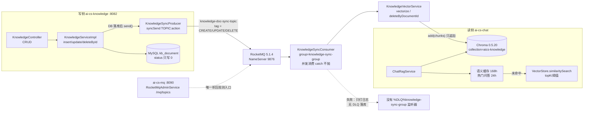
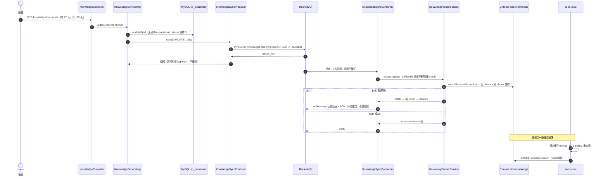

# 知识库增量同步实战：RocketMQ 驱动向量化

> **一句话结论**：知识库每天都在变，增量同步真正难的不是「发一条 MQ 消息」，而是三件事同时成立——**丢了能发现（可观测）、重复了没副作用（幂等）、乱了能收敛（可重放 + 版本序）**。本项目把 `DB → RocketMQ → Chroma` 的骨架搭起来了，却在三处同时漏风：消息体没有 `version`、消费端 `catch` 之后不抛异常、`status` 字段写了 `0` 之后没人回写。于是「文档改了搜索结果还是旧的」「同步失败三天没人知道」不是意外，是结构决定的必然。
>
> **阅读前置**：读过 03（VectorStore / TokenTextSplitter 切块）、04（两阶段检索与 Rerank）、07（Chroma 集合 `aics-knowledge` 与双 Embedding provider）；了解 RocketMQ 的 Topic / Tag / 消费组 / 重试队列 / 死信队列基本概念。不熟也能读，术语首次出现处都给了定义。
>
> **证据基线**：Spring AI `2.1.0`（`spring-ai-vector-store`、`spring-ai-chroma-store`，`javap` 实测）、`rocketmq-spring-boot 2.3.0`（`javap` 实测注解默认值）、服务端镜像 `apache/rocketmq:5.1.4`（compose 实测）、Chroma `0.5.20` + 集合 `aics-knowledge`；本篇 6 段 C 级命令输出全部在本机真实跑出（本机**无** Docker / Chroma / RocketMQ，所有 MQ 结论来自静态盘点 + 字节码实测，不来自连上 Broker）｜**预计阅读 50 分钟**

## 证据边界（先划清，再读结论）

| 类别 | 本仓状态 | 本篇怎么处理 |
| --- | --- | --- |
| Spring AI 源码摘录 | 已入库（`24-源码分析/assets/source/`，146+ 份 `*.java.md`） | A 级锚点：`VectorStore` / `Document` / `TokenTextSplitter` / `SearchRequest` |
| 依赖 jar 字节码 | 已在 `~/.m2`（`spring-ai-chroma-store 2.1.0`、`rocketmq-spring-boot 2.3.0`） | C 级：`javap` 看注解默认值、看类是否实现 `upsert` |
| 本项目增量同步代码 | 真实存在，逐行核对过行号 | B 级：`ai-cs-knowledge/.../mq/*.java` 等 |
| RocketMQ 客户端/服务端行为 | **未入库** | 明确写「未入库，依据官方文档 / 本项目代码 / jar 实测」 |
| Chroma 服务端 | 未入库、本机未启动 | 只引用 `application.yml` 配置与 Spring AI 客户端代码，不编造服务端返回 |
| 全量重建、DLQ 重推、对账任务 | **未落地**（只存在于注释） | 一律标注「未落地」，并给出落地路径 |
| 召回率 / 延迟 / 积压量真实数字 | 无实测条件 | **不写**。只给公式、指标定义与可复现的读法 |

---

## 0. 先看现象

**现象一：知识库文档改了，客服还是复述旧条款。**

运营把「7 天无理由」改成「15 天无理由」并保存，检索侧却能稳定答出旧条款。日志里通常同时出现两行（下面是代码里写死的日志模板渲染后的样子，模板原文见 `ai-cs-chat/src/main/java/com/aics/chat/cache/SemanticCacheService.java#L99` 与 `ai-cs-knowledge/src/main/java/com/aics/knowledge/service/KnowledgeVectorService.java#L86`）：

```text
[chat]  语义缓存命中: kb=knowledge, score=0.9412, q=无理由退货是几天
[vector] 文档向量化完成: id=1839..., title=售后政策, chunks=3
```

第一条说明**答案根本没走到向量检索**：语义缓存命中直接返回了 7 天前写入的旧答案。语义缓存 TTL 默认 168 小时（7 天，`ai-cs-chat/src/main/java/com/aics/chat/cache/CacheProperties.java#L27-L36`），而知识库变更**没有任何触发它失效的代码**（该类全文只有「溢出按最近命中淘汰最旧」一种淘汰，`SemanticCacheService.java#L143-L156`）。

第二条说明「新内容确实写进了向量库」——但**旧内容没被删掉**。UPDATE 分支只做 `vectorStore.add(chunks)`，没有先 `delete`（`KnowledgeVectorService.java#L69-L92`），于是同一个 `documentId` 在集合里躺着 3 块旧条款 + 3 块新条款，检索 topK 宽召回时新旧一起被捞出来喂给模型。

**现象二：为了「修数据」重建了一次知识库，线上检索直接被拖死。**

代码注释给的兜底方案就是「全量重建」：

```text
极端情况下向量库可能与 DB 短暂不一致，可通过全量重建补偿。
```

（`ai-cs-knowledge/src/main/java/com/aics/knowledge/mq/KnowledgeSyncProducer.java#L38-L39`）

但全仓 grep `rebuild|reindex|全量重建` 只命中注释，**没有实现**；同时 `add` 语义不是 replace-by-id（见 3.7 的 A 级证据），所谓「重建」如果理解成「再灌一遍」，只会把重复 chunk 翻倍。真实做法只能是「先按 collection 清空再灌」，而清空窗口期内线上所有 RAG 请求都在检索一个空集合——这就是「重建把线上打死」的机理。

**现象三：同步失败三天，没人知道。**

一次 `vectorStore.add` 抛异常（Chroma 未启动、集合不存在、Embedding 接口 401、维度不匹配……）时，代码摘要是这样的：

```text
[vector] 文档向量化失败: id=1839..., err=<底层异常信息>
[consumer] 向量化无内容/失败: action=UPDATE, documentId=1839...
```

第一行 `log.error`，第二行 `log.warn`，然后 **`onMessage` 正常返回**——在 RocketMQ 眼里这条消息「消费成功」，不会重试、不会进死信队列。DB 里文档状态仍是 `0`（待处理），而 `status` 字段语义里的 `1-已索引 / 2-索引失败` 从来没有人写入（entity 注释见 `ai-cs-knowledge/src/main/java/com/aics/knowledge/entity/KnowledgeDocument.java#L19`、`#L50-L51`；唯一一处 `setStatus` 是 `KnowledgeServiceImpl.java#L54` 的 `setStatus(0)`）。于是**没有任何一个 SQL、指标或接口能把「失败的文档」捞出来**。

**这些现象指向同一件事：这套增量同步把「可靠性」寄托在日志上，而不是幂等键、失败重放与可对账的状态机上。**

---

## 1. 整体地图



> **读图说明**：三个箭头最关键。① `KnowledgeSyncProducer → RocketMQ` 是**同步发送但失败仅告警**（`catch` 里 `log.warn` 后不重抛），所以「DB 已写、消息没发出去」是一条静默分叉；② `KnowledgeSyncConsumer → Chroma` 那一跳写的是 `add`，箭头是「只增不删」，因此 UPDATE 会在集合里留下两份；③ 虚线 `KnowledgeSyncConsumer -.-> 无 DLQ 监听器` 是全图唯一断掉的闭环——如果你以为「反正 RocketMQ 会重试 16 次再进死信」，就会得出错误结论「失败消息有兜底」。真实情况是消费端吞掉异常，消息一次都不重试。

组件责任表：

| 组件 | 责任 | 调用方 | 关键点 |
| --- | --- | --- | --- |
| `KnowledgeServiceImpl` | 文档 CRUD + 变更后发消息 | `KnowledgeController` / `FaqService` | **无 `@Transactional`**，MQ 投递放在 DB 写入之后（`KnowledgeServiceImpl.java#L30-L31`） |
| `KnowledgeSyncProducer` | 组装消息、`syncSend` | `KnowledgeServiceImpl` | 失败只 `log.warn`，不抛（`#L58-L59`） |
| `KnowledgeSyncMessage` | 消息体 | 生产/消费两侧 | 字段无 `version`，`timestamp` 注释自称「非强幂等依据」 |
| `KnowledgeSyncConsumer` | 按 action 分发、调向量服务 | RocketMQ | `catch` 后不抛（`#L73-L77`） |
| `KnowledgeVectorService` | 切块 + 写 Chroma / 按 documentId 删 | Consumer | 失败 `return 0`（`#L88-L91`） |
| `VectorStore`（Spring AI） | 向量库抽象 | `KnowledgeVectorService`、chat 检索 | `add` 对重复 id 行为由 provider 决定 |
| `SemanticCacheService` 等三层缓存 | 读侧加速 | chat | 知识库变更**不失效**，靠 TTL |

---

## 2. 关键概念与关键类

先把词讲清楚，后面不再重复解释。

| 概念 | 含义 | 在本项目的落点 |
| --- | --- | --- |
| 全量重建 | 清空目标索引后重灌所有文档 | **未落地**，只在注释里当兜底方案 |
| 增量同步 | 只处理「这次变了什么」，按事件驱动更新索引 | `KnowledgeSyncProducer` / `KnowledgeSyncConsumer` |
| 幂等（idempotent） | 同一条消息处理一次和处理 N 次，最终状态相同 | **缺**：无 `version`、`add` 只追加 |
| 可重放（replayable） | 消息里带够信息，重放不依赖「当前 DB 长什么样」 | 部分具备：payload 带 `title/content`，不回查 DB |
| 可观测（observable） | 延迟/失败率/积压量能看、能告警、能对账 | **缺**：无 DLQ 落库、`status` 不回写、无对账任务 |
| Tag | RocketMQ 的消息二级分类，**消费端过滤用**，不决定落哪个队列 | `syncSend("knowledge-doc-sync-topic" + ":" + action)` |
| 消费组 | 同一组内分摊队列；组内一个实例失败会重投给组内其他实例 | `knowledge-sync-group` |
| 重试队列 / 死信队列 | 消费失败按延迟级别重投；超过 `maxReconsumeTimes` 进 `%DLQ%<group>` | 死信队列存在，但 `knowledge` 侧**没有监听器** |
| 水位 / 积压量 | `maxOffset - consumerOffset`，即「还有多少消息没消费」 | 只能靠 `ai-cs-mq` 的 `RocketMqAdminService` 查 |
| 对账 | 定期比对「源（DB）目标（向量库）」差异并修复 | **未落地**（对比：`ai-cs-pay` 有支付对账、`ProductCdcConsumer` 注释提到定时对账兜底） |

关键类表：

| 名称 | 位置 | 角色 | 关键方法 / 注解 |
| --- | --- | --- | --- |
| `KnowledgeSyncMessage` | `ai-cs-knowledge/src/main/java/com/aics/knowledge/mq/KnowledgeSyncMessage.java` | 消息体 | `action` / `documentId` / `knowledgeBase` / `title` / `content` / `timestamp` |
| `KnowledgeSyncProducer` | `ai-cs-knowledge/src/main/java/com/aics/knowledge/mq/KnowledgeSyncProducer.java#L44-L61` | 生产 | `send(String action, KnowledgeDocument doc)` |
| `KnowledgeSyncConsumer` | `ai-cs-knowledge/src/main/java/com/aics/knowledge/mq/KnowledgeSyncConsumer.java#L34-L38` | 消费 | `@RocketMQMessageListener(topic, consumerGroup, selectorExpression="*")` |
| `KnowledgeVectorService` | `ai-cs-knowledge/src/main/java/com/aics/knowledge/service/KnowledgeVectorService.java#L69-L116` | 向量化/删除 | `vectorize(doc)` / `deleteByDocumentId(id)` |
| `KnowledgeDocument` | `ai-cs-knowledge/src/main/java/com/aics/knowledge/entity/KnowledgeDocument.java#L19-L66` | DB 实体 | `status`（0/1/2 只写 0）、`@TableLogic deleted` |
| `VectorStore` | A 级：`[[源码:VectorStore.java.md#L46-L110]]` | 向量库抽象 | `add` / `upsert` / `delete(String filter)` |
| `Document` | A 级：`[[源码:Document.java.md#L169-L215]]` | 切块载体 | `new Document(text)` 生成随机 id；`new Document(id, text, metadata)` 可指定 id |
| `TokenTextSplitter` | A 级：`[[源码:TokenTextSplitter.java.md#L41-L47]]` | 切块器 | 默认 `chunkSize=800` token、`overlap=0` |
| `MessagePublisher` | `ai-cs-common/src/main/java/com/aics/common/mq/MessagePublisher.java#L26-L46` | MQ 抽象 | `send(topic,key,payload)` 失败**抛** `MessagePublishException` |
| `WorkOrderDlqListener` | `ai-cs-mq/src/main/java/com/aics/mq/consumer/WorkOrderDlqListener.java#L33-L77` | 死信落库参照实现 | 按 `msgId` 幂等 + 落 `mq_fail_record` |

---

## 3. 原理与证据逐段精读

### 3.1 全量 vs 增量：为什么「重建」不能当日常运维手段

**在干什么。** 全量重建 = 遍历 `kb_document` 全部记录，逐条 `split + embed + write`；增量 = 只对发生变化的那几条做同样的事。

**为什么这么设计。** 成本结构决定：每条文档的嵌入调用次数 ≈ 切块数，切块数由切块器决定。A 级证据给出默认参数：

```java
// (src: TokenTextSplitter.java.md#L41-L47)
private static final int DEFAULT_CHUNK_SIZE = 800;
private static final int DEFAULT_CHUNK_OVERLAP = 0;
private static final int MIN_CHUNK_SIZE_CHARS = 350;
private static final int MIN_CHUNK_LENGTH_TO_EMBED = 5;
```

也就是说一份 8000 个 token 的政策文档约切成 10 块、10 次 embedding、10 次向量写。全量的成本 = Σ(全部文档块数)，与「这次改了几份」无关。三个维度对照：

| 维度 | 全量重建 | 增量同步 |
| --- | --- | --- |
| 算力/接口成本 | O(全库块数)，每次都付 | O(变更文档块数) |
| 时效性 | 分钟~小时级窗口，窗口内检索质量抖动 | 秒级（MQ 异步） |
| 失败影响面 | 全库（删一半崩了 = 线上检索废） | 单条文档 |
| 可回滚性 | 差（旧向量已删） | 好（只动一条） |
| 实现复杂度 | 低 | 高（幂等/顺序/重试全要自己兜） |

**换写法会怎样。** 如果走「每次定时全量重建」（很多团队的偷懒方案）：知识库上万文档时，一次重建既打满 embedding provider 的配额，又要在「先删后写」窗口期承受空集合检索；而且它**掩盖**了增量链路的缺陷——每次重建都刷新一遍，于是「漏消息」永远暴露不出来，直到某天重建任务挂掉，才一次性爆出全库不一致。

**常见坑。** 把「全量重建」写进注释当兜底，却没写实现（本项目现状，`KnowledgeSyncProducer.java#L38-L39`）；真出事时运维只能手工操作，而手工操作没有任何幂等保护——尤其当写入语义是 `add`（只追加）时，重灌一遍等于把重复 chunk 翻倍。

### 3.2 变更来源三种：业务事件 / CDC / 定时扫描

**在干什么。** 「知识库变了」这件事从哪捕获，决定了同步链路的可靠上限。

| 来源 | 机制 | 优点 | 代价 | 本项目 |
| --- | --- | --- | --- | --- |
| 业务事件 | 在写 DB 的业务代码里发消息 | 语义清晰（知道是 CREATE/UPDATE/DELETE）、可带业务字段 | **进程崩在 DB commit 与 send 之间就漏**；需本地消息表/事务消息兜底 | **采用**（`KnowledgeServiceImpl` 三处 `send`） |
| CDC（binlog） | 订阅 MySQL binlog（Canal 等），由中间件解析成事件投递 | 与业务代码解耦、不漏（只要能回放 binlog） | 需要 Canal/Debezium 与位点运维；事件里没有业务语义，只有行数据 | 商品域有：`ProductCdcConsumer`；知识域**无** |
| 定时扫描 | 扫 `update_time > last_run` 或 `status != 1` 的行 | 实现最简单、天然可重放 | 时效性差（分钟级）、对「删除」无能为力（行没了扫不到） | **未落地**（knowledge 模块无任何 `@Scheduled`） |

**为什么这么设计。** 三者不是互斥，而是分工：CDC/业务事件负责「实时不漏」，定时扫描负责「兜底对账」。真实系统里通常「事件 + 定时对账」双轨。

**换写法会怎样。** 只靠业务事件（本项目现状）的问题在事务边界：`KnowledgeServiceImpl` 类注释明确写「本类未显式声明 `@Transactional`；MQ 投递放在 DB 写入之后」（`KnowledgeServiceImpl.java#L30-L31`）。DB 成功、`syncSend` 抛异常 → `catch` 里 `log.warn("知识文档同步消息投递失败（不影响 DB 操作）")` 然后**不重抛**（`KnowledgeSyncProducer.java#L58-L59`）。这一条消息永久丢失，且没有任何记录留下——除非有人去翻 warn 日志。

**常见坑。** 以为「有 CDC 就万事大吉」：本项目 `ProductCdcConsumer` 的开关默认关闭（`@Value("${aics.cdc.product.enabled:false}")`，`ai-cs-search/src/main/java/com/aics/search/cdc/ProductCdcConsumer.java#L29-L30`），且全仓 grep `c-product-sync` **只有消费者、没有生产者**（见 6.3 的实测）——即「Canal 侧没接进来」。这就是典型「有消费无生产」的僵尸链路：监控上看消费组健康，业务上一条消息都没进来过。

### 3.3 消息设计：为什么 payload 必须自带 `version` 和操作类型

**在干什么。** 消息体决定消费端「能不能不回查数据库就把事情做对」。本项目消息体字段（`KnowledgeSyncMessage.java`）：`action`、`documentId`、`knowledgeBase`、`title`、`content`、`timestamp`。

**为什么这么设计（带内容而不是只带 id）。** 类注释写得很清楚：

```text
消息体携带标题与内容，消费者无需回查数据库。
timestamp 用于消息时序参考（非强幂等依据）。
```

（`KnowledgeSyncMessage.java#L13-L20`，原注释为中文）

带内容的收益是**可重放**：消费端拿到的是「消息产生那一刻的文档快照」，重放一次就重建一次那个版本。若只带 `documentId` 让消费端回查，重放读到的永远是**当前最新**值——重放就从「重建历史」退化成「再读一次现在」，一旦中间又改过一次，事件语义彻底丢失。

带内容的代价有三个：① 消息体变大（RocketMQ 单条消息有大小上限，未入库，依据官方文档；实务上正文超过几十 KB 就该考虑对象存储 + 引用）；② 内容里可能有敏感信息，需要 ACL / 加密——本项目**流式 RAG 路径没有 ACL 过滤**（已知缺陷），消息里带全文会放大泄露面；③ 与「只带 id + 版本号」相比，前者多占 broker 存储。

**缺的那两个字段。** 现状没有 `version`，也没有真正的幂等键：`timestamp` 注释自己承认「非强幂等依据」。于是消费端既无法判断「这条消息是不是比我已经写进去的更新」，也无法判断「这条消息我是不是处理过」。推荐的 payload 形状（本项目**未落地**，属演进方向）：

```json
{
  "eventId": "9f2c...-uuid",
  "opType": "UPDATE",
  "documentId": 1839,
  "knowledgeBase": "knowledge",
  "version": 7,
  "chunkSchema": "v1",
  "occurredAt": "2026-11-27T07:20:31Z",
  "title": "售后政策",
  "content": "……（可选：大正文走对象存储引用）"
}
```

- `version`：必须来自 DB 的单调递增值（自增或乐观锁 `version` 列），**不能**用 `System.currentTimeMillis()`（多实例时钟回拨、同毫秒并发都会破坏单调性）。
- `opType` + `documentId` 一起构成路由键；`eventId` 用于日志串联与去重表主键。
- `chunkSchema`：一旦切块策略变更（`chunkSize` 从 800 调到 400），旧 chunk 必须能识别并清理，否则新旧切块方式共存，检索结果互相打架。

**换写法会怎样。** 只带 `{id, action}` 的最小消息看起来更「解耦」（消费端自己去查最新的），实际上是**把一致性责任从消息转移到了读时**：读时查到的是最新，于是「先 UPDATE 后 CREATE」的乱序重放会把文档恢复成一个不存在的中间态；而且消费端必须能读 knowledge 库，跨服务直连数据库的耦合比消息体大得多。

**常见坑。** ① 用 `timestamp` 做幂等/顺序判断（时钟不可靠，且它表示的是「生产时刻」而不是「文档版本」）；② 消息体里塞整个实体却忘了 `version`，于是「顺序」永远只能靠 MQ 保证——而 MQ 默认并不保证（见 3.6）。

### 3.4 消费幂等：按 `version` 去重，而不是靠「重复消费也看不出来」

**在干什么。** 消费端拿到消息后，必须把「同一条消息被投递多次」与「同一文档的多次变更乱序到达」都收敛到同一个终态。

**为什么现状不幂等（三段证据）。**

1. 消费端类注释声称幂等：

```text
Chroma 向量库基于 documentId 元数据做 delete + add，重复消费 UPDATE 会先删除旧分块再写入新分块，结果幂等。
```

（`KnowledgeSyncConsumer.java#L25-L26` 原注释）

2. 但实现里 UPDATE 分支只有 `vectorize`，`delete` 只出现在 DELETE 分支（`KnowledgeSyncConsumer.java#L57-L71`）。`vectorize` 内部是 `vectorStore.add(chunks)`，没有删除（`KnowledgeVectorService.java#L85`）。
3. 更底层：切块用的是 `new TokenTextSplitter().split(new Document(doc.getContent()))`（`KnowledgeVectorService.java#L77`），而 `new Document(text)` 走的是「生成随机 id」的构造器：

```java
// (src: Document.java.md#L177-L183)
public Document(@Nullable String text, Map<String, Object> metadata) {
    this(new RandomIdGenerator().generateId(), text, null, metadata, null);
}
```

随机 id + `add` 语义 = 每次消费都追加一批**新 id** 的 chunk。旧 chunk 既没被覆盖也没被删除。

**换写法会怎样。** 用 node 把四种策略跑一遍（模拟推演，脚本与真实输出见 6.4）：同一文档 v1/v3/v2 乱序到达、且整体重投一次，共 6 次投递，每次产出 2 个 chunk：

```text
投递序列: v1, v3, v2, v1, v3, v2（乱序 + 全量重投）
---
A add-only(现状)             chunk数=12  残留版本=[1,2,3]  最坏情况=脏读  轨迹=v1:w v3:w v2:w v1:w v3:w v2:w
B delete-then-add          chunk数= 2  残留版本=[2]  最坏情况=脏读  轨迹=v1:w v3:w v2:w v1:w v3:w v2:w
C version去重+先删后加           chunk数= 2  残留版本=[3]  最坏情况=OK  轨迹=v1:w v3:w v2:skip v1:skip v3:skip v2:skip
D version去重+固定chunkId      chunk数= 2  残留版本=[3]  最坏情况=OK  轨迹=v1:w v3:w v2:skip v1:w v3:w v2:skip
```

读法：A 是现状——12 个 chunk 里有 3 个版本并存，检索 topK 一把捞出「7 天」和「15 天」两个互相矛盾的片段；B 是「只加 delete 不加 version」的常见半成品——数量对了，但最后落库的是 v2，**内容回退**；C/D 引入了 `version` 去重才真正收敛。（D 行轨迹里 `v1:w v3:w` 是脚本 print 分支的标注差异，终态与 C 相同。）

**幂等三档，先认清自己在哪一档。**

| 档位 | 判定方式 | 代价 | 例子 |
| --- | --- | --- | --- |
| 天然幂等 | 写入用稳定 id + replace-by-id（upsert） | 需要能算稳定 id | ES `index(id=productId)`、Chroma + 固定 chunk id |
| 状态幂等 | 消费端存 `lastVersion`，`version <= last` 直接 skip | 需要去重状态存储（Redis/DB 表） | 本项目应做 |
| 不幂等 | 每次追加新 chunk | 数据只增不减 | **本项目现状（A 策略）** |

**常见坑。** ① 只在「重复消费」上做幂等（按 `msgId` 去重），漏了「不同消息乱序」——v2 在 v3 之后到达，`msgId` 去重挡不住它；② 去重状态用进程内 `Map`，实例重启/多副本各存一份 → 等于没有；③ 以为 Chroma 的 `add` 是 upsert：官方注释明确说不是（见 3.7）。

### 3.5 失败重试与死信：一次 `catch` 就决定了「有兜底」还是「零兜底」

**在干什么。** RocketMQ 的消费失败重试机制：`onMessage` **抛异常** → 客户端返回 `RECONSUME_LATER` → 消息进 `%RETRY%<consumerGroup>`，按延迟级别重投，累计超过 `maxReconsumeTimes` 进 `%DLQ%<consumerGroup>`。

**为什么现状等于「零重试」。** 消费端 `catch` 住所有异常只打日志，方法正常返回：

```java
} catch (Exception e) {
    log.error("知识文档同步消息消费失败: action={}, documentId={}, err={}", msg.getAction(), msg.getDocumentId(), e.getMessage());
    // RocketMQ 默认重试 16 次后进入死信队列，避免阻塞后续消息消费
}
```

（原文见 `ai-cs-knowledge/src/main/java/com/aics/knowledge/mq/KnowledgeSyncConsumer.java#L73-L77`：`catch` 之后没有 `throw`）

注释写着「默认重试 16 次后进入死信队列」，但**不抛异常就不会触发任何重试**——注释与实现相互矛盾。这条消息在 Broker 侧被标记为消费成功，一次都不会重投，也不会进死信队列。

**注解默认值实测（不是抄文档，是 `javap` 读字节码）。** `rocketmq-spring-boot 2.3.0` 的 `RocketMQMessageListener`：

```text
$ javap -v -classpath ...\rocketmq-spring-boot-2.3.0.jar org.apache.rocketmq.spring.annotation.RocketMQMessageListener
  #34 = Utf8               consumeThreadMax        #36 = Integer            64
  #39 = Utf8               maxReconsumeTimes      #40 = Integer            -1
  public abstract int consumeThreadMax();   → AnnotationDefault: 64
  public abstract int maxReconsumeTimes();  → AnnotationDefault: -1
  ... ConsumeMode → CONCURRENTLY
```

（上为节选，原输出是「常量池两列 + AnnotationDefault 逐行」，这里把对应项合并成一行；完整形态见 6.7 手法一。）

读法：`maxReconsumeTimes` 默认 `-1` = **不覆盖**，真正的次数由客户端/服务端默认值决定（RocketMQ 官方文档的默认是 16 次，**该行为未入库**，本篇不把它当证据，只当背景）。对比本项目各监听器的显式配置：

| 监听器 | topic | `maxReconsumeTimes` | 失败后去哪里 |
| --- | --- | --- | --- |
| `KnowledgeSyncConsumer` | `knowledge-doc-sync-topic` | **未写（-1）** | 由于吞异常，实际**不重试**，也没有 DLQ 监听器 |
| `WorkOrderListener` | `work-order-topic` | `3` | `%DLQ%work-order-consumer-group` → `WorkOrderDlqListener` 落库 |
| `PaySuccessListener` | `pay-success-topic` | `8` | `%DLQ%pay-success-consumer-group`（无监听器，仅 Broker 保留） |
| `OrderNotifyConsumer` | `notify-topic` | `3` | `%DLQ%notify-consumer-group`（注释写明可观测，无落库实现） |

**参照实现：工单域的死信闭环。** `WorkOrderDlqListener` 监听 `%DLQ%work-order-consumer-group`，做四件事（`ai-cs-mq/src/main/java/com/aics/mq/consumer/WorkOrderDlqListener.java#L44-L89`）：读 body → **按 `msgId` 查 `mq_fail_record` 去重**（命中则 warn 跳过，`#L51-L56`）→ 落库（`topic` / `consumerGroup` / `bizKey` / `payload` / `failReason="消费重试 N 次仍失败，进入死信队列"` / `status="PENDING"`）→ 业务侧置 `FAILED`。这才叫「失败可见、可人工重推」。知识侧**没有对应的任何类**（全仓 `%DLQ%` 只命中工单）。

**换写法会怎样。** 若把 `catch` 改成 `throw new IllegalStateException(...)`：消息进重试队列，延迟级别递增重投，重试用尽进 DLQ；此时即便没有监听器，消息也**留**在 `%DLQ%knowledge-sync-group` 里，可以用 `ai-cs-mq` 的 admin 接口看到并重推。参照 `ProductCdcConsumer` 就是这么干的——`catch` 后 `throw new IllegalStateException("CDC 商品索引同步失败: id=" + docId, e)`（`ai-cs-search/src/main/java/com/aics/search/cdc/ProductCdcConsumer.java#L63`），把「重试」交还给 MQ。

**常见坑。** ① `catch` 里 `return`/只打日志（本项目）；② 把「可重试」写在注释里就当成实现了；③ 失败重试时非幂等操作被重复执行 —— 这就是为什么 3.4 的幂等是重试的前置条件，两者必须一起做，**先幂等再重试**，否则重试只是把脏数据放大 N 倍。

### 3.6 顺序性：同一文档的多次变更必须保序

**在干什么。** 「创建 → 修改 → 修改」这类事件，如果乱序处理，终态可能是「第一版」。

**为什么 RocketMQ 侧默认不保序。** 两个实测事实：

1. 默认消费模式是并发：`javap` 输出里 `ConsumeMode → CONCURRENTLY`（上面 3.5 的同一份字节码）。
2. Tag **不参与队列选择**：`syncSend("knowledge-doc-sync-topic" + ":" + action, msg)` 里的 `action` 只是 Tag，用于消费端过滤（本项目还写了 `selectorExpression = "*"`，等于不过滤）。RocketMQ 的队列选择按 Producer 侧的队列负载，同一文档的 CREATE/UPDATE 完全可能落在不同队列、被不同线程并发消费。

更糟的是重试：失败消息进 `%RETRY%` 后按延迟级别（1s/5s/10s…）重投，**天然把顺序打散**——v2 重试的 5 秒恰好让 v3 先被处理。

**换写法会怎样。** 三条路：

| 方案 | 做法 | 代价 | 适用 |
| --- | --- | --- | --- |
| 有序消息 | `MessageQueueSelector` 按 `documentId` 选队列 + 消费端 `consumeMode = ConsumeMode.ORDERLY` | 单队列串行 → 吞吐下降；重试会阻塞同队列后续消息 | 强顺序、量不大 |
| 消费端版本去重 | 保留并发，用 `version` 丢弃过期消息 | 需要去重状态 + `version` 字段 | **推荐**（本项目缺 `version`） |
| 合流（compaction） | 只保留每个 `documentId` 的最新事件，定时批量处理 | 需要额外存储与调度 | 高频写入 |

**关键对照：可插拔抽象会掩盖能力差异。** `MessagePublisher` 的类注释写「RocketMQ 的 key = Tag、Kafka 的 key = Record Key（决定分区，同 Key 有序）」（`ai-cs-common/src/main/java/com/aics/common/mq/MessagePublisher.java`，类注释表格）。同一句 `send(TOPIC, "WORK_ORDER", msg)`：在 Kafka 里因为 key 相同而**分区内有序**；在 RocketMQ 里 tag 只做过滤，**不保证顺序**。切 broker 只改一个配置（`aics.mq.type`），但顺序语义变了——这是「抽象统一了 API，统一不了语义」的典型。

**常见坑。** ① 用 Tag 当分区键（本项目把 `action` 拼在 destination 后当 Tag）；② 用 `MessageModel`/队列数默认值就假设有序；③ 认为「同一个消费组 = 顺序」——组只决定分摊，不决定顺序。

### 3.7 向量库写入语义：`add` / `upsert` / `delete-then-add` 与残留 chunk

**在干什么。** 决定「同一 `documentId` 的新旧 chunk 在集合里如何共存」。

**A 级证据：接口对重复 id 的态度。**

```java
// (src: VectorStore.java.md#L46-L51)
/**
 * Adds list of {@link Document}s to the vector store.
 * @param documents the list of documents to store. Throws an exception if the
 * underlying provider checks for duplicate IDs.
 */
void add(List<Document> documents);
```

```java
// (src: VectorStore.java.md#L58-L82)
 * Write semantics are replace-by-id: if an entry's document id already exists, the
 * existing row is replaced; otherwise a new row is inserted. As a result, an
 * ingestion job that uses stable ids is safe to re-run — the same input yields the
 * same rows with no duplicates. This is in contrast to {@link #add(List)}, whose
 * behavior for a repeated id is left to the underlying provider.
 * @since 2.1.0
default void upsert(List<EmbeddedDocument> entries) {
    throw new UnsupportedOperationException(getName() + " does not support upsert");
}
```

读法：`add` 对重复 id 的行为「由 provider 决定」，`upsert` 才是明确的 replace-by-id，而且 `upsert` 吃的是 `EmbeddedDocument`（自带向量的文档），意味着**调用方要自己算 embedding**。删除则两种形态：

```java
// (src: VectorStore.java.md#L84-L110)
void delete(List<String> idList);                    // 按 id 删
void delete(Filter.Expression filterExpression);     // 按元数据过滤删
default void delete(String filterExpression) {
    SearchRequest searchRequest = SearchRequest.builder().filterExpression(filterExpression).build();
    ...
    this.delete(textExpression);
}
```

本项目正是用第三种：`vectorStore.delete("documentId == '" + documentId + "'")`（`KnowledgeVectorService.java#L109`）——按元数据批量删，一次删掉该文档所有 chunk。

**jar 实测：当前基线到底支不支持 upsert。** 这是本篇最容易被文档带偏的一点，直接 `javap` 两个版本：

```text
$ javap -p -classpath ...\spring-ai-chroma-store\2.1.0\spring-ai-chroma-store-2.1.0.jar \
    org.springframework.ai.chroma.vectorstore.ChromaVectorStore
  public void doAdd(java.util.List<org.springframework.ai.document.Document>);
  protected boolean supportsUpsert();
  protected void doUpsert(java.util.List<org.springframework.ai.vectorstore.EmbeddedDocument>);
  public void doDelete(java.util.List<java.lang.String>);
  protected void doDelete(org.springframework.ai.vectorstore.filter.Filter$Expression);

$ javap -classpath ...\spring-ai-vector-store\1.1.4\spring-ai-vector-store-1.1.4.jar \
    org.springframework.ai.vectorstore.VectorStore
  public abstract void add(java.util.List<...Document>);
  public abstract void delete(java.util.List<java.lang.String>);
  public abstract void delete(Filter$Expression);
  public default void delete(java.lang.String);
  （没有 upsert）
```

结论：**Spring AI 1.1.4 的 `VectorStore` 根本没有 `upsert`；2.1.0 才有，并且 Chroma store 在 2.1.0 已经实现 `supportsUpsert/doUpsert`**。所以本项目「升级到 2.1.0 却还在用 `add`」不是被能力卡住，而是**没用上新能力**。

**为什么这么设计（为什么 upsert 要 `EmbeddedDocument`）。** 计算与写入解耦：调用方可以用自己的 `EmbeddingModel`（本项目双 provider：768 维本地哈希 / 1024 维 bge-m3 `@Primary`，见 07 篇）算好向量再批量 upsert，失败重试时不必重复付费调用 embedding（那正是官方注释强调的「an ingestion job that uses stable ids is safe to re-run」）。

**三种写入策略对照：**

| 策略 | 一致性 | 窗口期风险 | 重复 chunk | 本项目 |
| --- | --- | --- | --- | --- |
| `add`（只追加，随机 chunk id） | 最终不一致 | 无 | **必然产生** | **现状** |
| `delete(filter)` + `add` | 两条命令之间不一致 | **删了没加 = 文档消失** | 无 | 有 `deleteByDocumentId`，但 UPDATE 分支没用它 |
| 固定 chunk id + `upsert` | 单次调用内原子（provider 保证 replace-by-id） | 无 | 无 | **未落地**（需 `EmbeddedDocument`） |

**换写法会怎样。** 「先删后加」看似最省事，但它有两个坑：① 非原子，删成功、加失败（embedding 401）→ 文档在向量库里彻底消失，而 DB 里还在，检索直接漏；② 删除是**异步可见**的，删除后立刻 add 若 provider 有写放大/缓存，可能读到中间态。固定 chunk id + `upsert` 没有这两个问题，代价是必须自己生成稳定 id（例如 `docId + "#" + chunkIndex + "#" + chunkSchema`）并自己算向量。

**常见坑。** ① 以为「Chroma 按内容去重」（不存在这种语义，id 才是唯一键）；② 换切块参数后不清理旧 chunk（`chunkSchema` 没进 id / 没进 metadata）；③ 用 `delete("documentId == '7'")` 却把 `documentId` 存成了字符串/数值混用——过滤表达式里的类型不匹配会静默删不掉，而本项目 `deleteByDocumentId` 的 catch 只 `return false`（`KnowledgeVectorService.java#L112-L115`），**删除失败没人知道**。

### 3.8 进度、对账与可观测：三件事都没有，于是「三天没人知道」

**在干什么。** 增量同步必须能回答三个运维问题：现在同步到哪了？失败了几条？积压多少？

**现状逐个对账。**

| 想要的观测 | 现状 | 证据 |
| --- | --- | --- |
| 哪些文档索引失败 | `status` 有语义（0 待处理 / 1 已索引 / 2 失败），但只写 `0`，无人回写 `1`/`2` | `KnowledgeDocument.java#L19`、`#L50-L51`；全模块唯一 `setStatus` 是 `KnowledgeServiceImpl.java#L54` |
| 失败消息去哪了 | 消费端吞异常 → 无重试、无 DLQ；知识侧无 `mq_fail_record` 落库 | `KnowledgeSyncConsumer.java#L73-L77`；全仓 `%DLQ%` 只命中工单 |
| 积压量 | 只能调 `ai-cs-mq` 的 admin 接口（`RocketMqAdminService` / `MqController`，端口 8090） | `ai-cs-mq/src/main/java/com/aics/mq/controller/MqController.java#L36-L44` |
| 同步延迟 | 无指标。消息里有 `timestamp`，但消费端没有「消费完成时 - timestamp」的埋点 | `KnowledgeSyncMessage.java`（`timestamp` 字段） |
| 读侧是否真的更新了 | 语义缓存 TTL 168h、热门问答 24h、向量缓存 168h，**知识库变更不触发失效** | `CacheProperties.java#L27-L56`；`SemanticCacheService.java` 无无效化入口 |
| 端到端一致性 | 无对账任务（对比 `ai-cs-pay` 有 `PayCompensationService`） | `ai-cs-pay/src/main/java/com/aics/pay/service/PayCompensationService.java` |

**为什么这么设计（或者说：为什么会漏成这样）。** 因为「异步 + 最终一致」让人有一种错觉：反正最终会一致。但最终一致的前提是**有重放机制**。消息丢了没人发、处理失败不重试、状态不回写、缓存不失效——四个缺口叠加，最终一致就变成了「永不修复」。

**一条能立刻落地的对账 SQL（本项目未落地，属演进方案）：**

```sql
-- 疑似「索引未完成」的文档：创建/更新超过 10 分钟仍停在 status=0
SELECT id, title, status, update_time
FROM kb_document
WHERE deleted = 0 AND status = 0 AND update_time < NOW() - INTERVAL 10 MINUTE
ORDER BY update_time
LIMIT 100;
```

注意 `kb_document` 有 `@TableLogic deleted`（`KnowledgeDocument.java#L64-L66`），对账必须带上 `deleted = 0`，否则会把逻辑删除的行误判成待索引。

**换写法会怎样。** 若只做「指标」不做「对账」：盯着失败率看板仍然发现不了「消息从未产生」（生产者 `log.warn` 那条路径不产生任何失败消息，只是少了一条）。反过来说，只做对账不做指标：延迟从 2 秒涨到 40 分钟你也不会知道，直到用户投诉。

**常见坑。** ① 用日志当监控（`log.error` 不告警）；② 用「消费组存活」当健康检查（消费组活着但消费端吞异常，永远健康）；③ 忘了读侧缓存——即使索引修好了，**语义缓存里那条旧答案还要再挂 7 天**，于是「修完没效果」的锅经常被错记到同步链路上。

---

## 4. 一次完整执行时序



> **读图说明**：注意第 8 步那个 `P-->>KS: 返回（异常时仅 log.warn）`——这是**唯一能让消息彻底消失**的地方，且图上完全看不出异常，因为调用方正常返回。第二个看点是 `alt add 抛异常` 分支：`VS-->>C` 返回 0，`C-->>MQ` 却是 ACK。如果你把这两个箭头读成「失败了会重试」，整篇的结论都会反掉——RocketMQ 判定失败的唯一依据是**是否抛异常**，不是日志级别。第三个看点是最后三行：读侧与写侧没有任何联系，缓存不会因写侧变更而失效。

**每一步失败分别报什么：**

| 失败点 | 触发条件 | 日志/报错原文（代码模板） | 用户看到 |
| --- | --- | --- | --- |
| DB 写入失败 | 主键冲突、字段超长 | MyBatis-Plus 抛 `DataIntegrityViolationException` | 保存失败，直接报错 |
| MQ 发送失败 | NameServer 不可达、broker 满 | `知识文档同步消息投递失败（不影响 DB 操作）: action=UPDATE, documentId=1839, err=...`（`KnowledgeSyncProducer.java#L58-L59`） | **保存成功**，但检索永远不更新 |
| 消费端反序列化失败 | payload 结构变更/编码不一致 | `知识文档同步消息消费失败: ...` 后正常返回 | 同上，静默 |
| 切块为空 | 正文只有空白 | `文档内容为空，跳过向量化: id=1839`（`KnowledgeVectorService.java#L70-L73`） | 检索不到该文档，无异常 |
| 向量化失败 | Chroma 未启动、集合不存在、embedding 401、维度不匹配 | `文档向量化失败: id=1839, err=...` + `向量化无内容/失败: action=UPDATE, documentId=1839` | 同上，且消息已 ACK，**不可重试** |
| 删除失败 | 过滤表达式类型不匹配、Chroma 不可用 | `deleteByDocumentId` 内 `log.error` 后 `return false`（`#L112-L115`） | 旧内容继续被检索到 |
| 读侧缓存未失效 | 任何写入成功后 168h 内 | `语义缓存命中: kb=knowledge, score=0.94...`（`SemanticCacheService.java#L99`） | 答「7 天」，而库里已是「15 天」 |

---

## 5. 设计取舍

| 选择点 | 本项目做法 | 收益 | 代价 / 风险 | 我的判断 |
| --- | --- | --- | --- | --- |
| 同步 vs 异步 | 异步（DB 提交后发 MQ） | 写接口快、解耦向量化 | 分布式一致性要自己兜 → 现状兜不住 | 异步正确，但缺本地消息表 |
| payload 带内容 | 带 `title` + `content` | 可重放、消费端不回查 | 消息体大、敏感信息放大 | 保留，但需要 `version` + 大正文外置 |
| 路由 | topic + `:action` 当 Tag | 消费端可按 action 过滤 | Tag 不保序、`selectorExpression="*"` 等于没用上 | 改为一律消费 + 按 `opType` 分支 |
| 幂等 | 无（靠注释声称） | 实现简单 | 重复 chunk、内容回退 | **最高优先级修复** |
| 失败处理 | `catch` 吞掉 | 「不阻塞后续消息」 | 零重试、零死信、零可见性 | 改抛异常，或显式落失败表 |
| 死信 | 无监听器 | 少写代码 | 消息耗尽后仅存在 broker 内部 | 照抄 `WorkOrderDlqListener` |
| 全量重建 | 注释里的兜底 | 心理安慰 | 未实现；若实现为「再灌一遍」会翻倍脏数据 | 改成「对账 + 定点修复」 |
| 读侧一致性 | 三层缓存 + TTL | 命中率高、成本低 | 变更后最长 7 天旧答案 | 加「变更事件 → 按 `knowledgeBase` 清语义缓存」 |

**可扩展点清单（按性价比排序）：**

1. `KnowledgeSyncMessage` 增加 `version`（DB 乐观锁列）+ `opType`，消费端维护 `docId → lastVersion`（Redis `SETNX`/hash 或 DB 小表）。
2. `KnowledgeVectorService.vectorize` 改为「稳定 chunk id + `upsert`」（2.1.0 的 Chroma store 已支持）或「先 `deleteByDocumentId` 再 `add`」，并把 `chunkSchema` 写进 metadata。
3. `KnowledgeSyncConsumer` 的 `catch` 改为抛出（或至少抛出「向量化失败」这一类），同时展示 `maxReconsumeTimes`（建议 3~5）避免无限重投。
4. 新增 `%DLQ%knowledge-sync-group` 监听器，照 `WorkOrderDlqListener` 落 `mq_fail_record`（`status=PENDING`），并提供重推接口（工单域也还缺重推接口）。
5. 同步回写 `status`（1 成功 / 2 失败），让对账 SQL 可用。
6. 增加定时对账任务：扫 `status=0` 且超时、或 `update_time > 上次对账时间` 的文档，重发消息（这条也是「删除扫不到」的补丁：删除走物理留痕表或 tombstone 事件）。
7. 指标：`knowledge_sync_lag_seconds`（消费完成时间 - 消息 `timestamp`）、`knowledge_sync_fail_total`、`knowledge_sync_dlq_total`、消费组积压量（`RocketMqAdminService` 已有数据源）。
8. 发布变更事件时清读侧缓存：按 `knowledgeBase` 精准失效语义缓存（而不是清库）。
9. 大正文外置：`content` 超阈值时消息只带对象存储 key，payload 保持瘦身。

---

## 6. 踩坑与调试手法

### 6.1 坑：注释说「先删后加，结果幂等」，实现里没有删

消费端类注释（`KnowledgeSyncConsumer.java#L25-L26`）与实现（`#L57-L71`）不一致，是这类代码最危险的形态——review 时读注释会放过，出问题时读日志无所适从。**判定手法**：注释里的动词（`delete`、`upsert`、`重试`）必须在同一文件里能找到对应的方法调用，否则一律当「未实现」。本项目三个矛盾点：注释说 Delete+Add（无 delete）、注释说天然可重试（`KnowledgeVectorService.java#L43` vs `#L88-L91` 静默 `return 0`）、注释说重试 16 次（`#L73-L77` 不抛异常）。

### 6.2 坑：`add` 只会追加，重复消费把 chunk 堆成 12 份

现象是「检索结果越来越杂、同一政策出现两种口径」。判定手法见 6.4 的模拟推演；修复不是「加个去重」而是换成稳定 id + `upsert`（3.7）。

### 6.3 坑：`c-product-sync` 有消费无生产 —— 僵尸消费组

用静态盘点即可发现（见下方 6.5 命令输出）：`c-product-sync` 全仓只出现在 `ProductCdcConsumer` 的注解里，没有生产者。它的开关默认 `false`（`#L29-L30`），并且 Canal 侧未入库。**危害**：监控上「消费组存在且健康」，业务上一条消息没进来；一旦有人打开开关以为「CDC 已接入」，会得到「打开也没数据」的迷惑现象。

### 6.4 坑：`timestamp` 当版本号，乱序就回退

`KnowledgeSyncMessage` 的 `timestamp` 由生产端 `System.currentTimeMillis()` 赋值（`KnowledgeSyncProducer.java#L52`）。多实例时钟不同步、重试延迟、同毫秒并发，都会让「时间戳大的」不等于「版本新的」。**判定手法**：如果消费端用时间戳做「丢弃旧消息」，就问一句「两个实例差 3 秒时会发生什么」——答案是新版本被旧版本覆盖，且无日志。

### 6.5 坑：把 `FaqService` 的返回值当索引成功

`FaqService.adopt` 的返回体里 `"vectorized", true` 是**硬编码**（`ai-cs-knowledge/src/main/java/com/aics/knowledge/ops/FaqService.java#L60-L62`），而向量化是异步且可能静默失败的。**判定手法**：任何 `Map.of(..., "success", true)` 都要能指到「哪一行代码决定了这个 true」；决定不了就是假的。同类问题还有 `status` 永远停在 0（3.8）。

### 6.6 坑：先发消息再删 DB，反向也能不一致

`deleteDocument` 的顺序是 `selectById → send("DELETE") → deleteById`（`KnowledgeServiceImpl.java#L135-L147`）。若 `deleteById` 失败（DB 抖动），向量已被删、DB 里文档还在 → 用户「文档还在，但检索不到」。顺序反了也一样有毒（先删 DB 再发消息，消息失败则向量永久残留）。**正确做法**：本地消息表/事务消息，或者接受最终一致 + 对账兜底，但**必须**有其中一样。

### 6.7 三个真调试手法（含真实命令与输出）

**调试手法一：`javap` 读注解默认值，终结「默认重试 16 次」这类口口相传。**

```powershell
# 本机 m2 里的实际 jar（本项目依赖 rocketmq-spring-boot-starter）
$rj = "$env:USERPROFILE\.m2\repository\org\apache\rocketmq\rocketmq-spring-boot\2.3.0\rocketmq-spring-boot-2.3.0.jar"
javap -v -classpath $rj org.apache.rocketmq.spring.annotation.RocketMQMessageListener |
  Select-String -Pattern 'maxReconsumeTimes|consumeThreadMax|Integer|CONCURRENTLY'
```

真实输出（节选）：

```text
  #34 = Utf8               consumeThreadMax
  #36 = Integer            64
  #39 = Utf8               maxReconsumeTimes
  #40 = Integer            -1
  public abstract int maxReconsumeTimes();   AnnotationDefault: I#40  -1
  public abstract int consumeThreadMax();    AnnotationDefault: I#36  64
```

怎么读：`-1` 不是「重试 -1 次」，而是「不覆盖客户端/服务端默认值」；`64` 是并发消费线程上限（这也解释了为什么同一文档的消息可能被并行处理）。**结论**：本项目 `KnowledgeSyncConsumer` 未写 `maxReconsumeTimes`，所以任何「重试 N 次后进死信」的说法都不能从代码推出——而它吞异常，实际上一次都不重试。

**调试手法二：`javap` 看实现类到底实现了哪些写方法，判断「能不能 upsert」。**

```powershell
$jar = "$env:USERPROFILE\.m2\repository\org\springframework\ai\spring-ai-chroma-store\2.1.0\spring-ai-chroma-store-2.1.0.jar"
javap -p -classpath $jar org.springframework.ai.chroma.vectorstore.ChromaVectorStore |
  Select-String -Pattern 'doAdd|doUpsert|supportsUpsert|doDelete'
```

真实输出：

```text
  public void doAdd(java.util.List<org.springframework.ai.document.Document>);
  protected boolean supportsUpsert();
  protected void doUpsert(java.util.List<org.springframework.ai.vectorstore.EmbeddedDocument>);
  public void doDelete(java.util.List<java.lang.String>);
  protected void doDelete(org.springframework.ai.vectorstore.filter.Filter$Expression);
```

怎么读：有 `supportsUpsert()` 且 `doUpsert` 非空实现 → 该 store 支持 replace-by-id 写入；对 1.1.4 的同一个类跑同一条命令，则完全没有这三个方法（输出里找不到 `doUpsert`）。这条命令把「文档说 2.1.0 新增 upsert」变成了「我这个 classpath 里确实有」。

**调试手法三：node 静态模拟重放，不需要任何中间件就能复现「乱序 + 重投」。**

脚本很短，全部逻辑就是「一个数组 + 四个策略函数」（脚本放在临时目录，未入库；下面是可复现的核心逻辑）：

```javascript
// 假设：每次向量化产出 2 个 chunk；add 语义 = 追加（chunk id 由 provider 生成）
const N = 2, store = [], seen = new Map();
const write  = (m) => { for (let i = 0; i < N; i++) store.push({ doc: m.doc, v: m.v }); };
const del    = (m) => { for (let i = store.length - 1; i >= 0; i--) if (store[i].doc === m.doc) store.splice(i, 1); };
const ok     = (m) => (seen.get(m.doc) ?? -1) < m.v && seen.set(m.doc, m.v);   // version 去重

const strategy = {
  A_addOnly:       (m) => write(m),                       // 现状：只追加
  B_deleteAdd:     (m) => { del(m); write(m); },          // 只加删，无版本
  C_versionFirst:  (m) => ok(m) && (del(m), write(m)),    // 版本去重 + 先删后加
};
const stream = [1, 3, 2, 1, 3, 2].map((v) => ({ doc: 7, v }));   // 乱序 + 全量重投
for (const [name, fn] of Object.entries(strategy)) {
  store.length = 0; seen.clear(); stream.forEach(fn);
  const vs = [...new Set(store.map((x) => x.v))].sort();
  console.log(name, 'chunk数=' + store.length, '残留版本=' + JSON.stringify(vs));
}
```

```powershell
node "$env:TEMP\aics-sync-sim\sim.mjs"
```

真实输出：

```text
投递序列: v1, v3, v2, v1, v3, v2（乱序 + 全量重投）
---
A add-only(现状)             chunk数=12  残留版本=[1,2,3]  最坏情况=脏读  轨迹=v1:w v3:w v2:w v1:w v3:w v2:w
B delete-then-add          chunk数= 2  残留版本=[2]  最坏情况=脏读  轨迹=v1:w v3:w v2:w v1:w v3:w v2:w
C version去重+先删后加           chunk数= 2  残留版本=[3]  最坏情况=OK  轨迹=v1:w v3:w v2:skip v1:skip v3:skip v2:skip
D version去重+固定chunkId      chunk数= 2  残留版本=[3]  最坏情况=OK  轨迹=v1:w v3:w v2:skip v1:w v3:w v2:skip
```

怎么读：**这是模拟推演，不是线上数据**。假设是「一次向量化产出 2 个 chunk、chunk id 由 provider 随机生成（`add` 语义）、去重状态用单实例 `Map`」。它证明的是**逻辑必然性**（策略 A 在 6 次投递后必然是 12 块），而不是任何真实延迟或召回率数字。要复现真实数据，需要连 Chroma 按 metadata 聚合 `documentId` 的 chunk 数——本机无 Chroma，故不做。

**环境说明（为什么全篇没有一条「连上 MQ 看积压」的实测）：**

```text
docker     NOT FOUND
redis-cli  NOT FOUND
chroma     NOT FOUND
本地监听端口（8000 Chroma / 9200 ES / 6379 Redis / 9876 NameServer / 8082 knowledge / 8090 mq）：全部未监听
```

所以 MQ 相关的结论全部来自 ① 源码静态盘点（6.8 的 grep 脚本）、② jar 字节码实测（6.7 手法一/二）。凡是需要 Broker 实际行为的（重试延迟级别、DLQ 保留策略），一律标注「未入库，依据官方文档」。

### 6.8 静态盘点脚本：一次看清「谁生产、谁消费、谁断了」

```powershell
# 全仓 topic 字面量盘点（跳过 target 与测试）
$files = Get-ChildItem -Recurse -Filter *.java | Where-Object { $_.FullName -notmatch '\\target\\|\\test\\' }
$hits = @{}
foreach ($f in $files) {
  Select-String -Path $f.FullName -Pattern '"[A-Za-z0-9\.\-]+-(topic|sync)"' -ErrorAction SilentlyContinue | ForEach-Object {
    $t = $_.Matches[0].Value.Trim('"')
    $rel = $_.Path.Replace('D:\Projects\Persion\ai-customer-service\','')
    if (-not $hits.ContainsKey($t)) { $hits[$t] = @() }
    $hits[$t] += "$rel#$($_.LineNumber)"
  }
}
foreach ($k in ($hits.Keys | Sort-Object)) { "{0,-30} {1}" -f $k, ($hits[$k] -join ' | ') }
```

真实输出（路径为仓库相对路径，原样保留）：

```text
chat-message-topic
  ai-cs-chat/src/main/java/com/aics/chat/mq/ChatMessageProducer.java#23
  ai-cs-message/src/main/java/com/aics/message/consumer/ChatMessageConsumer.java#31
  ai-cs-message/src/main/java/com/aics/message/producer/ChatMessageProducer.java#28
c-product-sync
  ai-cs-search/src/main/java/com/aics/search/cdc/ProductCdcConsumer.java#23
knowledge-doc-sync-topic
  ai-cs-knowledge/src/main/java/com/aics/knowledge/mq/KnowledgeSyncConsumer.java#35
  ai-cs-knowledge/src/main/java/com/aics/knowledge/mq/KnowledgeSyncProducer.java#29
notify-topic
  ai-cs-notify/src/main/java/com/aics/notify/consumer/OrderNotifyConsumer.java#26
  ai-cs-order/src/main/java/com/aics/order/event/OrderPaidEventListener.java#36
order-timeout-topic
  ai-cs-order/src/main/java/com/aics/order/listener/OrderTimeoutListener.java#19
  ai-cs-order/src/main/java/com/aics/order/service/impl/OrderCreateTxService.java#144
pay-success-topic
  ai-cs-order/src/main/java/com/aics/order/listener/PaySuccessListener.java#28
  ai-cs-pay/src/main/java/com/aics/pay/mq/PaySuccessMessageProducer.java#35
work-order-topic
  ai-cs-mq/src/main/java/com/aics/mq/producer/WorkOrderProducer.java#22
```

（原始单行输出被折成「topic + 缩进命中点」，内容与行号未改动。）

再补一刀「消费端注解原文」：

```powershell
Get-ChildItem -Recurse -Filter *.java | Where-Object { $_.FullName -notmatch '\\target\\|\\test\\' } |
  Select-String -Pattern '@RocketMQMessageListener' -Context 0,5 |
  ForEach-Object { "{0}#{1} => {2}" -f $_.Path.Replace('D:\Projects\Persion\ai-customer-service\',''), $_.LineNumber,
    (($_.Context.PostContext -join ' ') -replace '\s+',' ').Trim() }
```

真实输出（节选，路径同样为仓库相对路径）：

```text
ai-cs-knowledge/src/main/java/com/aics/knowledge/mq/KnowledgeSyncConsumer.java#34
  => topic = "knowledge-doc-sync-topic", consumerGroup = "knowledge-sync-group", selectorExpression = "*"
ai-cs-mq/src/main/java/com/aics/mq/consumer/WorkOrderListener.java#33
  => topic = WorkOrderProducer.TOPIC, consumerGroup = "work-order-consumer-group", maxReconsumeTimes = 3
ai-cs-mq/src/main/java/com/aics/mq/consumer/WorkOrderDlqListener.java#33
  => topic = "%DLQ%work-order-consumer-group", consumerGroup = "work-order-dlq-consumer-group"
ai-cs-order/src/main/java/com/aics/order/listener/PaySuccessListener.java#27
  => topic = "pay-success-topic", consumerGroup = "pay-success-consumer-group", maxReconsumeTimes = 8
ai-cs-notify/src/main/java/com/aics/notify/consumer/OrderNotifyConsumer.java#25
  => topic = "notify-topic", consumerGroup = "notify-consumer-group", maxReconsumeTimes = 3
ai-cs-search/src/main/java/com/aics/search/cdc/ProductCdcConsumer.java#23
  => topic = "c-product-sync", consumerGroup = "search-product-cdc-consumer"
```

（`=>` 之后是注解原文，`//` 注释行已省略；`topic = WorkOrderProducer.TOPIC` 这种常量写法照抄，正是它让「字面量盘点」漏判。）

**怎么读这两段输出（这是本篇最容易被读错的地方）：**

- `c-product-sync`：**有消费无生产**（生产者应在 Canal 侧，未入库、未接入，开关默认 `false`）。
- `%DLQ%work-order-consumer-group`：字面上也「无生产」——但它的生产者是 **RocketMQ Broker 自己**（重试耗尽后转投）。误读成「死信队列没人发消息」会得出「死信机制没用」的错误结论。
- `knowledge-doc-sync-topic` 的生产点在 `KnowledgeSyncProducer.java#L29`（常量）与 `#L54`（`syncSend(TOPIC + ":" + action, message)`）——**用「字面量同现」判定会漏掉这种字符串拼接**，第一版脚本就漏了它，只能靠「常量回溯」修正。这个坑本身值得记住：topic 名一旦被拼接，静态盘点必须回溯常量定义。
- `chat-message-topic` 有两个生产者（`ai-cs-chat` 与 `ai-cs-message` 各一个 `ChatMessageProducer`），单看一个模块会以为「本服务只消费」。

---

## 7. ⚠️ 版本差异

| 变化点 | 旧写法 / 旧认知 | 当前基线（实测） | 影响 | 迁移动作 |
| --- | --- | --- | --- | --- |
| `VectorStore.upsert` | 1.1.4 里**不存在**（`javap` 无此方法） | 2.1.0 新增，`@since 2.1.0`；Chroma store 已实现 `supportsUpsert/doUpsert` | 可以做到「重放安全、无重复 chunk」 | 用 `EmbeddedDocument` + 稳定 chunk id 替换 `add` |
| `rocketmq-spring-boot` | 旧文档写「默认重试 16 次进 DLQ」 | 2.3.0 注解 `maxReconsumeTimes` 默认 `-1`（=不覆盖）、`consumeThreadMax` 默认 `64`、`consumeMode` 默认 `CONCURRENTLY` | 「16 次」是服务端默认值（未入库，依据官方文档），不是注解默认值 | 显式写 `maxReconsumeTimes`；不要在注释里承诺次数 |
| 消费端失败语义 | 旧稿称「catch 后 RocketMQ 会重试」 | `catch` 不抛 = ACK，零重试 | 「失败自动兜底」不成立 | 改为抛出，或落失败表 + 定时重放 |
| 向量写入语义 | 旧稿称「Chroma 分块 id 由内容+元数据生成，重复写入不产生脏数据」 | `new Document(text)` 用 `RandomIdGenerator` 生成随机 id（A 级 `Document.java.md#L177-L183`），`add` 只追加 | 重复 chunk 必然产生 | 稳定 id + `upsert`，或先删后加 |
| UPDATE 是否先删 | 旧稿称「UPDATE 先删后建」/「可选增强」 | 实现里 UPDATE 分支**没有** delete（`KnowledgeSyncConsumer.java#L60-L71`） | 新旧内容并存 | 补 `deleteByDocumentId` 或改 `upsert` |
| MQ 发送抽象 | 旧写法直接注入 `RocketMQTemplate` | 新增 `MessagePublisher` 抽象 + `aics.mq.type` 切换（`MessagePublisherAutoConfiguration.java#L40-L53`） | 语义差异被抽象掩盖（Tag vs 分区键） | 新代码走抽象，但要显式写出顺序假设 |
| 发送失败语义 | 旧写法 `log.warn` 忽略 | `RocketMqMessagePublisher.send` 抛 `MessagePublishException`（`RocketMqMessagePublisher.java#L41-L49`） | **两套语义并存**：知识域 warn-only，工单域 fail-fast | 知识域改为 fail-fast + 本地消息表/重试 |
| RocketMQ 服务端 | 旧文档未标版本 | 镜像 `apache/rocketmq:5.1.4`（`deploy/docker-compose/docker-compose-all.yml#L108`） | 延迟级别/死信策略以 5.x 为准 | 升级时重验延迟级别与 DLQ 保留 |
| Chroma | 旧文档未标版本 | 服务端 `0.5.20`，集合 `aics-knowledge` 三服务共用；`initialize-schema: false`（`ai-cs-knowledge/src/main/resources/application.yml#L30-L31`） | 集合必须预先存在，否则 `add` 抛异常 → 被吞 | 启动检查集合存在性，失败即告警 |

---

## 8. 面试高频问与答

（只列问题，答案自己先讲一遍，再对照正文小节。）

1. 知识库每天在变，为什么不能靠定时全量重建？全量的成本模型怎么估？
2. 增量同步的三条链路（业务事件 / CDC / 定时扫描）各自会漏在什么地方？为什么真实系统要「事件 + 对账」双轨？
3. 消息体为什么建议带 `content` 而不是只带 `documentId` 让消费端回查？两种做法分别牺牲了什么？
4. 幂等键为什么不能选 `timestamp`？你会怎么设计 `version`？
5. 消费端已经按 `msgId` 去重了，为什么还会出现「旧内容覆盖新内容」？
6. `VectorStore.add` 和 `upsert` 的语义差异是什么？为什么 `upsert` 要接 `EmbeddedDocument`？
7. 「先删后加」有什么窗口期风险？固定 chunk id + upsert 怎么规避？
8. RocketMQ 里 `catch` 住异常只打日志会发生什么？`maxReconsumeTimes = -1` 是什么意思？
9. 同一文档的多次变更如何保序？有序消费、版本去重、合流三种方案怎么选？
10. 死信队列落库表应该设计哪些字段？「人工重推」的闭环包含哪几步？
11. 增量同步要看哪些指标？积压量、同步延迟分别怎么算？
12. 为什么「索引修好了」用户还是看到旧答案？读侧缓存该怎么失效？
13. 如果让你给这套链路加一个最小可用的对账任务，你会怎么写 SQL、怎么防止重复重发？

---

## 9. 动手练习

**练习 1：给消息体加 `version` 并在消费端做去重（最小改动）。**
在 `KnowledgeSyncMessage` 加 `Integer version`，`KnowledgeDocument` 加 `version` 列（MyBatis-Plus `@Version` 或手动 `setVersion(old+1)`），`KnowledgeSyncProducer.send` 组装时带上；消费端用 Redis hash 记录 `docId → lastVersion`，`version <= last` 时 `log.info` 跳过。
*验收标准*：连续两次投递同一条 v3 消息，第二次日志出现「跳过过期消息: docId=..., version=3, last=3」，且 Chroma 里该文档 chunk 数不增加（可用 `deleteByDocumentId` 的前后计数对比，或按 metadata 聚合）。

**练习 2：把 `vectorize` 改成幂等写入。**
用固定 id：`docId + "#" + chunkIndex`，通过 `EmbeddingModel.embed(...)` 自行算向量后调 `vectorStore.upsert(...)`；或退一步先 `deleteByDocumentId(docId)` 再 `add`。
*验收标准*：同一文档连续向量化 3 次，集合里该 `documentId` 的 chunk 数恒等于切块数（不随次数增长）；给出可复现的核对命令或代码片段。

**练习 3：让失败变得可重试、可见。**
把 `KnowledgeSyncConsumer` 的 `catch` 改为抛出异常，并显式 `maxReconsumeTimes = 3`；新增 `%DLQ%knowledge-sync-group` 监听器落 `mq_fail_record`（`status=PENDING`）。
*验收标准*：手工把 Chroma 地址改错，观察日志出现重试、3 次后消息进 DLQ 并落库一行；恢复配置后该行状态可被人工改为 `RETRYING` 并重推成功。

**练习 4：补一个对账任务。**
按 3.8 的 SQL 扫「`status = 0` 且 `update_time` 超过 10 分钟」的文档，逐条重发同步消息（带指纹去重，避免重复轰炸）。
*验收标准*：任务日志打印「本轮扫出 N 条待补，重发 N 条」；重复执行两轮，第二轮不重复重发同一文档（有幂等标记）。

**练习 5：把读侧缓存接上写侧事件。**
知识文档变更后，按 `knowledgeBase` 精准清除 `SemanticCacheService` 的 hash 与索引（而不是清全库）。
*验收标准*：改一条文档后立即提问，日志里不再出现「语义缓存命中」而是走到 `similaritySearch`；未受影响的知识库缓存条目仍在（`/chat/cache/stats` 条目数只减了对应 key）。

**练习 6：用静态脚本画出本仓 MQ 拓扑图。**
把 6.8 的两段脚本合成一个，输出「topic → 生产点 → 消费组 → 是否配置 maxReconsumeTimes」表格，并标注 `有消费无生产`。
*验收标准*：表格能复现本篇 6.8 的四条结论之一（`c-product-sync` 无生产、`%DLQ%` 由 Broker 生产、`knowledge-doc-sync-topic` 靠常量回溯才被发现、`chat-message-topic` 双生产点）。

---

## 小结

- 增量同步的骨架只有三步（写 DB → 发消息 → 消费写向量），但它的正确性由**幂等、可重放、可观测**三条腿支撑，缺一条就会以「脏数据 / 静默丢失 / 无人知晓」的形式体现出来。
- 本项目三条腿都不全：消息体没有 `version`（不幂等）、UPDATE 分支不删旧 chunk（越同步越脏）、`catch` 吞异常（零重试零死信）、`status` 只写 `0`（无法对账）。
- 最刺眼的一类 bug 是**注释与实现矛盾**：类注释说「delete + add 幂等」「天然可重试」「重试 16 次进 DLQ」，实现三处都不成立。读代码时以调用链为准，注释只当意图参考。
- Spring AI 2.1.0 其实已经给了答案：`upsert` 是 replace-by-id，重放安全；`add` 对重复 id 的行为「由 provider 决定」。本项目只是没用上（`javap` 实测 Chroma store 已实现 `supportsUpsert/doUpsert`）。
- MySQL 侧的可靠发送只有两条路：本地消息表 / 事务消息；本项目知识域两条都没有，只有一行「发送失败仅告警」的 `log.warn`。
- 顺序性不要指望 MQ 默认给：`consumeMode` 默认并发、Tag 不决定队列、重试队列天然打散顺序；用 `version` 在消费端收敛最便宜。
- 读侧一致性是同一个问题的一半：三层缓存（语义 168h / 热门 24h / 向量 168h）不因变更失效，会让「同步已修好」在用户视角继续表现为「还是旧答案」。
- **可操作归纳（三条命令，今天就能验证本篇所有关键结论）**：① `javap -v -classpath .../rocketmq-spring-boot-2.3.0.jar org.apache.rocketmq.spring.annotation.RocketMQMessageListener` 查 `maxReconsumeTimes`/`consumeThreadMax`/`ConsumeMode` 真实默认值；② `javap -p -classpath .../spring-ai-chroma-store-2.1.0.jar org.springframework.ai.chroma.vectorstore.ChromaVectorStore` 确认有没有 `doUpsert/supportsUpsert`；③ `grep -rn "catch (Exception" ai-cs-knowledge/src/main/java/com/aics/knowledge/mq/` 看哪些 `catch` 之后没有 `throw`——凡是吞异常的消费端，重试与死信都等于不存在。

---

## 自测题

1. 为什么「文档改了但检索还是旧的」这件事，会同时由三个不同层面的原因造成？分别是什么？

<details><summary>参考答案</summary>

三个层面各自能独立造成这个现象：①写侧——UPDATE 只 `add` 不删旧 chunk，新旧条款并存；②消息侧——消息丢失或消费静默失败，向量库压根没更新；③读侧——语义缓存 TTL 168 小时且不因知识库变更失效，命中就直接返回旧答案。排查必须按「向量库里有没有新内容 → 消息是否到达 → 缓存是否命中」的顺序逐层缩小，否则容易修错层。
</details>

2. 全量重建为什么不能当作「日常兜底」？它的成本与风险分别在哪里？

<details><summary>参考答案</summary>

成本随全库规模线性增长且每次都要重付：一份文档的 embedding 调用次数约等于切块数（默认 `chunkSize=800` token），全量 = Σ 全部文档块数，与「这次改了几份」无关。风险在于重建窗口期：若要「先清空再灌」，清空到灌完之间线上检索面对的是残缺集合；而如果实现成「再灌一遍」，在 `add`（只追加）语义下会把重复 chunk 翻倍。所以兜底应该是「对账 + 定点修复」，不是全量重灌。
</details>

3. 业务事件、CDC、定时扫描三种变更来源，各自最典型的漏数据场景是什么？

<details><summary>参考答案</summary>

业务事件最容易漏在事务边界：DB 已提交、`send` 失败，本项目就是 `log.warn` 后不重抛，消息永久丢失。CDC 漏在中间件与位点：Canal 没接入、位点丢失、开关默认关闭（本项目 `c-product-sync` 只有消费者没有生产者）。定时扫描漏在语义：它按行扫描，**删除**的行已经不存在，扫不到；同时时效性受扫描周期限制。三者组合（事件实时 + 定时对账兜底）才闭合。
</details>

4. 为什么消息体里要带 `content` 和 `version`，而不是只带 `documentId`？

<details><summary>参考答案</summary>

带 `content` 是为了「可重放」：消费端拿到的必须是消息产生那一刻的文档快照，重放才能重建历史版本；如果只带 id 让消费端回查，重放读到的永远是当前最新值，事件语义丢失。带 `version` 是为了幂等与顺序收敛：既判断「是否处理过」，也判断「是否比已写入的更新」。两者缺一，重放要么建错版本，要么把旧版本盖回新版本。
</details>

5. 消费端已经按 `msgId` 去重，为什么仍然会出现「旧内容覆盖新内容」？

<details><summary>参考答案</summary>

`msgId` 去重只能挡住「同一条消息被重复投递」，挡不住「不同消息乱序到达」：v3 先被处理、v2 后到，v2 是一条**新**消息，`msgId` 不同，去重逻辑放行，于是落库内容回退到 v2。要解决必须在业务维度加版本号比较（`version <= last` 则丢弃），而不是只做消息维度去重。
</details>

6. `VectorStore.add` 与 `upsert` 的语义差异是什么？为什么本项目「重复 chunk」不是 Chroma 的锅？

<details><summary>参考答案</summary>

`add` 对重复 id 的行为由 provider 决定，而本项目切块用的是 `new Document(text)`，其 id 来自 `RandomIdGenerator`，每次都是新 id——所以 `add` 只会追加，永远不会覆盖。`upsert` 的语义是 replace-by-id，且官方注释明确说「用稳定 id 的灌数据任务可以安全重跑，不产生重复」。因此重复 chunk 是「随机 id + add」的组合造成的，不是 Chroma 的缺陷；2.1.0 的 Chroma store 已实现 `supportsUpsert/doUpsert`。
</details>

7. 「先删后加」和「固定 chunk id + upsert」各有什么风险？你会怎么选？

<details><summary>参考答案</summary>

先删后加是两条独立调用，非原子：删成功、加失败（embedding 401、Chroma 抖动）就变成「文档在向量库里消失」，检索直接漏；且中间存在一段空窗口。固定 chunk id + upsert 是一次调用的 replace-by-id，重放安全、无空窗口，代价是调用方要自己算 embedding（`upsert` 接收 `EmbeddedDocument`）并生成稳定 id。工程上优先选后者；若暂时不想自己算向量，至少要把「先删后加」的失败路径做成可重试（抛异常而不是 `return false`）。
</details>

8. 消费端 `catch` 住异常只打日志会发生什么？`maxReconsumeTimes = -1` 是什么含义？

<details><summary>参考答案</summary>

`onMessage` 正常返回，Broker 认为消费成功 → 消息被 ACK，不重试、不进死信队列，这次失败永久丢失，只留一行 error 日志。`maxReconsumeTimes = -1` 是注解默认值，含义是「不覆盖客户端/服务端默认值」，而不是「不重试」；真要限定次数必须显式写（本项目工单域写 3、支付域写 8，知识域没写）。
</details>

9. 同一文档的多次变更如何保序？三种方案的取舍是什么？

<details><summary>参考答案</summary>

①有序消费：按 `documentId` 选同一个队列 + `ConsumeMode.ORDERLY`，顺序最强但吞吐下降、重试会阻塞同队列后续消息；②版本去重：保留并发消费，用 `version` 丢弃过期消息，成本最低、最适合本项目；③合流：按 `documentId` 只保留最新事件再批量处理，适合高频写入但要额外存储与调度。注意 RocketMQ 的 Tag 只做消费端过滤，不决定队列，所以「把 action 拼到 destination 当 Tag」并不能保序。
</details>

10. 死信落库表要设计哪些字段？「人工重推」闭环包含哪几步？

<details><summary>参考答案</summary>

字段至少要有 `msgId`（幂等键）、`topic`、`consumerGroup`、`bizKey`（如 `documentId`）、`payload`（原文，便于重放）、`failReason`、`reconsumeTimes`、`status`（PENDING/RETRYING/FIXED/IGNORED）与时间戳；本项目工单域的 `MqFailRecord` 就是这套。闭环五步：失败消息进 DLQ → 监听器按 `msgId` 幂等落库 → 告警通知 → 人工/自动重推（重放原 payload）→ 回写状态并保留审计。目前工单域实现了前两步，重推接口尚未落地。
</details>

11. 增量同步该看哪几个指标？积压量与同步延迟分别怎么算？

<details><summary>参考答案</summary>

核心四个：失败率（消费失败/总数）、同步延迟（消费完成时间 - 消息 `timestamp`）、积压量（`maxOffset - consumerOffset`，按队列求和）、无主文档数（DB 里 `status=0` 且超时未变的条数，用对账 SQL 算）。积压量反映「还没处理多少」，同步延迟反映「最老的那条等了多久」，两者一起看才能区分「突发流量」与「消费者卡死」。
</details>

12. 为什么索引修好了用户还看到旧答案？怎么设计失效？

<details><summary>参考答案</summary>

读侧有三层缓存（语义 168h / 热门问答 24h / 向量 168h），它们的淘汰只有「溢出按最久未命中」，没有任何「知识库变更」触发的失效入口，所以索引即使立刻正确，缓存里的旧答案还能再挂 7 天。设计上应让写侧变更事件携带 `knowledgeBase`（必要时再带 `documentId`），按知识库粒度精准清语义缓存与热门问答缓存，而不是清全库；同时保留 TTL 作为兜底。
</details>

13. 要你给这套链路加最小可用的对账任务，你会怎么做？

<details><summary>参考答案</summary>

第一步用 SQL 捞「疑似未完成」：`deleted = 0 AND status = 0 AND update_time < NOW() - INTERVAL 10 MINUTE`（注意逻辑删除字段）；第二步对这些文档重发同步消息，重发前用一张 `sync_retry` 指纹表（`documentId + version + 批次`，唯一索引）做去重，避免每轮重复轰炸；第三步统计每轮「扫出/重发/修复」的数量并暴露为指标，同时把仍未修复的降级为告警。删除类差异扫不到（行已不在），要么留 tombstone 表，要么靠消息侧 DLQ/失败表补齐。
</details>
