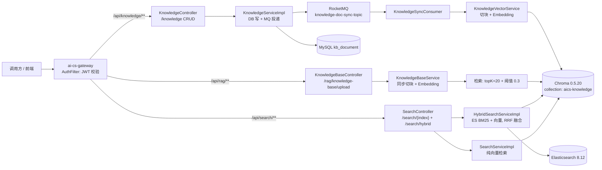
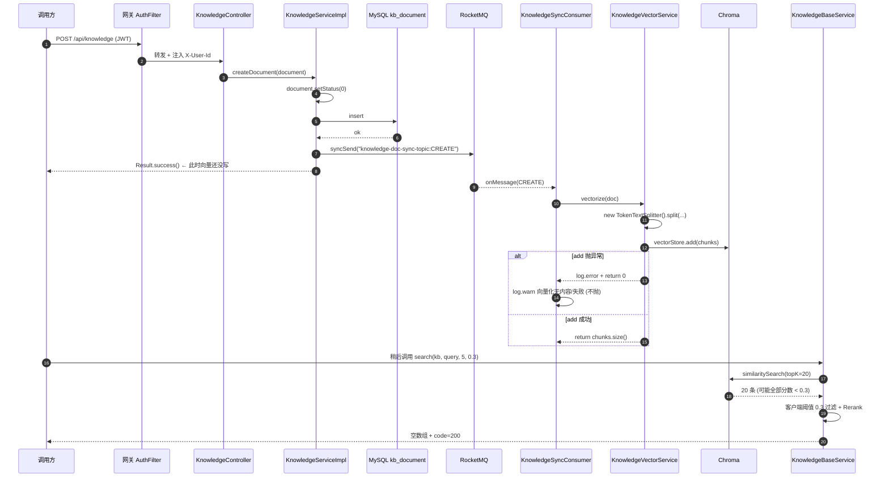
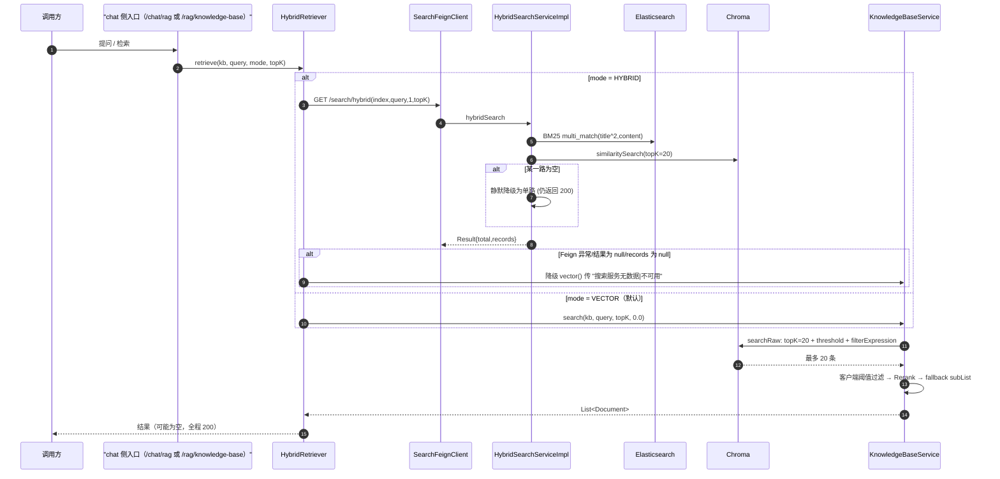

# ai-cs-knowledge / ai-cs-search 接口测试报告：三个失败现场与一份可复跑的核对清单

> **一句话结论**：这条链路最危险的地方不是报错，而是**失败也返回 200**——上传返回 `chunks=0` 算成功、检索 0 条算成功、混合检索降级成纯向量也算成功；所以测试报告必须用「字段判据」而不是「状态码判据」来写，且每条结论都要能被别人复跑。
> **阅读前置**：读过本目录 01（RAG 链路）与 03（向量检索），知道 `VectorStore`、`EmbeddingModel`、切块（chunk）是什么；会跑 `curl` 和 PowerShell；知道 Spring Boot 的 `@RestController` 与 MyBatis-Plus 分页。
> **证据基线**：A 级 = `learning-docs/24-源码分析/assets/source/` 已入库的 Spring AI 2.1.0 摘录（`VectorStore.java.md`、`SearchRequest.java.md`、`TokenTextSplitter.java.md`、`Document.java.md`）；B 级 = 本仓库 knowledge / search / chat / gateway 源码与 yml（行号当次逐条核对）；C 级 = 静态扫描 + node 模拟推演（本机真实输出，未连接任何外部服务）｜预计阅读 30 分钟。

先把证据边界摊开，避免把推演当实测：

| 级别 | 本文怎么用 | 本文里对应什么 | 复现门槛 |
|---|---|---|---|
| A | Spring AI 2.1.0 官方源码摘录，解释「SDK 语义」 | 阈值是客户端后置过滤、`add` 与 `upsert` 的重复 id 语义、切块默认参数 | 只读文件，零依赖 |
| B | 本仓库真实源码/配置，解释「本项目怎么用 SDK」 | 接口签名、返回包装、异常处理、上传限制、降级分支 | 只读文件，零依赖 |
| C | 本机静态核对与模拟推演 | 94 个 yml 零 multipart 配置、端口全空、RRF 名次融合算术 | `pwsh` / `node`，30 秒内 |
| ❌ 未实测 | HTTP 请求全部只是模板 | 所有 `curl` 调用、Chroma/ES/MinIO/RocketMQ 的真实响应 | 本机无 docker/chroma/es/redis，**跑不了** |

## 0. 先看现象

### 0.0 本机当时的环境（这一行决定后面的写法）

```powershell
cd D:\Projects\Persion\ai-customer-service
foreach($c in @("docker","chroma","curl","node","javap")){ $p=Get-Command $c -ErrorAction SilentlyContinue; if($p){"$c => $($p.Source)"} else {"$c => NOT FOUND"} }
Get-NetTCPConnection -State Listen | Where-Object { $_.LocalPort -in 8000,9200,6379,8082,8083,8084,8080 } | Select-Object LocalAddress,LocalPort
```

```text
docker => NOT FOUND
chroma => NOT FOUND
node => C:\Program Files\nodejs\node.exe
javap => D:\DevTools\jdk\jdk17.0.19\bin\javap.exe
（第三行 Get-NetTCPConnection 无任何输出）
```

**怎么读**：`docker` 与 `chroma` 都 NOT FOUND，且 8000（Chroma）/9200（Elasticsearch）/6379（Redis）/8080（网关）/8082（knowledge）/8083（chat）/8084（search）**七个端口全无监听**。也就是说：本文所有 HTTP 结论都不可能在本机跑出来，只能写成「该发什么请求 + 该看哪几个字段 + 通过判据」，并明确标注**未实测**。能真跑的只有三类：读源码、扫配置、用 node 算算术。

这不是偷懒，而是这份报告的诚实底线：**凡是没跑过的调用，一律写「未实测」，并用静态证据给出它必须成立的推理链**。

### 0.1 现象一：上传返回成功，检索永远为空

调用方看到的是这样（结构来自源码，**具体值未实测**）：

```json
{
  "code": 200,
  "message": "操作成功",
  "data": { "knowledgeBase": "faq", "fileName": "退款政策.pdf", "chunks": 8 },
  "timestamp": 1764200000000
}
```

`code=200`、`chunks=8`，看起来一切正常。但紧接着检索：

```bash
curl -s "http://localhost:8080/api/rag/knowledge-base/search?knowledgeBase=faq&query=退款要几天"
```

拿回来是 `data: []`，同样 `code=200`。**两次都是成功，中间没有任何一条错误日志**。

这不是玄学，代码里至少有三条各自独立、都能单独造成这个结果的路：

- **元数据对不上**。knowledge 侧写入时把 `knowledgeBase` 元数据写成常量 `"knowledge"`（`ai-cs-knowledge/src/main/java/com/aics/knowledge/service/KnowledgeVectorService.java#L52`），而 search 侧检索时把这个 filter 值当索引名用（`ai-cs-search/src/main/java/com/aics/search/service/impl/SearchServiceImpl.java#L51-L82`）。写入侧是名字叫 `faq` 还是 `knowledge`，两处必须约定一致，否则 filter 一条都过不去。
- **解析失败被吞成空列表**。`DocumentLoader` 三个 `load*` 方法 catch 后都 `return new ArrayList<>()`（`ai-cs-chat/src/main/java/com/aics/chat/rag/DocumentLoader.java#L57-L60`），空列表继续往下走，切块数量自然是 0，接口照样 200。
- **阈值是客户端后置过滤**。`similarityThreshold` 的官方注释写得很直白：这是 **在客户端做的后处理，不是服务端过滤**（`[[源码:SearchRequest.java.md#L164-L178]]`）。所以「宽召回 topK=20 + 阈值 0.3」的真实语义是：向量库先返回 20 条，代码再把低于 0.3 的丢掉——如果这 20 条都低于 0.3，最终结果就是 0 条，而 HTTP 依然 200。

```java
public Builder similarityThreshold(double threshold) {
    Assert.isTrue(threshold >= 0 && threshold <= 1, "Similarity threshold must be in [0,1] range.");
    this.searchRequest.similarityThreshold = threshold;
    return this;
}
```

(src: SearchRequest.java.md#L164-L178)

### 0.2 现象二：上传 3MB 文件直接 500，且提示看不出原因

调用方拿到的是：

```json
{ "code": 500, "message": "系统内部错误", "data": null, "timestamp": 1764200000000 }
```

服务端日志里能看到的只有兜底那一行（格式串来自源码 `ai-cs-common/src/main/java/com/aics/common/exception/GlobalExceptionHandler.java#L149-L154`）：

```text
ERROR c.a.c.e.GlobalExceptionHandler - 系统异常 [POST] /rag/knowledge-base/upload
org.springframework.web.multipart.MaxUploadSizeExceededException: Maximum upload size exceeded
```

问题是：**仓库里没有任何一处配置 multipart 上限**。全仓 94 个 yml/yaml 扫 `max-file-size` / `max-request-size` / `multipart`——命中 0 行（下节 6.3 有完整命令与输出）。没有配置就走 Spring Boot 默认值：单文件 1MB、单请求 10MB。于是 3MB 文件必然抛 `MaxUploadSizeExceededException`；而 `GlobalExceptionHandler` 没有为它写专用处理器，只能落到 `@ExceptionHandler(Exception.class)` 兜底，于是**响应体被抹平成「系统内部错误」**，客户端完全无法区分「文件太大」和「数据库连不上」。

顺带一个容易误判的点：**上传接口不在 knowledge 模块**。`MultipartFile` 全仓只有 5 处，knowledge 一个都没有；真正收文件的是 chat 的 `ai-cs-chat/src/main/java/com/aics/chat/controller/KnowledgeBaseController.java#L58-L65`。所以「上传 3MB 报 500」这条现象，被测对象其实是 chat，不是 knowledge。

### 0.3 现象三：检索接口声明了 page 参数，但翻页没反应

```bash
curl -s "http://localhost:8080/api/search/knowledge?query=退款&page=2&size=10"
```

`page=2` 和 `page=1` 返回一模一样的第一批数据，而且响应里**没有 total**（`data` 就是裸数组）。原因在源码里很直白：`page` 只出现在方法签名和日志里，**从未参与任何计算**（`ai-cs-search/src/main/java/com/aics/search/controller/SearchController.java#L31-L39` + `ai-cs-search/src/main/java/com/aics/search/service/impl/SearchServiceImpl.java#L51-L82`）。

同一个 Controller 里另一个接口却老老实实做了分页与总数：`/search/hybrid` 会算 `topK = page*size`、在内存里 `subList` 切页、并把 `vo.setTotal(all.size())` 填上（`ai-cs-search/src/main/java/com/aics/search/controller/SearchController.java#L41-L63`）。**所以「没有分页与总分」不是全局缺陷，而是两个接口语义不一致**——这正是测试报告应该抓的东西。

### 0.4 旧稿里必须作废的结论（沿用会误导）

这份报告的前身是一份「23/23 用例符合预期」的历史快照（Spring Boot 3.2.5 时代）。把它当素材可以，当事实不行——下面几条在当前代码里已经不成立或必须重测：

| 旧稿结论 | 当前代码核对结果 | 处置 |
|---|---|---|
| 「23/23 用例符合预期」 | 当时环境 Boot 3.2.5；当前 Boot 4.2.0 / Spring AI 2.1.0；且旧用例**不覆盖**上传、混合检索、网关鉴权 | 降级为历史快照，不作验收结论 |
| search 有 4 个接口 | 6.4 的抽取显示现在 **5 个**（新增 `/search/hybrid`，且它是唯一有分页与总分的） | 以本文 13 个端点为准 |
| 「查不存在 id 返回 500」 | 按当前源码，`BusinessException` 处理器**不带 `@ResponseStatus`**，应为 **HTTP 200 + `code=2001`** | 旧结论作废（会误导前端只判状态码）；但本机无法实测，标为**待重测** |
| 「删不存在索引返回 200（ES 幂等）」 | `createIndex` 现在是空实现（只打日志），`deleteIndex` 走 Chroma filter + ES 删除 | 语义已变，需按 3.6 重新验证 |
| 「表名 `t_knowledge_document` 不一致」的坑 | 实体现在是 `@TableName("kb_document")` | 已修，转为回归项 |
| 「`@RequestParam` 未命名导致 500」的坑 | 全仓注解已显式命名（`@PathVariable("id")`、`@RequestParam("query")`） | 已修，转为回归项 |
| 「本地装了 ES 8.12.2、跑过 `ks_test_all.py`」 | 本文不启动任何服务；`logs/` 已被 gitignore，证据文件不随仓库走 | 仅作历史记录，不可复跑 |

这张表的用途不是否定旧稿，而是**把「历史结论」和「当前事实」分开**——测试报告最容易犯的错就是把三个月前的一次通过，当成今天的验收依据。

> 这些现象指向同一件事：**这条链路的失败几乎不体现在 HTTP 状态码上**。上传、检索、入库全部返回 200，真正的信号只落在 `chunks` 数值、`data`/`records` 长度、以及被 catch 吞掉的那几行 WARN/ERROR 日志里。因此本文的每条用例都以「该看哪几个字段」和「通过判据」为核心，而不是「状态码是不是 200」。

## 1. 整体地图



> **读图说明**：
> ① 图里有**两条写入路径**（`KnowledgeVectorService` 走 MQ 异步、`KnowledgeBaseService` 走 HTTP 同步）和**两条检索路径**（`SearchServiceImpl` 纯向量、`HybridSearchServiceImpl` 双路融合），四条路径**终点都是同一个 Chroma 集合 `aics-knowledge`**——这是最容易看错的地方：看错成「knowledge 写 knowledge 的库、search 查 search 的库」，就会得出「检索不到是跨库问题」的错误结论。
> ② 唯一需要穿过网关鉴权的边是 `调用方→gateway`；`HybridRetriever` 调 search 走的是 Feign 直连 `lb://ai-cs-search`（不经过 `AuthFilter`），所以「网关 401」和「服务内部调用失败」是两件不同的事，不要合并成一个 bug。
> ③ Chroma 只有一条边画到 ES 之外，说明 **ES 只是 search 的增强路**：ES 挂了检索仍然有结果（降级），DB 挂了则整个 CRUD 没了。

| 组件 | 责任 | 谁调用它 |
|---|---|---|
| `AuthFilter` | 网关鉴权：JWT 白名单 + `X-API-Key` 兜底，通过后注入 `X-User-Id` | Spring Cloud Gateway 过滤器链（`ai-cs-gateway/src/main/java/com/aics/gateway/filter/AuthFilter.java#L83-L96`） |
| `KnowledgeController` | 知识文档 CRUD（纯 JSON，无文件） | 网关 `/api/knowledge/**` |
| `KnowledgeServiceImpl` | 写 DB、投 MQ；**不自带 `@Transactional`** | `KnowledgeController` |
| `KnowledgeSyncProducer` | `syncSend` 到 `knowledge-doc-sync-topic`，失败只 WARN 不抛 | `KnowledgeServiceImpl` |
| `KnowledgeSyncConsumer` | 按 action 分发向量化/删除，异常被 catch 吞掉 | RocketMQ 推送 |
| `KnowledgeVectorService` | 切块 + 写 Chroma；失败 `return 0` | `KnowledgeSyncConsumer` |
| `KnowledgeBaseService` | 上传/文本切块入库 + 宽召回 + Rerank + 降级 | `KnowledgeBaseController`、`HybridRetriever` |
| `SearchServiceImpl` | 纯向量检索（`/{index}`）、索引文档、ES 双写 | `SearchController` |
| `HybridSearchServiceImpl` | ES BM25 + 向量双路召回，`RrfMerger` 融合 | `SearchController`、`HybridRetriever`(Feign) |
| `RrfMerger` | **只按名次**做 RRF 融合，`1/(60+rank)` 累加 | `HybridSearchServiceImpl` |

图里**故意没有画 MinIO**，这本身是一个结论：`FileStorageService`（MinIO）只被 chat 的图片/视觉链路用到（`ai-cs-chat/src/main/java/com/aics/chat/controller/ChatController.java#L199`），知识文档上传是**直接读 `MultipartFile` 的字节流**，不落对象存储。所以「上传的文件去哪了」这个问题在知识库链路上没有 MinIO 这一环——如果按常见架构去 MinIO 里找原始文件，会白找一遍。

## 2. 接口与用例清单

### 2.1 knowledge 模块（5 个接口，全部 JSON）

前缀 `/knowledge`，类上 `@RestController @Validated`，**5 个方法没有任何鉴权注解**（`ai-cs-knowledge/src/main/java/com/aics/knowledge/controller/KnowledgeController.java#L46-L50`）。

| 方法 | 路径 | 鉴权 | 输入 | 预期 | 外部依赖 |
|---|---|---|---|---|---|
| POST | `/knowledge` | 网关 JWT（服务本身无） | `@RequestBody KnowledgeDocument`，**无 `@Valid`** | `code=200`，`data=null`；同时投一条 MQ | MySQL + RocketMQ |
| GET | `/knowledge/{id}` | 同上 | `@PathVariable("id") Long` | 命中返回实体；不存在 `code=2001` 且 **HTTP 200** | MySQL |
| GET | `/knowledge/list` | 同上 | `page`(默认1) / `pageSize`(默认10) / `keyword`(可选) | `data` 是 MyBatis-Plus `Page`：`records/total/size/current/pages` | MySQL |
| PUT | `/knowledge` | 同上 | `@RequestBody KnowledgeDocument`（需带 id） | `code=200`；先 `updateById` 再投 UPDATE | MySQL + RocketMQ |
| DELETE | `/knowledge/{id}` | 同上 | `@PathVariable("id") Long` | `code=200`；先投 DELETE 再删行 | MySQL + RocketMQ |

### 2.2 search 模块（5 个接口）

前缀 `/search`（`ai-cs-search/src/main/java/com/aics/search/controller/SearchController.java#L31-L39`）。

| 方法 | 路径 | 鉴权 | 输入 | 预期 | 外部依赖 |
|---|---|---|---|---|---|
| GET | `/search/{index}` | 网关 JWT | `index`(`@NotBlank`) + `query`(`@NotBlank`) + `page` + `size` | `data` = `List<Map>`，**无 total，`page` 不生效** | Chroma + Embedding API |
| GET | `/search/hybrid` | 网关 JWT | `index` + `query` + `page` + `size` | `data` = `{total,page,size,records}`，**唯一有分页与总分** | Chroma + ES + Embedding API |
| POST | `/search/index/{index}` | 网关 JWT | `index` + `@RequestBody Map mappings` | `code=200`，日志「Chroma 模式：无需创建索引」（**空实现**） | 无 |
| POST | `/search/document/{index}` | 网关 JWT | `index` + `@RequestBody Map document`（需 content/text） | `code=200`；写 Chroma 并双写 ES | Chroma + ES |
| DELETE | `/search/index/{index}` | 网关 JWT | `index` | `code=200`；按 `knowledgeBase` filter 删向量 + 删 ES 文档 | Chroma + ES |

### 2.3 chat 侧 RAG 入口（3 个接口，本文只测「上传→检索」这条）

前缀 `/rag/knowledge-base`（`ai-cs-chat/src/main/java/com/aics/chat/controller/KnowledgeBaseController.java#L43-L49`）。

| 方法 | 路径 | 鉴权 | 输入 | 预期 | 外部依赖 |
|---|---|---|---|---|---|
| POST | `/rag/knowledge-base/text` | 网关 JWT | `knowledgeBase` + `text`（**都是 `@RequestParam`，不是 JSON**） | `data={knowledgeBase,chunks}` | Chroma + Embedding API |
| POST | `/rag/knowledge-base/upload` | 网关 JWT | `knowledgeBase` + `file`(`MultipartFile`) | `data={knowledgeBase,fileName,chunks}` | Chroma + Embedding API + Tika/PDFBox |
| GET | `/rag/knowledge-base/search` | 网关 JWT | `knowledgeBase` + `query` | `data=[{text,score}]`，内部固定 `topK=5, threshold=0.3` | Chroma + Embedding API |

### 2.4 关键概念与关键类

| 名称 | 位置 | 角色 | 关键方法/字段 |
|---|---|---|---|
| `Result<T>` | `ai-cs-common/src/main/java/com/aics/common/result/Result.java#L78-L80` | 统一响应体，**HTTP 与业务码解耦** | `code/message/data/timestamp`；`isSuccess()` 判 `code==200` |
| `ResultCode` | `ai-cs-common/src/main/java/com/aics/common/result/ResultCode.java` | 业务码字典 | `KNOWLEDGE_NOT_FOUND(2001)`、`SEARCH_QUERY_FAIL(4002)`、`INTERNAL_ERROR(500)` |
| `GlobalExceptionHandler` | `ai-cs-common/src/main/java/com/aics/common/exception/GlobalExceptionHandler.java#L149-L154` | 兜底异常 → 500「系统内部错误」 | `handleException`；**无 multipart 专用处理器** |
| `VectorStore` | A 级：`VectorStore.java.md` | 向量库抽象 | `add(List)`、`delete(String filterExpression)`、`similaritySearch(SearchRequest)`、`upsert` |
| `SearchRequest` | A 级：`SearchRequest.java.md` | 检索参数对象 | `topK`（默认 4）、`similarityThreshold`（客户端后置过滤）、`filterExpression` |
| `TokenTextSplitter` | A 级：`TokenTextSplitter.java.md` | 按 token 切块 | 默认 `chunkSize=800`、`overlap=0`、`minChunkSizeChars=350`、`maxNumChunks=10000` |
| `KnowledgeVectorService` | `ai-cs-knowledge/src/main/java/com/aics/knowledge/service/KnowledgeVectorService.java#L69-L92` | knowledge 侧向量化 | `vectorize`（失败 `return 0`）、`deleteByDocumentId` |
| `KnowledgeBaseService` | `ai-cs-chat/src/main/java/com/aics/chat/service/KnowledgeBaseService.java#L228-L260` | chat 侧入库 + 检索 + 降级 | `addChunks`、`search`、`searchRaw` |
| `HybridSearchServiceImpl` | `ai-cs-search/src/main/java/com/aics/search/hybrid/HybridSearchServiceImpl.java#L50-L74` | 双路召回 + 融合 | 两处降级（ES 空→纯向量、向量空→纯 ES） |
| `RrfMerger` | `ai-cs-search/src/main/java/com/aics/search/hybrid/RrfMerger.java#L35-L47` | RRF 融合 | `1/(60+rank)` 累加，**不看原始分** |
| `EvalGateConfig` | `ai-cs-chat/src/main/java/com/aics/chat/rag/eval/EvalGateConfig.java#L34-L43` | 评估门禁阈值 | `p95LatencyMs`、`avgTokensPerRequest` 都是 `Long`，**未配置即 null，不判定** |

几个首现术语，后面直接用不再解释：

- **向量化（Embedding）**：把文本送进模型，得到一串浮点数（本项目的 bge-m3 是 1024 维），语义相近的文本向量距离近。
- **chunk（分块）**：长文档切成小段再各自向量化，检索时命中的是某个 chunk，不是整篇文档。
- **topK**：只取相似度最高的前 K 条。**阈值**：再按分数下限过滤。
- **BM25**：Elasticsearch 的关键词打分算法，靠词频/逆文档频率，不做语义。
- **RRF（Reciprocal Rank Fusion）**：把多路召回结果按**名次**折算成分数（`1/(k+rank)`）再相加，规避「不同路分数量纲不可比」。
- **JWT**：网关校验的 Bearer Token；通过后把 `X-User-Id` 注入下游请求头。
- **降级**：主路径失败时静默退回次要路径（例如混合检索失败退回纯向量），**HTTP 仍然 200**。

## 3. 逐接口用例与核对结果

这一节按「接口组」组织，每组给：**该发什么请求** → **该看哪几个字段** → **通过判据** → 四层解释（在干什么 / 为什么这么设计 / 换写法会怎样 / 常见坑），最后标注**本机可执行性**。

统一约定：`BASE` 直连服务端口（绕过网关），`GW` 走网关 8080（需要 JWT）。**所有 HTTP 调用本机未实测**，因为 0.0 节已证明没有任何服务在监听。

### 3.1 知识文档 CRUD（用例 K1~K6）

| 用例 | 请求 | 该看哪几个字段 | 通过判据 |
|---|---|---|---|
| K1 创建 | `POST $BASE/knowledge`，body 带 `title`/`content` | `body.code`、`body.data` | `code=200` 且 `data=null`；DB 出现新行且 `status=0` |
| K2 按 id 查 | `GET $BASE/knowledge/{id}` | `body.data.id`、`data.createTime` | `id` 一致、`createTime` 非空（自动填充生效） |
| K3 查不存在 | `GET $BASE/knowledge/999999999` | **HTTP 状态码**、`body.code`、`body.message` | **HTTP 200** 且 `code=2001`、`message` 来自 `ResultCode` |
| K4 更新 | `PUT $BASE/knowledge`，body 带 `id` | `body.code`、再查一次的 `data.title` | `code=200` 且二次查询标题已变 |
| K5 删除 | `DELETE $BASE/knowledge/{id}` | `body.code`、再查一次的 `body.code` | 删除 `200`；再查 `2001`（逻辑删，`@TableLogic deleted`） |
| K6 列表 | `GET $BASE/knowledge/list?page=1&pageSize=5` | `data.records` 长度、`data.total`、`data.size` | 长度 ≤5，`total` ≥ 实际行数，`size=5` |

```bash
# K1：创建（未实测，本机无 MySQL）
curl -s -X POST "http://localhost:8082/knowledge" \
  -H "Content-Type: application/json" \
  -d '{"title":"退款政策","content":"签收后 7 天内可申请退款，需保留吊牌。","tags":"售后,退款"}'

# K3：查不存在 id —— 注意这里要盯的是 HTTP 状态码，而它会是 200
curl -s -o /dev/null -w "%{http_code}\n" "http://localhost:8082/knowledge/999999999"
```

- **在干什么**：验证最小的写-读-改-删闭环，以及「业务异常如何暴露给调用方」。
- **为什么这么设计**：`BusinessException` 的处理器**故意不加 `@ResponseStatus`**（`ai-cs-common/src/main/java/com/aics/common/exception/GlobalExceptionHandler.java#L35-L39`），所以业务失败是 `HTTP 200 + body.code=2001`。这样前端只需统一读 `code`，不用为每种业务错误维护 HTTP 状态映射。
- **换写法会怎样**：如果给 `BusinessException` 加 `@ResponseStatus(NOT_FOUND)`，K3 就变成 HTTP 404，前端所有 `if (res.code === 200)` 的写法会集体失效——这类「看起来更 RESTful」的改动其实是破坏性改动。
- **常见坑**：`createDocument` 的 `@RequestBody` 上**没有 `@Valid`**，`title` 传空串也能建成功（`ai-cs-knowledge/src/main/java/com/aics/knowledge/controller/KnowledgeController.java#L46-L50`）。用例必须自己断言「空 title 会被接受」这个**已知缺陷**，否则评审会以为你漏测。

**本机可执行性**：❌ 需要 MySQL + 服务进程。**替代静态核对**：确认 5 个 mapping 注解与行号（6.4 的注解抽取命令，输出真实）；确认 `KnowledgeDocument` 的 `@TableName("kb_document")` 与建表脚本一致（旧稿踩过的坑，见 6.1）。

### 3.2 分页与关键字（用例 L1~L3）

| 用例 | 请求 | 该看哪几个字段 | 通过判据 |
|---|---|---|---|
| L1 默认分页 | `GET $BASE/knowledge/list` | `data.current`、`data.size`、`data.records` | `current=1`、`size=10`、长度 ≤10 |
| L2 关键字过滤 | `GET .../list?keyword=退款` | `data.total`、每条 `data.records[].title` | `total` 变小；命中的行标题或 tags 含「退款」 |
| L3 超大页码 | `GET .../list?page=99999&pageSize=10` | `data.records`、`data.total` | `records=[]` 但 `total` 不变（分页插件不报错） |

- **在干什么**：验证 MyBatis-Plus 分页插件与 `keyword` 的「标题 or 标签」双字段模糊。
- **为什么这么设计**：`PaginationInnerInterceptor(DbType.MYSQL)` 让 `Page` 参数变成物理 `LIMIT`（`ai-cs-knowledge/src/main/java/com/aics/knowledge/config/MybatisPlusConfig.java#L34-L40`）；`keyword` 用 `like(title).or().like(tags)`（`ai-cs-knowledge/src/main/java/com/aics/knowledge/service/impl/KnowledgeServiceImpl.java#L90-L104`）。
- **换写法会怎样**：把 `or()` 换成 `and()` 会导致「标题含关键词但标签不含」的文档全部搜不到——一个括号写错就是召回率腰斩，而且**不会报错**。
- **常见坑**：`Page` 的 JSON 字段名是 `current` 而不是 `page`；判据里写 `data.page` 会永远取到 `undefined`，让人误判成「分页没生效」。

**本机可执行性**：❌ 同上。静态可核对：`PaginationInnerInterceptor` 与 `MetaObjectHandler` 是否都在（6.4 命令可复用）。

### 3.3 上传与解析（用例 U1~U4）——本节全部「未实测」，只能给替代手段

| 用例 | 请求 | 该看哪几个字段 | 通过判据 |
|---|---|---|---|
| U1 正常 txt | `POST $BASE/rag/knowledge-base/upload`，`-F knowledgeBase=faq -F file=@a.txt` | `data.chunks` | `chunks ≥ 1`；日志出现「知识库[faq]入库完成, 共N个分块」 |
| U2 3MB PDF | 同上，`-F file=@big.pdf`（>1MB） | **HTTP 状态码**、`body.code`、`body.message` | 预期 **500 + code=500 + message=系统内部错误**（这是已知缺陷，不是通过） |
| U3 损坏的 docx | `-F file=@broken.docx` | `data.chunks`、日志 `Tika文档加载失败` | 预期 `chunks=0` 且 `code=200`（**假通过**，必须记为失败） |
| U4 空文件 | `-F file=@empty.txt` | `data.chunks` | `chunks=0`，`code=200` |

```bash
# U1（未实测）：注意 knowledgeBase 是 @RequestParam，不是 JSON 字段
curl -s -X POST "http://localhost:8083/rag/knowledge-base/upload" \
  -F "knowledgeBase=faq" -F "file=@./手册.txt"

# U2（未实测）：造一个 3MB 文件，验证「默认 1MB 上限」这个推断
pwsh -c "fsutil file createnew big.pdf 3145728"   # 仅 Windows 需要管理员；也可用 node 写 3MB 随机字节
```

- **在干什么**：验证「文件 → 解析 → 文档列表」这一段，尤其是**解析失败时的可见性**。
- **为什么这么设计**：多格式靠策略分流——后缀 `.pdf` 走 `PagePdfDocumentReader`（每页一个 Document，带 `page_number`），`.docx/.xlsx/.html` 走 Tika，其余走 `TextReader`（`ai-cs-chat/src/main/java/com/aics/chat/rag/DocumentLoader.java#L43-L61`）。
- **换写法会怎样**：如果在 catch 里改成 `throw new BusinessException(KNOWLEDGE_PARSE_FAIL)`，U3 就会变成明确的失败（更好的语义），但上传会整体回滚、用户拿不到「部分成功」；当前选择的代价是**失败无声**。
- **常见坑**：`chunks=0` 有两种完全不同的原因——「文件本身没内容」和「解析器抛异常被吞」。只看响应体分不出来，**必须去日志里找那三行之一：`PDF文档加载失败` / `文本文档加载失败` / `Tika文档加载失败`**（`ai-cs-chat/src/main/java/com/aics/chat/rag/DocumentLoader.java#L58`、`#L77`、`#L94`，三处 catch 都 `return new ArrayList<>()`）。这是本报告判定 U3 为「假通过」的唯一依据。

**本机可执行性**：❌ 三条硬阻塞同时存在：没有 chat 服务进程、没有 Chroma、没有可用的 Embedding API Key。**替代静态核对**：读 `DocumentLoader` 的 catch 分支确认返回空列表（已核对 L57-60）；读 `GlobalExceptionHandler` 确认无 multipart 专用处理器（已核对 L149-154）；用 6.3 的 94 个 yml 扫描证明「没有配置上限」。

### 3.4 向量化与入库（用例 V1~V3）

| 用例 | 请求/动作 | 该看哪几个字段 | 通过判据 |
|---|---|---|---|
| V1 knowledge 异步入库 | `POST $BASE/knowledge` 后观察日志 | 日志 `投递知识文档同步消息` → `消费知识文档同步消息` → `向量化完成: chunks=N` | 三段日志按序出现，且 `chunks ≥ 1` |
| V2 向量化失败 | 断开 Chroma 后重复 V1 | 日志 `文档向量化失败: id=..., err=...` 与 `向量化无内容/失败` | **`code=200` 但 chunks 段缺失**——必须记为失败 |
| V3 删除同步 | `DELETE $BASE/knowledge/{id}` | 日志 `向量删除完成: documentId=...` | 出现该行；且 Chroma 侧 `documentId == id` 的 chunk 归零 |

- **在干什么**：验证「DB 写成功」与「向量写成功」这两件事**是否被当成一件事报告**。
- **为什么这么设计**：DB 与向量库是两个存储，无法放进一个本地事务，项目选择「先写 DB，再 `syncSend` 投 MQ，消费端异步向量化」（`ai-cs-knowledge/src/main/java/com/aics/knowledge/mq/KnowledgeSyncProducer.java#L44-L61`）。
- **换写法会怎样**：把 `syncSend` 换成 `asyncSend` 吞吐更高，但本方法已经把异常吞掉只 WARN，异步化后连「投递失败」这条唯一线索也会消失；反过来改成「投递失败就回滚 DB」，则 MQ 抖动会直接导致知识库不可写。
- **常见坑**：`KnowledgeVectorService.vectorize` 的 catch 分支 **`return 0`**（`ai-cs-knowledge/src/main/java/com/aics/knowledge/service/KnowledgeVectorService.java#L88-L92`），而消费者只在 `chunks==0` 时打一行 `log.warn("向量化无内容/失败: ...")` 且**不抛异常**（`ai-cs-knowledge/src/main/java/com/aics/knowledge/mq/KnowledgeSyncConsumer.java#L66-L77`）。于是：向量库挂了 → 文档「创建成功」→ 检索永远为空 → 没有任何重试、没有任何补偿队列。类注释里写的「天然可重试」与实现相反，注释里写的「靠补偿机制保证」也**不存在对应代码**。

**本机可执行性**：❌ 需要 MySQL + RocketMQ + Chroma 三件套。**替代静态核对**：`vectorize` 的返回 0 分支、消费者的吞异常分支、生产者的吞异常分支，三处行号已逐个核对；「无补偿队列」通过全仓搜索 `compensat` / `retry` 在 knowledge 模块无业务实现可佐证（属负面证据，结论标注为「未发现」，不声称绝对不存在）。

### 3.5 纯向量检索 `/search/{index}`（用例 S1~S4）

| 用例 | 请求 | 该看哪几个字段 | 通过判据 |
|---|---|---|---|
| S1 命中 | `GET $BASE/search/knowledge?query=退款` | `data` 长度、`data[]._score`、`data[].id` | 长度 ≥1 且 `_score` 单调降序 |
| S2 翻页无效 | 同 S1 加 `page=2&size=3` | `data` 内容与 S1 对比 | **两次结果完全相同**（`page` 不生效，已知缺陷） |
| S3 无总分 | 同 S1 | 响应里有没有 `total` | **没有**（`data` 是裸数组） |
| S4 空 query | `GET .../search/knowledge?query=` | **HTTP 状态码**、`body.code`、`body.message` | **400** + `code=400` + 含「搜索关键词不能为空」 |

- **在干什么**：确认这个接口的真实语义是「向量库 top-size 直出」，不是「分页查询」。
- **为什么这么设计**：`SearchServiceImpl.search` 把 `size` 直接当 `topK` 用（`SearchRequest.builder().query(query).topK(Math.max(1, size))`），没有任何 offset 概念——因为 Chroma 的 `similaritySearch` 本身没有分页原语，**只支持 topK**。
- **换写法会怎样**：想要真分页只有两条路：要么 `topK = page*size` 再在内存切（`/search/hybrid` 就是这么干的，代价是翻到第 10 页要把前 100 条都取回来），要么在 Chroma 侧用 where 过滤 + 游标。没有第三条便宜路。
- **常见坑**：S4 的 400 来自 `@Validated` + `@NotBlank`，被 `ConstraintViolationException` 处理器接住（`ai-cs-common/src/main/java/com/aics/common/exception/GlobalExceptionHandler.java#L70-L78`）。如果只测「正常查询」，就会漏掉「参数校验只在这个接口生效、`/knowledge` 的 JSON 体完全不校验」这种不对称。

**本机可执行性**：❌ 需要 Chroma + Embedding API。静态可核对：`page` 参数在方法体内确无引用（`ai-cs-search/src/main/java/com/aics/search/service/impl/SearchServiceImpl.java#L51-L82` 全文已读，`page` 仅出现在日志）。

### 3.6 混合检索 `/search/hybrid`（用例 H1~H4）

| 用例 | 请求 | 该看哪几个字段 | 通过判据 |
|---|---|---|---|
| H1 正常融合 | `GET $BASE/search/hybrid?index=knowledge&query=退款&page=1&size=5` | `data.total`、`data.records[].documentId`、`records[].score`、`records[].esRank`、`records[].vectorRank` | `total ≥ records.length`；`score` 单调降序；双路都命中的条目 `esRank>0 且 vectorRank>0` |
| H2 第二页 | `...&page=2&size=5` | `records` 与 H1 无交集 | 两页 `documentId` 集合不重叠（分页真的生效） |
| H3 ES 挂掉 | 停 ES 后重跑 H1 | `records` 仍有数据、日志 `混合检索两路均无结果` 是否不出现 | 有结果 + **`esRank` 全为 0**（静默降级为纯向量） |
| H4 size 越界 | `...&size=1000` | 实际返回条数、`data.size` | `size` 被钳到 100（`Math.min(Math.max(1,size),100)`） |

- **在干什么**：验证唯一「有分页 + 有总分」的检索接口，以及**降级时字段会怎么变**。
- **为什么这么设计**：`topK = page*size` 先取够、再 `subList` 切页（`ai-cs-search/src/main/java/com/aics/search/controller/SearchController.java#L48-L61`）；融合本身用 RRF，只吃名次不吃原始分（`ai-cs-search/src/main/java/com/aics/search/hybrid/RrfMerger.java#L35-L47`）。
- **换写法会怎样**：如果用加权分数融合（比如 `0.5*es + 0.5*vec`），就得先解决 BM25 分（无上界）与余弦相似度（0~1）量纲不可比的问题——RRF 用名次天然规避，代价是**丢掉了置信度信息**。
- **常见坑**：`HybridSearchServiceImpl` 有两处降级：ES 空 → 只用向量、向量空 → 只用 ES（`ai-cs-search/src/main/java/com/aics/search/hybrid/HybridSearchServiceImpl.java#L61-L68`），而且两路都空时返回空列表并只 WARN。所以 H1「有结果」根本不能证明双路都活着——**必须看 `esRank`/`vectorRank` 是否都为非 0**，这是本组用例唯一有效的判据。

**本机可执行性**：❌ 需要 Chroma + ES + Embedding。**替代手段**：用 node 复算 RRF 融合，并与仓库里已有的单测断言对齐（见 6.6）。

### 3.7 异常与校验语义（用例 E1~E5）

| 用例 | 请求 | 该看哪几个字段 | 通过判据 |
|---|---|---|---|
| E1 缺必填参数 | `GET $BASE/search/knowledge?query=` （缺 index 场景用 `/search/`） | HTTP 码、`body.message` | 400 / 405，`message` 是「缺少请求参数: xxx」或方法不支持 |
| E2 错误方法 | `POST $BASE/knowledge/list` | HTTP 码 | 405 |
| E3 非法 JSON | `POST $BASE/knowledge`，body 为 `{"title":` | HTTP 码、`body.message` | 400 + 「请求体格式错误或字段类型无效」 |
| E4 非法路径参数 | `GET $BASE/knowledge/abc` | HTTP 码、`body.message` | 400 + 「参数类型错误: id」 |
| E5 业务异常 | `GET $BASE/knowledge/999999999` | HTTP 码 + `body.code` | **200 + 2001**（与 E1~E4 的 400 形成对比） |

- **在干什么**：把「HTTP 语义」和「业务语义」两套码表逐一对齐，确认调用方该信哪一个。
- **为什么这么设计**：参数类异常全部 `@ResponseStatus(BAD_REQUEST)`，业务类异常不给状态码（`ai-cs-common/src/main/java/com/aics/common/exception/GlobalExceptionHandler.java#L44-L52`）。这是一套「**HTTP 只表达协议层对错，业务对错放 body**」的混合约定。
- **换写法会怎样**：统一成全 200+code 会让网关/监控无法用状态码做告警；统一成全 4xx/5xx 又要维护 20 多个业务码到状态码的映射表，且前端 `message` 语义会漂移。
- **常见坑**：`Result.fail(ResultCode.INTERNAL_ERROR)` 的 `message` 是固定的「系统内部错误」，**不含任何原因**；真正的原因只在日志第三个参数（异常对象）里。所以「看到 500 就查 body.message」是无效动作，必须去查日志栈。

**本机可执行性**：❌ 需要服务进程。静态可核对：11 个 handler 的分支与行号已全部核对（3.1~3.7 引用到的都是其中几条）。

### 3.8 网关与鉴权（用例 G1~G4）

| 用例 | 请求 | 该看哪几个字段 | 通过判据 |
|---|---|---|---|
| G1 无 Token 走网关 | `GET $GW/api/knowledge/list` | HTTP 码、`body.message` | 401 + 「Token无效或已过期」 |
| G2 带 Token | 同 G1 加 `Authorization: Bearer <jwt>` | `body.code`、下游收到的 `X-User-Id` | 200；下游能读到注入的 `X-User-Id` |
| G3 伪造头 | 加 `X-User-Id: 1` 但无 Token | 同上 | 仍是 401（白名单外不会透传伪造头） |
| G4 白名单路径 | `GET $GW/api/health` | HTTP 码 | 200（确实在 `WHITE_LIST` 里） |

- **在干什么**：确认 `/api/knowledge/**`、`/api/search/**`、`/api/rag/**` **不在白名单**，必须带 JWT。
- **为什么这么设计**：白名单只有登录/注册/验证码/健康检查/文档这几条（`ai-cs-gateway/src/main/java/com/aics/gateway/filter/AuthFilter.java#L83-L96`）；白名单放行前还会主动删除客户端伪造的 `X-User-Id/X-User-Name/X-User-Roles`。
- **换写法会怎样**：把 `/api/knowledge/**` 加进白名单，本地联调立刻变简单——代价是知识库 CRUD 完全裸奔（服务本身没有任何鉴权注解可兜底）。
- **常见坑**：G1 的 401 与 G3 的「伪造头无效」是同一段逻辑的两个结果，容易被合成一条用例；但它们的失败方式不同（一个是不放行、一个是放行后清洗），**排查时指向完全不同的代码行**。

**本机可执行性**：❌ 需要网关 + Nacos（路由 `lb://` 依赖注册中心）。静态可核对：`WHITE_LIST` 全部 12 条已逐条读过，确认三个前缀都不在。

### 3.9 一致性对账（用例 C1~C3）——这是本报告最有价值的一组

| 用例 | 动作 | 该看哪几个字段 | 通过判据 |
|---|---|---|---|
| C1 DB ↔ Chroma 行数 | 列表 `total` vs Chroma 该 `documentId` 的 chunk 数 | 两边都比 | 每篇文档至少有 1 条 chunk；`total` 与「去重后的 documentId 数」相等 |
| C2 元数据一致性 | 抽 3 条 chunk 看 metadata | `knowledgeBase`、`documentId`、`title` | `knowledgeBase` 与调用方约定的索引名一致；`documentId` 与 DB 主键同源 |
| C3 重复 chunk | 同一文档连续入库两次 | 该 `documentId` 的 chunk 数 | **不去重**（`add` 语义如此），第二次是翻倍——记为已知缺陷 |

- **在干什么**：验证「DB 有、向量库没有」和「向量库有、DB 没有」这两种不一致**是否能被稳定检出**。
- **为什么这么设计**：两个存储之间没有事务，`add` 又明确不保证幂等——官方注释写得很清楚：`add` 对重复 id 的行为**交给底层 provider 决定**，而 `upsert` 才是 **replace-by-id**（`[[源码:VectorStore.java.md#L58-L82]]`）。本项目用的是 `add`。
- **换写法会怎样**：改用 `upsert`（2.1.0 新增）可以让「重复消费 UPDATE」变成幂等——但 `upsert` 要求**调用方自己算好 embedding**（入参是 `List<EmbeddedDocument>`），等于把 Embedding 从 VectorStore 内部提到业务层，改动不小。
- **常见坑**：C3 常被误判成「向写入 bug」。实际上它是 `add` 的既定语义；消费者注释里声称「重复消费 UPDATE 会先删旧再写新，结果幂等」，但 `vectorize` 里**并没有先 delete**——注释与实现不符，是真正该记的缺陷。

**本机可执行性**：❌ 需要 Chroma HTTP 接口。**替代手段**：给 Chroma 的 `collections/{name}/get` 请求模板 + 判读方法（见 6.5），并明确标注未实测。

### 3.10 用例判定矩阵（23 条，一屏看完谁通过、谁只能静态核对）

把上面九组的用例号汇总成一张表，用于交付时逐条勾选。**「状态」一列的取值只有三种**：`静态通过`（源码/配置已核对，结论成立）、`待实测`（本机跑不了，判据已写好）、`已知缺陷`（当前实现有问题，用例的目的是把它记下来而不是等它变绿）。

| 用例 | 一句话目的 | 关键判据 | 状态 | 依赖 |
|---|---|---|---|---|
| K1 创建 | 写入闭环 | `code=200` + DB 有新行 | 待实测 | MySQL |
| K2 按 id 查 | 读回一致 | `data.id` 相同、`createTime` 非空 | 待实测 | MySQL |
| K3 查不存在 | 业务码语义 | **HTTP 200** + `code=2001` | 待实测 | MySQL |
| K4 更新 | 改后生效 | 二次查询标题已变 | 待实测 | MySQL |
| K5 删除 | 逻辑删 | 再查返回 `2001` | 待实测 | MySQL |
| K6 列表 | 分页生效 | `records ≤ size`、`total` 合理 | 待实测 | MySQL |
| L1 默认分页 | 默认值 | `current=1`、`size=10` | 待实测 | MySQL |
| L2 关键字 | or 语义 | 标题**或** tags 命中 | 待实测 | MySQL |
| L3 超大页码 | 边界 | `records=[]`、`total` 不变 | 待实测 | MySQL |
| U1 txt 上传 | 解析→切块 | `chunks ≥ 1` | 待实测 | Chroma+Embedding |
| U2 3MB 上传 | 上限语义 | 500 + 「系统内部错误」 | **已知缺陷**（静态通过） | Spring 默认值 |
| U3 损坏 docx | 解析失败可见性 | `chunks=0` 但 200 → 记失败 | **已知缺陷** | Tika |
| U4 空文件 | 边界 | `chunks=0` | 待实测 | — |
| V1 异步入库 | 三段日志顺序 | 投递→消费→完成 | 待实测 | MQ |
| V2 向量化失败 | 静默失败 | 200 但无 chunks | **已知缺陷** | Chroma |
| V3 删除同步 | 反向清理 | chunk 归零 | 待实测 | MQ |
| S1 纯向量命中 | 有结果 | `_score` 单调降序 | 待实测 | Chroma |
| S2 翻页无效 | page 被忽略 | 两次结果相同 | **已知缺陷** | — |
| S3 无总分 | 响应形状 | 无 `total` 字段 | **已知缺陷** | — |
| S4 空 query | 校验语义 | 400 + 中文提示 | 静态通过 | 注解已核对 |
| H1 混合融合 | 双路判据 | `esRank>0 && vectorRank>0` | 待实测 | ES+Chroma |
| H2 真分页 | subList | 两页无交集 | 待实测 | ES+Chroma |
| H3 ES 降级 | 静默降级 | `esRank` 全 0 但有结果 | 静态通过 | 两处降级已读 |
| E1~E5 异常语义 | 两套码表 | 400 与 200+2001 并存 | 静态通过 | 11 个 handler 已读 |
| G1~G4 网关鉴权 | 白名单边界 | 401 / 通过 / 伪造头被清洗 | 静态通过 | `WHITE_LIST` 12 条已读 |
| C1~C3 一致性对账 | 两库一致 | chunk 数与 `documentId` 可对账 | **已知缺陷** | Chroma HTTP API |

读这张表的方式：**「静态通过」不等于「功能没问题」**，只表示「这一条的行为已经能从代码里确定下来」；「已知缺陷」里的 U2、S2、S3、C3 都是当前实现确认存在的问题，用例的作用是让它们在报告里有个固定位置，将来修完能立刻知道该重跑哪几条。

## 4. 一次完整执行时序

以「knowledge 侧创建文档 → 异步向量化 → chat 侧检索命中」为主线（这是最容易出现「假通过」的一条）：



> **读图说明**：第 8 步的返回值是**整条链路的假通过分水岭**——`Result.success()` 在向量写入之前就已经返回给调用方，也就是说「创建成功」只证明 DB 写进去了，**完全不代表能被检索到**。第 16~17 步（`alt add 抛异常` 分支）是第二个分水岭：异常被吞进日志、返回值退化成 `0`，消费者只 WARN 不重试，于是向量库永久缺失该文档。第 21~22 步是第三个分水岭：Chroma 返回了 20 条，但客户端阈值把它们全过滤掉，最终空数组。

**最容易「假通过」的一步**：第 18→19 步的 `return chunks.size()`。它返回的是**切块数量**，不是「写进 Chroma 的数量」。只要切块成功，即使 `vectorStore.add` 写到了另一个 host 的 Chroma（配置默认值不一致，见第 7 节），接口也会返回 `chunks=8`。**判据必须是「检索命中」而非「chunks>0」**。

每一步失败分别报什么：

| 步 | 失败点 | 触发条件 | 报错/日志 | 调用方看到 |
|---|---|---|---|---|
| 1 | 网关鉴权 | 无/过期 JWT | `401 Token无效或已过期` | HTTP 401 |
| 3 | 参数校验 | `KnowledgeController` 无 `@Valid` | 无 | **静默通过**（缺陷） |
| 5 | DB 写 | 表名/字段不匹配（旧稿踩过的坑） | `系统异常 [POST] ...Table 'kb_document' doesn't exist` | HTTP 500 + 系统内部错误 |
| 7 | MQ 投递 | NameServer 不可达 | `知识文档同步消息投递失败（不影响 DB 操作）` | **HTTP 200**（DB 已写） |
| 14 | 切块 | 内容为空 | `log.info` 后 `return 0` | HTTP 200 |
| 16 | 向量写入 | Chroma 不可达 / Embedding API 失败 | `文档向量化失败: id=..., err=...` + `向量化无内容/失败` | **HTTP 200**（已返回） |
| 20 | 检索 | Chroma 不可达 | `SEARCH_QUERY_FAIL` / `业务异常 [GET] ...: code=4002` | HTTP 200 + `code=4002` |
| 21 | 阈值过滤 | 分数全 <0.3 | 无日志 | HTTP 200 + `data=[]` |

### 4.2 检索侧的时序：一次查询要穿过几层降级

写入侧看完了，再看读取侧。同一个问题「为什么检索为空」，在读取侧有**四个不同的失败点**，它们全部返回 200：



> **读图说明**：图里有两层各两处的降级，共**四个静默回退点**——`HSS` 内部两处（ES 空、向量空，`HybridSearchServiceImpl` L61-68），`HR` 内部两处（Feign 返回不可用、抛异常，`HybridRetriever` L176-213）。它们的共同点是：**调用方看到的都是「一次成功的请求」，差别只在结果多少**。所以「混合检索没有效果」这类问题，必须先确认走的是哪条边，而不是直接怀疑 RRF 算法。另外注意第 3 步 `mode = VECTOR` 是**默认分支**：`hybridEnabled` 的默认值是 `false`（`ai-cs-chat/src/main/java/com/aics/chat/rag/retrieve/RagRetrieveProperties.java#L10-L14`，前缀 `aics.rag`），只要不显式打开 `aics.rag.hybrid-enabled`，混合检索的整张图根本不会被执行——这也是 H 组用例必须先确认开关状态、再谈结果的原因。

**这一侧最容易假通过的一步**：第 15 步的 `return vector(...)`。降级成功后，`HybridRetriever` 返回的是**纯向量结果**，字段齐全、分数正常、条数合理，唯一破绽是日志里那一行 `混合检索失败，降级纯向量` 或 `搜索服务无数据`。判据因此必须是「**日志里没有降级关键字**」，而不是「结果非空」。

## 5. 测试策略取舍

| 手段 | 能抓什么 | 抓不到什么 | 本项目适用性 |
|---|---|---|---|
| 单元测试 | 纯逻辑：RRF 分数、降级分支、切块参数 | 真实 Chroma/ES 行为、配置默认值、注解命名 | ✅ 已有 `RrfMergerTest`、`HybridSearchServiceImplTest`；knowledge 侧**零覆盖** |
| 切片测试（`@WebMvcTest`） | Controller 映射、参数校验、异常处理器、响应体结构 | 服务层真实行为 | ⚠️ 可行但需 Nacos/Redis 隔离，本机不便 |
| 契约测试 | Feign DTO 与 search 侧字段名是否一致 | 行为正确性 | ⚠️ `SearchFeignClient` 与 `HybridResultPageVO` 目前靠人眼比对 |
| 端到端 | 真链路：上传→入库→检索命中 | 定位能力（失败点太多） | ❌ 本机无 Chroma/ES/Redis/Docker |
| **手动接口报告 + 静态核对** | 接口语义、字段判据、默认值陷阱、注释与实现不符 | 真实时延/召回率 | ✅ **本次采用** |

为什么这次选「手动报告 + 静态核对」而不是自动化：

- **阻塞是硬性的**。`docker`、`chroma` 都 NOT FOUND，七个端口全空（0.0 节）。这不是「懒得搭」，而是当前会话根本起不来外部依赖，且任务约束明确禁止启动服务、禁止联网。
- **真正的问题不在「跑通」，而在「判据」**。三个失败现场的共同点是 HTTP 200，所以就算把服务跑起来，`curl` 一遍也不会「失败」——值钱的是「该看哪个字段」这套判据，而判据可以从源码静态核对出来。
- **静态核对已经能证伪若干注释**。`vectorize` 的静默 `return 0`、「靠补偿机制保证」的补偿代码缺失、`add` 的非幂等语义——这些都不需要跑服务就能钉死，而且证据比一次成功调用更硬。

反过来，这套方法的**明确短板**（写进报告，避免自欺）：

- 无法给任何**召回率/时延数字**。本文一个性能数字都不写。
- 无法证明「Chroma 0.5.20 的 `add` 对重复 id 到底怎么处理」——只能引用官方注释「由 provider 决定」，**实测结论缺失**。
- 无法验证「多实例并发消费时幂等是否真的成立」。

可扩展点清单（按改动成本从低到高）：

1. 给 `KnowledgeVectorService.vectorize` 返回值区分「0 块」与「写入失败」，让调用方能判错（改 1 个方法签名）。
2. 在 `GlobalExceptionHandler` 加 `MaxUploadSizeExceededException` 处理器，返回 `code=2002` 与「文件过大（上限 1MB）」（加 ~8 行）。
3. `application.yml` 显式写 `spring.servlet.multipart.max-file-size: 20MB`，让上限可见、可审（1 行）。
4. 新增 `KnowledgeSyncConsumer` 失败入补偿表（DB 表 + 定时扫描），替代「靠补偿机制保证」这句空话。
5. `vectorize` 改用 `upsert` + 稳定 chunk id，让重复消费真正幂等（需要自己算 embedding，改动中等）。
6. `SearchController./{index}` 补 `total` 与真实 offset（涉及 `SearchService` 接口变更）。
7. 把 20 条 golden 集的 `aics.eval.gate.*` 阈值填上并接进 CI（目前 `EvalGateConfig` 两个字段都是 `null`，等于不判定）。

## 6. 踩坑与调试手法

### 6.1 六个必须写进报告的坑

| 坑 | 现象 | 根因 | 验证手段 |
|---|---|---|---|
| 表名不一致 | 列表 500，日志 `Table 't_knowledge_document' doesn't exist` | 实体 `@TableName` 与建表脚本不同名（旧稿修复前） | 比对 `ai-cs-knowledge/src/main/java/com/aics/knowledge/entity/KnowledgeDocument.java#L23` 与 `deploy/mysql/all-init.sql#L245`（建表语句就在这一行起） |
| `create_time` 为 null | 创建 500，`Column 'create_time' cannot be null` | 缺 `MetaObjectHandler` 自动填充 | 确认 `MybatisPlusConfig` 有 `insertFill`（`ai-cs-knowledge/src/main/java/com/aics/knowledge/config/MybatisPlusConfig.java#L50-L66`） |
| `@PathVariable` 未命名 | 全接口 500，`Name for argument ... not available via reflection` | 编译未开 `-parameters` 且注解没写名字 | 全仓已统一写成 `@PathVariable("id")`（抽查 `KnowledgeController#L60`） |
| 上传超限被抹平 | 3MB 上传 500「系统内部错误」 | 无 multipart 配置 + 无专用异常处理器 | 94 个 yml 零命中（6.3）+ handler 清单（6.4） |
| 阈值是客户端过滤 | 「召回 20 条却返回 0 条」 | `similarityThreshold` 是客户端后处理 | A 级注释 `[[源码:SearchRequest.java.md#L164-L178]]` |
| 降级伪装成成功 | 混合检索「有结果」但只有一路 | 两处静默降级 | 看 `esRank`/`vectorRank` 是否为 0（H1/H3） |

### 6.2 真调试手法一：用「三处日志的时间顺序」区分「没入库」与「检索不到」

这条手法不需要任何外部工具，只看日志，但**只有顺序能说清责任**（下面四条是**按源码里的 log 格式串构造的样例**，不是某次真实运行的截取——四行的文案与占位符都能在源码里逐字对上）：

```text
INFO  KnowledgeSyncProducer - 投递知识文档同步消息: action=CREATE, documentId=123, title=退款政策
INFO  KnowledgeSyncConsumer - 消费知识文档同步消息: action=CREATE, documentId=123
ERROR KnowledgeVectorService - 文档向量化失败: id=123, err=Connection refused
WARN  KnowledgeSyncConsumer - 向量化无内容/失败: action=CREATE, documentId=123
```

**怎么读**：四行齐全 = 「DB 写成功、消息投出去了、消费了、向量化失败」→ 责任在 Chroma/Embedding，不在检索。若第 3、4 行缺失而第 1 行存在 = 消费端没消费（MQ 问题）。若第 1 行都没有 = 生产侧就没投（看 `投递...失败` 那条 WARN）。若四行都没有 = 请求根本没到 service（先在网关层看 401）。

### 6.3 真调试手法二：用「配置扫描的命中数」证明一个默认值正在生效

```powershell
cd D:\Projects\Persion\ai-customer-service
$yml = Get-ChildItem -Recurse -Include *.yml,*.yaml -File | Where-Object { $_.FullName -notmatch 'node_modules|\\target\\' }
"扫描 yml 文件数: $($yml.Count)"
$hit = $yml | Select-String -Pattern 'max-file-size|max-request-size|multipart'
"命中行数: $($hit.Count)"
```

```text
扫描 yml 文件数: 94
命中行数: 0
```

**怎么读**：94 个配置文件里**一个** multipart 相关配置都没有 → 上限完全由 Spring Boot 默认值决定（单文件 1MB / 单请求 10MB）→ 「3MB 上传必失败」不是猜测而是可推导结论。这条手法的价值在于**负面证据也可复跑**：任何人重跑都会得到同样的 `0`。

### 6.4 真调试手法三：从源码批量抽接口清单，核对「接口地图」有没有漏

```powershell
cd D:\Projects\Persion\ai-customer-service
Select-String -Path ai-cs-knowledge\src\main\java\com\aics\knowledge\controller\KnowledgeController.java,`
  ai-cs-search\src\main\java\com\aics\search\controller\SearchController.java,`
  ai-cs-chat\src\main\java\com\aics\chat\controller\KnowledgeBaseController.java `
  -Pattern '@(Get|Post|Put|Delete)Mapping' |
  ForEach-Object { "{0}:{1}  {2}" -f (Split-Path $_.Path -Leaf), $_.LineNumber, $_.Line.Trim() }
```

```text
KnowledgeController.java:47  @PostMapping
KnowledgeController.java:59  @GetMapping("/{id}")
KnowledgeController.java:74  @GetMapping("/list")
KnowledgeController.java:90  @PutMapping
KnowledgeController.java:103  @DeleteMapping("/{id}")
SearchController.java:32  @GetMapping("/{index}")
SearchController.java:42  @GetMapping("/hybrid")
SearchController.java:66  @PostMapping("/index/{index}")
SearchController.java:74  @PostMapping("/document/{index}")
SearchController.java:82  @DeleteMapping("/index/{index}")
KnowledgeBaseController.java:44  @PostMapping("/text")
KnowledgeBaseController.java:59  @PostMapping("/upload")
KnowledgeBaseController.java:75  @GetMapping("/search")
```

**怎么读**：13 行 = 13 个端点。① `KnowledgeController` 5 个、`SearchController` 5 个、`KnowledgeBaseController` 3 个，与本文 2.1~2.3 的三张表逐行对应——**任何一张表少一行就是漏测**。② `SearchController` 里 `/{index}`(32) 写在 `/hybrid`(42) 之前，但 Spring 精确匹配优先，所以 `/search/hybrid` 不会被当作 `index=hybrid`，这是**看起来该冲突实际不冲突**的一处，别浪费时间去修。③ knowledge **没有任何上传 mapping**，这正是「上传报 500 却去 knowledge 找代码」会扑空的原因。

### 6.5 如何核对 Chroma 里到底有没有这篇文档（模板，未实测）

本机无 Chroma，下面是**该发什么请求 + 怎么判读**，标注未实测：

```bash
# 1) 看集合是否存在（v1 API；Chroma 0.5.x 默认 8000 端口）
curl -s "http://localhost:8000/api/v1/collections/aics-knowledge"

# 2) 按元数据取该文档的所有 chunk（只看 id + metadata，不看向量）
curl -s -X POST "http://localhost:8000/api/v1/collections/aics-knowledge/get" \
  -H "Content-Type: application/json" \
  -d '{"where":{"documentId":"123"},"include":["metadatas","documents"],"limit":50}'
```

**怎么判读**：① 第一条 404/空 → 集合都没建（`initialize-schema: false` 的模块不会自动建）；② 第二条返回 `ids: []` → 该文档**确实没入库**（责任在向量化，不在检索）；③ 有 `ids` 但 `metadatas[].knowledgeBase` 是 `"knowledge"` 而你检索用的 index 是 `"faq"` → **元数据不匹配**（责任在约定，不在链路）；④ 有 `ids` 且元数据对得上但检索仍为空 → 责任在阈值/Rerank/降级（回到 3.5、3.6 的字段判据）。这四步是「没入库 vs 检索不到」唯一不会互相甩锅的切法。

### 6.6 模拟推演：RRF 只按名次会抹掉什么（node，可复跑）

```powershell
node -e "const K=60;const es=[['d1',0.92],['d2',0.88],['d3',0.61],['d4',0.55]];const vec=[['d3',0.81],['d5',0.79],['d1',0.72]];const s=new Map();const add=(l)=>l.forEach(([id],i)=>s.set(id,(s.get(id)||0)+1/(K+i+1)));add(es);add(vec);for(const [id,v] of [...s.entries()].sort((a,b)=>b[1]-a[1])){const e=es.find(x=>x[0]===id),g=vec.find(x=>x[0]===id);console.log(id,v.toFixed(5),(e?e[1]:'-'),(g?g[1]:'-'))}"
```

```text
id   rrf      rawES rawVec
d1   0.03227  0.92  0.72
d3   0.03227  0.61  0.81
d2   0.01613  0.88  -
d5   0.01613  -     0.79
d4   0.01563  0.55  -
```

**模拟推演的假设**：两路各给 4/3 条假数据，融合公式严格照抄 `RrfMerger` 的 `1/(60+rank)`（k=60），不引入任何真实检索结果——**这不是召回率实测**。**怎么读**：`d1` 与 `d3` 名次组合一样（1+3 与 3+1）→ 融合分**完全相同**，尽管 `d1` 的原始分（0.92/0.72）明显高于 `d3`（0.61/0.81）。这说明「同分排序不稳定」是 RRF 的固有属性；交叉验证：仓库已有单测断言 `1.0/61 + 1.0/62`（`ai-cs-search/src/test/java/com/aics/search/hybrid/RrfMergerTest.java#L40-L46`），与本模拟同一量级，可互证公式没抄错。

### 6.7 模拟推演：阈值 0.3 到底会砍掉多少（node，可复跑）

```powershell
node -e "const mk=(seed,lo,hi)=>{let x=seed;const r=()=>((x=(x*1103515245+12345)%2147483648)/2147483648);return Array.from({length:20},()=>+(lo+r()*(hi-lo)).toFixed(4));};for(const [n,lo,hi] of [['相关文档',0.45,0.92],['弱相关文档',0.10,0.34]]){const s=mk(7,lo,hi);console.log(n+' 存活 '+s.filter(v=>v>=0.3).length+'/20  前5: '+[...s].sort((a,b)=>b-a).slice(0,5).join(', '));}"
```

```text
相关文档 存活 20/20  前5: 0.9188, 0.9166, 0.9139, 0.8843, 0.8802
弱相关文档 存活 6/20  前5: 0.3394, 0.3383, 0.3369, 0.3218, 0.3197
```

**模拟推演的假设**：用固定种子 LCG 造两组 20 条分数区间（「相关」「弱相关」是我设定的情景，**不是任何一次真实检索的分数分布**），只为演示「topK 与 threshold 是两个阶段的过滤器」。**怎么读**：召回数永远是 20（topK 决定），最终条数由阈值二次决定——所以「检索不到」既可能是 topK 太小（召回里没有正确答案），也可能是阈值太高（有答案但被砍）。**排查顺序必须是先看 topK 命中的原始分，再看阈值**，反过来会一直在调阈值。

### 6.8 真调试手法四：用 javap 钉死「无参构造到底给了哪些默认值」

切块参数直接决定「一篇文档被切成几块」，而代码里写的是 `new TokenTextSplitter()`（无参）。要证明这块走的是哪组默认值，读源码摘录是一层证据，`javap` 钉签名是第二层：

```powershell
& "D:\DevTools\jdk\jdk17.0.19\bin\javap.exe" `
  -classpath "C:\Users\16680\.m2\repository\org\springframework\ai\spring-ai-commons\2.1.0\spring-ai-commons-2.1.0.jar" `
  org.springframework.ai.transformer.splitter.TokenTextSplitter
```

```text
public class org.springframework.ai.transformer.splitter.TokenTextSplitter extends org.springframework.ai.transformer.splitter.TextSplitter {
  public org.springframework.ai.transformer.splitter.TokenTextSplitter();
  public org.springframework.ai.transformer.splitter.TokenTextSplitter(boolean);
  public org.springframework.ai.transformer.splitter.TokenTextSplitter(com.knuddels.jtokkit.api.EncodingType);
  public org.springframework.ai.transformer.splitter.TokenTextSplitter(com.knuddels.jtokkit.api.EncodingType, boolean);
  public org.springframework.ai.transformer.splitter.TokenTextSplitter(int, int, int, int, boolean, java.util.List<java.lang.Character>);
  public static org.springframework.ai.transformer.splitter.TokenTextSplitter$Builder builder();
  protected java.util.List<java.lang.String> splitText(java.lang.String);
  protected java.util.List<java.lang.String> doSplit(java.lang.String, int);
  protected java.util.List<java.lang.String> doSplit(java.lang.String, int, int);
  protected int getLastPunctuationIndex(java.lang.String);
  static {};
}
```

**怎么读**：① 无参构造确实存在 → 业务代码 `new TokenTextSplitter()` 编得过，不是笔误；② 六个参数的构造器把 `chunkSize/overlap/minChunkSizeChars/maxNumChunks/keepSeparator/punctuationMarks` 全部暴露，说明**要调切块只能从这里进**，改配置项没用；③ `doSplit(String,int,int)` 带 overlap 的重载存在，是 2.1.0 才有的能力（对应 `[[源码:TokenTextSplitter.java.md#L156-L183]]` 的 `@since 2.1.0`），旧版本想加重叠只能重写子类；④ 类在 `spring-ai-commons-2.1.0.jar`，不在 `spring-ai-vector-store` 里——查错 jar 会得到 `ClassNotFoundException`，白折腾半小时。

**注意**：`javap` 只证明签名，不给常量值；`chunkSize=800` 这类数值来自摘录里的字段定义（`[[源码:TokenTextSplitter.java.md#L41-L51]]`），两者要一起用才算完整证据。

## 7. ⚠️ 版本差异

| 项 | 旧写法/旧基线 | 当前基线（实测） | 变化点 | 迁移动作 |
|---|---|---|---|---|
| 报告自身 | 旧稿标「Spring Boot 3.2.5，23/23 用例符合预期」 | Boot 4.2.0 / Spring AI 2.1.0（根 `pom.xml#L39-L42`） | 旧数据**不能当当前验收结论**，只能当历史快照 | 保留旧编号做追溯，结论全部重算 |
| `VectorStore` 写入 | 只有 `add(List)` | 2.1.0 新增 `upsert(List<EmbeddedDocument>)` | `add` 对重复 id **行为由 provider 决定**；`upsert` 才是 replace-by-id（`[[源码:VectorStore.java.md#L58-L82]]`） | 若要幂等消费，切 `upsert` 并自算 embedding |
| `SearchRequest.topK` | 默认 4 | 默认仍是 4，`DEFAULT_TOP_K = 4`（`[[源码:SearchRequest.java.md#L49-L56]]`） | 不传 topK 会静默只返 4 条 | 本项目都显式传 topK，**新增调用点必须显式传** |
| 阈值语义 | 易误解为服务端过滤 | 注释明确「客户端后处理」（`[[源码:SearchRequest.java.md#L164-L178]]`） | 阈值 0.3 = 客户端丢分 | 想提高召回就降阈值，别指望改 topK |
| `TokenTextSplitter` | 无参构造 = 默认参数 | `chunkSize=800`、`overlap=0`、`minChunkSizeChars=350`、`maxNumChunks=10000`（`[[源码:TokenTextSplitter.java.md#L41-L51]]`） | 2.1.0 把 overlap 抽成 `doSplit(text, chunkSize, chunkOverlap)`（`[[源码:TokenTextSplitter.java.md#L156-L183]]`） | 无重叠意味着跨块的句子会被切断，需要时显式用 builder 设 overlap |
| Tika | 3.x 线（m2 里 3.2.3） | **4.0.0**（m2 实测存在 3.2.3 与 4.0.0 两个版本目录） | Tika 4 + POI 5.5.1 要求 Commons Compress 1.28.0，根 pom 已 pin（`pom.xml#L195-L200`） | 升级解析器时要连带看 compress 版本，否则 `NoClassDefFoundError` |
| MyBatis-Plus | 文档基线表写「3.0.5 / starter 4.1.0」 | 根 `pom.xml#L47` 声明 **3.5.13**，m2 里同时有 3.5.13 与 3.5.6 | **文档基线与 pom 声明不符**，以 pom 为准 | 报告里写版本要标「pom 声明」，不要抄基线表 |
| `spring-ai-rag` | 24-源码分析 02 篇标注「源码: spring-ai-rag:2.1.0」 | m2 中 **该 artifact 不存在** | 本项目 RAG 组合逻辑是自写（`KnowledgeBaseService`/`HybridRetriever`），**没有直接依赖** `spring-ai-rag` | 不得声称本项目用 `RetrievalAugmentationAdvisor` 那条链 |
| Chroma | 0.5.20（外部服务，未入库） | 集合名 `aics-knowledge`，三服务共用 | 三处 yml 的 host 默认值不一致：chat/knowledge 为 `localhost`、search 为 `123.60.31.79`（`ai-cs-search/src/main/resources/application.yml#L38-L44`） | 本地必须显式配 `CHROMA_PORT`/host，否则「写一边、查另一边」 |
| ES 客户端 | 旧稿 `spring-data-elasticsearch 5.x` | 现在直接用 `elasticsearch-java 8.12.2`（`pom.xml#L178-L179`） | 不再有 `IndexCoordinates` 那个包迁移坑 | 旧踩坑条目只作历史记录，不要再照抄修复步骤 |

## 8. 面试高频问与答（只列问题）

1. 一条「上传成功但检索为空」的链路，你会按什么顺序切分责任域？每一步用什么证据？
2. 为什么这个项目的业务异常返回 HTTP 200，而参数异常返回 400？这套混合约定有什么代价？
3. `VectorStore.add` 与 `upsert` 在重复 id 上的语义差别是什么？为什么本项目选 `add` 会留重复 chunk？
4. `similarityThreshold` 在 Spring AI 里是服务端过滤还是客户端过滤？这个实现选择对「召回 20 返回 0」有什么解释力？
5. topK=20 + 阈值 0.3 的两阶段设计，各自的失效模式是什么？为什么排查顺序不能颠倒？
6. RRF 为什么只看名次不看原始分？这带来了什么信息损失？什么场景下会退化成「同分并列」？
7. 混合检索有两处静默降级，你怎么在测试里证明「两路都活着」而不是「一路在工作」？
8. `syncSend` 投递失败只 WARN、消费异常 catch 不抛、`vectorize` 失败 `return 0`——这三层各自放弃了什么保证？合起来会造成什么后果？
9. 类注释写「天然可重试」「靠补偿机制保证」，实现里却找不到对应代码。这类注释与实现不符在测试报告里该怎么呈现才有说服力？
10. 为什么 knowledge 模块没有上传接口，而「上传 3MB 报 500」这个现象却真实存在？被测对象到底是谁？
11. 仓库里没有任何 multipart 配置，你怎么用「负面证据」证明上限是 1MB，而不是「可能有人配在别处」？
12. 单测、切片、契约、端到端各能抓什么？在没有 Chroma/ES/Docker 的机器上，你凭什么说结论可信？
13. 如果让你给这条链路补三个自动化测试，优先级怎么排？为什么第一个不是端到端？
14. 三服务的 Chroma host 默认值不一致，这类「配置默认值不一致」的缺陷，靠什么手段能在上线前发现？

## 9. 复跑步骤与验收标准

### 9.1 前置条件与本机可执行性

| 依赖 | 用途 | 本机状态 | 能否复跑 |
|---|---|---|---|
| JDK 17+ / `javap` | 静态核对类签名 | ✅ `D:\DevTools\jdk\jdk17.0.19\bin\javap.exe` | ✅ |
| `node` | 模拟推演 | ✅ `C:\Program Files\nodejs\node.exe` | ✅ |
| `pwsh` 7 | 配置扫描/注解抽取 | ✅ | ✅ |
| MySQL 8.0 | K/L 组用例 | ❌ 无服务 | ❌ |
| Chroma 0.5.20 | V/S/H/C 组用例 | ❌ `chroma` NOT FOUND，8000 无监听 | ❌ |
| Elasticsearch 8.12 | H 组 ES 路径 | ❌ 9200 无监听 | ❌ |
| RocketMQ 5.x | V 组异步链路 | ❌ 9876 未验证可达 | ❌ |
| Nacos | 网关 `lb://` 路由 | ❌ 8848 无监听 | ❌ |

### 9.2 本机可跑的四条命令（就是本文 C 级证据）

```powershell
# 1) 环境探测：证明「跑不了」
foreach($c in @("docker","chroma","node","javap")){ $p=Get-Command $c -ErrorAction SilentlyContinue; if($p){"$c => $($p.Source)"} else {"$c => NOT FOUND"} }
Get-NetTCPConnection -State Listen | Where-Object { $_.LocalPort -in 8000,9200,6379,8082,8083,8084,8080 } | Select-Object LocalAddress,LocalPort

# 2) multipart 配置扫描：证明上限走了默认值（见 6.3）

# 3) 接口注解抽取：证明接口地图没漏（见 6.4）

# 4) RRF / 阈值模拟推演：证明公式与语义（见 6.6、6.7）
```

四条命令单条都在 30 秒内、不联网、不启动任何进程，且输出可逐字比对。

### 9.3 需要基础设施的调用（模板，全部未实测）

```bash
BASE_K=http://localhost:8082   # knowledge
BASE_S=http://localhost:8084   # search
BASE_C=http://localhost:8083   # chat
GW=http://localhost:8080       # 网关（需 JWT）

# 快速冒烟（顺序有意义：先写、再等、再查）
curl -s -X POST "$BASE_K/knowledge" -H "Content-Type: application/json" \
  -d '{"title":"退款政策","content":"签收后 7 天内可申请退款。"}'
sleep 3                                   # 等 MQ 消费 + 向量化
curl -s "$BASE_S/search/knowledge?query=退款"          # 看 data 长度与 _score
curl -s "$BASE_S/search/hybrid?index=knowledge&query=退款&page=1&size=5"   # 看 total/records/esRank
curl -s -o /dev/null -w "%{http_code}\n" "$GW/api/knowledge/list"          # 预期 401
```

### 9.4 验收标准（逐条勾，勾不上就写「未达标」）

- [ ] 13 个端点全部在报告的表里出现，且与 6.4 的抽取结果逐行一致。
- [ ] 每条用例都有「该看哪几个字段」和「通过判据」，没有一条只写「返回 200 即通过」。
- [ ] 所有 HTTP 调用标注「未实测」，并说明本机为何跑不了（0.0 节的端口清单）。
- [ ] 「上传成功但检索为空」给出至少 3 条独立成因，每条能指到具体行号。
- [ ] 「3MB 上传 500」给出可复跑的负面证据（94 个 yml 命中 0），并指出兜底处理器行号。
- [ ] 「分页与总分缺失」明确区分 `/search/{index}`（无）与 `/search/hybrid`（有）。
- [ ] 每个 Mermaid 图后都有读图说明，且点出至少一条容易看错的边。
- [ ] 版本差异表里，文档基线与 pom 声明不符处**以 pom 为准**并显式标注。
- [ ] 全文不出现任何未实测的召回率、时延、QPS 数字。
- [ ] 结论分两类明确标注：已落地（代码里确有实现）/ 未落地（注释声称但无实现）。

### 9.5 如果你手上真有基础设施：按这个顺序跑，别跳步

顺序本身是判据的一部分——先写后读、先单路后双路、最后才动鉴权，任何一步跳过都会让后面的失败无法归因。

| 步 | 动作 | 预期观察 | 失败时下一步查什么 |
|---|---|---|---|
| 1 | `docker ps` 确认 Chroma 0.5.20 容器存活，`curl :8000/api/v1/heartbeat` | 心跳 200 | 先解决平台，别查代码 |
| 2 | 三服务 yml 里显式配同一个 Chroma host，确认启动日志里的集合名是 `aics-knowledge` | 三个服务日志集合名一致 | 不一致 → 就是 7 节那条默认值陷阱 |
| 3 | `POST /knowledge` 建一篇文档，**立刻**查 `GET /knowledge/{id}` | DB 有行、`status=0` | DB 出错 → 6.1 的表名/自动填充两项 |
| 4 | 盯日志等三段：投递 → 消费 → 向量化完成 | 三段按序出现 | 缺哪段就按 6.2 的顺序法定位 |
| 5 | 调 Chroma `get` 按 `documentId` 查 chunk | 返回 ≥1 条、`knowledgeBase` 与约定一致 | 空 → 向量化没写进去；有但名字不对 → 元数据约定 |
| 6 | `GET /search/knowledge?query=...` 单路向量 | `data` 非空、`_score` 递减 | 空但第 5 步有数据 → 阈值/topK（6.7） |
| 7 | 打开 `aics.rag.hybrid-enabled`，`GET /search/hybrid` | 记录里 `esRank` 与 `vectorRank` 都有非 0 | 某一路全 0 → 那一路的降级被触发 |
| 8 | 停掉 ES 再跑第 7 步 | 仍有结果、`esRank` 全 0、日志出现降级 | 无结果 → 两路都挂，不是降级问题 |
| 9 | 最后测网关：无 Token 打 `/api/knowledge/list` | 401 | 200 → `WHITE_LIST` 被改过 |
| 10 | 上传 >1MB 文件复验 U2 | 500 + 「系统内部错误」 | 变成 200 → 有人加了 multipart 配置，报告要同步更新 |

第 10 步特意放在最后：它是**已知缺陷的回归检查**，一旦有人修了，这条用例就该从「已知缺陷」改成「通过」，而不是留在报告里继续当缺陷描述。

## 小结

- 这条链路的核心风险是**失败静默**：上传、入库、检索全部返回 200，信号只在 `chunks`、`data` 长度、`esRank/vectorRank` 和被吞掉的 WARN 日志里。
- 因此测试报告的验收单位不是「接口通不通」，而是「**字段判据能不能复跑**」——本文 13 个端点全部落到具体字段上。
- 「上传成功但检索为空」至少有三条独立成因：元数据 `knowledgeBase` 约定不一致、解析失败被吞成空列表、阈值是客户端后置过滤。三者互不排斥，必须分开验证。
- 「3MB 上传 500」已被负面证据钉死：94 个 yml 零 multipart 配置 → 走 Spring Boot 默认 1MB → `MaxUploadSizeExceededException` 不在处理清单里 → 落兜底 → 报「系统内部错误」，语义彻底丢失。
- 「没有分页与总分」是**接口间不一致**而非全局缺陷：`/search/hybrid` 有 `total` 与真分页，`/search/{index}` 完全没有。
- 最危险的假通过是 `vectorize` 返回 `chunks.size()`：它证明「切块成功」，不证明「写进 Chroma」，更不证明「能被检索到」。
- 注释与实现不符已确认三处：`天然可重试`、`靠补偿机制保证`、`重复消费 UPDATE 幂等`——报告里必须按「未落地」呈现，而不是照抄注释当事实。
- **可操作归纳**：以后测 RAG 链路，判据只认三样——① Chroma 里该 `documentId` 的 chunk 数、② 检索返回的 `_score` 与 `esRank/vectorRank`、③ 检索结果能否反查到 DB 主键；`HTTP 200` 和 `chunks>0` 都不算证据。

## 自测题

**Q1** 为什么本文坚持「所有 `curl` 都标未实测」？

<details><summary>参考答案</summary>因为 0.0 节已实测 `docker`/`chroma` 均 NOT FOUND，且 8000/9200/6379/8080/8082/8083/8084 七个端口全无监听，任何 HTTP 调用都不可能在本机产生真实输出。把没跑过的调用标成实测，就等于编造证据，整份报告随之失信。</details>

**Q2** 上传接口返回 `code=200, chunks=8`，为什么仍不能判定「入库成功」？

<details><summary>参考答案</summary>`chunks` 是 `TokenTextSplitter` 切出的块数，取自 `addChunks` 的返回值，与 `vectorStore.add` 是否真的把向量写进目标 Chroma 无关。若 Chroma 指向了另一个 host 或写入抛异常被吞，切块数照样是 8。唯一有效的判据是「随后用相同 filter 检索能命中」或「Chroma 里能查到该 `documentId` 的 chunk」。</details>

**Q3** `similarityThreshold` 的过滤发生在哪里？这解释了什么现象？

<details><summary>参考答案</summary>官方注释明确它是**客户端后处理**，不是服务端过滤（`SearchRequest.java.md#L164-L178`）。所以向量库先按 topK 返回，再由代码丢掉低分项。这直接解释了「召回 20 条却返回 0 条且 HTTP 200」——阈值高而分数普遍低时结果被清空，链路上没有任何报错。</details>

**Q4** 为什么说 `KnowledgeVectorService.vectorize` 的 `catch → return 0` 是「假通过」的根源？

<details><summary>参考答案</summary>它把「向量化异常」降级成「切块数为 0」这个正常返回值，消费者只打一行 WARN 且不抛出，于是 RocketMQ 不会重试、也没有补偿队列。结果：DB 写成功、接口 200、向量库永久缺失，检索永远为空且无人报警。</details>

**Q5** 「上传 3MB 报 500」这条结论，你用什么可复跑的证据支撑？

<details><summary>参考答案</summary>用负面证据：全仓 94 个 yml/yaml 扫 `max-file-size|max-request-size|multipart` 命中 0 行，说明上限完全由 Spring Boot 默认值（单文件 1MB）决定；再核对 `GlobalExceptionHandler` 的 11 个 handler 里没有 `MaxUploadSizeExceededException`，只能落 `Exception` 兜底，因此响应体被抹成「系统内部错误」。两条都可独立复跑。</details>

**Q6** 为什么 `/search/{index}` 没有分页而 `/search/hybrid` 有？

<details><summary>参考答案</summary>因为 `SearchServiceImpl.search` 把 `size` 直接当 `topK`，`page` 只出现在日志里，Chroma 的 `similaritySearch` 也没有 offset 原语；而 `/search/hybrid` 在 Controller 里先算 `topK = page*size`、再内存 `subList` 切页并回填 `total`。属接口语义不一致，不是底层不支持。</details>

**Q7** RRF 只按名次融合，会带来什么具体后果？怎么在测试里暴露？

<details><summary>参考答案</summary>同一条目在「ES 第1 + 向量第3」与「ES 第3 + 向量第1」时融合分完全相等，原始分（0.92 vs 0.61）的置信差异被抹平，排序可能不稳定。测试里必须同时断言 `score` 与 `esRank/vectorRank`，只断言「有结果」无法暴露这一性质。</details>

**Q8** 如何证明混合检索「两路都活着」，而不是某一路在独撑？

<details><summary>参考答案</summary>看每条记录的 `esRank` 与 `vectorRank`：两路都命中时二者都 >0，某一路为空时另一路的 rank 恒为 0。仅凭「有结果」无法区分，因为 `HybridSearchServiceImpl` 在两处静默降级后会返回单路结果且 HTTP 仍 200。</details>

**Q9** 类注释写「靠补偿机制保证」，但仓库里找不到补偿代码，报告该怎么写？

<details><summary>参考答案</summary>按「未落地」标注：先引用注释原文与行号，再列出应有的实现要素（补偿表、定时扫描、失败重投）并说明全仓未见，最后把它列为明确缺陷而非既有能力。不能照抄注释当事实，也不能因为「没找到」就断言绝不存在——措辞用「未发现对应实现」。</details>

**Q10** 「上传 3MB 报 500」的被测对象为什么不是 knowledge 模块？

<details><summary>参考答案</summary>因为 `MultipartFile` 在全仓只有 5 处，knowledge 一个都没有；knowledge 的 5 个接口全是 JSON 体的 CRUD。真正收文件的是 chat 的 `/rag/knowledge-base/upload`，所以上传类用例的 BASE 必须是 8083（chat），而不是 8082。</details>

**Q11** 三服务共用同一个 Chroma 集合，为什么还会「写一边、查另一边」？

<details><summary>参考答案</summary>集合名都是 `aics-knowledge`，但 host 默认值不一致：chat/knowledge 的 yml 默认 `localhost`，search 的 yml 默认 `123.60.31.79`。若不显式配置，两个进程连的其实是不同实例上的同名集合，写入与查询各自成功却永远对不上。</details>

**Q12** 在没有 Chroma/ES/Docker 的机器上，凭什么说这份报告可信？

<details><summary>参考答案</summary>因为它的每条结论都对应可独立复跑的证据：A 级读官方源码摘录（语义）、B 级读本仓库源码配置（行号当次核对）、C 级跑静态扫描与 node 模拟（真实输出）。同时它明确拒绝给出召回率、时延等必须实测的数字，并把所有 HTTP 调用标为未实测——**边界清楚所以可信**。</details>
