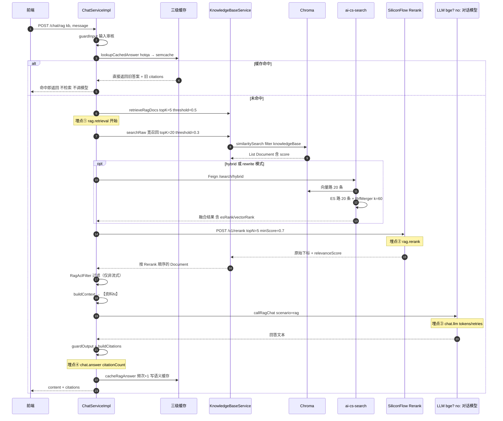

# RAG 全栈实战·知识点汇总：把 9 篇压成一张"症状 → 环节"的检索地图

> 一句话结论：RAG 的十个环节里任何一个"静默降级"，最终都表现为同一句话——"我暂时没有这方面的资料"；所以真正要背的不是参数表，而是**每个环节坏掉时留下的那条独有痕迹**，看到痕迹就能一步定位到环节。
> 阅读前置：读过本模块 [01-RAG检索增强生成.md](01-RAG检索增强生成.md)、[03-RAG向量检索实战.md](03-RAG向量检索实战.md)、[04-RAG进阶实战-Rerank重排序.md](04-RAG进阶实战-Rerank重排序.md)；知道"向量""余弦相似度""topK"是什么即可，不需要数学推导；能看懂 Spring Boot 的 `@Value` 默认值与 `@Bean` 装配。
> 证据基线：Spring AI 2.1.0（`learning-docs/24-源码分析/assets/source/` 已入库摘录，并用 `jar tf` 静态核对了 m2 里的 jar 结构）/ Spring Boot 4.2.0 / JDK 17 / 本项目 `ai-cs-chat`、`ai-cs-knowledge`、`ai-cs-search` 当前工作区代码。预计阅读 50~60 分钟。

本篇的证据边界先摊开，后面每一条结论都能对回这张表：

| 类别 | 本仓状态 | 本篇怎么处理 |
| --- | --- | --- |
| Spring AI 框架源码（RAG 与向量存储） | `24-源码分析/assets/source/` 已入库 2.1.0 摘录：`VectorStore.java.md`、`SearchRequest.java.md`、`TokenTextSplitter.java.md`、`Document.java.md`、`RetrievalAugmentationAdvisor.java.md`、`VectorStoreDocumentRetriever.java.md`、`ConcatenationDocumentJoiner.java.md`、`ContextualQueryAugmenter.java.md`、`RewriteQueryTransformer.java.md`、`Query.java.md` 等 | 唯一 A 级来源；行号即摘录文件的行号，逐段引用 |
| Spring AI 模块与类归属 | m2 实测：`spring-ai-vector-store-advisor-2.1.0.jar`、`spring-ai-vector-store-2.1.0.jar`、`spring-ai-advisors-vector-store-1.1.4.jar` 均在；**没有 `spring-ai-rag`** | C 级：`jar tf` 列出类清单，用来证明"哪个类在哪个模块、本项目到底有没有" |
| 本项目 chat / knowledge / search 三服务代码与配置 | 真实存在，行号已逐行 `read` 核对 | B 级：路径 + `#L起-L止` |
| Chroma / Tika / Elasticsearch / RocketMQ 的客户端实现细节 | **未入库**（`assets/source/` 只收录 Spring AI 自身源码） | 依据官方文档 + 本项目真实调用点，凡涉实现细节处明确标注"未入库，依据官方文档/本项目代码" |
| 真实检索质量、召回率、延迟 | 本机 `docker`/`chroma`/`redis-cli` 全部 `NOT FOUND`，`8000`/`9200`/`6379` 端口不通（第 6 节给探测命令与真实输出）；本篇禁止启动服务、禁止联网 | 不写任何实测召回率/延迟数字；只给"怎么算"，以及可复现的静态核对与模拟推演 |

## 0. 先看现象

三个现场，都是"学过但用不出来"的典型：知识明明入库了、开关明明打开了、功能明明写完了，线上就是不生效。

### 现象 1：文档列表里有这篇文档，问它却说"没有这方面的资料"

`ai-cs-chat` 的日志（下面是源码里真实的日志模板，`{}` 里的值是我填的示例，不是跑出来的）：

```text
INFO  c.a.c.service.KnowledgeBaseService - 知识库[knowledge]宽召回完成: 命中0条
INFO  c.a.c.service.KnowledgeBaseService - 知识库[knowledge]检索完成(相似度排序): 召回0条 -> 返回0条
```

这两行来自 `ai-cs-chat/src/main/java/com/aics/chat/service/KnowledgeBaseService.java#L277-L277` 与同文件 `#L258-L258`。它们一出现，问题就锁定在"检索"而非"生成"：上下文压根没拼进去，Prompt 里放的是 `（未检索到相关资料）`（`ai-cs-chat/src/main/java/com/aics/chat/service/impl/ChatServiceImpl.java#L444-L445`）。

再看写入侧，`ai-cs-knowledge` 的向量化把知识库标识写成了**常量**，不是请求里的知识库：

```java
chunk.getMetadata().put("knowledgeBase", KNOWLEDGE_BASE);
```

`(src: KnowledgeVectorService.java#L80-L80)`（该常量定义见 `ai-cs-knowledge/src/main/java/com/aics/knowledge/service/KnowledgeVectorService.java#L52-L52`，值是 `"knowledge"`）

而检索侧用的是请求参数拼出来的过滤表达式 `${knowledgeBase} == '...'`（`ai-cs-chat/src/main/java/com/aics/chat/service/KnowledgeBaseService.java#L273-L273`）。**写入写死 `knowledge`、检索传 `product-manual`，两边永远对不上**——库里躺着向量，检索过滤条件却把它们全排除了。这就是"命中 0 条"最常见的根因：不是向量不准，是隔离键不一致。

### 现象 2：上传接口返回成功，`kb_document` 表里也有记录，但向量库里没有

`ai-cs-knowledge` 的日志（同样是真实模板 + 我填的示例值）：

```text
ERROR c.a.k.service.KnowledgeVectorService - 文档向量化失败: id=1203, err=Connection refused
WARN  c.a.k.mq.KnowledgeSyncConsumer - 向量化无内容/失败: action=CREATE, documentId=1203
```

第一行来自 `ai-cs-knowledge/src/main/java/com/aics/knowledge/service/KnowledgeVectorService.java#L89-L89`，第二行来自 `ai-cs-knowledge/src/main/java/com/aics/knowledge/mq/KnowledgeSyncConsumer.java#L70-L70`。**两条日志都没有异常抛出**：`vectorize()` catch 住后 `return 0`，Consumer 只是 `log.warn` 然后正常返回——对 RocketMQ 来说这就是 ACK，消息不会再投。于是 DB 有数据、向量库没有、接口 200，三方永远不一致。

这个坑的反讽之处在于类注释自己写着"天然可重试"（同文件 `#L43-L43` 区域），而实现把失败吞成了 `return 0`。

### 现象 3：混合检索开关打开了，效果一点没变——因为 ES 那一路永远是空的

`ai-cs-search` 的降级路径只会安静地走单路（`ai-cs-search/src/main/java/com/aics/search/hybrid/HybridSearchServiceImpl.java#L61-L68`）。为什么 ES 永远空？因为**没有任何代码把知识库文档写进 ES**：`ai-cs-knowledge` 整个模块 0 处 `elasticsearch|esClient|indexToEs` 引用，全仓唯一的 ES 写入点是搜索服务的 HTTP 接口 `ai-cs-search/src/main/java/com/aics/search/controller/SearchController.java#L75-L78`（`POST /search/index`），而知识库入库路径走的是 RocketMQ → `vectorStore.add`，从来没调过它。

顺带一提：`RagRetrieveProperties` 里三个增强开关默认全是 `false`（`ai-cs-chat/src/main/java/com/aics/chat/rag/retrieve/RagRetrieveProperties.java#L14-L20`），而 `tools/nacos-config/ai-cs-chat.yml#L21-L25` 也没有这三项——所以就算写了混合检索链路，**配置里根本没打开过**，`HybridRetriever` 每次都在第一道判断就降级回纯向量（`ai-cs-chat/src/main/java/com/aics/chat/rag/retrieve/HybridRetriever.java#L123-L126`）。

这些现象指向同一件事：**RAG 不是"检索 + 生成"两个动作，而是一条十环串联的流水线；每一环都有"出错就静默降级"的设计，而降级不等于报错——它只是让最终答案变得更像"我不知道"。** 所以排障的第一步永远不是换模型，而是找到"哪一环的痕迹出现了、哪一环的痕迹该出现却没出现"。

## 1. 整体地图

```mermaid
flowchart TD
  DB["① 文档入库<br/>knowledge_db.kb_document"] --> P["② 解析<br/>DocumentLoader / Tika / PDF Reader"]
  P --> SP["③ 切块<br/>TokenTextSplitter"]
  SP --> EM["④ 向量化<br/>EmbeddingModel bge-m3 / 哈希"]
  EM --> IX["⑤ 索引<br/>Chroma aics-knowledge / ES 索引"]
  IX --> RT["⑥ 检索<br/>向量 / BM25 / RRF 融合"]
  RT --> RK["⑦ 重排<br/>SiliconFlow Rerank"]
  RK --> AC["⑦.5 ACL 过滤<br/>RagAclFilter"]
  AC --> CT["⑧ 拼 Prompt<br/>buildContext + scenario=rag"]
  CT --> GN["⑨ 生成<br/>ResilientAiService → LLM"]
  GN --> CI["⑩ 引用<br/>buildCitations"]
  CA["缓存 hotqa / semcache"] -.命中直返.-> GN
  CA -.命中时跳过 ⑥⑦⑦.5⑧.-> CI
  DB -.MQ knowledge-doc-sync-topic.-> SP
```

> **读图说明**：三个最容易看错的箭头。第一，`DB -.MQ.-> SP` 是虚线：入库和解析之间隔着 RocketMQ，所以"表里有记录"和"向量化跑过了"是两件事，中间还可能丢消息（第 3 节症状 2）。第二，缓存节点的虚线跨过了 ⑥⑦⑦.5⑧ 四个环节：**缓存命中时既不检索也不做 ACL 过滤**，这是本篇里唯一"安全边界被旁路"的路径。第三，⑤ 索引分叉出 Chroma 与 ES 两个物理存储，但只有 Chroma 会被 `ai-cs-knowledge` 写——ES 那一路靠搜索服务自己的 HTTP 接口（见 §0 现象 3），所以图里它们虽然并排，数据来源完全不同。

读这张地图的正确姿势，是把它当"**排查路径**"而不是"架构图"：从最右边（⑩ 引用）往左倒推，每一个节点问一句"它坏掉时用户看到什么"。

- ⑩ 引用为空但答案像样 → 多半是 ⑥ 没命中，模型拿常识编的；
- ⑨ 报"AI 助手暂时繁忙" → 模型/网关层问题，与检索无关，别动参数；
- ⑧ 上下文里没有 `【资料1】` → ⑦.5 把候选全剔了，或 ⑦ 把候选全过滤了；
- ⑦ 精排日志缺席 → 降级（无 key / 超时 / 全被 `min-score` 滤掉）；
- ⑥ 命中 0 条 → ⑤ 数据没写进去，或 metadata 隔离键不一致；
- ⑤ 向量库无数据 → ④/③ 静默失败，或 MQ 消息没到。

这个倒推顺序的价值在于：**它把"猜"变成"查"**。十个环节里有八个只要一条日志就能排除，真正需要调参数的只有 ⑥⑦，而 ⑥⑦ 只在"前五环都确认正常"之后才值得动。

| 组件 | 责任（一句话） | 谁调用它 |
| --- | --- | --- |
| `KnowledgeServiceImpl` | 文档 CRUD，DB 落库后发 MQ 消息（不保证向量化成功） | `KnowledgeController` |
| `KnowledgeSyncProducer` / `KnowledgeSyncConsumer` | 投递与消费 `knowledge-doc-sync-topic`，按 `CREATE/UPDATE/DELETE` 分派 | RocketMQ |
| `KnowledgeVectorService` | 切块 + 打 metadata + `vectorStore.add` 写 Chroma | `KnowledgeSyncConsumer` |
| `DocumentLoader` | PDF / Tika / 纯文本三种解析器路由，异常一律返回空列表 | `KnowledgeBaseService.addFile` |
| `TokenTextSplitter` | 按 token 切块（默认 800 token/块、overlap 0） | knowledge 与 chat 两侧都用 |
| `EmbeddingModel` | 文本 → 向量（`@Primary` 的 bge-m3；无 key 时 `HashEmbeddingModel` 768 维兜底） | Chroma `VectorStore` 内部 |
| `ChromaVectorStore` | 向量存储与相似度检索，集合 `aics-knowledge` 三服务共用 | chat / knowledge / search |
| `KnowledgeBaseService` | 两阶段检索：宽召回 topK=20 + 阈值 0.3 → Rerank → 降级 | `ChatServiceImpl`、`HybridRetriever` |
| `HybridRetriever` | 四模式策略分派（VECTOR/HYBRID/REWRITE/GRAPH），两处降级都在 `hybrid()` 内 | `ChatServiceImpl.retrieveRagDocs` |
| `SiliconFlowRerankService` | 调 `/v1/rerank` 精排，四层降级 | `KnowledgeBaseService.search` |
| `RagAclFilter` | 库级 + 文档级 ACL 过滤，剔除的记 `RAG_ACL_DENIED` 审计 | `ChatServiceImpl`（仅非流式一处） |
| `ChatServiceImpl` | 编排：Guardrail → 缓存 → 检索 → ACL → 拼 Prompt → LLM → 引用 → 回填缓存 | `ChatController` |

## 2. 关键概念与关键类

术语先按"数据流经过的顺序"排；"本项目取值"一列全部有出处，不是通用建议值。

| 名称 | 位置 | 角色 | 关键方法 / 本项目取值 |
| --- | --- | --- | --- |
| Document | `Document.java.md` | 检索的最小单位：一段文本 + 元数据 + 可选 score | `getId()` / `getText()` / `getMetadata()` / `getScore()`；本项目 metadata 固定三键 `knowledgeBase`/`documentId`/`title` |
| Chunk（分块） | `TokenTextSplitter.java.md` | 长文档切成可独立检索的片段 | 默认 `chunkSize=800` token、`overlap=0`、`minChunkSizeChars=350`、`minChunkLengthToEmbed=5`、`maxNumChunks=10000`、`keepSeparator=true` |
| Embedding（向量化） | `EmbeddingModel` 抽象 | 文本 → 定长浮点向量 | 生产用 `BAAI/bge-m3`（`@Primary`）；兜底 `HashEmbeddingModel` 768 维 |
| 维度 | — | 向量长度，决定存储与相似度计算成本 | 哈希兜底 768；bge-m3 由模型输出（本项目不硬编码维度） |
| 余弦相似度 | Chroma 内部 | 两向量夹角，越大越相似 | 本项目不自己算，交给 `vectorStore.similaritySearch` |
| similarityThreshold | `SearchRequest.java.md` | 低于该分数的候选直接丢弃 | 框架默认 `SIMILARITY_THRESHOLD_ACCEPT_ALL = 0.0`；本项目宽召回用 `0.3` |
| topK | `SearchRequest.java.md` | 最多返回多少条 | 框架默认 `DEFAULT_TOP_K = 4`；`QuestionAnswerAdvisor` 用 5；宽召回固定 20 |
| 宽召回（recall） | `KnowledgeBaseService.searchRaw` | 低阈值、多取数，保证召回率 | `recall-top-k: 20` + `recall-threshold: 0.3`（`tools/nacos-config/ai-cs-chat.yml#L21-L25`） |
| 精排（Rerank） | `SiliconFlowRerankService` | 交叉编码器对"问题-片段"逐对打分重排 | `BAAI/bge-reranker-v2-m3`，`top-n: 5`，`min-score: 0.7`，`timeout-ms: 5000` |
| RRF（Reciprocal Rank Fusion） | `RrfMerger` / `MultiQueryMerger` | 只用**名次**融合多路结果，不信原始分数 | `score += 1/(k+rank)`，`k=60`（两处各自硬编码/配置） |
| 稀疏检索 / BM25 | ES `multiMatch` | 关键词精确匹配，擅长型号、SKU、错误码 | `multiMatch("title^2","content")`，`size=20`，`term` 过滤 `knowledgeBase` |
| 稠密检索 / dense | Chroma `similaritySearch` | 语义近似匹配，擅长同义改写 | 集合 `aics-knowledge`，`chromadb/chroma:0.5.20` |
| 混合检索 hybrid | `HybridSearchServiceImpl` | ES + 向量两路召回后 RRF 融合 | `RETRIEVE_TOP_K=20`、`RRF_K=60`；单路空则降级单路 |
| filterExpression | `VectorStoreDocumentRetriever.java.md` | 把"只能查哪个知识库"下推给向量库 | 文本表达式由 `FilterExpressionTextParser` 解析；本项目写法 `knowledgeBase == 'kb'` |
| knowledgeBase（隔离键） | metadata | 多租户/多库隔离的唯一依据 | 写入侧常量 `"knowledge"`；检索侧请求参数——**不一致就是现象 1** |
| ACL（检索期鉴权） | `ai-cs-chat/src/main/java/com/aics/chat/security/RagAclFilter.java` | 无权限文档不进 Prompt，模型无从引用 | 库级 + 文档级两级；仅 `ChatServiceImpl#L439` 一处调用（流式未接） |
| 查询改写（Query Rewrite） | `ai-cs-chat/src/main/java/com/aics/chat/rag/rewrite/QueryRewriteService.java` | 一题拆成 N 个子查询，各查一次再融合 | `count=3`，子查询上限 200 字符；`rewrite-enabled=false` |
| HyDE | 同上 | 先让模型"编"一段假答案再去检索，用答案的语义找文档 | `MAX_HYDE_LENGTH=800`；与改写同一条链路 |
| 语义缓存（semcache） | `SemanticCacheService` | 问题向量化后与历史问题算余弦，够像就直接返回旧答案 | `threshold: 0.92`、`max-entries: 200`、`ttl-hours: 168` |
| 热门问答缓存（hotqa） | `HotQaCacheService` | 同一问题被问够次数就提升为直出答案 | `promote-threshold: 3`、`ttl-hours: 24` |
| 向量缓存（veccache） | `VectorCacheStore` + `CachingEmbeddingModel` | 相同文本不重复调 Embedding API | `l1-max-entries: 4096`、`ttl-hours: 168` |
| golden 集 | `ai-cs-chat/src/main/resources/eval/` 目录下的 `golden-set.json` | 固定的"问题 + 期望文档 + 参考答"回归样本 | 20 条（`gc-001`~`gc-020`），字段 6 个 |
| Recall@k / MRR / HitRate | `ai-cs-chat/src/main/java/com/aics/chat/rag/eval/RetrievalMetrics.java` | 检索质量三指标 | 纯计算类；门禁阈值 `aics.eval.gate.*` 全为 `null` |
| Citation（引用溯源） | `ai-cs-chat/src/main/java/com/aics/chat/service/impl/ChatServiceImpl.java#L1041-L1078` | 把命中文档变成前端可点开的出处 | 五字段：`documentId`/`title`/`page_number`/`score`/`content` |
| 降级（degrade） | 各处 `catch` | 外围故障时回退主能力，不抛错不告警 | `RetrieveResult.degraded` + `degradeReason`；但**只写日志，不进 span** |
| documentId（关联键） | metadata | 删除、幂等、ACL、引用共用的唯一关联键 | knowledge 侧写父文档 id；chat 侧误写 `chunk.getId()` |
| RerankResultItem.index | `SiliconFlowRerankService` | 精排返回的是"原始列表下标"，不是文档本身 | 必须 `recallDocs.get(index)` 回取，顺序被改过就错位 |
| Mono / Reactor | `spring-webflux` | 单值异步容器：要么有值、要么空、要么错误 | Rerank 用 `Mono.empty()` 表达"降级"，这让"空"与"失败"不可区分 |
| SSE（流式） | `ChatController` | 服务端逐条推送事件；本项目用 `done` 事件补发 citations | 流式分支未接 ACL，是权限缺口所在 |
| Micrometer Observation | `TraceSpans` / `TraceContext` | 一次调用的观测单元，stop 时落成 span | `span.type` 约定 7 类：INTENT/RETRIEVAL/RERANK/LLM/TOOL/ANSWER/SAFETY |

读这张表时要抓住一个隐含结构：**前 10 行是"链路"，后 15 行是"横切关注点"**（隔离、权限、缓存、观测、评估）。链路决定"能不能答"，横切除非决定"敢不敢答、值不值得答"——线上事故里后者往往更贵。

## 3. 症状 → 根因 → 定位手法 → 修法

本篇主体。用法：拿到现象先在下表左列"对症"，再按第三列去验证——**不要跳过验证直接改**，RAG 里一半的"改好了"其实是别的原因碰巧生效。

| 症状（日志/表现） | 根因 | 定位手法 | 修法 |
| --- | --- | --- | --- |
| 宽召回 `命中0条`，但库里明明有文档 | 写入侧 `knowledgeBase` 常量 `"knowledge"` 与检索侧请求参数不一致（`KnowledgeVectorService.java#L52` vs `KnowledgeBaseService.java#L273`） | 打印两条链路的过滤值：写入看 `KnowledgeVectorService#L80`，检索看请求 `knowledgeBase` 参数 | 写入侧改用请求里的知识库标识；建一份知识库字典，禁止散落字符串 |
| 召回不为 0，但 Prompt 里是 `（未检索到相关资料）` | ACL 把命中文档全部剔除（库级直接整库置空） | 查审计事件 `RAG_ACL_DENIED`（`RagAclFilter.java#L50-L53`） | 先确认 `aics.security.rag-acl-*` 配置是否误配；ACL 命中要能看到"被剔除了几条" |
| 上传成功、DB 有记录、向量库没有 | `vectorize()` catch 后 `return 0`（`KnowledgeVectorService.java#L88-L91`），Consumer 只 `warn` 后 ACK | `grep "文档向量化失败"` / `grep "向量化无内容/失败"` | 失败要重抛触发 MQ 重试，或落补偿队列表；DB 增加 `vector_status` |
| 文档更新后检索到的还是旧内容 | Consumer 的 `UPDATE` 分支与 `CREATE` 走同一段代码，只 `vectorize` 不先删旧分块（`KnowledgeSyncConsumer.java#L60-L71`，与 `#L23-L26` 注释自称"先删旧分块"矛盾） | 统计同一 `documentId` 的向量条数是否随更新次数翻倍 | `UPDATE` 分支先 `deleteByDocumentId` 再 `vectorize`；或改用 `upsert` 的 replace-by-id 语义 |
| 同一文档重复上传，命中结果里出现多条完全相同的片段 | `VectorStore.add` 对重复 id 的行为"由 provider 决定"（`[[源码:VectorStore.java.md#L61-L66]]`），不是 replace | 按 `documentId` 聚合看分块数（需要 Chroma：`count` + metadata 过滤） | 换 `upsert`（2.1.0 新增，语义是 replace-by-id，见 `[[源码:VectorStore.java.md#L73-L97]]`）——**本项目未落地** |
| 召回了 20 条，返回的却是相似度序、且和问题不太相关 | Rerank 把候选全部按 `minScore=0.7` 过滤掉了，列表为空 → 静默走 `recallDocs.subList` 回退（`KnowledgeBaseService.java#L240-L257`） | 看日志里有没有 `Rerank精排完成: 召回20条 -> 返回N条`；没有就是走了回退 | 回退也打日志/打 span，别让"精排失效"看起来像"精排生效" |
| `RAG增强检索: mode=HYBRID, degraded=true` 从没出现过 | 三个开关默认 `false`（`RagRetrieveProperties.java#L14-L20`），nacos 里也没配 | `Select-String -Path tools/nacos-config/ai-cs-chat.yml -Pattern "hybrid"` → 无命中 | 在 nacos 补 `aics.rag.hybrid-enabled: true`，重启后确认日志出现该行 |
| 混合检索开了，`degraded=true` 一直为真，ES 恒空 | 知识库入库路径从不写 ES（knowledge 模块 0 处 ES 引用），ES 只能靠 `POST /search/index` 手工灌 | 看 `HybridSearchServiceImpl` 是否走了单路降级（`#L61-L68`） | knowledge 侧向量化成功后同步调搜索服务建索引（**未落地，属设计缺口**） |
| 混合检索偶发整体失败并回落纯向量 | 搜索服务 Feign 调用异常 → `HybridRetriever` `catch` 后降级（`HybridRetriever.java#L208-L212`） | `grep "搜索服务不可用"` | 给 Feign 配超时与熔断，并把降级原因打进 span |
| ES 明明写了索引却搜不到 | 索引名大小写：读侧统一 `kb.toLowerCase()`（`SearchServiceImpl.java#L225-L227`） | 对比写入时传的 index 参数与读侧的 `esIndexName(kb)` | 入口统一做 `toLowerCase`，或加常量表 |
| 精确型号/SKU 类问题永远答不准 | 纯向量对 token 级精确匹配不敏感，且 `hybrid` 默认关 | 同一 query 手动对比"纯向量"与"hybrid"的命中差异 | 开 hybrid；ES 侧保持 `title^2` 权重 |
| PDF 引用里 `page_number` 全空 | 只有 `PagePdfDocumentReader` 会写 `page_number`；Tika / TextReader 不写 | 看 citations 的 `page_number` 是否 `instanceof Number`（`ChatServiceImpl.java#L1065-L1068`） | 前端按"有没有页码"分两种引用样式，别显示 `null` |
| 长 PDF 只答出其中一页 | `withPagesPerDocument(1)` 让每页独立成 Document，跨页语义被切断（`DocumentLoader.java#L46-L53`） | 看答案覆盖范围是否总在同一页 | 调大 pagesPerDocument 或按标题层级合并 |
| 流式回答引用了无权限文档 | 流式分支只调 `retrieveRagDocs`，没有 `ragAclFilter.filter`（`ChatServiceImpl.java#L587-L594`） | `grep ragAclFilter` → 全仓只有 `#L439` 一处调用 | 流式分支补同一层过滤；把 ACL 下沉到检索器内 |
| 换了用户问同一个问题，答案直接是别人的 | 缓存 key 只有 `kb + 问题`，不含用户/角色（`HotQaCacheService.java#L64`、`SemanticCacheService.java#L68`） | 日志 `RAG对话命中缓存: … source=HOT_QA` | key 加 `userId`/角色维度；命中缓存后仍要过一遍文档级 ACL |
| 首字延迟高，用户以为卡死 | `Rerank` 是同步 `.block()`（`KnowledgeBaseService.java#L239-L239`），LLM 又串行在后 | 看 `rag.retrieval` 与 `rag.rerank` 两段耗时占比 | Rerank 与 Prompt 组装并行；先流式吐"正在查资料" |
| 成本突然翻倍，`promptTokens` 涨 | `QuestionAnswerAdvisor` 被 `defaultAdvisors` 挂到了**每个** ChatClient（`SpringAiConfig.java#L277-L289`），所有对话都在检索；宽召回 20 条也没截断 | 看 `chat.llm` span 的 `promptTokens` | 只在 RAG 场景挂 advisor；上下文按 token 预算截断 |
| 评估跑了但没有结论 | golden 只有 20 条、`aics.eval.gate.*` 全 `null`、CI 未接门禁 | 查配置里是否有 `aics.eval` 块 → 无 | 先配 `p95-latency-ms`/`avg-tokens-per-request`，再接 CI |

下面按环节分段精读。每段固定四层：**在干什么**（这段代码的执行事实）→ **为什么这么设计**（它要解决什么）→ **换写法会怎样**（另一种实现会引入什么代价）→ **常见坑**（本项目的真实偏差）。为控制表格宽度，上表左列与"定位手法"列对部分类名用了简写（如 `KnowledgeVectorService.java#L52`），其完整路径见第 2 节"位置"列或按 `ai-cs-knowledge/src/main/java/com/aics/knowledge`、`ai-cs-chat/src/main/java/com/aics/chat` 两个根目录补全；下文正文引用一律写完整路径。

### 3.1 写入：为什么"写入成功"不等于"检索得到"

**在干什么**：`KnowledgeVectorService.vectorize` 拿文档内容 → `TokenTextSplitter.split` 切块 → 每块写三个 metadata → `vectorStore.add(chunks)` → 返回块数。整段被一个 `try/catch` 包住，`catch` 里 `log.error` 后 `return 0`（`ai-cs-knowledge/src/main/java/com/aics/knowledge/service/KnowledgeVectorService.java#L88-L91`）。

**为什么这么设计**：向量库是"外部依赖"，作者希望向量化失败不要把文档入库流程带崩，于是用"返回 0 表示没切出块"和"抛异常"折中成"永远不抛"。消费端据此判断 `chunks>0` 打 info、否则打 warn（`KnowledgeSyncConsumer.java#L68-L70`）。

**换写法会怎样**：写入链路有三次"口头成功"——DB insert 成功、MQ 发送成功（`catch` 只 warn，`ai-cs-knowledge/src/main/java/com/aics/knowledge/mq/KnowledgeSyncProducer.java#L56-L59`）、消费返回成功（`catch` 不重抛）。若其中任何一处改成"失败即抛"，配合对应层的重试，三方最终会一致；而当前写法下，三者可以同时"成功"而向量库为空。

**常见坑**：①把 `documentId` 写成**分块自己的 id**——`KnowledgeBaseService.addChunks` 写的是 `chunk.getId()`（`ai-cs-chat/src/main/java/com/aics/chat/service/KnowledgeBaseService.java#L168-L175`），而 knowledge 侧写的是父文档 id（`KnowledgeVectorService.java#L81-L81`），两条写入路径语义不一致，删除与 ACL 的 `docKey` 必然对不上（`RagAclFilter.java#L86-L89` 优先取 `metadata.documentId`）。②`UPDATE` 与 `CREATE` 走同一分支，更新后旧分块不删，条数随更新次数增长。

### 3.2 检索入口：`search` 的两阶段与"参数名骗人"

**在干什么**：`KnowledgeBaseService.search(kb, query, topK, threshold)` 用**字段上的** `recallTopK`/`recallThreshold` 调 `searchRaw` 宽召回（`ai-cs-chat/src/main/java/com/aics/chat/service/KnowledgeBaseService.java#L228-L230`），再按 `ObjectProvider<RerankService>` 有无决定要不要精排，最后按 `item.getIndex()` 从宽召回列表回取文档。

**为什么这么设计**：两阶段是为了"召回率交给宽召回、精确率交给精排"——宽召回宁可多收，精排再收敛到 topN。把 `topK` 与 `threshold` 都做成入参，本意是让调用方（对话 / 混合检索 / 图谱）各自微调。

**换写法会怎样**：只召回 5 条（省掉宽召回）会让 Recall@5 直接掉，因为没有候选给精排纠错；反过来把 20 条全塞进 Prompt，模型容易"照着不相关的资料编"，`promptTokens` 也线性涨。

**常见坑**：入参 `topK`/`threshold` **完全没被使用**——`ChatServiceImpl` 传的是 `retrieveRagDocs(kb, message, 5, 0.5, …)`（`ChatServiceImpl.java#L437-L437`），线上却始终按 20/0.3 走。在调用点把阈值改成 0.8 观察"效果变化"，是这个项目里最典型的假动作。

### 3.3 精排：为什么 Rerank 的降级是"静默"的

**在干什么**：`SiliconFlowRerankService.rerank` 先判 `apiKey` 空或文档空 → `Mono.empty()`；否则 `Mono.fromCallable(doRerank).subscribeOn(boundedElastic()).timeout(5000).onErrorResume(...)`（`ai-cs-chat/src/main/java/com/aics/chat/rag/rerank/SiliconFlowRerankService.java#L126-L160`）。`doRerank` 只保留 `relevanceScore >= minScore` 并按分数降序（`#L195-L198`）。

**为什么这么设计**：精排是"锦上添花"的旁路——没有它仍能按相似度给出答案，所以作者把四类失败（无 key、超时、异常、全被阈值过滤）都收敛成"空结果 + 降级日志"，保证主链路永不因精排失败而报错。

**换写法会怎样**：若让 `rerank` 返回 `Optional<List<Document>>`，空就是空，调用方必须显式决定要不要退化并打 `degradedReason`——这正是 `HybridRetriever` 的 `RetrieveResult.degraded/degradeReason` 已经做对的地方（`ai-cs-chat/src/main/java/com/aics/chat/rag/retrieve/HybridRetriever.java#L119-L145`）。同一系统里两种风格并存，正是"同一份知识只能用在原地"的原因。

**常见坑**：以为 `min-score: 0.7` 是"及格线"。bge-reranker 的相关性分数量纲不同于向量余弦，0.7 对某些语料等于"全军覆没"，于是 `reranked` 为空、静默回退相似度序，而调用方看到的是"返回了 N 条"，一切正常。

### 3.4 切块：默认参数悄悄决定了召回上限

**在干什么**：knowledge 与 chat 两侧都用 `new TokenTextSplitter()`，一个参数都不传（`KnowledgeVectorService.java#L77-L77`、`KnowledgeBaseService.java#L161-L161`），于是全部取默认值：

```java
public static final int DEFAULT_CHUNK_SIZE = 800;
public static final int DEFAULT_CHUNK_OVERLAP = 0;
public static final int MIN_CHUNK_SIZE_CHARS = 350;
public static final int MIN_CHUNK_LENGTH_TO_EMBED = 5;
public static final int MAX_NUM_CHUNKS = 10000;
public static final boolean KEEP_SEPARATOR = true;
```

`(src: TokenTextSplitter.java.md#L56-L70)`

**为什么这么设计**：切块是"召回粒度的旋钮"——块太大，一个向量平均掉多个主题，相似度被稀释；块太小，单块信息不足，模型要靠跨块推理。默认 800 token 是英文语料的经验值，`overlap=0` 是为了让块数最少、成本最低。

**换写法会怎样**：把 `overlap` 调到 100~200 会让跨块句子有两份拷贝，缓解"答案被切在边界上"的问题，代价是向量条数与 embedding 成本同比上升；把 `chunkSize` 调到 300 会让短问答更准，但需要多跳推理的问题（"先看 A 再对 B"）反而答不出。

**常见坑**：①`MIN_CHUNK_LENGTH_TO_EMBED = 5` 意味着少于 5 个字符的碎片被直接丢弃（`[[源码:TokenTextSplitter.java.md#L206-L210]]`），表格式 PDF 解析出来的零碎单元格会整批消失；②默认切块不认标题层级，`【资料N】` 拼起来后模型看不到"这段属于第几章"，所以引用只能靠 `title` + `page_number`。

### 3.5 融合：RRF 为什么只信名次

**在干什么**：`HybridSearchServiceImpl` 先并行拿 ES 与向量两路各 20 条（`ai-cs-search/src/main/java/com/aics/search/hybrid/HybridSearchServiceImpl.java#L52-L53`、`#L41-L41`），再 `RrfMerger.merge(esItems, vectorItems, topK, RRF_K)`，融合公式是 `scores.merge(id, 1.0 / (k + rank), Double::sum)`（`ai-cs-search/src/main/java/com/aics/search/hybrid/RrfMerger.java#L66-L66`）。

**为什么这么设计**：BM25 分数是无界的正数、余弦相似度在 0~1 之间，两者**量纲不同、分布不同**，直接相加就等于让 ES 的单方面高分垄断排序。RRF 只取名次，天然免疫量纲问题，还省掉了每路分数的归一化。

**换写法会怎样**：改成"加权分数融合"（`0.7*cos + 0.3*bm25_norm`）在调好权重时效果更好，但权重必须跟着语料重新标定；而名次融合在语料变化时不需要重调——这是"先能跑"与"跑得最好"的取舍，工程上通常先选前者。

**常见坑**：①两路对齐键是"ES `_id` == Chroma `metadata.documentId`"（`HybridSearchServiceImpl.java#L136-L137`），任一侧 id 体系变了（比如 chat 侧写 `chunk.getId()`）就会退化成"两路互不相识、谁都不加分"；②`fillMissing` 只补空字段不覆盖（`RrfMerger.java#L78-L97`），所以同一 doc 两路的 `title` 不一致时，先到的那份赢——排序键与展示字段来自不同副本，是很隐蔽的一类 bug。

### 3.6 安全边界：ACL 与缓存的两条旁路

**在干什么**：`RagAclFilter.filter` 先做库级判断——不通过就整库置空并记 `RAG_ACL_DENIED` 审计；再做文档级逐条剔除（`ai-cs-chat/src/main/java/com/aics/chat/security/RagAclFilter.java#L39-L69`）。它只在 `ChatServiceImpl` 的非流式分支被调用一次（`ChatServiceImpl.java#L439-L439`）。

**为什么这么设计**：把 ACL 放在"检索之后、拼 Prompt 之前"，可以让无权限文档根本不进上下文——模型没看过的东西不可能说出来。放在生成之后去删改，等于指望模型忘掉它刚读过的东西。

**换写法会怎样**：把 ACL 下沉到 `VectorStore` 的 `filterExpression` 里（例如 `knowledgeBase == 'kb' and docId in [...]`）能省掉一次内存过滤，还天然覆盖所有调用路径；代价是过滤表达式随权限模型变复杂，且向量库对表达式语法支持有限（本项目用的是纯字符串拼接，见 `KnowledgeBaseService.java#L273-L273`，有注入风险）。

**常见坑**：①流式分支根本没过滤（`ChatServiceImpl.java#L587-L594`），流式与非流式的权限行为不一致；②缓存命中直接返回旧答案，绕过了全部检索与过滤，而缓存 key 只有 `kb + question` 不含用户身份——**同一个知识库的两个用户会互相"看到"对方的答案**。

### 3.7 拼 Prompt：为什么"没有资料"必须显式说出来

**在干什么**：`buildContext` 把文档拼成 `【资料1】…【资料2】…`（`KnowledgeBaseService.java#L287-L293`），再由 `promptRegistry.render("rag", {context, message})` 渲染成最终 Prompt（`ChatServiceImpl.java#L441-L450`），模板里明确写了"请严格基于下面的【知识库资料】回答用户问题"与"如果资料中没有相关信息，请如实告知"（`ai-cs-chat/src/main/resources/application-prompt.yml#L61-L63`）。

**为什么这么设计**：RAG 的最大风险不是"不知道"，而是"不知道却编"。模板里那句"没有相关信息请如实告知"就是压低幻觉的指令锚点，业界同款做法在框架里是 `ContextualQueryAugmenter` 的默认模板与 `allowEmptyContext=false`（`[[源码:ContextualQueryAugmenter.java.md#L68-L92]]`）。

**换写法会怎样**：若省略"没资料要如实说"，模型会把通用常识混进答案，看起来"什么都能答"，实际无法溯源；若把 `【资料N】` 编号去掉，引用就无法与答案句子对应，`buildCitations` 也失去了锚。

**常见坑**：①上下文不按 token 预算截断，20 条宽召回全塞进去，指令被稀释、`promptTokens` 飙升；②`QuestionAnswerAdvisor` 通过 `defaultAdvisors` 挂在了每个 ChatClient 上（`SpringAiConfig.java#L277-L289`），连不需要检索的普通对话也会注入上下文——这是"成本翻倍"最容易被忽略的来源。

### 3.8 生成与引用：为什么出处来自 metadata 而不是模型

**在干什么**：`buildCitations` 遍历检索结果，从 metadata 取 `documentId`/`title`/`page_number`/`score` 并截取 `content`，同时做防御式转换：`documentId` 转 `Long` 失败就跳过这一条、`page_number` 必须 `instanceof Number` 才用（`ai-cs-chat/src/main/java/com/aics/chat/service/impl/ChatServiceImpl.java#L1041-L1078`）。

**为什么这么设计**：模型不会准确复述文档 id，让它"自己报出处"必然编造。把出处与答案解耦——答案由模型写，出处由检索结果给——是唯一可靠的做法；框架层面同类能力是 `after()` 把文档写进 `ChatResponse.metadata["rag_document_context"]`（`[[源码:RetrievalAugmentationAdvisor.java.md#L175-L186]]`）。

**换写法会怎样**：让模型在正文里输出 `[1][2]` 再由前端解析，看似更"自然"，但编号一旦对不上就是错误引用；而"引用列表与答案文本并行返回"的代价是用户可能看到"答案提到但引用里没有"的情况，需要前端明确提示。

**常见坑**：①流式分支里 citations 必须先缓存、随 `done` 事件一次性下发（`ChatServiceImpl.java#L748-L792`），否则前端拿到答案时还没有出处；②`title` 在两条写入路径来源不同（knowledge 侧取文档标题、chat 侧 `extractTitle`），同库不同文档的标题风格会不一致。

### 3.9 评估闭环：为什么"有 golden 集"不等于"有质量门禁"

**在干什么**：`GoldenCaseLoader` 从 `classpath:eval/golden-set.json`（或 `file:` 前缀的外部路径）读样本（`ai-cs-chat/src/main/java/com/aics/chat/rag/eval/GoldenCaseLoader.java#L32-L40`）；`RetrievalMetrics` 提供 `recallAtK`/`mrr`/`hitRate`（`ai-cs-chat/src/main/java/com/aics/chat/rag/eval/RetrievalMetrics.java#L23-L36`）；`EvalGateConfig` 声明 `p95LatencyMs` 与 `avgTokensPerRequest` 两个门禁阈值（`ai-cs-chat/src/main/java/com/aics/chat/rag/eval/EvalGateConfig.java#L34-L43`）。

**为什么这么设计**：RAG 的改动（换 embedding、调阈值、改切块）几乎不会让接口报错，只会让答案慢慢变差。所以必须有一套"离线可比"的基准，把主观的"感觉不准"变成客观的 `Recall@k`。阈值做成可配、默认 `null`，本意是"先不卡，等基线稳定再开"。

**换写法会怎样**：如果门禁阈值一上线就硬卡，团队会为了过门禁而改样本，而不是改系统；反之像现在这样长期 `null`，评估就退化成"一个能跑但没人看的脚本"。中间路线是"先只做趋势告警（不 fail），连续 N 次下降才拦"。

**常见坑**：①20 条样本、单知识库（`product-manual`），抖动一条就是 5 个百分点，统计意义不足；②`tools/nacos-config/ai-cs-chat.yml` 里根本没有 `aics.eval` 块，阈值等于永远是 `null`；③CI 未接评估，"改坏了"只能等用户反馈——这三条合起来说明**评估体系本身尚未落地**。

### 3.10 三级缓存：省钱的代价是"绕过一切校验"

**在干什么**：`HotQaCacheService` 用 Redis ZSet 记频次，同一问题被问到 `promote-threshold=3` 次就提升为直出答案（`ai-cs-chat/src/main/java/com/aics/chat/cache/HotQaCacheService.java#L97-L100`）；`SemanticCacheService` 把新问题向量化后与历史问题算余弦，`>= 0.92` 就命中（`ai-cs-chat/src/main/java/com/aics/chat/cache/SemanticCacheService.java#L81-L99`）；`VectorCacheStore` + `CachingEmbeddingModel` 保证同一文本不重复调 embedding（`VectorCacheStore.java#L59-L94`）。

**为什么这么设计**：RAG 一次问答要花一次 embedding + 一次 rerank + 一次 LLM，成本与延迟都在百毫秒到秒级。客服场景的问题分布高度集中（前 20 个问题占大多数），缓存能直接砍掉 60% 以上的 LLM 调用——这是"把钱花在长尾上"的经典做法。

**换写法会怎样**：不做语义缓存只做精确匹配，命中率会大幅下降（用户换个说法就miss）；不做频次提升，热门问题每次都重新生成，答案还会因为模型随机性而不一致。但如果缓存 key 带上 `userId`，命中率又会掉——**这正是本项目现在选择"不带 userId"的原因，也是它最大的安全缺口**。

**常见坑**：①缓存命中路径跳过检索、跳过 ACL、跳过评估（`ChatServiceImpl.java#L425-L433` 命中后直接返回且不触发 `triggerOnlineEval`），所以线上指标会"看起来很好"而问题被掩盖；②语义缓存阈值 0.92 在高维空间里并不严，"退款流程是什么"与"退款要多久"可能被判为同一问题；③`VectorCacheStore` 的 L2 失败会静默降级 L1-only（`VectorCacheStore.java#L75-L75`），表现为"embedding 调用量突然上升"而不是报错。

## 4. 一次完整执行时序



> **读图说明**：`alt 缓存命中` 这一支要连着看——它是唯一不经过 ⑦⑦.5⑧ 的路径，所以"缓存命中"既省了钱也省掉了 ACL。`opt hybrid` 分支里两路召回是**并行**的（`HybridSearchServiceImpl` 先各自拿到列表再融合），所以只看总耗时无法判断是谁慢。最容易被忽略的是 `KB-->>CS` 与 `CS->>RR` 之间的顺序：Rerank 用的是**宽召回那 20 条**的下标（`item.getIndex()` 回取 `recallDocs.get(idx)`，`KnowledgeBaseService.java#L242-L247`），一旦宽召回的列表被任何后处理改过顺序，回取就会错位。

五个可观测埋点与"该看什么"（前四个是 Micrometer Observation，第五个目前只是日志）：

| # | 埋点 | 类型 / 名字 | 关键字段 | 该看的指标 | 缺了会怎样 |
| --- | --- | --- | --- | --- | --- |
| ① | 检索 | `RETRIEVAL` / `rag.retrieval`（`ChatServiceImpl.java#L931-L939`） | low：`span.type`、`knowledgeBase`；high：`query`、`topK`、`hybrid`、`rewrite`、`hitCount`、`detail` | `hitCount` 的分布（0 占比就是"检索失灵率"）、检索段耗时 | 只能看到"答案不好"，看不到"根本没召回" |
| ② | 重排 | `RERANK` / `rag.rerank`（`SiliconFlowRerankService.java#L145-L149`） | low：`model`；high：`beforeCount`、`query` | 调用次数 vs 检索次数（差值 = 降级率）、耗时 | Rerank 静默失效永远发现不了 |
| ③ | 生成 | `LLM` / `chat.llm`（`ResilientAiService.java#L470-L471`） | low：`span.type`/`provider`/`model`；high：`promptTokens`、`completionTokens`、`retries` | 单次 `promptTokens`（上下文膨胀）、重试率 | 成本归因不到"检索塞太多"这一因 |
| ④ | 回答 | `ANSWER` / `chat.answer`（`ChatServiceImpl.java#L997-L1004`） | high：`citationCount`、`answerLength` | `citationCount=0` 的占比（幻觉高危面）、答案长度分布 | 无法区分"没资料"与"有资料但模型没用" |
| ⑤ | 降级 | 结构化日志（**尚无 span**）：`RAG增强检索: mode=…, degraded=…, hits=…`（`ChatServiceImpl.java#L951-L952`）、`宽召回完成: 命中{}条`（`KnowledgeBaseService.java#L277`）、`Rerank精排完成`（`#L248`） | mode / degraded / hits / 前后条数 | `degraded=true` 的占比、`召回20 → 返回N` 的落差 | 降级完全不可见——这是本篇最大的一处观测缺口 |

失败在哪一步、报什么：

| 失败步骤 | 现象 | 报错原文 / 痕迹 |
| --- | --- | --- |
| ③ 切块 | 文档入库但永远是 0 块 | `文档内容为空，跳过向量化: id=…`（`KnowledgeVectorService.java#L71`） |
| ④ 向量化 | 接口 200、向量库无数据 | `文档向量化失败: id=…, err=…` + `向量化无内容/失败`（`#L89`、`KnowledgeSyncConsumer.java#L70`） |
| ⑤ 索引（ES） | hybrid 恒单路 | 无报错，只有 `HybridSearchServiceImpl` 的单路降级日志 |
| ⑥ 检索 | 命中 0 条 | `宽召回完成: 命中0条` |
| ⑦ 重排 | 精排被跳过 | 缺 `Rerank精排完成` 日志；`Rerank降级` info（`SiliconFlowRerankService.java#L129-L133`） |
| ⑧ 拼 Prompt | 上下文是"未检索到相关资料" | `ChatServiceImpl.java#L445` 的三元兜底 |
| ⑨ 生成 | 降级兜底文案 | `AI 助手暂时繁忙，请稍后重试。`（`ai-cs-chat/src/main/java/com/aics/chat/service/impl/ResilientAiService.java#L448-L455`；流式则前置 `[ERROR]`，同文件 `#L261`） |
| ⑦.5 ACL | 回答"无权访问" | 审计事件 `RAG_ACL_DENIED`，`filter` 返回 `List.of()` |

为什么这五个埋点必须按这个顺序读？因为它们的**因果是单向的**：① 的 `hitCount=0` 会让 ② 根本不发生（没有候选可排），② 的降级会让 ④ 的 `citationCount` 掉下来，③ 的 `promptTokens` 异常只可能来自 ⑧ 塞了太多资料。所以正确读法是"从①往④顺着找第一个异常点"，反过来（先看答案质量再回头看）会同时看到多个异常，无法归因。

再补一句关于 ⑤ 的定位：降级日志目前**不是** Micrometer 指标，只能靠文本检索。这也是为什么第 6 节的手法里，前两条都是"用日志把中间产物打出来"——在没有 metric 的阶段，日志就是唯一的时间序列。

## 5. 参数调优表

每个参数都给"调大/调小各自的后果"和"怎么验证"——**验证一律优先用 golden 集的 `Recall@k`/`HitRate`，不要靠肉眼感觉**。

| 参数 | 位置 | 调大 | 调小 | 怎么验证 |
| --- | --- | --- | --- | --- |
| `aics.rag.recall-top-k`（20） | `tools/nacos-config/ai-cs-chat.yml#L21-L25` | 召回候选更多，Rerank 有更多纠错机会，但耗时与 token 涨 | 精排无米下锅，`Recall@k` 掉 | golden 集跑 `Recall@k`；同时看 `rag.retrieval` 耗时 |
| `aics.rag.recall-threshold`（0.3） | 同上 | 噪声少、命中少；小于 0 会退化成"全收" | 噪声多、Prompt 被稀释 | 统计 `hitCount=0` 占比 vs 答案正确率，找拐点 |
| `QuestionAnswerAdvisor` 的 `topK`（5） | `SpringAiConfig.java#L266-L274` | 进 Prompt 的资料更多，成本与幻觉风险升 | 上下文不足，答不全 | `chat.llm` 的 `promptTokens` 与 `citationCount` 联看 |
| `QuestionAnswerAdvisor` 的 `similarityThreshold`（0.3d） | 同上 | 只留高分片段，可能"什么都不剩" | 低分片段混入 | 临时设 0.9 验证"阈值方向是否起作用" |
| `aics.rerank.top-n`（5） | `tools/nacos-config/ai-cs-chat.yml#L11-L19` | 返回更多精排结果，Prompt 更长 | 可能漏掉第二条相关资料 | 对比 `Recall@5` 与 `Recall@10` |
| `aics.rerank.min-score`（0.7） | 同上 | 过滤狠，容易整列为空→静默回退 | 几乎不过滤，等于没精排 | 看 `Rerank精排完成` 的"返回N条"是否等于"召回20条" |
| `aics.rerank.timeout-ms`（5000） | 同上 | 等待更久，尾部延迟变差 | 高峰必超时→全体回退相似度序 | 统计 Rerank span 的超时率 |
| `aics.rag.rrf-k`（60） | `RagRetrieveProperties.java#L23` | 名次差异被抹平，融合更"民主" | 靠前名次权重放大，头部效应强 | 用 §6 的 RRF 模拟脚本对比列表顺序 |
| `aics.rag.hybrid-enabled`（false） | 需在 nacos 新增 | 开启 ES+向量融合，精确词命中变好 | 精确型号类问题继续答不准 | 日志出现 `RAG增强检索: mode=HYBRID` 且 `degraded=false` |
| `aics.rag.rewrite-enabled`（false） | 需在 nacos 新增 | 一题多查，召回更全，但多一次 LLM 调用 | 口语化问题召回不足 | 看 `rewrite` 场景的 LLM span 是否出现、`hits` 是否上升 |
| `aics.rag.graph-enabled`（false） | 需在 nacos 新增 | 图谱优先，多跳问题变好 | — | 日志 `图谱未命中，降级普通检索` 出现频率 |
| ES `size`（20） / `title^2` | `HybridSearchServiceImpl.java#L86-L91` | 关键词路候选更多 | 关键词路覆盖不足 | 对比同一 query 的 `esRank` 与 `vectorRank` |
| `aics.cache.semantic.threshold`（0.92） | `application.yml#L170-L193` | 只认几乎相同的问题，命中率低但更安全 | 相似但语义不同的问题被误命中，答非所问 | 日志 `语义缓存命中: … score=` 抽样人工看 |
| `aics.cache.hot-qa.promote-threshold`（3） | 同上 | 更难成为热门，直出更保守 | 噪声问题快速变"标准答案" | 看 hotqa `topQuestions` 榜单质量 |
| `TokenTextSplitter` 默认 `chunkSize`（800） | 两处都用 `new TokenTextSplitter()`：`KnowledgeVectorService.java#L77`、`KnowledgeBaseService.java#L161` | 单块语义更完整，但可能超模型上下文、相似度被平均掉 | 片段更精准，但答案被切碎、跨块推理变差 | 同一文档两种切法各建一个库，比 `HitRate` |
| `aics.eval.gate.p95-latency-ms` / `avg-tokens-per-request`（null） | `ai-cs-chat/src/main/java/com/aics/chat/rag/eval/EvalGateConfig.java#L34-L43` | 阈值收紧，门禁更严 | `null` 等于不判定，永远放行 | 配一个值后跑评估，确认能 FAIL |
| 改写子查询数 `count`（3） | `ai-cs-chat/src/main/resources/application-prompt.yml#L50-L50` | 覆盖更多表述角度，但 LLM 调用与检索次数同步涨 | 改写收益有限，口语化问题召回不足 | 对比开/关改写时 `hitCount` 与端到端耗时 |
| `TokenTextSplitter` 的 `maxNumChunks`（10000） | `[[源码:TokenTextSplitter.java.md#L56-L70]]` | 超长文档不会被截断（但也可能写爆向量库） | 超长文档后半部分直接丢弃且**无告警** | 对最长的一篇文档统计块数是否恰好等于上限 |
| `MAX_HYDE_LENGTH`（800） | `ai-cs-chat/src/main/java/com/aics/chat/rag/rewrite/QueryRewriteService.java#L77-L78` | 假答案更完整，语义信息更多，但多花 token | 假答案过短，等价于只做关键词扩写 | 看 HyDE 那一路的 `hits` 是否比其他子查询更高 |

## 6. 踩坑与调试手法

**手法 1：先看 `hitCount`，再怀疑模型。** 任何"答不准"先分成两半：召回 0 条是检索问题，召回 N 条但答错是生成问题。`rag.retrieval` span 的 `hitCount` 就是这条分界线（`ChatServiceImpl.java#L972-L973`）。没有 trace 后端时，退化成看日志 `宽召回完成: 命中{}条`。

**手法 2：判别实验设计——"检索问题还是生成问题"。** 三段对照，缺一段就会误判：

1. **A 段（检索层）**：把 `retrieveRagDocs` 的返回值在日志里打成 `docIds + score`（现有 `detail` 字段已支持，limit 20）。若目标文档不在 → 检索问题，进 2；若在 → 进 3。
2. **B 段（准入层）**：检查 `RagAclFilter` 过滤前后条数、`buildContext` 的字符长度、Prompt 里是否真的出现了目标片段。若被 ACL 剔除或 context 为空 → 权限/阈值问题，不是算法问题。
3. **C 段（生成层）**：**保持 context 不变，把模型换成最简单的追问**——例如在同一次会话里追问"刚才资料里第 N 条写了什么"。若模型能复述资料原文却答不出问题 → 是 Prompt/指令问题（`application-prompt.yml#L63` 的模板约束太弱）；若连复述都做不到 → 是上下文太长被截断或模型能力问题。

这个设计的价值在于**它不是"再问一次"，而是把同一个 query 的中间产物冻结下来做对照**——只有中间产物可比，"换模型/换参数"才有意义。

**手法 3：静态核对"配置到底生效了没"。** 本项目大量使用 `@Value("${...:默认值}")` 与 `@ConfigurationProperties`，缺配置不报错、静默取默认值。核对命令与真实输出：

```powershell
cd D:\Projects\Persion\ai-customer-service
Select-String -Path tools\nacos-config\ai-cs-chat.yml -Pattern "hybrid|rewrite|graph|recall"
```

```text
tools\nacos-config\ai-cs-chat.yml:22:  recall-top-k: 20
tools\nacos-config\ai-cs-chat.yml:23:  recall-threshold: 0.3
```

怎么读：**只有两行命中**，说明 `hybrid-enabled`/`rewrite-enabled`/`graph-enabled` 三个键压根没配 → 依赖 `RagRetrieveProperties` 的字段默认值 `false`。所以"我打开了混合检索"这句话，在这份配置下必然为假。

**手法 4：用 `jar tf` 确认"类到底在不在 classpath"。** Spring AI 2.1.0 把 advisor 模块改过名，只看文档会怀疑人生：

```powershell
$m2 = "$env:USERPROFILE\.m2\repository\org\springframework\ai"
& jar tf "$m2\spring-ai-vector-store-advisor\2.1.0\spring-ai-vector-store-advisor-2.1.0.jar" |
  Select-String "QuestionAnswerAdvisor"
```

```text
org/springframework/ai/chat/client/advisor/vectorstore/QuestionAnswerAdvisor$Builder.class
org/springframework/ai/chat/client/advisor/vectorstore/QuestionAnswerAdvisor.class
```

怎么读：类还在，位于 `spring-ai-vector-store-advisor`（2.1.0 的模块名），包路径与 1.1.4 的 `spring-ai-advisors-vector-store` 完全一致——所以"升级后 import 不变、依赖坐标变了"是这次升级的典型坑（详见 §7）。

**手法 5：用 node 复算 RRF，验证"只按名次融合"到底意味着什么（模拟推演）。** 假设两路各给 3 条，`k=60`：

```javascript
const K = 60, f = r => 1 / (K + r);
const vec = [['docA',1],['docB',2],['docC',3]];   // 向量路名次
const es  = [['docB',1],['docD',2],['docA',3]];   // ES 路名次
const m = new Map();
const add = (list, w) => list.forEach(([d,r]) => {
  const o = m.get(d) || { d, s: 0 };
  o.s += f(r); o[w] = r; m.set(d, o);
});
add(vec,'vec'); add(es,'es');
[...m.values()].sort((a,b)=>b.s-a.s)
  .forEach((o,i)=>console.log(i+1, o.d, o.s.toFixed(6), 'vec='+(o.vec??'-'), 'es='+(o.es??'-')));
```

```text
1 docB 0.032522 vec=2 es=1
2 docA 0.032266 vec=1 es=3
3 docD 0.016129 vec=- es=2
4 docC 0.015873 vec=3 es=-
```

怎么读：**假设**是"两路各返回前 3 名、无重复剔除"（这是模拟推演，不是线上数据）。三个结论：①两路都在前列的 `docB` 夺冠，这就是 RRF"共识优先"的机制；②`docB` 与 `docA` 只差 0.8%，说明 k=60 时"名次 1 vs 名次 2"几乎等价——想拉开差距就得调小 k；③只有一路命中的 `docD`/`docC` 分数直接腰斩，所以**任何一路漏召回都会显著掉分**，这正是"ES 路恒空 → 融合退化成单路也没报错"却仍然改变排序的原因。

**手法 6：golden 集只能验证"结构对不对"，别当成质量分。** 用 node 读真实文件确认它的规模与字段：

```powershell
cd D:\Projects\Persion\ai-customer-service
node -e "const a=require('./ai-cs-chat/src/main/resources/eval/golden-set.json');console.log('cases='+a.length);console.log('fields='+Object.keys(a[0]).join(','));console.log('kb='+[...new Set(a.map(x=>x.knowledgeBase))].join(','))"
```

```text
cases=20
fields=id,question,knowledgeBase,expectedDocumentIds,referenceAnswer,expectedKeywords
kb=product-manual
```

怎么读：20 条、单知识库、6 个字段。这个规模可以证明"评估链路能跑通"，但**不能**当成线上召回率——20 条里任何一条抖动就是 5 个百分点。想当门禁用，先扩到百条量级并覆盖多个知识库。

**手法 7：怀疑缓存污染时做"关缓存对照"。** 缓存命中会跳过检索，所以"改了检索参数没反应"很可能根本没走到检索。把 `aics.cache.semantic.enabled` 与 `aics.cache.hot-qa.enabled` 临时置 `false`（`application.yml#L170-L193` 里的三块配置），同一条问题再问一次；若答案变了，问题就在缓存而不在检索。

**手法 8：用"该出现的日志没出现"反向定位。** 这比看报错更可靠，因为本项目的失败几乎都不报错。整理一张"阳性日志清单"，逐条 `Select-String` 确认出现：

```powershell
cd D:\Projects\Persion\ai-customer-service
Select-String -Path ai-cs-chat\src\main\java\com\aics\chat\service\KnowledgeBaseService.java `
  -Pattern "宽召回完成|Rerank精排完成|检索完成\(相似度排序\)"
```

```text
ai-cs-chat\src\main\java\com\aics\chat\service\KnowledgeBaseService.java:248:  ... "知识库[{}]Rerank精排完成: 召回{}条 -> 返回{}条" ...
ai-cs-chat\src\main\java\com\aics\chat\service\KnowledgeBaseService.java:258:  ... "知识库[{}]检索完成(相似度排序): 召回{}条 -> 返回{}条" ...
ai-cs-chat\src\main\java\com\aics\chat\service\KnowledgeBaseService.java:277:  ... "知识库[{}]宽召回完成: 命中{}条" ...
```

怎么读：三个日志模板真实存在，说明它们就是可以当"探针"用的三个断言点。**若一次请求里只出现 277（命中 N>0）和 258（相似度排序），却从未出现 248，那 Rerank 一次都没成功跑过**——不需要任何 trace 后端就能判定。这就是"absence of a positive signal is a signal"。

**手法 9：拿到 span 之后，先看 `status` 再看耗时。** `TraceSpanObservationHandler` 在 `onStop` 时组装 span，异常会置 `status=FAILED` 并把 `errorSummary` 截断到 500 字符。排查顺序应该是：先筛 `status=FAILED` 的 span 找出真异常，再看 `span.type` 缺哪一类（比如整段时间里 `RERANK` 一个都没有 = 全量降级），最后才看耗时分布。直接看 P99 延迟通常只会得到"Rerank 很慢"这类无效结论，因为慢不等于错，而错往往不慢。

## 7. ⚠️ 版本差异

本题在面试里几乎必考：**"QuestionAnswerAdvisor 和 RetrievalAugmentationAdvisor 什么关系？"** 先把两组事实钉死——一组来自源码摘录（A 级），一组来自本地 jar（C 级）。

| 维度 | 旧写法（`spring-ai-advisors-vector-store` 1.1.x） | 当前基线（2.1.0） | 变化点 | 迁移动作 |
| --- | --- | --- | --- | --- |
| Maven 坐标 | `spring-ai-advisors-vector-store` | `spring-ai-vector-store-advisor` | 模块改名，包名不变 | 只改 `artifactId`；`import` 一行都不用动 |
| RAG 主入口 | `QuestionAnswerAdvisor.builder(vectorStore).searchRequest(...)` | `RetrievalAugmentationAdvisor.builder()...build()`（`spring-ai-rag`） | 从"一个 advisor 包办"变成"可编排的流水线" | 新项目用 RAG 模块；存量项目可保留 QuestionAnswerAdvisor |
| 检索抽象 | advisor 内部直接持有 `VectorStore` | 抽象出 `DocumentRetriever`，实现类 `VectorStoreDocumentRetriever` | 检索可替换（多库、图谱、HTTP） | 迁移到 `VectorStoreDocumentRetriever.builder()...` |
| 多查询 | 无（一次检索） | `queryTransformers` / `queryExpanders` 链 + 并行检索 | 一题多查是框架能力，不必自己写 | 用 `MultiQueryExpander` 替掉自研改写 |
| 上下文注入 | advisor 内部拼字符串 | `QueryAugmenter`（默认 `ContextualQueryAugmenter`），空上下文有专门模板 | 模板与"空资料怎么说"可配 | 自定义 `QueryAugmenter` 或改模板 |
| 文档回传 | 无统一出口 | `after()` 把命中文档写进 `ChatResponse.metadata["rag_document_context"]` | 引用溯源有官方出口 | 从 metadata 取，别再自己造上下文对象 |
| 写入语义 | `add`：重复 id 的行为由 provider 决定 | 新增 `upsert`：replace-by-id，默认实现抛 `UnsupportedOperationException` | 幂等写入有官方语义 | 确认所用 store 是否实现 upsert，再替换 add |
| 本项目现状 | 仍在用 `QuestionAnswerAdvisor`（`ai-cs-chat/src/main/java/com/aics/chat/config/SpringAiConfig.java#L266-L274`） | **未引入 `spring-ai-rag`** | 依赖见 `ai-cs-chat/pom.xml#L74-L78`（只声明了 `spring-ai-vector-store-advisor`） | 要迁移得先加 `spring-ai-rag` 依赖（**未落地**） |

旧写法的检索语义在这里（本项目当前就是这条路径）：

```java
@Bean
QuestionAnswerAdvisor ragAdvisor(VectorStore vectorStore) {
	return QuestionAnswerAdvisor.builder(vectorStore)
		.searchRequest(SearchRequest.builder().similarityThreshold(0.3d).topK(5).build())
		.build();
}
```

`(src: SearchRequest.java.md#L148-L160)`（`builder()` 与 `topK` 的 `Assert` 见摘录 L148-L160；`SIMILARITY_THRESHOLD_ACCEPT_ALL = 0.0` 与 `DEFAULT_TOP_K = 4` 见 `[[源码:SearchRequest.java.md#L59-L64]]`）

新范式是"流水线"，`before()` 里固定七步：建 `Query` → 改写器链 → 扩展器链 → **并行**检索（`CompletableFuture.supplyAsync` + `join`）→ `DocumentJoiner` 合并 → 后处理器 → `QueryAugmenter` 改写 prompt：

```java
public ChatClientRequest before(ChatClientRequest chatClientRequest, @Nullable AdvisorChain advisorChain) {
	Map<String, Object> context = new HashMap<>(chatClientRequest.context());
	// 1. create query, 2. transform, 3. expand, 4. retrieve in parallel
	Map<Query, List<List<Document>>> documentsForQuery = queries.stream()
			.map(query -> CompletableFuture.supplyAsync(() -> getDocumentsForQuery(query), this.taskExecutor))
			// ...
			.collect(Collectors.toMap(Map.Entry::getKey, entry -> List.of(entry.getValue())));
	// 5. join documents, 6. augment query, 7. mutate request
	context.put(DOCUMENT_CONTEXT, documents);
	Query augmentedQuery = this.queryAugmenter.augment(originalQuery, documents);
	return chatClientRequest.mutate()
			.prompt(chatClientRequest.prompt().augmentUserMessage(augmentedQuery.text()))
			.context(context)
			.build();
}
```

`(src: RetrievalAugmentationAdvisor.java.md#L122-L153)`

三个必须记住的细节：①`DOCUMENT_CONTEXT = "rag_document_context"`（`[[源码:RetrievalAugmentationAdvisor.java.md#L79-L79]]`），`after()` 靠这个 key 把文档挂进 `ChatResponse.metadata`（`[[源码:RetrievalAugmentationAdvisor.java.md#L175-L186]]`）；②默认线程池 `corePoolSize=4`、`maxPoolSize=16`、线程名前缀 `ai-advisor-`（`[[源码:RetrievalAugmentationAdvisor.java.md#L209-L215]]`），而 `ThreadPoolTaskExecutor` 默认队列无界，所以"16 个线程"实际上几乎只用 4 个；③`getDocumentsForQuery` 用 `Map.entry(query, documents)` 打包（`[[源码:RetrievalAugmentationAdvisor.java.md#L160-L163]]`），`Map.entry` 不接受 null——检索器返回 null 会当场抛 NPE，而不是"空结果"。

拼装时的默认值也值得记：`ContextualQueryAugmenter` 默认 `allowEmptyContext=false`（`[[源码:ContextualQueryAugmenter.java.md#L68-L92]]`），意思是"没有资料就明确说答不了"，这条默认策略和本项目 `application-prompt.yml#L63` 里手写的"如果资料中没有相关信息，请如实告知"是同一个设计意图。

如果要给本项目排一条迁移顺序，合理的做法是"先换出口，再换入口"：①先加 `spring-ai-rag` 依赖并只用它的 `ContextualQueryAugmenter` 与 `rag_document_context` 出口拿到同一份上下文（此时检索仍是自己的），这一步零风险；②再把 `KnowledgeBaseService` 的宽召回 + Rerank 包成一个 `DocumentRetriever` 实现，交给 `RetrievalAugmentationAdvisor` 调用；③最后才把自研的 `QueryRewriteService` 换成 `MultiQueryExpander`。反过来先换查询改写，会把"改写效果差"和"检索退化"两件事混在一次变更里，无法归因。

需要强调：以上三步在本项目**均未落地**——`ai-cs-chat/pom.xml#L74-L78` 只声明了 `spring-ai-vector-store-advisor`，全仓搜不到任何 `spring-ai-rag` 引用。

## 8. 面试高频问与答

1. RAG 全链路有哪几环？每一环坏掉时最典型的症状是什么？
2. 为什么"向量库里有数据"不等于"检索能命中"？请列出至少四个中间检查点。
3. 两阶段检索（宽召回 + 精排）为什么不能一步到位？20 与 5 这两个数字分别受什么约束？
4. Rerank 的 `minScore` 设得太高会发生什么？为什么线上可能完全没有报错？
5. RRF 为什么只用名次不用分数？`k` 的物理意义是什么？调小会发生什么？
6. 混合检索里两路结果怎么对齐？如果两边 id 体系不一致会怎样？
7. BM25 和向量检索各擅长什么类型的问题？举两个只靠向量会答错的例子。
8. `TokenTextSplitter` 的 `chunkSize` / `overlap` / `minChunkSizeChars` 分别影响什么？overlap 为 0 有什么代价？
9. 文档更新时如何保证向量库不残留旧分块？`add` 和 `upsert` 的语义差别是什么？
10. 为什么 ACL 必须做在"检索期"而不是"生成后"？流式链路漏掉过滤会导致什么？
11. 语义缓存和热门问答缓存的命中条件有什么本质区别？两者各自的安全风险是什么？
12. 如何设计一个实验，判断问题出在"检索"还是"生成"？
13. `rag.retrieval` / `rag.rerank` / `chat.llm` / `chat.answer` 四个埋点各自能回答什么问题？哪一个缺口最大？
14. golden 集 20 条够不够做 CI 门禁？要补什么才能当真门禁用？
15. QuestionAnswerAdvisor 和 RetrievalAugmentationAdvisor 有什么区别？升级要改哪些东西？
16. `RetrievalAugmentationAdvisor` 的检索为什么是并行的？默认线程池有什么坑？
17. 一个 RAG 系统上线后要长期稳定，你会在哪几处加"不一致就会告警"的检查？
18. 如果让你把本项目现在的 RAG 重构成新范式，迁移顺序是什么？先做哪一步收益最大？
19. 知识库涨到百万级文档、Chroma 单机撑不住时，你会按什么维度拆分（集合？实例？分片键？）？
20. 一个 RAG 系统上线三个月后检索质量缓慢下降，你会从哪几个方向找原因？

## 9. 动手练习

每条绑定一个环节，验收标准都可机械判定（不用启动服务也能做前 4 条）。

1. **环节①写入 / ③切块**：用 `new TokenTextSplitter()` 的默认参数，在离线环境对一篇真实文档（任意 1 万字以上文本）切块，统计块数与平均块长。验收：能说出"默认 800 token、overlap 0、`minChunkLengthToEmbed=5`"这三个默认值分别由哪行常量决定（`[[源码:TokenTextSplitter.java.md#L56-L70]]`），并解释为什么 overlap=0 会让跨块问题答不全。
2. **环节⑥检索**：把 `KnowledgeBaseService.searchRaw` 的 `filterExpression` 从常量改成请求参数，写出改造前/后各自的命中条件。验收：能画出"写入侧写 `"knowledge"`、检索侧传 `product-manual"` 时为什么命中 0 条，并在文档里指出 `KnowledgeVectorService.java#L52` 与 `KnowledgeBaseService.java#L273` 两处。
3. **环节⑦重排**：读 `KnowledgeBaseService.search`，列出它在哪些情况下会"静默走回退"。验收：列出 4 条以上（apiKey 空、超时、异常、`minScore` 过滤后为空），并为每条写一句"应该补什么日志"。
4. **环节⑥融合**：用 §6 手法 5 的脚本，把 `k` 改成 1 和 1000 各跑一次，记录 `docB` 与 `docA` 的分差。验收：给出两组分数，并解释"k 越小头部效应越强"的原因（写出公式 `1/(k+rank)` 的极限行为）。
5. **环节⑨生成 / 埋点**：为 `RAG增强检索: degraded=…` 这条日志补一个真正的 span（`span.type=DEGRADE` 或复用 `RETRIEVAL` 的 high 键），并说明为什么降级必须进观测。验收：代码里 `Observation` 只在 `finally` 里 `stop()`，且降级与非降级都能区分；给出"上线后要看哪个指标"的一句话。
6. **环节⑦.5 ACL**：给流式分支补上 `ragAclFilter.filter`。验收：`grep ragAclFilter` 从 1 处调用变成 2 处，且两处都在 `buildContext` 之前；说明缓存命中路径为什么仍需要单独处理。
7. **环节⑩引用**：解释 `buildCitations` 里 `documentId` 转 `Long` 失败为什么是"忽略"而不是"报错"。验收：能指出 `ChatServiceImpl.java#L1051-L1058` 的防御式转换，并说明为什么引用缺一条比整个回答失败更可接受。
8. **环节②解析**：读 `DocumentLoader` 的三条分支（`ai-cs-chat/src/main/java/com/aics/chat/rag/DocumentLoader.java#L43-L97`），列出"三种解析器分别会/不会写哪些 metadata"。验收：明确指出只有 `PagePdfDocumentReader` 会写 `page_number`，并解释为什么三处 `catch` 都返回空列表会让"上传成功但检索为空"。
9. **环节⑤索引（ES 路）**：定位"知识库入库从不写 ES"这件事的证据链。验收：给出两条命令——一条证明 `ai-cs-knowledge` 模块内 0 处 ES 引用，一条证明全仓唯一 `indexDocument` 调用点是 `SearchController#L75-L78`；并写出"要修的话改哪个类、加哪一步"。
10. **环节⑥检索（合成验证）**：设计一个不需要向量库的验证：用 §6 手法 5 的脚本模拟"ES 路全空"的情况，观察融合结果退化成什么。验收：给出输出并说明"为什么两路齐全时 `docD` 会掉到最后"——即单路命中的分数为什么天然吃亏。

## 小结

- RAG 的失败几乎从不像"失败"：`catch` → 降级 → 返回空列表 → 模型说"我暂时没有这方面的资料"，一路都是正常返回。
- 十个环节里，**只有 Chroma 是 chat/knowledge/search 三服务共用的物理真相**；ES 目前只有搜索服务自己的 HTTP 入口能写，所以"混合检索"在本项目默认是单路。
- 三类"静默"是排障主战场：向量化失败 `return 0`、Rerank 失败回退相似度序、增强检索开关默认 `false`。
- 定位顺序永远是"先 `hitCount`，再 ACL，再 context，最后模型"；跳过任何一步都会误判成模型不行。
- 参数调优必须以 golden 集为准绳；而当前 golden 只有 20 条、门禁阈值全 `null`、CI 未接——**评估体系本身还没上线**，这是最大的工程缺口。
- 版本上：`QuestionAnswerAdvisor`（模块已改名 `spring-ai-vector-store-advisor`）仍在用，`RetrievalAugmentationAdvisor`（`spring-ai-rag`）未引入；两者的差别不只是 API，而是"单步检索"与"可编排流水线"的范式差别。
- 可操作归纳：**下次遇到"答不准"，按这条顺序做三件事**——①用 `Select-String` 确认增强开关是否真在配置里；②用 `hitCount` 与 `Rerank精排完成` 两条日志判断卡在⑥还是⑦；③若都正常，才去动 Prompt 与模型。三件事十分钟内可完成，比换模型便宜得多。

## 自测题

<details>
<summary>参考答案</summary>

因为写入侧把 `knowledgeBase` 写成常量 `"knowledge"`（`KnowledgeVectorService.java#L52`），而检索侧用请求参数拼过滤表达式（`KnowledgeBaseService.java#L273`）。两者不一致时过滤条件把全部向量排除，`vectorStore.similaritySearch` 返回空列表，日志表现为 `宽召回完成: 命中0条`。这不是向量质量问题，是隔离键不一致。

</details>

<details>
<summary>参考答案</summary>

三个变化：模块 `artifactId` 从 `spring-ai-advisors-vector-store` 改成 `spring-ai-vector-store-advisor`；RAG 主入口从单个 advisor 变成可编排流水线 `RetrievalAugmentationAdvisor`；检索从"advisor 内部持有 VectorStore"抽成 `DocumentRetriever` 抽象。因为包路径没变，升级时 `import` 不用改，只改依赖坐标，所以很容易漏改。

</details>

<details>
<summary>参考答案</summary>

因为 `minScore` 过滤后列表为空时，`search` 不会报错，而是落到 `recallDocs.subList(0, topK)` 的相似度序回退（`KnowledgeBaseService.java#L240-L257`），日志只打 `检索完成(相似度排序)`。调用方拿到的是"正常的 N 条文档"，只是排序没经过精排。唯一能识别的痕迹是"`Rerank精排完成` 这条日志缺席"。

</details>

<details>
<summary>参考答案</summary>

`1.0/(k+rank)` 中 k 越小，名次对分数的相对差距越大（k=1 时第 1 名 0.5、第 2 名 0.333，差 33%；k=60 时差约 1.6%），所以 k 小 = 头部效应强、k 大 = 各名次被压平更"民主"。RRF 只用名次不用原始分数，是因为向量余弦分与 BM25 分不同量纲、无法直接相加。

</details>

<details>
<summary>参考答案</summary>

`add` 对重复 id 的行为"由底层 provider 决定"（`[[源码:VectorStore.java.md#L61-L66]]`），可能是插入也可能是覆盖，因此重复上传会留下重复 chunk；`upsert` 是 2.1.0 新增的 replace-by-id 语义（`[[源码:VectorStore.java.md#L73-L97]]`），相同 id 覆盖、无重复，默认实现却抛 `UnsupportedOperationException`，需具体 store 支持。本项目仍用 `add`，所以重复 chunk 问题未解决。

</details>

<details>
<summary>参考答案</summary>

因为 ACL 做在检索期时，无权限文档根本不进入 Prompt，模型无从引用，也不可能"记住后再说出来"；生成后再删改则引用可能已经吐给用户。本项目流式分支只调 `retrieveRagDocs` 没有过滤（`ChatServiceImpl.java#L587-L594`），全仓 `ragAclFilter.filter` 只有非流式那一处调用。

</details>

<details>
<summary>参考答案</summary>

语义缓存是"问题向量与历史问题的余弦 ≥ 0.92"就算命中（`aics.cache.semantic.threshold`），风险是语义相近但答案不同的问题被误命中；热门问答缓存是"同一规范化问题被问满 3 次就直出答案"，风险是错误答案被"固化"成标准答案。两者共同的安全缺口是缓存 key 只含知识库与问题、不含用户身份。

</details>

<details>
<summary>参考答案</summary>

分三段冻结中间产物：先把检索返回的 `docIds + score` 打出来判断目标文档在不在；再看 ACL 过滤前后条数与 `buildContext` 长度，判断资料有没有真的进 Prompt；最后保持 context 不变、让模型复述资料原文，判断是"资料没进去"还是"进去了没用上"。关键是每一步都拿中间产物做对照，而不是重问一次。

</details>

<details>
<summary>参考答案</summary>

并行是为了让"一题多查"的多个子查询同时检索，把串行等待压成一次等待（`CompletableFuture.supplyAsync` + `join`，`[[源码:RetrievalAugmentationAdvisor.java.md#L122-L153]]`）。坑在于默认线程池 `corePoolSize=4`、`maxPoolSize=16`，但 `ThreadPoolTaskExecutor` 默认队列无界，任务会先排队而不是扩到 16 线程，实际吞吐接近 4；另外 `getDocumentsForQuery` 用 `Map.entry` 打包，检索器返回 null 会直接抛 NPE。

</details>

<details>
<summary>参考答案</summary>

四个埋点各自回答：`rag.retrieval` 回答"有没有召回"（`hitCount`），`rag.rerank` 回答"精排有没有真跑"（调用次数 vs 检索次数），`chat.llm` 回答"这次调用花了多少 token、重试几次"，`chat.answer` 回答"回答带没带引用"（`citationCount`）。缺口最大的是"降级"——`degraded/degradeReason` 只写日志、没有 span，所以降级率无法聚合告警。

</details>

<details>
<summary>参考答案</summary>

不够。20 条样本里任何一条抖动就代表 5 个百分点，且目前只覆盖一个知识库（`product-manual`）；`aics.eval.gate.*` 阈值全为 `null` 等于"不判定"，CI 也没接。要当真门禁得扩到百条量级、覆盖多知识库，并把 `p95-latency-ms` 与 `avg-tokens-per-request` 配成实际数值。

</details>

<details>
<summary>参考答案</summary>

`documentId` 是引用溯源与 ACL 的关联键，转 `Long` 失败说明这条向量写入时 metadata 不规范；此时丢掉一条引用只会让出处少一条，若抛异常则整次回答失败。所以采用"忽略非法值"的防御式转换（`ChatServiceImpl.java#L1051-L1058`）。代价是这类数据问题不会暴露，需要另外的监控去统计"引用数少于命中数"的比例。

</details>

<details>
<summary>参考答案</summary>

不能。`VectorStore.add` 对重复 id 的行为由 provider 决定，只有 `upsert` 才是 replace-by-id；而本项目两条写入路径的 `documentId` 语义还不一致（knowledge 侧写父文档 id、chat 侧写 `chunk.getId()`）。所以正确做法是先统一 id 语义，再在 knowledge 写入路径上按 `documentId` 先删后写，或迁移到 `upsert`。

</details>

<details>
<summary>参考答案</summary>

因为默认 `DEFAULT_CHUNK_OVERLAP = 0`（`[[源码:TokenTextSplitter.java.md#L56-L70]]`），块与块之间没有任何重叠，跨块的句子（比如上一段结尾提到型号、下一段才给参数）会被切成两半，两个向量各只含半句话，相似度都偏低。调整 overlap 到 100~200 可以让边界句子各留一份，代价是向量条数与 embedding 成本上升。

</details>

<details>
<summary>参考答案</summary>

因为降级只写结构化日志、没有对应的 span：`RAG增强检索: mode=…, degraded=…` 走的是 `log.info`，`degradedReason` 只存在于 `RetrieveResult` 对象里，`retrieveRagDocs` 也没有把它写进 `rag.retrieval` 的 high 字段。结果是"降级率"这个最关键的指标无法聚合告警。补法是给降级加一个高基数低维度的 span 属性（或独立 span），并在 `observation` 里带 `degraded` 与原因。

</details>
