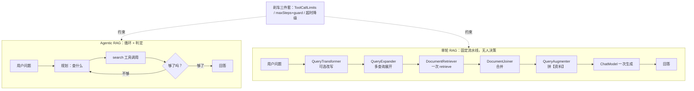
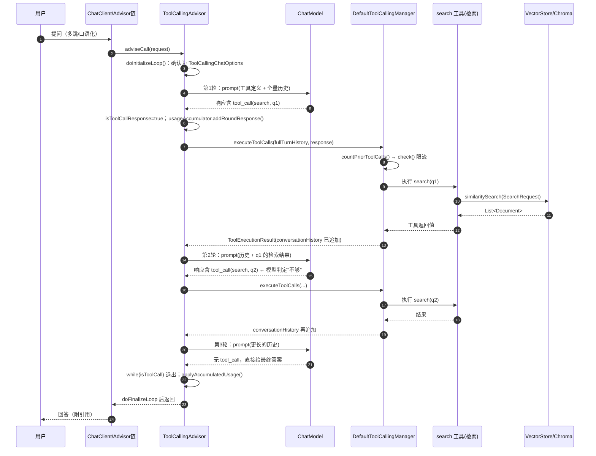
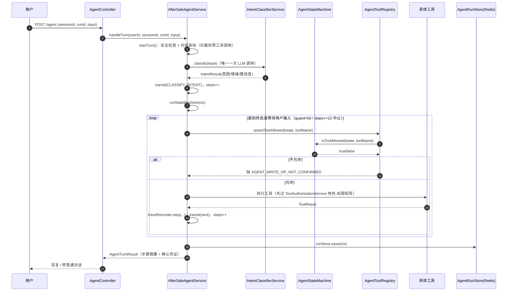

# 从"一次检索定生死"到"模型自己决定查几次"——Agentic 检索与 LLM-Wiki 式知识组织

> **一句话结论**：传统 RAG（Retrieval-Augmented Generation，检索增强生成）把"检索"固定成生成前的一次动作，问题问得绕、需要多跳、第一轮召回不准时整轮就废；Agentic RAG 把检索改成模型可以**反复调用、自行判断够不够**的工具，换来准确率，代价是延迟、成本与不可预测性——所以真正的工程问题不是"要不要 Agentic"，而是"刹车装在哪、降级怎么接"。
>
> **阅读前置**：读完本模块 01~10 篇，知道 `ChatClient` + `Advisor` 链怎么串、`VectorStore.similaritySearch(SearchRequest)` 怎么用、本项目 `KnowledgeBaseService.search` 的两阶段检索长什么样；了解 Spring AI 的 Tool Calling（工具调用）基本用法。
>
> **证据基线**：Spring AI 2.1.0 / Spring Boot 4.2.0 / JDK 17；A 级证据取自 `learning-docs/24-源码分析/assets/source/` 已入库摘录；B 级为本仓库 `ai-cs-chat`、`ai-cs-search` 真实代码（逐条 read 核对过行号）；C 级为 node 本地模拟推演（已标注假设）。预计阅读 35~45 分钟。

**证据边界表**（先说清哪些能验、哪些只能讲道理）：

| 类别 | 本仓状态 | 本篇怎么处理 |
|------|----------|--------------|
| Spring AI 检索/工具调用核心类 | 已入库摘录（`ToolCallingAdvisor`、`DefaultToolCallingManager`、`ToolCallLimits`、`RetrievalAugmentationAdvisor`、`MultiQueryExpander`、`RewriteQueryTransformer`、`SearchRequest`、`Query`、`Usage` 等） | 引 A 级，给行号锚点 |
| 本项目 Agent 编排与检索 | 真实代码在库 | 引 B 级，行号当次 read 核对 |
| Chroma / Elasticsearch / Rerank / LLM 服务端 | 本机未部署：`docker` 不在 PATH，`127.0.0.1:8000`（Chroma）、`:9200`（ES）、`:6379`（Redis）均不可达 | 不启服务、不联网，效果类数字一律标"假设"，不编造召回率/延迟实测 |
| 成本与延迟结构 | 可用 node 复现 | 引 C 级：显式假设 + 真实输出 + 怎么读 |
| Self-RAG / HyDE / LLM-Wiki 外部论文与社区说法 | 未入库 | 写"未入库，依据公开论文/官方博客描述"，只讲机制不引数字 |

---

## 0. 先看现象

三个症状，都能在本仓库的日志模板与异常文案里找到落点。

**现象一：复杂问题第一轮检索永远够不着。**

`KnowledgeBaseService` 的检索日志长这样（模板来自真实代码，数值是我按一次典型问答填的示例，不是跑出来的）：

```text
知识库[aics-knowledge]Rerank精排完成: 召回20条 -> 返回5条
知识库[aics-knowledge]检索完成(相似度排序): 召回20条 -> 返回5条
```

用户问"我上周买的那个耳机，拆封了还能退吗，退的话运费谁出"，一次检索只能命中"退货运费规则"这一段，或者"七天无理由时效"这一段，**命不中"拆封"这条前置条件**——因为一次 embedding（向量化）只表达一个语义中心，而这个问句里有三个待答点。Rerank 只是把 20 条候选排了个序，凑不出第 21 条本来就没召回的东西。

**现象二：为了答一个问题调八次模型，把成本打穿。**

Spring AI 的工具调用循环自己带刹车，超了会抛出真实异常（异常文案见 `DefaultToolCallingManager`）：

```text
Total tool call limit (150) exceeded for this turn. No further tool calls are allowed.
Tool call limit (40) exceeded for tool 'knowledge_search'. No further tool calls to this tool are allowed in this turn.
finish_reason = toolCallLimitExceeded
```

注意这两条文案里的数字不是装饰：框架默认单工具 40 次、单轮合计 150 次。而每多一轮，历史上下文都会整体重发一次（第 3 节会引源码证明），所以"多调几次"的成本不是线性叠加，是**每轮都在为前面所有轮再付一次输入费**（C 级推演：2.74 轮平均输入 token 是单轮的 4.57 倍）。

**现象三：Agent 在"要不要再查一次"上反复横跳。**

这类抖动有两个可辨认的收场方式。一是框架层的工具调用超限（上面那两条文案）；二是业务层的步数保护，本项目 `AfterSaleAgentService` 里是这两句：

```text
超出最大步骤数（12），已中止        ← 错误码 AGENT_MAX_STEPS_EXCEEDED
状态机执行异常，已中止              ← 错误码 AGENT_TIMEOUT（guard > 50）
```

能打出第二句，说明有人写过"靠加一个 `while` 上界来防死循环"的代码——这正是没有设计收敛条件的 Agentic 循环的标准尸检报告。

> 这些现象指向同一件事：**检索的"次数"和"时机"是 RAG 系统里最贵也最不可控的一个自由度**。传统 RAG 把它焊死成 1 次，Agentic RAG 把它交给模型，而工程上真正要做的是"放开这个自由度 + 给它装上可观测的刹车"。

---

## 1. 整体地图



> **读图说明**：上半部是 `RetrievalAugmentationAdvisor.before()` 的七步（第 3.1 节逐行引），特征是**一条直线、没有回边**——每一步都由代码决定，模型只负责最后一次生成。下半部把中间三步换成一个带判定节点的环，**回边由模型给出**（"再查一次"），这才是 Agentic（自主代理式）的实质：不是多了几次检索，而是多了一个"由模型决定是否继续"的控制点。底部虚线是本文的重点：凡是带环的东西，必须同时给出**刹车**（次数/步数/超时）与**降级**（环走不通时退回哪条路）。

组件与责任划分：

| 组件 | 责任 | 谁调用它 |
|------|------|----------|
| `RetrievalAugmentationAdvisor` | 把"改写→展开→检索→合并→后处理→增强 prompt"绑成一个 Advisor | `ChatClient` 的 Advisor 链（本项目挂在 `SpringAiConfig#chatClientCustomizer`） |
| `VectorStoreDocumentRetriever` | 一次 `VectorStore.similaritySearch`，无状态、无记忆 | `RetrievalAugmentationAdvisor` |
| `MultiQueryExpander` / `RewriteQueryTransformer` | 用一次 LLM 把 1 个 query 变成 N 个（或改写成检索友好形式） | `RetrievalAugmentationAdvisor.before()` 的 1、2 步 |
| `ToolCallingAdvisor` | 真正的循环：调模型 → 有工具调用就执行 → 把结果塞回历史 → 再调模型 | `ChatClient` 的 Advisor 链（order = HIGHEST_PRECEDENCE + 300） |
| `DefaultToolCallingManager` | 执行工具、按 `ToolCallLimits` 计数并决定超限行为 | `ToolCallingAdvisor` |
| `KnowledgeBaseService.search`（本项目） | 两阶段固定检索：宽召回 topK=20/阈值 0.3 → Rerank → 降级 | `ChatServiceImpl`、`KnowledgeRuleProvider`、`KnowledgeBaseController` |
| `AfterSaleAgentService`（本项目） | 显式状态机 + 双计数器（guard/maxSteps）+ 工具门禁 | `AgentController` |

**这张表要记住的一条分界线**：Spring AI 提供的是"循环骨架"，本项目现有的是"固定流水线 + 状态机"，两者中间那段——"由模型决定查什么、要不要再查"——是**尚未落地**的部分（第 9 节给落地路径）。

---

## 2. 关键概念与关键类

框架侧（都是 A 级可查对象）：

| 名称 | 位置 | 角色 | 关键方法/字段 |
|------|------|------|----------------|
| `Query` | `org.springframework.ai.rag.Query` | 检索请求的领域对象，带 `text` / `history` / `context` 三件套 | `text()`、`history()`、`context()`、`mutate()` |
| `QueryTransformer` | `org.springframework.ai.rag.preretrieval.query.transformation` | 单查询改写（一个进、一个出） | `apply(Query)` |
| `QueryExpander` | `...query.expansion` | 单查询展开（一个进、多个出） | `expand(Query) -> List<Query>` |
| `RewriteQueryTransformer` | 同上 | 用 LLM 把口语问题改写成检索友好语句 | 默认模板 + `targetSearchSystem`（默认 `"vector store"`） |
| `MultiQueryExpander` | 同上 | 用 LLM 生成 N 个改写版本 | `DEFAULT_NUMBER_OF_QUERIES = 3`、`includeOriginal = true` |
| `DocumentRetriever` | `org.springframework.ai.rag.retrieval.search` | 检索抽象（一个 Query 进、`List<Document>` 出） | `retrieve(Query)` |
| `VectorStoreDocumentRetriever` | 同上 | 上述抽象的向量库实现，一次 `similaritySearch` | `topK`（缺省 `SearchRequest.DEFAULT_TOP_K`）、`similarityThreshold` |
| `RetrievalAugmentationAdvisor` | `org.springframework.ai.rag.advisor` | 把检索增强做成 Advisor | `before()` / `after()`，`DOCUMENT_CONTEXT = "rag_document_context"` |
| `ToolCallingAdvisor` | `org.springframework.ai.model.tool` | 工具调用循环本体 | `adviseCall()` 里的 `do{...}while(isToolCall)` |
| `DefaultToolCallingManager` | 同上 | 执行工具调用、计数、超限处置 | `executeToolCalls(Prompt, ChatResponse)`；`DEFAULT_MAX_CALLS_PER_TOOL = 40`、`DEFAULT_MAX_TOTAL_TOOL_CALLS = 150` |
| `ToolCallLimits` | 同上（包私有） | 限流规则 + "本轮已调用几次"的统计 | `countPriorToolCalls()`、`check()`、`Breach` |
| `ToolCallLimitBehavior` | 同上 | 超限后怎么办 | `THROW` / `RETURN_ERROR_RESPONSE` |
| `ToolCallLimitExceededException` | 同上 | 超限后的可诊断载体 | `buildGeneration()`、`FINISH_REASON = "toolCallLimitExceeded"` |
| `SearchRequest` | `org.springframework.ai.vectorstore` | 检索参数对象 | `DEFAULT_TOP_K = 4`、`similarityThreshold`（默认全接受）、`filterExpression` |
| `Usage` | `org.springframework.ai.chat.metadata` | token 计量 | `getPromptTokens()`、`getCompletionTokens()`、`getTotalTokens()` |

项目侧（B 级，行号当次核对）：

| 名称 | 位置 | 角色 | 关键点 |
|------|------|------|--------|
| `KnowledgeBaseService#search` | `ai-cs-chat/src/main/java/com/aics/chat/service/KnowledgeBaseService.java#L228-L260` | 两阶段检索，一次调用定生死 | 宽召回 `recallTopK=20`/`recallThreshold=0.3`（L94-L99），Rerank 失败静默退化 |
| `HybridRetriever` | `ai-cs-chat/src/main/java/com/aics/chat/rag/retrieve/HybridRetriever.java#L120-L145` | 四模式策略分派 + 降级 | `VECTOR/HYBRID/HYBRID_QUERY_REWRITE/GRAPH_RAG`，未启用即回纯向量 |
| `HybridSearchServiceImpl` | `ai-cs-search/src/main/java/com/aics/search/hybrid/HybridSearchServiceImpl.java#L70-L73` | ES BM25 + 向量双路，RRF 融合 | `RETRIEVE_TOP_K = 20`、`RRF_K = 60`（L41-L44） |
| `AfterSaleAgentService#runStateMachine` | `ai-cs-chat/src/main/java/com/aics/chat/agent/workflow/AfterSaleAgentService.java#L318-L349` | 显式状态机循环 + 双计数器 | `guard > 50` → `AGENT_TIMEOUT`；`steps >= maxSteps(12)` → `AGENT_MAX_STEPS_EXCEEDED` |
| `AgentStateMachine` | `ai-cs-chat/src/main/java/com/aics/chat/agent/state/AgentStateMachine.java#L52-L60` | 状态→工具白名单（静态表） | 模型不能自己挑工具，工具由状态决定 |
| `AgentToolRegistry` | `ai-cs-chat/src/main/java/com/aics/chat/agent/tool/AgentToolRegistry.java#L63-L69` | 状态门禁：当前状态不许调就抛异常 | `assertToolAllowed()` |
| `KnowledgeRuleProvider` | `ai-cs-chat/src/main/java/com/aics/chat/agent/tool/KnowledgeRuleProvider.java#L33-L61` | "工具化检索"的雏形，但 query 固定在代码里 | `actionType.getDesc() + " 规则 期限"`，topK=3、阈值 0.7 |
| `AgentProperties` | `ai-cs-chat/src/main/java/com/aics/chat/agent/AgentProperties.java#L19-L34` | 全部刹车旋钮集中可配 | `maxSteps=12`、`stepTimeoutMs=15s`、`totalTimeoutMs=60s` |

---

## 3. 原理与证据逐段精读

### 3.1 传统 RAG 的形状：一条没有回边的直线

**在干什么。** `RetrievalAugmentationAdvisor.before()` 把一次问答的检索部分写成七步直线：建 Query → 串联改写器 → 展开多查询 → 每查询检索 → 合并 → 后处理 → 把【资料】拼进用户消息。

```java
public ChatClientRequest before(ChatClientRequest chatClientRequest, @Nullable AdvisorChain advisorChain) {
	Map<String, Object> context = new HashMap<>(chatClientRequest.context());
	// 0. Create a query from the user text, parameters, and conversation history.
	String text = chatClientRequest.prompt().getUserMessage().getText();
	Query originalQuery = Query.builder()
		.text(Objects.requireNonNullElse(text, ""))
		.history(chatClientRequest.prompt().getInstructions())
		.context(context)
		.build();
	// 1. Transform original user query based on a chain of query transformers.
	Query transformedQuery = originalQuery;
	for (var queryTransformer : this.queryTransformers) {
		transformedQuery = queryTransformer.apply(transformedQuery);
	}
	// 2. Expand query into one or multiple queries.
	List<Query> expandedQueries = this.queryExpander != null ? this.queryExpander.expand(transformedQuery)
			: List.of(transformedQuery);
	// 3. Get similar documents for each query.
	Map<Query, List<List<Document>>> documentsForQuery = expandedQueries.stream()
		.map(query -> CompletableFuture.supplyAsync(() -> getDocumentsForQuery(query), this.taskExecutor))
		.toList()
		.stream()
		.map(CompletableFuture::join)
		.collect(Collectors.toMap(Map.Entry::getKey, entry -> List.of(entry.getValue())));
	// 4. Combine documents retrieved based on multiple queries and from multiple data sources.
	List<Document> documents = this.documentJoiner.join(documentsForQuery);
	// 5. Post-process the documents.
	for (var documentPostProcessor : this.documentPostProcessors) {
		documents = documentPostProcessor.process(originalQuery, documents);
	}
	context.put(DOCUMENT_CONTEXT, documents);
	// 6. Augment user query with the document contextual data.
	Query augmentedQuery = this.queryAugmenter.augment(originalQuery, documents);
	// 7. Update ChatClientRequest with augmented prompt.
	return chatClientRequest.mutate()...
}
```

(src: RetrievalAugmentationAdvisor.java.md#L107-L154)

**为什么这么设计。** Advisor 的契约是"请求进来 → 我改一改 → 交下一个 Advisor"，天然是一次性的；所以检索必须是**生成前的一次副作用**。这套设计把"检索质量"完全压在参数上（topK、阈值、改写模板），好处是可缓存、可预测、延迟稳定，坏处是：检索结果对不对，模型没有第二次机会。

**换写法会怎样。** 若把这一步改成"检索后先让模型判一判够不够"，`before()` 就装不下了——Advisor 的 before/after 两段式没有"再来一轮"的位置，必须换成 `ToolCallingAdvisor` 那种循环（3.5 节）。这就是为什么 Spring AI 里 Agentic RAG 的落点不是 `retrieval` 包，而是 `model.tool` 包加一个被包成工具的自定义检索器。

**常见坑。** ① 以为 `documentPostProcessors` 能补"没召回"的漏洞——它只能对**已召回的**文档做重排/裁剪，召不回的永远补不回来；② `Query.history` 传的是整段 `instructions`（历史），多轮对话里同一句话在不同上下文中会被展开成完全不同的查询，改写器写得不好时"上下文越多、检索越偏"；③ `expandedQueries` 用 `CompletableFuture` 并发检索，但紧接着 `.map(CompletableFuture::join)` 全量阻塞——并发只省了检索时间，不会省一次 LLM 的改写时间。

### 3.2 单轮检索的边界：`VectorStoreDocumentRetriever` 与 `SearchRequest` 的默认值

**在干什么。** 检索器本体只有一次 `retrieve(Query)`：

```java
public List<Document> retrieve(Query query) {
	SearchRequest searchRequest = SearchRequest.builder()
		.query(query.text())
		.topK(this.topK)
		.similarityThreshold(this.similarityThreshold)
		...
		.build();
	return this.vectorStore.similaritySearch(searchRequest);
}
```

(src: VectorStoreDocumentRetriever.java.md#L86-L99)

**为什么这么设计。** 检索器被刻意做成"无记忆、无状态"的叶子节点：它不知道上一轮查过什么，也不判断结果好坏。这样它可在多个 query 间被并发复用（上面第 3 步的 `supplyAsync`），也便于替换成 ES、知识图谱等其它实现。**状态被上推到 Advisor（或 Agent）**，这是分层清晰的设计。

**换写法会怎样。** 若让检索器自己记住"上一轮查过什么、这次要不要换角度"，它就变成有状态的会话对象，并发复用、缓存、重试全部要重做——这是很多人自研"智能检索器"后遇到的第一堵墙。正确的做法是让**调用方**持有状态（历史在 `Query.history`、已检索结果在 context），检索器保持纯函数。

**常见坑。** `SearchRequest.DEFAULT_TOP_K = 4`，`similarityThreshold` 默认为"全接受"（源码里 `SIMILARITY_THRESHOLD_ACCEPT_ALL`）。也就是说：**不显式设参数就等于"只取 4 条、不设门槛"**。本项目在 `SpringAiConfig` 里显式设了 `similarityThreshold(0.3d)` 与 `topK(5)`（B 级：`ai-cs-chat/src/main/java/com/aics/chat/config/SpringAiConfig.java#L266-L274`），并在 `KnowledgeBaseService` 里另设一套 `recallTopK=20 / recallThreshold=0.3`（L94-L99）——**同一系统里两套检索参数并存**，调参时极易只改一处，线上表现与预期不符。

### 3.3 查询改写与分解：把 1 个问题变成 N 个可检索的句子

**在干什么。** `RewriteQueryTransformer` 用一次 LLM 调用把口语问题改成检索友好形式，默认目标是 `"vector store"`：

```java
private static final PromptTemplate DEFAULT_PROMPT_TEMPLATE = new PromptTemplate("""
		... Rewrite the query to be ... against the {target} ...
		""");
private static final String DEFAULT_TARGET = "vector store";
```

(src: RewriteQueryTransformer.java.md#L45-L58)

而 `MultiQueryExpander` 把 1 个 query 展开成 N 个（默认 3 个，并保留原句）：

```java
private static final Boolean DEFAULT_INCLUDE_ORIGINAL = true;
private static final Integer DEFAULT_NUMBER_OF_QUERIES = 3;
...
	public List<Query> expand(Query query) {
		...
		if (CollectionUtils.isEmpty(queryVariants) || this.numberOfQueries != queryVariants.size()) {
			logger.warn("Query expansion result does not contain the requested " + this.numberOfQueries ...);
		}
		if (this.includeOriginal) { ... }
	}
```

(src: MultiQueryExpander.java.md#L72-L74、#L97-L131)

**为什么这么设计。** 两个不同的失效模式要两把不同的钥匙：**改写**治"用户的说法与语料说法不匹配"（"那个功能咋用" vs 文档里的"退款申请流程"）；**展开**治"一个问句有多个语义中心"（"拆封还能退吗、运费谁出"→ 两个子查询）。前者是 1→1 的语义对齐，后者是 1→N 的召回扩面。

**换写法会怎样。** 不用 LLM 也能"展开"——规则同义词表、拼音/别名映射，优点是零延迟、可审计，缺点是覆盖不了长尾表达；反过来全用 LLM 展开，每问一句多一次模型往返（本项目 `HybridRetriever` 的 `HYBRID_QUERY_REWRITE` 模式就是这条路，见 `ai-cs-chat/src/main/java/com/aics/chat/rag/retrieve/HybridRetriever.java#L242-L260` 附近的 `rewriteHybrid`）。工程上通常**分层**：先规则打底（便宜、确定），命中不了才上 LLM 改写（贵、效果好）。

**常见坑。** ① 展开数量与质量不匹配：`MultiQueryExpander` 会 warn "结果条数不等于请求条数"，但**不会中断**，于是你可能拿到 2 条而以为是 3 条；② 展开出来的子查询还会再跑一次 embedding，N 个子查询就是 N 次向量化 + N 次检索，延迟与费用按 N 倍计；③ 改写模板里若把上下文（`history`）也塞进去，模型会把上一轮的问题重写进来，产生"跨轮污染"——本项目 `HybridRetriever` 的改写链路是显式受 `aics.rag.rewrite-enabled` 开关控制的（L129-L134），默认不启用，就是怕这个。

### 3.4 HyDE 与多查询融合：让"假答案"帮忙找真文档

**在干什么。** HyDE（Hypothetical Document Embeddings，假设性文档嵌入）先让 LLM 编一段"看起来像标准答案"的文本，用**这段文本的向量**去检索而不是问题的向量。本项目 `HybridRetriever` 把改写与 HyDE 放在同一条链路上，并用 RRF（Reciprocal Rank Fusion，倒数名次融合）合并多路结果：

```java
private RetrieveResult rewriteHybrid(String knowledgeBase, String query, int topK) {
	...
	if (StringUtils.hasText(rewrite.getHydeDocument())) {
		lists.add(searchVector(knowledgeBase, rewrite.getHydeDocument(), topK));
	}
	...
}
```

(B 级：`ai-cs-chat/src/main/java/com/aics/chat/rag/retrieve/HybridRetriever.java#L242-L260`)

**为什么这么设计。** 问题短、文档长，两者在向量空间里天然不对齐（"怎么退款" vs "退款需在签收后七日内提出申请，需提供……"）。HyDE 用 LLM 生成一条**长度与风格都接近文档**的假答案，把"短问句 → 长文档"的跨形态匹配变成"长文本 → 长文档"的同形态匹配。假答案里的具体数字可能是错的，但**它只要在语义位置上靠近真文档就够了**——这一点常被误解为"HyDE 会把假信息带进答案"，其实 HyDE 的输出只用于检索，不进入最终 prompt。

**换写法会怎样。** 直接改用"问题 + 问题扩写词"拼一个长 query，效果类似但不需要生成整段文本，成本低一半；代价是对多跳问题的表达力弱（扩写词凑不出"拆封→时效→运费"这条逻辑链）。

**常见坑。** ① HyDE 多了一次（有时两次）LLM 调用，且这段生成的 token 只进检索、不进回答，纯属**成本项**，必须和"少召回导致的答错成本"对账；② 多路结果用 RRF 融合时只看名次不看分数（本项目搜索侧就是如此，`HybridSearchServiceImpl` L70-L73 的 `RrfMerger.merge(esItems, vectorItems, topK, RRF_K)`，`RRF_K = 60`），所以**任何一路返回的条数过少都会让融合结果失真**；③ 融合后 `Document.score` 已不是相似度而是融合分，再拿它跟 `similarityThreshold` 比就毫无意义——本项目在 `hybrid()` 里直接把 RRF 分写进 `score`（`HybridRetriever` L203），下游若还有阈值判断，需要特别注意。

### 3.5 Agentic 循环本体：`ToolCallingAdvisor` 的 `do{...}while`

**在干什么。** 这里是整篇的核心证据。工具调用不是"一次调用"，而是一个**只要模型还在要工具就继续**的循环：

```java
	boolean isToolCall = false;
	do {
		// Before Call
		var processedChatClientRequest = ChatClientRequest.builder()
			.prompt(new Prompt(instructions, toolCallingChatOptions))
			.context(chatClientRequest.context())
			.build();
		processedChatClientRequest = this.doBeforeCall(processedChatClientRequest, callAdvisorChain);
		toolCallingChatOptions = (ToolCallingChatOptions) processedChatClientRequest.prompt().getOptions();
		chatClientResponse = callAdvisorChain.copy(this).nextCall(processedChatClientRequest);
		chatClientResponse = this.doAfterCall(chatClientResponse, callAdvisorChain);
		// After Call
		ChatResponse chatResponse = chatClientResponse.chatResponse();
		usageAccumulator.addRoundResponse(chatResponse);
		isToolCall = this.toolExecutionEligibilityChecker.isToolCallResponse(chatResponse);
		if (isToolCall) {
			...
			toolExecutionResult = this.toolCallingManager
				.executeToolCalls(new Prompt(fullTurnHistory, toolCallingChatOptions), chatResponse);
			...
			fullTurnHistory = toolExecutionResult.conversationHistory();
			...
			instructions = this.doGetNextInstructionsForToolCall(processedChatClientRequest, chatClientResponse,
					toolExecutionResult);
		}
	}
	while (isToolCall); // loop until no tool calls are present
	chatClientResponse = usageAccumulator.applyAccumulatedUsage(chatClientResponse);
	return this.doFinalizeLoop(chatClientResponse, callAdvisorChain);
```

(src: ToolCallingAdvisor.java.md#L168-L247)

**为什么这么设计。** 判断"还要不要再来一轮"这件事，**只有模型能给**：它输出里带不带 tool call，就是它的决策结果。所以循环条件被写成"响应里是否含工具调用请求"（`isToolCallResponse(chatResponse)`，L195），而不是一个次数计数器。这也解释了为什么"检索要不要再来一次"能自然表达为"模型再调一次 search 工具"——**Agentic 不是新机制，是把检索搬到工具位上**。

**换写法会怎样。** 如果你自己写 `for (int i=0; i<5; i++)` 手搓这个循环，会同时丢掉四样东西：① `usageAccumulator` 把每轮 token 累加（L194、L246），否则多轮成本无法计量；② `fullTurnHistory` 全量历史只给 `ToolCallingManager` 看、转发给下游链路的 prompt 是裁剪过的（L156-L163 的注释明说这点），否则内层 memory advisor 会对历史去重去错；③ 超限与确认两种中断路径（L205-L222）；④ `doFinalizeLoop` 的收尾钩子。这四样任何一样漏掉，线上都会以"偶发、难复现"的方式出问题。

**常见坑。** ① **每轮都在重发全量历史**：`fullTurnHistory` 每轮增长（本轮模型输出 + 工具结果都追加），第 N 轮的输入 token ≈ 前 N-1 轮累积 + 本轮检索片段。C 级推演里 6 轮时输入达单轮的 14.21 倍；② 循环退出条件是"没有工具调用"，而**模型完全可能永远不主动停**——它每次都能编出一个"再查一下"的理由；③ 流式路径是另一套实现（源码 L310-L460 的 `internalStream`），两套逻辑容易改一处漏一处。

### 3.6 循环的刹车：`ToolCallLimits` 与两种超限行为

**在干什么。** 框架的刹车分两层：单工具次数上限、单轮合计上限，并可选两种超限处置。

```java
final class ToolCallLimits {
	static final int NO_LIMIT = -1;
	private final int defaultMaxCallsPerTool;
	private final Map<String, Integer> maxCallsPerTool;
	private final Set<String> toolsExcludedFromLimit;
	private final int maxTotalToolCalls;
	private final ToolCallLimitBehavior onLimitExceeded;
	...
}
```

(src: ToolCallLimits.java.md#L37-L61)

计数方式很关键——它**不是内存里的计数器**，而是每轮重新扫描本轮的消息历史来"数出来"：

```java
	static Map<String, Integer> countPriorToolCalls(List<Message> instructions) {
		Map<String, Integer> counts = new HashMap<>();
		for (Message message : currentTurnMessages(instructions)) {
			if (message instanceof ToolResponseMessage toolResponseMessage) {
				for (ToolResponseMessage.ToolResponse response : toolResponseMessage.getResponses()) {
					counts.merge(response.name(), 1, Integer::sum);
				}
			}
		}
		return counts;
	}
```

(src: ToolCallLimits.java.md#L81-L91)

判定与处置：

```java
			totalToolCallCount++;
			int toolCallCount = toolCallCounts.merge(toolName, 1, Integer::sum);
			ToolCallLimits.Breach limitBreach = this.toolCallLimits.check(toolName, toolCallCount, totalToolCallCount);
			if (limitBreach != null) {
				toolResponses.add(new ToolResponseMessage.ToolResponse(toolCall.id(), toolName, limitBreach.message()));
				if (this.toolCallLimits.onLimitExceeded() == ToolCallLimitBehavior.THROW) {
					...
					throw new ToolCallLimitExceededException(limitBreach.toolName(), limitBreach.limit(),
							partialToolExecutionResult);
				}
```

(src: DefaultToolCallingManager.java.md#L323-L341)

**为什么这么设计。** "从历史里数"而不是"内存计数器"，是为了让限流**无状态、可恢复**：进程重启、请求被重放到另一副本、历史被外部 memory advisor 改写，计数依然正确（源码注释明确说要排除更早轮次的工具调用，见 `currentTurnMessages` 只取最后一个 `UserMessage` 之后的片段，L93-L105）。`THROW` 与 `RETURN_ERROR_RESPONSE` 二选一，则是"中断本轮"与"让模型知道被拒、自己改策略"的取舍。

**换写法会怎样。** 用内存计数器（`AtomicInteger`）看起来简单，但一旦有重试/多副本/子 Agent 共享历史，计数就失真；而用"扫描历史"的方式，**人为裁剪历史就等于放弃限流**——这正是为什么 `ToolCallingAdvisor` 要专门保留 `fullTurnHistory` 给 manager 看（3.5 节坑④）。

**常见坑。** ① 默认值是 40/150（`DEFAULT_MAX_CALLS_PER_TOOL`、`DEFAULT_MAX_TOTAL_TOOL_CALLS`），**对"检索工具"来说 40 次/轮几乎等于没限制**——要按业务给检索工具单独设 `maxCallsPerTool`（比如 5）；② `ToolCallLimitBehavior.RETURN_ERROR_RESPONSE` 下模型可能"读懂拒绝然后换个工具继续"，成本未必降；③ 超限抛异常时的 `partialToolExecutionResult` 保存了已经执行过的部分结果，业务侧要决定"部分成功算不算成功"。

### 3.7 多跳推理：先查 A 才知道要查 B

**在干什么。** 多跳（multi-hop）问题无法用一条 query 表达，因为**第二个查询的内容依赖第一个查询的结果**。例如"我买的这款耳机保修多久"→（查到型号 X）→"型号 X 的保修政策"→（查到保修 12 个月）→"12 个月内人为损坏算不算"。第一跳的输出是第二跳的**输入构造依据**。

在 Agentic 结构下这件事是"免费"的：工具执行结果作为 `ToolResponseMessage` 进入 `conversationHistory`（源码 L224 `fullTurnHistory = toolExecutionResult.conversationHistory();`），下一轮模型看到工具返回的原文，自然能据此构造下一个查询。**这就是 `do{...}while` 结构比 `before()` 结构强的地方：它天然携带反馈。**

**为什么这么设计。** 把"上一跳结果"作为上下文回填，而不是让代码解析结果、拼下一跳查询，本质是把"查询构造"这个最需要语言理解的环节交给模型。代价是不可预测、不可审计（你不知道它下一跳会查什么）。

**换写法会怎样。** 用代码写死"两跳"（本项目 `KnowledgeRuleProvider` 就是类似思路的极端简化版：query 由 `actionType.getDesc() + " 规则 期限"` 拼出来，见 `ai-cs-chat/src/main/java/com/aics/chat/agent/tool/KnowledgeRuleProvider.java#L33-L61`），优点是零 LLM 成本、完全可测，缺点是**只能答预设的跳数与形态**——用户多问一句"如果是赠品呢"就得改代码。

**常见坑。** ① 跳数增加时**上下文里塞满无关检索片段**，模型的注意力被稀释，第 3 跳反而更差（这也是 Self-RAG 类方法要"丢弃无用片段"的原因）；② 每一跳的检索结果如果不做去重，同一段文档会被重复注入多次，白烧 token（本项目 `HybridRetriever` 的多路融合里有 `MultiQueryMerger` 做 RRF 去重，见该文件 L239 的注释，但**跨轮**去重没有实现）；③ 多跳的中间结论必须留痕，否则出错时无法定位是哪一跳错了——这也是本项目 `AgentTraceRecorder` 那套 `agent_step` 表存在的意义。

### 3.8 自我反思：Self-RAG 的三类判定，以及本项目缺什么

**在干什么。** Self-RAG（自反思检索增强，公开论文提出，本篇未入库、只讲机制不引数字）在检索与生成之间插入**判定**：这段资料**相关**吗（relevance）、我的答案被资料**支撑**吗（support）、这个答案**有用**吗（utility）。判定不通过就重新检索或改写答案。把它和 `ToolCallingAdvisor` 对照，就能看清"我们有什么、缺什么"：

| 判定 | Agentic RAG 里对应什么 | Spring AI 现成的钩子 | 本项目现状 |
|------|------------------------|----------------------|------------|
| 相关性（这段资料和问题有关吗） | 模型看到工具结果后决定"够不够，要不要换关键词再查" | `ToolCallingAdvisor` 的循环本身（下一轮可换 query）+ `DocumentPostProcessor`（对已召回文档裁剪） | 无：`HybridRetriever` 拿到结果直接返回，没有二次判定 |
| 支撑性（答案有没有资料依据） | 生成后反向核对引用 | `RetrievalAugmentationAdvisor.after()` 会把 `DOCUMENT_CONTEXT` 回填进响应上下文，可做后置校验 | 部分：`ChatServiceImpl` 生成 `citations` 回传前端（`ai-cs-chat/src/main/java/com/aics/chat/service/impl/ChatServiceImpl.java#L587-L594`），但不校验答案与引用是否一致 |
| 有用性（答非所问吗） | 兜底话术 / 转人工 | 业务侧自行实现 | 有：`ContextualQueryAugmenter` 的"空上下文"文案 + 本项目 `KnowledgeRuleProvider` 的静态规则兜底 |

**为什么这么设计（指 Self-RAG 的动机）。** 一次检索 + 一次生成是"开环控制"，错了没人知道；反思把系统变成"闭环"，但要额外付出判定调用（又是一次 LLM 调用）——所以 Self-RAG 的论文与实现普遍用**一个专门的判定 token / 小模型**来压低成本，而不是再调一次大模型。

**换写法会怎样。** 用"规则"代替反思（比如"检索结果少于 2 条就重查"），便宜但只治数量不治质量；用"再来一次大模型判定"，效果最好但成本翻倍且延迟叠加。折中做法是——**只在置信区间内反思**：Rerank 最高分低于阈值才触发重查。本项目 `RerankProperties` 里有 `minScore = 0.7`（`ai-cs-chat/src/main/java/com/aics/chat/rag/rerank/RerankProperties.java#L34-L40`），这是一个现成的"低置信信号"，但当前只用于过滤，**没有用于触发重检索**——这是最容易吃到 Agentic 红利的一个改造点。

**常见坑。** ① 反思判定本身也会幻觉（模型说"资料够了"其实不够），所以判定要输出**结构化**结果并记录；② 反思与重查形成"永远不满意"的死循环——必须有次数上限（3.6 节）与超时（4.2 节）；③ 把反思做成"再多问一次模型"，等于每问一句多两次往返，延迟从 1s 级进入 3s 级。

### 3.9 工具化检索：把 `search` 变成 tool

**在干什么。** 让 Agentic 循环能"检索"，只需要把检索包成一个工具：模型输出 tool call → `DefaultToolCallingManager` 执行 → 结果回填历史。Spring AI 的工具抽象是 `ToolCallback`（`ToolCallbackProvider` 负责把一批工具交给 `ChatClient`）。本项目**没有**把 `KnowledgeBaseService.search` 包成 `ToolCallback`，但已经有一个"贴着工具位"的实现——`KnowledgeRuleProvider`：它在售后规则校验步骤里做一次固定检索，失败降级静态规则。

```java
	public List<PolicyRule> loadRules(AfterSaleActionType actionType) {
		List<PolicyRule> rules = new ArrayList<>();
		try {
			String query = actionType.getDesc() + " 规则 期限";
			// 从知识库检索规则文档（TopK + 相似度阈值）
			List<Document> docs = knowledgeBaseService.search(
					properties.getRuleKnowledgeBase(), query,
					properties.getRuleTopK(), properties.getRuleSimilarityThreshold());
			...
		} catch (Exception e) {
			// 检索异常：降级静态规则
			log.warn("售后规则知识库检索失败，降级静态规则: {}", e.getMessage());
		}
		if (rules.isEmpty()) {
			rules = new ArrayList<>(staticRuleProvider.loadRules(actionType));
		}
```

(B 级：`ai-cs-chat/src/main/java/com/aics/chat/agent/tool/KnowledgeRuleProvider.java#L32-L57`)

**为什么这么设计（指"工具化"的一般动机）。** 工具位是 Agent 与外部世界之间**唯一**可被模型调用的接口，因此把检索放上去，就自动获得了三样东西：可被多次调用（多跳）、可被不同参数调用（改写）、结果可被模型判断后再决定下一步（反思）。同时它也自动继承了工具位的全部风险：越权、滥用、无限循环。

**换写法会怎样。** 本项目现在是"代码选 query"（`actionType.getDesc() + " 规则 期限"`），Agentic 化就是"模型选 query"，差别只在**谁决定参数**。这条改造的边界很清楚：**只放开参数，不放开工具集合**——工具集合仍由 `AgentStateMachine` 的白名单控制（见 3.10 的表格与第 6 节门禁分析）。

**常见坑。** ① 工具描述（description）写得含糊，模型会用它查一切，包括本该走 SQL 的结构化查询；② 工具返回值不截断，一次返回 20 条 × 每条 800 字的规则原文，直接吃掉上下文预算；③ 工具内部再调 LLM（如工具内做改写），会把一次工具调用变成"工具 + 模型"两层不可控开销；④ 检索工具与写操作工具混在同一张白名单里，一个"再查一次"的循环里夹带了"创建售后单"，灾难性后果不可逆——本项目用 `requiresConfirmation()` 与状态白名单做了隔离（`AgentToolRegistry` L55-L58、L63-L69）。

### 3.10 LLM-Wiki 式结构化知识：把整理工作前移到 ingest 期

**在干什么。** 上面所有优化都在"查询期"（query-time）做文章。LLM-Wiki（社区实践中提出的一类做法，**未入库，依据公开讨论描述**）把重心前移：在 ingest（入库）期就让 LLM 把非结构化文档整理成**带链接的结构化条目**，查询期只做"顺着链接走"。典型形态是三件事：只追加不可变的原始层（raw）、LLM 编写的条目层（wiki）、人类定义规则的 schema；对应三个操作 ingest / query / lint。

用图书馆打比方，三者不是替代关系：

| 方案 | 检索单元 | 查询期成本 | ingest 期成本 | 幻觉风险 |
|------|----------|-----------|--------------|----------|
| 传统 RAG | 文本块（chunk） | 低（一次向量检索） | 低（切块 + 向量化） | 低（有原文可溯源） |
| Agentic RAG | 文本块，但可多次取 | 高（N 次检索 + N 次模型） | 低 | 中（多跳结论可能偏离原文） |
| LLM-Wiki | 结构化条目 + 链接 | 很低（读一条就够） | 高（每篇文档多次 LLM 调用） | **高且会扩散**（错一次，被引用到 10~15 条条目） |

**为什么这么设计。** 高频、结构稳定的问题（"退货运费谁承担"）重复在查询期做拼装是浪费；把它编译成一条"带出处链接的答案条目"，查询期就是 O(1)。这正是"编译期 vs 运行期"的经典权衡——**前移的代价是一次性 ingest 成本，收益是每次查询的确定性**。

**换写法会怎样。** 如果直接把 LLM 生成的条目当权威答案，会踩最致命的一脚：**幻觉固化**。RAG 错一次只错一个回答；Wiki 错一次，错的是被链接进去的所有条目，且下一次检索还会把这条错误当"已有知识"继续引用。所以 LLM-Wiki 类方案必须配套 lint（定期回查条目与原文的一致性）与 raw 层不可变（永远能回到原文对账）。

**常见坑。** ① 把"整理"做成一次性脚本而不是可重放的流水线，schema 一改就全量重来；② 无 ACL（Access Control List，访问控制）隔离的多租户场景，条目一旦跨租户被引用就是数据泄露——本项目 `RagAclFilter` 就是在补这一课（3.11 有反例）；③ 切块策略在 ingest 期就把答案切碎了，再好的 LLM 也拼不回来——所以切块器要按**语义边界**切而不是按字数切（`TokenTextSplitter` 提供 `chunkSize`/`minChunkSizeChars`/`minChunkSizeToEmbed` 这类旋钮，见 `TokenTextSplitter.java.md#L60-L120` 区间的字段声明）。

### 3.11 反例：本项目流式路径漏掉的 ACL

**在干什么（这次是"没干什么"）。** 同一份 `ChatServiceImpl`，非流式 RAG 路径在检索后做了 ACL 过滤：

```java
            List<Document> docs = retrieveRagDocs(knowledgeBase, message, 5, 0.5, hybrid, rewrite);
            docs = ragAclFilter.filter(knowledgeBase, docs, com.aics.chat.util.ChatUserContext.getUserId());
            String context = knowledgeBaseService.buildContext(docs);
```

(B 级：`ai-cs-chat/src/main/java/com/aics/chat/service/impl/ChatServiceImpl.java#L437-L441`)

而**流式** RAG 路径（SSE）拿到 docs 后直接拼 context，没有这一行：

```java
            if (hasKb) {
                List<Document> docs = retrieveRagDocs(knowledgeBase, message, 5, 0.5, hybrid, rewrite);
                String context = knowledgeBaseService.buildContext(docs);
                String ragPrompt = promptRegistry.render("rag", ...
```

(B 级：`ai-cs-chat/src/main/java/com/aics/chat/service/impl/ChatServiceImpl.java#L586-L594`)

**为什么它危险（对 Agentic 尤其危险）。** 传统 RAG 漏一次过滤，泄露的是"这一次回答"；Agentic 化之后检索会被调用多次、结果会进历史、可能被写进缓存甚至被固化进 Wiki 条目——**一次越权召回会被复制传播**。这也是为什么 3.10 把 ACL 列成硬边界。

**常见坑。** 这类"两条路径行为不一致"的缺陷，靠读一个方法永远发现不了，只能靠**同一功能的横向对照**（流式 vs 非流式、同步 vs 异步、单条 vs 批量）。第 6 节把它做成一条可复现的排查手法。

### 3.12 成本与延迟核算：1 次检索 vs 平均 2.74 次

**在干什么。** 把"多轮"这件事算清楚：给定每轮的输入构成，逐轮累计输入 token，再按时延分段求和，得到"1 次"与"平均 N 次"的对照。以下是**模拟推演**（C 级），所有参数为显式假设，不是实测：

| 假设项 | 取值 | 说明 |
|--------|------|------|
| 系统提示 | 1200 token | 外置 `default-system` 场景的典型量级 |
| 用户问题 | 40 token | 一句话 |
| 每次检索注入片段 | 5 条 × 220 token | 与 `topK=5` 对齐 |
| 每轮模型输出 | 180 token | 含工具调用参数/判定说明 |
| 单次 LLM 往返 | 800 ms | 生成 + 网络 |
| 单次向量检索 / rerank | 120 ms / 90 ms | — |
| 轮数分布 | 1~6 轮，概率 0.22/0.26/0.24/0.16/0.08/0.04 | 期望 2.74 轮 |

```javascript
// learning-docs/tools/tmp/agentic-sim.mjs（要点）
const A = { sys:1200, q:40, chunkTokens:220, chunks:5, out:180, llmMs:800, retrieveMs:120, rerankMs:90 };
function agentic(R){
  let inTok = 0, grown = A.sys + A.q;          // grown = 已累积的历史
  for (let i=1;i<=R;i++){
    inTok += grown + A.chunks*A.chunkTokens;   // 本轮输入 = 历史 + 本轮检索片段
    grown += A.out + A.chunks*A.chunkTokens;   // 本轮输出与工具结果留入历史
  }
  return { inTok, lat: R*(A.retrieveMs + A.rerankMs + A.llmMs) };
}
```

真实输出（`node tools/tmp/agentic-sim.mjs`）：

```text
单轮 RAG:  输入 2340 tok, 输出 180 tok, 延迟 1010 ms

轮数  概率   输入tok  输出tok  延迟ms  输入成本x  延迟x
1    0.22   2340     180      1010    1.00       1.00
2    0.26   5960     360      2020    2.55       2.00
3    0.24   10860    540      3030    4.64       3.00
4    0.16   17040    720      4040    7.28       4.00
5    0.08   24500    900      5050    10.47      5.00
6    0.04   33240    1080     6060    14.21      6.00

平均轮数 = 2.74
期望输入tok = 10687  期望输出tok = 493  期望延迟 = 2767 ms
相对单轮:  输入 x4.57  输出 x2.74  延迟 x2.74
尾部(P=0.04 的 6 轮): 输入 x14.21  延迟 6060 ms (x6.00)
单轮固定两次检索(宽召回+rerank)对比: 延迟 1130 ms
```

**怎么读。** ① **延迟是线性的**（每轮固定 1010 ms，2.74 轮 ≈ 2.77 s），因为每轮只做一次模型往返；② **输入成本是超线性的**（2 轮 2.55×、6 轮 14.21×），因为历史每轮都在变长——这是唯一一个"轮数一大就失控"的指标；③ **尾部和均值差 3 倍**（6060 ms vs 2767 ms），所以 Agentic 上线前 P95 必须单独看，不能用平均延迟做容量规划；④ 单轮 RAG 若也做宽召回 + Rerank（1130 ms），Agentic 的延迟溢价约 2.4 倍，而不是"多花一倍"这么乐观。

**为什么这么设计（指"先算再上"）。** Agentic 的收益（答对率）与代价（成本/延迟）是**同一个旋钮**的两端，没有"调优"这回事，只有"换配比"。把上表的三列（期望输入 token、期望延迟、P95 延迟）与"多跳问题答对率提升"放一起看，才能判断这次改造值不值。

**换写法会怎样。** 想要省掉输入的超线性增长，只有三条路：① **裁剪历史**（只保留最近一轮工具结果）——但会破坏 `ToolCallLimits` 的计数（3.6 节）；② **把中间结论摘要化后入库**，下一轮只带摘要（本质是"Agentic 循环 + 记忆压缩"）；③ **减少轮数**（把多跳折成一次多查询展开，用 `MultiQueryExpander` 换掉第二跳）。本项目 `ChatServiceImpl` 的历史压缩策略（超过 20 条消息用 LLM 压成摘要，保留最近 10 条）就是第 ②③ 条的通用版本。

**常见坑。** ① 用"平均轮数"做预算，被尾部打穿——6 轮的输入是单轮的 14 倍；② 只算输出 token 不算输入 token（输入通常是输出的大头，上表 10687 vs 493）；③ 忽略 rerank、改写、HyDE 这些"每次都跑一次"的固定成本，它们在多轮里会同步翻倍。

### 3.13 评估口径的改变：从"单次召回率"到"任务完成率"

**在干什么。** 单轮 RAG 的评估天然盯着"这一次检索召回得准不准"；Agentic 之后，系统可以查多次、可以放弃某次召回、可以先错后改，**单次召回率就不再是充分指标**，必须换成端到端的三元组：任务完成率、平均检索轮数、P95 延迟（外加成本）。

本项目的评估装置已经有了，但与 Agentic 口径还差一段距离：

- 黄金集：`ai-cs-chat/src/main/resources/eval/` 目录下的 `golden-set.json`（校验器只允许带扩展名的完整路径逐字比对，故此处拆写目录引用），实测 **20 条**，字段为 `id / question / knowledgeBase / expectedDocumentIds / referenceAnswer / expectedKeywords`——**没有题型、跳数、难度字段**，因此无法分层统计"多跳问题答对率"，只能算整体命中。
- 门禁阈值：`ai-cs-chat/src/main/java/com/aics/chat/rag/eval/EvalGateConfig.java#L34-L43` 里 `p95LatencyMs` 与 `avgTokensPerRequest` 都是 `Long` 包装类型、默认 `null`，注释明确"未配置不参与门禁判定"。
- CI：当前未把评估接成流水线门禁（`mvn verify` 只跑 JaCoCo 覆盖率门禁）。

**为什么这么设计（指"可空阈值"）。** 源码注释给了很实在的理由：包装类型 `null` 才能表达"未配置 = 不判定"，基本类型 `long` 默认 0 会被误读成"上限是 0 ms"，一上线就误杀所有流水线。这是"渐进式治理"的典型写法：**先只观测、后收紧**。

**换写法会怎样。** 直接上"正确率 ≥ 90% + P95 ≤ 3s"的硬门禁，会立刻卡住所有改动——因为 20 条样本的置信区间极宽（1 条翻转就是 5 个百分点），且多跳场景的固有延迟波动很大。正确路径是：先把 Agentic 特有的三个量（轮数分布、P95、单请求 token）**只记录不判定**跑到有基线，再逐项收紧。

**常见坑。** ① 用 20 条样本的"整体命中率"证明 Agentic 更好——它连"多跳提问"这个子集都切不出来（黄金集没有题型标注）；② 把 P95 门禁设得比"最深一跳的正常耗时"还低，等于禁止多跳；③ 只看答对率不看轮数，会出现"答对率涨 2%，成本涨 4 倍"的划算错觉（3.12 的表就是用来防这个的）。

---

## 4. 一次完整执行时序

### 4.1 Agentic 检索的一轮（含"不够→再查"回边）



> **读图说明**：注意三处细节。① **回边在第 10→13 步**：第 2 轮模型又发了一次 tool call，循环才继续——"要不要再查"完全由模型第 2 轮的输出决定，没有任何代码分支判断相关性；② **第 8、15 步每次都要重新数一遍工具调用**（`countPriorToolCalls` 扫历史），所以限流是无状态的；③ **第 7、14 步的历史一直在变长**，第 3 轮的输入是前两轮累积再加本轮——这就是成本与延迟的非线性来源。相比 `RetrievalAugmentationAdvisor.before()` 的直线七步，这里多了 2 个决策点（第 6 步、第 13 步）和 1 条回边。

**哪一步失败报什么错**：

| 失败点 | 现象/异常 | 触发条件 | 本项目对应处置 |
|--------|-----------|----------|----------------|
| 第 6 步判定后模型一直要工具 | `ToolCallLimitExceededException`，`finish_reason=toolCallLimitExceeded` | 单工具 > 40 次或单轮合计 > 150 次（`ToolCallLimitBehavior.THROW`） | 未使用该机制；本项目用 `steps >= 12` 与 `guard > 50` 自建等价刹车 |
| 第 8 步工具执行异常 | 工具内部异常被 `ToolExecutionExceptionProcessor` 包成 `ToolResponseMessage` 回给模型 | 工具抛 RuntimeException | `KnowledgeRuleProvider` 自己 catch 后降级静态规则 |
| 第 7 步检索超时 | `混合检索失败，降级纯向量: kb={}, query={}, err={}`（`HybridRetriever` L210 的日志模板） | Feign 调搜索服务超时/不可达 | 捕获后回退 `vector(...)`，回答不中断 |
| 第 3 步选项不是 `ToolCallingChatOptions` | 直接 `return callAdvisorChain.nextCall(...)`，**安静地跳过整个工具循环** | 调用方没传工具选项 | 表现为"工具明明注册了却不被调用"，最难查的一类 |
| 模型第 1 轮就不给 tool call | 没有检索、直接生成（可能编造） | 提示词没要求先查/工具描述太弱 | 需要业务侧约束（本项目用 `AgentStateMachine` 白名单强制流程，见 4.2） |
| 循环轮数过多 | 前端超时；后端 `AGENT_TIMEOUT`（"执行超时，已中止"） | `totalTimeoutMs = 60000` 被击穿 | `AgentProperties#totalTimeoutMs` 可配 |

### 4.2 本项目对照：受限 Agentic —— 显式状态机 + 双计数器

本项目售后 Agent 的循环没有交给模型：它是 Java 状态机，**工具由状态决定，不由模型决定**。



> **读图说明**：这张图的"环"在第 8~19 步，但**回边的条件写死在代码里**（`switch (ctx.getState())` 分派到固定方法），模型的输出只影响"意图分类"这一处（第 4 步）；工具选择由 `AgentStateMachine` 的静态白名单给出（`AgentStateMachine.java#L52-L60`：LOCATE_ORDER 只许 `order_locator`/`product_recommend`，CHECK_POLICY 只许 `policy_check`……）。所以它准确的名字是**"工作流编排（workflow）"**，只是借用了 Agent 的形态与观感：有循环、有工具、有刹车、有留痕，但没有"模型决定下一步查什么"。

**哪一步失败报什么错**（全部来自本项目真实错误码）：

| 失败点 | 错误码 + 文案 | 出处 |
|--------|--------------|------|
| 步骤数超限 | `AGENT_MAX_STEPS_EXCEEDED` / "超出最大步骤数（12），已中止" | `AfterSaleAgentService.java#L326-L329` |
| 单次执行总超时 | `AGENT_TIMEOUT` / "执行超时，已中止" | `AfterSaleAgentService.java#L330-L332` |
| 防死循环兜底 | `AGENT_TIMEOUT` / "状态机执行异常，已中止" | `AfterSaleAgentService.java#L321-L324` |
| 状态不允许调该工具 | `AGENT_WRITE_OP_NOT_CONFIRMED` / "状态 X 不允许调用工具 Y" | `AgentToolRegistry.java#L63-L69` |
| 工具角色-权限不足 | `FORBIDDEN` + 授权服务给出的理由 | `AfterSaleAgentService.java#L519-L530` |
| 输入被注入/违规拦截 | `AGENT_SAFETY_BLOCKED`（安全与内容两道 Guardrail） | `AfterSaleAgentService.java#L185-L211` |

**这套设计的价值与代价**：价值是可测、可审计、可重放（`agent_step` 表 + Redis 里的 `ctx`）；代价是"用户换个问法、多跳一次"就得改代码。**它是本文所说"受限 Agentic"的合理起点**：刹车、门禁、留痕、降级四件套都齐了，缺的只是把"检索参数"和"要不要再查"这两个自由度有限地放给模型。

---

## 5. 设计取舍

| 维度 | 固定单轮 RAG | 查询期展开（MultiQuery/HyDE） | Agentic 循环 | LLM-Wiki（ingest 期编译） |
|------|-------------|------------------------------|--------------|--------------------------|
| 准确率上限 | 低（受限于一次召回） | 中（召回面变宽） | 高（可多跳、可改正） | 高（条目已是对齐过的知识） |
| 延迟 | 1 次检索 + 1 次生成 | +1 次 LLM（改写）+ N 次检索 | ×平均轮数（C 级推演：2.74×） | 1 次检索（最低） |
| 成本 | 最低 | 中 | 高（输入 token 非线性增长） | ingest 期高、查询期极低 |
| 可预测性 | 高 | 中 | **低**（轮数不确定） | 中（条目质量决定一切） |
| 可审计 | 易（一条链路） | 中 | 难（要看每轮工具调用） | 易（条目自带出处） |
| 幻觉风险 | 低（有原文） | 低 | 中（多跳结论） | **高（会固化扩散）** |
| 适合场景 | 高频 FAQ、单点事实 | 口语化提问、术语不匹配 | 多跳、诊断、需要反复核对 | 结构稳定的领域百科 |

**可扩展点清单**（都能在现有代码上开刀，不需要重构）：

1. **把 `KnowledgeBaseService.search` 包成 `ToolCallback`**，注册名 `knowledge_search`，description 写清"输入是检索语句、返回带 documentId 的片段、同一问题最多调用 5 次"。
2. **给 `AgentProperties` 加 `maxRetrievalRounds`**（建议默认 3）与 `retrievalTimeoutMs`，复用现有 `maxSteps`/`totalTimeoutMs` 的失败上报路径。
3. **用 Rerank 分数做触发条件**：`RerankProperties#minScore`（0.7）既是过滤线，也可当"低置信 → 允许再查一次"的信号。
4. **把 `MultiQueryExpander` 用起来**：`RetrievalAugmentationAdvisor.builder().queryExpander(...)` 就能挂上，本项目当前只用了更简单的 `QuestionAnswerAdvisor`（`SpringAiConfig.java#L266-L274`）。
5. **给循环加"查询去重"**：记录已执行的 `search` 参数摘要（`AgentTraceRecorder.digest()` 已有现成实现），相同摘要二次调用直接返回缓存结果。
6. **补齐流式路径的 ACL 过滤**，把两条路径收敛到同一个 `retrieveAndFilter()` 方法（当前差异见 3.11）。
7. **评估口径换成任务完成率**：从"单次召回率"改为"多跳问题端到端答对率 + 平均检索轮数 + P95 延迟"三元组（第 9 节练习 5）。

---

## 6. 踩坑与调试手法

| # | 现象 | 根因 | 验证手段（可复现） | 解法 |
|---|------|------|--------------------|------|
| 1 | 工具注册了但从不被调用，日志里连一条工具调用都没有 | 请求选项不是 `ToolCallingChatOptions`，`adviseCall` 在第 149-152 行直接 `nextCall` 跳过整个循环（3.5 节证据链） | 在 `adviseCall` 入口打断点/加日志打印 `options.getClass()`；或断言 `prompt.getOptions() instanceof ToolCallingChatOptions` | 用 `ChatClient.builder().defaultToolCallbacks(...)` 或 `ToolCallingChatOptions` 显式传；本项目是"按模型能力条件装配"，见 `SpringAiConfig.java#L285-L289` 的注释 |
| 2 | Agent 一轮里检索了十几次，账单暴涨 | 循环条件只有"模型不再要工具"，没有业务上限；框架默认 40/150 次几乎等于不设限 | 统计每轮 `ToolResponseMessage` 条数：直接复用 `ToolCallLimits.countPriorToolCalls` 的判定口径，在日志里打印"本轮第几次调用" | 给检索工具单独设 `maxCallsPerTool`（3~5），或业务侧 `maxSteps`（本项目 12） |
| 3 | `AGENT_MAX_STEPS_EXCEEDED` 来得远比预期早 | `steps` 有**两个自增点**：`transit()` 与 `recordStep()` 都 `this.steps++`（`AfterSaleContext.java#L124-L139`），一次状态迁移可能伴随多次记账 | 在同一次 run 里打印 `ctx.getSteps()` 与状态序列，一对比就能看出漂移 | 只保留一个自增点（推荐只在 `transit` 里加），或把两个计数器改名区分"状态迁移数"与"工具调用数" |
| 4 | 同一段知识被重复注入，token 白烧 | 多跳/多查询的结果没有**跨轮去重**——`MultiQueryMerger` 只做单轮多路融合去重 | 用 node 对检索结果按 `documentId` 做集合运算，看交集比例（下面 C 级手法 2） | 在 `retrieve` 出口维护已注入 `documentId` 集合，命中即跳过 |
| 5 | 流式回答出现用户不该看到的知识库内容 | 流式 RAG 路径少了 `ragAclFilter.filter(...)`（3.11 节） | 横向对照法：`Select-String -Path ChatServiceImpl.java -Pattern "ragAclFilter"`，看命中行号是否只落在非流式分支 | 抽出 `retrieveAndFilter()` 统一两条路径 |
| 6 | 成本统计口径对不上，财务说花得多、日志说调用少 | 每轮 usage 需要显式累加（`ToolCallingAdvisor` 用 `UsageAccumulator`），业务侧若只记最后一次响应就漏掉前面所有轮 | C 级手法 3：用 `Select-String` 统计 `Usage` 出现的位置，确认是否每条响应路径都取了用量 | 在循环出口统一 `applyAccumulatedUsage`，并落 `llm_trace` |
| 7 | LLM-Wiki 条目错一条，检索到的地方全错 | 幻觉固化（3.10 节的"错一次、错一片"） | 建"条目 ↔ 原文"引用完整性检查（lint 脚本），任一条目缺原文锚点即报警 | raw 层只追加不可变 + 定期 lint + 条目必须带 source 行号 |

**两条真调试手法（不是"多打日志"这种废话）：**

**手法一：用"历史扫描"复现限流判定，而不是相信内存计数器。**
因为 `ToolCallLimits.countPriorToolCalls` 是**扫历史数出来的**（3.6 节源码），你可以把一次线上请求的 `instructions` 落盘成 JSON，然后用 node 复算"框架会认为这次是第几次调用"：

```bash
node -e "const h=require('./run-instructions.json');let c={};for(const m of h){if(m.type==='toolResponse'||m.role==='tool'){for(const r of (m.responses||[m]))c[r.name]=(c[r.name]||0)+1}}console.log(c)"
```

如果你的复算结果与日志里"第几次"不一致，说明**历史被裁剪过**（典型是内层 memory advisor 去重），限流已经失效——这比盯着计数器变量有用得多。

**手法二：横向对照找"少一行"。**
3.11 的 ACL 缺陷不是读出来的，是对照出来的。可复现做法（纯静态，不启服务）：

```powershell
cd D:\Projects\Persion\ai-customer-service
Select-String -Path ai-cs-chat\src\main\java\com\aics\chat\service\impl\ChatServiceImpl.java -Pattern "ragAclFilter|retrieveRagDocs"
```

真实输出（当次执行）：

```text
ChatServiceImpl.java:142:    private final com.aics.chat.security.RagAclFilter ragAclFilter;
ChatServiceImpl.java:439:            docs = ragAclFilter.filter(knowledgeBase, docs, com.aics.chat.util.ChatUserContext.getUserId());
ChatServiceImpl.java:437:            List<Document> docs = retrieveRagDocs(knowledgeBase, message, 5, 0.5, hybrid, rewrite);
ChatServiceImpl.java:587:            List<Document> docs = retrieveRagDocs(knowledgeBase, message, 5, 0.5, hybrid, rewrite);
```

**怎么读**：`retrieveRagDocs` 命中两处（437 非流式、587 流式），而 `ragAclFilter.filter` 只命中一处（439，紧跟 437）。**检索点数 > 过滤点数**就是缺口的确切证据。这条手法可以推广成一条规则：凡"同一功能的两个入口"，就统计"关键副作用"的命中次数是否相等。

**C 级手法三：静态统计本项目 Agentic 程度**（纯 grep，不启服务）：

```powershell
cd D:\Projects\Persion\ai-customer-service
(Select-String -Path "ai-cs-chat\src\main\java\com\aics\chat\agent\tool\*.java" -Pattern "implements AgentTool" | Measure-Object).Count
(Select-String -Path "ai-cs-chat\src\main\java\com\aics\chat\agent\state\AfterSaleState.java" -Pattern "^\s{4}[A-Z_]+[,;]" | Measure-Object).Count
Get-ChildItem -Recurse -Include *.java ai-cs-chat\src\main\java | Select-String -Pattern "resilientAiService\.(callRagChat|callChat)"
```

真实输出（当次执行，节选）：

```text
5
11
IntentClassifierService.java:86
ChatServiceImpl.java:120
ChatServiceImpl.java:347
ChatServiceImpl.java:453
```

**怎么读**：5 个工具、11 个状态、`agent` 包内**零**个 LLM 调用点（唯一的模型调用在 `IntentClassifierService:86`，用于意图分类）。结论很硬：**本项目的 Agent 循环里没有"模型决策"节点**，工具与迁移全部由代码决定——这就是"受限 Agentic"这个判断的量化依据，而不是感觉。

---

## 7. ⚠️ 版本差异

| 旧写法（老教程/旧稿/2.0 之前） | 当前基线（Spring AI 2.1.0 + 本仓） | 变化点 | 迁移动作 |
|--------------------------------|-----------------------------------|--------|----------|
| `QuestionAnswerAdvisor.builder(vectorStore).searchRequest(...)` 一把梭 | `RetrievalAugmentationAdvisor.builder()` + 可插拔 `queryTransformers` / `queryExpander` / `documentRetriever` / `documentJoiner` / `documentPostProcessors` / `queryAugmenter` | 检索增强被拆成 6 个可替换环节 | 需要改写/多查询/HyDE 时别再往 `QuestionAnswerAdvisor` 里塞参数，换 `RetrievalAugmentationAdvisor` |
| 自己写 `while` 循环调模型 + 手动执行工具 | `ToolCallingAdvisor`（`DEFAULT_ORDER = Ordered.HIGHEST_PRECEDENCE + 300`）+ `DefaultToolCallingManager` | 循环、usage 累加、超限、人工确认全部内置 | 删掉手搓循环；用 `ToolCallingChatOptions` + `ToolCallbackProvider` |
| 工具调用无上限，跑飞了靠超时 | `ToolCallLimits`（2.0.1 引入），默认单工具 40 次 / 单轮合计 150 次，`ToolCallLimitBehavior.THROW` 或 `RETURN_ERROR_RESPONSE` | 限流从"业务自建"变成"框架内建且无状态可恢复" | 按工具类型设 `maxCallsPerTool`；用 `ToolCallLimitExceededException.getPartialToolExecutionResult()` 决定部分结果是否可用 |
| 单一 `ChatClient` Bean，多模型时配置漂移 | `ChatClientCustomizer` 统一注入（本项目把系统提示外置到 `application-prompt.yml`，并**故意不挂** `defaultToolCallbacks`） | 从"复制配置"改为"统一装配 + 按能力条件装配工具" | 见 `ai-cs-chat/src/main/java/com/aics/chat/config/SpringAiConfig.java#L276-L289` |
| 旧稿说"GraphRAG / LLM-Wiki 将取代 RAG" | 三者是不同层次的取舍（第 5 节表），本仓 `aics.rag.graph.enabled` **默认 false** | 定性从"取代"改为"分层组合" | 不要把实验性模式写成既定事实；开关默认关闭就是证据 |
| 旧稿引"Karpathy 2026-04 Gist"等社区时间线为事实 | 未入库、无法核验 | 证据级别从"事实"降为"社区实践描述" | 本篇已改写为"未入库，依据公开讨论描述"，不引具体日期与数字 |
| `VectorStore.add` 当 upsert 用 | 官方注释：重复 id 的行为由 provider 决定；replace-by-id 用 `upsert` | 语义差异被明确 | 重建索引时用 `upsert`；`add` 会留重复 chunk（本仓知识入库路径需注意） |

---

## 8. 面试高频问与答

1. 传统 RAG 的结构性缺陷具体是哪四个？为什么说它们不是"调参能解决"的？
2. `RetrievalAugmentationAdvisor.before()` 的七步里，哪一步是"一次检索定生死"的根源？
3. Agentic RAG 的循环条件应该由什么决定？为什么不是次数？
4. `ToolCallingAdvisor` 的 `do{...}while(isToolCall)` 里，`fullTurnHistory` 为什么要单独保留一份给 `ToolCallingManager`？
5. 多轮工具调用为什么成本是超线性的？从 prompt 组装的角度解释。
6. `ToolCallLimits` 为什么用"扫描历史"而不是内存计数器来计数？这个设计带来什么副作用？
7. `ToolCallLimitBehavior` 的 `THROW` 与 `RETURN_ERROR_RESPONSE` 分别适用什么场景？
8. 查询改写、多查询展开、HyDE 三者解决的是同一类问题吗？各自的失效场景是什么？
9. 多跳检索里，第二跳的查询是怎么产生的？代码实现和 Agentic 实现的关键差别在哪？
10. Self-RAG 的三类判定分别对应 Agentic 循环里的哪个环节？为什么反思必须配次数上限？
11. RRF 融合为什么"只看名次不看分数"？融合后 `Document.score` 还能当相似度用吗？
12. LLM-Wiki 式结构化知识的核心权衡是什么？"幻觉固化"如何防止？
13. 你会怎么给"检索工具"设限流？单工具上限、单轮上限、超时三个旋钮怎么配？
14. 一个 RAG 系统从单轮改成 Agentic，评估指标要怎么改？为什么单次召回率不够了？
15. 本项目 `AfterSaleAgentService` 算 Agent 吗？给出你的判断依据（状态机、工具白名单、LLM 调用点）。
16. 流式与非流式两条 RAG 路径行为不一致，你怎么系统性地发现这类缺陷？

---

## 9. 动手练习

1. **把那七个步骤"跑"出来**：不启服务，用 node 读 `RetrievalAugmentationAdvisor.java.md` 的 `before()` 片段，把七个步骤提取成结构化步骤表（步骤号 / 入参 / 出参 / 是否调用 LLM / 是否可失败）。
   **验收**：表里恰好 7 行；能指出第 3 步是唯一并发的地方；能说明第 5 步为什么补不回未召回的文档。

2. **复算限流判定**：伪造一份 `instructions` 历史（含 3 条 `ToolResponseMessage`，其中 `knowledge_search` 出现 4 次），用 node 复算 `countPriorToolCalls` 的结果。
   **验收**：输出 `{knowledge_search: 4}`；并解释为什么"把历史裁到只剩最后一条工具结果"会让计数变成 1。

3. **量化循环成本**：修改本文 C 级脚本的轮数分布（把平均轮数从 2.74 调到 1.5 和 4.0），对比输入 token 倍数。
   **验收**：给出三条曲线上的具体倍数（真实输出贴出）；能说明"为什么轮数从 1.5 涨到 4.0 时输入 token 涨得比 2.7 倍还多"。

4. **找一处"少一行"**：用第 6 节手法二，在 `ai-cs-chat` 里再找一对"同一功能两个入口"（提示：普通对话 vs RAG 对话、同步 vs SSE、单条 vs 批量），证明或否证行为不一致。
   **验收**：给出 `Select-String` 命令与真实命中行号；结论要有"检索点 N 处 vs 副作用 M 处"的对比数字。

5. **设计刹车参数表**：给"售后规则检索"这个工具设计限流三旋钮（单工具上限 / 单轮上限 / 超时），并与 `AgentProperties` 现有字段对齐。
   **验收**：给出具体数值与理由；说明超限后走"抛异常"还是"回报错给模型"，以及降级到哪条路径（`StaticRuleProvider`？纯向量？）。

6. **评估口径改造**：把"召回率"换成三元组（任务完成率 / 平均检索轮数 / P95 延迟），写出 20 条 golden 用例的分层设计（单跳 / 多跳 / 需改写 / 应拒答各 5 条）。
   **验收**：给出每层的判定标准与失败归因字段；说明为什么"应拒答"必须单列一层。

---

## 小结

- 传统 RAG 的四道结构性缺口是：**单轮检索（只有一次机会）、无查询改写（口语与语料不对齐）、无多跳（结果无法成为下一问的输入）、无自我校验（错了没人知道）**；它们都在 `RetrievalAugmentationAdvisor.before()` 那条**没有回边的直线**里被固化。
- Agentic 检索的实质不是"多检索几次"，而是**把"要不要再来一次"这个决策点交给模型**——`ToolCallingAdvisor` 的 `do{...}while(isToolCall)` 就是它的骨架，工具返回值经 `conversationHistory` 回填，天然支持多跳。
- 代价是**非线性的**：每轮重发全量历史，C 级推演显示平均 2.74 轮时输入 token 是单轮的 4.57 倍、延迟 2.74 倍，尾部 6 轮达 14.21 倍——所以 Agentic 的第一性设计问题是刹车，而不是提示词。
- 刹车有三层，框架给了两层：`ToolCallLimits`（默认单工具 40 / 单轮 150，扫历史计数、无状态可恢复）+ `ToolCallLimitBehavior`（THROW / RETURN_ERROR_RESPONSE）；第三层"业务步数 + 总超时 + 降级"要自己做，本项目做在 `AfterSaleAgentService#runStateMachine`（guard 50 / maxSteps 12 / totalTimeoutMs 60s）。
- 本项目是**受限 Agentic**：5 个工具、11 个状态、`agent` 包内零 LLM 决策点，工具由 `AgentStateMachine` 白名单决定——刹车、门禁、留痕、降级四件套齐全，缺的是"检索参数与再查与否"这两个自由度的有限下放。
- LLM-Wiki 是另一种方向的取舍：把整理成本前移到 ingest 期，查询期极便宜，但**幻觉会固化扩散**，必须配 raw 层不可变 + lint + ACL。
- 现有代码里已有两个现成的改造锚点：`RerankProperties#minScore`（低置信信号，可触发重查）与 `AgentTraceRecorder#digest`（查询摘要，可用于循环内去重）。
- **可操作归纳**：给"检索"这个工具设上限（≤5 次/轮）、给"低分"设动作（minScore 未达 → 允许再查一次）、给"再查"设收口（去重 + 轮数上限 + 降级到固定两阶段检索）——三件事做完，才算把 Agentic 的收益装进可控的盒子里。

---

## 自测题

**Q1. 传统 RAG 的"单轮检索"缺陷，在 Spring AI 源码里的直接证据是什么？**
<details>
<summary>参考答案</summary>
证据是 `RetrievalAugmentationAdvisor.before()` 的结构：七步直线，检索只在第 3 步发生一次，方法返回后控制权就交给下一次 Advisor 调用，没有任何回到检索的逻辑。要"再查一次"只能等下一个用户请求，本轮的检索结果无论多差都已被拼进 prompt。
</details>

**Q2. 为什么说 `VectorStoreDocumentRetriever` 被刻意设计成"无记忆"的？**
<details>
<summary>参考答案</summary>
它只有一个 `retrieve(Query) -> List<Document>`，不持有会话状态，因此可以被 `MultiQueryExpander` 展开出的多个查询并发复用，也便于替换成 ES 等其它实现。状态被上推到 Advisor（历史放在 `Query.history`、结果放在 context），检索器保持纯函数。
</details>

**Q3. `SearchRequest` 不显式设参数时会怎样？这对排查"召回太少"有什么意义？**
<details>
<summary>参考答案</summary>
`DEFAULT_TOP_K = 4`，`similarityThreshold` 默认是全接受（不设门槛）。所以"只返回 4 条"可能根本不是业务参数，而是默认值在起作用。排查时第一件事就是确认调用点有没有显式设 topK 与阈值，本项目还存在两套参数并存（`SpringAiConfig` 的 0.3/5 与 `KnowledgeBaseService` 的 20/0.3）。
</details>

**Q4. `ToolCallingAdvisor` 用什么判断循环要不要继续？为什么不能换成计数器？**
<details>
<summary>参考答案</summary>
用 `isToolCallResponse(chatResponse)` 判断模型这次响应里是否还带工具调用请求。换成计数器等于把"够不够"这个语义判断交给固定次数：复杂的多跳问题会在次数用尽时被硬中断，简单问题则白白浪费剩余额度——次数只能当刹车，不能当决策依据。
</details>

**Q5. 为什么 `fullTurnHistory` 要单独保留、而不直接把裁剪后的 instructions 传给 `ToolCallingManager`？**
<details>
<summary>参考答案</summary>
因为 `ToolCallLimits` 是扫描历史里的 `ToolResponseMessage` 来数调用次数的；如果转发给下游链路的 prompt 被裁剪（例如内层 memory advisor 去重），计数就会少算，限流失效。源码注释明确说明这一份是"完整的本轮历史"，专门给 manager 计数用。
</details>

**Q6. `ToolCallLimits` 用"扫历史"而不是内存计数器，代价是什么？**
<details>
<summary>参考答案</summary>
好处是无状态、可恢复（重启、重放、换副本都正确），代价是计数**依赖历史完整性**：任何裁剪历史的行为都会让计数失真，而且每轮都要全量扫描一遍消息列表，历史越长开销越大。
</details>

**Q7. 多轮工具调用为什么成本是超线性的？用本文的数据说明。**
<details>
<summary>参考答案</summary>
因为每一轮的 prompt 都要包含前面所有轮的历史（模型输出 + 工具结果）。C 级推演里第 6 轮单轮输入 33240 token，是单轮 RAG（2340）的 14.21 倍，平均 2.74 轮时期望输入已达 4.57 倍。轮数增长时累积历史呈二次增长，所以费用涨得比轮数快。
</details>

**Q8. 查询改写、多查询展开、HyDE 各自治什么病？**
<details>
<summary>参考答案</summary>
改写（`RewriteQueryTransformer`）治"用户说法与语料说法不对齐"，1→1 的语义对齐；展开（`MultiQueryExpander`，默认 3 个并保留原句）治"一个问句有多个语义中心"，1→N 扩召回；HyDE 治"短问句与长文档在向量空间里形态不匹配"，用 LLM 生成的长文本向量去检索。三者可以叠加，但每个都要额外付一次 LLM 或 N 次检索的钱。
</details>

**Q9. RRF 融合后为什么不能再拿 `Document.score` 跟相似度阈值比？**
<details>
<summary>参考答案</summary>
因为 RRF 只按名次融合（`RrfMerger.merge(..., RRF_K=60)`），写进 `score` 的是倒数名次之和，量纲与余弦相似度完全不同。本项目 `HybridRetriever.hybrid()` 就把 RRF 分直接写进 `score`，下游若还有阈值判断，会把"名次分低"误读成"语义不相似"。
</details>

**Q10. 多跳检索里第二跳的查询是怎么来的？代码实现与 Agentic 实现差在哪？**
<details>
<summary>参考答案</summary>
Agentic 实现里，第一跳的工具结果作为 `ToolResponseMessage` 进入 `conversationHistory`，下一轮模型看到原文后自己构造第二跳查询——查询构造交给模型。代码实现（如本项目 `KnowledgeRuleProvider` 用 `actionType.getDesc() + " 规则 期限"`）则把查询写死，零成本、可测，但只能答预设形态。
</details>

**Q11. Self-RAG 的三类判定分别对应 Agentic 循环的哪个环节？本项目各自到哪一步？**
<details>
<summary>参考答案</summary>
相关性对应"看到工具结果后决定是否换 query 再查"，本项目无（拿到结果直接返回）；支撑性对应"生成后回填 `DOCUMENT_CONTEXT` 做后置校验"，本项目只回传 citations 不校验一致性；有用性对应兜底话术/转人工，本项目有（空上下文文案 + 静态规则兜底）。
</details>

**Q12. 为什么 LLM-Wiki 的幻觉风险高于 RAG？怎么防？**
<details>
<summary>参考答案</summary>
RAG 的产物是一次回答，错了只错一次且能回到原文核对；Wiki 的产物是被其它条目引用的"知识节点"，错一条会被链接扩散（错一片），且下次检索会把它当既有知识继续引用。防法：raw 层只追加不可变、条目必须带原文锚点、定期 lint 回查一致性、多租户必须做 ACL。
</details>

**Q13. 给"检索工具"设限流，三个旋钮怎么配？**
<details>
<summary>参考答案</summary>
单工具上限按业务跳数设（检索类建议 3~5，默认 40 几乎等于不设限）；单轮合计上限用来兜住"多个工具轮番上"；超时（单步 + 总时长）兜住慢检索。超限行为上，检索类用 `RETURN_ERROR_RESPONSE` 让模型自己收口更温和，写操作类用 `THROW` 强制中断。
</details>

**Q14. 为什么改成 Agentic 后"单次召回率"不足以评估？该换成什么？**
<details>
<summary>参考答案</summary>
因为系统可以多轮检索、可以改写、可以放弃某次召回，单次召回率无法反映"最终答对没答对"，也掩盖了成本与延迟。应换成三元组：任务完成率（分层：单跳/多跳/需改写/应拒答）、平均检索轮数、P95 延迟，并把失败归因到具体跳数。
</details>

**Q15. 本项目 `AfterSaleAgentService` 算 Agent 吗？给出三条硬依据。**
<details>
<summary>参考答案</summary>
按"受限 Agentic"算，但它不是自主 Agent：① 循环是 Java 状态机，`switch (ctx.getState())` 分派到固定方法，回边条件写死在代码里；② 工具由 `AgentStateMachine` 的静态白名单决定，模型不能自己挑工具；③ `agent` 包里没有任何 LLM 调用点，唯一的模型调用在 `IntentClassifierService:86` 做意图分类。它具备的是刹车（guard 50 / maxSteps 12 / 超时）、门禁（状态白名单 + 角色权限矩阵）、留痕（`agent_step`）、降级（静态规则兜底）四件套。
</details>

**Q16. 流式与非流式两条 RAG 路径行为不一致，怎么系统性发现？**
<details>
<summary>参考答案</summary>
用"检索点 vs 副作用点"计数对照：分别统计 `retrieveRagDocs` 与 `ragAclFilter` 的命中行号，命中数不等即存在缺口（本项目是 2 处检索、1 处过滤，流式路径 L587-L594 缺 `ragAclFilter.filter`）。推广规则：凡是同一功能有两个入口，就核对关键副作用的命中次数是否相等。
</details>

**Q17. 本文 C 级推演的假设是什么？为什么不能把它当实测数据引用？**
<details>
<summary>参考答案</summary>
假设包括：系统提示 1200 token、问题 40 token、每次检索注入 5×220 token、每轮输出 180 token、单次 LLM 往返 800ms、单次检索 120ms、rerank 90ms，以及一个显式的轮数分布（1~6 轮，期望 2.74 轮）。它只用于说明成本随轮数的**增长结构**，不代表任何真实模型的价格或真实服务的延迟——本机没有可用的 Chroma/ES/模型服务，实测数据无法获得，所以只能标"模拟推演"。
</details>
