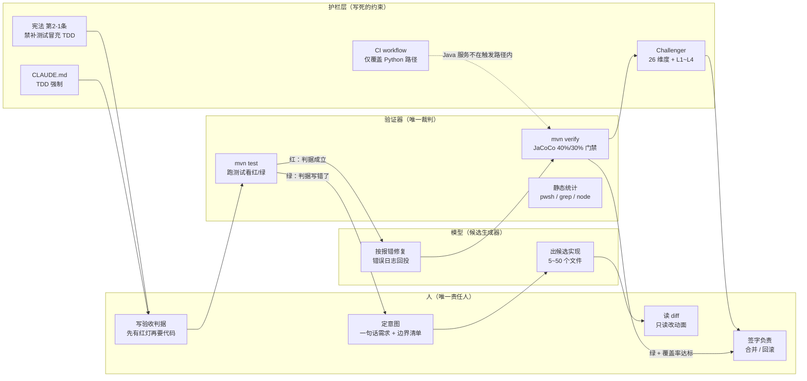
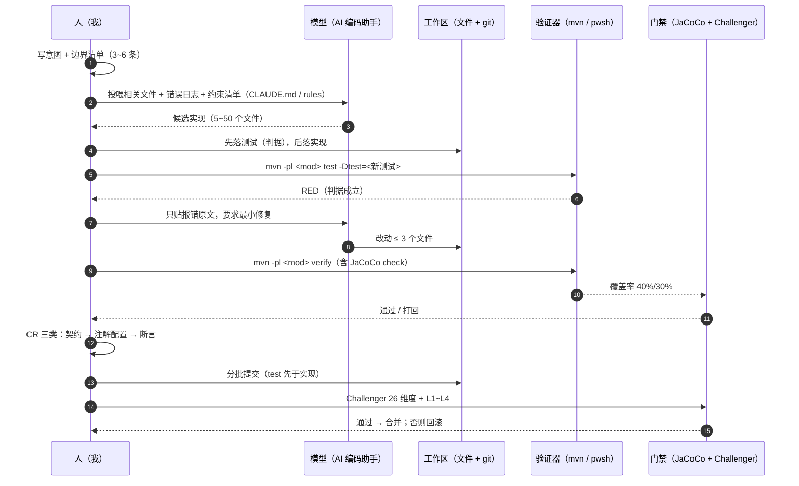

# Vibe Coding（氛围编程）：用自然语言驱动生成，以运行结果为准

> **一句话结论**：Vibe Coding 不是"不会写代码也能造系统"，而是"用自然语言把意图压成候选实现、再以运行结果当唯一裁判"的低成本**探索协议**；它的风险不在生成得快，而在**你不知道自己不知道什么**——本仓 143 个测试类里只有 12 个能真正碰到 Spring 容器（第 0.2 节有统计），剩下 131 个看不见注解、事务、条件装配这些"跑通了也错"的地方。
> **阅读前置**：写过一个 Spring Boot 模块的 CRUD 与单元测试；知道 `@Test`、`assertThat` 在干什么，知道 `mvn test` 和 `mvn verify` 是两条不同的命令；不需要懂大模型内部原理——本文把模型当"输入自然语言、输出候选代码"的黑盒处理。
> **证据基线**：JDK 17 / Spring Boot 4.2.0 / Spring AI 2.1.0 / JaCoCo（父 POM `pom.xml#L349-L389`）；本仓 `CLAUDE.md`、`.claude/`、`.specify/`、`specs/005-after-sales-agent/`、`docs/` 的真实文件与真实行号；预计阅读 **35 分钟**（含 6 段可原地重跑的静态统计）。

## 0. 先看现象

### 0.1 证据边界（先说清楚本文哪些话有兜底）

Vibe Coding 是方法论主题，最容易写成"听起来对"的空话。所以本文只保留能挂上本项目痕迹的结论，其余全部改写进第 6 节（误区）与第 7 节（版本与时效）。

| 证据类别 | 本仓状态 | 本文怎么用 |
| --- | --- | --- |
| A 级：框架源码摘录 | `learning-docs/24-源码分析/assets/source/` 已入库 905 份 .md；与"测试切片/上下文"相关的可检索到 `DataJpaTest.java.md`、`WebMvcTest.java.md`、`SpringBootTest.java.md` 等 | 只在第 3.3 节讲"切片测试到底验了什么"时给 `[[源码:文件.java.md#Lx-Ly]]`，其余不给 A 级（本篇主题不在框架源码里） |
| B 级：本仓真实文件 | `CLAUDE.md`、`.claude/rules/`、`.claude/agents/`、`.specify/memory/constitution.md`、`specs/005-after-sales-agent/tasks.md`、`docs/28`、`docs/29`、`docs/30`、`pom.xml` 均已 `read` 核对行号 | 讲"我们这个项目怎么约束 AI 写代码"时给 `路径#L起-L止` |
| C 级：可复现实测 | 只做静态统计：测试类/测试方法/断言计数、测试类型分类、提交粒度、常驻上下文规模、CI 覆盖面；不起服务、不联网、不跑 `mvn`/`npm` 构建 | 讲"护栏到底有多厚"时给命令 + 真实输出 + 怎么读 |
| 无 | 本机无 docker / redis / mysql / chroma（`05-AI集成/README.md#L19-L28` 已实测记录）；且本文所有统计都不运行测试 | 涉及"跑一遍看看"的结论一律写"未实测，依据本仓文档/代码" |

### 0.2 三个真实症状（都能在本仓找到出处）

**症状一：模型给的代码跑通了，但边界全错。**

`docs/29-用户接口输入校验与E2E测试.md#L50-L55` 记着 6 条真实缺陷，其中两条是"功能跑得通、边界全错"的典型：

- 第 50 行：注册接口直接接收未校验实体，"空值、短密码及超长输入会进入 Service/数据库"——主流程 200 OK，边界全裸。
- 第 55 行：E2E 复现"普通用户在更新昵称时夹带 `role=admin` 后**真实提权**"——接口照样成功返回，安全面已经是洞。

这两条都不是语法错误、不是编译错误，是**跑得通但不对**。Vibe 式生成最容易命中的就是这一类。

**症状二：一次让模型改 12 个文件，出问题找不到是哪一步引入的。**

本仓的真实提交数据支持这个痛感（统计命令与输出在第 6.2 节）：

```text
commit 数: 59
平均改动文件数: 35.2
最大: 1030
```

而 `.claude/rules/git-workflow.md#L41-L46` 写的却是"**每次提交只做一件事**"。规范与实践差了 30 倍，这不是纪律问题，是**验证能力问题**：一次改 12 个文件时，你没有能力在同一个回合里验证 12 处行为。

**症状三：测试是模型写的，测试和实现一起错。**

`docs/28-故障案例库.md#L69-L72` 记的是本项目最贵的一课：

```text
### 为什么单测没暴露

`OrderServiceTest` 用 `@InjectMocks` 创建的是**裸实例**，没有 Spring 代理，自然测不出"注解没生效"。
**只有集成测试（真实 Spring 上下文 + 事务状态断言）才能暴露**——这也是本次补测试的直接动机。
```

当时的 `docs/28-故障案例库.md#L86` 记录：修复前 85 个测试全绿、`BUILD SUCCESS`，而 `@Transactional` 在自调用下**根本没有生效**。测试和实现都是"对的写法"，两边一起把错误盖住了。

**这些现象指向同一件事：Vibe Coding 的产出是"能跑的证据"，不是"对的证据"；它的风险不在写得快，而在你不知道自己不知道什么——你不知道边界在哪、不知道注解是否生效、也不知道测试是不是和实现一起错了。**

## 1. 整体地图

### 1.1 一张图看清"人、模型、验证器、护栏"四者的关系



> **读图说明**：这张图有 3 条容易看错的边。**第一条**是 `H3 --> V1`：验收判据必须**先于**模型出码存在，否则 `V1` 的绿灯只证明"代码自己和自己一致"，不证明"符合你的意图"——`docs/28` 那 85 个绿灯就是这么来的。**第二条**是 `V1 -->|绿：判据写错了| H1` 这条回边：测试一次就绿，大多数情况下不是好消息，而是判据没写对（第 3.4 节给出判断方法）。**第三条**是虚线 `G4 -.-> V2`：CI 看着像第二道闸，实际没接上——本仓唯一的 workflow 只触发 Python 目录（第 6.4 节有真实输出），Java 侧的 JaCoCo 门禁只存在于"人记得跑 `mvn verify`"这一层。

### 1.2 组件、责任与参与方

| 组件 | 谁在做 | 责任（一句话） | 本仓落点 |
| --- | --- | --- | --- |
| 意图与判据 | 人 | 把"想要什么"压成可判定的验收项 | `specs/005-after-sales-agent/tasks.md#L104-L113` 把断言点写进任务 |
| 候选生成 | 模型（AI 编码助手） | 产出可编译、可运行的实现草案 | 本仓通过 `CLAUDE.md` + `.claude/`（skills/agents/commands）约束其行为 |
| 验证执行 | 人 + Maven | `mvn test` 看红绿、`mvn verify` 过覆盖率 | `pom.xml#L349-L389` 的 JaCoCo 三段执行 |
| 静态复核 | 人 + pwsh/node | 用统计回答"测试够不够厚""改动面多大" | 本文第 6 节 6 段命令 |
| 审查门禁 | Challenger 角色 | 26 个维度 + L1~L4 逐项打回 | `.claude/agents/challenger.md#L53-L97` |
| 过程留痕 | 人 | 分批提交、测试先于实现 | `.claude/rules/git-workflow.md#L41-L46`、宪法 `#L44` |
| 最终责任 | 人 | 合并、回滚、背锅 | 没有任何一条规范能把这条转移给模型 |

### 1.3 读这张地图的正确姿势

不要把 Vibe Coding 理解成"第 1 层到第 2 层就结束"。地图里真正决定成败的是 **`VERIFY` 与 `GUARD` 两列**：`HUMAN` 与 `MODEL` 之间的来回在任何模式下都一样（你说话、它出码），差别只在于你有没有本事在同一个回合里证伪它。本仓花了 754 行规则（第 6.5 节统计）去加固这两列，恰恰说明这不是"风格问题"而是"证据问题"。

## 2. 关键概念与关键要素

| 名称 | 位置（本仓落点） | 角色 | 关键点 |
| --- | --- | --- | --- |
| Vibe Coding（氛围编程） | 本篇 | 开发方式 | 用自然语言驱动生成、以运行结果为准；不要求人读全量代码，但要求人**能判定结果** |
| 适用边界 | 第 3.1 节 | 选型判据 | 探索型 / 一次性脚本 / UI 原型可以；核心交易链路（下单、支付、扣库存）不行 |
| 人机分工四层 | 第 3.2 节 | 责任模型 | 我定意图 → 模型出候选 → 我验证 → 我负责；第四层不可转移 |
| 不可见缺陷面 | 第 3.3 节 | 风险清单 | 边界、异常、并发、安全——四类都"跑得通" |
| 验证优先工作流 | 第 3.4 节 | 工作顺序 | 先写验收判据（红），再让模型生成（绿） |
| 上下文投喂 | 第 3.5 节 | 提示工程 | 相关文件 + 错误日志 + 约束清单，三样缺一不可 |
| 局部性原理 | 第 3.6 节 | 改动粒度 | 一次只改一个可验证的小块；对应 `git-workflow.md#L43` |
| 返工成本曲线 | 第 3.7 节 | 成本模型 | 改动越大，验证覆盖率越低，返工越可能变成重写 |
| 收手线 | 第 3.8 节 | 何时手写 | 涉及资损、越权、幂等、事务边界时必须切回手写 + TDD |
| CR 三类漏看 | 第 3.9 节 | 审查清单 | 无断言的测试、注解/配置类隐性改动、跨模块契约变化 |
| 断言（assertion） | 全仓 2133 处 | 测试的最小单位 | 用代码表达"我认为结果应该是 X"；没有断言的测试只是"跑过一遍" |
| 覆盖率（coverage） | `pom.xml#L373-L382` | 门禁指标 | 被测试执行到的代码行/分支比例；行 ≥40%、分支 ≥30% |
| 切片测试 | `[[源码:WebMvcTest.java.md#L111-L111]]` | 测试形态 | 只加载 Web 层或持久层的部分自动配置，快但看不见全链路 |
| TDD | `CLAUDE.md#L118-L129` | 流程约束 | Red → Green → Refactor；本项目强制（宪法第2-1条） |
| SDD（规格驱动） | `specs/` | 流程约束 | specify → clarify → plan → tasks → implement → analyze |
| Challenger | `.claude/agents/challenger.md` | 审查角色 | 26 维度 + L1~L4 四级验证，任一不通过即打回 |

## 3. 原理与证据逐段精读

### 3.1 定义与适用边界：先分清"探索"和"承重"

**在干什么。** 把"用自然语言生成代码"这件事按风险切成三类场地：**探索型**（不确定方案，写废了也无所谓）、**一次性脚本**（跑完就扔）、**UI 原型**（错的是观感不是钱），以及**承重结构**（下单、支付、扣库存、鉴权）。Vibe Coding 只在第一类场地成立，在第四类场地它退化成"用运行结果赌资损"。

**为什么这么设计。** 因为 Vibe Coding 的验收标准是"运行结果"，而运行结果只能覆盖你**想到要跑**的路径。本仓对这条路线的边界有明文定义：`docs/16-TDD与SDD适用场景对比.md#L62-L64` 直接写 SDD 不适合"简单功能、小改动（杀鸡用牛刀）"、"个人项目快速迭代"；反过来 `CLAUDE.md#L114-L116` 写的是"开发任何新功能必须遵循 TDD"。两头夹起来，本项目的适用带其实很窄：**探索可以用氛围，交付必须走证据**。

**换写法会怎样。** 如果反过来——先 vibe 出承重代码再补测试——你会得到 `docs/28-故障案例库.md#L63-L67` 那张表：没有事务时，"下单主表插入成功、明细插入失败"＝脏数据，"本地扣减成功、远程库存扣减失败"＝**资损**。这三行是适用边界的量化定义：任何一行成立，就出场地。

**常见坑。** 把"原型通过"当成"可以直接上线"。本仓对此有一个真实反例：`docs/16-TDD与SDD适用场景对比.md#L32-L34` 记录了一次一句话委托——"用 TDD 开发商品服务"，一次性交付 26 个测试 + 完整实现 + 部署配置。它之所以能这么干，前提是**委托里点名了 TDD**；如果那句话是"帮我做个商品服务"，同样 26 个文件的产出就没有任何判据兜底。

### 3.2 人机分工四层模型：第四层不可转移

**在干什么。** 把一次 AI 协作拆成四层，一层都不能省：

| 层 | 谁做 | 产出物 | 本仓证据 |
| --- | --- | --- | --- |
| ① 我定意图 | 人 | 一句话需求 + 边界清单 | `specs/005-after-sales-agent/spec.md`（20031 字节的功能规格） |
| ② 模型出候选 | 模型 | 可编译的实现草案 | `specs/005-after-sales-agent/tasks.md#L32-L35`（T006~T009 四步实施） |
| ③ 我验证 | 人 + Maven | 红/绿 + 覆盖率数字 | `pom.xml#L349-L389` |
| ④ 我负责 | 人 | 合并或回滚的决定 | `git-workflow.md#L57-L60`（合并前过 Challenger） |

**为什么这么设计。** 因为②③之间有一条**能力不对称**：模型能一次产出 50 个文件，而你在同一个回合里能读完、能验证的只有 5 个以内。本仓把这条不对称写成了流程：宪法 `.specify/memory/constitution.md#L44` 要求"测试提交（或测试文件变更）**必须先于**对应实现提交，作为 Challenger 审查的 Red 证据"；`specs/005-after-sales-agent/tasks.md#L144` 的 T054 直接写"按模块分批提交（test 先于实现）"。

**换写法会怎样。** 如果③由模型自己完成（它写测试、它跑绿），你就把"裁判"交给了"运动员"。`docs/28-故障案例库.md#L69-L72` 就是这个场景的真实后果：测试存在、绿灯存在、注解不生效也存在。

**常见坑。** 把"④我负责"理解成"review 一下就行"。第 3.9 节会讲，CR 能看出来的东西比你想的少得多；真正的负责是**留下能被别人重跑的证据**，比如 `docs/30-Spring-AI-2.1升级实施与验证.md#L140-L149` 那张"每模块通过数/失败/错误"的表——它不是给人看的，是给下一个人重跑用的。

### 3.3 「感觉能用」不等于能用：四类不可见缺陷面

**在干什么。** 把"看起来能用"和"真的能用"之间的差距，拆成四个固定的检查面：**边界、异常、并发、安全**。四类的共同点：**主流程 100% 正常，缺陷 0% 可见**。

**为什么这么设计。** 因为验证成本随覆盖面非线性上升，而模型的产出恰好落在"主流程全覆盖、四类面全空"这个最廉价的位置。A 级证据能说明这句话不是主观判断：Spring 的测试切片**默认就不是全链路**——`[[源码:DataJpaTest.java.md#L55-L55]]` 的原文注释是"By default, tests annotated with `@DataJpaTest` are transactional and roll back"，`[[源码:DataJpaTest.java.md#L89-L89]]` 的 `@Transactional` 让每个测试方法结束后回滚。回滚很香（测试互不干扰），但它同时意味着**你看不到"提交后"的副作用**——事务边界、审计字段、唯一索引冲突这些"真出事的地方"全在回滚之后。

**换写法会怎样。** 本仓有一个 143 个测试类也兜不住的实例，见第 0.2 节症状三：事务注解失效属于"注解没生效"类缺陷，纯 Mockito 测试用的是裸实例，天生看不见代理。而 `docs/29-用户接口输入校验与E2E测试.md#L50-L55` 列的 6 条缺陷里，落在四个面上的至少 5 条：未校验入参（边界）、异常映射到 500（异常）、`MetaObjectHandler` 缺失导致审计时间为 NULL（异常/数据）、夹带 `role=admin` 提权（安全）。

**常见坑。** 用"我手动点了一遍没问题"覆盖四个面。手点只能覆盖主流程 + 你想得到的边界；`docs/29-...#L36-L46` 的边界清单（缺字段、`null`、空字符串、纯空白、`String` 字段收到对象、Long 收到非数字、24 个三字节中文字符 vs 25 个）不是靠"点一遍"想出来的，是**照着清单穷举**出来的。

### 3.4 验证优先工作流：先写验收判据，再让模型生成

**在干什么。** 把顺序倒过来：不是"生成→跑一下→看起来行"，而是"**先写一个必然失败的判据**→让模型去满足它"。

**为什么这么设计。** 因为判据是唯一能区分"代码符合我意图"和"代码符合它自己"的东西。本仓把这件事做成了任务模板，`specs/005-after-sales-agent/tasks.md#L104-L113` 是一段可以直接抄的范例——注意它的每个测试任务里写死的不是"测试 X 服务"，而是**具体的判据**：

```text
- [ ] T028 `AgentStateMachineTest`：合法/非法迁移、每状态工具集、终态判定、最大步骤
- [ ] T029 `SafetyGuardServiceTest`：注入样本（忽略指令/泄露提示词/越权工具）拦截、正常样本放行、BLOCK 后零工具调用
- [ ] T032 `ConfirmationServiceTest`：Token 生成/校验、超时过期、摘要一致性
- [ ] T034 `AfterSaleAgentServiceTest`（核心）：……未确认零写操作；拒绝→CANCELLED；资格不满足→转人工；多候选订单→询问；步骤超限→降级；幂等键=runId
```

（src: ../../../specs/005-after-sales-agent/tasks.md#L104-L113）

`tasks.md#L6` 还写死了结构性要求："每个实现任务先写测试并验证失败（Red），再实现使其通过（Green）"。对应的宪法条款在 `.specify/memory/constitution.md#L37`：**禁止**"在无失败测试的情况下编写实现代码"，**禁止**"实现完成后补写测试冒充 TDD"，**禁止**"为凑覆盖率而编写无意义断言"——最后一条正好是模型最爱的作弊路径。

**换写法会怎样。** 没有判据时，你只能拿"能启动""页面能开""接口 200"当验收。这三样恰好是 `docs/30-Spring-AI-2.1升级实施与验证.md#L153-L155` 明确排除的：

```text
3. 这些是 `mvn test` 的编译、单元和离线/模拟上下文验证，**不是全仓所有模块的 `mvn verify`，也不等于真实
   DeepSeek/硅基流动调用、Chroma 读写、Nacos 刷新、RocketMQ/Seata/MySQL 链路或生产部署验收**。
```

（src: ../../../docs/30-Spring-AI-2.1升级实施与验证.md#L153-L155）

**常见坑。** 判据写完第一次就绿。这时正确的反应不是庆祝，而是怀疑判据——要么它测的是实现里已有的行为（等于没事前写），要么它太弱（比如只断言 `result != null`）。本仓对此有一份可执行的清单：`learning-docs/08-测试/03-一等公民验证清单（一二梯队落地）.md#L14-L48`，每一项都要求两列证据——"单测"与"真实环境证据"，例如第 19 行要求 Sentinel 的证据是"启动日志 + 并发打接口返回 429"，第 44 行要求事务消息的证据是"mock 支付回调 → pay 日志 SEND_OK → order 日志 PAID"。**判据的标准是"别人照着能重跑出同一结论"**，不是"我跑过"。

### 3.5 上下文投喂策略：三样东西，缺一样就退回猜

**在干什么。** 每次让模型动手前，先决定投喂什么：①**相关文件**（改哪个类、它的接口、它的测试）②**错误日志**（真实报错原文，不是你的转述）③**约束清单**（这个项目不许怎么写）。

**为什么这么设计。** 模型的输出质量几乎完全由这三样决定，而"约束清单"是本仓投入最重的部分。实测规模（命令与口径见第 6.5 节）：

```text
CLAUDE.md 行数 = 150
.claude 下 md 文件数 = 41
.claude 下 md 总行数 = 7535
specs 下 md 文件数 = 41
specs 下 md 总行数 = 4380
```

`CLAUDE.md` 的 150 行里有 TDD 强制、覆盖率门禁、依赖方向禁令（禁止微服务互相依赖、禁止 common 依赖业务模块）；`.claude/rules/coding-rules.md#L23-L31` 是另一类约束——"Controller 只做参数校验与委托"、"优先构造器注入、禁止字段注入"、"禁止 `e.printStackTrace()`"、"禁止 `System.out.println()`"、"禁止手动逐字段 get/set 复制"（要求 MapStruct）。这些不是风格洁癖：**每一条都是模型最容易违反的默认写法**。

**换写法会怎样。** 不投喂约束，模型会用"互联网上最常见的写法"填空——字段注入 + 手动 `for` 循环复制 + `e.printStackTrace()`。这类代码能编译、能跑、能过你的弱断言，然后在 CR 时被 Challenger 按 `challenger.md#L53-L82` 的 26 个维度打回。项目里所以把规范写成文件，本质是**把 CR 的一部分前置到生成时**。

**常见坑。** 投喂过量。一次性塞 5000 行代码进去，模型对"最后 500 行"的注意力远高于开头的约束。本仓的做法是分层的：常驻的只有 `CLAUDE.md`（150 行）+ `.claude/context/tech-stack.md`（57 行），其余 `.claude/skills`（3456 行）、`commands`（3056 行）按需加载——这个分层本身就是一种上下文预算管理，第 6.5 节给了按目录的实测行数。

### 3.6 局部性原理：一次只改一个可验证的小块

**在干什么。** 把一次任务切到"改动面 ≤ 一次能验证完的面"为止。判据很土：**如果你说不清这个改动会破坏哪 3 个已有行为，它就太大了。**

**为什么这么设计。** 因为定位成本随改动面超线性上升。规范层面本仓写的是 `.claude/rules/git-workflow.md#L43`——"**每次提交只做一件事**"；任务层面 `specs/005-after-sales-agent/tasks.md` 用 T001…T054 切成 54 个块，每块都有"检查点"（如 `#L38` "ai-cs-order 售后能力独立可用"）。

**换写法会怎样。** 对照本仓真实提交（第 6.2 节命令）：59 个提交平均 35.2 个文件，其中 `f46af4a`（新增 24-源码分析中文精读教程）一份提交 1030 个文件。这类"巨型提交"在文档场景还能靠 `git show --stat` 接受，在代码场景就是灾难——`cceccf4`（升级 Spring AI 2.1 并适配 Spring Boot 4）动了 33 个文件，它的验证成本被如实写在 `docs/30-Spring-AI-2.1升级实施与验证.md#L132-L149`：一条 Reactor 命令、403 个测试、4 个模块。**能这么做的前提是先有这条命令**；没有它，33 个文件等于 33 个未知。

**常见坑。** 把"小步"理解成"少写几行"。小步的定义是**可验证**，不是**短**。`tasks.md#L24-L28` 里 T003~T005 三行看着很小，但它们覆盖的是归属校验、状态校验、幂等去重、订单不存在——每一条都是能单独变红的判据。反过来，一个改了 1 个文件但顺手重构了 200 行的提交，比改 10 个文件但每个只加 3 行断言的提交危险得多。

### 3.7 返工成本曲线：改动越大，验证越难，返工越像重写

**在干什么。** 给"什么时候继续聊、什么时候推倒重来"一个成本模型：返工成本 ≈ 改动面 × 你未覆盖的缺陷面，两个乘数都在改动变大时变差。

**为什么这么设计。** 因为模型的修复能力是"按报错修"，而报错只覆盖你跑的路径。改动变大后，两个乘数同时恶化：改动面线性涨，验证覆盖率反而下降（你没时间给 30 个文件各写判据）。本仓有一个正面对照：`docs/30-...#L153-L154` 记录 33 文件升级里只暴露了 2 个真实问题——Tika 4/POI 5.5.1 需要 Commons Compress 1.28.0（被 MinIO 传递依赖拉到 1.26.0）、product 测试里 Mockito `any()/argThat()` 歧义。**两个问题都是"跑测试才出现"的类型**，不跑就是 0 信息。

**换写法会怎样。** 如果不承认这条曲线，就会出现"越改越不敢跑测试"的死亡螺旋：改动大 → 测试挂一堆 → 判断不了哪些挂是预期的 → 跳过测试 → 直接提交。本仓的解法是**先把验证成本固定下来**：`CLAUDE.md#L121-L129` 三行命令写死了 Red/Green/Refactor 各跑什么，`mvn -pl ai-cs-order verify` 这条命令的耗时不随你的心情变化。

**常见坑。** 用"多轮对话"硬扛大改动。第 5 轮的对话里，模型看到的上下文已经被前面 4 轮的中间产物污染；而你要求它"顺便修一下"的第 5 个问题时，它可能正在拆掉第 2 轮的判据。**返工点应该出现在"判据红但连续 3 轮都修不绿"时**，而不是出现在"我看着不舒服"时——前者有客观信号，后者没有。

### 3.8 什么时候必须切回手写

**在干什么。** 给"收手"一条硬线，而不是靠自觉。

**为什么这么设计。** 因为氛围模式的问题不是"质量差"，是"质量不可判定"。一旦某段代码的失败后果不可逆或不可观测，就必须换成能留下证据的写法。本仓的四条硬线：

| 触发条件 | 为什么不能 vibe | 本仓锚点 |
| --- | --- | --- |
| 涉及资损（扣款、扣库存、退款） | 错了要赔钱，且事后难定位 | `docs/28-故障案例库.md#L63-L67` |
| 涉及越权与身份 | 缺陷表现为"功能正常" | `docs/29-...#L55`（夹带 `role=admin` 真实提权） |
| 涉及事务/幂等/并发边界 | 单测天然看不见（裸实例无代理） | `docs/28-...#L69-L72` |
| 有合规或审计要求 | 需要能重跑的过程证据 | `docs/30-...#L161-L164`（"可运行/已验证"必须区分层级） |

**换写法会怎样。** 反过来，这些场景用 TDD 手写，成本也并没有想象中高：`docs/28-...#L76-L87` 为了抓住事务失效，只加了**一个**集成测试类（`ai-cs-order/src/test/java/com/aics/order/service/impl/OrderCreateTxWiringTest.java`），用最小 Spring 上下文 + H2 断言 `TransactionSynchronizationManager.isActualTransactionActive()`，RED 时的输出就一行"Expecting value to be true but was false"。**一条断言换掉一类资损可能**，这是本仓性价比最高的一笔投入。

**常见坑。** 把"切回手写"理解成"全部重写"。实际做法是**只把承重的那几十行手写 + 加判据**，其余（DTO、Mapper、样板 CRUD）继续用生成。宪法 `.specify/memory/constitution.md#L47` 给了这条边界的标准姿势："新功能严格 TDD；修改存量代码前必须先为被改动行为补充特征测试（characterization test）"。

### 3.9 CR 时最容易漏看的三类改动

**在干什么。** 把 Code Review（CR，人工代码审查）的注意力从"格式与命名"挪到"绿灯骗人的地方"。

**为什么这么设计。** 因为 CR 的有效时间通常只有几分钟，而模型的产出量是几分钟看不完的。必须有一个固定的三类清单，每次只查这三类：

**第一类：有测试、没断言。** 这是最贵的漏看。实测（命令与口径见第 6.1 节）：全仓 143 个测试类、654 个测试方法、2133 处断言调用（平均每方法 3.26 处），但这个数字骗人——按"`@Test` 数 > 0 且断言类调用为 0"口径筛，还剩 1 个类（`ai-cs-search/src/test/java/com/aics/search/cdc/ProductCdcConsumerTest.java`）。**注意我第一次筛出 7 个是错的**：正则漏了 MockMvc 的 `andExpect`，修正后降到 1。这个纠错过程本身就是 CR 教训：**统计口径不写清楚，结论一定错**。

**第二类：注解与配置类隐性改动。** 这些行没有逻辑，跑起来一切正常，但语义变了：`@Transactional` 加在哪、`@Conditional` 条件改了没、`@Bean` 是不是被 `@Primary` 顶掉、yml 里 `similarityThreshold` 从 0.3 改成 0.7。它们全部属于"容器级行为"，而第 0.2 节的统计说明：143 个测试类里只有 12 个碰得到容器，131 个碰不到。**所以这类改动的 CR 只能靠人，别指望测试。**

**第三类：跨模块契约变化。** DTO 字段增删、Feign 接口签名、错误码枚举（如 `specs/005-after-sales-agent/tasks.md#L12` 一次新增 `AGENT_*(3101-3109)` 与 `AFTER_SALE_*(7101-7105)` 两组码）。这类改动在单模块测试里全绿，在联调时炸。本仓的处理办法是把它变成门禁项：`challenger.md#L93` 的 L2 就叫"契约验证——检查接口契约（OpenAPI / gRPC / DTO）是否与 spec.md 一致"。

**常见坑。** 只查第一类。三类里第二类最隐形（无 diff 感、无报错），第三类最贵（跨服务炸），而人的注意力天然全给第一类。**建议的 CR 顺序是 3→2→1**：先看契约（最快、最贵），再看注解配置（需要上下文），最后看断言（最费时）。

## 4. 一次完整执行时序

### 4.1 从"一句话意图"到"可合并的提交"



> **读图说明**：看三处节奏。**第 4 步是整张图的枢纽**——测试先落、实现后落，顺序反了（先实现后补测试）整条链的证据就失效，宪法 `#L44` 把这条写成硬性要求正是因为它是唯一能区分 TDD 与"补测试冒充 TDD"的痕迹。**第 5~7 步必须是一次往返**：先看到 RED 再让模型修，一次就绿说明判据没写对（回第 1 步）。**第 12~14 步是三道不同的闸**，别混：`verify` 卡覆盖率数字、CR 卡人眼能看的东西、Challenger 卡流程与文档一致性；三者互不替代。

### 4.2 每一步失败会怎样

| # | 失败点 | 触发条件 | 你看到什么 | 正确反应 |
| --- | --- | --- | --- | --- |
| 1 | 意图不清 | 边界清单少于 3 条 | 模型给出"教科书式"实现，没有一条对上业务 | 回第 1 步补清单，别急着生成 |
| 3 | 候选过大 | 一次产出 > 10 个文件 | diff 读不完，取舍靠猜 | 砍需求，只留一个可验证块 |
| 5 | 判据本来就绿 | 测试首次运行即 PASS | `BUILD SUCCESS` | 判据无效，重写（加边界值/反向断言） |
| 5 | 编译不过 | 测试引用了不存在的类 | `COMPILATION ERROR` | 先补接口签名，别让模型"顺手"生成实现 |
| 9 | 覆盖率不达标 | 行 <40% 或分支 <30% | JaCoCo 报 `Rule violated for bundle` | 补行为测试，不是补 getter 调用 |
| 9 | 只跑 test 没跑 verify | 误以为 `mvn test` 有门禁 | 一切绿 | 记住：`check` 绑定在 `verify`（`pom.xml#L364-L367`） |
| 12 | 提交粒度过大 | 单次提交 >10 个文件 | `git show --stat` 一屏放不下 | 按模块拆，test 单独先提交 |
| 14 | Challenger 打回 | 覆盖率口径不符（80% vs 40%，见 6.5 节） | 审查报告"阻断项" | 先对齐口径，再谈补测 |

## 5. 设计取舍

### 5.1 本项目实际选了哪一边

| 取舍点 | 本项目选择 | 换另一边会怎样 | 本仓锚点 |
| --- | --- | --- | --- |
| 生成速度 vs 可验证性 | 先判据后生成（慢半天） | 快，但绿的是"自洽"不是"正确" | `specs/005-after-sales-agent/tasks.md#L6` |
| 覆盖率门禁高低 | 行 40% / 分支 30%（初始阈值） | 定太高会让团队写无意义断言 | `pom.xml#L373-L382`、宪法 `#L45` |
| 门禁触发时机 | 绑 `verify`（人手动跑） | 绑 `test` 会拖慢每次本地测试 | `pom.xml#L360-L367` |
| 测试形态 | 以纯 Mockito 为主（131/143 不碰容器） | 全上 `@SpringBootTest` 更真但慢到没人跑 | 第 0.2 节/第 6.3 节统计 |
| 规范载体 | 写成文件（`CLAUDE.md` + `.claude/rules`） | 只口头交代，模型每轮重新猜 | `.claude/rules/coding-rules.md#L23-L31` |
| 提交粒度 | 规范要求"一次一件事"，实践平均 35 文件 | 一味求小会让文档类提交碎成渣 | `git-workflow.md#L43` vs 第 6.2 节 |
| 存量代码 | 先补特征测试再改 | 直接改会失去"改前行为"的基线 | 宪法 `#L47` |
| 模型定位 | 生成候选，不参与判定 | 让它自测自评＝运动员兼裁判 | `docs/28-...#L69-L72` |

### 5.2 可扩展点清单（想加强护栏时按这个顺序动）

1. **把 JaCoCo 门禁接进 CI**：当前 `.github/workflows/` 只有 1 个 workflow，触发路径只含 Python 目录（第 6.4 节），Java 侧等于零 CI。最小动作：加一个 `paths: ai-cs-*/**` 的 job 跑 `mvn -pl <mod> verify`。
2. **给四个不可见缺陷面各配一个模板测试**：边界（`docs/29-...#L36-L46` 那份清单直接抄）、异常（统一 400/500 映射断言）、并发（同用户重复提交 → 幂等键）、安全（越权/提权样本，参考 `tasks.md#L107` 的注入样本设计）。
3. **把"零断言"做成 CI 断言**：第 6.1 节的静态统计可以当脚本跑，命中即失败。
4. **覆盖率口径统一**：`.claude/agents/challenger.md#L74`（≥80%）、`#L88`/`#L126`（=100%）、`pom.xml#L376`（0.40）、宪法 `#L45`（目标 80%/70%）四处数字不同，审前必须先声明用哪个。
5. **容器级测试配额**：143 个类里 131 个不碰容器，建议每个模块至少保证 1 个真实上下文测试（本仓样板是 `OrderCreateTxWiringTest`、`UserApiEndToEndTest`）。
6. **上下文分层白名单**：把"哪类文件必须投喂、哪类按需加载"写进 `.claude/`，避免每轮靠人记（现在 `skills/` 3456 行、`commands/` 3056 行都是按需的）。

## 6. 踩坑与调试手法

### 6.1 手法一：用一条命令回答"我们的测试有没有断言"

**为什么需要它。** `@Test` 数量是虚荣指标。真正要问的是"这些方法里有没有能变红的东西"。

**命令与口径**（`cd D:\Projects\Persion\ai-customer-service` 执行，纯静态统计，30 秒内）：

```powershell
$tf = Get-ChildItem -Recurse -File -Filter *Test.java | Where-Object { $_.FullName -notmatch '\\target\\' }
$pat = '\b(assertThat|assertEquals|assertTrue|assertFalse|assertNull|assertNotNull|assertThrows|assertDoesNotThrow|assertThatThrownBy|verify\(|andExpect|expectThat|Assertions\.|fail\()'
foreach ($f in $tf) {
  $t = Get-Content $f.FullName -Raw
  $n = ([regex]::Matches($t, '(?m)^\s*@(Test|ParameterizedTest)\b')).Count
  if ($n -eq 0) { continue }
  $a = ([regex]::Matches($t, $pat)).Count
  if ($a -eq 0) { "$($f.Name)  @Test=$n  断言=0" }
}
```

**真实输出**：

```text
测试类文件数 = 143
测试方法注解数 = 654
@DisplayName 数 = 480
断言/校验调用总数 = 2133
平均每个测试方法 = 3.26
零断言测试类数 = 1
ProductCdcConsumerTest.java  ai-cs-search
```

**怎么读。** ①**口径决定结论**：第一版正则是 7 个命中，加上 `andExpect`（MockMvc 的断言方式）后降到 1——6 个是误报。任何"我们测试很水"的结论都必须先贴口径。②唯一命中的 `ai-cs-search/src/test/java/com/aics/search/cdc/ProductCdcConsumerTest.java` 只有 2 个 `@Test`，属于"用 mock 验证调用不发生"的类型，值得单独看一眼。③**2133/654 = 3.26 处/方法**是本项目的断言密度基线：低于 1 的测试类重点看，高于 5 的通常是参数化测试。

### 6.2 手法二：用一条命令量出"一次改动到底有多大"

```powershell
$log = git log --pretty=format:'@@%h|%s' --name-only -n 60
$blocks = ($log -join "`n") -split '@@' | Where-Object { $_.Trim() -ne '' }
$res = foreach ($b in $blocks) {
  $lines = $b -split "`n"
  [pscustomobject]@{ Files = ($lines | Select-Object -Skip 1 | Where-Object { $_.Trim() -ne '' }).Count; Head = $lines[0] }
}
"commit 数: $($res.Count)"
"平均改动文件数: $([math]::Round(($res | Measure-Object Files -Average).Average,1))"
$res | Where-Object { $_.Head -match '^\w+\|(feat|fix|refactor|test)' } | Sort-Object Files -Descending
```

**真实输出**（节选）：

```text
commit 数: 59
平均改动文件数: 35.2
最大: 1030
1-3 个文件: 15 次    4-10: 16 次    11-30: 15 次    31+: 13 次

Files Head
 1030 f46af4a|docs(learning): 新增24源码分析中文精读教程
  127 c753472|feat(platform): 补齐 Spring 微服务治理与中间件能力
   57 e68096d|feat(platform): 补齐一二梯队技术（...）
   41 babbf03|feat(frontend): 新增 React 版前端工程
   33 cceccf4|feat: 升级Spring AI 2.1并适配Spring Boot 4
   11 e5d4350|fix: 加固用户输入校验与资料更新授权边界
```

**怎么读。** ①**31+ 的 13 次里多数是 docs 提交**（1030 文件那次是整批教程入库），这类"一次搬一堆文档"没有行为风险，不必按代码标准批判。②**代码类的危险区是 33~127**：`cceccf4`（33 文件）的验证代价被如实记录在 `docs/30-...#L132-L149`（一条命令、403 个测试、4 个模块），`c753472`（127 文件）那种提交则根本没法在 CR 里读完。③**11 文件的 `fix: 加固用户输入校验`** 恰好对应 `docs/29` 的 6 条缺陷——**修边界问题天然会动一批文件**，这也是为什么第 3.6 节说"小步"的判据是可验证性而不是文件数。

### 6.3 手法三：量出"测试到底看不看得见容器"（决定你该不该信绿灯）

```powershell
$tf = Get-ChildItem -Recurse -File -Filter *Test.java | Where-Object { $_.FullName -notmatch '\\target\\' }
foreach ($f in $tf) {
  $t = Get-Content $f.FullName -Raw
  $kind = if ($t -match '@SpringBootTest') { 'A 完整上下文' }
          elseif ($t -match '@WebMvcTest|@DataJpaTest|@JsonTest|@RestClientTest') { 'B 切片' }
          elseif ($t -match 'ApplicationContextRunner') { 'C 容器装配' }
          elseif ($t -match 'MockitoExtension') { 'D 纯 Mockito' }
          else { 'E 纯 JUnit/手工构造' }
  "$kind`t$($f.Name)"
}
```

**真实输出**（汇总口径：一个文件只计一次，A > B > C > D > E 优先级）：

```text
含 @SpringBootTest（完整上下文/进程内 E2E） = 1
含 @WebMvcTest/@DataJpaTest/@JsonTest/@RestClientTest（切片） = 2
含 ApplicationContextRunner（容器装配/配置绑定） = 9
其余 131 个在容器外：其中 MockitoExtension 47 个、手动 Mockito.mock 45 个、完全无框架标记 44 个、MockMvcBuilders 手工装配 6 个
合计 = 143
（唯一 @SpringBootTest：ai-cs-user/src/test/java/com/aics/user/security/UserApiEndToEndTest.java）
```

**怎么读。** ①**12 / 143 ≈ 8%** 的测试能触达 Spring 容器，其余 131 个在"没有 Spring 的世界"里断言。②这解释了 `docs/28-...#L69-L72` 的事故为什么能发生：注解是否生效、Bean 是否被 `@Conditional` 跳过、yml 绑定是否正确，这些**只有容器级测试看得见**。③所以看到绿灯时先问一句："这个绿灯属于哪一类？"如果是 D/E 类，它只证明"这段逻辑在裸对象上自洽"。④`docs/29-...#L54` 还提醒了第三种坑：切片测试如果只 mock MVC，"不能只 mock MVC 后声称验证了异常映射"——切片本身也有真假。

### 6.4 手法四：确认"CI 到底跑不跑你的测试"

```powershell
Get-ChildItem .github\workflows -File | Select-Object Name, Length
Select-String -Path .github\workflows\*.yml -Pattern '^\s{2,6}(push|pull_request|paths):|^\s{8}- "' | ForEach-Object { "$($_.Filename)#L$($_.LineNumber): $($_.Line.Trim())" }
```

**真实输出**：

```text
Name                        Length
----                        ------
python-learning-validate.yml  3004

python-learning-validate.yml#L3: push:
python-learning-validate.yml#L4: branches:
python-learning-validate.yml#L8: paths:
python-learning-validate.yml#L9: - "learning-docs/22-Python速成/**"
python-learning-validate.yml#L10: - "ai-cs-py-recommend/**"
python-learning-validate.yml#L11: pull_request:
```

**怎么读。** ①全仓**只有 1 个** CI workflow（120 行、4 个 job），触发路径只有 `learning-docs/22-Python速成/**` 与 `ai-cs-py-recommend/**` 两条。②也就是说：**8 个 Java 微服务、143 个测试类、40%/30% 覆盖率门禁，全部不进 CI**——它们只在你记得敲 `mvn verify` 时生效。③连这唯一的 workflow 也是软门禁：`python-learning-validate.yml#L66` 的 `black --check ... || true`、`#L71` 的 `mypy ... || true`、`#L83` 的 `fail_ci_if_error: false`。**"护栏很厚"这个说法在本仓不成立：厚的是规则文件（7535 行），薄的是自动执行（1 个 workflow）。**

### 6.5 手法五：对账——同一个指标出现了几个数字？

```powershell
Select-String -Path .claude\agents\challenger.md -Pattern '覆盖率' | ForEach-Object { "challenger#L$($_.LineNumber): $($_.Line.Trim())" }
Select-String -Path .specify\memory\constitution.md -Pattern '覆盖率' | ForEach-Object { "宪法#L$($_.LineNumber): $($_.Line.Trim())" }
Select-String -Path CLAUDE.md -Pattern '覆盖率 ≥' | ForEach-Object { "CLAUDE.md#L$($_.LineNumber): $($_.Line.Trim())" }
```

**真实输出**：

```text
challenger#L74: | 18 | 测试覆盖 | 单元测试覆盖率 ≥ 80%，集成测试覆盖关键路径 |
challenger#L126: - 禁止功能模块缺少单元/集成测试，禁止单元测试覆盖率未达 100%。
宪法#L45: 5. **覆盖率门禁**：单元测试行覆盖率 ≥ 40%、分支覆盖率 ≥ 30%（初始阈值，随迭代上调，目标行 80% / 分支 70%）
CLAUDE.md#L133: - 行覆盖率 ≥ 40%
CLAUDE.md#L134: - 分支覆盖率 ≥ 30%
```

**怎么读。** 同一个"覆盖率"，仓库里出现了 **40% / 80% / 100%** 三个数字，还各自挂在"门禁/目标/红线"三个不同语义上。①**执行层只有一个**：`pom.xml#L364-L387` 的 JaCoCo `check`（行 0.40 / 分支 0.30，绑定 `verify`）。②**数字不一致的代价**：AI 协作时你把哪份文件投喂给模型，它就照哪份写——投 `challenger.md` 会得到"为了 100% 覆盖率写 getter 测试"的产出，而宪法 `#L37` 明文禁止"为凑覆盖率而编写无意义断言"。③**正确姿势**：审前统一声明"以 `pom.xml` 为准，目标值另算"，并把这条写进任务模板（`tasks.md#L36` 的 T010 就是"运行测试与覆盖率校验"这种可执行表述，而不是引用某个百分数）。

### 6.6 手法六：上下文预算体检（模型为什么会"忘了规矩"）

```powershell
(Get-Content CLAUDE.md).Count
Get-ChildItem .claude -Directory | ForEach-Object {
  $f = Get-ChildItem $_.FullName -Recurse -File -Filter *.md
  "$($_.Name): $($f.Count) 个 md, $((($f | ForEach-Object { (Get-Content $_.FullName).Count } | Measure-Object -Sum).Sum)) 行"
}
```

**真实输出**：

```text
150                                  # CLAUDE.md 行数
agents: 3 个 md, 864 行
commands: 15 个 md, 3056 行
context: 1 个 md, 57 行
rules: 2 个 md, 102 行
skills: 20 个 md, 3456 行
.claude 合计: 41 个 md, 7535 行
specs: 41 个 md, 4380 行
```

**怎么读。** ①**常驻的只有 150 + 57 + 102 ≈ 310 行**（`CLAUDE.md` + `tech-stack.md` + 两条 rules），其余 7000+ 行是按需加载的 skills/commands。②这就是"模型忘了规矩"的真实原因：不是它不听话，而是**规矩不在当前上下文里**。③所以第 3.5 节的投喂策略要落到"这次要它遵守哪 2~3 条"，比如动 Controller 就把 `coding-rules.md#L23-L27`（Controller 只做校验与委托、禁止直接操作 Mapper）单独贴给它，而不是指望它记住 7535 行。

## 7. ⚠️ 版本差异

旧稿（155 行、10 节散文）写于更早的语境，其中相当一部分已经不适用于本仓当前基线。下表逐条给出迁移动作。

| # | 旧写法 | 当前基线 | 变化点 | 迁移动作 |
| --- | --- | --- | --- | --- |
| 1 | 开头引用"参考来源：`docs/09-AI开发模式全景对比.md` 第3节" | 该文件**不存在**（`Test-Path` = False）；真正的全景对比在 [06-AI开发模式全景对比](06-AI开发模式全景对比.md)，模块入口在 [05-AI集成/README](../README.md) | 引用失效 | 改引存在文件；引用外部材料必须给可点开的路径 |
| 2 | "没有测试、没有文档、没有代码审查。唯一的标准是看起来对不对" | 本项目**强制 TDD**（宪法第2-1条）+ JaCoCo 40%/30% 门禁 + Challenger 26 维度审查 | 从"无约束"到"三重约束" | 把这句话改写为"氛围模式的默认形态 vs 本项目允许的形态"（第 3.1、3.2 节） |
| 3 | 工具表列 Bolt.new / v0.dev / Lovable / Replit Agent | 本仓实际用的是 IDE 内置 Agent + `CLAUDE.md` + `.claude/`（skills 20 个、commands 15 个）+ `.specify/` SDD 命令链 | 工具形态从"网页生成器"变成"仓库内的 harness" | 保留工具表作为背景，但结论改成"决定成败的是 harness 与判据，不是工具品牌"（第 1.2 节） |
| 4 | "Vibe Coding 由 Karpathy 于 2025 年提出"、"最热门的编程语言是英语" | 属外部公开观点，**本仓无对应证据**（A 级 905 份源码摘录中无相关条目） | 无可核验锚点 | 保留但明确标注"外部观点，未入库，依据公开资料"，不作为论据使用 |
| 5 | 适配清单："生产环境不适合、团队协作不适合、复杂业务不适合"（三条空泛结论） | 已量化为四条硬线：资损 / 越权 / 事务幂等并发 / 合规审计（第 3.8 节表） | 从形容词到触发条件 | 换成可判定的收手线，每条给本仓锚点 |
| 6 | 优点表："极度快速、门槛极低、创意友好、降低疲劳" | 这些是**收益**不是**证据**；本仓可核验的收益记录是 `docs/16-...#L32-L34`（一句话委托交付 26 个测试） | 收益需带前提（"委托里点名了 TDD"） | 保留收益描述，但必须补"前提条件"列 |
| 7 | 缺点表："代码质量不稳定、安全性无保障、不可维护、幻觉放大" | 已定位到四个可检查的面：边界/异常/并发/安全（第 3.3 节），并有真实缺陷清单 `docs/29-...#L50-L55` | 从印象到清单 | 用四类面 + 本仓 6 条真实缺陷替换 |
| 8 | 模式阶梯"Vibe → 对话迭代 → TDD → Plan-First → SDD" | 已拆成 6 篇独立文档（本目录 01~06），并在 `README#L175` 登记为"AI 参与编码的 6 种模式" | 阶梯图 → 目录结构 | 保留阶梯作为心智模型，具体选型指向 02/03/05 篇 |
| 9 | 实战示例用"待办事项应用"三层对话 | 本仓有真实任务链：`specs/005-after-sales-agent/tasks.md`（T001~T054，含测试任务与检查点） | 玩具示例 → 生产任务模板 | 用 tasks.md 的测试任务段落替换待办示例（第 3.4 节） |
| 10 | "5 条最佳实践"（原型用 vibe、通过后切换、至少检查关键逻辑、善用版本控制、不要用于生产） | 前两条被 `docs/16` 的 TDD/SDD 适用边界覆盖；后三条已升级为门禁（`pom.xml` 覆盖率、`git-workflow.md#L43` 提交粒度、CHALLENGER L1~L4） | 建议 → 门禁 | 建议只留能挂证据的；其余进第 6 节误区 |
| 11 | 通篇未提覆盖率数字与 CI | 现基线：`pom.xml#L373-L382`（0.40/0.30 绑 verify）、`challenger.md#L74`（≥80%）、宪法 `#L45`（目标 80%/70%）、**CI 仅 1 个 workflow 且不含 Java**（第 6.4 节） | 新增"护栏有多厚"这一维度 | 补第 6.3~6.5 三节实证 |
| 12 | 未涉及技术栈版本 | Spring AI **2.1.0** / Spring Boot **4.2.0** / JDK **17**（`CLAUDE.md#L1-L20`、`.claude/context/tech-stack.md`） | 基线升级（含 Boot 4 破坏性变更） | 引 `docs/30-Spring-AI-2.1升级实施与验证.md` 作为升级验证样板 |

## 8. 面试高频问与答

> 只列问题。每题都应该能答出"结论 → 原理 → 我们项目怎么做 → 代价"四层。

1. Vibe Coding 的精确定义是什么？它和"用 AI 补全代码"、"Agentic Coding"的边界在哪？
2. 什么样的任务适合氛围模式？给出你项目里一个具体例子，并说明为什么它安全。
3. 人机分工的四层模型里，为什么"我负责"这一层不能转移给模型？
4. "跑通了"能证明什么、不能证明什么？说出四类"跑通但错"的缺陷面。
5. 你的项目里 143 个测试类只有 12 个能触达 Spring 容器，这个结构会漏掉哪类缺陷？
6. 为什么"先写验收判据再让模型生成"能提高质量？如果判据一次就绿，说明什么？
7. 覆盖率 40%/80%/100% 三个口径同时存在于一个仓库，会造成什么后果？你会怎么统一？
8. JaCoCo 的 `check` 绑在哪个生命周期阶段？`mvn test` 和 `mvn verify` 的差别对 AI 协作有什么影响？
9. 上下文投喂的三要素是什么？为什么"贴 5000 行代码"通常比"贴 3 条约束"效果差？
10. 什么是局部性原理？"每次提交只做一件事"和你项目平均 35 个文件/提交的矛盾怎么解释？
11. 返工成本曲线是什么形状？什么信号出现时你应该停止对话、推倒重来？
12. 哪些场景必须切回手写？手写时最小代价的做法是什么（举一个你项目里的真实例子）？
13. CR 时最容易漏看的三类改动是什么？为什么"有测试没断言"最贵？
14. 如果 CI 只有一个 workflow 且不覆盖 Java，你会怎么论证"我们的验证护栏够用/不够用"？
15. 模型写的测试和实现一起错，你怎么在流程上防止？（提示：谁先提交、谁跑、留什么痕）
16. 你会用什么静态统计说服同事"我们的测试比想象中薄"？口径怎么交代才不算误导？

## 9. 动手练习

> 全部可在本机完成，不需要启动服务、不需要联网、不需要跑 Maven 构建。验收标准都是"别人能重跑出同一结论"。

### 练习 1：把"测试薄不薄"量化出来（20 分钟）

用第 6.1 节的命令统计：测试类数、`@Test` 数、断言总数、平均断言密度、零断言类清单。

**验收标准**：交出一份含 5 个数字 + 1 个清单的输出，并写明三件事——①正则包含哪些断言形式（为什么必须含 `andExpect`）②第一次筛出的数量和修正后差多少、为什么 ③你所在模块的断言密度与全仓 3.26 的差距。

### 练习 2：算出"你的测试能看见容器吗"（30 分钟）

按第 6.3 节把测试类分成 A（`@SpringBootTest`）/B（切片）/C（`ApplicationContextRunner`）/D（纯 Mockito）/E（纯 JUnit）五类，算出比例。

**验收标准**：给出 143 或你模块的分布表；并回答："如果我现在把某个 `@Transactional` 从方法 A 挪到方法 B，哪几类测试可能变红？哪几类一定不会？"必须点名至少 1 个具体测试类。

### 练习 3：给一个真缺陷补判据（45 分钟）

从 `docs/29-用户接口输入校验与E2E测试.md#L50-L55` 或 `docs/28-故障案例库.md#L69-L72` 里挑一条已修复缺陷，**在不看修复代码的前提下**，先写出能变红的测试判据（只写测试，不写实现）。

**验收标准**：提交一个测试类，它在当前代码上运行**必须失败**（贴出失败输出，如 `Expecting value to be true but was false` 一类）；并说明这条判据属于四类不可见缺陷面里的哪一类、为什么纯 Mockito 抓不到（或能抓到）。

### 练习 4：把一句模糊需求改成"可委托"的一句话（20 分钟）

拿一个你手上的小需求，先写成氛围式的一句话（"帮我做个 XX"），再改写成符合本项目要求的一句话（参考 `docs/16-...#L34` 的"用 TDD 开发商品服务"句式）。

**验收标准**：两版并列；改写版必须满足三条——①点名流程（TDD/SDD）②点名验收方式（哪个测试类/哪条命令）③点名边界（至少 3 条不许发生的行为）。然后判断：改写版还需要模型"猜"什么？

### 练习 5：做一次 CR 三类漏看演练（30 分钟）

用 `git log --name-only` 挑一个改动 10 个以上文件的提交，只看 diff，按第 3.9 节顺序（契约 → 注解配置 → 断言）逐类检查。

**验收标准**：产出三行结论，每行给出"该类改动在这个提交里有/没有，证据是哪个文件哪几行"；若发现"有测试但断言缺失"，贴出测试方法名。最后回答：这个提交如果只跑 `mvn test`，哪类问题一定不会被发现？

### 练习 6：给仓库补一条真正的 CI 门禁（40 分钟，只写配置不跑构建）

参照 `.github/workflows/python-learning-validate.yml#L3-L14` 的触发写法，写一个只覆盖 `ai-cs-order/**` 的 workflow，跑 `mvn -pl ai-cs-order verify`。

**验收标准**：YAML 能通过语法检查（可用 `node -e` 或在线校验器，勿联网提交）；必须解释三件事——①为什么用 `verify` 而不是 `test`（引 `pom.xml#L364-L367`）②`paths` 漏写会造成什么（引第 6.4 节的现状）③这个 job 失败时应该阻断什么。

### 练习 7：统一覆盖率口径（20 分钟，纯文档）

用第 6.5 节命令找出仓库里所有覆盖率数字，列一张"数字 → 出处 → 语义（门禁/目标/红线）"表。

**验收标准**：表里至少 4 行（challenger ≥80%、challenger =100%、宪法 40/30 与目标 80/70、pom 0.40/0.30），并给出你建议的"对外只报哪一个数字、为什么"。

## 小结

- Vibe Coding 的成立条件是"**结果可判定**"：探索、一次性脚本、UI 原型成立；承重链路（资损/越权/事务）不成立——本仓的四条收手线来自 `docs/28#L63-L67` 与 `docs/29#L55` 这类真实事故。
- 人机分工是四层且第四层不可转移：我定意图 → 模型出候选 → 我验证 → 我负责；本仓把"测试先于实现提交"写成硬性痕迹（宪法 `#L44`、`tasks.md#L144`）。
- "感觉能用"和"能用"之间隔着四个面：边界、异常、并发、安全。它们共同的特征是主流程 100% 正常，因此**只能靠清单穷举**（`docs/29#L36-L46` 是现成清单）。
- 验证优先的本质是顺序：判据先红、实现后绿。判据一次就绿不是好消息，是判据失效。
- 本仓的测试比看上去薄：**143 个测试类里只有 12 个能触达 Spring 容器**，131 个在容器外断言——这解释了"注解没生效却 85 个测试全绿"的事故为什么必然发生。
- 本仓的护栏比看上去薄：规则 7535 行，CI 只有 1 个 workflow 且只触发 Python 路径，覆盖率门禁只活在"人记得跑 `mvn verify`"里。
- CR 的注意力要按"契约 → 注解配置 → 断言"排序，因为三者被测试发现的概率依次降低。
- **可操作归纳**：下次让 AI 写代码前，先做三个动作——①写出 3~6 条边界清单，②把它们变成必然变红的判据，③确认这条判据属于 A/B/C/D/E 哪一类（若不是 A/B/C，先想清楚它看不见什么）；然后再允许模型动手。

## 自测题

<details>
<summary>参考答案</summary>

1. Vibe Coding 的验收标准是什么？为什么这个标准在核心交易链路上不成立？
2. 举出本仓一个"跑通了但边界全错"的真实例子，并说明它属于四类缺陷面的哪一类。
3. 人机分工四层模型中，第二层和第三层之间为什么存在"能力不对称"？
4. `@DataJpaTest` 默认会在测试方法结束后回滚，这对"验证提交后的副作用"意味着什么？
5. 为什么"判据一次就绿"通常不是好消息？你会怎么修正它？
6. 上下文投喂的三要素是什么？为什么本仓把规范写成 `CLAUDE.md` 而不是口头交代？
7. 本仓 143 个测试类中，能触达 Spring 容器的有多少？这个比例会漏掉哪类缺陷？
8. `mvn test` 与 `mvn verify` 在覆盖率上有什么区别？证据在哪一行？
9. 本仓 CI 会跑 Java 测试吗？说出你的判断依据。
10. CR 三类漏看改动分别是什么？为什么第二类最隐形？
11. 一次提交改了 33 个文件时，验证成本体现在哪个文档里？它为什么"不等于验收"？
12. 什么情况下必须切回手写？请给出本仓一条具体的收手线及其证据。
13. 覆盖率在本仓出现了几个不同数字？统一口径时应该以哪个为准？
14. 如果要给"氛围模式"设一个客观的返工信号，你会选什么？

</details>

<details>
<summary>参考答案</summary>

1. 验收标准是"运行结果符合预期"，而运行结果只覆盖你想到要跑的路径。核心交易链路的失败后果是资损、越权、脏数据，这些恰好落在"想不起来跑"的四类面上：`docs/28-故障案例库.md#L63-L67` 给了三行量化后果（订单头存在无明细、本地已扣远程未扣、异常不回滚）。

</details>

<details>
<summary>参考答案</summary>

2. `docs/29-用户接口输入校验与E2E测试.md#L55`：普通用户更新昵称时夹带 `role=admin` 造成真实提权，接口照常成功。属于**安全**面（同文档 `#L50` 的未校验注册属**边界**面、`#L52` 的异常映射 500 属**异常**面）。

</details>

<details>
<summary>参考答案</summary>

3. 模型一次能产出 5~50 个文件，而人在同一回合里能读完、能验证的只有 5 个以内。验证能力是瓶颈，所以第三层不能外包；本仓用"测试提交先于实现提交"（宪法 `#L44`）强制把验证留在人这一侧。

</details>

<details>
<summary>参考答案</summary>

4. 回滚保证测试互不干扰，但同时抹掉了"提交之后"的一切：事务边界是否真的开了、唯一索引冲突、审计字段是否被填。A 级原文见 `[[源码:DataJpaTest.java.md#L55-L55]]`，注解本身在 `#L89`。本仓 `docs/29#L53` 的 `MetaObjectHandler` 缺失事故就是"只有 H2 实测才暴露"的例子。

</details>

<details>
<summary>参考答案</summary>

5. 因为一次就绿常见于两种坏情况：判据测的是实现已有的行为（等于事后补），或判据太弱（只断言 `!= null`）。修正方法是加边界值、反向断言、以及在判据里写死"不许发生"的行为（参考 `tasks.md#L112` 的"未确认零写操作"）。

</details>

<details>
<summary>参考答案</summary>

6. 三要素是相关文件、错误日志原文、约束清单。写成文件是因为约束必须可被下一轮、下一个人、下一个模型复用；本仓常驻只有约 310 行（`CLAUDE.md` 150 + `tech-stack.md` 57 + `rules` 102），其余按需加载，实测见第 6.6 节。

</details>

<details>
<summary>参考答案</summary>

7. 12 个（1 个 `@SpringBootTest` + 2 个切片 + 9 个 `ApplicationContextRunner`），占 143 的约 8%。漏掉的是"容器级行为"：注解是否生效、Bean 是否被条件装配跳过、yml 是否绑定正确、事务代理是否绕过。

</details>

<details>
<summary>参考答案</summary>

8. `report` 绑在 `test` 阶段（会生成报告），`check`（真正的门禁）绑在 `verify` 阶段，见 `pom.xml#L360-L367`；阈值在 `#L373-L382`（行 0.40 / 分支 0.30）。所以只跑 `mvn test` 永远不会因覆盖率失败。

</details>

<details>
<summary>参考答案</summary>

9. 不跑。全仓 `.github/workflows` 只有 1 个文件（120 行），触发路径是 `learning-docs/22-Python速成/**` 与 `ai-cs-py-recommend/**`（`python-learning-validate.yml#L8-L14`）；8 个 Java 服务的测试与覆盖率门禁都不在其中。

</details>

<details>
<summary>参考答案</summary>

10. 三类是"有测试没断言"、"注解与配置类隐性改动"、"跨模块契约变化"。第二类最隐形：它没有逻辑行、没有报错、diff 看起来只是挪了一行，但语义变了（事务边界、条件装配、阈值参数），而 131/143 的测试根本看不见容器。

</details>

<details>
<summary>参考答案</summary>

11. 体现在 `docs/30-Spring-AI-2.1升级实施与验证.md#L132-L149`：一条 Reactor 命令、403 个测试通过。它明确写了"不等于真实 DeepSeek/硅基流动调用、Chroma 读写、Nacos 刷新、RocketMQ/Seata/MySQL 链路或生产部署验收"（`#L155`）——编译级绿与生产级绿是两回事。

</details>

<details>
<summary>参考答案</summary>

12. 涉及资损、越权、事务/幂等/并发边界、合规审计时必须切回手写。最小代价做法是本仓的样板：为事务失效只加一个集成测试类 `OrderCreateTxWiringTest`，用最小 Spring 上下文 + H2 断言 `isActualTransactionActive()`，一条断言换掉一类资损可能（`docs/28#L76-L87`）。

</details>

<details>
<summary>参考答案</summary>

13. 三个：`challenger.md#L74` 的 ≥80%、`#L126` 的 =100%、宪法 `#L45` 与 `CLAUDE.md#L133-L134` 的 40%/30%（目标 80%/70%）。执行层唯一生效的是 `pom.xml#L364-L387` 的 0.40/0.30，所以对口径时应以 POM 为准，其余作为目标或红线另行声明。

</details>

<details>
<summary>参考答案</summary>

14. 选"判据红但连续 3 轮修不绿"或"修复改动面持续超过可验证面（例如连续两次 >10 个文件）"。这两个信号客观可数，且都指向"该重切粒度或推倒重来"；相比之下"我看着不舒服"没有共识基础，无法在团队里复用。

</details>

---

**下一步**：想判定自己该不该用氛围模式 → 第 3.1、3.8 两节；想评估本仓证据厚度 → 第 6.1~6.6 六段命令原地重跑；想看这套流程在真实任务里长什么样 → [specs/005-after-sales-agent/tasks.md](../../../specs/005-after-sales-agent/tasks.md)。
