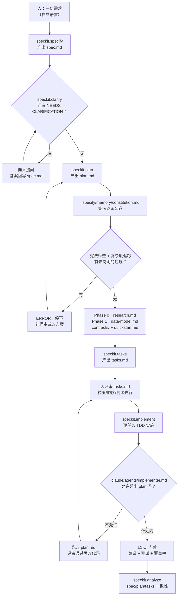
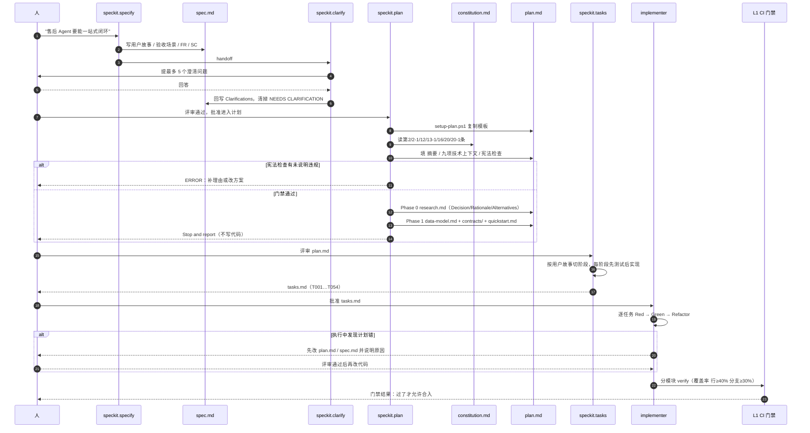

# Plan First：价值不在"多写一份文档"，而在把不可逆的设计决策提前到最便宜的时机

> **一句话结论**：Plan First（计划驱动开发）要解决的不是"让 AI 写得更认真"，而是**把"决定了就很难改"的东西——模块归属、依赖方向、表结构、接口契约、验收口径——挪到你还能免费改回来的时刻**，也就是写第一行代码之前。
> **阅读前置**：会写 Spring Boot 业务代码，被 AI 一次性甩出几百行 diff 而无法 review；知道 `mvn test` 与 `git commit` 是什么；不需要事先了解 Spec-Kit / SDD。
> **证据基线**：本项目真实工作流文件（`.specify/`、`specs/`、`.claude/`、`openspec/`、`CLAUDE.md`）；命令实测环境 Windows PowerShell 5.1 / Node 24；预计阅读 28 分钟。

## 证据边界（先看这篇的证据从哪来）

方法论主题没有 JAR 源码可读，所以本篇**不用 A 级源码锚点**，改用本项目自己的计划产物当证据。先把边界摊开，免得把"本项目当前的做法"当成"业界标准"。

| 证据类别 | 本仓状态 | 本篇怎么处理 |
|----------|----------|--------------|
| A 级：`learning-docs/24-源码分析/assets/source/` 已入库摘录 | 908 个 `.java.md`，全部是 Spring / Spring AI 源码，**没有 Spec-Kit、没有计划工具链** | **未入库，依据官方文档/本项目文档**；本篇不写任何 `[[源码:...]]` 锚点 |
| B 级：本仓库真实文件 | `.specify/templates/*`、`.specify/memory/constitution.md`、`specs/005-after-sales-agent/*`、`.claude/agents/implementer.md`、`openspec/changes/2026-08-18-prompt-config/*` | 本篇主要证据，引用写相对链接或仓库相对路径，行号均当次核对 |
| C 级：可复现实测 | 只做静态统计（目录清单、标题计数、勾选计数、`git log`），**不启动服务、不跑 mvn/npm** | 每条都写清统计口径与真实输出 |
| 明确未落地 | 计划模板里**没有**"回滚方式"字段（全仓 `specs/` 命中 0 行"回滚"） | 如实标注为缺口，并给出补齐方式，不假装存在 |

---

## 0. 先看现象

### 现象一：AI 一次输出 800 行改动，人根本 review 不动

这不是"AI 写得多"，而是**决策被塞进了 diff 里**。本项目 `specs/005-after-sales-agent/plan.md` 第 29 行的规模估计写得很直白：

```text
**规模/范围**：5 个微服务模块 + 公共模块 + SQL 交付物，约 40 个新增/变更 Java 文件
```

实测这个估计是准的：从 `plan.md` 的源代码树里抽出 44 个具名 `.java` 文件，在 `ai-cs-*/src` 下逐个比对，44 个全部已存在（口径与输出见 [第 6 节](#6-踩坑与调试手法)）。也就是说，**只要没有计划，这 44 个文件的包结构、类名、依赖方向就会在同一个 diff 里一次性出现**——reviewer 面对的是"结果"，不是"决策"，他能做的只有点头或者重写。

> 一句话：一个 800 行的 diff 里，真正需要人拍板的可能只有 5 个决定，其余 795 行是这 5 个决定的后果。计划的作用就是让那 5 个决定先单独出现。

### 现象二：计划写了，但没写验收判据，做完不知道算不算完成

先看一个"真实缺口"。本项目计划模板 `.specify/templates/plan-template.md` 有五个二级小节：`## 摘要`、`## 技术上下文`、`## 宪法检查`、`## 项目结构`、`## 复杂度追踪`——**没有"验收判据"，也没有"回滚方式"**。用关键词直接查：

```powershell
cd D:\Projects\Persion\ai-customer-service
Select-String -Path .specify\templates\plan-template.md -Pattern '验收|回滚|边界|影响'
```

```text
（无输出）
```

实测输出为空，即模板全文不含这四个词。那验收判据去哪了？答案是**被拆到了另外两份文档**：

- 行为级验收在规格里：`specs/005-after-sales-agent/spec.md` 第 18-23 行，用户故事 1 的"验收场景"用"**假设** … **当** … **则** …"写了 4 条；
- 任务级验证在任务清单里：`specs/005-after-sales-agent/tasks.md` 每个用户故事阶段都有 `**独立测试**` 与 `**检查点**`。

这个拆分本身是合理的（后面 3.4 会讲为什么），但它带来一个副作用：**如果你只写 plan.md 就交给 AI 干活，AI 手上没有任何"做完的标准"**。它会把"代码能编译"当成完成。

### 现象三：计划与最终代码脱节，没人回头更新

这是最贵的一种。本项目有三份可以互相打脸的记录：

| 记录 | 内容 | 怎么查 |
|------|------|--------|
| `specs/README.md` 第 27-33 行 | 005 状态 = "实施中" | 人工读表 |
| `specs/005-after-sales-agent/tasks.md` | 54 条任务，勾选 **0** 条 | 数 `- [ ]` |
| `ai-cs-chat/src/main/java/com/aics/chat/agent/` | 37 个实现类已提交 | `git log` |

`git log` 把时间线也摆出来了：

```powershell
cd D:\Projects\Persion\ai-customer-service
git log -1 --format='%h %ad %s' --date=short -- specs/005-after-sales-agent/tasks.md
git log -1 --format='%h %ad %s' --date=short -- ai-cs-chat/src/main/java/com/aics/chat/agent
```

```text
889e0ee 2026-08-13 docs: 新增智能客服 Agent 编排与人工转接功能规格、实施计划与任务拆解（specs/005）
50877c9 2026-08-22 feat(chat): 售后Agent编排支持SSE流式输出步骤与回复
```

任务清单从 2026-08-13 生成那一刻起**再没被改过**，而代码在 8-22 已经实现完成并合入。于是今天谁想知道"这个功能做完了吗"，从计划书里读到的答案是错的，必须去数代码。

> 这些现象指向同一件事：**计划书一旦和代码分家，它就退化成一份过期的愿望清单，而"过早写代码"和"写过期的计划"是同一个病的两种症状——决策没有在正确的时机被固定下来。**

---

## 1. 整体地图

本项目里有**两条**计划流水线，一条重、一条轻，共用同一套"先文档后代码"的骨架。先把重的那条画清楚，因为它是 `CLAUDE.md` 钦定的主路径。



> **读图说明**：这张图上有两个"回头箭头"是全图的重点。第一个是 `C → C1 → C`（澄清回路）和 `F → F1 → D`（宪法违规回路）——**它们出现在写代码之前，改一次只花几分钟**；第二个是 `K → L → I`，它是唯一一个"执行中才发现计划错"的合法出口，代价是重走一遍评审。整张图的设计意图就一句话：**把所有"改主意"的动作，尽可能压到图的左半边。**另外注意 `G` 节点：`/speckit.plan` 命令跑完 Phase 1 就 `Stop and report`，**不写代码**，这是 `plan` 与 `implement` 的硬边界。

### 组件与责任

| 组件（真实路径） | 责任 | 参与方 | 产物 |
|------------------|------|--------|------|
| `learning-docs` 外的 [`.specify/templates/spec-template.md`](../../../.specify/templates/spec-template.md) | 定义"规格该写什么"：用户故事、验收场景、功能需求、非功能需求 | 人 + `/speckit.specify` | `specs/<id>/spec.md` |
| [`.specify/templates/plan-template.md`](../../../.specify/templates/plan-template.md) | 定义"计划该写什么"：九项技术上下文 + 宪法检查 + 项目结构 + 复杂度追踪 | `/speckit.plan` | `specs/<id>/plan.md` |
| [`.specify/templates/tasks-template.md`](../../../.specify/templates/tasks-template.md) | 定义"任务怎么切"：阶段化、`[P]` 并行标记、每阶段 `### 测试（必选 - TDD Red 阶段）⚠️` | `/speckit.tasks` | `specs/<id>/tasks.md` |
| [`.specify/memory/constitution.md`](../../../.specify/memory/constitution.md) | 全项目的硬约束（TDD、依赖方向、版本、门禁），计划的"合法性判据" | 人维护，AI 逐条核 | 计划里的 `## 宪法检查` |
| [`.specify/scripts/powershell/setup-plan.ps1`](../../../.specify/scripts/powershell/setup-plan.ps1) | 把模板复制到 `specs/<id>/plan.md` 并回传 FEATURE_SPEC / IMPL_PLAN / SPECS_DIR / BRANCH | `/speckit.plan` 第一步 | 未填写的 plan 骨架 |
| [`.claude/commands/speckit.plan.md`](../../../.claude/commands/speckit.plan.md) | 计划阶段的执行脚本（五步 Outline + 两个 Phase） | AI | 同上 |
| [`.claude/agents/implementer.md`](../../../.claude/agents/implementer.md) | 执行者的行为约束："禁止无文档直接编码""禁止自行扩大实现范围" | Implementer 角色 | 代码 + 提交信息 |
| [`openspec/`](../../../openspec/config.yaml) | 第二条轻量流水线（proposal → design → tasks → 归档） | 人 + opsx 命令 | `openspec/changes/<日期>-<名字>/` |

> **读图说明**（表读法）：第 1-3 行是"三个模板 = 三种文档形态"，它们不是可选的风格偏好，而是被命令硬编码读取的——`/speckit.plan` 只认 `plan-template.md` 的骨架。第 4 行是唯一一个"跨阶段"的组件：宪法在 plan 阶段被勾选、在 tasks 阶段被校验（L1 门禁会检查 TDD 结构）、在 implement 阶段被再次引用，**它是计划的度量衡**。最后一行提醒：本项目并非只有一套流程，`openspec/` 是并存的事实。

### 本项目当前的规格化程度（C 级实测）

```powershell
cd D:\Projects\Persion\ai-customer-service
foreach ($d in Get-ChildItem specs -Directory) {
  $f = Get-ChildItem $d.FullName -Recurse -File
  "{0,-26} 文件={1} 行合计={2}" -f $d.Name, $f.Count, (($f | ForEach-Object {
      [System.IO.File]::ReadAllLines($_.FullName, [System.Text.Encoding]::UTF8).Count
    } | Measure-Object -Sum).Sum)
}
```

```text
001-cart-checkout          文件=8 行合计=1178
002-rag-quality-upgrade    文件=8 行合计=1016
003-rag-advanced-features  文件=8 行合计=1181
004-vlm-multimodal         文件=8 行合计=877
005-after-sales-agent      文件=8 行合计=951
```

口径：`specs/` 下每个 feature 目录递归统计**所有文件**（不只是 `.md`）与**所有行**。结果是 5 个 feature × 8 个文件 = 40 份规格化文档，结构完全一致（`spec.md`/`plan.md`/`tasks.md`/`research.md`/`data-model.md`/`quickstart.md`/`contracts/rest-api.md`/`checklists/requirements.md`）。**这 8 个文件正好对应 3.2 节要讲的"四个必备要素"的载体**，下面逐项对账。

---

## 2. 关键概念与关键要素

| 名称 | 位置（真实文件） | 角色 | 关键点 |
|------|------------------|------|--------|
| Plan First（计划驱动开发） | 本篇主题；本项目落地为 `plan.md` | 在写代码前把不可逆决策固定下来的动作 | 它不是"文档流程"，是**决策时机的调度**；轻量版可以只有一页 |
| Spec（规格） | `specs/005-after-sales-agent/spec.md` | 描述**行为与验收**，不描述实现 | 本项目要求"规格里不出现实现细节"，见 3.4 |
| Plan（实施计划） | `specs/005-after-sales-agent/plan.md` | 描述**技术方案**：技术上下文、宪法勾选、文件清单、结构决策 | 唯一允许出现 Java 类名与包路径的阶段产物 |
| Tasks（任务清单） | `specs/005-after-sales-agent/tasks.md` | 把计划切成可勾选的执行单元 | 编号 `T001…T054`，每条含确切文件路径；`[P]` = 可并行 |
| 宪法检查 | `plan.md` 的 `## 宪法检查` 小节 | 计划的合法性门禁 | 逐条打勾（第2条 SDD、第2-1条 TDD、第13-1条 SQL 幂等…），犯规必须解释 |
| 复杂度追踪 | `plan.md` 的 `## 复杂度追踪` 小节 | 违规的书面理由账本 | 三列：违规项 / 为何需要 / 拒绝更简单替代方案的原因 |
| `[NEEDS CLARIFICATION]` 标记 | `plan-template.md` 的技术上下文九项 | 未知信息不许瞎猜的机制 | 九项技术上下文任何一项不知道，就写这个标记，plan 阶段不许带着它往下走 |
| 独立测试（Independent Test） | `spec.md` 每个用户故事、`tasks.md` 每个阶段 | 验收判据的落点 | 一句话说明"怎么证明这个故事单独可用" |
| 检查点（Checkpoint） | `tasks.md` 每阶段末尾 | 阶段级停机验证 | 本项目实际有 6 个检查点（005） |
| TDD Red 小节 | `tasks.md` 的 `### …测试（必选 - TDD Red 阶段）⚠️` | 强制"测试先于实现"的结构 | 001/003/004/005 都有，002 没有（见 3.6） |
| L1 CI 门禁 | `constitution.md` 第 6 条 | 计划是否被执行的结构性检查 | 含"确认 tasks.md 中每个实现任务均有前置测试任务" |
| 三权分立 | `.claude/agents/` 下 `challenger.md` / `implementer.md` / `deliverer.md` | 评审者 / 实现者 / 交付者互不兼任 | 计划评审是 Challenger 的活，不是实现的人自己说自己行 |

---

## 3. 原理与证据逐段精读

### 3.1 为什么 AI 编码必须先计划：模型的默认行为是"立刻产出看起来合理的代码"

**在干什么**：把"先想清楚再动手"从一个道德要求，变成一个由文件结构和命令序列强制的机械流程。`/speckit.plan` 命令显式规定跑完 Phase 1 就 `Stop and report`——不许顺手写代码。

**为什么这么设计**：大模型的输出目标是"下一个 token 最可能是什么"，而不是"这个决定以后改起来贵不贵"。给它一句"给用户模块加手机号登录"，它能产出 300 行**看起来完全合理**的代码：新建 `SmsService`（而项目里已有 `NotifyService`）、在 `user` 模块里直连短信 SDK（违反依赖方向规则）、把验证码写进 Redis 但没设过期（漏了约束）。这些错误的共同点是：**每一处都是"局部合理、全局错"**，而且在 diff 里看不出来，只有在"这个类该不该存在"这个层面上才看得出来。

**换写法会怎样**：如果直接让 AI 写代码，然后用 code review 拦，你会付出两次成本——一次是 AI 生成 300 行的时间，一次是你逐行读懂再否掉的时间；而如果你先要一份 20 行的计划，你只需要判断"要不要新建 SmsService"这一个问题，**否决成本从 300 行降到 1 行**。这就是"把决策提前到最便宜的时机"的字面意思。

**常见坑**：把"先计划"理解成"必须先写长文档"。本项目的 `openspec/` 流水线就是反例：`openspec/changes/2026-08-18-prompt-config/` 里的 `proposal.md` 只有 `## Why` / `## What Changes` / `## Capabilities` / `## Impact` 四节，`design.md` 141 行就讲完了配置化 + 灰度 + 回滚。计划的价值在**决策密度**，不在字数。

### 3.2 计划的四个必备要素：目标与边界、文件清单、验收判据、回滚方式

**在干什么**：给"计划写完了"一个可检验的定义。四个要素缺任何一个，计划就退化成"意图声明"。

**为什么这么设计**：这四个要素分别回答四个不同的问题，而且**它们失效的方式完全不同**：缺目标与边界 → 需求一膨胀就没人知道该不该做；缺文件清单 → 不知道要碰哪些模块，评审时看不出依赖方向错；缺验收判据 → 做完了不知道停在哪里；缺回滚方式 → 上线发现错，只能热修。

本项目对这四项的真实覆盖情况如下（**这是本篇最重要的一张对账表**）：

| 要素 | 本项目落点 | 证据 | 覆盖度 |
|------|-----------|------|--------|
| 目标与边界 | `plan.md` 的 `## 摘要`（7 条编号交付面）+ `## 技术上下文` 的 `**约束**` 行 | `specs/005-after-sales-agent/plan.md` 第 6-16 行、第 28 行 `约束：状态机自研轻量实现…；写操作未经确认零执行；幂等键唯一约束；敏感参数摘要化` | ✅ 有，且"边界"写成了正向禁止项 |
| 涉及文件清单 | `plan.md` 的 `### 源代码（仓库根目录）` 树 | 同上第 56-114 行：59 行目录树，44 个具名 `.java`（含 4 个 Feign 客户端），每个文件带职责注释 | ✅ 有，精确到包 |
| 验收判据 | 分两处：`spec.md` 的"验收场景"（假设/当/则）+ `tasks.md` 的 `**独立测试**` 与 `**检查点**` | `spec.md` 第 18-23 行；`tasks.md` 6 个 `检查点` | ⚠️ 有，但**不在 plan.md 里**，见 3.4 |
| 回滚方式 | 无 | 递归 grep 全 `specs/` 40 个文件，"回滚"命中 **0 行** | ❌ **本项目当前缺这一项** |

关于最后一行，必须说清楚：**本项目当前缺"回滚方式"**。这不是猜测，是统计结果：

```powershell
cd D:\Projects\Persion\ai-customer-service
foreach ($k in '回滚','验证命令') {
  $n = (Get-ChildItem specs -Recurse -File -Filter *.md | ForEach-Object {
      [System.IO.File]::ReadAllLines($_.FullName, [System.Text.Encoding]::UTF8)
    } | Where-Object { $_ -match $k }).Count
  "关键词[$k] 命中行数=$n"
}
```

```text
关键词[回滚] 命中行数=0
关键词[验证命令] 命中行数=0
```

口径：`specs/` 下 40 个 `.md` 文件的**每一行**做正则匹配，命中行计数（不是文件数）。补齐方式有两种，任选：

1. **借 `openspec/` 的现成范式**：`openspec/changes/2026-08-18-prompt-config/design.md` 第 137-141 行有一节 `## 7. 过渡策略（降低风险）`，写法是"开关 + 逐场景灰度 + 单测覆盖热回滚"。把这一节的结构抄进 `plan-template.md`，就补上了。
2. **在 `plan.md` 里加一节 `## 回滚与降级`**，只回答三件事：出问题时关哪个开关、数据要不要回滚（表加没加、加错怎么办）、已写入的数据怎么处置。这三问对后端改动 90% 够用。

**换写法会怎样**：不加回滚方式，计划就只是"乐观路径"。本项目 `005` 这种带写操作的功能（创建换后申请）尤其危险——`plan.md` 第 28 行专门约束了"写操作未经确认零执行"，这是**事前**防线；但没有对应的事后防线（数据写错了怎么撤）。事前和事后不是一回事。

**常见坑**：把"回滚方式"写成"出问题就 revert commit"。那不算回滚方式，因为 revert 代码不会 revert 数据：`deploy/mysql/after-sales-agent-init.sql` 建的 5 张表还在，`after_sale_application` 里已经写入的申请单还在。回滚方式必须回答"**有状态的东西怎么办**"。

### 3.3 从需求到计划的拆解：spec → clarify → plan → tasks 的输入输出契约

**在干什么**：把"写个计划"拆成四段有明确输入输出的工序，每段只允许读上一段的产物。

**为什么这么设计**：因为如果不规定输入，AI 就会用"记忆里的项目"代替"这个项目的文件"。本项目把输入写死在了产物头部：

- `specs/005-after-sales-agent/plan.md` 第 4 行：`**输入**: 来自 /specs/005-after-sales-agent/spec.md 的功能规格`
- `specs/005-after-sales-agent/tasks.md` 第 3-4 行：`**输入**: 来自 /specs/005-after-sales-agent/ 的设计文档` / `**前置条件**: plan.md（必填）、spec.md（用户故事必填）、data-model.md、contracts/rest-api.md`

注意 `tasks.md` 那行 `**前置条件**`——它把"可以开始切任务"变成一个有判据的状态：四份文档不齐就不许切。这是**流水线的准入检查**，比"记得先写计划"可靠得多。

拆解的四个动作与判据：

| 工序 | 输入 | 输出 | 完成判据 |
|------|------|------|----------|
| `/speckit.specify` | 人话需求 | `spec.md`（用户故事 + 验收场景 + 功能需求 + 成功标准） | 每个用户故事都有"独立测试"和"验收场景"；`checklists/requirements.md` 全勾 |
| `/speckit.clarify` | `spec.md` | 回写后的 `spec.md`（含 `## Clarifications`） | 全文 `[NEEDS CLARIFICATION]` 计数为 0 |
| `/speckit.plan` | `spec.md` + 宪法 + `plan-template.md` | `plan.md` + `research.md` + `data-model.md` + `contracts/` + `quickstart.md` | 九项技术上下文齐全；`## 宪法检查` 全勾或附理由；Phase 1 结束即停 |
| `/speckit.tasks` | `plan.md` + `spec.md` + `data-model.md` + `contracts/` | `tasks.md` | 每条任务有 ID、确切文件路径；每个用户故事阶段有 `### 测试（必选 - TDD Red 阶段）` |

`checklists/requirements.md` 是这套契约的"体检报告"，本项目 `specs/005-after-sales-agent/checklists/requirements.md` 第 16-20 行是这样的：

```text
- [x] No [NEEDS CLARIFICATION] markers remain — 无遗留标记，4 项关键决策已在 Clarifications 中明确
- [x] Requirements are testable and unambiguous — FR-001~FR-014 均可通过测试验证
- [x] Success criteria are measurable — SC-001~SC-008 含具体指标（F1>=0.90、正确率>=95%、次数=0）
```

"SC-001~SC-008 含具体指标（F1>=0.90）"这句是关键：**成功标准必须能被量化到"别人算出来和你一样"的程度**，否则它只是形容词。

**换写法会怎样**：跳过 clarify 直接 plan，你会得到一个"看起来很完整但关键假设是猜的"计划。`plan-template.md` 对这种情况有专门机制：九项技术上下文任何一项不知道，必须写 `NEEDS CLARIFICATION`（原文用词是"需要澄清"），而 `/speckit.plan` 的 Key rules 明确"门禁失败或澄清未决即 ERROR"。也就是说，**猜出来的计划不是"差一点"的计划，是非法计划**。

**常见坑**：把 `research.md` 当成"资料收集"。它的格式是三行固定结构——Decision / Rationale / Alternatives considered（`/speckit.plan` 的 Phase 0 规定）。第三行"考虑过的替代方案"才是价值所在：它记录了"为什么没选另一个"，半年后有人问"为什么不用 Spring StateMachine"时，答案在 `plan.md` 的 `## 复杂度追踪` 里（第 121 行明确写了拒绝理由），不用重新开会。

### 3.4 计划与规格的分工：spec 写行为，plan 写技术方案

**在干什么**：把"要不要做"和"怎么做"拆成两个文件，并规定谁能出现实现细节。

**为什么这么设计**：因为这两件事的**评审人不同**。规格是给业务方和测试看的（"换货前必须让用户确认"），计划是给开发看的（"确认逻辑放 `confirm/ConfirmationService.java`"）。混在一份文档里，业务方读到 Java 类名就开始走神，开发读到"假设用户拒绝确认则流程进入 CANCELLED"就不知道代码在哪。

本项目的分工是**显式写在检查项里的**，`specs/005-after-sales-agent/checklists/requirements.md` 第 9 行：

```text
- [x] No implementation details (languages, frameworks, APIs) — 规格仅描述行为与验收场景，技术方案在 plan.md 中承载
```

对比两份文档对同一件事的写法，分工一目了然：

| 维度 | `spec.md`（第 20 行） | `plan.md`（第 56-114 行） |
|------|------------------------|----------------------------|
| 关注点 | "**当** Agent 执行，**则** 依次完成意图识别、订单定位、规则校验、商品召回，并在写操作前展示摘要并要求确认" | `├── workflow/AfterSaleAgentService.java  ← 编排主流程` `├── confirm/ConfirmationService.java  ← 确认状态与幂等` |
| 出现的名词 | 业务名词（换货申请、规则条款、审计记录） | 技术名词（Feign、Redis、状态机、DDL） |
| 谁能改 | 业务 + 测试 + 开发共同评审 | 开发 + Challenger 评审 |
| 变更影响 | 影响验收口径，改了要重跑验收 | 影响文件清单，改了要重切任务 |

**换写法会怎样**：如果只有 spec 没有 plan，AI 会自己发明技术方案——你会在 diff 里第一次看到"它选了 Redis 存状态"这个决定。如果只有 plan 没有 spec，你会得到一份"文件清单正确但目标含糊"的计划，最典型的表现是：做完了没人能说清这次改动是否解决了用户的问题。本项目 `docs/16-TDD与SDD适用场景对比.md` 第 96-110 行把两者的组合关系画得很清楚：`specify → clarify → plan` 负责"想清楚"，`Red → Green → Refactor` 负责"做扎实"，`tasks.md` 是两者的接缝。

**常见坑**：把"规格不含实现细节"理解成"规格可以含糊"。恰恰相反——`checklists/requirements.md` 第 17 行要求 `Requirements are testable and unambiguous`。规格要**精确到行为可判定**，只是不许精确到类名。判断标准：这句话能不能写成一条断言？"系统必须让用户确认后再执行写操作"能；"系统要智能地判断"不能。

### 3.5 可执行性检验：每一步能不能独立验证

**在干什么**：回答"这份计划能不能被执行"这个问题，而不是"这份计划写得漂不漂亮"。

**为什么这么设计**：AI 执行计划时不会"理解"计划，它是逐条读任务然后干活。所以**计划的可执行性 = 每条任务是否自足**：一条任务如果换一个没有上下文的 agent 来读，还需不需要追问？需要追问的地方，就是隐藏的返工点。

本项目的检验机制是三层，从粗到细：

| 层级 | 机制 | 真实位置 | 强度 |
|------|------|----------|------|
| 阶段级 | `**检查点**`：阶段末停机验证 | `tasks.md` 6 处，如"**检查点**：基础层就绪 - 可以开始并行实施用户故事" | 强：不通过不准进下一阶段 |
| 故事级 | `**独立测试**`：一句话说明怎么证明该故事单独可用 | `tasks.md` 每个用户故事阶段（4 处） | 中：依赖执行者自觉展开 |
| 任务级 | 无 | —— | **本项目当前缺**：`tasks.md` 里"验证命令"命中 0 行 |

任务级缺口的具体样子，看 `tasks.md` 第 117 行：

```text
- [ ] T036 `ai-cs-chat` 新建 `agent/AgentProperties.java` + 配置绑定
```

这条任务是"可执行"的（文件路径明确），但**没有说怎么算做完**。是"能编译过"？还是"`AgentProperties` 能被 Spring 加载并被单测断言绑定成功"？两种理解差一个测试类。本项目用第 141 行的收口任务兜底：

```text
- [ ] T051 全量构建：`mvn clean install -DskipTests` + 各模块 `mvn verify`（含覆盖率门禁）
```

这是"最后一次性验证"，代价是：**中间 53 条任务全部执行完，你才知道哪一条错了**。补齐方式很轻——在 `tasks.md` 的格式说明里加一列约定，每条任务写成 `T0xx <动作>；验证：<命令或断言>`，例如：

```text
- [ ] T036 ai-cs-chat 新建 agent/AgentProperties.java + 配置绑定；验证：AgentPropertiesTest 断言 aics.agent.* 前缀绑定成功
```

**换写法会怎样**：不做可执行性检验的计划，特征很明显——任务描述里全是"完善""优化""对接"这类动词。这类词在评审时读起来毫无破绽，在执行时无法判断完成。

**常见坑**：把"能编译通过"当成验证。编译通过只证明语法对，对 AI 生成的代码几乎零信息量——它本来就很擅长让代码编译通过。

### 3.6 粒度控制：一步 = 一次可 review 的改动

**在干什么**：给"一条任务应该多大"一个可操作的尺子：**一次 commit / 一次 review 能看完的改动量**。

**为什么这么设计**：粒度和"能不能否决"直接挂钩。粒度太粗（"实现售后 Agent"），人在 review 时只能整体接受或整体拒绝，否决成本极高，实际发生的是"接受"；粒度太细（"新增一个 getter"），评审开销超过收益，人会跳过不看。合适的粒度是**一条任务对应一个可独立描述的决定**。

本项目的真实粒度是这样的（`specs/005-after-sales-agent/tasks.md`）：

```text
- [ ] T001 在 `ai-cs-common/src/main/java/com/aics/common/result/ResultCode.java` 新增 AGENT_*(3101-3109) 与 AFTER_SALE_*(7101-7105) 错误码
- [ ] T002 编写 `deploy/mysql/after-sales-agent-init.sql`（5 张新表 + 售后规则种子文档，幂等 SQL），并入 `deploy/mysql/all-init.sql` 与 `deploy/mysql/order-init.sql`
```

`T001` 改一个文件、一个决定（错误码段位分配）；`T002` 一次 SQL 交付、一个决定（5 张表结构）。都是"一次 review 能看完"的尺度。

但**同一个仓库里的 5 个 feature，粒度并不一致**。C 级统计（口径见下方命令）：

```powershell
cd D:\Projects\Persion\ai-customer-service
foreach ($d in Get-ChildItem specs -Directory) {
  $l = [System.IO.File]::ReadAllLines((Join-Path $d.FullName 'tasks.md'), [System.Text.Encoding]::UTF8)
  "{0,-26} 任务={1,3} TDD测试小节={2,2} 独立验证小节={3,2}" -f $d.Name,
    ($l | Where-Object { $_ -match '^\s*-\s*\[[ xX]\]' }).Count,
    ($l | Where-Object { $_ -match '^### .*测试.*(TDD|必选)' }).Count,
    ($l | Where-Object { $_ -match '^### .*验证' }).Count
}
```

```text
001-cart-checkout          任务= 54 TDD测试小节= 3 独立验证小节= 0
002-rag-quality-upgrade    任务= 53 TDD测试小节= 0 独立验证小节= 5
003-rag-advanced-features  任务= 68 TDD测试小节= 6 独立验证小节= 0
004-vlm-multimodal         任务= 33 TDD测试小节= 3 独立验证小节= 0
005-after-sales-agent      任务= 54 TDD测试小节= 4 独立验证小节= 0
```

口径：勾选行匹配 `^\s*-\s*\[[ xX]\]`（含已完成与未完成）；TDD 小节匹配 `^### .*测试.*(TDD|必选)`；"独立验证小节"匹配 `^### .*验证`（002 用 `### Phase N 验证` 这种写法）。

**002 是唯一的例外**：0 个 TDD 测试小节，改用 5 个 `### Phase N 验证`。两种写法都能用，但含义不同——TDD 小节是**结构承诺**（L1 门禁会检查"每个实现任务是否都有前置测试任务"），`Phase N 验证` 是**事后验证**。前者防"先写实现后补测试"，后者不防。

**换写法会怎样**：粒度太粗 → 计划评审退化为点头；太细 → 计划本身变成负担，人会跳过评审直接让 AI 干（这正是"计划没人看"的真实成因，不是人懒，是粒度不对）。

**常见坑**：把"一条任务 = 一个文件"当规则。`T002` 就改 3 个 SQL 文件（新增 1 个 + 并入 2 个），但它是一个决定（表结构 + 幂等），所以合适。正确的尺子是决定数量，不是文件数量。

### 3.7 计划变更管理：执行中发现计划错了怎么办

**在干什么**：给"计划错了"一条正式通道，而不是让它变成"偷偷按自己想法改代码"。

**为什么这么设计**：计划一定会错——写计划时你还没摸到代码。所以真正的问题不是"如何写出不会错的计划"，而是"**发现错的时候，改动从哪里进入系统**"。本项目把这条路写进了执行者的行为规范，`.claude/agents/implementer.md` 第 38 行：

```text
4. **缺陷修复合规**：发现缺陷后，先修订文档（spec.md / plan.md），记录变更原因，经评审通过后改代码，commit message 必须引用修订文档章节。
```

紧接着第 179 行还有一条更硬的：

```text
- 禁止自动扩散 capability（不可自行扩大实现范围）
```

这两条合起来定义了一个闭环：**改计划 → 评审 → 改代码 → 提交信息回链**。第 116 行把最后一环也钉死了：`commit message 必须关联 tasks.md 子任务编号`。

本仓库里有一次真实的计划修订，可以当范例看。`specs/005-after-sales-agent/plan.md` 第 21-22 行：

```text
**主要依赖（原实施基线）**：Spring Boot 3.2.5、Spring AI 1.1.4（chat 侧已有 ChatClient + @Tool 基础设施）…（MyBatis-Plus 3.5.6）
**当前复核（2026-11-26）**：Boot 4.2.0 / Spring AI 2.1.0 / MyBatis-Plus 3.5.13；本计划中的版本与当时验收结论保留历史语义，2.1 回归另见 `docs/30-Spring-AI-2.1升级实施与验证.md`。
```

注意它的处理方式：**不删旧基线，而是新旧并列 + 一句话说明"历史语义保留" + 指向后续文档**。这比"直接改成新版本号"更贵但更对——因为这个功能当初是按 1.1.4 验收的，抹掉旧基线会让"验收结论"失去依据。提交证据：`git log -1 --date=short -- specs/005-after-sales-agent/plan.md` 显示 `fedea62 2026-11-26 docs: 同步Spring AI 2.1实施文档与验证边界`。

`openspec/` 侧有一种更轻的写法值得抄：`openspec/changes/2026-08-18-prompt-config/tasks.md` 里，**没做完的任务都写明了没做完的原因**，第 21 行：

```text
- [ ] 3.6 过渡开关：`aics.prompt.enabled=false` 时回退保留的硬编码副本（过渡期后移除）——已实现 `enabled=false` 走 `fallback` 分支机制，但各调用点未逐一传 fallback（后续按需补齐）
```

一行任务 = 状态 + 差距 + 后续动作。这样"未完成"不再是一个羞耻的空白格，而是一条可继续的信息。

**换写法会怎样**：不给正式通道，执行者只有两个选择——停下（进度停摆）或者悄悄改（计划与实际分叉，就是本文现象三）。后者更常见，因为 AI 不会主动停下。

**常见坑**：以为"计划变更"必须重写整份文档。上面两个例子说明，一次合法的修订可以只有两行（新旧基线并列）或一行（任务后面加说明）。

### 3.8 评审与轻量化：什么时候计划可以很轻

**在干什么**：区分"必须重计划"和"可以一句话过"的边界，避免 Plan First 退化成流程表演。

**为什么这么设计**：如果所有改动都要求 spec + plan + tasks 三件套，团队会发明"补文档"这种反模式——先写代码，再倒推文档。文档一旦是事后补的，它就没有任何防错价值，只剩形式。

本项目的宪法其实很硬（第 3 条：任何实现前必须有已批准的 Spec/Plan/Tasks），但仓库里**同时存在两条强度不同的流水线**，这本身就是"分级"的落地：

| 维度 | 重流水线（`specs/` + `/speckit.*`） | 轻流水线（`openspec/changes/`） |
|------|--------------------------------------|----------------------------------|
| 文档数 | 8 份/feature（含 `research.md`、`data-model.md`、`contracts/`） | 4 份/change（`proposal.md`、`design.md`、`tasks.md`、`specs/*/spec.md`） |
| 触发点 | 新功能、跨服务改动、需要验收留证 | 单模块内重构、配置化、能力增强 |
| 计划"四个要素" | 目标边界在 `摘要`+`约束`；文件清单在 `项目结构`；验收在 spec+tasks；回滚缺 | 目标边界在 `design.md §1`；文件清单在 `§4 调用点改造清单`；验收在 `tasks.md`；**回滚在 `§7 过渡策略`** |
| 规模示例 | 005：约 40 个 Java 文件、5 个模块 | prompt-config：`ai-cs-chat` 单模块配置化 |

有意思的是：**轻流水线的 design.md 反而把"目标与边界"写成了独立小节**。`openspec/changes/2026-08-18-prompt-config/design.md` 第 7-10 行：

```text
**本期边界**：
- 版本/灰度/回滚信息以 YAML 配置为单一事实来源（不持久化到 DB，重启即恢复配置态）。
- 灰度策略支持三种：按比例权重、按 userId 尾号分桶、scenario 全量指定。
- 效果关联复用现有 LlmJudgeService / RagEvalService 与 TraceSpan…
```

三条全是**排除项**：不做 DB 持久化、灰度只支持三种、不做新评估算法。写计划最值钱的动作就是这个——**明确写下"这期不做什么"**。

那什么时候计划可以真的很轻（一页纸甚至一段话）？判据是"不可逆决策的数量"：

| 改动类型 | 计划强度 | 本项目依据 |
|----------|----------|------------|
| 改名、日志、注释、补单测 | 一段话，甚至只在 commit message 里说清 | 无结构变更、无跨模块依赖，回滚 = revert |
| 单文件内加一个分支 | 三行：改哪个文件、加什么条件、怎么验证 | 决策数 = 1 |
| 新增一个接口/一张表 | 必须正式计划（表结构不可逆） | 宪法第 13-1 条要求 SQL 幂等；表建错要写迁移脚本 |
| 跨模块/跨服务改动 | 必须正式计划 + 文件清单 | 依赖方向错会导致循环依赖，返工面覆盖全仓 |
| 涉及写操作/金钱/权限 | 正式计划 + 宪法勾选 + 回滚方式 | 005 的 `约束` 行：写操作未经确认零执行 |

**换写法会怎样**：不分级 → 人开始绕过流程。本项目 `openspec/config.yaml` 第 1 行 `schema: spec-driven` 说明这套轻流水线是配置驱动的，可以按项目粒度调；而 `specs/` 那套跟着 `/speckit.*` 命令走，强度固定。务实做法是：**小事走轻的，大事走重的，但"回滚方式"这一项不管轻重都要有**——这也是本项目当前最该补的一刀（重流水线缺、轻流水线有）。

**常见坑**：把"轻"理解成"跳过"。轻 = 少写文档，不是不写判据。改名这种改动的验收判据可以只有一句"`mvn -pl ai-cs-chat test` 全绿且无新增失败用例"，但它必须存在。

---

## 4. 一次完整执行时序

以本项目的重流水线为例，走一遍"一句需求 → 可交付代码"，含两处人评审卡点。



> **读图说明**：最关键的两条箭头是 **8（`人→Plan`）** 和 **17（`人→Tasks`）**——它们是人唯二两次真正"拍板"的机会，都在代码存在之前，改动成本最低。第 **12** 步的 `Stop and report` 是防"AI 顺手写完代码"的机械闸门：计划阶段结束就停，写代码必须重新由人发起（第 21 步）。第 **19-20** 步是唯一允许"计划追着现实改"的通道，方向是**先文档后代码**，不能倒过来。

### 每一步失败会发生什么

| 失败点 | 触发条件 | 真实报错或后果 | 用户看到什么 |
|--------|----------|----------------|--------------|
| 4 澄清未决 | `spec.md` 仍有 `[NEEDS CLARIFICATION]` | `/speckit.plan` 的 Key rules 判定为 ERROR，流程停 | 命令报错退出，`spec.md` 保持原样 |
| 11 宪法违规未说明 | `## 宪法检查` 有条款不满足且没写理由 | 命令输出 gating ERROR，Phase 0 不启动 | 计划文件停在模板状态，没有 `research.md` |
| 14 技术上下文缺项 | 九项里任何一项没填 | 不允许写"待定"，只能写"需要澄清"（模板原文用词） | `plan.md` 出现 `NEEDS CLARIFICATION` 字样，评审必须打回 |
| 18 任务粒度失控 | 一条任务含多个决定 | 无自动报错，**只有评审能拦** | 实施时该任务反复返工，diff 不可 review |
| 19 计划与代码分叉 | 执行者跳过文档直接改实现 | 无自动报错；`implementer.md` 第 179 行属行为约束，靠评审兜底 | 计划书从此过期（本文现象三） |
| 23 CI 门禁失败 | 覆盖率行 < 40% 或分支 < 30% | `mvn verify` 失败，构建中断 | 无法合入；需补测试或补 `复杂度追踪` 理由 |

注意第 18、19 两行**没有自动报错**——这是计划这件事的本质：机器能验证"文档格式对不对"，只能由人验证"这个决定该不该做"。所以计划流程里人的时间应该花在评审上，而不是花在写文档上。

---

## 5. 设计取舍

| 决策点 | 本项目选择 | 代价 | 替代方案与拒绝理由 |
|--------|-----------|------|--------------------|
| 计划放在规格之后还是替代规格 | 规格与计划分离（`spec.md` + `plan.md` 两份） | 多写一份文档，多一次评审 | 合并成一份：`checklists/requirements.md` 第 9 行要求"规格不含实现细节"，合并后无法向业务方交付 |
| 计划的强制程度 | 宪法第 3 条硬性要求，任何实现前必须有已批准的 Spec/Plan/Tasks | 小改动也要走流程，容易催生"补文档" | 全靠自觉：`specs/README.md` 第 37 行自述"脚手架初始不含任何历史 SDD 产物"，无强制则产物为零 |
| 任务清单是否强制 TDD 结构 | 强制：每阶段必须有 `### 测试（必选 - TDD Red 阶段）⚠️` | 计划阶段耗时增加；002 那期就是漏了这条 | 事后验证（`### Phase N 验证`）：002 的实测形态，无法防"先实现后补测试" |
| 验收判据放哪 | 拆两处：行为判据在 `spec.md`，任务判据在 `tasks.md` | `plan.md` 自身没有完成定义，只读计划会误判"编译通过=完成" | 全放 `plan.md`：业务方看 plan 时被技术名词劝退 |
| 回滚方式的地位 | **当前未纳入模板**（`specs/` 命中 0 行） | 上线后发现错，只能热修；有状态数据无处置方案 | 应纳入：`openspec/.../design.md §7` 已证明这个字段写起来只值 5 行 |
| 是否允许多套流水线并存 | 允许：`specs/`（重）+ `openspec/changes/`（轻） | 两套产物、两套命令，新人有选择成本 | 只留一套：小事被迫走重流程 → 人会绕流程，比并存更糟 |

### 可扩展点清单

- **给 `plan-template.md` 加 `## 回滚与降级` 小节**：三问（关哪个开关 / 表要不要回滚 / 已写数据怎么处置），模板加一节即可，无需改命令。
- **给 `tasks.md` 加"验证"字段约定**：在格式说明里加 `验证：<命令或断言>`，把现在 0 命中的"验证命令"变成每任务必填，`T051` 那种一次性收口就能降级为兜底。
- **把 `002` 的 `### Phase N 验证` 补成 TDD 小节**：结构对齐后 L1 门禁才能真正检查"测试任务先于实现任务"。
- **加一个 `tasks.md` 勾选纪律**：勾选与代码同 commit，或由脚本按 `git log` 反推进度。当前 005 是 0/54 勾选但代码已完成，说明勾选已失去信息量。
- **把 `docs/16-TDD与SDD适用场景对比.md` 的"组合使用"段落链接进 `plan-template.md`**：让"为什么计划要和 TDD 串起来"有据可查。

---

## 6. 踩坑与调试手法

前两条是**可操作的自查手法**（完整命令 + 真实输出 + 怎么读），后面四条是踩出来的坑。

### 手法一：别信勾选状态，用代码反查计划执行度

**为什么需要**：`tasks.md` 的勾选是人工维护的，会腐烂。005 就是活标本：README 说"实施中"，任务勾选 0/54，但代码 37 个类全在。

```powershell
cd D:\Projects\Persion\ai-customer-service
$plan  = [System.IO.File]::ReadAllLines((Resolve-Path 'specs\005-after-sales-agent\plan.md'), [System.Text.Encoding]::UTF8)
$need  = @($plan | ForEach-Object { if ($_ -match '([A-Za-z][A-Za-z0-9]*\.java)') { $matches[1] } } | Sort-Object -Unique)
$have  = @((Get-ChildItem -Directory | Where-Object { $_.Name -like 'ai-cs-*' } | ForEach-Object {
            Get-ChildItem (Join-Path $_.FullName 'src') -Recurse -File -ErrorAction SilentlyContinue
          } | Where-Object { $_.Extension -eq '.java' } | Select-Object -ExpandProperty Name | Sort-Object -Unique))
"计划具名类={0}  已存在={1}  缺失={2}" -f $need.Count, ($need | Where-Object { $have -contains $_ }).Count, ($need | Where-Object { $have -notcontains $_ }).Count
```

```text
计划具名类=44  已存在=44  缺失=0
```

**怎么读**：`计划具名类=44` 是从 `plan.md` 里正则抽出的 `.java` 文件名（口径 `[A-Za-z][A-Za-z0-9]*\.java`，去重）；`已存在` 是在 `ai-cs-*/src` 下按**文件名**匹配（不比对包路径，所以这是个宽松下界）。44/44 说明计划里列的每一个类都已落地；而同一时刻 `tasks.md` 的勾选是 0。**结论：勾选状态为 0 不代表没干活，只代表没人回头勾。**

顺手把进度口径对齐：

```powershell
cd D:\Projects\Persion\ai-customer-service
Get-ChildItem specs -Directory | ForEach-Object {
  $l = [System.IO.File]::ReadAllLines((Join-Path $_.FullName 'tasks.md'), [System.Text.Encoding]::UTF8)
  $row = (Select-String -Path specs\README.md -Pattern ("^\| " + $_.Name + " \|[^|]*\|([^|]*)\|")).Matches
  "{0,-26} README={1,-8} 勾选完成={2,3} 未完成={3,3}" -f $_.Name, $row.Groups[1].Value.Trim(),
    ($l | Where-Object { $_ -match '^\s*-\s*\[[xX]\]' }).Count,
    ($l | Where-Object { $_ -match '^\s*-\s*\[ \]' }).Count
}
```

```text
001-cart-checkout          README=已实施      勾选完成= 48 未完成=  6
002-rag-quality-upgrade    README=已实施      勾选完成=  0 未完成= 53
003-rag-advanced-features  README=实施中      勾选完成= 68 未完成=  0
004-vlm-multimodal         README=已实施      勾选完成= 33 未完成=  0
005-after-sales-agent      README=实施中      勾选完成=  0 未完成= 54
```

**怎么读**：正确的应该是"已实施"↔全部勾选、"实施中"↔部分勾选。实际有 3 处矛盾：002 说已实施但 0 勾选；003 说实施中但 68/68 全勾；005 说实施中但 0 勾选（而代码已完成）。**这个脚本应该进 CI**——它不需要跑编译，纯静态，能持续提醒"文档与代码分家了"。

### 手法二：统计口径不对，所有结论都会歪

**为什么需要**：本篇大量结论来自行数与标题计数。如果统计工具本身读错编码，你会得到一组"看起来很像真的"的数字。实测这个坑在本机必现：

```powershell
cd D:\Projects\Persion\ai-customer-service
$p = 'specs\005-after-sales-agent\plan.md'
"Get-Content 默认: " + (Get-Content $p).Count
"Get-Content -Encoding utf8: " + (Get-Content $p -Encoding utf8).Count
"[IO.File]::ReadAllLines: " + [System.IO.File]::ReadAllLines((Resolve-Path $p), [System.Text.Encoding]::UTF8).Count
"PSVersion: " + $PSVersionTable.PSVersion
"Default encoding: " + [System.Text.Encoding]::Default.WebName
```

```text
Get-Content 默认: 83
Get-Content -Encoding utf8: 123
[IO.File]::ReadAllLines: 123
PSVersion: 5.1.26100.9818
Default encoding: gb2312
```

**怎么读**：同一个文件三种读法，默认 `Get-Content` 报 83 行，另外两种报 123 行——差 40 行。原因是这个环境是 **Windows PowerShell 5.1，默认编码 gb2312**，而文件是 UTF-8 无 BOM、LF 换行（`[IO.File]::ReadAllBytes` 前三字节 `35,32,229`，即 `# ` + UTF-8 中文首字节；`\r\n` 计数 0、纯 `\n` 计数 123）。用 gb2312 解码 UTF-8 中文会让字节错位，行分割随之错乱，中文关键词匹配也会全部落空（实测 `宪法检查` 命中 0 次，而用正确编码就能命中）。

**规则**：本篇所有统计一律用 `[System.IO.File]::ReadAllLines(<path>, [System.Text.Encoding]::UTF8)`。这也是为什么"证据要写清口径"——不写口径的统计数字，和编造没有区别。

### 坑三：以为模板里有"验收判据"，其实没有

`plan-template.md` 全文不含"验收/回滚/边界/影响"（第 0 节已给实测输出）。所以照模板填完 `plan.md`，你手上依然没有"做完的标准"。**自查动作**：任何计划评审前，先回答"这次改动完成后，用什么命令或断言证明它成了"。答不出来，说明验收判据还停在 spec 里没落成任务。

### 坑四：计划里的版本号是历史快照，不是当前事实

`specs/005-after-sales-agent/plan.md` 第 21 行写 Boot 3.2.5 / Spring AI 1.1.4，第 22 行才补了"当前复核 Boot 4.2.0 / Spring AI 2.1.0"。而项目宪法第 18 条的版本基线是 Boot 4.2.0 / Spring AI 2.1.0。**坑在哪**：如果你照第 21 行写代码（比如按 1.1.4 的 `ChatClient` API 写），编译会挂。**自查动作**：读任何 `plan.md` 的技术上下文，先看有没有"当前复核"这种加注行；没有的话，去 `.specify/memory/constitution.md` 第 18 条对一遍版本。

### 坑五：计划的"用户故事"与"任务阶段"必须一一对应

`tasks.md` 的组织方式是"阶段 = 用户故事"，每个阶段开头有 `**目标**` / `**独立测试**`。一旦有人在阶段 2（基础层）里塞进业务逻辑，整个"每阶段可独立验证"的设计就破了——基础层被污染的后果是**所有**后续阶段的验证都不可信。**自查动作**：数阶段数与 spec 里的用户故事数。005 是 8 个用户故事但 `tasks.md` 只有 7 个阶段（阶段 1 是基础层，阶段 2-6 对应部分故事，阶段 7 是跨切面），这类压缩本身合法，但压掉的必须是"同源故事"，不能是"懒得拆"。

### 坑六：把 research.md 写成资料堆

`/speckit.plan` 的 Phase 0 要求每条研究记录固定三行：Decision / Rationale / Alternatives considered。第三行经常被写成"其他方案（略）"。**这一行恰恰是计划最贵的产出**——它把"为什么不选 B"固化了。本项目在 `plan.md` 第 121-123 行做了正确示范：`自研轻量状态机（而非直接调 LLM ReAct）｜售后写操作必须确定性可控｜模型自由 ReAct 无法保证"写操作前必确认"的强约束与可回放审计`。半年后再有人提"为什么不用 ReAct"，答案在这里。

---

## 7. ⚠️ 版本差异

本项目内部分可观察到三代形态，差异不在工具版本，在"计划的完备度要求"。

| 项目 | 旧写法（002 那期 / 模板早期形态） | 当前基线（001/003/004/005 + 现行模板） | 变化点 | 迁移动作 |
|------|-----------------------------------|------------------------------------------|--------|----------|
| 任务清单的测试结构 | `### Phase N 验证`（002，5 处，0 个 TDD 小节） | `### …测试（必选 - TDD Red 阶段）⚠️` 与 `### …实施` 成对出现（001/003/004/005 共 16 对） | 从"事后验证"变成"结构承诺"，L1 门禁可检查 | 给 002 的每个阶段补一个测试小节，把 `Phase N 验证` 里的断言搬进去 |
| 计划的完成定义 | 模板五节即可交差（无验收字段） | 验收判据拆到 `spec.md` 验收场景 + `tasks.md` 独立测试/检查点 | 判据变多但有落点，只是不在 plan 里 | 在 `plan.md` 增一节"验收判据映射"，列出对应 spec 场景编号与 tasks 检查点 |
| 回滚/过渡策略 | 无（`specs/` 全库 0 命中） | `openspec` 侧已有 `## 7. 过渡策略（降低风险）`（prompt-config:137-141） | 轻流水线反超重流水线 | 把 `design.md §7` 的三条结构搬进 `plan-template.md` |
| 技术基线版本 | `plan.md` 第 21 行：Boot 3.2.5 / Spring AI 1.1.4 / MyBatis-Plus 3.5.6 | 第 22 行"当前复核"：Boot 4.2.0 / Spring AI 2.1.0 / MyBatis-Plus 3.5.13（与宪法第 18 条一致） | 大版本跃迁，计划里出现"双基线" | 新计划直接按第 18 条写；旧计划保留原基线 + 加"当前复核"行指向 `docs/30-Spring-AI-2.1升级实施与验证.md` |
| 计划修订的留痕方式 | 改完即覆盖（无痕） | 新旧并列 + 提交信息回链（`fedea62 docs: 同步Spring AI 2.1实施文档与验证边界`） | 修订本身成为可审计事件 | 每次改 `plan.md` 都在改动处留"原/现"对照，并让 commit message 引用小节名 |
| 进度状态的可信度 | 靠 `tasks.md` 勾选 | 勾选不可信（005：0/54 勾选 vs 44/44 类已存在），需用代码反查（手法一） | 进度证据从"人工勾选"变成"静态扫描" | 把手法一的脚本纳入 CI，或要求勾选与代码同 commit |

> **一句话**：这套东西的"版本差异"不是 Spring 的版本号，而是**计划从"文档产物"升级为"可被机器检查的结构"**。凡是能被 `grep`、能被脚本计数、能被 CI 判定的，才叫落地；写在文档里靠自觉的，都会随第一次加班而蒸发。

---

## 8. 面试高频问与答

1. Plan First 和"让 AI 先讲一遍思路再动手"有什么区别？
2. 为什么说 AI 编码更需要计划，而人写代码反而可以少计划？
3. 一份可执行的计划必须包含哪四个要素？缺了"回滚方式"会出什么事？
4. Spec、Plan、Tasks 三份文档各自回答什么问题？能不能合并成一份？
5. 计划里的 `[NEEDS CLARIFICATION]` 这种标记解决了什么工程问题？
6. "计划的可执行性"怎么检验？一条任务写"新建 XxxProperties + 配置绑定"算可执行吗？
7. 计划的粒度怎么定？为什么"一条任务 = 一个文件"是错的尺子？
8. 执行到一半发现计划错了，正确流程是什么？为什么不能"顺手改代码然后补文档"？
9. 计划与 TDD 怎么串起来？tasks.md 里的"测试（必选 - TDD Red 阶段）"这个结构拦住了什么？
10. 如果团队任务勾选长期不更新，你用什么办法拿到真实进度？
11. 什么样的改动可以不要正式计划？给出你的判据。
12. 你怎么证明一份计划"没有过期"？
13. 计划评审时你会重点看哪三处？为什么不是逐行看？
14. 多 agent 并行执行同一份计划，最容易出什么问题？

---

## 9. 动手练习

### 练习 1：给 005 的计划补"回滚方式"

读 `specs/005-after-sales-agent/plan.md` 与 `deploy/mysql/after-sales-agent-init.sql`，在 `plan.md` 末尾加一节 `## 回滚与降级`，回答三问：出问题时关哪个开关、新建的 5 张表怎么处置、已写入的 `after_sale_application` 数据怎么办。
**验收标准**：三问都有具体答案，且至少一条指向真实文件或真实配置项（不是"视情况而定"）。

### 练习 2：把 T036 补成"自足任务"

`specs/005-after-sales-agent/tasks.md` 第 117 行 `T036` 只有动作没有判据。给它补 `验证：` 子句，要求换一个没有上下文的执行者读完就能判断完成与否。
**验收标准**：验证子句里含一条可执行的断言或命令（例如断言 `aics.agent.*` 前缀绑定成功），且不依赖"看代码觉得对"。

### 练习 3：用静态扫描给 005 算真实进度

写一个 pwsh 脚本：从 `plan.md` 抽 `.java` 文件名 → 在 `ai-cs-*/src` 下按文件名匹配 → 输出"计划 N 个 / 已存在 M 个 / 缺失清单"。要求编码一律用 `[System.IO.File]::ReadAllLines`。
**验收标准**：脚本输出 `计划具名类=44  已存在=44  缺失=0`（本篇实测值）；再对 `001-cart-checkout` 跑一遍，验证脚本不是只对 005 有效。

### 练习 4：给 002 补 TDD 结构

`specs/002-rag-quality-upgrade/tasks.md` 目前是 53 条任务 + 5 个 `### Phase N 验证`，没有 TDD 小节。挑一个阶段，把它重构成 `### …测试（必选 - TDD Red 阶段）⚠️` + `### …实施` 两段。
**验收标准**：重构后该阶段的测试任务编号全部小于对应实现任务编号，且原 `Phase N 验证` 里的断言被搬进测试小节（不允许删掉断言）。

### 练习 5：用轻流水线写一次计划

给自己找一个单模块小改动（改日志、抽一个常量、补一个单测），照 `openspec/changes/2026-08-18-prompt-config/` 的结构写 `proposal.md`（Why/What Changes/Impact）+ `design.md`（目标与边界、方案、过渡策略）+ `tasks.md`。
**验收标准**：`design.md` 的"本期边界"至少 3 条且都是**排除项**；`tasks.md` 每条任务都能一次 review 看完；`design.md` 有明确的回滚开关。

### 练习 6：把"计划过期"变成可告警

把第 6 节手法一的脚本和"README 状态 vs 勾选数"的脚本合并，输出一张表：feature / README 状态 / 勾选完成 / 未完成 / 计划具名类已落地数。判断每行是否自相矛盾。
**验收标准**：能准确指出 002、003、005 三处矛盾（本篇实测），并对每处给出一句话处置建议（改 README、补勾选、或改代码）。

---

## 小结

- **Plan First 的产出不是文档，是决策的时间戳**：把模块归属、依赖方向、表结构、接口契约、验收口径这些"改了很贵"的东西，挪到写第一行代码之前定下来。
- 模型的默认行为是**立刻产出看起来合理的代码**，"看起来合理"是它的强项也是它最大的风险——错在"该不该有这个类"这一层，diff 里看不出来。
- 一份可执行的计划必须回答四个问题：**目标与边界、涉及文件清单、验收判据、回滚方式**。本项目前三项都有真实落点（`plan.md` 摘要/约束、源代码树 44 个具名文件、`spec.md` 验收场景 + `tasks.md` 独立测试/检查点），**第四项缺失**——`specs/` 全库"回滚"命中 0 行，补齐方式是抄 `openspec/.../design.md §7` 的三条结构。
- 计划与规格必须分家：**spec 写行为可判定，plan 写技术可执行**，`checklists/requirements.md` 第 9 行把"规格不含实现细节"写成了检查项。
- 计划的粒度尺子是"**一次 review 能看完的一个决定**"，不是文件数或行数；本项目 5 个 feature 里 002 是唯一没有 TDD 测试小节的，属历史形态，该补。
- **计划一定会错**，所以关键不是"写对"，而是给"改错"一条正式通道：先改 `plan.md`/`spec.md` → 评审 → 再改代码 → commit message 回链（`implementer.md` 第 38、116、179 行）。
- **勾选状态不是进度**：005 的 `tasks.md` 勾选 0/54，而计划里 44 个具名类已 44/44 落地；进度要用静态扫描反查，别信人工维护的 checkbox。
- **可操作归纳**：下次让 AI 动手前，只做三件事——① 让它先输出"要改哪几个文件、每个文件一句话职责"；② 逼它写出"做完用什么命令或断言证明成了"；③ 问一句"如果这一步做错了，怎么退回去"。三问答全，再放它写代码。

---

## 自测题

**Q1：Plan First 的核心价值是什么？**

<details>
<summary>参考答案</summary>

把不可逆的设计决策提前到最便宜的时机。计划本身没有价值，它只是在"改动还很便宜"的时候逼你把模块归属、依赖方向、表结构、验收口径定下来。

</details>

**Q2：为什么说 AI 编码比人编码更需要计划？**

<details>
<summary>参考答案</summary>

因为模型的优化目标是"下一个 token 最可能"，不是"这个决定以后改起来贵不贵"。它能产出 300 行看起来完全合理但全局错误的代码（新建已有的类、跨模块直连），这些错误在 diff 层面无法识别，只有在"该不该有这个类"的决策层面才能拦。

</details>

**Q3：可执行计划的四个必备要素是什么？**

<details>
<summary>参考答案</summary>

目标与边界、涉及文件清单、验收判据、回滚方式。四者失效方式不同：缺边界会需求膨胀，缺清单会看不出依赖方向错，缺判据会"做完不知道算不算完成"，缺回滚只能热修。

</details>

**Q4：本项目计划的"回滚方式"这项覆盖情况如何？**

<details>
<summary>参考答案</summary>

缺失。对 `specs/` 下 40 个 `.md` 递归做行级匹配，"回滚"命中 0 行。补齐方式是把 `openspec/changes/2026-08-18-prompt-config/design.md` 第 137-141 行 `## 7. 过渡策略（降低风险）` 的三条结构（开关、逐场景灰度、单测覆盖热回滚）搬进 `plan-template.md`。

</details>

**Q5：Spec 与 Plan 的分工是什么？依据在哪？**

<details>
<summary>参考答案</summary>

Spec 描述行为与验收、禁止出现实现细节；Plan 描述技术方案、精确到包与类。依据是 `specs/005-after-sales-agent/checklists/requirements.md` 第 9 行："No implementation details (languages, frameworks, APIs) — 规格仅描述行为与验收场景，技术方案在 plan.md 中承载"。

</details>

**Q6：`[NEEDS CLARIFICATION]` 机制解决什么问题？**

<details>
<summary>参考答案</summary>

解决"AI 用记忆里的项目代替这个项目的文件"。`plan-template.md` 的九项技术上下文任何一项不知道，只能写这个标记，而 `/speckit.plan` 的 Key rules 规定"澄清未决即 ERROR"——猜出来的计划是非法计划，不是"差一点"的计划。

</details>

**Q7：怎么判断一条任务"自足"？举个反例。**

<details>
<summary>参考答案</summary>

换成没有上下文的执行者读完不需要追问，就是自足。反例是 `tasks.md` 第 117 行 T036"新建 `agent/AgentProperties.java` + 配置绑定"——文件路径明确但没说怎么算做完，是"编译过"还是"绑定被单测断言"，差一个测试类。

</details>

**Q8：计划的粒度怎么定？为什么"一条任务 = 一个文件"是错的？**

<details>
<summary>参考答案</summary>

尺子是"一次 review 能看完的一个决定"。T002 一次改 3 个 SQL 文件（新增 1 个 + 并入 2 个）但只有一个决定（表结构 + 幂等），所以合适；反过来一个文件里塞两个决定就应该拆。

</details>

**Q9：执行中发现计划错了，正确流程是什么？**

<details>
<summary>参考答案</summary>

先改 `plan.md`/`spec.md` 并记录原因，评审通过后再改代码，commit message 引用修订章节。依据是 `.claude/agents/implementer.md` 第 38 行（缺陷修复合规）与第 116 行（提交信息必须关联 tasks.md 子任务编号），第 179 行还禁止"自行扩大实现范围"。

</details>

**Q10：任务勾选长期不更新时，怎么拿真实进度？**

<details>
<summary>参考答案</summary>

用静态扫描反查：从 `plan.md` 抽 `.java` 文件名，在 `ai-cs-*/src` 下按名匹配。实测 005 是"计划具名类=44 已存在=44 缺失=0"，而同一时刻勾选 0/54——勾选为 0 只说明没人回头勾，不说明没干活。

</details>

**Q11：为什么统计行数时不能用默认的 `Get-Content`？**

<details>
<summary>参考答案</summary>

本环境是 Windows PowerShell 5.1、默认编码 gb2312，而仓库文件多为 UTF-8 无 BOM + LF。用默认编码读 `plan.md` 得到 83 行，`-Encoding utf8` 或 `[IO.File]::ReadAllLines` 得到 123 行，差 40 行，中文关键词匹配也会全部落空。所以本篇一律用 `ReadAllLines` + UTF8，并写清口径。

</details>

**Q12：`tasks.md` 里 `### 测试（必选 - TDD Red 阶段）⚠️` 这个结构拦住了什么？**

<details>
<summary>参考答案</summary>

拦"先写实现后补测试"。它是结构承诺，能被 L1 CI 门禁检查（确认每个实现任务都有前置测试任务）；002 用的 `### Phase N 验证` 是事后验证，拦不住这个行为。

</details>

**Q13：什么样的改动可以不要正式计划？**

<details>
<summary>参考答案</summary>

判据是"不可逆决策的数量"。改名、日志、注释、补单测这类，决策数为 0 或 1，一段话就够；但"回滚方式"这一项不管轻重都要有——哪怕是"`mvn -pl ai-cs-chat test` 全绿且 revert 即可"。

</details>

**Q14：计划评审为什么该重点看"文件清单"和"验收判据"？**

<details>
<summary>参考答案</summary>

因为这两处最贵且最难事后补救。文件清单错了意味着依赖方向和包归属错，返工面覆盖全仓；验收判据缺了，整份计划没有终止条件，做完没人能说清是否解决了问题。逐行看代码细节是实施阶段的活，不是评审阶段的活。

</details>
