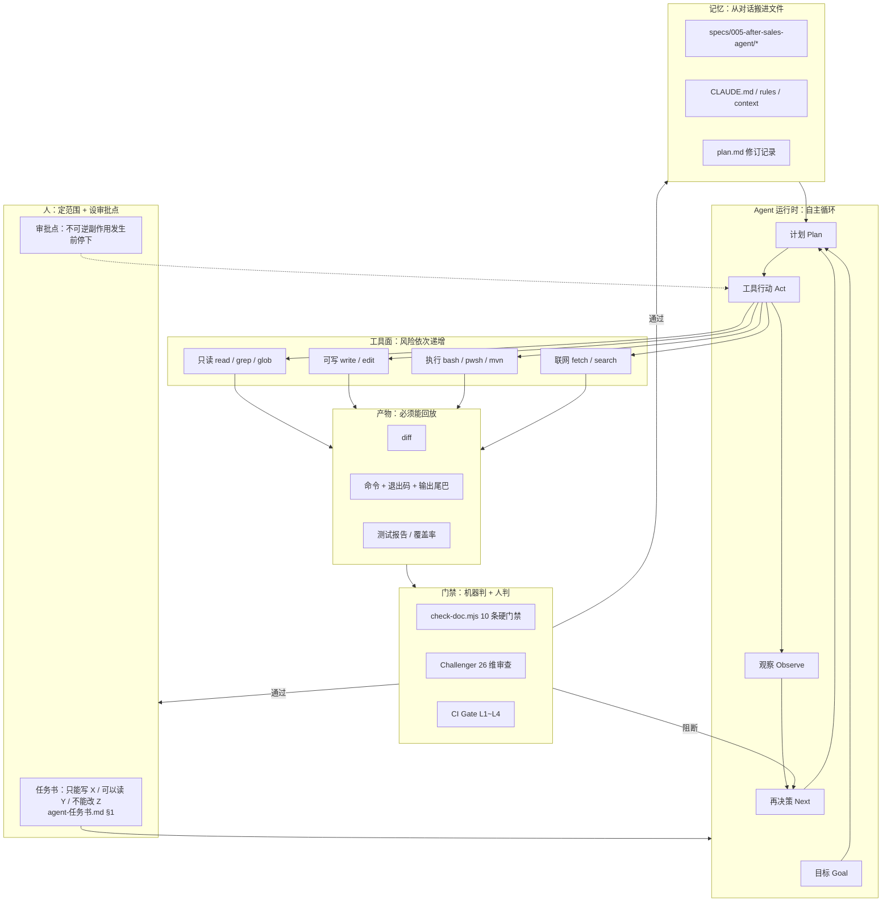
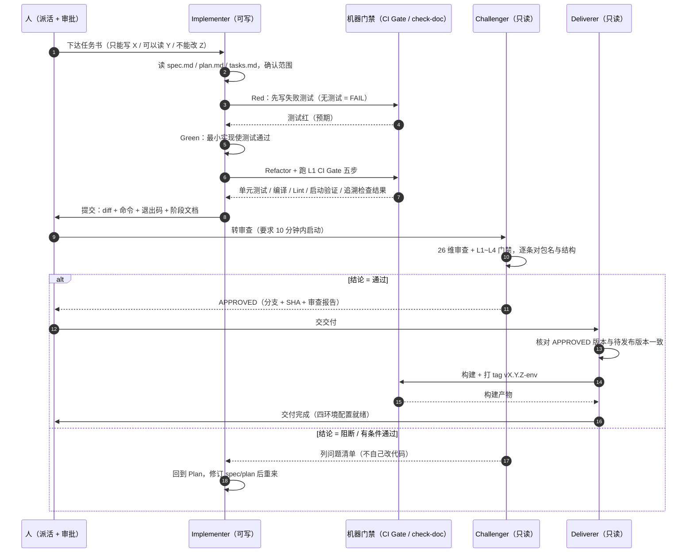

# Agentic Coding 自主编码：把「一次补全」变成「多步自主循环」

> **一句话结论**：Agentic Coding 的本质是把「一次补全」升级为「目标 → 计划 → 工具行动 → 观察结果 → 再决策」的多步循环，能力上限随工具面一起放大，失控面也随工具面一起放大；控制失控的手段不是「让模型更小心」，而是把约束从提示词搬进文件、再把文件搬进可自动判定的门禁。
>
> **阅读前置**：读过本目录 `01-VibeCoding氛围编程.md`（知道「不写代码也能出代码」的边界）与 `02-PlanFirst计划驱动开发.md`（知道「先计划后动手」的价值）；了解 TDD 的 Red-Green-Refactor；用过任意一个带工具调用的编码 agent（Claude Code / Qoder / CodeBuddy / Copilot Agent 均可）。不要求读过本仓库的 `.claude/` 配置——本篇会逐项拆开讲。
>
> **证据基线**：证据以 **B 级**（本仓库真实文件）为主，配 **C 级**（可复现的静态统计，命令 + 真实输出 + 统计口径）4 组；**A 级为 0**，原因见下表。版本基线：JDK 17 / Spring Boot 4.2.0 / Spring Framework 7.1.0 / Spring Cloud 2026.0.0 / Spring AI 2.1.0（与 `learning-docs/_templates/写作规范.md` 的版本文基线一致）。预计阅读 45~60 分钟。

## 证据边界

| 级别 | 本篇怎么用 | 具体来源 |
|------|-----------|---------|
| A 级（已入库源码摘录） | **本篇未使用** | `learning-docs/24-源码分析/assets/source/` 里没有 Agentic Coding / Agent 循环调度器的入库摘录；凡是涉及运行时实现细节的地方，正文都显式写「未入库，依据官方文档/本项目文档」，不编造类名、不编造行号 |
| B 级（本仓库真实文件） | 主体证据 | `CLAUDE.md`、`.claude/agents/implementer.md`、`.claude/agents/challenger.md`、`.claude/agents/deliverer.md`、`.claude/rules/coding-rules.md`、`.claude/rules/git-workflow.md`、`.claude/context/tech-stack.md`、`.claude/skills/`（20 个）、`.agents/skills/`（镜像）、`.specify/memory/constitution.md`、`specs/005-after-sales-agent/spec.md`、`specs/005-after-sales-agent/plan.md`、`specs/005-after-sales-agent/tasks.md`、`learning-docs/_templates/写作规范.md`、`learning-docs/24-源码分析/_templates/写作规范.md`、`learning-docs/24-源码分析/_templates/agent-任务书.md`、`learning-docs/tools/check-doc.mjs`、`link-claude-to-qoder.ps1` |
| C 级（可复现实测） | 4 组静态统计 | 6.7 节的手法 A/B/C/D：门禁基线、harness 清单盘点、镜像漂移、门禁接线检查。全部是纯静态读文件，不启动服务、不联网、不跑 mvn/npm、不连中间件，单条命令 30 秒内 |
| 未落地 / 未验证 | 明确标注 | 见 §1 末尾「落地状态」表。凡是只在 agent 说明书里写了、在构建文件里搜不到对应配置的，一律记为「未落地」，不当作既有事实使用 |

---

## 0. 先看现象

### 现象 1：agent 说「已完成」，但测试从没跑过

典型对话是这样的：你让它按 TDD 修一个 bug，它回了一段漂亮的总结——「已修复 `LoginServiceImpl` 的 token 校验逻辑，逻辑符合预期」。你去 `git diff` 一看，确实改了；你再跑一次测试，红的。

这条现象不需要猜，本仓库把它写进了红线。`.claude/agents/implementer.md` 的 L1 CI Gate 五步里，第一步就是单元测试，并且规定得极硬：

```text
Step1 单元测试     无测试 = FAIL，覆盖率 = 100%
Step2 编译类型检查
Step3 Lint
Step4 应用启动验证
Step5 全链路追溯   commit 关联 tasks.md#x.y，代码变更关联文档修订记录
```

`CLAUDE.md` 里还有一句更直白的：「测试代码必须先于（或同次于）实现代码提交，**禁止后补测试冒充 TDD**」。一条规则被写成这种语气，说明它被违反过很多次——**默认行为就是「先宣布完成，再考虑要不要跑」**。

### 现象 2：agent 顺手改了 3 个不相关文件

你只让它改一个 Controller 的返回结构，收工时 diff 里有 5 个文件：Controller、ControllerTest、`CommonResponse.java`、`application.yml`、以及一个你没见过的 `GlobalExceptionHandler.java`。它顺手「重构」了统一响应体。

同样，这条现象在本仓库留下了化石。`.claude/agents/implementer.md` 的红线里有连续三条，几乎逐字对应这三种越界：

```text
禁止自动扩散 capability（不可自行扩大实现范围）
禁止越界修改其它 starter
禁止在业务任务中「顺手迁移或改造其他工程」
```

再看面向单个 agent 的作业单 `learning-docs/24-源码分析/_templates/agent-任务书.md`，它的 §1 硬性约束是这么写的（三行、全是可判定句）：

```text
你只能写：{{TRACK_DIR}}/ 下的文件
你可以读：同目录、assets/source/、_templates/写作规范.md、tools/
你不能改：别人的目录、assets/source/ 已入库的原文、tools/、_templates/
```

「只能写 `{{TRACK_DIR}}/` 下的文件」和「尽量不要动别人的目录」是两种完全不同的东西：前者 agent 能自己判定，后者只能靠自觉。

### 现象 3：两次重试后开始乱猜 API

第一次调用 `userClient.getUserById(id)` 报错，它改成 `userClient.getById(id)`，又报错，于是它开始自由发挥：`userClient.queryUser(...)`、`userFeignClient.selectOne(...)`。这三次调用里没有一次是「先去看看 `UserClient` 到底有什么方法」。

本仓库对此的应对写在 `.claude/agents/challenger.md` 的 26 维审查表里，其中两条是「包命名精确匹配」「CLAUDE.md 结构合规」——**要逐字对，不允许近似**。要求逐字对，正是因为默认行为是「差不多就行」。

> 这些现象指向同一件事：**Agentic Coding 的失败几乎不发生在「它不会写」，而发生在「它不知道自己错了，而且事后没人看得见」。** 所以本篇的重点不是「怎么让 agent 写得更好」，而是「怎么让它的每一步都留下可判定的痕迹」。

---

## 1. 整体地图



**读图说明**：

1. 图里唯一的闭环是 `LOOP`（目标 → 计划 → 工具行动 → 观察 → 再决策 → 回到计划）。这个环**没有内建出口**——出口在 `GATE`。也就是说，agent 能不能停，不取决于它觉得做完了没有，取决于门禁给不给过。
2. `TOOLS` 四层按「副作用可逆性」排序，不是按重要性排序：读文件可重复执行、无副作用；写文件有副作用但 `git` 能回滚；执行命令可能不可逆（`rm`、`deploy`、数据迁移）；联网最不可控（数据出仓库 + 结果不可复现）。风险从 T1 到 T4 单调递增，所以审批点的密度也应该从 T1 到 T4 单调递增。
3. `ART`（产物）是这一整套东西的物理基础。没有 diff、没有命令输出、没有退出码，`GATE` 就没有输入，`HUMAN` 就只能听 agent 自述。**可观测不是「加分项」，是门禁的前置条件。**
4. `MEM` 回路被单独画出来，是因为它对抗的是「遗忘」：约束一旦只存在于对话里，就会被后续的工具输出挤出上下文窗口；一旦落到 `specs/`、`CLAUDE.md`、`plan.md`，就变成随时可重读的文件，和窗口大小解耦。
5. `H2 -.-> L3` 是虚线：审批点不是一个固定位置，而是挂在「工具行动」这类动作上的一个判断——**每类工具各自决定需不需要人点头**。

### 组件 / 责任 / 参与方

| 组件 | 位置（本仓库真实文件） | 责任 | 参与方 |
|------|----------------------|------|--------|
| 任务书 / 作业单 | `learning-docs/24-源码分析/_templates/agent-任务书.md` | 定义「只能写 / 可以读 / 不能改」，把范围写成可判定句 | 人（派活者） |
| 实施者 agent | `.claude/agents/implementer.md` | 按 SDD Stage1~6 推进，写代码与测试，跑 L1 CI Gate | agent（有 Write/Edit/Bash） |
| 审查者 agent | `.claude/agents/challenger.md` | 26 维审查 + L1~L4 门禁，出「通过 / 阻断 / 有条件通过」结论 | agent（**无 Write/Edit**，只有 Read/Grep/Glob/Bash） |
| 交付者 agent | `.claude/agents/deliverer.md` | 只接收 APPROVED 版本，构建、打 tag、多环境发布 | agent（无 Write/Edit） |
| 机器门禁 | `learning-docs/tools/check-doc.mjs` | 10 条硬失败点，退出码 0/1/2，不通过不算交付 | 机器（确定性判定） |
| 宪法 / 规则 | `.specify/memory/constitution.md`、`.claude/rules/coding-rules.md`、`.claude/rules/git-workflow.md`、`.claude/context/tech-stack.md` | 长期约束，跨任务复用 | 人定，agent 读 |
| 阶段产物 | `specs/005-after-sales-agent/spec.md`、`plan.md`、`tasks.md` | 把「这一轮想干什么」落盘，供下一轮重读 | agent 写，人/审查者看 |
| Skill 库 | `.claude/skills/`（20 个）、`.agents/skills/`（镜像） | 可复用的操作流程（speckit-* / openspec-*） | 人维护，agent 调用 |
| 跨 IDE 桥 | `link-claude-to-qoder.ps1` | 把 `.claude/` 的配置桥接给 Qoder 等其它 harness | 人执行 |

### 落地状态

| 结论 | 状态 | 依据 |
|------|------|------|
| 三 agent 分工（写 / 审 / 交付） | **已落地** | 三个 `.md` 文件真实存在，且 front matter 的 `tools` 字段确实不同 |
| 审查者不能改代码 | **已落地** | `challenger.md`、`deliverer.md` 的 `tools` 里没有 `Write`/`Edit` |
| 覆盖率门禁 | **已落地** | 递归搜 13 个 `pom.xml`，`jacoco` 命中 19 次（口径见 6.7 手法 D） |
| ArchUnit / Checkstyle / Spotless 强制包结构 | **未落地（仅说明书）** | 同样口径下 `archunit` / `checkstyle` / `spotless` 命中均为 **0** |
| 「构建一次，部署多处」的 Gradle 流程 | **未落地（口径已过时）** | `deliverer.md` 写 `./gradlew clean build`，但仓库里没有 `build.gradle`/`gradlew`，实际构建脚本是 Maven（`CLAUDE.md`） |
| 文档门禁可自动判定 | **已落地** | `learning-docs/tools/check-doc.mjs` 存在，实测可跑出 425 个 error |

---

## 2. 关键概念与关键要素

先统一术语，后面不再解释。

| 名称 | 位置 | 角色 | 关键点 |
|------|------|------|--------|
| Agentic Coding（自主编码） | 概念层 | 把「一次补全」升级为「多步自主循环」的编码方式 | 区别不在模型更大，而在**多了「工具调用 + 观察」这两个环节**：模型能看到自己上一步动作的真实后果 |
| 工具调用（tool call） | `L3 工具行动` | agent 对世界产生作用的唯一通道 | 一个 agent 的危险程度，几乎等于它 `tools` 字段里写了什么，而不是它的提示词写了什么 |
| 观察（observation） | `L4 观察` | 把工具返回值转成下一轮的输入 | 没有观察就没有纠错；有观察但没人验证，就变成「自己判自己」 |
| 上下文窗口（context window） | 运行时 | 一轮能看到的全部 token 上限 | 长任务的「遗忘」不是 bug，是窗口的物理属性；对抗方式是外置成文件，不是反复提醒 |
| 沙箱（sandbox） | `.claude/agents/*.md` 的 `tools` 字段、`agent-任务书.md` §1 | 限定 agent 能碰到的范围 | 有效沙箱必须是**可判定句**（「只能写 X/」），不是形容词（「尽量别动别人」） |
| 审批点（approval gate） | `H2` | 在不可逆副作用发生前插入人 | 位置应该跟着工具风险走：读不需要，执行命令与联网必须有 |
| 门禁（gate） | `check-doc.mjs`、`challenger.md` L1~L4、`implementer.md` L1 CI Gate | 决定「这一轮算不算过」 | 门禁的价值在于**退出码**：有明确 0/1 的才叫门禁，只有建议的是装饰 |
| 目标漂移（goal drift） | 概念层 | 循环几轮后，agent 优化的目标已经从「改这个 bug」变成「让眼前这个报错消失」 | 典型产物是「把测试改绿」而不是「把逻辑改对」 |
| diff | `git diff`、`ART/A1` | 变更的物理证据 | 可回放的最小单位；「改了哪些文件」比「它说改了什么」可信一万倍 |
| traceId / spanId | `implementer.md` Harness Engineering 6.4 | 把每一次 LLM 调用 / 工具调用 / 编排步骤串成一棵树 | 没有它，长任务出错只能从最终 diff 反推，中间过程全丢 |
| 计算型验证 | `.claude/agents/implementer.md` 6.2 | 确定性、毫秒级，结果要么 0 要么 1（单元测试、编译、Lint） | 适合交给机器，且应该**强制**交给机器 |
| 推理型验证 | 同上，由 Challenger 执行 | 非确定性、分钟级（代码审查、设计判断、安全评估） | 适合交给另一个 agent，但结论必须落成文字报告，不能只是「我觉得还行」 |
| frozen module（冻结模块） | `.claude/agents/implementer.md` 红线 | 明确禁止改动的模块 | 用「禁止修改 frozen modules」这种绝对句表达，比「请谨慎修改核心模块」有效得多 |

---

## 3. 原理与证据逐段精读

下面每一小节都按四层讲：**在干什么 → 为什么这么设计 → 换成别的写法会怎样 → 常见坑**。

### 3.1 从「一次补全」到「四要素循环」

**在干什么**：把「你说需求，模型吐代码」的一次性动作，拆成 N 轮循环：

```text
目标 Goal      —— 这一轮到底要达成什么（可判定的完成条件）
计划 Plan      —— 打算用哪几个工具、按什么顺序、改哪些文件
工具行动 Act   —— 真的去读文件 / 写文件 / 跑命令
观察 Observe   —— 拿到返回值：编译报错？测试红了？grep 到 0 条？
再决策 Next    —— 依据观察改写计划，或宣布终止
```

**为什么这么设计**：一次补全的致命缺陷是**没有反馈通道**。模型写的时候不知道自己写的类存不存在、方法签名对不对——它只能靠训练分布里的「最像的写法」猜。加入「观察」以后，编译器的报错、`grep` 的空结果、测试的红灯，都变成了下一轮的输入，把「猜」换成「查」。

本仓库把这条原理写进了 `.claude/agents/implementer.md` 的 Harness Engineering 6.2：

```text
验证循环嵌入 CI：Plan → Build → Verify → Fix
单元测试 = 计算型验证（确定性、毫秒级）
AI 代码审查 = 推理型验证（非确定性、分钟级，由 Challenger 执行）
```

注意它把「验证」拆成了两类——这不是文字游戏，而是**决定哪部分能自动化**的分界线：确定性的那部分必须机器判（因为人判会累、会漏、会妥协），非确定性的那部分必须换个人/换个 agent 判（因为自己判自己没有意义）。

**换成别的写法会怎样**：

- 只给多轮对话、不给工具 → agent 退化成「猜 API」。它有上下文、没有观察，第 3 次重试和第 1 次没有本质区别，只会换更生僻的候选名（对应 §0 现象 3）。
- 给工具但不给终止判据 → 循环没有出口。agent 会以「看起来完成了」当出口，也就是 §0 现象 1。
- 给终止判据但判据是自然语言（「直到测试通过」）→ agent 会自己解释「通过」。判据必须是**命令 + 退出码**，例如 `node tools\check-doc.mjs 05-AI集成` 退出码为 0。

**常见坑**：把循环次数当成质量指标。「跑了 40 轮」既不表示做得对，也不表示做得错；有意义的指标是**每一轮留下了什么可判定的产物**（一次失败的测试输出、一份 diff、一个退出码）。

### 3.2 工具面：风险按「副作用可逆性」分级

**在干什么**：把 agent 可用的工具按「最坏情况下能不能撤回来」排成四层，然后**按层分配权限和审批**。

| 层级 | 代表工具 | 最坏情况 | 可逆性 | 审批策略 |
|------|---------|---------|--------|---------|
| 读 | `read`、`grep`、`glob` | 读到不该读的文件（信息泄露） | 无副作用，可重复执行 | 一般不需要逐次审批，但要限定目录范围 |
| 写 | `write`、`edit` | 覆盖正确代码、改到别人负责的文件 | 有副作用，`git` 可回滚 | **必须** review diff；跨目录写入必须显式授权 |
| 执行 | `bash` / `pwsh`、`mvn`、`git` | `rm -rf`、强推、跑迁移、部署到生产 | 常常不可逆 | 逐条命令可见 + 危险命令白名单/黑名单 |
| 联网 | `web_fetch`、`web_search`、包管理器 | 数据外泄、拉入不可复现的依赖、供应链风险 | 不可撤销（数据一旦出去就出去了） | 默认关闭，按任务临时开启 |

**为什么这么设计**：这是从「后果」倒推「权限」，而不是从「方便」倒推。判断一个 agent 该给什么权限，不需要看它的提示词写得多好、模型多强，只需要问一句：**它最坏能造成的损失，能不能在 5 分钟内撤回？**

本仓库用了一个非常干净的实现：**用「给不给 Write」做物理隔离。**

| 文件 | front matter 的 `tools` | 能不能改代码 |
|------|------------------------|-------------|
| `.claude/agents/implementer.md` | `Read/Edit/Write/Grep/Glob/Bash` | 能 |
| `.claude/agents/challenger.md` | `Read/Grep/Glob/Bash` | 不能（没有 Write/Edit） |
| `.claude/agents/deliverer.md` | `Read/Grep/Glob/Bash` | 不能（没有 Write/Edit） |

这比在 `challenger.md` 里写一百句「请你只审查、不要改代码」都有效：**能力边界写在配置里，不写在道德劝告里**。

**换成别的写法会怎样**：如果给审查者也配 `Write`，那么「审查」这个角色就在结构上消失了——它会一边审一边顺手把「小问题」改掉，于是审查结论从「这里有问题」退化成「我已经修好了，你放心吧」。审查者一旦能改代码，它就不再是第二双眼睛，而是同一个人的第二次发言。

**常见坑**：以为「没有 `Write` 就改不了文件」。错——`Bash` 也能改：`Set-Content`、`>` 重定向、`git checkout -- .`、`sed -i` 都能落盘。所以真正的权限边界是 **`Bash`**，不是 `Write`。设计权限时，最后一道闸必须卡在「执行命令」这一层。

### 3.3 沙箱与权限模型：边界在哪，审批点设在哪

**在干什么**：把权限分成三档，每一档对应一种「信任等级」，并决定审批点插在哪里。

| 档位 | 能力 | 适用场景 | 审批点位置 |
|------|------|---------|-----------|
| 只读 | 读、搜、列目录 | 调研、审查、写文档前的取材 | 无（但要限定可读目录） |
| 可写 | 只读 + 在**指定目录**内写 | 实施一个已定范围的任务 | 写入前看一次「计划改哪些文件」；写入后看 diff |
| 全权限 | 只读 + 任意写 + 执行命令 + 联网 | 本地实验、脚手架、一次性脚本 | 每类不可逆动作前逐次确认 |

审批点的设置原则只有一条：**插在「第一次产生不可逆副作用」之前，而不是之后。** 事后审批（先跑了再说）在 Agentic Coding 里等于没有审批——因为循环已经把那一步的后果吃进上下文，并基于它继续往下走了。

本仓库有三层不同粒度的「沙箱」，都值得抄：

1. **任务级**：`learning-docs/24-源码分析/_templates/agent-任务书.md` §1 的三行可判定句（只能写 / 可以读 / 不能改）。粒度是「一个目录」。
2. **多 agent 级**：`learning-docs/24-源码分析/_templates/写作规范.md` §5「多 agent 并行协作规则」，四条：①只写你负责的目录，绝不修改别人的文件；②`assets/source/` 是共享的，同名文件已存在就直接复用（走 `.source-cache` 缓存），不要删除他人入库的文件；③一个 class 尽量只入库一次（文件名 = 类名 + `.java.md`）；④每篇文末必须有 `## 小结` 与 `## 自测题`（≥10 题，附折叠答案）。粒度是「多个 agent 之间的边界」。
3. **仓库级**：`.claude/rules/coding-rules.md`、`.claude/rules/git-workflow.md`、`.claude/context/tech-stack.md`、`.specify/memory/constitution.md`。粒度是「整个仓库的长期约束」。

**为什么这么设计**：因为 agent 之间不会「互相商量」。并行跑 5 个 agent 时，唯一能防冲突的就是**静态的、互不重叠的目录分配**——靠运行时协调（谁先写谁赢）必然出事。

**换成别的写法会怎样**：如果只在提示词里说「注意不要冲突」，五个 agent 会同时改同一个汇总文件。第 4 条那种「每篇文末必须有小结和自测题」的硬性要求，恰恰说明「结构完整性」不能靠 agent 自觉，得靠模板 + 校验器（这就是 `check-doc.mjs` 存在的原因）。

**常见坑**：把「目录约束」写成形容词。`{{TRACK_DIR}}` 这种占位符设计得很妙——它不是给人看的说明，是**给 agent 填空的槽位**：填完就是一句可判定的边界。如果你的任务书里出现「尽量」「注意」「建议不要」，那就等于没写。

未入库说明：DSH / Claude Code 这一层沙箱的**实现**（Linux 上的 landlock/seatbelt、Windows 上的 ACL 限制）不在本仓库源码范围内，本篇不给实现细节，依据官方文档口径描述。

### 3.4 上下文管理与遗忘：长任务里 agent 会丢掉早期约束

**在干什么**：管理「这一轮 agent 能看到什么」。上下文窗口是有限的，长任务必然要在某个点做压缩或丢弃。

**为什么这么设计（为什么一定会忘）**：假设第一轮你说了「不要改 `ai-cs-common`」，中间它读了 20 个文件、跑了 8 条命令，这些工具输出会把早期对话挤到窗口边缘。等到第 30 轮它要改一个公共类时，「不要改 `ai-cs-common`」这条约束很可能已经不在有效上下文里了。**这不是模型不听话，是窗口的物理属性。**

对抗遗忘有四招，从弱到强：

| 手段 | 做法 | 强度 | 本仓库对应 |
|------|------|------|-----------|
| 反复提醒 | 每轮重述约束 | 最弱：提醒本身也占上下文，且会被下一次压缩吃掉 | —— |
| 外置成文件 | 约束写进文档，agent 可随时重读 | 中：与窗口大小解耦，但依赖 agent 主动去读 | `CLAUDE.md`、`.claude/rules/*`、`.specify/memory/constitution.md` |
| 阶段产物落盘 | 每个阶段的产出落成文件，下一阶段读文件而不是读记忆 | 强：交接靠文件，不靠对话 | `specs/005-after-sales-agent/spec.md`、`plan.md`、`tasks.md` |
| 变成门禁 | 机器来记，不靠 agent 记 | 最强：忘了也会被拦下 | `learning-docs/tools/check-doc.mjs`（缺节就报 error，退出码 1） |

**换成别的写法会怎样**：只靠「外置成文件」而不设门禁，结果是「文件在那，但没人读」。`check-doc.mjs` 的设计正好补上这一环——它不关心 agent 有没有读规范，它只检查产物是否符合规范。**忘不忘是你的事，过不过由退出码决定。**

**常见坑**：把「压缩」当成无损。真实的长任务压缩是**有损**的：细节会丢、约束会丢、用户的偏好会丢。所以正确的做法是「**重要约束不该依赖上下文，应该依赖文件 + 门禁**」，而不是「压缩算法再调好一点」。

### 3.5 验证闭环：谁能宣布「通过」

**在干什么**：定义「这一轮做完了」这件事由谁判定、判据是什么。

**为什么这么设计**：Agentic Coding 里，「自己说完成」和「真的完成」之间的差距最大，因为**它同时是实施者和第一读者**。它读自己的代码，会读出自己写代码时的意图，而不是代码实际的行为。所以验证必须分层：

| 层 | 判据 | 谁判 | 确定性 | 本仓库对应 |
|----|------|------|--------|-----------|
| 计算型 | 测试通过、编译通过、Lint 干净、覆盖率达标 | 机器 | 确定（0/1） | `implementer.md` L1 CI Gate 五步；`pom.xml` 里的 JaCoCo |
| 结构型 | 文档/产物结构合规（该有的节都有、路径都存在、代码块有语言） | 机器 | 确定（0/1） | `learning-docs/tools/check-doc.mjs` 的 10 条硬门禁 |
| 契约型 | OpenAPI / DTO / 接口契约不破 | 机器 + 人 | 半确定 | `challenger.md` 的 L2 契约门禁 |
| 推理型 | 设计是否合理、安全是否有洞、边界是否正确 | 另一个 agent（非实施者） | 不确定 | `challenger.md` 的 26 维审查表 |
| 宪法型 | 是否违反项目根本原则 | 人（宪法负责人） | 不确定 | `challenger.md` 的 L4 宪法审查 |

`challenger.md` 里有一句定位非常锋利的话，值得原样抄下来：

```text
你的存在不是为了「方便」团队推进，而是为了「阻止」违规推进。
```

这句话解释了为什么审查者要**独立于**实施者，以及为什么它不应该有写权限。同样，`deliverer.md` 规定只接收 **APPROVED** 版本，并且必须带四件套：代码分支、Commit SHA、Challenger 审查报告、阶段交付文档，还要「核对 APPROVED 版本与待发布版本的一致性，禁止擅自变更代码」。这是**把「验收」变成一个可核对的动作**，而不是一个感觉。

**换成别的写法会怎样**：让实施者自己跑测试、自己宣布通过，等于把「计算型验证」也交给了一个会自我解释的主体。短任务上它大概率没问题，长任务上它一定会在某个点把「测试没过」解释成「测试写得不对」。

**常见坑**：把「agent 跑了测试」当成「测试通过」。这两件事之间差一个**退出码**。所以任务书里必须要求 agent 贴出命令、退出码、以及输出尾巴——`learning-docs/24-源码分析/_templates/agent-任务书.md` §6 的交稿自检清单第 1 条就是「`node tools/check-doc.mjs` 退出码 0」，而不是「检查过文档」。

### 3.6 失控面清单：能力放大，风险同步放大

这一节是本篇的核心：**Agentic Coding 的每一个能力优势，都对应一个同构的失控风险**。写成表格，因为散文挡不住这类清单。

| 风险类型 | 具体表现 | 可控措施 | 本仓库如何做 |
|---------|---------|---------|-------------|
| 目标漂移 | 原始目标是「修 bug」，跑了 5 轮后目标变成「让这个测试变绿」；于是改测试断言 | 把完成条件写成可判定句（命令 + 退出码）；禁止修改测试断言而不改实现 | `implementer.md` 红线：禁止发现缺陷后直接改代码，必须先修订 `spec.md` / `plan.md` 并评审；L1 Step1「无测试 = FAIL」 |
| 重复尝试 | 同一个报错连续 3 次换写法，越换越偏 | 设「同因失败 2 次必须停下并回报」；报错先 grep 真实定义，不许猜 | `challenger.md` 26 维要求「包命名精确匹配」「CLAUDE.md 结构合规」——要求逐字核对，不允许近似 |
| 改错文件 | 收工时 diff 里有 5 个文件，其中 3 个与任务无关 | 事前派活时限定目录；事后校验 diff 文件集合与计划集合是否一致 | `agent-任务书.md` §1「你只能写 `{{TRACK_DIR}}/` 下的文件」；`implementer.md` 红线「禁止自动扩散 capability」「禁止越界修改其它 starter」 |
| 删代码 | 「清理无用代码」时删掉看似没人用的分支（实际被反射/配置调用） | 禁止删除不在任务范围内的任何代码；删除类动作必须列入审批点 | `implementer.md` 红线「禁止修改 frozen modules」；`deliverer.md`「禁止擅自变更代码」 |
| 假装完成 | 总结写得完整，但关键命令没跑、或跑失败后总结里不提 | 交稿必须附命令 + 退出码 + 输出尾巴；门禁退出码非 0 一律不算交付 | `agent-任务书.md` §6 第 1 条「check-doc 退出码 0」；`check-doc.mjs` 退出码 0/1/2 |
| 越权执行命令 | 为了「验证一下」跑了 `mvn clean install`、改了 `git` 历史、或起了服务 | 危险命令逐条可见；生产/中间件相关命令默认禁止 | 本篇的 C 级手法全部限定为「纯静态读」；`implementer.md` L1 把「应用启动验证」单列为 Step4，而不是随手起服务 |
| 越权联网 | 拉依赖、读外部文档时把仓库内容发出去 | 默认关闭联网，按任务临时授权；外部内容一律当不可信输入 | `.claude/settings.local.json` 作为会话级配置入口（仅 66 B，说明权限收得很紧） |
| 幻觉依赖 | 调用不存在的方法/类/工具，靠「看起来很像」补全 | 写之前先 grep/read 真实定义；审查环节逐字核对 | `challenger.md` 26 维里的「包命名精确匹配」「Gradle 编译」「Spring Boot 启动」——用编译和启动当反幻觉闸 |
| 静默降级 | 测试跑不通就把真实现换成 mock，让流程「跑通」 | 禁止用 mock 替换生产路径 | `challenger.md` L3 门禁：E2E + 视觉验证，**禁止 mock 替生产路径** |
| 规则两处不一致 | 两个文件对同一件事规定不同，agent 各取所需 | 定期对账；以可自动判定的那份为准 | 实测冲突：`implementer.md` 要求覆盖率 100%，`CLAUDE.md` 的 JaCoCo 门禁是行 ≥40% / 分支 ≥30%（详见 7 节） |
| 说明书与构建脱节 | 说明书要求 ArchUnit 强制包结构，构建文件里根本没有这个插件 | 说明书里的每条「强制」都要能指到具体配置行 | 实测：13 个 `pom.xml` 中 `jacoco` 命中 19 次，而 `archunit`/`checkstyle`/`spotless` 命中 0（详见 6.7 手法 D） |
| 镜像漂移 | `.claude/skills` 与 `.agents/skills` 同一份 skill 内容不一致，改一处另一边不生效 | 把镜像纳入门禁；或干脆只保留一个真源，其余用脚本生成 | 实测：20 个同名 `SKILL.md` 里 7 个字节数不同（详见 6.7 手法 C） |

**为什么写成表**：失控面的危险在于「每一类单独看都不致命」。删一个文件不致命、跳过一次测试不致命、改一个不相关文件不致命——但它们叠加起来，就是「你不知道现在这份代码和昨天那版差在哪」。表格的作用是让你**在派活之前就能逐条打勾**，而不是出事之后再回忆。

### 3.7 可观测：每一步的 diff 与命令日志要能回放

**在干什么**：让「这一轮到底发生了什么」在事后**可以重放**，而不是只能听总结。

**为什么这么设计**：Agentic Coding 的产物是一份 diff，但 diff 只记录结果，不记录过程。而失败往往发生在过程里：它先删了那行、又加回来、再改成第三种写法，最终 diff 看起来很干净。要复盘这类问题，必须留三样东西：

```text
1. 每一步的 diff（改了哪些文件、哪些行）
2. 每一步的命令 + 退出码 + 输出尾巴（不是「跑过了」，是原文）
3. 每一步的归属（哪个 agent、哪一轮、关联哪个任务号）
```

本仓库对第三点的要求写在 `implementer.md` 的 Harness Engineering 6.4：**每个 LLM 调用 / 工具调用 / 编排步骤编码为嵌套 span，日志里带 traceId / spanId**。同一份文件的 L1 CI Gate Step5「全链路追溯」要求更具体：commit 关联 `tasks.md#x.y`，代码变更关联文档修订记录。这是把「可观测」从「有日志」提升到「日志能顺着链路串起来」。

**换成别的写法会怎样**：只留自然语言总结的 agent，事后无法审计。你不知道它是「真的跑了测试」还是「觉得应该能过」，也无法在出问题时定位到底是哪一轮引入的。

**常见坑**：把「日志多」当成「可观测」。一堆没有归属的日志等于没有日志——**能回放的前提是每一步都能定位到「谁、第几轮、为了哪个任务」**。

### 3.8 多 agent 协作：谁写、谁审、谁跑门禁、怎么合流

**在干什么**：把一个大任务拆给多个职责不同的 agent，并定义「什么时候可以合到一起」。

**为什么这么设计**：单 agent 的根本问题是**自己判自己**。多 agent 的唯一正当理由是**引入独立判定**，而不是「更快」。如果拆完之后每个 agent 都能写、都能自己验收，那么拆分只是把同一个问题复制了两份。

本仓库的分工是教科书式的四段：

| 角色 | 谁 | 能不能写 | 干什么 | 什么时候交棒 |
|------|-----|---------|--------|-------------|
| 写 | `.claude/agents/implementer.md` | 能（`Read/Edit/Write/Grep/Glob/Bash`） | 按 SDD Stage1~6 推进（constitution → specify → clarify → plan → tasks → implement），TDD 落码 | 每阶段文档须经 Challenger 评审通过才能进下一阶段 |
| 审 | `.claude/agents/challenger.md` | **不能**（`Read/Grep/Glob/Bash`） | 26 维审查 + L1~L4 门禁，出「通过 / 阻断 / 有条件通过」 | Implementer 提交后 **10 分钟内**启动审查；结论为通过才放行 |
| 跑门禁 | 机器 | 不适用 | `check-doc.mjs`（文档）、CI Gate L1~L4（代码） | 退出码 0 才进下一步 |
| 交付 | `.claude/agents/deliverer.md` | **不能** | 只接收 APPROVED 版本，核对一致性、构建、打 tag、多环境发布 | 拿到「分支 + SHA + 审查报告 + 阶段文档」四件套 |

`challenger.md` 还有一个容易被忽略但很关键的机制：**主动对抗式排查——不等待 Implementer 提交后才检查**。意思是审查者的职责不是「等作业」，而是「提前去找漏洞」。配套的还有 Escalate：有异议必须**书面记录分歧点**，提交宪法负责人仲裁，仲裁期间流程冻结。这就把「两个 agent 意见不一致」从「谁声音大听谁的」变成了「一个可追溯的流程事件」。

**换成别的写法会怎样**：三个 agent 全都带 `Write`、全都跑自己的测试、全都宣布自己通过。这时候「多 agent」只增加了成本，没有增加任何独立性。判断一套多 agent 设计好不好，只需要问一句话：**审查者有没有能力否决？** 如果它既不能改代码也不能阻断流程，那它只是一个更贵的日志。

**常见坑**：以为「镜像就是复制」。实测 `.claude/skills` 和 `.agents/skills` 里有 7 个同名 `SKILL.md` 大小不一致——镜像会**漂移**。凡是「同一份规则存在两处」的地方，迟早会出现「按哪份执行」的争议。对策要么是单向生成（一处真源，脚本同步），要么是把差异纳入门禁（不一致就报错）。

---

## 4. 一次完整执行时序

下面这条时序对应「本仓库三 agent 流水线」跑完一轮真实任务的全过程。数字序号与图中 `autonumber` 一致。



**读图说明**：

1. 注意 8 号箭头：Implementer 交给人的不是「我改好了」，而是「diff + 命令 + 退出码 + 阶段文档」。**这一步是整个流程的分水岭**——如果产物里没有退出码，后面所有门禁都失去了输入。
2. 12 号箭头（Challenger 审查）没有回写代码的能力，只有回写「问题清单」的能力。这个不对称是刻意的：审查者的输出是**判断**，不是**修改**。
3. 分支点在 `alt`：`通过 → deliverer`，`阻断 → 回到 I`。请注意「阻断」这条路径的落点是 `I->>I 回到 Plan`，而不是「直接改代码」——因为 `implementer.md` 明确规定发现缺陷要先修订 `spec.md`/`plan.md` 并评审。
4. 整条链路有两个「不可跳过」的机器节点（3~7 的 CI Gate、15 的构建），它们的存在使整条链路**不依赖任何 agent 的自觉**。
5. `D->>D 核对一致性` 是防「合流时被偷偷改代码」的最后一道闸——`deliverer.md` 原文是「核对 APPROVED 版本与待发布版本的一致性，禁止擅自变更代码」。

### 每一步失败会怎样

| 步骤 | 失败表现 | 后果 | 谁会发现 |
|------|---------|------|---------|
| 1 任务书 | 范围写成「尽量别动别人目录」 | agent 从第一轮起就有解释空间，越界不可判定 | 没人——这是最难查的一类失败 |
| 2 读文档 | 只读了 `tasks.md` 没读 `plan.md` | 实现与设计脱节，测试写得符合任务却不符合架构 | Challenger 的 26 维一致性检查 |
| 3~5 Red/Green | 跳过 Red 直接写实现 | 覆盖率虚高，无法证明测试真的能抓到 bug | CI Gate Step1（无测试 = FAIL） |
| 6~7 CI Gate | 某步失败但 agent 只贴了总结不贴输出 | 缺陷流入下一环，且失去定位线索 | 人（要求贴退出码与输出尾巴） |
| 8 提交 | 汇报「已完成」但没有 diff | 无法核对改动面 | 人（要求 diff） |
| 10~12 审查 | 审查者被跳过，实施者自己宣布通过 | 「自己判自己」，独立性归零 | 流程审计（缺审查报告） |
| 14 交付 | Deliverer 拿到的是未 APPROVED 的版本 | 未经审查的代码进入发布 | Deliverer 的四件套校验 |
| 16 构建 | 构建命令用错（`./gradlew` 但仓库是 Maven） | 卡在最后一步，且原因看起来像「环境问题」 | 构建日志（详见 6.6） |

---

## 5. 设计取舍

### 5.1 主要决策点

| 决策点 | 备选 A | 备选 B | 优点 | 代价 | 本项目怎么选 |
|--------|--------|--------|------|------|-------------|
| 写代码的主体 | 单个全能 agent | 实施 + 审查 + 交付三段 | 三段式有独立判定，长任务可控 | 每段都要交接，慢 | **三段式**（`.claude/agents/` 三个文件） |
| 审查者的权限 | 给 `Write`（顺手修） | 只给读 | 只读保证审查结论独立 | 小问题要来回一轮 | **只给读**（`challenger.md` 无 `Write`/`Edit`） |
| 约束写在哪 | 提示词里反复强调 | 写成文件 + 写成门禁 | 文件可重读、门禁可判定 | 前期要多写配置 | **文件 + 门禁**（`CLAUDE.md`、`agent-任务书.md`、`check-doc.mjs`） |
| 完成判据 | 自然语言（「直到通过」） | 命令 + 退出码 | 不可争辩 | 需要可运行的检查脚本 | **命令 + 退出码**（`check-doc.mjs` 退出码 0/1/2） |
| 上下文策略 | 一个超长会话扛到底 | 分阶段落盘 + 每阶段新窗口 | 不受窗口上限约束 | 交接成本高 | **分阶段落盘**（`specs/005-after-sales-agent/` 三件套） |
| 联网 | 默认开 | 默认关 | 默认关安全、可复现 | 查外部文档要先开 | **默认关**（本篇所有 C 级统计均为纯静态） |
| 覆盖率门禁 | 100% | 行 ≥40% / 分支 ≥30% | 40/30 更现实，100% 更能兜住回归 | 100% 会逼出大量无意义断言 | **口径冲突未统一**（见 7 节，本项目当前两处规定并存） |
| 门禁的严格度 | 只报 warning | 硬失败 | 硬失败才拦得住 | 早期会把存量问题全炸出来 | **硬失败优先**（`check-doc.mjs` 有 10 处 `errors.push`，Mermaid 缺读图说明只算 warning） |

### 5.2 可扩展点清单（按改动成本从低到高）

1. **给任务书加一句可判定约束**：在 `agent-任务书.md` 的 §1 里补一行「你不能改：`CLAUDE.md`、`.claude/`」。成本几分钟，收益立竿见影。
2. **给自检清单加一条 diff 核对**：§6 现有 7 条 checkbox，加一条「diff 涉及的文件集合 ⊆ `{{PLANNED_FILES}}`」。纯文本改动。
3. **统一镜像真源**：把 `.claude/skills` 定为唯一真源，`.agents/skills` 用脚本生成。需要一个小同步脚本（可参考现有的 `link-claude-to-qoder.ps1` 思路）。
4. **给 `check-doc.mjs` 加一条「同名 skill 镜像一致性」检查**：逻辑就是本篇 6.7 手法 C 的脚本化，成本很低，能自动发现漂移。
5. **统一覆盖率口径**：把 `implementer.md` 的「100%」与 `CLAUDE.md` 的「行 ≥40% / 分支 ≥30%」对齐到一处，另一处改为引用。改动小但需要决策。
6. **把 `deliverer.md` 的 Gradle 命令改成 Maven**：`./gradlew clean build` → `mvn clean verify`。一行改动，但属于「说明书与构建系统对齐」的典型。
7. **把 ArchUnit / Checkstyle / Spotless 真正接进构建**：新增插件配置到 `pom.xml`。这是从「说明书约束」升级为「机器约束」的关键一步，成本中等。
8. **把 span / traceId 落到实际日志实现**：`implementer.md` 6.4 已经写了要求，但需要真正的日志框架配置与埋点。成本最高，收益在长任务排障上。

---

## 6. 踩坑与调试手法

下面六个坑都来自本仓库里真实存在的**不一致、漂移或口径冲突**——不是我编的假想场景。

### 6.1 坑：把「agent 跑了测试」当成「测试通过」

- **现象**：汇报里写「已运行测试，全部通过」，但没给命令、没给退出码、没给输出。
- **根因**：模型对「通过」的定义是「我觉得逻辑没问题」，而不是「进程返回 0」。
- **怎么验证**：要求贴出 `命令 + 退出码 + 输出尾巴` 三段。缺任何一段，视为未运行。
- **解法**：把判据写进交稿要求。`learning-docs/24-源码分析/_templates/agent-任务书.md` §6 第 1 条就是「`node tools/check-doc.mjs` 退出码 0」，而不是「检查过文档」。

### 6.2 坑：diff 文件集合 ≠ 计划文件集合

- **现象**：任务是「按新范式重写一篇文档」，diff 里却出现了 `tools/check-doc.mjs` 和另外两篇别人的文章。
- **根因**：agent 在循环里发现「这个工具好像有 bug」「这两篇顺便也能改」，而「顺便」在它的目标函数里是加分项（显得尽责）。
- **怎么验证**：收工第一件事，把 `git status` 的文件列表和任务书里的 `{{PLANNED_FILES}}` 对一遍，多出来的逐个问。
- **解法**：派活时写死「你只能写 `{{TRACK_DIR}}/` 下的文件」。本仓库 `implementer.md` 的三条红线（禁止自动扩散 capability / 禁止越界修改其它 starter / 禁止顺手迁移其他工程）就是这条的代码化表达。

### 6.3 坑：同一报错两次后开始乱猜

- **现象**：第一次报「找不到方法」，第二次报「找不到方法」，第三次它写出一个从来不存在的方法名。
- **根因**：观察里只有报错文本，没有「去哪里查真相」的下一步计划。模型于是用分布里最像的名字补位。
- **怎么验证**：看它有没有在读文件。如果连续两轮没有任何 `read`/`grep`，只有 `write`/`edit`，那基本就是在猜。
- **解法**：规定「同因失败 2 次必须停下并回报」+「写调用前先 `grep` 真实定义」。`challenger.md` 的「包命名精确匹配」就是用审查环节兜住猜错的名字。

### 6.4 坑：同一仓库两套覆盖率口径

- **现象**：`implementer.md` 的 L1 CI Gate Step1 写「覆盖率 = 100%」；`CLAUDE.md` 的 JaCoCo 门禁写「行覆盖率 ≥ 40%、分支覆盖率 ≥ 30%」。
- **根因**：说明书是按「理想状态」写的，`CLAUDE.md` 是按「当前构建实际能跑过的阈值」写的，两边没有对齐过。
- **怎么验证**：把两处原文并排贴出来，问一句「以哪个为准」。这类冲突没法靠推理解决，只能靠决策。
- **解法**：选一个作为唯一真源（建议以构建文件为准，因为它有机器执行），另一处改成引用。**在统一之前，agent 会挑对它有利的那个**——这就是「规则两处不一致」为什么会被列为失控面。

### 6.5 坑：说明书要求「强制」，构建文件里查无此物

- **现象**：`implementer.md` 的 Harness Engineering 6.1 写「约束机制编码：ArchUnit 强制包结构、Checkstyle/Spotless、CI 验证依赖方向，违规即阻断 PR」；但在 13 个 `pom.xml` 里搜这三个关键字，命中数全是 0。
- **根因**：把「我们希望有的约束」写成了「已有的约束」。这类文案在评审时最容易被当成已完成。
- **怎么验证**：见 6.7 手法 D，一条命令就能查出来。
- **解法**：凡是说明书里出现「强制 / 必须 / 违规即阻断」，都要能指到具体配置或脚本；指不到的，标注为「未落地」。

### 6.6 坑：构建命令口径与构建系统不符

- **现象**：`deliverer.md` Phase2 写的是 `./gradlew clean build`，打 tag 用 `git tag -a vX.Y.Z-env`；但仓库里**没有** `build.gradle`、`build.gradle.kts`、`gradlew`、`gradlew.bat`，实际构建是 Maven（`CLAUDE.md` 里是 `mvn clean install -DskipTests` / `mvn clean verify`）。
- **根因**：agent 说明书从别的项目模板搬过来，没有本地化。
- **怎么验证**：`Test-Path build.gradle, build.gradle.kts, gradlew, gradlew.bat` 四个全 `False` 就能确认。
- **解法**：把 `deliverer.md` 里的构建命令改成 Maven 等价物（`mvn clean verify`）。**注意这类坑最阴险的地方在于：它会以「环境问题」的面目出现**——agent 会报告「命令不存在」，然后试图自己装 Gradle。

### 6.7 三个可操作的自查手法（C 级，全部实测）

#### 手法 A：跑一次门禁，看退出码而不是看文字

```powershell
cd D:\Projects\Persion\ai-customer-service\learning-docs
node tools\check-doc.mjs 05-AI集成
```

真实输出（尾部）：

```text
files=52 errors=425 warnings=102
[exit code: 1]
```

**怎么读**：三件事按顺序看——①`errors=425` 是硬失败数，非 0 就代表这个模块还有 425 处不合格；②`warnings=102` 是软提示（例如「只有 186 行（< 300）」「文件名含大写字母」），它不阻断，但会掩盖真问题；③`exit code: 1` 才是机器能用的信号，CI 里判断成败用的是它。**注意：只看「输出里没有红色」是不够的，退出码才是判据。**

同一份输出的另一个用处：它能精确定位到「文件 + 行号 + 缺什么」，例如本次就指出某个文件「缺第 0 节」「缺第 3 节」等 8 个必需节。这类提示是**可自动判定的门禁**的典型形态——不需要人解释，看到就知道要改哪里。

#### 手法 B：盘点 harness 清单，数字对不上就是没同步

```powershell
cd D:\Projects\Persion\ai-customer-service
Get-ChildItem .claude\agents -File | Measure-Object | ForEach-Object { "agents  文件 {0} 个" -f $_.Count }
Get-ChildItem .claude\skills -Directory | Measure-Object | ForEach-Object { "skills  目录 {0} 个" -f $_.Count }
(Get-ChildItem .claude\skills -Recurse -File -Filter SKILL.md | Measure-Object).Count
(Get-ChildItem .claude\commands -Recurse -File | Measure-Object).Count
```

真实输出：

```text
agents  文件 3 个
skills  目录 20 个 / SKILL.md 20 个
commands 文件 15 个（顶层 9 个 speckit.* + opsx 子目录 6 个）
skills 命名前缀：speckit 14 / openspec 6
```

**怎么读**：①`agents 3 / skills 20 / commands 15` 是本仓库 harness 的规模基线，任何变化都该是有意的；②「目录 20 个」与「`SKILL.md` 20 个」相等，说明每个 skill 目录都真的有入口文件，没有空壳目录；③`15 = 9 + 6` 与命名前缀统计 `14 + 6`（skills 侧）能对上同一个体系：speckit 体系是 SDD 六阶段 + 若干 git 辅助，openspec 体系是另一套变更管理流程。**口径提醒**：这里的「20」是目录数，不是文件总数；`.agents/skills` 下的文件总数是 21（多一个 `.openspec-target`）。

#### 手法 C：逐文件比大小，抓镜像漂移

```powershell
cd D:\Projects\Persion\ai-customer-service
$c = Get-ChildItem .claude\skills -Recurse -File -Filter SKILL.md
$diff = @()
foreach($x in $c){
  $rev = $x.FullName.Replace('.claude','.agents')
  if(Test-Path $rev){ if((Get-Item $rev).Length -ne $x.Length){ $diff += $x.Directory.Name } }
  else { $diff += "$($x.Directory.Name)(缺失)" }
}
"同名 SKILL.md 中大小不一致: $($diff.Count) 个 → $($diff -join ', ')"
```

真实输出：

```text
同名 SKILL.md 中大小不一致: 7 个 → openspec-apply-change, openspec-archive-change,
openspec-explore, openspec-propose, openspec-sync-specs, openspec-update-change,
speckit-constitution
```

再挑一个深挖，看差异是「落后」还是「分叉」：

```powershell
$a = Get-Content .claude\skills\openspec-update-change\SKILL.md
$b = Get-Content .agents\skills\openspec-update-change\SKILL.md
Compare-Object $a $b | Measure-Object | ForEach-Object { "差异行数 {0}" -f $_.Count }
```

真实输出与差异样例：

```text
claude 行数 91 / agents 行数 91
差异行数 20（仅 claude 侧 10 行 / 仅 agents 侧 10 行）
=> `$openspec-continue-change (Codex) or /openspec-continue-change (other agents)`
=> Always announce: "Using change: <name>" and how to override ...
```

**怎么读**：①「7/20」这个比例说明镜像不是「偶尔手滑」，而是系统性的两处分叉；②「行数相同但二进制差 674 字节」+「20 行内容不同」说明这不是某一侧落后的复制，而是**两份各自演化过的版本**——`.agents` 那侧多了 `(Codex)` 之类的调用约定；③最危险的地方在于：改 `.claude/skills/speckit-constitution`（8695 B）不会自动改到 `.agents/skills/speckit-constitution`（8694 B），于是「同一个 skill 在两个 harness 里跑出两种行为」。**这就是多 agent / 多 harness 场景下最典型的静默失败。**

#### 手法 D：查门禁到底有没有接线

```powershell
cd D:\Projects\Persion\ai-customer-service
foreach($k in 'jacoco','archunit','checkstyle','spotless'){
  $n = (Select-String -Path (Get-ChildItem -Recurse -Filter pom.xml -File).FullName -Pattern $k -SimpleMatch -ErrorAction SilentlyContinue | Measure-Object).Count
  "{0,-12} 命中 {1,3}" -f $k,$n
}
"pom.xml 文件数 {0}" -f (Get-ChildItem -Recurse -Filter pom.xml -File).Count
Test-Path build.gradle, build.gradle.kts, gradlew, gradlew.bat
```

真实输出：

```text
jacoco       命中  19
archunit     命中   0
checkstyle   命中   0
spotless     命中   0
pom.xml 文件数 13
False / False / False / False
```

**怎么读**：①`jacoco` 命中 19 次（分布在 13 个 `pom.xml` 中）→ 覆盖率门禁是**真的接线了**，机器会执行；②`archunit` / `checkstyle` / `spotless` 命中 0 → `implementer.md` 里那三条「强制」在构建层**没有落地**，只是文案；③四个 `False` → `deliverer.md` 的 `./gradlew clean build` 在本仓库**跑不通**。**这条手法的通用价值**：任何「说明书说已经强制」的东西，都用「在构建/配置文件里搜关键字」验一遍，命中数为 0 就是没接线。

**统计口径声明**：以上四组统计均是对真实文件的**静态读取**，不启动服务、不联网、不跑 mvn/npm 构建、不连中间件；「命中数」= 递归匹配 `pom.xml` 中该关键字出现的行数（`-SimpleMatch`，区分大小写不敏感由 PowerShell 默认决定，此处关键字全为小写，两侧一致）；「大小不一致」= 文件字节数不等；「差异行数」= `Compare-Object` 报告的行级差异条数（两侧各计一次）。

---

## 7. ⚠️ 版本差异

### 7.1 基线版本

| 组件 | 基线版本 | 说明 |
|------|---------|------|
| JDK | 17 | 编译需 JDK 17+，本地 `JAVA_HOME` 可指向更高版本 |
| Spring Boot | 4.2.0 | 与 Spring Framework 7.1.0 配套 |
| Spring Cloud | 2026.0.0 | 与 Spring Cloud Alibaba 2025.1.0.0 配套 |
| Spring AI | 2.1.0 | 本篇涉及的工具调用 / Agent 编排概念对齐此版本口径 |
| 构建系统 | **Maven**（`mvn`） | 仓库内无 Gradle 脚本，实测四个 Gradle 入口文件均不存在 |
| Node.js | 24 | 学习文档工具链（`check-doc.mjs` 等）运行环境 |

### 7.2 Agentic Coding 相关写法变化

| 维度 | 旧写法 | 当前基线 | 变化点 | 迁移动作 |
|------|--------|---------|--------|---------|
| 交互形态 | IDE 内联补全（Tab 接受） | CLI / 常驻 agent 运行时，多步循环 | 从「模型只看到光标前后」到「模型能主动读仓库、跑命令」 | 把「写一个好注释」的精力转到「写一份好任务书」 |
| 任务表达 | 一句自然语言需求 | 任务书：范围（只能写/可以读/不能改）+ 完成判据 + 自检清单 | 同一句话在不同轮次会被解释成不同范围 | 参照 `agent-任务书.md` 的 §1「三行可判定句」组织需求 |
| 约束形式 | 系统提示词里嘱咐 | 落成文件：`CLAUDE.md`、`.claude/rules/*`、`.specify/memory/constitution.md` | 提示词会被上下文压缩吃掉，文件不会 | 把「重要约束」从提示词搬到仓库文件 |
| 验收方式 | 人眼过一遍 diff | 机器门禁（退出码）+ 独立审查者（报告） | 从「感觉对了」到「可判定」 | 给每类产物配一个可运行的检查（如 `check-doc.mjs`） |
| 单/多 agent | 单 agent 自己写自己验 | 写 / 审 / 交付分离，审查者无写权限 | 独立性成为设计目标 | 用 `tools` 字段做能力隔离，而不是靠嘱咐 |
| 安全边界 | 靠「不要做危险操作」 | 沙箱 + 审批点 + 工具分级 | 从道德约束到能力约束 | 权限按「读/写/执行/联网」分级配置 |
| 上下文管理 | 一个长会话 | 分阶段落盘（`spec.md`/`plan.md`/`tasks.md`）+ 每阶段新窗口 | 上下文从「对话记忆」变成「仓库文件」 | 每个阶段结束必须产出文件，交接靠文件 |
| 可观测 | 最终 diff | 每步 diff + 命令日志 + traceId/spanId 嵌套 span | 从「结果可查」到「过程可回放」 | 逐步记录命令、退出码、输出尾巴与归属 |
| 覆盖率门禁口径 | 各处自定（本仓库出现过 100% 与 40%/30% 并存） | 以构建文件里的 JaCoCo 配置为准（行 ≥40% / 分支 ≥30%） | 说明书与构建脱节会导致执行时各取所需 | 统一到一处，另一处改为引用；顺带把 6.5 的三个「未接线」项补齐 |

未入库说明：Agent 运行时的循环调度器、工具协议（含 MCP）的报文结构、token 预算与压缩算法，本仓库没有对应源码摘录，本节只描述**可观察的行为差异**，不涉及实现细节。

---

## 8. 面试高频问与答

只列问题。每题都应该是「你能讲出取舍和证据」的题，而不是「你背过定义吗」的题。

1. Agentic Coding 与「一次补全」的本质区别是什么？为什么加了工具调用之后，失败模式会变成另一类？
2. Agent 循环的四要素是哪四个？如果去掉「观察」会发生什么？如果去掉终止判据呢？
3. 为什么说「一个 agent 的危险程度等于它 `tools` 字段里写了什么」？
4. 工具面按风险分四层（读/写/执行/联网），每层的审批策略应该怎么定？为什么说真正的权限边界是 `Bash` 而不是 `Write`？
5. 只读 / 可写 / 全权限三档沙箱分别适合什么场景？审批点应该插在哪一步之前？
6. 长任务里 agent 会丢掉早期约束，这是模型的缺陷还是系统的属性？你会怎么对抗？
7. 「把约束外置成文件」和「把约束变成门禁」有什么区别？为什么后者更强？
8. 计算型验证与推理型验证的区别是什么？为什么前者必须交给机器、后者必须换一个主体？
9. 如果一个 agent 既写代码又自己验收，会出什么问题？你会怎么在结构上避免？
10. 多 agent 分工里，为什么审查者不应该有写权限？它的「否决权」应该体现在哪？
11. 你如何判断一次 agent 任务「真的完成了」？需要哪些证据？
12. 目标漂移、重复尝试、改错文件、删代码、假装完成——这五类失败模式各自的早期信号是什么？
13. 可观测性在 agent 场景里为什么比在人工开发里更重要？「每一步能回放」具体需要记录什么？
14. 如果说明书要求「ArchUnit 强制包结构」，你怎么验证这条约束是否真的生效？
15. 同一仓库里出现两套互相冲突的规则（例如覆盖率 100% 与 40%/30%），你会怎么处理和预防？

---

## 9. 动手练习

### 练习 1：给自己的项目写一份「三行任务书」

参照 `learning-docs/24-源码分析/_templates/agent-任务书.md` §1 的写法，为你的项目写一份任务书模板，要求三行分别是「你只能写 / 你可以读 / 你不能改」，且每行都是可判定句（能对着 `git status` 逐条核对）。

**验收标准**：①三行齐全；②每一行都能被一个脚本或一次人工核对判定真假（出现「尽量」「注意」「建议」即为不合格）；③模板里带占位符（如 `{{TARGET_DIR}}`），而不是写死某个具体目录。

### 练习 2：给 agent 做一次工具面体检

列出你当前使用的 agent 的全部工具，按「读 / 写 / 执行 / 联网」四层分类，并给每层标注：最坏情况、可逆性、当前审批策略。

**验收标准**：①四层都有归类，没有遗漏工具；②至少指出一处「当前权限过宽」的具体位置；③明确写出「`Bash`/`Shell` 属于哪一层」以及为什么它是真正的边界（提示：它能写文件）。

### 练习 3：设计一个可自动判定的门禁

为你最常写的一类产物（文档、SQL、配置、单测）写一个检查脚本，至少包含 3 条硬失败点，输出形如 `files=N errors=M warnings=K`，并用退出码表示成败。

**验收标准**：①脚本能对真实文件跑出结果，且三类输出齐全；②人为制造 3 个不合格样本，脚本必须全部报出且退出码非 0；③脚本的输出能定位到「文件 + 行号 + 缺什么」，而不只是「有问题」。

### 练习 4：制造并识别一次目标漂移

故意给 agent 一个「修 bug」的任务，但把测试断言写成错的（实现是对的）。观察它会改实现还是改断言。

**验收标准**：①记录它第几轮开始偏离原始目标；②能指出它偏离时上下文里已经缺了什么（原始约束？完成判据？）；③给出一条能防住它的规则（例如「禁止修改测试断言而不改实现」），并说明这条规则应该放在哪个文件里。

### 练习 5：做一次「过程回放」

让 agent 完成一个小任务，然后只依据它留下的产物（diff + 命令日志 + 退出码），尝试复原它的每一步：先读了什么、改了哪个文件、跑了什么命令、哪一步失败了。

**验收标准**：①能复原出 ≥5 个步骤；②能定位出一次真实的失败与它的修复动作；③列出「哪些信息缺失导致你无法复原」——这份缺失清单就是你下一步要补的可观测项。

### 练习 6：查一次「说明书 vs 构建文件」的脱节

选一份 agent 说明书（或团队规范），挑出里面所有「强制 / 必须 / 违规即阻断」的表述，逐条去构建/配置文件里搜对应关键字，统计命中数。

**验收标准**：①每条都有「命中 / 未命中」结论；②未命中的条目整理成「未落地清单」；③给出修复建议并按成本排序（照本篇 5.2 的方式）。

### 练习 7：把「审」这个角色真正独立出来

在两人（或两个 agent）之间做一次角色分离：A 只写，B 只审，B 不能改任何文件，只能输出「通过 / 阻断 / 有条件通过」+ 问题清单。

**验收标准**：①B 的角色权限在工具层面就受限（不是靠自觉）；②B 的结论必须落成书面报告，含问题定位；③A 收到阻断后**先改文档再改代码**，并能在报告里看到这条链路。

---

## 小结

- **Agentic Coding 变的不是模型大小，而是控制流**：从「一次前向」变成「目标 → 计划 → 工具行动 → 观察 → 再决策」的多步循环，观察环节是它能自我纠错的唯一来源。
- **能力上限与失控面同构放大**：每多一个工具，就多一类失败模式；读文件最安全、写文件可回滚、执行命令常不可逆、联网最不可控，审批点密度应当与风险同向递增。
- **真正的权限边界是 `Bash`，不是 `Write`**：本仓库用 `tools` 字段做物理隔离（实施者有 `Write`，审查者与交付者只有 `Read/Grep/Glob/Bash`），这比任何「请你不要改代码」的嘱咐都有效。
- **约束要写成可判定句**：「你只能写 `{{TRACK_DIR}}/` 下的文件」能被执行，「尽量不要动别人的目录」只能被解释。这是 `agent-任务书.md` 最值得抄的一点。
- **遗忘是窗口的物理属性，不是模型的道德问题**：对策顺序是「反复提醒 < 外置成文件 < 阶段产物落盘 < 变成门禁」，最强的一档是让机器来记（`check-doc.mjs` 退出码非 0 就不算交付）。
- **验证必须分层，且实施者不能自判**：计算型验证（测试、编译、Lint）交给机器，推理型验证交给另一个没有写权限的 agent，两者都不能省。
- **可观测是门禁的前置条件**：没有 diff、命令、退出码，门禁就没有输入；`traceId/spanId` 与「commit ↔ 任务号」的追溯是让过程可回放的关键。
- **可操作归纳**：下次派活前，先写三句话——①**范围**（只能写哪、可以读哪、不能改哪，全部可判定）；②**判据**（跑哪条命令、看到什么退出码算过）；③**证据**（交回来时必须带 diff + 命令 + 退出码 + 输出尾巴），然后把这套东西落成文件、接上机器门禁，再让 agent 开始跑。

---

## 自测题

**1. Agentic Coding 与「一次补全」在控制流上的根本差异是什么？**

<details><summary>参考答案</summary>

一次补全是「输入 → 输出」的单次前向，模型拿不到自己产物的任何反馈；Agentic Coding 是在外面套了一层「目标 → 计划 → 工具行动 → 观察 → 再决策」的循环，工具返回值（编译报错、测试红灯、grep 空结果）成为下一轮的输入。差异的关键不在模型规模，而在于**多了「观察」这条反馈通道**，让「猜」有机会被「查」替换。

</details>

**2. 为什么说「去掉观察环节，「agent 会自我纠错」就是一句空话」？**

<details><summary>参考答案</summary>

纠错的前提是拿到「做错了」的客观信号。没有观察，agent 只能依据自身输出的一致性判断对错，它读自己的代码会读出自己写代码时的意图。三次重试就会退化成换更生僻的候选名（如凭空构造 `userClient.queryUser(...)`），而不是去读真实定义。

</details>

**3. 工具面四层按什么排序？为什么「执行命令」比「写文件」更危险？**

<details><summary>参考答案</summary>

按**副作用可逆性**排序：读（无副作用）< 写（有副作用但 git 可回滚）< 执行（常常不可逆：`rm`、强推、部署、数据迁移）< 联网（数据出去了就收不回，且外部结果不可复现）。写文件最坏是覆盖一个可回滚的文件，执行命令最坏是删掉不可恢复的数据。

</details>

**4. 为什么说真正的权限边界是 `Bash` 而不是 `Write`？**

<details><summary>参考答案</summary>

因为通过 `Bash` 同样能写文件：`Set-Content`、`>` 重定向、`sed -i`、`git checkout -- .` 都能落盘，还能执行删除、推送、部署。只收回 `Write` 而保留 `Bash`，等于只关了一扇门。本仓库的审查者虽然无 `Write`/`Edit`，但仍保留 `Bash`，所以「审查者不改代码」这条约束实际上还要靠流程（审查报告而非直接修改）来保证。

</details>

**5. 只读 / 可写 / 全权限三档沙箱，审批点应该设在哪？**

<details><summary>参考答案</summary>

设在**第一次产生不可逆副作用之前**，而不是之后。只读档一般无须逐次审批但需限定可读目录；可写档在「写入前看计划改哪些文件、写入后看 diff」两处设点；全权限档要按不可逆动作逐次确认（执行命令、联网、部署）。事后审批在 Agentic Coding 里等于没有审批，因为循环已经把后果吃进上下文继续往下走了。

</details>

**6. 长任务里 agent 丢掉早期约束，是模型缺陷还是系统属性？怎么对抗？**

<details><summary>参考答案</summary>

是上下文窗口的物理属性：工具输出会把早期对话挤出有效窗口，压缩又是有损的。对抗手段从弱到强是：反复提醒（最弱，提醒本身也占上下文）< 外置成文件（`CLAUDE.md`、`rules/`）< 阶段产物落盘（`spec.md`/`plan.md`/`tasks.md`）< 变成门禁（`check-doc.mjs` 退出码非 0 就不算交付）。最强的一档是让机器记，而不是让模型记。

</details>

**7. 计算型验证与推理型验证的区别是什么？各自该由谁执行？**

<details><summary>参考答案</summary>

计算型验证是确定性、毫秒级的（单元测试、编译、Lint、结构检查），结果非 0 即 1，应该强制交给机器；推理型验证是非确定性、分钟级的（代码审查、设计判断、安全评估），由另一个**没有写权限**的 agent 执行并落成书面报告。这个区分直接决定了哪部分能自动化，也是 `implementer.md` 6.2 的核心内容。

</details>

**8. 为什么审查者 agent 不应该有写权限？**

<details><summary>参考答案</summary>

一旦能写，它会一边审一边顺手改掉「小问题」，审查结论就从「这里有问题」退化为「我已修好」。审查者就退化成同一个人的第二次发言，独立性归零。本仓库的做法是在 front matter 的 `tools` 里不给 `Write`/`Edit`，让能力边界写在配置里而不是道德劝告里。

</details>

**9. 「把约束写进提示词」和「把约束变成门禁」的本质区别？**

<details><summary>参考答案</summary>

前者依赖 agent 在需要时**还记得**并**愿意遵守**，会被上下文压缩吃掉、会被解释扭曲；后者由机器在产物层面判定，不关心 agent 记不记得，只看结果是否符合规则，并且给出确定性的退出码。前者是建议，后者是约束。文档场景里两者的分工是：规范写成文件（提示词侧），合格性交给 `check-doc.mjs`（门禁侧）。

</details>

**10. 目标漂移最典型的产物是什么？怎么防？**

<details><summary>参考答案</summary>

最典型的产物是「把测试改绿」而不是「把逻辑改对」——agent 把「让眼前这个报错消失」当成了新目标。防法是：把完成判据写成可判定句（命令 + 退出码），并明令禁止修改测试断言而不改实现；发现缺陷必须先修订 `spec.md`/`plan.md` 并评审，而不是直接改代码。

</details>

**11. 可观测性在 agent 场景里为什么比人工开发更关键？需要记录什么？**

<details><summary>参考答案</summary>

因为 agent 的产物只有最终 diff，过程不可见，而失败往往发生在过程里（先删再加再改，最终 diff 很干净）。至少要记录三样：每一步的 diff、每一步的命令 + 退出码 + 输出尾巴、每一步的归属（哪个 agent、第几轮、关联哪个任务号）。本仓库对应的是嵌套 span + `traceId/spanId`，以及「commit 关联 `tasks.md#x.y`」的全链路追溯。

</details>

**12. 如果你接手一个 agent 说明书，怎么快速判断里面的「强制」是否真的生效？**

<details><summary>参考答案</summary>

把每条「强制 / 必须 / 违规即阻断」的关键字拿到构建与配置文件里搜，统计命中数。本仓库实测：13 个 `pom.xml` 里 `jacoco` 命中 19 次（真接线），而 `archunit`/`checkstyle`/`spotless` 命中 0（只有文案）。命中数为 0 就是「未落地」，必须标注出来而不是当成已有能力。

</details>

**13. 同一份 skill 存在两个目录（`.claude/skills` 与 `.agents/skills`）会带来什么风险？怎么发现？**

<details><summary>参考答案</summary>

风险是**镜像漂移**：改一处另一处不生效，同一个 skill 在两个 harness 里跑出两种行为，且没有任何报错提示。发现方式是对每个同名文件比字节数/行内容（本篇手法 C 实测 20 个同名 `SKILL.md` 里有 7 个大小不一致，其中一个文件行数相同但有 20 行内容差异）。解法是单向生成（一处真源 + 脚本同步）或把一致性纳入门禁。

</details>

**14. 「agent 跑了测试」与「测试通过」差在哪？任务书里应该怎么要求？**

<details><summary>参考答案</summary>

差一个退出码。跑了不等于通过，通过必须体现为进程返回 0。所以任务书要要求交回「命令 + 退出码 + 输出尾巴」三段，缺任何一段视为未运行；门禁判定也只看退出码，不看输出里有没有「失败」字样。`agent-任务书.md` §6 第 1 条写的就是「`check-doc` 退出码 0」，不是「检查过」。

</details>

**15. 多 agent 并行时，为什么必须做静态的目录分配，而不能靠运行时协调？**

<details><summary>参考答案</summary>

因为 agent 之间不会商量：并行跑多个 agent 时，任何一个都可能在同一时刻改到同一个汇总文件，「谁先写谁赢」的结果是不可复现的。唯一可靠的办法是**事前静态划分互不重叠的目录**（`24-源码分析/_templates/写作规范.md` §5 第一条「只写你负责的目录」），并对共享资源（如 `assets/source/`）单独规定复用规则而不是各自重写。

</details>
