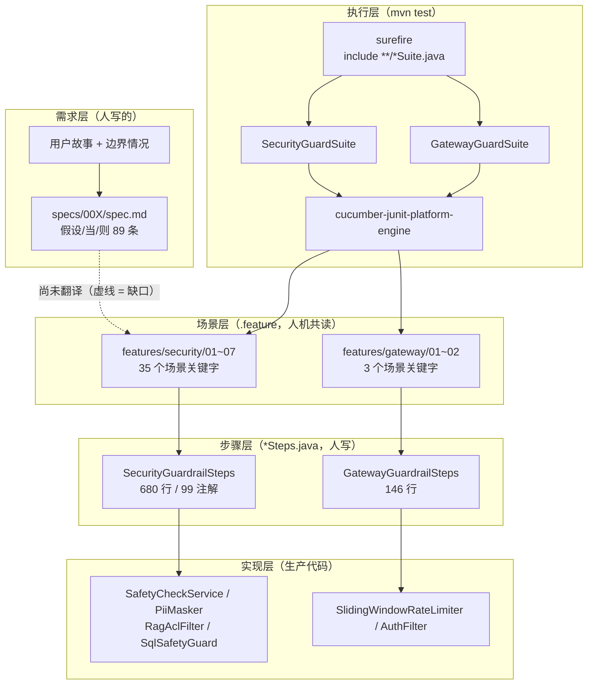
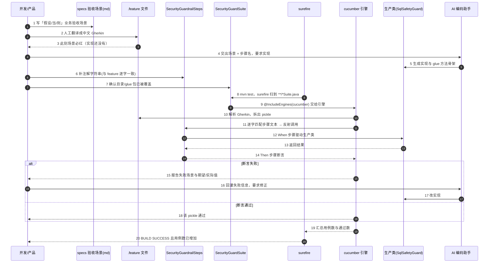

# BDD 行为驱动开发：先有判据，再要代码

> **一句话结论**：BDD（Behavior-Driven Development，行为驱动开发）真正稀缺的不是「又一个测试框架」，而是把需求翻译成**机器可判定的断言**这个动作——Given-When-Then 场景就是交给 AI 之前必须先写好的验收契约。本项目实测 9 个 `.feature` / 38 个场景关键字（41 个可执行用例）/ 99 个步骤定义，全部集中在「AI 安全护栏 + 网关」，而 `specs/` 里 89 条业务验收场景一条都还没翻成 `.feature`。
> **阅读前置**：会写 JUnit 5 测试，知道 `mvn test` 与 surefire 各管什么；读过 [08-测试/04-Cucumber-BDD行为驱动实战.md](../../08-测试/04-Cucumber-BDD行为驱动实战.md) 更好——本篇第 7 节会纠正它三处过期数字。
> **证据基线**：A 级 **0 处**（Cucumber / Gherkin 引擎源码未入库，本篇不引任何 `assets/source` 行号）；B 级 = 9 个 `.feature`、2 个 `*Steps.java`、2 个 `*Suite.java`、2 个 `pom.xml`、5 个 `specs/*/spec.md`、`learning-docs/08-测试/04-Cucumber-BDD行为驱动实战.md`；C 级 = 对真实文件跑静态统计（`node` / `Select-String`，不启动服务、不联网、不构建）。预计阅读 40 分钟。

**证据边界（先说清楚哪些查过、哪些查不到）**

| 级别 | 来源 | 覆盖什么 | 本篇的处理 |
|---|---|---|---|
| A | `learning-docs/24-源码分析/assets/source/` | Cucumber 引擎、Gherkin 解析器、JUnit Platform | **主题未入库** → 一律写「未入库，依据官方文档/本项目文档」，不编行号 |
| B | 本仓库真实文件 | 9 个 feature、2 个 Steps、2 个 Suite、2 个 pom、5 个 spec、1 篇旧测试文档 | 逐条给路径 + 行号，行号均已 `read` 核对 |
| C | 可复现静态统计 | feature/scenario/glue 计数、依赖版本、`cucumber-spring` 命中数 | 给完整命令 + 真实输出 + 「怎么读」 |

本机探测边界：`mvn` 未执行（任务禁止构建），因此**本篇没有任何「测试跑了多久、几个失败」的运行时数字**；场景数量一律来自对源文件的静态计数，口径写在每条命令下方。凡是本篇出现「应该是这样」的判断，都标注了依据或明确写「未验证」。

---

## 0. 先看现象

下面三段都是真实文件内容摘录（不是运行日志，也不是我编的输出），每段后面给链路解释。

### 现象一：BDD 场景写成了接口测试的复制

打开 `ai-cs-chat/src/test/resources/features/security/05_rag_acl.feature` L9-L16，你看到的是业务语言：

```gherkin
Scenario: 无权限文档不被召回
  Given 文档 "doc-secret" 仅对角色 INTERNAL 可见
  And 当前用户 userId=1 角色为 USER
  And 检索结果包含文档 "doc-secret" 和 "doc-public"
  When 执行 ACL 过滤
  Then 仅返回文档 "doc-public"
  And 回答不引用无权限文档
  And 审计记录 ACL 过滤事件
```

再看它背后的步骤定义（`ai-cs-chat/src/test/java/com/aics/chat/security/guardrail/SecurityGuardrailSteps.java` L150-L152）：

```java
public void checkInput() {
    safetyResult = safetyService.check(inputText);
}
```

问题在 `And 检索结果包含文档 "doc-secret" 和 "doc-public"` 这一行：它是**手工把输入数据的形状写死在场景里**，等于把「`List<Document>` 该长什么样」搬进了业务语言。场景本来该回答「用户能不能看到不该看的东西」，现在回答的是「我给过滤器喂了哪些对象、它吐回哪些对象」。这就是「场景写成接口测试的复制」的第一个形态——**Given 里塞夹具（fixture），Then 里塞返回值结构**。

它的极端形态出现在 `specs/`：5 个 spec 里共有 **89 条**用「假设/当/则」写的业务验收场景（C 级计数口径见 §6.6），但 `.feature` 文件里的 41 个可执行用例（口径见 §6.5）**没有一条**来自这 89 条。于是仓库里长期并行两套话术：一套给人和 AI 看（markdown），一套给机器跑（gherkin），彼此不校验。

### 现象二：步骤定义膨胀到没人维护

同一批文件里数出来的比值（C 级，口径见 §6.5）：

| 指标 | 实测值 | 怎么算出来的 |
|---|---|---|
| glue 注解总数 | 99 | 两个 `*Steps.java` 里 `@Given/@When/@Then/@And` 注解字符串计数 |
| 可执行用例（pickle） | 41 | `Scenario:` 37 + Scenario Outline 的 Examples 数据行 4 |
| 步骤定义/用例 | **2.4** | 99 ÷ 41 |
| `SecurityGuardrailSteps.java` | 680 行 / 35 场景 ≈ **19.4 行/场景** | 文件行数 ÷ chat 模块场景数 |
| `GatewayGuardrailSteps.java` | 146 行 / 3 场景 ≈ **48.7 行/场景** | 文件行数 ÷ gateway 模块场景数 |

48.7 行/场景意味着：改一句业务话术，要同时动 `.feature` 的步骤文本、glue 的注解字符串、glue 的方法体三处，而这三处分散在三个不同目录、由不同人负责。当「改一句话要动三处」成立时，团队的自然反应不是重构，而是**不再改场景**——于是 `.feature` 从活文档退化成化石。

### 现象三：场景全绿，线上还是出问题

`ai-cs-gateway/src/test/java/com/aics/gateway/guardrail/GatewayGuardrailSteps.java` L67-L71 是全篇最值得逐字读的一段：

```java
@And("返回 429 提示且不转发下游")
public void assert429NotForwarded() {
    // 限流器拒绝即过滤器返回 429 且不调用下游（映射逻辑由 RateLimitFilterTest 覆盖）
    assertEquals(true, limited);
}
```

它对应的场景是 `ai-cs-gateway/src/test/resources/features/gateway/01_rate_limit.feature` L11 的 `And 返回 429 提示且不转发下游`。这句步骤名承诺了三件事：**① 返回 429；② 有提示体；③ 不转发下游**。而方法体只断言了 `limited == true`，也就是「限流器说不让过」。注释诚实地承认了这件事——「映射逻辑由 RateLimitFilterTest 覆盖」。

于是出现典型的三重错位：场景名比断言宽，断言比需求窄，需求被另一份测试悄悄兜着。等哪天 `RateLimitFilterTest` 被删、被 `@Disabled`、或者有人只信「BDD 全绿」就放行，这条链路就出现了**绿灯下的真空**。这不是假设出来的风险，注释本身就写在代码里。

> 这些现象指向同一件事：**场景被当成了「测试代码的中文注释」，而不是「需求的机器可判定形式」**。一旦场景不再约束实现、只复述实现，它就既不能指导 AI 写代码，也不能在线上出事前拦住人。

---

## 1. 整体地图



> **读图说明**：看两条箭头。第一条是实线 `F1 --> G1`——`.feature` 里的步骤文本会被**逐字**拿去和 `@Given("...")` 的字符串比对，对不上就是 `undefined`，这条边是本篇所有坑的来源。第二条是虚线 `SPEC -.-> F1`：虚线代表**当前不存在**，`specs/` 里 89 条验收场景没有任何一条落进 `.feature`，这是本项目 BDD 最大的落地缺口。如果你把 `SF --> S1` 看错成「`.feature` 放进去就会自动跑」，就会得出完全错误的结论——真正让场景跑起来的是 `*Suite.java` 这个空类 + surefire 的 include 配置，少任何一个，41 个用例一个都不会执行，而 `mvn test` 依然显示 BUILD SUCCESS。

### 组件、责任与参与方

| 组件 | 责任 | 本项目实现（B 级证据） | 谁写 |
|---|---|---|---|
| 需求验收场景 | 说清「什么算做完了」 | `specs/005-after-sales-agent/spec.md` L18-L23 等，共 89 条 | 人（产品/开发） |
| Feature 文件 | 把验收场景写成 Gherkin 四要素 | `ai-cs-chat/src/test/resources/features/security/*.feature`（7 个）、`ai-cs-gateway/src/test/resources/features/gateway/*.feature`（2 个） | 人，AI 可起草 |
| 步骤定义（glue） | 把中文步骤绑到 Java 方法 | `SecurityGuardrailSteps.java`（680 行，L76-L89 有 `@ParameterType`）、`GatewayGuardrailSteps.java`（146 行） | 人 |
| Suite | 告诉 JUnit Platform「哪个目录的 feature、哪个包的 glue」 | `SecurityGuardSuite.java` L14-L19、`GatewayGuardSuite.java` L12-L17 | 人 |
| 执行引擎 | 解析 Gherkin、匹配 glue、生成用例树 | `cucumber-junit-platform-engine` 8.1.0（`ai-cs-chat/pom.xml` L193-L198） | 依赖引入即可 |
| 测试调度 | 找出并运行 Suite | surefire + `<include>**/*Suite.java</include>`（`ai-cs-chat/pom.xml` L249-L262） | 一次性配置 |
| 被测实现 | 真正的生产类 | `SecurityAuditRecorder`、`PiiMasker`、`SlidingWindowRateLimiter`、`AuthFilter` 等 | 人 + AI |

---

## 2. 关键概念与关键要素

先说明：Cucumber / Gherkin 的引擎源码**未入库**（`learning-docs/24-源码分析/assets/source/` 下没有对应摘录），所以下表「位置」列凡是标 A 级的地方一律写「未入库」，其余全部是本仓库真实路径。

| 名称 | 位置 | 角色 | 关键点 |
|---|---|---|---|
| BDD | 未入库（官方文档：Cucumber 官网 / Dan North 原文） | 方法论：用「行为」而非「实现」描述需求 | 产出物是**可执行的规格**，不是文档 |
| Gherkin | 未入库（官方文档：Cucumber Gherkin Reference） | 场景专用的 DSL（领域特定语言） | 关键字有本地化版本，本项目用**中文**：`Feature/背景/场景/假设/当/则/并且` |
| Feature | B 级：`ai-cs-chat/src/test/resources/features/security/03_pii_masking.feature` L1-L4 | 一个能力域，含「作为/我想要/以便」三段 | 三段是可读性投资，不影响执行 |
| Scenario | 同上 L9-L12 | 一个可独立执行的行为样例 | 用例的**原子单位**，一场景一行为 |
| Given（假设） | 同上 L10 | 前置状态，不含被验证的动作 | 写状态，不写动作；本项目多用 `当前用户 userId=1` 这类状态 |
| When（当） | 同上 L11 | **唯一**那个会改变状态的动作 | 一个 When 只放一个动作，这是最常被违反的规则 |
| Then（则） | 同上 L12 | 可观测结果，写「看得见什么」 | 不写「调了哪个方法、抛了哪种异常」 |
| And / But | 同上 L13 | 延续上一个关键字的语义 | `And` 跟在 `When` 后仍算 When 的一部分 |
| Background（背景） | 同上 L6-L7 | 该 feature 内所有场景共享的 Given | 只该放**状态**，不该放动作 |
| Scenario Outline + Examples | B 级：`06_sql_safety.feature` L39-L49 | 参数化场景：一份模板 + 数据表 | 4 行数据 = 4 个可执行用例（pickle） |
| 标签（tag） | 本项目 **0 处使用**（C 级：对 9 个 `.feature` 检索 `^@`，无匹配） | 给场景分类以便选择性运行 | 缺失意味着无法按 `@smoke` 之类的粒度跑子集 |
| 步骤定义 / glue | B 级：`SecurityGuardrailSteps.java` | 步骤文本 → Java 方法的绑定层 | 注解字符串必须与 feature **逐字**一致 |
| `@ParameterType` | B 级：`SecurityGuardrailSteps.java` L76-L89 | 自定义参数类型（`{list}` → `List<String>`） | 正则 `\[[^\]]*\]|\S+` 同时吃 `["a","b"]` 和裸词 |
| pickle（泡菜） | 未入库（官方文档 + Cucumber 内部术语） | Gherkin 场景实例化后的可执行单元 | Outline 展开后一个 pickle 对应一次执行 |
| Suite | B 级：`SecurityGuardSuite.java` L14-L19 | JUnit Platform 套件入口 | 空类 + 4 个注解，是「让场景被跑」的开关 |
| `mvn test` 集成 | B 级：`ai-cs-chat/pom.xml` L249-L262 | surefire 发现并运行 Suite | include 里必须有 `**/*Suite.java` |
| TDD | B 级：`CLAUDE.md`「TDD 开发规范」段 | 单元层的红-绿-重构纪律 | 与 BDD 是**上下层**关系，不是替代关系 |

---

## 3. 原理与证据逐段精读

### 3.1 BDD 的三层语言，以及每层各自负责什么

**在干什么**：BDD 把一句话需求拆成三层，每层用一种「母语」：

| 层 | 语言 | 谁读 | 本项目实例 |
|---|---|---|---|
| 业务场景层 | 中文 Gherkin（`.feature`） | 产品 / 测试 / AI | `Given 文档 "doc-secret" 仅对角色 INTERNAL 可见` |
| 步骤定义层 | Java + 注解字符串（glue） | 开发 | `@Given("文档 {string} 仅对角色 {word} 可见")` |
| 实现层 | 生产代码 | 开发 | `RagAclFilter` / `SqlSafetyGuard` |

关键是**箭头方向不能反过来**：业务场景描述「外部看得见的行为」，步骤定义把这句话翻译成「对生产对象的调用」，实现层才是被验证的东西。`05_rag_acl.feature` L1-L4 的三段式（作为系统 / 我想要 / 以便）正是这一层的可读性声明。

**为什么这么设计**：因为「谁来改需求」和「谁来改实现」往往是两个人。三层语言的价值在于：业务话术变化时只动第一层，被测对象换名时只动第二层，算法变化时只动第三层。这是**变更爆炸半径的控制**，不是审美。

**换写法会怎样**：如果省掉第一层，直接写 JUnit 测试方法名当代替，你就回到了普通单元测试——可读性尚可，但产品经理无法参与评审，AI 也无法从「测试方法名」里稳定推出需求边界。如果省掉第二层（跳过 glue，直接让 `.feature` 里写类名方法名），你就得到现象一：场景退化成接口测试的复制品。

**常见坑**：把三层压成两层，也就是**在 `.feature` 里写技术名词**。判定方法很简单：把 `.feature` 拿给不做开发的人看，如果他要问「`SafetyCheckResult` 是什么」，说明已经漏了。

### 3.2 为什么 BDD 天然适合对接 AI

**在干什么**：把「先写场景、再让 AI 实现」这条路，和「直接让 AI 写代码、人再 review」对比，会发现差别不在生成质量，而在**判据出现的时刻**。

| 维度 | 没有场景时 | 有场景时 |
|---|---|---|
| 判据来自哪里 | 人脑，事后 review 时现编 | 文件里的 41 个 pickle，可执行 |
| AI 能否自己判断做完了 | 不能，必须等人说「可以了」 | 能，跑一遍就知道哪条不过 |
| 返工的验收标准 | 模糊（「感觉不对」） | 明确（`Then 结果为 "138****5678"` 不过） |
| 需求漂移 | AI 每轮自由发挥 | 场景不变则行为不变 |
| 上下文用量 | 越长越贵 | 场景就是压缩后的需求摘要 |

`03_pii_masking.feature` L9-L12 是极端好例子：`Then 结果为 "138****5678"` —— 这是一个**字符级**的可判定断言，AI 不会理解错，人也不会争论。这类场景写满 20 条，等于给 AI 一份「输入 → 精确输出」的对照表；而如果只写「实现手机号脱敏」，AI 有一百种合理实现，你有一百零一种不满。

**为什么这么设计**：自然语言 → 可执行断言这一步，恰好是 LLM 最擅长又最不可靠的边界。说它擅长，是因为它天然会写散文；说它不可靠，是因为散文无法验证。BDD 提供了一个**约束格式**：你必须把「想要」写成「当 X 发生，则观察到 Y」。这个格式逼着需求方说出可观测的结果，而这正是 AI 需要的全部信息。

**换写法会怎样**：换成纯 prompt 驱动（用户提需求 → AI 改代码 → 人肉验证），验证成本会随代码量线性上涨，很快就没人验证了。换成纯 TDD（先写 JUnit 测试）也有一条路，但测试方法名不是业务语言，产品经理依然读不懂、也就依然不参与评审，而**评审才是需求阶段的最后一道闸门**。

**常见坑**：误以为「让 AI 生成 `.feature`」就是 BDD。生成的场景如果没有业务方确认，那只是 AI 的自问自答——它写什么都会写得像那么回事，判据的权威性来自「人认可过这份判据」，不来自文本流畅度。

### 3.3 Given-When-Then 的写法规范

**在干什么**：用四条硬规则把场景写成「可判定的」。

| 规则 | 正确示例（本项目真实场景） | 违反后果 |
|---|---|---|
| Given 只写状态，不写动作 | `Given 当前用户 userId=1`（`02_tool_authorization.feature` L10） | 场景开始就产生副作用，失败原因不可定位 |
| When 只写**一个**动作 | `When 执行 PII 脱敏`（`03_pii_masking.feature` L11） | 失败时不知道是哪个动作坏的 |
| Then 只写可观测结果 | `Then 结果为 "138****5678"`（同文件 L12） | 断言无法判断对错 |
| 一个场景一个行为 | `04_content_safety.feature` L9-L13 只验证「违规输入被拒答」 | 场景名承诺 N 件事，断言只证 1 件（见现象三） |

**为什么这么设计**：场景是**最小可复现单元**。一个 Given 一个 When 一份 Then，等价于「一次对照实验」：控制变量（Given）、施加干预（When）、测量结果（Then）。多条 When 就变成多因素实验，失败时无法归因。

**换写法会怎样**：允许 Given 里写动作，就会出现「场景一跑就改数据，重跑结果不同」的不稳定；允许 Then 写实现细节，就会出现「实现改了、行为没变、场景却红了」的假失败。两种都会快速消耗团队对 BDD 的信任。

**常见坑**：把「准备数据」当成 When。本项目真实存在这个毛病——`01_rate_limit.feature` L8-L9：

```gherkin
When 同一用户已发起 60 次请求
And 该用户再次发起第 61 次请求
```

`已发起 60 次请求` 是**状态准备**，理应写成 `Given 用户已发起 60 次请求`；`再次发起第 61 次` 才是那个 When。现在两个动作都挂在 When 下面，靠 `And` 蒙混过去：读的人分不清哪句是被测行为、哪句是铺垫，一旦这条场景红了，先要花时间判断是铺垫写错了还是逻辑写错了。

### 3.4 三类最常见的错法（都能在本仓库找到实例）

**在干什么**：把错法分型，方便自查。

**错法一：When 里塞多个动作**（见上节 `01_rate_limit.feature` L8-L9）。它的变体是「When 里塞断言」，例如 `When 用户提交订单并看到成功提示` —— 看到提示是 Then 的事。

**错法二：Then 里写实现细节**。判据是「这句话里有没有出现类名、方法名、异常类型、返回值类型」。`05_rag_acl.feature` L12 的 `And 检索结果包含文档 "doc-secret" 和 "doc-public"` 已经接近红线：它描述的是过滤器内部的数据形状，而不是用户可感知的结果。更彻底的坏例子是把 `Then 断言 list.size()==1` 写进场景。

**错法三：Then 语义过载，一个步骤服务多个被测对象**。`SecurityGuardrailSteps.java` L154-L163 是教科书级案例：

```java
@Then("返回拦截结果")
public void assertBlocked() {
    if (safetyResult != null) {
        assertFalse(safetyResult.passed(), "应拦截: " + inputText);
    } else if (contentResult != null) {
        assertFalse(contentResult.passed(), "应拦截: " + inputText);
    } else {
        fail("应先执行检查");
    }
}
```

一个 `Then 返回拦截结果` 同时服务「输入安全服务」和「内容审核服务」两个被测对象。分支逻辑进了步骤定义，意味着**场景本身已经说不清自己在验证谁**；同时断言被稀释成「反正有一个没过」，具体是哪个服务、因为什么规则拦的，全落到下一行 `And 拦截分类为 "ILLEGAL"` 去补。

**为什么这么设计**（即为什么这三种错法特别容易发生）：因为写 glue 的人通常刚写完被测类，脑子里全是方法签名；而改 feature 的人通常只想让测试变绿。两边都走「最短路径」，最短路径一定通向耦合。

**换写法会怎样**：把 `返回拦截结果` 拆成 `Then 输入安全服务拦截该请求` 与 `Then 内容审核服务拦截该输出`，两个方法各自三行、各自只认一个对象——代价是注解多一个，收益是失败信息立刻指向具体组件。

**常见坑**：以为「步骤定义里有 if/else 只是代码风格问题」。不是。它意味着**场景的判定权被搬进了 Java 代码**，`.feature` 从此只是装饰。

### 3.5 Feature 文件组织与标签

**在干什么**：决定「哪些场景放一个文件、怎么分组、怎么按需跑子集」。

本项目的实际组织（C 级清单，命令见 §6.5）：

```text
ai-cs-chat/src/test/resources/features/security/
  01_prompt_injection.feature     47 行  7 场景
  02_tool_authorization.feature   34 行  4 场景
  03_pii_masking.feature          39 行  6 场景
  04_content_safety.feature       38 行  5 场景
  05_rag_acl.feature              32 行  3 场景
  06_sql_safety.feature           55 行  7 场景（含 1 个 Outline）
  07_audit_trail.feature          27 行  3 场景
ai-cs-gateway/src/test/resources/features/gateway/
  01_rate_limit.feature           17 行  2 场景
  02_trusted_identity.feature     11 行  1 场景
```

组织原则从这份清单里能反推出来：**按安全威胁分文件，不按 Controller 分**。`01_prompt_injection`、`02_tool_authorization`、`05_rag_acl` 都是「一类越权/攻击面」，一个文件讲透一类；同样的道理，网关的两个文件按「限流」「可信身份」分，而不是按 `AuthFilterTest` 这种类名分。这是对的，因为需求是按威胁演进的，不是按类名演进的。

**标签（tag）在本项目是 0**。C 级：对 9 个 `.feature` 检索以 `@` 开头的行，无匹配。后果很具体——你想只跑 `01_prompt_injection` 的 7 个场景，只能靠改 `@SelectClasspathResource` 或者临时改文件名，没有 `@smoke` / `@p0` 这种粒度。修复成本极低：在 `Scenario:` 上一行加 `@smoke`，运行时用 `cucumber.filter.tags` 参数过滤。

**为什么这么设计**：`Background` 的存在（本项目 7 个 chat feature **全部**有 Background，如 `03_pii_masking.feature` L6-L7 的 `Given PII 脱敏工具已就绪`；gateway 的 2 个 feature 都没有）说明作者意识到「每个场景都重复写同一句准备」是浪费，于是抽到文件级。这是 feature 内去重；标签是 feature **之间**去重的分类机制，两者互补而非替代。

**换写法会怎样**：如果按 Controller 组织（一个 Controller 一个 feature），场景数量会跟着接口数量涨，而接口是纯粹的实现细节——接口一重构，20 个 feature 全要改。按行为组织则不会，因为行为是稳定的。

**常见坑**：把 `Background` 当 `@Before` 用，在里面写「创建用户并登录、初始化数据库、清空缓存」三连。Background 每场景都会重跑一遍，塞得越多单场景越慢，而且它只该放状态。

### 3.6 步骤定义的复用与参数化

**在干什么**：让 99 个注解不被复制成 990 个。

Cucumber 的复用机制其实只有一条：**注解里的字符串是一个正则模板**，参数占位符决定了一个步骤能匹配多少种具体写法。

| 占位符 | 匹配什么 | 本项目用例 |
|---|---|---|
| `{string}` | 双引号包裹的字符串 | `@Given("模型生成的 SQL 为 {string}")` |
| `{int}` / `{long}` | 整数 | `@Given("当前用户 userId={long}")` |
| `{word}` | 无空格单词 | `@Given("当前用户 userId={long} 角色为 {word}")` |
| `{list}` | 自定义类型，需 `@ParameterType` | `SecurityGuardrailSteps.java` L76-L89 定义 `list(...)` |

`@ParameterType` 那段的真实代码值得看清楚，因为它解释了「为什么这个项目能写出 `["orders"]` 这种参数」：

```java
@ParameterType("\\[[^\\]]*\\]|\\S+")
public List<String> list(String value) {
    ...
}
```

正则的左右两支分别吃「带方括号的列表字面量」和「裸词」，于是 `06_sql_safety.feature` L26 的 `Given 库 "order" 的表白名单为 ["orders"]` 能被解析成一个 `List<String>`。

**为什么这么设计**：参数化是**唯一能同时降低场景数和 glue 数**的机制。`06_sql_safety.feature` L39-L49 的 Outline 把 4 种危险 SQL（注释绕过、`SLEEP(10)`、`INTO OUTFILE`、堆叠 `DROP TABLE`）压成一个场景模板 + 4 行数据；如果不用 Outline，就是 4 个场景、4 份重复的 Given/When/Then 文本。41 个 pickle 里，4 个来自这唯一一个 Outline。

**换写法会怎样**：不参数化而复制粘贴，`.feature` 会迅速膨胀成 400 行，且任何一处业务话术调整都要 4 处同步。反过来，过度参数化（把所有东西塞进 Examples）会让场景失去可读性——读的人看不到具体例子，只看到一堆 `<placeholder>`。

**常见坑**：Cucumber 的步骤匹配是**全局**的——所有 glue 里的所有注解共用一个匹配空间，不是「先按 feature 分组再匹配」。本项目实测 `歧义步骤行 = 0`（口径见 §6.5），说明 99 个注解之间没有互相抢活；但一旦有人加了 `@Given("文档 {string} 仅对角色 {word} 可见")` 和 `@Given("文档 {word} 仅对角色 {word} 可见")` 两条，`doc-secret` 这种既像 string 又像 word 的步骤就会**歧义**，Cucumber 会直接报错而不是随便挑一个。这就是为什么 `@ParameterType` 的正则要写得足够特异。

### 3.7 Cucumber 的执行模型：Suite + 引擎 + surefire

**在干什么**：把「`.feature` 文件」变成「`mvn test` 会跑的用例」。中间有三道门，缺一不可。

`SecurityGuardSuite.java`（全文只有 20 行，L14-L19 是全部实质内容）：

```java
@Suite
@IncludeEngines("cucumber")
@SelectClasspathResource("features/security")
@ConfigurationParameter(key = Constants.GLUE_PROPERTY_NAME, value = "com.aics.chat.security.guardrail")
@ConfigurationParameter(key = Constants.PLUGIN_PROPERTY_NAME, value = "pretty")
public class SecurityGuardSuite {
}
```

四行注解各管一件事：`@Suite` 声明这是 JUnit Platform 套件；`@IncludeEngines("cucumber")` 说「只用 cucumber 引擎，不要用 JUnit Jupiter」；`@SelectClasspathResource("features/security")` 指出 feature 在 classpath 下的目录（注意：是 `src/test/resources` 相对路径，不是文件系统路径）；`GLUE_PROPERTY_NAME` 指出 glue 包名，`PLUGIN_PROPERTY_NAME = "pretty"` 决定控制台输出格式。`ai-cs-gateway/src/test/java/com/aics/gateway/guardrail/GatewayGuardSuite.java` L12-L17 是同构写法，只换了目录和包名。

然后 surefire 必须能找到这个 Suite（`ai-cs-chat/pom.xml` L249-L262）：

```xml
<!-- 3.2 BDD：surefire 同时发现 JUnit5 测试与 Cucumber Suite（*Suite.java） -->
<plugin>
    <groupId>org.apache.maven.plugins</groupId>
    <artifactId>maven-surefire-plugin</artifactId>
    <configuration>
        <includes>
            <include>**/*Test.java</include>
            <include>**/*Tests.java</include>
            <include>**/*TestCase.java</include>
            <include>**/Test*.java</include>
            <include>**/*Suite.java</include>
        </includes>
    </configuration>
</plugin>
```

**为什么这么设计**：Cucumber 5 之后，Cucumber 不再自己提供 `RunCucumber` 入口，而是作为 **JUnit Platform 引擎**存在。这带来一个隐式约定：引擎要生效，必须有东西触发 JUnit Platform，而 surefire 的默认扫描规则是 `**/Test*.java`、`**/*Test.java`、`**/*Tests.java`、`**/*TestCase.java`——`SecurityGuardSuite` 一个都不匹配。所以 `**/*Suite.java` 这一行是**必需项**，不是可选项。

**换写法会怎样**：不写 `**/*Suite.java`，`mvn test` 依然 BUILD SUCCESS，但 41 个用例一个都没跑。这是 BDD 落地里最危险的一种失败：**静默跳过**。相比之下，跑挂反而是好事。

**常见坑**：误以为 `@SelectClasspathResource` 里的路径是相对磁盘的。它相对的是 **classpath 根**，也就是 `target/test-classes`。所以 `src/test/resources/features/security` 对应的值是 `features/security`，多写一层 `src/test/resources` 就找不到文件。

### 3.8 Cucumber + Spring Boot 的两种集成方式

**在干什么**：决定步骤定义里的被测对象从哪来——`new` 出来，还是从 Spring 容器里注入。

| 方式 | 依赖 | 步骤里怎么写 | 启动成本 | 隔离性 |
|---|---|---|---|---|
| 对象级（本项目选的路） | 只需 `cucumber-java` | `new PiiMasker()`、`mock(SecurityEventFeignClient.class)` | 毫秒 | 高，无外部依赖 |
| 容器级 | 额外 `cucumber-spring` + `@CucumberContextConfiguration` | `@Autowired SafetyCheckService` | 秒级，需 ApplicationContext | 低，需处理上下文缓存与脏数据 |

判定本项目走的是哪条路，不需要读代码，一条 grep 就够（C 级）：

```powershell
Get-ChildItem -Recurse -Include *.java,*.xml,*.md |
  Where-Object { $_.FullName -notmatch '\\target\\|node_modules' } |
  Select-String -Pattern 'cucumber-spring|CucumberContextConfiguration' -List
# 输出：(空)  → 命中 0 个文件
```

所以本项目是**对象级 BDD**：`SecurityGuardrailSteps.java` L123-L126 里 `new SecurityAuditRecorder(mock(SecurityEventFeignClient.class), props, new PiiMasker())` 就是证据——被测对象手工组装，协作方用 Mockito 打桩，Spring 容器完全没启动。

**为什么这么设计**：这是很清醒的取舍。这些场景验证的是「安全规则本身」（手机号是否脱敏、SQL 是否只允许 SELECT、租户是否隔离），规则是纯逻辑，不需要数据库、不需要 Nacos、不需要 Feign 真的通。用容器级集成只会把启动时间从毫秒拉到秒级，并引入「测试环境配置」这一类与主题无关的脆弱点。

**换写法会怎样**：改成容器级，就要处理 `@SpringBootTest` 的上下文缓存、`application-test.yml` 的配置齐全、以及 Feign 客户端在无注册中心时的报错。也就是说，BDD 场景会从「验证业务规则」变成「顺便验证整套基础设施装配」。

**常见坑**：把对象级 BDD 当成「集成测试不做了」。这两件事不冲突——容器级该由 `@SpringBootTest` 集成测试承担（本项目 `CLAUDE.md` 的测试分层表里「集成测试 | H2 + Embedded Redis」就是这一层）。BDD 场景落在哪一层是**选择**，不是能力缺失；但要写清选了哪层，否则读者会误以为这些场景验证了从 HTTP 到数据库的全链路。

### 3.9 BDD 与 TDD 的分工

**在干什么**：把两层纪律分开——外层回答「做对了事吗」，内层回答「把事做对了吗」。

| 维度 | BDD（外层验收） | TDD（内层单元） |
|---|---|---|
| 粒度 | 一个业务行为 | 一个类/方法的分支 |
| 语言 | 中文 Gherkin，产品能读 | Java 测试方法名，开发才能读 |
| 本项目位置 | `features/security/*.feature` + glue | `src/test/java/**/*Test.java`（如 `RateLimitFilterTest`） |
| 数量 | 41 个 pickle | 远多于 41（未逐个数，未验证） |
| 何时红 | 需求没实现 | 某个分支没写对 |
| 强制程度 | 项目里属「3.2 安全网关」专题的自选动作 | **强制**（`CLAUDE.md`：宪法第 2-1 条，Red→Green→Refactor） |

两者在本项目的真实分工可以在 `GatewayGuardrailSteps.java` L67-L71 的注释里看到影子：「映射逻辑由 `RateLimitFilterTest` 覆盖」——BDD 场景验证限流器「拒了」，单元测试验证「拒了之后 429 怎么拼出来」。**分工本身是对的，问题是没有写进场景名**（见现象三）。

`CLAUDE.md` 的「TDD 开发规范」段把内层纪律写得很硬：`mvn -pl ai-cs-order test -Dtest=XxxServiceTest` → `mvn -pl ai-cs-order verify`，JaCoCo 行覆盖 ≥40%、分支 ≥30%，不达标构建失败，还有一条提交纪律「测试代码必须先于（或同次于）实现代码提交，禁止后补测试冒充 TDD」。BDD 场景则没有对应的门禁——这就是为什么 89 条 spec 验收场景至今停在 markdown 里。

**为什么这么设计**：两层的**失败代价不同**。单元测试红了，5 秒内能定位到方法；BDD 红了，要先判断是需求理解错了、还是 glue 写错了、还是实现错了。所以内层必须密、外层必须精——外层一旦比内层还密，维护成本会反超收益（见 3.10）。

**换写法会怎样**：用 BDD 覆盖一切，等于用最贵的机制做最细的活，结果是没人愿意改场景；只用 TDD 不用 BDD，则需求的「验收标准」永远停留在人的脑子里，AI 拿不到判据。

**常见坑**：把 BDD 场景当「超级单元测试」用，一个场景只断言一个 getter。这类场景在评审时过不了「产品经理能读懂并认可」这一关，也就不该存在于 `.feature` 里。

### 3.10 场景数量与维护成本的平衡

**在干什么**：算一笔账——每多一条场景，长期成本是多少。

用本项目的真实数字反推（C 级口径见 §6.5）：

| 指标 | 数值 | 含义 |
|---|---|---|
| glue 注解 | 99 | 每加一条场景至少新增 1 个注解（除非复用） |
| 可执行用例 | 41 | 场景数（展开后） |
| 注解/用例 | 2.4 | 复用没做到 1:1，说明有相当多一次性步骤 |
| 跨 feature 复用注解 | 9 | 只有 9 个注解被 2 个以上 feature 用到，且**没有一个超过 2 个 feature** |
| `SecurityGuardrailSteps.java` | 680 行 | 680 ÷ 99 ≈ 6.9 行/注解（注解总数为两个 glue 文件合计） |
| `GatewayGuardrailSteps.java` | 146 行 / 3 场景 | 48.7 行/场景，复用几乎为零 |

那个「复用注解没有一个超过 2 个 feature」的数字最值得琢磨：它说明这套 glue 的复用是**偶然的**（两个 feature 恰好都要 `Given SQL 安全守卫已就绪`），不是设计的。真正被设计复用的步骤会出现在很多 feature 里。

由此得到一条经验判据：

> **一条场景的长期成本 ≈ 一次编写 + 每次需求变化时三处同步（feature 文本 / 注解字符串 / 方法体）。因此场景应当按「业务规则」而非「输入组合」增长；输入组合交给 Scenario Outline，业务规则才配一个独立场景。**

按这条判据看本项目：`03_pii_masking.feature` 的 6 个场景（手机号 / 身份证 / 银行卡 / 非银行卡不误伤 / 邮箱与地址 / 轨迹不落明文）里，前三个其实是**同一个规则的三组数据**，严格说可以压成一个 Outline + 3 行 Examples。压完场景数从 6 → 4，glue 不变，而可读性几乎不损失（因为每组数据本身就是最好的说明）。而「非银行卡不误伤」这种**反向用例**必须留着，它验证的是规则边界，不是数据组合。

**为什么这么设计**：BDD 的成本结构是「前期贵、变更便宜、腐坏后极贵」。它只在场景**被持续阅读**时才划算。所以控制的不是场景总数，而是**没人读的场景数**。

**换写法会怎样**：为了覆盖率数字而堆场景，会得到一批只跑不读的 feature，此时 BDD 的净收益为负——因为它比普通测试多付了「翻译成中文」这一层成本，却没收到「业务方参与评审」的回报。

**常见坑**：把「每个接口一个场景」当规范。接口是实现的投影，接口变了场景就该变——这种场景从写下第一天起就在腐坏。

### 3.11 把场景当作 AI 的验收契约

**在干什么**：把 BDD 嵌进 AI 编码的循环，得到一个**可自证完成**的闭环：

```text
① 人写场景（或人审核 AI 起草的场景）→ 判据固化
② 场景此刻必然红（实现还不存在）→ 先证明「判据是有效的」
③ 交给 AI 实现
④ 跑场景：不过 → 把失败信息回灌给 AI，回到 ③
⑤ 过 → 交付，且判据留在仓库里
```

第 ② 步是最容易被跳过、也最不能跳过的一步。**如果场景写了但立刻是绿的，说明它没在验证任何东西**——`GatewayGuardrailSteps.java` L67-L71 就是这种绿：断言 `limited == true` 在限流器写出来那天就已经为真，它从未红过，因此从未证明过任何事。

本项目有一个现成的对照证据：`SecurityGuardrailSteps.java` L226-L229 的 `@And("审计记录该越权尝试")` 断言的是 `TOOL_UNAUTHORIZED` 事件类型。这类断言**在实现缺失时必然失败**（拿不到审计记录），所以它具备契约性质。这就是「好 Then」和「坏 Then」的实操分界线：**好 Then 在实现未写时一定红，坏 Then 在实现未写时也可能绿**。

**为什么这么设计**：AI 编码的核心风险不是「写不出来」，而是「写出来了但不是你要的」，且你**没有低成本手段发现**。可执行场景把「发现成本」压到一次 `mvn test`。这也是为什么 BDD 特别适合 AI：它把「我觉得不对」翻译成「第 11 行第 3 个 pickle 失败，期望 `138****5678`，实得 `13812345678`」，后者 AI 能直接消费。

**换写法会怎样**：用「让 AI 自己写测试、自己写实现」替代，等于让被测方兼出题方；只要 AI 的测试和它的实现基于同一个错误理解，测试就会全绿，而错误被完整保留下来。BDD 场景的价值恰恰在于它是**外部输入**。

**常见坑**：把「AI 起草的场景」直接当契约。AI 起草很好，但必须有人签字——尤其要检查三件事：Then 是否可判定（有没有精确值）、Then 是否实现无关（有没有类名）、反向用例是否存在（只有正例的契约是半个契约）。

### 3.12 在本项目落地一个新 BDD 场景的最小闭环

**在干什么**：给一份可照做的清单，六个动作，都在本项目里被验证过。

1. 在 `.feature` 里加场景，用中文关键字，Given 写状态、When 写单个动作、Then 写精确可观测值（范式参考 `03_pii_masking.feature` L9-L12）。
2. 在对应 glue 包里加 `@Given/@When/@Then`，注解字符串与 feature **逐字**一致（`{string}` 等占位符除外）。
3. 步骤方法里只做「调用 + 断言」，不写 if/else 分支（反例见 3.4）。
4. 如果被测对象需要组装，采用 `new + mock`（参考 `SecurityGuardrailSteps.java` L123-L126），不要引入 Spring 上下文。
5. 确认 Suite 的 `@SelectClasspathResource` 覆盖到该目录、`GLUE_PROPERTY_NAME` 指向该包（`SecurityGuardSuite.java` L16-L17）。
6. 跑 `mvn test`，并**核对用例数是否增加**——这是识别「场景没被加载」的唯一可靠手段（见 3.7 的静默跳过）。

**为什么这么设计**：第 6 步是整条清单的兜底。BDD 的所有失败模式里，只有「跑挂」是安全的，其余（未加载、undefined、全绿但没断言）都是静默的。

**换写法会怎样**：跳过第 6 步、只看「BUILD SUCCESS」，就会在某个时刻发现「我们写了 41 个场景」，而实际上一个都没跑——并且这个发现往往发生在线上出事之后。

**常见坑**：把新 feature 放到 `src/test/resources/features/` 的**别的一级目录**（比如 `features/agent/`），却指望已有的 Suite 自动带上。`@SelectClasspathResource("features/security")` 只扫这一个子目录，新增目录必须配套新增 Suite 并在 surefire include 里能被发现（`**/*Suite.java` 已覆盖命名，所以只需新建类）。

---

## 4. 一次完整执行时序

以「给 `06_sql_safety.feature` 加一个新场景并让它跑起来」为例。



> **读图说明**：盯住三个位置。第 3 步（`FEAT-->>DEV`）是契约是否有效的分界——场景在此刻必须红，不红就是现象三。第 11 步（`ENG->>GLUE`）是全篇最脆弱的一环，它要求**逐字匹配**，中文标点、空格、引号全算数。第 20 步那句「用例数已增加」是唯一能区分「真跑了」和「静默跳过」的信号；如果只看 BUILD SUCCESS 而不看用例数，你会把第 8 步没找到 Suite 的情况误判为成功。

### 哪一步失败会怎样

| 失败步骤 | 现象 | 该看哪里 | 用户/团队感知 |
|---|---|---|---|
| 8 surefire 没扫到 Suite | `mvn test` 全绿但用例数不变 | surefire `<includes>` 是否有 `**/*Suite.java`；类名是否以 `Suite` 结尾 | 「我们写了 BDD」但线上零保护 |
| 9 引擎没生效 | 报告里出现 0 tests 或引擎名不对 | `@IncludeEngines("cucumber")` 拼写；`cucumber-junit-platform-engine` 是否在 test scope | 同上，且难排查 |
| 10 feature 路径错 | `No features found` 类错误 | `@SelectClasspathResource` 值是 classpath 相对路径，不是文件系统路径 | 场景集体消失 |
| 11 步骤文本对不上 | 报告里该步骤标 `undefined`，场景状态为 skipped | feature 文本 vs 注解字符串逐字比对（中文引号/空格最常错） | 场景长期 skipped，等于没有 |
| 11 glue 有歧义 | 运行时报「多个步骤定义匹配同一步骤」 | 两条注解正则都能吃同一段文本（如 `{string}` 与 `{word}` 重叠） | 构建直接红，属于好失败 |
| 12 生产类装配失败 | `NullPointerException` / `NoSuchBeanDefinition` 类错误 | 步骤里 `new` 的对象依赖是否都给了（mock 有没有漏） | 构建红，通常好定位 |
| 14 断言太宽 | 场景绿，但线上仍出问题 | 对照现象三：步骤名承诺了几件事、断言证了几件事 | **最危险的失败**，无任何提示 |
| 16 回灌失败信息后 AI 仍不过 | 反复红在同一断言 | 先确认断言本身对不对，再怀疑实现（判据可能写错了） | 需要人介入，否则会陷入死循环 |

---

## 5. 设计取舍

| 决策点 | 本项目选择 | 换来什么 | 付了什么代价 | 证据 |
|---|---|---|---|---|
| 语义层 vs 实现层的边界 | 场景全部用业务语言，不出现类名 | 产品能评审；AI 能当规格用 | Then 的表述容易写虚（`返回拦截结果`） | `04_content_safety.feature` L12；反例 `SecurityGuardrailSteps.java` L154-L163 |
| 容器级 vs 对象级 | 对象级（`new` + Mockito） | 毫秒级、无外部依赖、稳定 | 不覆盖 HTTP→DB 全链路 | C 级：`cucumber-spring` 命中 0 |
| 引擎接入方式 | JUnit Platform Suite + surefire include | 与 JUnit 5 测试同一条命令跑 | 少写一行 include 就静默失效 | `ai-cs-chat/pom.xml` L199-L203、L249-L262 |
| 场景组织维度 | 按安全威胁分文件，不按类 | 重构不影响场景 | 找「某接口的场景」变难 | `features/security/01~07` 命名 |
| 参数化程度 | 仅 `06_sql_safety` 用了一个 Outline（4 行数据） | 少 3 个重复场景 | 其余 feature 存在可压缩的重复（如 03 的前三个场景） | `06_sql_safety.feature` L39-L49 |
| 标签体系 | **未采用**（0 处 `@tag`） | 无 | 无法按优先级/模块跑子集 | C 级：检索 `^@` 无匹配 |
| 状态传递方式 | Steps 实例字段（`inputText`/`safetyResult`） | 写法直白 | 步骤间隐式耦合，顺序错了才报错 | `SecurityGuardrailSteps.java` L106-L116 |
| 清理机制 | 单个 `@After cleanup()` | 场景间隔离 | 字段多时容易漏清 | 同文件 L118-L121 |
| spec 验收场景的落地 | 仅 markdown，**未转 feature** | 成本低、评审快 | 89 条判据不可执行 | `specs/*/spec.md` vs 9 个 `.feature` |

**可扩展点清单**（按性价比排序，均为未落地项）：

1. **给场景打标签**：`@smoke` / `@p0` / `@security`，配合 `cucumber.filter.tags` 跑子集。改动量：9 个文件各加几行。
2. **把 `specs/001-cart-checkout` 的 14 条验收场景转成 `.feature`**：这是「契约可执行化」最有价值的一步——购物车是纯业务规则，对象级 BDD 完全够用。
3. **补齐 `And 返回 429 提示且不转发下游` 的真实断言**：至少断言状态码为 429、断言下游未被调用。
4. **拆 `Then 返回拦截结果`**：按被测对象拆成两条步骤，消除 glue 里的 if/else。
5. **给 `03_pii_masking` 前三个场景合并为 Outline**：场景数 6 → 4，glue 不变。
6. **加一条「反向用例」检查清单**：每个规则型 feature 至少一条「不该发生的事没发生」的场景（本项目已有好例：`03_pii_masking.feature` L24-L27「非银行卡数字串不误伤」）。
7. **补一个 `features/agent/` Suite 与对应 spec 场景**：让 `005-after-sales-agent` 的 29 条验收场景有可执行的落点。
8. **把「场景数」纳入 CI 断言**：用例数低于基线即失败，专门拦「静默跳过」。

---

## 6. 踩坑与调试手法

### 6.1 坑：步骤名承诺三件事，断言只证一件

`GatewayGuardrailSteps.java` L67-L71 已详述。这不是笔误，是**命名与断言的宽度不匹配**，而只有断言是可执行的，所以场景名成了空头支票。

**调试/自查手法（可操作）**：给每个 `@Then/@And` 方法数「断言个数」，和步骤名里的「并列成分个数（数逗号、`且`、`和`）」比。不相等的重点看。

```powershell
Select-String -Path ai-cs-gateway/src/test/java/com/aics/gateway/guardrail/GatewayGuardrailSteps.java -Pattern '@(Then|And)\("'
```

**怎么读**：输出里的每一条注解字符串，都是对「承诺」的原文记录；再对着它下面的方法体看有几个 `assert*`。`返回 429 提示且不转发下游` 有 3 个并列成分，方法体 1 个断言，比值 3:1，典型不合格。

### 6.2 坑：Then 里写 if/else，场景判定权被搬进 Java

`SecurityGuardrailSteps.java` L154-L163 的 `assertBlocked()` 用 `if (safetyResult != null) … else if (contentResult != null) …` 服务两个被测对象。

**调试/自查手法（可操作）**：在 glue 文件里搜控制流关键字，`@Then` 方法体内出现 `if`/`for`/`switch` 就要人工过一遍。

```powershell
Select-String -Path ai-cs-chat/src/test/java/com/aics/chat/security/guardrail/SecurityGuardrailSteps.java -Pattern 'if \(|else if|switch \(' -Context 0,0
```

**怎么读**：看命中行号落在哪个方法体里。如果落在 `@Then` 方法内，就是本节的问题；如果落在辅助方法（如 `eventsOfType`，L128-L130）里，通常无害。

### 6.3 坑：忘了 Suite 或 surefire include，场景静默不执行

`.feature` 放在 `src/test/resources` 但没配套 `*Suite.java`，或者 Suite 类名是 `SecurityGuardrailBdd.java`（不以 `Suite` 结尾），surefire 就不会发现它。`mvn test` 全绿，41 个用例 0 执行。

**调试/自查手法（可操作）**：只看「用例数是否随新增场景增加」这一个信号。

```powershell
# 1) 确认 Suite 类存在且命名匹配 **/*Suite.java
Get-ChildItem -Recurse -Path ai-cs-chat,ai-cs-gateway -Filter *Suite.java |
  Where-Object { $_.FullName -notmatch '\\target\\' } | Select-Object -ExpandProperty FullName
# 2) 确认 surefire include 覆盖它
Select-String -Path ai-cs-chat/pom.xml,ai-cs-gateway/pom.xml -Pattern '\*\*/\*Suite\.java'
```

**怎么读**：第 1 条应输出 `SecurityGuardSuite.java` 与 `GatewayGuardSuite.java` 两个文件；第 2 条应在两个 pom 各输出一行（`ai-cs-chat/pom.xml` L259、`ai-cs-gateway/pom.xml` L134）。任一条为空，场景就不会跑。

### 6.4 坑：步骤文本与注解字符串不逐字一致

中文场景里最容易错的三处：全角/半角引号、`=` 前后空格、`userId` 的大小写。`02_tool_authorization.feature` L14 的 `And 返回"不存在或不属于当前用户"而不是订单数据`，对应 glue 是 `@And("返回\"不存在或不属于当前用户\"而不是订单数据")` —— 注解里的 `\"` 是 Java 转义，实际值仍是 `"`，必须与 feature 里那个字符完全同一个编码。

**调试/自查手法（可操作）**：跑 §6.5 的探针脚本，看 `undefined步骤行` 是否为 0。本项目实测为 **0**，说明 9 个 feature 的 167 行步骤全部有对应 glue。

### 6.5 坑（工具）：场景数与 glue 数到底怎么数

这里给一份可直接复现的静态探针。**统计口径**：仓库内（排除 `target`、`node_modules`、`.git`）所有 `.feature` 文件；glue 只取 `guardrail` 包下的 `*Steps.java`；`.feature` 的步骤行按 `Given/When/Then/And/But/*` 开头的行计；`pickle 数 = Scenario + (Examples 表行 − Outline 个数)`，即减去每个 Examples 的表头行。

```javascript
// bdd-probe.cjs —— BDD 场景/步骤定义静态统计（只读，不启动任何服务）
const fs = require("fs"), path = require("path");
const walk = d => fs.readdirSync(d, { withFileTypes: true }).flatMap(e => {
  const q = path.join(d, e.name);
  if (e.isDirectory()) return /^(target|node_modules|\.git)$/.test(e.name) ? [] : walk(q);
  return [q];
});
const all = walk(".");
const feats = all.filter(f => f.endsWith(".feature"));
const glues = all.filter(f => /guardrail[\\/].*Steps\.java$/.test(f));

let sc = 0, ol = 0, row = 0, stepLines = 0, ex = false;
for (const f of feats) {
  ex = false;
  for (const l of fs.readFileSync(f, "utf8").split(/\r?\n/)) {
    if (/^\s*Scenario Outline:/.test(l)) { ol++; ex = false; }
    else if (/^\s*Scenario:/.test(l)) { sc++; ex = false; }
    else if (/^\s*Examples:/.test(l)) ex = true;
    else if (ex && /^\s*\|/.test(l)) row++;
    if (/^\s*(Given|When|Then|And|But|\*)\s+\S/.test(l)) stepLines++;
  }
}

const pats = [];
for (const g of glues) {
  const src = fs.readFileSync(g, "utf8");
  for (const m of src.matchAll(/@(Given|When|Then|And|But)\("((?:[^"\\]|\\.)*)"\)/g))
    pats.push({ file: path.basename(g), kw: m[1], text: m[2].replace(/\\(.)/g, "$1") });
}
const toRe = t => new RegExp("^" + t.split(/(\{string\}|\{int\}|\{long\}|\{word\}|\{list\})/g).map(x =>
  x === "{string}" ? '"([^"]*)"'
  : x === "{int}" || x === "{long}" ? "(-?\\d+)"
  : x === "{word}" ? "(\\S+)"
  : x === "{list}" ? "(\\[[^\\]]*\\]|\\S+)"
  : x.replace(/[.*+?^${}()|[\]\\]/g, "\\$&")).join("") + "$");
const rule = pats.map(p => ({ ...p, re: toRe(p.text) }));

let undef = 0, ambig = 0;
const used = new Set(), perfeat = {};
for (const f of feats) {
  const name = path.basename(f);
  for (const l of fs.readFileSync(f, "utf8").split(/\r?\n/)) {
    const m = l.match(/^\s*(?:Given|When|Then|And|But|\*)\s+(.+?)\s*$/);
    if (!m) continue;
    const hits = rule.map((r, i) => ({ r, i })).filter(x => x.r.re.test(m[1]));
    if (!hits.length) { undef++; continue; }
    used.add(hits[0].i);
    if (hits.length > 1) ambig++;
    const k = hits[0].r.file + "::" + hits[0].r.text;
    (perfeat[k] = perfeat[k] || new Set()).add(name);
  }
}
console.log("feature=" + feats.length + " Scenario=" + sc + " Outline=" + ol +
  " Examples表行=" + row + " 数据行=" + (row - ol) + " pickle=" + (sc + row - ol) + " 步骤行=" + stepLines);
console.log("glue文件=" + glues.map(g => path.basename(g)).join(","));
console.log("glue注解=" + pats.length + " 被使用=" + used.size + " 死步骤=" + (pats.length - used.size) +
  " undefined步骤行=" + undef + " 歧义步骤行=" + ambig);
const shared = Object.entries(perfeat).filter(([, v]) => v.size >= 2);
console.log("跨feature复用注解=" + shared.length + " 例：" + shared.slice(0, 3).map(([k, v]) => k + "(×" + v.size + ")").join(" ； "));
```

在仓库根执行 `node bdd-probe.cjs`，真实输出（2026-11 本机，Node v24）：

```text
feature=9 Scenario=37 Outline=1 Examples表行=5 数据行=4 pickle=41 步骤行=167
glue文件=SecurityGuardrailSteps.java,GatewayGuardrailSteps.java
glue注解=99 被使用=99 死步骤=0 undefined步骤行=0 歧义步骤行=0
跨feature复用注解=9 例：SecurityGuardrailSteps.java::返回拦截结果(×2) ； SecurityGuardrailSteps.java::返回放行结果(×2) ； SecurityGuardrailSteps.java::当前用户 userId={long}(×2)
```

**怎么读**：`pickle=41` 是真正会执行的用例数（用户口口相传的「38 个 BDD 场景」指的是 `Scenario/Outline` 关键字行数 37+1）。`undefined步骤行=0` 是**好消息**：9 个 feature 里 167 行步骤全部找得到 glue，说明没有写坏的中文标点。`死步骤=0` 同样是好消息：99 个注解没有一个孤儿。`跨feature复用注解=9` 且最大复用度只有 ×2，是本篇「复用是偶然的」这句话的原始依据。这份输出同时也是 §0 现象二那张表的分子分母来源。

### 6.6 坑：版本与数量在文档里被写错，然后被复制传播

`learning-docs/08-测试/04-Cucumber-BDD行为驱动实战.md` L3 写「Cucumber **7.15.0**」「chat 7 个 feature，**31 个场景**」，L23 又写「9 个 feature 文件、**34 个场景**」，L175 再写「31 个场景」。三处互相矛盾，且都不等于实测的 37（Scenario 行）/41（pickle）。

**调试/自查手法（可操作）**：数字只认两个来源——`pom.xml` 和探针输出。

```powershell
Select-String -Path ai-cs-chat/pom.xml,ai-cs-gateway/pom.xml -Pattern 'cucumber' -Encoding UTF8 |
  ForEach-Object { "{0}:{1}: {2}" -f (Split-Path $_.Path -Leaf), $_.LineNumber, $_.Line.Trim() }
```

**怎么读**：两个模块的 pom 同名，输出里只有 `pom.xml` 没有模块名，靠行号区分——**L184-L203 属于 chat 模块，L67-L89 属于 gateway 模块**（本文档所有 pom 引用都遵循这个约定）。你会看到 4 处 `io.cucumber` 的 groupId/artifactId，版本号在紧随其后的 `<version>` 行（L190、L196、L76、L82），全部是 `8.1.0`。

### 6.7 坑：场景靠 Steps 字段传值，顺序错了才报错

`SecurityGuardrailSteps.java` L106-L116 声明了 `inputText`、`safetyResult`、`contentResult` 等实例字段，`When` 步骤写字段、`Then` 步骤读字段。好处是写法直白；坏处是**步骤顺序成了隐式契约**——如果某个 Then 跑到某个 When 之前，读到的是 `null`，而 `assertBlocked()` 的 `else` 分支只会抛一句 `应先执行检查`，看不出到底缺了哪一步。

**调试/自查手法**：读失败信息时先看是不是 `应先执行检查` / `NullPointerException` 这类「顺序类」错误，优先怀疑步骤顺序和 `@After cleanup()`（L118-L121）的清理时机，而不是怀疑生产逻辑。

### 6.8 坑：`Background` 越写越重

本项目 `SecurityGuardrailSteps.java` 的共享准备集中在实例字段（L91-L101 是共享组件，L106-L116 是场景状态），没有 `@Before` 方法，只有 `@After cleanup()`（L118-L121）清 `ChatUserContext`。一旦有人在 Background 里堆「建库、插数据、清缓存」，每个场景都要重付一次。**自查**：数一个 feature 里 `Background` 的步骤行数，超过 3 行就该问「这些是状态还是流程」——流程一律下沉到 glue 的 `@Before`，别进 feature。

---

## 7. ⚠️ 版本差异

本篇最容易踩的不是 API，而是「文档写的和仓库里的不一样」。下表每一行都是本人核对过的差异。

| 项目 | 旧写法（过期/错误） | 当前基线（真实） | 变化点 | 迁移动作 |
|---|---|---|---|---|
| Cucumber 版本 | `7.15.0`（`08-测试/04-Cucumber-BDD行为驱动实战.md` L50-L69 的依赖块） | **8.1.0**（`ai-cs-chat/pom.xml` L190、L196；`ai-cs-gateway/pom.xml` L76、L82） | 大版本跨越，8.x 起引擎/API 都有调整 | 以 pom 为准；文档里的 7.15.0 应视为笔误 |
| `junit-platform-suite` 版本 | `1.10.2`（同上文档） | **无 `<version>`**（`ai-cs-chat/pom.xml` L199-L203），由 Spring Boot 4.2.0 BOM 管理 | 显式写死版本会与 BOM 打架 | 删掉显式版本，跟随 BOM |
| 入口写法 | `@CucumberOptions` + `RunCucumber` 主类 | `@Suite` + `@IncludeEngines("cucumber")` + `@SelectClasspathResource`（`SecurityGuardSuite.java` L14-L19） | Cucumber 5 之后作为 JUnit Platform 引擎存在 | 新场景一律用 Suite 写法 |
| 场景数量 | 「31 个场景」/「34 个场景」（旧测试文档 L3、L23、L175） | **37 个 `Scenario:` + 1 个 `Scenario Outline:` = 38 关键字行；展开后 41 个 pickle** | 统计口径不同导致三个数字都对不上 | 用 §6.5 探针脚本重算，别手数 |
| 被测对象的装配 | 「Cucumber + Spring Boot 集成」默认理解成容器级 | 本项目 **对象级**：`cucumber-spring` / `@CucumberContextConfiguration` 全仓库 0 处匹配 | 少了 Spring 上下文，多了 `new + mock` | 写文档时必须说清是对象级，别让人以为覆盖了全链路 |
| 场景语言 | 英文 `Feature/Scenario/Given/When/Then` | **中文关键字**（`场景/假设/当/则/并且`，见 `03_pii_masking.feature` L9-L13） | Gherkin 支持本地化关键字 | 新增场景必须沿用中文，混用会让术语检索失效 |
| 「AI 生成步骤定义」 | 旧稿 §10 把「AI 生成步骤定义」当默认路径 | 实际是**人写 glue、场景先于实现**；AI 的角色是起草场景与实现 | AI 生成 glue 容易生成不存在的被测方法 | 把 AI 定位为「起草 + 实现 + 修红」，glue 由人定稿 |
| 图表形式 | 旧稿用 ASCII 箭头图（`A → B → C`） | 规范要求 Mermaid + 读图说明 | ASCII 图无法被工具校验、也无法高亮关键箭头 | 全部改 Mermaid |

---

## 8. 面试高频问与答

只列问题，答案自己先答一遍，再对照 §3 的对应小节。

1. BDD 和「给测试起个业务化方法名」的本质区别是什么？
2. 为什么说 Given-When-Then 是一个「对照实验」结构？多条 When 会破坏什么？
3. 你在项目里怎么保证场景和步骤定义不会脱同步？机制层面靠什么？
4. Cucumber 5 之后为什么需要 `*Suite.java` 这么个空类？删掉会怎样？
5. `@SelectClasspathResource("features/security")` 里的路径是相对谁的？写错的表现是什么？
6. Scenario 和 Scenario Outline 的选择标准是什么？四条数据为什么不该写四个场景？
7. 一个 `Then` 步骤里出现 `if/else` 意味着什么？为什么它是设计缺陷而不是代码风格问题？
8. BDD 和 TDD 在同一个功能里怎么分工？如果团队只允许保留一种，你选哪个，为什么？
9. 怎么判断一条 BDD 场景「写了等于没写」？给两条可操作的判据。
10. Cucumber + Spring Boot 有哪两种集成方式？分别适合验证什么、不适合验证什么？
11. `@ParameterType` 解决什么问题？不定制它，`["orders"]` 这种参数会怎么解析？
12. 如果让你把 `specs/` 里 89 条 markdown 验收场景搬进 `.feature`，你会先搬哪一批，怎么控制成本？
13. 场景数量涨到 500 条时，你会先优化什么？「场景数」这个指标本身有什么问题？
14. 步骤文本匹配不上时，Cucumber 报的是什么状态？为什么说这种失败比断言失败更隐蔽？

---

## 9. 动手练习

每条都给了可检查的验收标准，不需要启动服务、不需要联网、不需要跑 Maven 构建也能完成前 4 条。

**练习 1：数清家底（只读，5 分钟）**
把 §6.5 的探针脚本存成 `bdd-probe.cjs` 放仓库根，跑 `node bdd-probe.cjs`。
验收标准：输出四行，且 `feature=9`、`pickle=41`、`glue注解=99`、`undefined步骤行=0` 与本文一致；能解释「38」和「41」分别是什么口径。

**练习 2：找出一条「空头支票」场景（只读，10 分钟）**
通读 `ai-cs-gateway/src/test/resources/features/gateway/01_rate_limit.feature` 与对应 glue。
验收标准：能指出 `And 返回 429 提示且不转发下游` 承诺了几件事、实际断言了几件事，并写出补全这条断言需要新增哪两个断言（状态码、下游未被调用）。

**练习 3：修一个 When（改 feature，15 分钟）**
把 `01_rate_limit.feature` L8-L9 的「When 同一用户已发起 60 次请求 / And 该用户再次发起第 61 次请求」改成「Given 已发起 60 次 / When 再发起 1 次」结构。
验收标准：改完跑探针脚本，`pickle` 与 `步骤行` 数值不变、`undefined步骤行` 仍为 0（说明只是改语义位置，没破坏匹配）。

**练习 4：补一条反向用例（设计，20 分钟）**
为 `03_pii_masking.feature` 设计一条「不该脱敏的东西没被脱敏」的场景（现有 L24-L27 已有订单号一例，再补一例，例如金额 `1234.56` 不应被当作银行卡号）。
验收标准：写出完整 Given/When/Then，Then 含精确期望值；并说明它与已有反向用例的区别。

**练习 5：把一个 spec 段落翻成 Gherkin（写，30 分钟）**
取 `specs/001-cart-checkout/spec.md` L20-L23 的 4 条验收场景，翻成中文 Gherkin 写进一个新文件草稿（不要放进 `features/security/`）。
验收标准：4 条里至少 2 条能合并成一个 Scenario Outline（提示：L20 与 L21 都是「购物车有 3 件商品，改数量/删一件」）；每条 Then 都有可判定的具体值，不出现类名。

**练习 6：设计一次 AI 验收契约实验（设计，20 分钟）**
选一条你已经实现的规则（例如「SQL 只允许 SELECT」），先把场景写下来，把实现代码临时注释掉，确认场景变红；再让 AI 依据场景重写实现。
验收标准：能给出「变红 → AI 实现 → 变绿」三张证据（失败信息、AI 产物、通过信息），并说明如果第一次就没红，说明判据有什么问题。

---

## 小结

- BDD 的稀缺品不是框架，是**在写代码之前就存在的、机器可判定的判据**；Given-When-Then 只是承载它的格式。
- 三层语言（业务场景 / 步骤定义 / 实现）的价值在**控制变更爆炸半径**，而不是好看；缺任何一层都会退化成「接口测试的中文注释」。
- 本项目 BDD 的真实规模：9 个 `.feature`、38 个场景关键字、41 个 pickle、99 个步骤定义、680+146 行 glue；全部集中在「AI 安全护栏 + 网关」。
- 最大的落地缺口是**契约只在 markdown 里**：`specs/` 的 89 条验收场景没有一条变成 `.feature`，可执行化只覆盖了安全规则这一块。
- 本项目走的是**对象级 BDD**（`cucumber-spring` 命中 0），换来毫秒级与零外部依赖，代价是不覆盖 HTTP→DB 全链路。
- 三种失败模式里最危险的是**静默**：`mvn test` 全绿但用例没跑（surefire 没 include `**/*Suite.java`），以及场景绿但没验证它声称验证的东西（`GatewayGuardrailSteps.java` L67-L71）。
- 判据是不是有效，只有一条硬标准：**实现未写时它必须红**。
- 可操作归纳：新增场景后，永远做这两件事——跑一遍 `bdd-probe.cjs` 看 `undefined步骤行` 是否仍为 0，并核对 `pickle` 数是否 +1。

---

## 自测题

**1. BDD 三层语言分别是哪三层，各自的「母语」是什么？**

<details><summary>参考答案</summary>
业务场景层用中文 Gherkin（`.feature`），步骤定义层用 Java 注解字符串（glue），实现层是生产代码。三层分别对应「描述行为」「绑定文本」「被验证的对象」。箭头方向不能反：先有场景，再有绑定，最后才是实现。
</details>

**2. 判断一条 Then 写得好不好的硬标准是什么？**

<details><summary>参考答案</summary>
标准是「实现未写时它必须红」。`Then 结果为 "138****5678"` 在脱敏逻辑还没写时必然失败，所以它是有效契约；而 `assertEquals(true, limited)` 在限流器写出来那天就为真，从未红过，因此没证明任何事。
</details>

**3. 为什么 `security` 目录下 7 个 feature 能跑起来，靠的是哪三样东西？**

<details><summary>参考答案</summary>
`SecurityGuardSuite.java` 的 `@Suite` 等注解、`cucumber-junit-platform-engine` 依赖、以及 surefire `<includes>` 里的 `**/*Suite.java`。三样缺任何一样，`.feature` 都不会被执行，而 `mvn test` 仍显示成功。
</details>

**4. `@SelectClasspathResource("features/security")` 的路径是相对哪里的？**

<details><summary>参考答案</summary>
相对 classpath 根目录，也就是构建后的 `target/test-classes`，而不是源码目录 `src/test/resources`。所以值里不能写 `src/test/resources/features/security`，多这一层就找不到文件。
</details>

**5. 本项目的 BDD 是容器级还是对象级？证据是什么？**

<details><summary>参考答案</summary>
对象级。全仓库检索 `cucumber-spring` 与 `@CucumberContextConfiguration` 命中 0 处，步骤定义里用 `new` 组装被测对象、用 Mockito mock 协作方（`SecurityGuardrailSteps.java` L123-L126）。代价是不覆盖 HTTP 到数据库的全链路。
</details>

**6. 「38 个 BDD 场景」这个说法准确吗？**

<details><summary>参考答案</summary>
指的是 `Scenario:` 37 行加 `Scenario Outline:` 1 行的关键字行数，作为「场景数」可以接受。但实际执行的是 pickle 数——Outline 的 4 行 Examples 数据会展开成 4 个用例，所以可执行用例是 41 个。两个口径都要说清。
</details>

**7. `Then` 方法体里出现 `if/else` 为什么是设计缺陷？**

<details><summary>参考答案</summary>
因为它意味着场景的判定权从 `.feature` 搬进了 Java：读者无法从场景看出到底在验证哪个被测对象。`SecurityGuardrailSteps.java` L154-L163 的 `assertBlocked()` 同时服务两个组件，就是典型。修法是把一条 Then 拆成两条各自只认一个对象的步骤。
</details>

**8. Scenario Outline 解决什么问题？什么时候不该用？**

<details><summary>参考答案</summary>
解决「同一规则、多组数据」的重复：`06_sql_safety.feature` L39-L49 用一个模板加 4 行危险 SQL，替代 4 份重复场景。不该用时是「每条数据其实代表不同业务规则」的场合，此时硬合并会让场景失去可读性，读的人只看到占位符。
</details>

**9. 为什么 `01_rate_limit.feature` L8-L9 是错的？**

<details><summary>参考答案</summary>
`已发起 60 次请求` 是状态准备，应该放在 Given；只有 `再次发起第 61 次请求` 才是被测的 When。两句都挂在 When 下，读的人分不清哪句是铺垫，场景红了也要先猜是铺垫错还是逻辑错。
</details>

**10. BDD 与 TDD 在本项目里各自的位置在哪，强制程度一样吗？**

<details><summary>参考答案</summary>
TDD 在单元层，由 `CLAUDE.md` 强制（宪法第 2-1 条、Red→Green→Refactor、JaCoCo 行覆盖 ≥40% / 分支 ≥30% 门禁）；BDD 在验收层，是「3.2 安全网关」专题的自选动作，没有门禁。这个不对称正是 89 条 spec 验收场景至今停在 markdown 的原因之一。
</details>

**11. 如果新加了一个 feature 文件但用例数没变，你会按什么顺序排查？**

<details><summary>参考答案</summary>
先确认有没有配套的 `*Suite.java` 且类名以 Suite 结尾；再确认 surefire `<includes>` 里有 `**/*Suite.java`；再确认 `@SelectClasspathResource` 的值指向了正确目录；最后确认 `GLUE_PROPERTY_NAME` 的包名和 glue 实际包一致。顺序是从「有没有被发现」到「发现后能不能匹配」。
</details>

**12. 场景数量越多越好吗？你会用什么指标替代「场景数」？**

<details><summary>参考答案</summary>
不是。BDD 的成本是「每次需求变化要同步三处」，只在场景被持续阅读时才划算。更好的指标是「复用度」（一个步骤注解被多少 feature 使用）与「用例数是否随场景增长」——本项目 99 个注解里只有 9 个被用到 2 个 feature，且没有一个超过 2 个，说明复用是偶然的。
</details>

**13. 本项目 `specs/005-after-sales-agent/spec.md` 的 29 条验收场景算 BDD 吗？**

<details><summary>参考答案</summary>
算「BDD 的第一层」，不算「可执行 BDD」。它们用「假设/当/则」写成，但存在于 markdown 里，没有 `.feature` 对应、没有 glue、`mvn test` 也不跑。价值是给人评审与给 AI 当需求输入，缺失的是「机器可判定」。
</details>

**14. 为什么说「让 AI 自己写测试 + 自己写实现」是危险的？**

<details><summary>参考答案</summary>
因为被测方兼出题方：只要 AI 的测试与它的实现基于同一个错误理解，测试就会全绿，错误被完整保留。BDD 场景的价值在于它是外部输入，判据的权威性来自人认可过它，不来自文本流畅度。
</details>

**15. 你从这个仓库里能学到的、最实用的一条 BDD 经验是什么？**

<details><summary>参考答案</summary>
场景的命名宽度必须与断言宽度一致。`返回 429 提示且不转发下游` 承诺三件事却只断言一件，是「场景全绿但线上仍出问题」的标准成因。写完 Then 后数一下步骤名里的并列成分与断言个数，是成本最低的一次自查。
</details>
