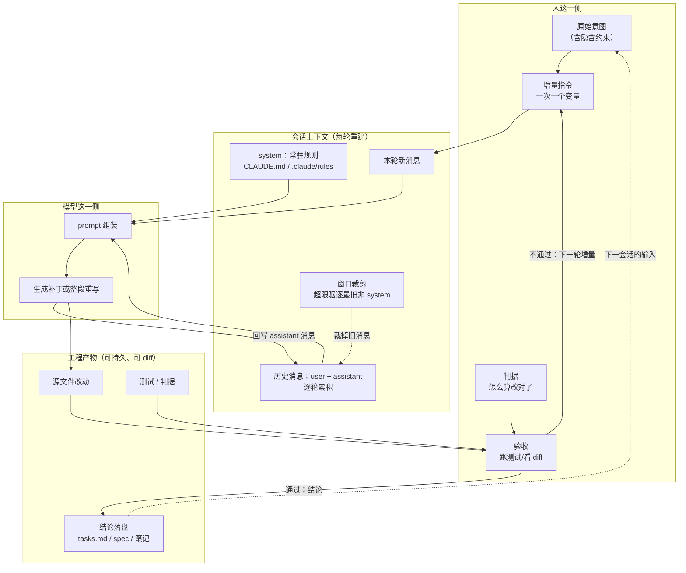
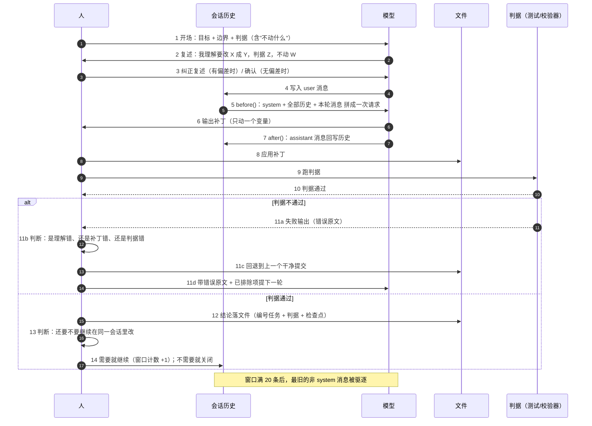

# 对话迭代：看起来最省事的模式，实际上是成本最高的那一档

> **一句话结论**：对话迭代把「上下文」当工作记忆用，而这份记忆每一轮都要原价重发一次、并且会被窗口**静默驱逐**——所以它的真实成本不在一轮对话里，而在"第 N 轮你仍要为前 N-1 轮付一次钱"，它的真实风险不在模型不会写，而在被裁掉的那几轮里恰好装着你的原始约束。
> **阅读前置**：读过 `01-VibeCoding氛围编程.md`（知道"以运行结果为准"）和 `02-PlanFirst计划驱动开发.md`（知道"把不可逆决策提前到最便宜的时机"）会更快；不熟 Spring AI 完全没关系，第 3 节用 4 份已入库源码摘录把机制钉死，只要会读 Java。
> **证据基线**：A 级 12 处（`learning-docs/24-源码分析/assets/source/` 已入库的 Spring AI 2.1.0 摘录，集中在会话窗口与用量统计 4 个文件）；B 级 14 处（本仓 `CLAUDE.md`、`.claude/rules/`、`.claude/agents/`、`specs/005-after-sales-agent/tasks.md`、`_templates/写作规范.md`、`24-源码分析/_templates/agent-任务书.md`，行号均已逐条核对）；C 级 5 组静态实测（4 个 node 脚本 + 1 条单行统计，全部给命令与真实输出，全程不启服务、不联网、不跑构建）。预计阅读 40~50 分钟。

## 证据边界（先看这篇的证据从哪来）

这篇讲的不是框架 API，而是"人和模型来回改"的工作方式。工作方式本身没有源码可读，所以证据分四类，边界必须写清楚，否则很容易把"我觉得"读成"实测"。

| 类别 | 本仓状态 | 本篇怎么处理 |
| --- | --- | --- |
| A 级：框架源码摘录 | `assets/source/` 已入库 908 份；与"会话/上下文/用量"直接相关的有 `MessageChatMemoryAdvisor.java.md`、`MessageWindowChatMemory.java.md`、`Usage.java.md`、`UsageAccumulator.java.md` | 只在这 4 份能证明的机制上给锚点（历史怎么被拼回、窗口怎么裁、用量怎么记）。方法论层面的判断**一律不给 A 级** |
| B 级：本仓工程文件 | `CLAUDE.md`、`.claude/context/tech-stack.md`、`.claude/rules/*.md`、`.claude/agents/*.md`、`specs/005-after-sales-agent/tasks.md`、`_templates/写作规范.md`、`24-源码分析/_templates/agent-任务书.md` | 给路径 + 行号，引用前逐行读过原文；只引用"文件里怎么写的"，不引申 |
| C 级：可复现实测 | 本机 node v24.16.0 可用 | 5 组静态统计：对话成本、常驻上下文、窗口驱逐、指令判据密度、规格可判定性。全部给完整脚本/命令 + 真实输出 + "怎么读" |
| 本机不可实测 | 未启动任何服务、未联网、未跑 `mvn`/`npm`、未调用任何模型 | 凡涉及运行时行为（真实 token 账单、真实模型表现）只讲机制，**不编数字**。本篇没有任何一次真实会话的 token 账单，只有按给定假设算出的量级 |

另有一条口径要说在前面：本仓**不保存**对话日志（`git log` 里只有文档和代码提交，没有会话记录），所以第 0 节的三条现象是这类会话的通用形态，不是某个提交的截图。其中"模型忘掉最初的要求"这一条，第 3.2/3.3 节用源码里的裁剪算法做了可复现验证——它不再是"感觉"。

---

## 0. 先看现象

### 现象 1：改了 8 轮之后，代码比第 1 轮更乱

第 1 轮的产出是干净的：一个方法、一段清晰的 if。第 4 轮你说"顺便把空值也处理一下"，第 6 轮你说"这个异常改成返回默认值"，第 8 轮你说"再加个日志"。四轮下来，那个方法变成了四层缩进 + 三个 try + 两个语义重叠的兜底分支，而且**第 2 轮你明确删掉的那段逻辑又回来了**——因为模型在第 8 轮看到的上下文里，第 2 轮的删除动作已经被后面的补丁盖住了。

一出现这个现象就说明：你在用"追加"当修改手段，而你没有回退点。

### 现象 2：同一段代码被反复重写三遍，最后选回第一版

"不是这样，改成 B。"→ 模型给 B。→ "B 不对，还是 A 的意思，但别用 X。"→ 模型给 A′。→ "A′ 又引入了 X。"→ 模型给 B′。三轮之后你在 diff 里翻回第一版，发现自己绕了一圈。

这不是模型变笨了。是你每一轮的否定都只说了"不对"，没说"哪里算对"——**没有判据的否定，模型只能猜，猜的结果就是随机游走**。

一出现这个现象就说明：你的指令里缺一个可判定的验收条件（第 3.6 节给出把判据写进指令的三种写法）。

### 现象 3：模型开始"忘掉"最初的要求

第 1 轮你说过"不要加日志、不要改 public 签名"。到第 12 轮，模型主动加了一行 `log.debug`，还问你"要不要顺便扩一下方法签名"。

这件事有精确的机制：会话窗口满了之后**裁掉的是最旧的非系统消息**，而你第 1 轮的那句约束就是最旧的非系统消息。第 3.2 节的模拟显示，在默认 20 条窗口下，它在**第 11 轮**被挤出去，并且此后再也不回来；同一句话如果写进 system 消息（也就是写进 `CLAUDE.md` / `.claude/rules/` 这一层），则窗口怎么裁都裁不掉它。

一出现这个现象就说明：你把"长期约束"放在了"短期记忆"的位置上。

> 这些现象指向同一件事：**对话迭代的成本和风险都不在"这一轮"，而在"历史的累积方式"**——每轮重发让成本随轮次线性增长、让噪声和真实信息一起争夺注意力；窗口驱逐让早期约束静默失效；没有判据让每次否定都变成随机游走；没有回退点让每一轮补丁都建立在上一轮的错误之上。省下来的那点"写文档的时间"，会在第 8 轮以"重写一遍"的方式还回来。

---

## 1. 整体地图



> **读图说明**：三条边决定成败。**第一条**是 `C2 --> M1` 这条从"历史消息"进"prompt 组装"的边——它是本篇全部成本论证的来源：历史不是留在磁盘上供模型按需检索，而是**每轮原封不动塞进请求**（第 3.1 节源码 `MessageChatMemoryAdvisor` 的 `before()` 就是干这个）。**第二条**是 `C4 -.-> C2` 这条虚线：窗口满了不是压缩，是把最旧的非 system 消息**删掉**，所以虚线指向的是"历史变短且不可逆"，看错成"压缩摘要"会得出"多聊几轮没关系"的错误结论。**第三条**是 `H4 -->|"通过：结论"| P3` 与 `P3 -.-> H1` 这两跳：只有走完"落盘→下次作为输入"这一圈，一次会话的收益才可复用；只走 `H4 --> H2` 不落盘，收益就锁死在那次会话里，会话一关全部归零。

| 组件 | 责任 | 本项目里的对应物 | 谁来调它 |
| --- | --- | --- | --- |
| 常驻规则（system 层） | 放"每轮都成立"的约束：技术栈版本、分层规范、提交纪律 | `CLAUDE.md`（176 行）+ `.claude/context/tech-stack.md`（62 行）+ `.claude/rules/coding-rules.md`（65 行）+ `.claude/rules/git-workflow.md`（60 行） | 每次会话自动加载，且**不随窗口裁剪消失**（第 3.3 节） |
| 历史消息 | 承载"上一轮说了什么"，同时是最大的成本项 | Spring AI 侧的 `ChatMemory` 实现；本仓对话类文档里对应的是"人肉记忆" | 每轮由框架拼进 prompt |
| 窗口裁剪 | 超限时删最旧的非 system 消息，切点吸附到完整轮 | `MessageWindowChatMemory`，默认 `DEFAULT_MAX_MESSAGES = 20` | 每次 `add()` 时触发 |
| 增量指令 | 把"改哪里、往哪改、怎么算对"压成一条消息 | 人写；范本是 `_templates/写作规范.md` 的"必须做到 / 常见废稿"两列 | 人 |
| 判据 | 让"改对了"可判定，能自动最好 | `specs/005-after-sales-agent/tasks.md` 的任务行（例：T003 的五个反例） | 人 + 测试 |
| 工程产物 | 让结论离开会话、进入版本库 | `specs/005-after-sales-agent/tasks.md`（161 行 / 8 阶段 / 54 任务 / 6 检查点） | 人 + `check-doc` 之类的校验器 |

三种典型用法在这张图上的差别，只在于**哪条边被用得多**：

| 用法 | 主要走哪条边 | 有效边界 | 越界后的典型症状 |
| --- | --- | --- | --- |
| 澄清需求 | `H1 --> H2 --> M2`，几乎不产生 `P1` | 需求还说不清、需要模型帮你把模糊点列出来并反问 | 聊了 10 轮，代码一行没动，结论也一行没落 |
| 逐段改进 | `M2 --> P1 --> H4 --> H2` 循环 | 单文件、单方法、改动面一眼能看完、每轮有可跑判据 | 第 5 轮之后开始"改 A 坏 B"，diff 越滚越大 |
| 报错排查 | `H2 --> M2`，输入以错误原文为主 | 错误可复现、堆栈完整、已排除项明确 | 越聊越像头脑风暴，模型开始编不存在的方法名 |

---

## 2. 关键概念与关键要素

术语首现即解释，后面不再重复。

| 名称 | 位置 | 角色 | 关键点 |
| --- | --- | --- | --- |
| 对话迭代（Conversational / Iterative） | 方法论，无代码对应物；本仓对照文档 `learning-docs/05-AI集成/03-AI编码方法论/06-AI开发模式全景对比.md` 第 103 行 `### 8. Conversational / Iterative（对话迭代式）` | 人主导、多轮来回、每轮只改一点的开发方式 | 它不是"Vibe Coding 的进阶版"，是另一条风险曲线：Vibe 赌运行结果，它赌人的判断力 |
| 上下文窗口（context window） | A 级：`MessageWindowChatMemory.java.md#L29-L45` | 一次请求里模型能"看见"的全部 token 容量 | 满了不是遗忘，是**被裁**；裁掉的不可恢复 |
| 窗口驱逐（eviction） | A 级：`MessageWindowChatMemory.java.md#L100-L134` | 超限时的处理策略 | 默认 20 条；只保 `SystemMessage`；切点吸附到最近的 USER，保证按完整轮裁剪 |
| system 消息 | A 级：`MessageChatMemoryAdvisor.java.md#L92-L99`；B 级：`CLAUDE.md#L14-L18` | 每轮都在最前面的那段指令 | 唯一"免疫裁剪"的通道，所以长期约束必须放这里 |
| 提示缓存（prompt caching） | A 级：`Usage.java.md#L78-L79`（读）与 `#L90-L91`（写） | 供应商对**相同前缀**复用计算结果，命中部分更便宜 | 前缀越稳定越省；"每轮重写整段历史"把这个优势直接废掉 |
| 用量字段（Usage） | A 级：`Usage.java.md#L37-L62` | 一次调用的 prompt / completion / total token 计数 | `getTotalTokens()` 只是两者相加；跨轮累加要看 `UsageAccumulator` |
| 增量指令 | 方法论；范本 B 级：`_templates/写作规范.md#L146-L159` | 一次只动一个变量的指令形态 | 三要素：一次一个变量、给反例、给判据。缺任一条都会退化成随机游走 |
| 复述确认（read-back） | 方法论；机制依据 A 级：`MessageChatMemoryAdvisor.java.md#L84-L90` | 让模型先把"我理解你要改 X 成 Y，判据是 Z"写出来，再动手 | 复述是**最便宜的一轮**（几百 token），理解错却要一整轮实现才暴露 |
| 回退点（clean state） | 工程实践；B 级：`specs/005-after-sales-agent/tasks.md#L15-L38` 的阶段检查点 | 一个"能干净回到这里"的提交 | 没有回退点，补丁只能叠加；"越改越差"是叠加的必然结果 |
| 结论落盘 | B 级：`specs/005-after-sales-agent/tasks.md` 全文形态 | 把会话结论写成文件里的编号任务 + 判据 + 检查点 | 会话会关，文件不会；54 个任务里 33 个带具体文件落点、15 个带验收语义（第 3.9 节实测） |

一句话分工：**system 管"永远成立"的规则，历史管"刚才说了什么"，增量指令管"这一轮只动哪个变量"，判据管"改没改对"，落盘管"下次还要不要重新想一遍"**。五者任一缺失，都会以"多聊几轮"的形式向你收利息。

---

## 3. 原理与证据逐段精读

本节每一小节都按四层走：在干什么 → 为什么这么设计 → 换成别的写法会怎样 → 常见坑。

### 3.1 每轮都全量重发：历史是怎么被拼回 prompt 的

**在干什么**：每次你按回车，框架并不是"接着上次的对话继续"——它把历史消息**从头拼进这一次的请求**，再发出去。Spring AI 的 `MessageChatMemoryAdvisor.before()` 把这件事写得非常直白：

```java
	@Override
	public ChatClientRequest before(ChatClientRequest chatClientRequest, AdvisorChain advisorChain) {
		String conversationId = getConversationId(chatClientRequest.context());

		// 1. Retrieve the chat memory for the current conversation.
		List<Message> memoryMessages = this.chatMemory.get(conversationId);

		// 2. Advise the request messages list.
		List<Message> promptMessages = chatClientRequest.prompt().getInstructions();
		List<Message> processedMessages = new ArrayList<>();
		if (!isMemoryAlreadyInPrompt(promptMessages, memoryMessages)) {
			processedMessages.addAll(memoryMessages);
		}
		processedMessages.addAll(promptMessages);

		// 2.1. Ensure system message, if present, appears first in the list.
		for (int i = 0; i < processedMessages.size(); i++) {
			if (processedMessages.get(i) instanceof SystemMessage) {
				Message systemMessage = processedMessages.remove(i);
				processedMessages.add(0, systemMessage);
				break;
			}
		}

		// 3. Create a new request with the advised messages.
		ChatClientRequest processedChatClientRequest = chatClientRequest.mutate()
			.prompt(chatClientRequest.prompt().mutate().messages(processedMessages).build())
			.build();

		// 4. Add the new user message to the conversation memory.
		Message userMessage = processedChatClientRequest.prompt().getLastUserOrToolResponseMessage();
		this.chatMemory.add(conversationId, userMessage);

		return processedChatClientRequest;
	}
```

`(src: MessageChatMemoryAdvisor.java#L78-L110)`

对应的写回在 `after()` 里：模型答完之后，把 assistant 消息也追加进同一个 `conversationId` 的记忆（`[[源码:MessageChatMemoryAdvisor.java.md#L141-L150]]`）。所以"记忆"是**累积**的，而"请求"是**每次重建**的。

**为什么这么设计**：因为模型是无状态的 HTTP 端点。它能"记得"你上一轮说的话，唯一原因是那些话这一轮又被发了一遍。这是个物理事实，不是实现缺陷。

**换成别的写法会怎样**：如果把它换成"检索式上下文"（只检索与当前问题相关的历史片段拼进去，而不是全部），成本曲线会从线性变近似常数——代价是要做相关性判断，一旦检索错，模型会拿到半截上下文，产生的错误比"全量重发"更难查，因为缺的那半截不在请求里、也不在任何日志里。所以工业界的默认选择仍是"窗口内全量重发 + 超限驱逐"，把可控性放在省钱之前。

**常见坑**：把"我已经说过一次"当成"模型会一直知道"。同一句话在第 1 轮是上下文，在第 12 轮可能只是十几条历史里的一行——`isMemoryAlreadyInPrompt()` 这种去重逻辑只防止"同一批消息重复拼接"，不保证模型会重视它。

### 3.2 窗口是"驱逐"而不是"压缩"：默认 20 条与"吸附到 USER"

**在干什么**：窗口满了之后，`MessageWindowChatMemory.process()` 做四件事：新 system 替换旧 system、超限时只从**非 system**消息里裁、裁的起点用 `size - maxMessages` 粗算、然后把这个切点**向后吸附到最近的 USER 消息**，保证留下的窗口从一个完整轮开始。

```java
		if (processedMessages.size() <= this.maxMessages) {
			return processedMessages;
		}

		List<Integer> nonSystemIndices = new ArrayList<>();
		for (int i = 0; i < processedMessages.size(); i++) {
			if (!(processedMessages.get(i) instanceof SystemMessage)) {
				nonSystemIndices.add(i);
			}
		}

		int cutIndex = processedMessages.size() - this.maxMessages;

		while (cutIndex < nonSystemIndices.size()
				&& processedMessages.get(nonSystemIndices.get(cutIndex)).getMessageType() != MessageType.USER) {
			cutIndex++;
		}
		cutIndex = Math.min(cutIndex, nonSystemIndices.size());

		Set<Integer> removeIndices = new HashSet<>(nonSystemIndices.subList(0, cutIndex));
		List<Message> trimmedMessages = new ArrayList<>();
		for (int i = 0; i < processedMessages.size(); i++) {
			if (!removeIndices.contains(i)) {
				trimmedMessages.add(processedMessages.get(i));
			}
		}
		return trimmedMessages;
```

`(src: MessageWindowChatMemory.java#L100-L134)`

默认值是 `DEFAULT_MAX_MESSAGES = 20`（`[[源码:MessageWindowChatMemory.java.md#L50-L50]]`）。类注释还写明了 system 的例外地位："if a new SystemMessage is added, all previous SystemMessage instances are removed… the SystemMessage messages are preserved while evicting other types of messages"（`[[源码:MessageWindowChatMemory.java.md#L29-L45]]`）。

**为什么这么设计**：吸附到 USER 是为了避免留下"孤立的 assistant 回答"——一段没有对应提问的回答，比没有这段回答更误导模型。只裁非 system 是因为 system 就是"这一轮仍然成立的规则"，裁掉它等于把项目规范随机删一条。

**换成别的写法会怎样**：换成"摘要压缩"（把最旧的 10 轮压成一段摘要再放回去），好处是长会话不会突然失忆，坏处是摘要由模型生成、会引入不可 diff 的失真，而且你得为摘要本身再付一次调用费。Spring AI 2.1.0 的注释里已经写明了这个方向：`@deprecated since 2.1.0 … in favor of session memory … a turn-aware window is EventFilter.lastN, and compaction replaces eviction`（`[[源码:MessageWindowChatMemory.java.md#L42-L45]]`）——**eviction 是旧基线，compaction 是新基线**，这条差异在第 7 节单列。

**常见坑**：以为把 `maxMessages` 调大就安全了。窗口上限是 token，不是条数：20 条长消息可能已经几十 K token，调大条数只会让你在别的维度撞墙。真正的做法见第 3.3 节——**把长期约束挪到 system，把会话长度当预算管**。

把这段算法照抄成 40 行 JS，跑一遍"20 轮一问一答"，就能看到约束消失的确切轮次：

```javascript
// 把 assets/source/MessageWindowChatMemory.java.md#L86-L135 的裁剪算法照抄成 JS，
// 喂 20 轮「一问一答」，看第 1 轮写下的约束什么时候被挤出窗口。只做静态模拟，不联网、不调模型。
const MAX = 20; // 源码 L50: DEFAULT_MAX_MESSAGES = 20
const SYSTEM = 'system';
const USER = 'user';
const ASSISTANT = 'assistant';

function process_window(memory, newMessages) {
  const hasNewSystem = newMessages.some(m => m.type === SYSTEM && !memory.includes(m));
  let processed = memory.filter(m => !(hasNewSystem && m.type === SYSTEM));
  processed = processed.concat(newMessages);
  if (processed.length <= MAX) return processed;

  const nonSystemIndices = [];
  for (let i = 0; i < processed.length; i++) if (processed[i].type !== SYSTEM) nonSystemIndices.push(i);

  let cutIndex = processed.length - MAX;
  // 源码 L118-L124：把切点向后吸附到最近的 USER 消息，保证按完整轮裁剪
  while (cutIndex < nonSystemIndices.length && processed[nonSystemIndices[cutIndex]].type !== USER) cutIndex++;
  cutIndex = Math.min(cutIndex, nonSystemIndices.length);

  const remove = new Set(nonSystemIndices.slice(0, cutIndex));
  return processed.filter((_, i) => !remove.has(i));
}

function run(label, putConstraintInSystem) {
  const constraint = { type: putConstraintInSystem ? SYSTEM : USER, text: '要求：不要加日志、不要改 public 方法签名' };
  let memory = putConstraintInSystem ? [constraint] : [];
  let firstUser = true;
  const marks = [];
  for (let round = 1; round <= 14; round++) {
    const userMsg = { type: USER, text: firstUser && !putConstraintInSystem ? constraint.text : `第${round}轮：把这段改成……` };
    firstUser = false;
    const reply = { type: ASSISTANT, text: `第${round}轮回复：补丁${round}` };
    memory = process_window(memory, [userMsg]);
    memory = process_window(memory, [reply]);
    const alive = memory.some(m => m.text === constraint.text);
    if (round <= 12 || !alive) marks.push(`${String(round).padStart(2)}: 窗口内${String(memory.length).padStart(2)}条 约束在=${alive ? '是' : '否'}`);
  }
  console.log(`\n== ${label} ==`);
  console.log(marks.join('\n'));
}

run('A. 约束写在第 1 轮的普通消息里（多数人的做法）', false);
run('B. 同一句约束写进 system 消息（等于写进 CLAUDE.md / .claude/rules）', true);
```

保存为 `window-evict.mjs` 后执行 `node window-evict.mjs`，真实输出（本机 node v24.16.0）：

```text
== A. 约束写在第 1 轮的普通消息里（多数人的做法） ==
 1: 窗口内 2条 约束在=是
 2: 窗口内 4条 约束在=是
 3: 窗口内 6条 约束在=是
 4: 窗口内 8条 约束在=是
 5: 窗口内10条 约束在=是
 6: 窗口内12条 约束在=是
 7: 窗口内14条 约束在=是
 8: 窗口内16条 约束在=是
 9: 窗口内18条 约束在=是
10: 窗口内20条 约束在=是
11: 窗口内20条 约束在=否
12: 窗口内20条 约束在=否

== B. 同一句约束写进 system 消息（等于写进 CLAUDE.md / .claude/rules） ==
 1: 窗口内 3条 约束在=是
 2: 窗口内 5条 约束在=是
 3: 窗口内 7条 约束在=是
 4: 窗口内 9条 约束在=是
 5: 窗口内11条 约束在=是
 6: 窗口内13条 约束在=是
 7: 窗口内15条 约束在=是
 8: 窗口内17条 约束在=是
 9: 窗口内19条 约束在=是
10: 窗口内19条 约束在=是
11: 窗口内19条 约束在=是
12: 窗口内19条 约束在=是
```

**怎么读这段输出**：① A 组前 10 轮"约束在=是"不是因为模型记性好，而是因为窗口还没满（第 10 轮刚好 20 条）；第 11 轮一超限，被删的就是最旧的那条非 system 消息——**你第 1 轮的约束**。② A 组 11 轮之后"窗口内 20 条"不再增长，说明窗口在满负荷运行，后续每一轮都在往前删。③ B 组稳定在 19 条（1 条 system + 18 条非 system），差值就是被 system 占掉的那一格：**一条 system 消息的代价是常驻一格窗口，收益是永久免疫裁剪**。④ 这个模拟的假设写在脚本里（一轮 = 1 条 user + 1 条 assistant、无工具调用、无多模态），换假设数值会变，但"第 11 轮左右开始丢"这个数量级不会变。

### 3.3 为什么"最初的约束"最先丢：只有 system 免裁

**在干什么**：裁剪时构造 `nonSystemIndices` 时明确排除了 `SystemMessage`（`[[源码:MessageWindowChatMemory.java.md#L104-L111]]`），而 `before()` 每次都会把 system 提到消息列表最前（`[[源码:MessageChatMemoryAdvisor.java.md#L92-L99]]`）。两段代码合起来的效果是：**system 既不会被裁，又永远在最前面**。

**为什么这么设计**：system 是"身份 + 规则"的通道，供应商侧也按这个语义做缓存和优先级。本仓把长期约束全放在这一层，是同一个思路的工程化：

```text
- 技术栈：[tech-stack.md](.claude/context/tech-stack.md)
- 编码规范：[coding-rules.md](.claude/rules/coding-rules.md)
- GIT 工作流：[git-workflow.md](.claude/rules/git-workflow.md)
```

上面三行就是 `CLAUDE.md#L16-L18` 的原文形态（原文件是 Markdown 链接，这里按纯文本贴出以免读者点开相对路径）；`.claude/rules/coding-rules.md#L23-L27` 把"分层规范"写成硬约束（Controller 只做参数校验 + 调 Service + 返回 `Result<T>`，禁止 Controller 直接操作 Mapper），`#L29-L31` 写"优先构造器注入 `@RequiredArgsConstructor`，禁止字段注入"。**这些条目之所以能"一直生效"，不是因为模型记住了，而是因为它们每一轮都在最前面**。

**换成别的写法会怎样**：把同样的规则写在第一轮的用户消息里，就是上一节 A 组的结果——第 11 轮开始失效，而且失效是**静默的**：模型不会说"我忘了你的约束"，它会自信地违反它。这是对话迭代最难查的一类错，因为你的会话记录里那句约束还在（你往上翻能看到），请求里却已经没有它了。

**常见坑**：把"这次特别重要的临时约束"也塞进 system。system 是常驻的，塞进去的每一条都在每一轮重复计费（第 3.5 节算出这部分占 44.4%），而且会稀释真正长期有效的规则。判断标准很简单：**这条约束明天还成立吗？**成立进 system，不成立留在本轮消息里。

### 3.4 提示缓存：稳定前缀便宜，反复重写昂贵

**在干什么**：供应商侧会对"相同的前缀"复用已算过的结果，命中的输入 token 更便宜。Spring AI 把这件事暴露成两个字段：读缓存与写缓存：

```java
	default @Nullable Long getCacheReadInputTokens() {
		return null;
```

`(src: Usage.java#L78-L79)`

```java
	default @Nullable Long getCacheWriteInputTokens() {
		return null;
	}
```

`(src: Usage.java#L90-L91)`

注释里写得很清楚：cached tokens 是"previously processed and stored by the provider, reducing cost and latency for repeated prompt prefixes"（`[[源码:Usage.java.md#L70-L76]]`），cache write 则是"new prompt content is cached for the first time"（`[[源码:Usage.java.md#L82-L89]]`）。

**为什么这么设计**：因为真实请求的前缀高度重复——system 一模一样，历史前 9 轮一模一样。缓存把"重复的前缀"从"每次重算"变成"每次查表"，这是长会话能跑得起的经济基础。

**换成别的写法会怎样**：**这正是对话迭代里"每轮重写整段代码"最贵的地方**。如果你每轮都让模型"把整个文件重新输出一遍"，那么前缀在第 3 行就变了——从第 3 行起全部是 cache write（贵），而"只给一个 diff / 只给改动的方法"则让前缀尽量保持不变（便宜）。同一个意图，"整段重写"和"补丁式修改"的单价可以差出好几倍。同时这也解释了为什么 `before()` 要把 system 移到最前（`[[源码:MessageChatMemoryAdvisor.java.md#L92-L99]]`）：**稳定前缀必须真的在第一位，缓存才命得中**。

**常见坑**：以为缓存能救"每轮重发"的成本。缓存降低的是**单价**，不是**总量**；历史越长，重发的 token 越多，即使全部命中缓存，你也还在为"噪声"付注意力代价——模型要在 20 条历史里找"当前这一轮到底要改什么"。

### 3.5 上下文窗口经济学：20 轮全量重发到底是多少钱

**在干什么**：把"每轮都带全量历史"这件事算成一张表。下面这段脚本只做算术，假设全部写在开头，改一个数就能重算：

```javascript
// 口径（假设，全部可改）：用固定假设值代替真实 tokenizer，仅用于量级比较，不是账单
const SYS = 2000;      // 常驻：系统规则 + 项目上下文（CLAUDE.md 等随每轮重发）
const USER = 120;      // 每轮用户消息（含一次「不是这样改」的反馈）
const REPLY = 450;     // 每轮模型回复（含一段 30 行左右的代码）
const ROUNDS = 20;
const SUMMARY_CAP = 350;  // 增量式：用一段封顶摘要替代全量历史

let full = 0, inc = 0, history = 0;
const rows = [];
for (let k = 1; k <= ROUNDS; k++) {
  const reqFull = SYS + history + USER;
  const reqInc = SYS + Math.min(history, SUMMARY_CAP) + USER;
  full += reqFull;
  inc += reqInc;
  rows.push([k, reqFull, full, reqInc, inc]);
  history += USER + REPLY;
}
console.log('轮次 | 全量重发本轮请求 | 全量累计 | 增量式本轮请求 | 增量累计');
for (const [k, a, b, c, d] of rows) {
  if ([1, 2, 3, 5, 8, 10, 15, 20].includes(k))
    console.log(`${String(k).padStart(2)} | ${String(a).padStart(6)} | ${String(b).padStart(7)} | ${String(c).padStart(6)} | ${String(d).padStart(6)}`);
}
console.log('---');
console.log(`20 轮全量累计 = ${full} tokens；增量式累计 = ${inc} tokens；比值 = ${(full / inc).toFixed(2)}x`);
console.log(`第 1 轮请求 = ${rows[0][1]}；第 20 轮请求 = ${rows[19][1]}；放大 = ${(rows[19][1] / rows[0][1]).toFixed(2)}x`);
console.log(`第 20 轮里历史占 = ${(history / rows[19][1] * 100).toFixed(1)}%（system 占 ${(SYS / rows[19][1] * 100).toFixed(1)}%）`);
const useful = ROUNDS * REPLY + ROUNDS * USER;
console.log(`20 轮真正新增信息 = ${useful} tokens；全量重发的浪费 = ${(full - useful)} tokens（${((full - useful) / full * 100).toFixed(1)}%）`);
```

保存为 `ctx-cost.mjs`，`node ctx-cost.mjs` 的真实输出：

```text
轮次 | 全量重发本轮请求 | 全量累计 | 增量式本轮请求 | 增量累计
 1 |   2120 |    2120 |   2120 |   2120
 2 |   2690 |    4810 |   2470 |   4590
 3 |   3260 |    8070 |   2470 |   7060
 5 |   4400 |   16300 |   2470 |  12000
 8 |   6110 |   32920 |   2470 |  19410
10 |   7250 |   46850 |   2470 |  24350
15 |  10100 |   91650 |   2470 |  36700
20 |  12950 |  150700 |   2470 |  49050
---
20 轮全量累计 = 150700 tokens；增量式累计 = 49050 tokens；比值 = 3.07x
第 1 轮请求 = 2120；第 20 轮请求 = 12950；放大 = 6.11x
第 20 轮里历史占 = 88.0%（system 占 15.4%）
20 轮真正新增信息 = 11400 tokens；全量重发的浪费 = 139300 tokens（92.4%）
```

**怎么读这段输出**：① "第 20 轮请求 12950 vs 第 1 轮 2120 = 6.11 倍"说明**单轮价格随轮次涨**，你越着急越贵。② "历史占 88.0%"说明到第 20 轮，你想要的那一句增量（120 token）只占请求的 0.9%——**信息密度被稀释到千分之九**，这是"模型开始抓不住重点"的算术解释。③ "浪费 92.4%"是口径推导出来的结论：20 轮里真正属于"新增信息"的只有 11400，其余 139300 都是重复投递。④ 增量式那列 3.07 倍的差距说明：**摘要/新会话不是省小钱，是把成本曲线从二次拉回线性**（全量重发的累计是 2 次方量级，不是 1 次方）。

常驻那部分也要算清楚——它是每一轮都付的固定成本：

```javascript
// 口径：token 粗估式（误差 ±20%）：中文/全角字符 ≈ 1 token；其余字符 ≈ 4 字符 1 token
import { readFileSync, readdirSync } from 'node:fs';
import { join } from 'node:path';

const ROOT = 'D:/Projects/Persion/ai-customer-service';
const files = [
  'CLAUDE.md',
  '.claude/context/tech-stack.md',
  '.claude/rules/coding-rules.md',
  '.claude/rules/git-workflow.md',
];
const est = (s) => {
  const cjk = (s.match(/[\u3000-\u9fff\uff00-\uffef]/g) || []).length;
  return Math.round(cjk * 1 + (s.length - cjk) / 4);
};
let totalChars = 0, totalTok = 0, totalLines = 0;
for (const f of files) {
  const s = readFileSync(join(ROOT, f), 'utf8');
  const lines = s.split('\n').length - (s.endsWith('\n') ? 1 : 0);
  const tok = est(s);
  totalChars += s.length; totalTok += tok; totalLines += lines;
  console.log(`${f.padEnd(38)} 行=${String(lines).padStart(4)} 字符=${String(s.length).padStart(6)} 约=${String(tok).padStart(5)} tok`);
}
console.log('---');
console.log(`常驻合计: ${files.length} 个文件 / ${totalLines} 行 / ${totalChars} 字符 / 约 ${totalTok} tok`);
console.log(`20 轮全量重发这份常驻部分 = 约 ${totalTok * 20} tok（占 150700 的 ${(totalTok * 20 / 150700 * 100).toFixed(1)}%）`);
console.log(`同目录按需加载: .claude/skills ${readdirSync(join(ROOT, '.claude/skills')).length} 个 skill 目录（不进常驻）`);
```

`node resident-cost.mjs` 的真实输出：

```text
CLAUDE.md                              行= 176 字符=  4107 约= 1599 tok
.claude/context/tech-stack.md          行=  62 字符=  1590 约=  657 tok
.claude/rules/coding-rules.md          行=  65 字符=  1246 约=  603 tok
.claude/rules/git-workflow.md          行=  60 字符=  1040 约=  488 tok
---
常驻合计: 4 个文件 / 363 行 / 7983 字符 / 约 3347 tok
20 轮全量重发这份常驻部分 = 约 66940 tok（占 150700 的 44.4%）
同目录按需加载: .claude/skills 20 个 skill 目录（不进常驻）
```

**怎么读**：① 367 行规则 ≈ 3347 token，一轮对话光"念规则"就要 3347 token；20 轮累计 66940，占总量的 44.4%——**规则不是免费的，它是按轮次重复收费的订阅制**。② 行数用"按 `\n` 切分并去掉末尾空行"的口径（176/62/65/60），换成 `Get-Content` 会数成 150/63/66/61，差 1 行是末尾换行、差 26 行是编码误读（第 6.4 节把这个坑单独拆开）。③ `.claude/skills` 下 20 个 skill **不在**这 3347 token 里——按需加载才是对的，把 20 个 skill 全塞常驻会让固定成本再翻几倍。

**为什么这么设计（把 3.5 四层补齐）**：人不会为"我第 3 轮说过的话"再解释一遍，模型必须，因为它读不到你的记忆。**换成别的写法会怎样**：用"结论落文件 + 新会话"替代"长会话硬撑"，累计成本从 2 次方降到接近 1 次方（3.07 倍差距是下界，因为真实历史里还有工具输出）。**常见坑**：把"省 token"理解成"少说话"。真正贵的是重复投递的旧历史，不是你这一轮的 120 token。

### 3.6 增量指令三要素：一次一个变量、给反例、给判据

**在干什么**：把"改一下"拆成三条可执行信息——**动哪个变量**（一次只动一个）、**什么是错的**（反例）、**什么算对**（判据）。本仓的写作规范把这件事做成了表格范式：

| 节 | 必须做到 | 常见废稿 |
| --- | --- | --- |
| 0 现象 | 给 2~3 个**真实会遇到的症状**（报错原文/线上表现/配置不生效），结尾一句"这些现象指向同一件事：…" | 没有现象，直接讲定义 |
| 6 踩坑 | 表格：现象 / 根因 / 验证手段 / 解法。至少 5 条，含 2 条调试手法 | 只列"注意事项" |
| 9 练习 | ≥5 条，每条绑定本篇某个具体分支，写清**验收标准**（能观察到什么） | "请自行尝试" |

（原文见 `_templates/写作规范.md#L146-L159`；这里节选三行，其余行结构相同。）

这张表本身就是"增量指令"的范本：**"必须做到"列是判据，"常见废稿"列是反例**。你只要照着"必须 / 废稿"的对子说话，模型就不需要猜。同样的形态出现在任务规格里——`specs/005-after-sales-agent/tasks.md#L26` 的 T003：

```text
- [ ] T003 `ai-cs-order` 模块 `src/test/java/…/service/AfterSaleServiceTest.java`：归属校验（他人订单→拒绝）、状态校验（非 PAID→不满足）、重复申请（存在 PENDING→拒绝）、幂等键去重（重复提交返回首次结果）、创建成功返回申请单号、订单不存在
```

六个判据、五个带"→ 结果"，没有一句"要做好校验"。

**为什么这么设计**：模型的输出空间是巨大的，一句"改一下"只剪掉了 0 个维度。反例负责剪掉错误区域，判据负责给出终止条件——**没有终止条件，模型就只能靠"看起来更好了"停下，而这个信号在你手里**。

**换成别的写法会怎样**：只说"不是这样"。模型会把"不是这样"理解成"换个写法试试"，然后随机游走（现象 2）。这正是 §5 里"期望的改动面"和"实际 diff"脱节的根源。

**常见坑**：判据写成形容词。"更健壮""更优雅""别太啰嗦"都不是判据，因为它们不可判定；可判定的判据长这样："输入 null 时返回空列表而不是抛异常""该方法不再被 Controller 以外的类调用""`mvn -pl ai-cs-order test -Dtest=AfterSaleServiceTest` 全绿"。判据密度是可以量的，本仓实测见 6.2 节：**硬约束句 190 行，其中带可判定判据的只有 25 行（13.2%）**——这就是"指令写得凶但没写清"的量化证据。

### 3.7 先复述再动手：把理解偏差压在最便宜的一轮

**在干什么**：动手之前先要一段复述——"我的理解是：你要把 X 改成 Y，判据是 Z，不动 W。对吗？"人确认（或纠正）之后再让它写代码。

**为什么这么设计**：因为**复述是整场对话里最便宜的一轮**：几百 token、零行代码、可 diff 的只有几句话。而"理解错了"这件事，如果到实现完才发现，代价是"一整轮生成 + 一轮纠错 + 一次回退"。把误差检查点从"第 5 步"提前到"第 0 步"，是纯赚的。本仓的任务书模板用的就是这个思路——给模型的不是"努力完成任务"，而是一张**边界清单**：

```text
- **你只能写**：`{{TRACK_DIR}}/` 下的文件
- **你可以读**：同目录、`assets/source/`、`_templates/写作规范.md`、`tools/`
- **你不能改**：别人的目录、`assets/source/` 已入库的原文、`tools/`、`_templates/`
```

（`24-源码分析/_templates/agent-任务书.md#L16-L18`）

这三行没有一句讲"怎么做"，全是"哪里不能碰"。它把"理解偏差"的最大风险面（改错文件、改坏别人东西）先行封住了——和第 7 节要讲的 `implementer.md` 红线清单是同一个设计。

**换成别的写法会怎样**：不写边界，只写目标。模型会在它认为合理的地方动手——包括 `assets/source/` 里那份"机械抓取、禁止手改"的原文。任务书第 44-45 行专门堵这个洞："没入库的类，你就不许在正文里贴它的代码块、不许写锚点。校验器会把编造的类名/行号/代码当作错误拦下来。"

**常见坑**：把复述做成走过场。你回"对"，它开始写，写到一半你说"不是这个意思"——那就是没读到复述。**复述里必须包含判据和"不动什么"**，只有这两项能让"对/不对"变成可判定。

### 3.8 「越改越差」的机制：补丁叠加的四种失效

**在干什么**：把"越改越差"拆成四种可识别的机制，每种配一个对策：

| 失效机制 | 表现 | 对策 |
| --- | --- | --- |
| 上下文污染 | 上一轮的错误补丁还在历史里，模型把它当"现状"继续在其上修补 | **回退到干净状态**再提要求，别在同一份脏上下文里叠第三层补丁 |
| 约束漂移 | 早期约束被驱逐或稀释（3.2/3.3） | 约束搬进 system；长会话开新的 |
| 目标漂移 | 每轮都"顺便"加一点，八轮后已经不是你最初要的东西 | 一次只动一个变量；每轮结束复述"当前状态 vs 原始目标" |
| 局部最优 | 模型为了"让这段看起来对"牺牲了调用方 | 判据必须是**跨文件**的（测试、编译、调用方断言），不是单方法自洽 |

**为什么这么设计（为什么要"回退"而不是"继续修"）**：因为模型没有独立的"代码真相"，它只有你给它的上下文。上下文里躺着三层补丁时，它能做的只有"在第四层上做第五层"；而回退到干净提交后，同一句话会得到一份"只含一次改动"的干净 output，diff 可读、可评审、可回滚。本仓把这件事制度化到了阶段级：`specs/005-after-sales-agent/tasks.md#L38` 写着 `**检查点**：ai-cs-order 售后能力独立可用`，`#L59` 是 `**检查点**：ai-cs-product 推荐能力独立可用`——**每个检查点就是一个合法的回退点**（8 个阶段 6 个检查点，实测见 3.9）。

**换成别的写法会怎样**：如果只有"继续改"而没有回退，第 N 轮的产出永远依赖第 N-1 轮的产出，误差累积是指数的——这跟长会话的成本曲线（3.5 节的 2 次方）是同一个形状。

**常见坑**：把"回退"理解成"删掉刚才那点改动"。真正的回退点是**能编译、能跑测试、你信得过的那个提交**；回到一个跑不起来的中间态，只会让下一轮的问题变成两个。

### 3.9 会话与工程产物分离：结论落文件，不落对话

**在干什么**：会话是易失的（关了就没、超窗就裁），工程产物是持久的（进 git、能 grep、能 DIFF）。所以每次会话结束时，唯一值得带走的东西是**写进文件的那几行**。

**为什么这么设计**：因为下一次会话是一条全新的上下文，它不会读你的上一次对话；它只会读你仓库里的文件（以及 `CLAUDE.md` 那一层 system）。所以"结论落盘"不是文档洁癖，是**给下一次会话准备 system 层**。本仓的落盘形态很具体：编号任务 + 文件路径 + 可判定断言 + 阶段检查点。

实测这份规格的可判定性（口径：任务行里出现带扩展名的具体文件路径 = 有落点；出现"边界/异常/校验/断言/失败/为空/重复/幂等/降噪"之一 = 有验收语义）：

```text
任务=54 带文件落点=33 带验收语义=15 两者都有=6
```

命令（在仓库根执行，只读一个文件、纯静态统计）：

```text
node -e "const s=require('fs').readFileSync('specs/005-after-sales-agent/tasks.md','utf8');const t=[...s.matchAll(/^- \[[ x]\] T\d+\s+(.*)$/gm)].map(m=>m[1]);const p=t.filter(x=>/\S+\.(java|sql|yml|md|ts|vue)\b/.test(x));const a=t.filter(x=>/边界|异常|校验|断言|失败|为空|重复|幂等|降噪/.test(x));console.log('任务='+t.length+' 带文件落点='+p.length+' 带验收语义='+a.length+' 两者都有='+t.filter(x=>p.includes(x)&&a.includes(x)).length)"
```

**怎么读**：① 61%（33/54）的任务带具体文件落点——这是好事，说明"改哪里"是确定的；② 只有 28%（15/54）带验收语义，"两者都有"只有 6 个——**这就是留给模型的猜题空间**，也是对话迭代最容易卡住的位置；③ 这份规格的原文是 161 行、8 个阶段、6 个检查点，一个人半小时能读完，比一场 20 轮对话的信息密度高一个数量级。

**换成别的写法会怎样**：把同样的结论留在对话里，会得到三个后果：下次会话要重新问一遍（成本重付）、无法 diff（结论会悄悄变形）、无法被校验器检查（错的话没人拦）。

**常见坑**：落盘落成"聊天记录粘贴"。没有编号、没有判据、没有检查点的一段散文，等于把上下文换了个存储介质，下次照样要重读重猜。判据很简单：**这段文字能不能直接变成一个可执行的验收动作？**

---

## 4. 一次完整执行时序

下面是一次"逐段改进"型对话的完整时序，包含一次失败回退。参与者刻意分开写：**人**、**历史（会话记忆）**、**模型**、**文件**、**判据（测试/校验器）**。



> **读图说明**：两个箭头最关键。**第一个**是第 5 步 `C->>M`：这一步把"历史 + 本轮"合并成一次请求，是全篇成本与噪声的唯一入口——看错成"模型自己记得"，就会以为轮次不花钱。**第二个**是第 11c 步 `P->>F`（回退）：这条边在真实的对话里**大多数时候被跳过**，人往往直接走 11d 带着脏上下文提下一轮，于是序列里少了一次"回到干净状态"，多了三层补丁——这就是现象 1 的路径。**第三个**注意 `alt` 分支的位置：只有判据通过才走第 12 步落盘，判据不通过时**不会有任何结论离开这次会话**，这也是为什么"聊得很热闹但什么都没留下"。

哪一步失败会怎样（对应的失败形态都是这一类会话的真实表现）：

| 失败点 | 触发条件 | 你会看到什么 | 后果 |
| --- | --- | --- | --- |
| 第 1 步开场缺判据 | 只给目标不给验收 | 模型输出"看起来对"，你只能说"不太对" | 进入随机游走（现象 2） |
| 第 1 步开场缺边界 | 没说"不动什么" | 模型顺手改了 public 签名 / 别的方法 | 改动面超预期，评审成本翻倍 |
| 第 2 步复述被跳过 | 人直接说"开始写" | 理解偏差到第 9 步才暴露 | 一整轮实现白做 |
| 第 5 步窗口已满 | 会话超过 20 条消息 | 模型忽然违反早期约束（现象 3） | 静默失效，比报错难查一个数量级 |
| 第 6 步补丁超范围 | 指令里带了"顺便" | diff 里出现与目标无关的改动 | 与 11c 回退点冲突，回退会连带丢功能 |
| 第 9 步判据本身写错 | 判据只验"能跑通" | 全绿但行为错 | 绿灯变假信号，越改越自信地错 |
| 第 11b 步误判 | 分不清"理解错/补丁错/判据错" | 三类问题用同一种手段（再问一遍）修 | 同一个错误重复出现三次 |
| 第 12 步漏落盘 | 会话结束直接关窗 | 下次会话重新问一遍 | 重复付费 + 结论漂移 |

---

## 5. 设计取舍

对话迭代不是"要不要用"的问题，是"用到哪一档"的问题。同一个需求，五种做法的代价曲线完全不同：

| 方案 | 优点 | 代价 | 本项目怎么选 |
| --- | --- | --- | --- |
| 纯对话迭代（无判据、无落盘） | 启动成本 0，适合"问一句" | 成本 2 次方增长、结论不稳定、不可回溯 | 只用于**澄清需求**和一次性脚本；不进主干 |
| 对话迭代 + 判据（测试先行） | 判据把"改对没"变成可判定，回退有依据 | 要先写判据，慢半拍 | 本项目日常小改的默认档（`CLAUDE.md#L114-L129` 的 Red→Green→Refactor 就是判据的落地形态） |
| Plan-First（先写计划再动手） | 把不可逆决策提前，避免八轮后返工 | 计划本身要评审，前期重 | 跨 3 个以上文件、或改动涉及表结构/接口签名时用 |
| SDD / Spec-Kit（规格驱动） | 任务可编号、可分配、可并行、可校验 | 流程重，只适合有明确交付物的功能 | 本仓 `specs/005-after-sales-agent/` 就是这么跑的（8 阶段 / 54 任务 / 6 检查点） |
| Agentic（自主体闭环） | 能连续跑、能自己跑测试 | 越权风险高，需要硬边界清单 | 只在有 `_templates/agent-任务书.md` 那种"你只能/你不能"清单时用 |

可扩展点清单（按改动成本从低到高，全部可在本仓落地）：

1. **开场模板**：把"目标 / 边界 / 判据 / 不动什么"四行写成一个 snippet，每次会话第一句粘上（成本：写 4 行）。
2. **新会话信号**：出现"开始重复解释同一件事"或"轮次 > 10"就换会话，并顺手把结论搬进文件（成本：一条团队约定）。
3. **约束上移**：把反复强调的临时约束搬进 `CLAUDE.md` 或 `.claude/rules/`，让它进 system 层免疫裁剪（成本：一次编辑，长期每轮多付固定 token）。
4. **判据前移**：每个改进项先写一行可判定断言（测试名或命令），再让模型动手（成本：先写几行测试）。
5. **回退点制度**：每完成一个可验证的小步就提交，把 `git` 当"会话检查点"用（成本：一次 commit）。
6. **升档到规格**：同一主题的对话超过 3 次，把它写成 `specs/<feature>/tasks.md` 形态的编号任务（成本：一次性投入，之后每次会话都省）。

---

## 6. 踩坑与调试手法

### 6.1 七条踩坑（现象 / 根因 / 验证手段 / 解法）

| 现象 | 根因 | 验证手段 | 解法 |
| --- | --- | --- | --- |
| 越改越乱，diff 越滚越大 | 在脏上下文上叠补丁，没有回退点 | `git diff --stat` 看改动面是否远超预期 | 回到上一个干净提交再提要求；一次只动一个变量 |
| 同一段代码被重写三遍 | 否定没有判据，模型只能猜 | 回看自己的三句反馈，有没有一句包含"算对的条件" | 每轮补一条判据 + 一条反例 |
| 模型"忘掉"最初要求 | 早期 user 约束被窗口驱逐（3.2 实测第 11 轮） | 数一下你的约束是第几条消息；`> 20` 就有风险 | 约束搬进 system（`CLAUDE.md` / `.claude/rules/`）或开新会话 |
| 单轮越来越贵、响应越来越慢 | 每轮全量重发历史（3.5 实测第 20 轮是第 1 轮的 6.11 倍） | 看每轮请求的 prompt 部分是否线性增长 | 换新会话；只带结论不带过程 |
| 排查对话越聊越发散 | 开场没给错误原文/复现步骤/已排除项 | 检查开场三件套齐不齐 | 用 6.3 的排查开场模板重开会话 |
| 结论留在对话里，第二天找不回来 | 没有落盘形态 | `grep` 仓库里搜关键词，搜不到就是没落 | 落成编号任务 + 判据 + 检查点 |
| 规则写了但不生效 | 规则在 user 消息里，或规则本身没判据 | 跑 6.2 的判据密度统计，看判据占比 | 规则上移 system；每条规则配可判定判据 |

### 6.2 手法一：量你的指令"判据密度"（可直接复用到自己的 prompt/规则文件）

**在干什么**：统计规则/指令文件里"硬约束句"和"柔性建议句"的比例，以及硬约束里有多少带可判定判据（可判定 = 含反引号包裹的路径/命令/字段、含 `#L` 行号、含数字阈值、含"退出码/报错/错误"之一）。

```javascript
// 口径：逐行匹配正则，统计「硬约束句」与「柔性建议句」，以及硬约束里带可判定判据的比例
import { readFileSync } from 'node:fs';
import { join } from 'node:path';

const ROOT = 'D:/Projects/Persion/ai-customer-service';
const files = [
  '.claude/rules/coding-rules.md',
  '.claude/rules/git-workflow.md',
  '.claude/agents/implementer.md',
  '.claude/agents/challenger.md',
  'learning-docs/24-源码分析/_templates/agent-任务书.md',
];
const HARD = /禁止|不得|严禁|不允许|必须|只能|不许/;
const SOFT = /建议|尽量|推荐|最好|可以考虑|酌情/;
const CRIT = /`[^`]+`|#L\d+|\d+%|\d+\s*(行|条|个|秒|轮)|退出码|报错|错误/;

let tot = 0, hard = 0, soft = 0, hardCrit = 0;
for (const f of files) {
  const lines = readFileSync(join(ROOT, f), 'utf8').split('\n');
  let h = 0, s = 0, hc = 0;
  for (const ln of lines) {
    const t = ln.trim();
    if (!t) continue;
    if (HARD.test(t)) { h++; if (CRIT.test(t)) hc++; }
    else if (SOFT.test(t)) s++;
  }
  tot += h + s; hard += h; soft += s; hardCrit += hc;
  console.log(`${f.padEnd(52)} 硬约束=${String(h).padStart(3)} 其中带判据=${String(hc).padStart(3)} 柔性建议=${String(s).padStart(3)}`);
}
console.log('---');
console.log(`合计: 硬约束 ${hard} 行 / 柔性建议 ${soft} 行；硬约束命中率 ${(hard / tot * 100).toFixed(1)}%`);
console.log(`硬约束里带可判定判据的占 ${(hardCrit / hard * 100).toFixed(1)}%（${hardCrit}/${hard}）`);
```

`node directive-density.mjs` 真实输出：

```text
.claude/rules/coding-rules.md                        硬约束=  8 其中带判据=  3 柔性建议=  0
.claude/rules/git-workflow.md                        硬约束=  4 其中带判据=  0 柔性建议=  0
.claude/agents/implementer.md                        硬约束=118 其中带判据=  9 柔性建议=  0
.claude/agents/challenger.md                         硬约束= 53 其中带判据=  9 柔性建议=  0
learning-docs/24-源码分析/_templates/agent-任务书.md        硬约束=  7 其中带判据=  4 柔性建议=  2
---
合计: 硬约束 190 行 / 柔性建议 2 行；硬约束命中率 99.0%
硬约束里带可判定判据的占 13.2%（25/190）
```

**怎么读**：① **99.0% 都是硬约束、只有 2 行柔性建议**——本仓的指令体系几乎全靠"禁止/必须"驱动，这是有意的：软话对模型没有约束力。② 但**硬约束里只有 13.2% 带判据**，说明大量"禁止 X"没有配"怎么算违反了 X"。这就是第 3.6 节"常见坑"的量化版：**你在用形容词下命令**。③ 逐文件看更有用：`agent-任务书.md` 的判据率是 4/7（最高），因为它写给"必须交什么、什么算不合格"；`git-workflow.md` 是 0/4，因为它的四条都是流程纪律，天然难判据化——这类规则应该靠工具（钩子/CI）兜，而不是靠模型自觉。

### 6.3 手法二：把"新会话信号"变成可执行的排查开场

**排查型对话的正确开场**（缺任一行的排查会话，基本都会退化成头脑风暴）：

```text
【错误原文】Exception in thread "main" java.lang.NullPointerException: Cannot invoke "..." because "resp.getData()" is null
【复现步骤】1) 调用 GET /order/after-sale/eligibility?orderId=1001 2) 10 次里稳定复现 3) 只在 status=null 的订单上出现
【已排除】不是网关鉴权（换成直连同样报）、不是数据库（该订单 status 列确实为 NULL）、不是编译问题（clean 后重编仍复现）
【判据】修复后：该请求返回 data.status="UNKNOWN" 且不抛异常；其余 9 条用例的响应体不变
【边界】不改 EligibilityVO 的字段名，不动 Controller 签名
```

为什么这五行有效，可以用一句话概括：**它们把"模型要问的问题"提前答完了**。模型在排查场景里最常做的三件事是"要看错误原文""要复现步骤""要排除项"，你把这三样一次给全，它就从"猜"切换到"推"。

**新会话信号（出现任一条，就换会话，并把结论先落盘）**：

| 信号 | 判据 | 动作 |
| --- | --- | --- |
| 轮次开销失控 | 轮次 > 10，或你开始"重复解释同一件事" | 写 3 行结论到文件 → 开新会话，第一句只带结论 + 判据 |
| 注意力漂移 | 模型开始违反早期约束（现象 3） | 约束搬 system 或新会话重开 |
| 目标已变 | 你现在想要的东西和第一轮不是一回事 | 新会话，用新的"目标+边界+判据"三件套开场 |
| 话题串了 | 一个会话里在改两个不相关的模块 | 拆成两个会话，各自有独立判据 |
| 判据变了 | 原来的测试已经不能证明对错 | 先改判据（写测试），再继续 |

### 6.4 手法三：统计口径必须先声明（一个真实的 26 行误差）

同一份 `CLAUDE.md`，两种数法给出两个答案：

```text
ReadAllLines: 176
GetContent: 150
```

（`[System.IO.File]::ReadAllLines('CLAUDE.md').Count` 与 `(Get-Content CLAUDE.md).Count`）

**怎么读**：① `ReadAllLines` 按 UTF-8 读，得到 176；`Get-Content` 用了默认编码，把部分多字节序列读错，**行数被合并掉了 26 行**——文件本身没有变，变的是口径。② 这个坑在"对话迭代"里格外致命：你会用行数/token 数判断"上下文是不是太大了"，而口径错误会让你把 176 行估成 150 行、把 20 轮的历史低估一截。③ 实操规则：**任何统计数字都要在文档里写清口径**（本篇所有行数都标注了是"按 `\n` 切分并去掉末尾空行"还是 `ReadAllLines`），脚本类统计一律写明"哪些文件、什么正则、怎么算命中"。

---

## 7. ⚠️ 版本差异

这一节专治"旧文档说法当成当前事实"。下表左侧是旧的（旧稿或更早的文档），中间是本次核对的当前基线。

| 旧写法 / 旧文档 | 当前基线 | 变化点 | 迁移动作 |
| --- | --- | --- | --- |
| 旧稿开头写"参考来源：`docs` 下的 09-AI开发模式全景对比 第 8 节" | 该文件真实位置是 `learning-docs/05-AI集成/03-AI编码方法论/06-AI开发模式全景对比.md`，第 103 行确有 `### 8. Conversational / Iterative（对话迭代式）`；`docs/` 目录下没有这个文件（那里的 09 号文档是 Jenkins 部署那篇） | 旧稿路径错、编号错，内容对应关系是对的 | 引用时改用 learning-docs 下的 06 号文档与行号 |
| 旧稿把"模型记得前面说过什么"当默认行为 | A 级基线：历史每轮由 `MessageChatMemoryAdvisor.before()` 重拼（`[[源码:MessageChatMemoryAdvisor.java.md#L78-L110]]`），窗口满 20 条后按 `MessageWindowChatMemory` 驱逐最旧非 system 消息 | "记忆"是重发的副产品，不是状态 | 长期约束搬进 system 层；把会话长度当预算 |
| 旧稿的目标是"每轮聚焦一件事、关键产出落盘、复杂任务升级模式" | 这三条仍然成立，但当前基线给了**可判据的载体**：`.claude/rules/coding-rules.md#L23-L27`（分层硬约束）、`specs/005-after-sales-agent/tasks.md#L26`（带五个反例的任务行）、`#L38`（检查点） | 从"建议"升级为"可校验的形态" | 把"聚焦一件事"写成"一次只动一个变量 + 一行判据" |
| 旧稿把 `.qoder/` 与 `QODER.md` 当作与 `.claude/` 并列的第二套 harness | 仍然成立：`QODER.md` 与 `.qoder/` 目录都在仓库里；`CLAUDE.md#L105-L110` 列的是 `.claude/`、`.agents/skills/`、`.specify/`、`link-claude-to-qoder.ps1` | 没有变化，但常驻上下文只算 `.claude/` 那 4 个文件（约 3347 token） | 若两套都要加载，常驻成本要重新算一遍（第 3.5 节口径可直接复用） |
| 旧稿把模式写成阶梯：Vibe → 对话迭代 → TDD → Plan-First → SDD | 现在看不是阶梯而是**两条不同的风险曲线**：Vibe 把判断权交给运行结果，对话迭代把判断权留给人，二者的失效方式不同（前者"绿灯假象"，后者"上下文漂移"） | 概念关系修正 | 选型时按"谁能提供判据"选，不按"成熟度"选 |
| 旧稿引用"`CLAUDE.md` 150 行"（更早的 `01-VibeCoding` 文档也用过这个数） | 当前实测 176 行（`ReadAllLines` 口径）/ 150 行（`Get-Content` 默认编码口径，属误读，见 6.4） | 数字漂移 + 口径坑 | 引用行数必须标口径；本篇统一用"按 `\n` 切分去末尾空行" |
| 旧稿"善用 `CLAUDE.md` + `QODER.md` 规则兜底" | 当前基线更进一步：`24-源码分析/_templates/agent-任务书.md#L16-L18` 用"你只能写/你可以读/你不能改"三行做边界，`implementer.md#L122-L144` 有整节"绝对禁止（红线）" | 从"写规则"进化到"写带边界的任务书" | 给模型的每次都带"不能改什么"，不只带"要做什么" |
| `MessageWindowChatMemory` 作为会话记忆的推荐实现 | 该类在 Spring AI 2.1.0 已 `@Deprecated(forRemoval = true)`：改用 `spring-ai-session` 的 `SessionService`，轮次感知窗口是 `EventFilter.lastN`，**compaction 取代 eviction**（`[[源码:MessageWindowChatMemory.java.md#L42-L45]]`） | 替换方向变了：从"删旧消息"到"压缩旧消息" | 升级时按 `12-SpringAI-2.0升级评估与迁移指南.md` 的迁移清单走；本篇 3.2 的结论对 eviction 成立，对 compaction 需重算（压缩本身也计费） |
| 旧稿"对话迭代是轻量模式，适合小改动" | 轻量只在**启动**阶段成立；成本随轮次呈 2 次方量级（第 3.5 节：20 轮累计 150700 vs 增量式 49050） | 结论修正：不是"便宜的模式"，是"前置成本低、尾部成本高"的模式 | 用它做完一件事就落盘收尾，不要用它"养"一个功能 |

---

## 8. 面试高频问与答

只列问题，答案在自测题里（第 1~6 题与第 7~10 题正好覆盖第 3.1~3.8 节）。

1. 为什么说"模型记得前面的对话"这句话是错的？它到底记得什么？
2. 上下文窗口满了之后，被删掉的是哪些消息？为什么删的不是别的？
3. 你第 1 轮明确说过的约束，第 12 轮为什么消失？怎么验证？
4. 什么内容该放 system，什么该放当轮消息？判断标准是什么？
5. 提示缓存对"对话迭代"的成本意味着什么？为什么"整段重写"比"给 diff"贵？
6. 20 轮对话的 token 消耗是线性的还是二次的？为什么？
7. 一条合格的"增量指令"包含哪几要素？缺了判据会发生什么？
8. 为什么要让模型先复述再动手？复述里必须包含什么？
9. "越改越差"有哪几种机制？为什么对策是回退而不是继续修？
10. 你怎么判断"该开新会话了"？开新会话前必须做的一件事是什么？
11. 排查型对话的开场应该给哪几样东西？少一样会怎样？
12. 会话结论为什么必须落文件？落成什么样才算合格？
13. 如果团队说"对话迭代最省事，以后都这么干"，你怎么反驳（要求给量化依据）？
14. 对话迭代和 Vibe Coding 的核心差别是什么？各自的失效方式？
15. 你怎么量"自己的指令写得好不好"？给一个可执行的指标。

---

## 9. 动手练习

每条都绑定本篇某个具体分支，验收标准写的是"能观察到什么"。

**练习 1（对应 3.5 节，成本核算）**
把 `ctx-cost.mjs` 抄下来，把 `REPLY` 从 450 改成 1200（模拟每轮都输出整段代码），重跑。记录三件事：20 轮累计、第 20 轮/第 1 轮倍数、"浪费"占比。
**验收标准**：能说出"为什么 reply 变大后，倍数变化不大但浪费占比上升"，且数值与你的假设自洽（用笔算验证任意一行）。

**练习 2（对应 3.2 节，窗口驱逐）**
把 `window-evict.mjs` 的 `MAX` 改成 10，重跑 A 组。
**验收标准**：约束消失的轮次提前到第 6 轮左右；你能解释"为什么是 `MAX/2 + 1` 轮左右"这个规律。

**练习 3（对应 3.6 节，增量指令改写）**
把你自己上一周说过的一句"不是这样，再改改"改写成三要素版本（一次一个变量 + 反例 + 判据）。
**验收标准**：改写后的句子能被别人直接当成验收清单用；写完自检"这句话里有几个可以打勾的条件"，≥2 个才算过。

**练习 4（对应 3.7 节，复述确认）**
下一次让模型改代码时，第一句加"动手前先用三行复述：改什么 / 判据 / 不动什么"。
**验收标准**：你能观察到复述里至少有一处和你原本想的不一样（大概率会有），而你在它动手前就纠正了。

**练习 5（对应 3.8/3.9 节，回退点 + 落盘）**
挑一个小改动，要求自己在"每通过一次判据就提交一次"，并在结束时把结论写成 3~5 行编号任务追加到某个 `tasks.md`（自己新建也行）。
**验收标准**：`git log --oneline -3` 能看到三个可回退点；会话关掉再开一个新会话，只凭那 3~5 行能继续干下去。

**练习 6（对应 6.2 节，判据密度自检）**
把 `directive-density.mjs` 指向你自己项目的规则文件（或本仓 `.claude/`），跑一遍。
**验收标准**：能报出"硬约束 N 行 / 带判据 M 行 / 判据率 X%"，并挑出 2 条"只有禁止没有判据"的规则，为它们各补一个可判定的判据。

---

## 小结

- 对话迭代的成本不在一轮对话里，而在"每轮都重发历史"这个机制上：本仓实测口径下，20 轮全量累计 150700 token，是增量式的 3.07 倍；第 20 轮单轮是第 1 轮的 6.11 倍。
- 窗口是**驱逐**不是压缩：默认 20 条、只保 system、切点吸附到完整轮；第 1 轮的普通消息在第 11 轮被永远挤出（可复现模拟）。
- 因此长期约束必须放 system 层（`CLAUDE.md` + `.claude/rules/`，实测 363 行 ≈ 3347 token，占 20 轮总量的 44.4%）——它不是免费记忆，是按轮计费的订阅。
- 增量指令三要素：一次一个变量、给反例、给判据。本仓指令体系硬约束占 99.0%，但带可判定判据的只有 13.2%——这是最容易补的一刀。
- "越改越差"有四种机制（上下文污染 / 约束漂移 / 目标漂移 / 局部最优），对策是**回退到干净提交**再提要求，不是继续叠补丁。
- 会话是易失的、产物是持久的：结论必须落成"编号任务 + 判据 + 检查点"，本仓 `tasks.md` 就是标本（54 任务里 33 个有落点，但只有 15 个带验收语义，剩下的就是留给你猜的部分）。
- 可操作归纳：**每次开场四行（目标 / 边界 / 判据 / 不动什么），每轮只动一个变量，每次判据通过就提交，每 10 轮或每次违反早期约束就换会话并把结论先落文件**——这四件事做完，对话迭代就从"最贵的模式"退回"最灵活的模式"。

---

## 自测题

**Q1.** 为什么说"模型记得前面的对话"是错的？它到底"记得"什么？

<details><summary>参考答案</summary>
模型是无状态端点，没有任何跨请求的记忆。"记得"只是 `MessageChatMemoryAdvisor.before()` 每一轮把 `chatMemory.get(conversationId)` 取到的历史消息全部拼进本次请求（`[[源码:MessageChatMemoryAdvisor.java.md#L78-L90]]`）。所以准确说法是：历史被"重新发送"，不是被"记住"。
</details>

**Q2.** 上下文窗口满了之后删哪些消息？为什么切点要吸附到最近的 USER 消息？

<details><summary>参考答案</summary>
只删非 system 消息，system 保留并始终排在最前。切点从 `size - maxMessages` 起，向后吸附到最近的 USER（`[[源码:MessageWindowChatMemory.java.md#L118-L124]]`），目的是保证保留下来的窗口从一个完整轮开始——否则会留下没有对应提问的孤立 assistant 回答，比没有更误导。
</details>

**Q3.** 怎么用可复现的方式证明"第 1 轮的约束会消失"？

<details><summary>参考答案</summary>
把 `MessageWindowChatMemory.process()` 的裁剪逻辑照抄成脚本，喂 20 条/轮的假会话，每轮检查约束字符串是否还在窗口里。本机跑出来的结果是：第 10 轮窗口刚好 20 条，第 11 轮约束消失；同一句约束改成 system 消息后，窗口稳定在 19 条且约束始终存在。
</details>

**Q4.** 什么内容该放 system，什么该放当轮消息？

<details><summary>参考答案</summary>
判据是"这条约束明天还成立吗"。明天还成立（分层规范、注入方式、禁止字段注入等）→ 放 `CLAUDE.md` 或 `.claude/rules/` 这类 system 层，免疫裁剪但要按轮计费；只对本次任务成立的（"这次别动 Controller 签名"）→ 留当轮消息，别污染常驻。本仓 `coding-rules.md#L23-L27`、`#L29-L31` 就是标准的 system 层内容。
</details>

**Q5.** 提示缓存命中与否，怎么改变"对话迭代"的成本结构？

<details><summary>参考答案</summary>
缓存只对"相同前缀"生效，`Usage.getCacheReadInputTokens()` 记录命中的输入 token（`[[源码:Usage.java.md#L70-L79]]`），`getCacheWriteInputTokens()` 记录首次写入（`#L82-L91`）。所以"只给 diff、前缀基本不动"能持续命中缓存；"每轮整段重写"从改动第一行起就全部是 cache write。这也是 `before()` 把 system 移到最前（`[[源码:MessageChatMemoryAdvisor.java.md#L92-L99]]`）的工程意义。
</details>

**Q6.** 20 轮对话的 token 消耗是线性还是二次的？给个数量级。

<details><summary>参考答案</summary>
累计是二次量级，因为第 k 轮请求 ≈ system + (k-1)×(user+reply) + user。按 sys=2000/user=120/reply=450 的假设，20 轮累计 150700 token，其中真正新增信息只有 11400（浪费 92.4%）；对照"只带摘要"的增量式是 49050，差 3.07 倍。这个数是假设下的量级，不是账单。
</details>

**Q7.** 一条合格的增量指令有哪三要素？缺判据会怎样？

<details><summary>参考答案</summary>
一次一个变量、给反例、给判据。缺判据时模型只能靠"看起来更好"自我终止，于是每次否定都变成随机游走——表现就是同一段代码被重写三遍。范本可以看 `_templates/写作规范.md#L146-L159`（必须做到 / 常见废稿两列）和 `specs/005-after-sales-agent/tasks.md#L26`（T003 的五个"→ 结果"）。
</details>

**Q8.** 为什么要求模型先复述？复述里必须包含什么？

<details><summary>参考答案</summary>
因为复述是整场对话里最便宜的一轮（几百 token、零行代码），而理解偏差如果到实现完才暴露，要付一整轮生成加一轮纠错。复述必须含三样：改什么、判据是什么、**不动什么**——只有后两项能让"对/不对"变成可判定的。
</details>

**Q9.** "越改越差"有哪四种机制？为什么对策是回退而不是继续修？

<details><summary>参考答案</summary>
上下文污染、约束漂移、目标漂移、局部最优。回退有效是因为模型只有你给的上下文，没有独立的代码真相：脏上下文里它只能在第 N 层补丁上做第 N+1 层；回到干净提交后，同一句话得到的是只含一次改动的可评审 diff。本仓把回退点制度化成了 `tasks.md#L38`、`#L59` 这样的阶段检查点。
</details>

**Q10.** 举三个"该开新会话"的信号，并说明开之前必须做什么。

<details><summary>参考答案</summary>
轮次 > 10 或开始重复解释同一件事；模型开始违反早期约束；一个会话里同时在改两个不相关模块。开新会话前必须先把结论写成 3~5 行落进文件（编号任务 + 判据），因为新会话读不到旧对话，只读得到仓库里的文件。
</details>

**Q11.** 排查型对话的开场要给哪几样？少一样会怎样？

<details><summary>参考答案</summary>
错误原文、复现步骤、已排除项，再补判据和边界。少了错误原文，模型只能猜异常类型；少了复现步骤，它给不出可验证的假设；少了已排除项，它会把你已经验证过八百遍的方向再提一遍——对话就退化成头脑风暴。
</details>

**Q12.** 结论落文件，落到什么程度才算合格？

<details><summary>参考答案</summary>
合格形态是"编号任务 + 具体文件落点 + 可判定断言 + 检查点"。本仓 `specs/005-after-sales-agent/tasks.md` 是标本：54 个任务里 33 个带具体文件路径（61%），15 个带验收语义（28%），6 个两者都有——那 28% 的低值正是留给模型猜的空间。反例是"把聊天记录粘进 md"，无法 diff、无法校验、下次照样重猜。
</details>

**Q13.** 有人说"对话迭代最省事"，用本篇的量化依据怎么反驳？

<details><summary>参考答案</summary>
分两段反驳：启动成本确实低（零文档、零脚手架），但尾部成本高——20 轮累计是增量式的 3.07 倍、是新增信息量的 13 倍（150700 vs 11400）；而且结论不稳定（第 11 轮约束被驱逐，判据缺失导致随机游走）。所以正确的说法是"前置成本最低、尾部成本最高"，适合做完一件事就收尾，不适合养一个功能。
</details>

**Q14.** 对话迭代和 Vibe Coding 的核心差别？各自的失效方式是什么？

<details><summary>参考答案</summary>
差别在"谁提供判据"：Vibe Coding 把判据交给运行结果（能跑就行），对话迭代把判据留在人手里（人逐轮判断）。失效方式因此不同：Vibe 的典型失效是"绿灯假象"（测试没覆盖到真实意图），对话迭代的典型失效是"上下文漂移"（约束被裁、目标被稀释）。
</details>

**Q15.** 怎么量"自己的指令写得好不好"？给一个可执行指标和一个真实数值。

<details><summary>参考答案</summary>
指标用"判据密度"：硬约束句里带可判定判据（路径/命令/行号/数字阈值/错误原文）的比例。对本仓 `.claude/` 与本篇引用的任务书实测：硬约束 190 行、柔性建议 2 行（99.0% 硬约束），但带判据的只有 25 行（13.2%）。这个指标可以直接拿脚本复算，也能反过来指导改写：每条"禁止 X"配一条"怎么算违反了 X"。
</details>
