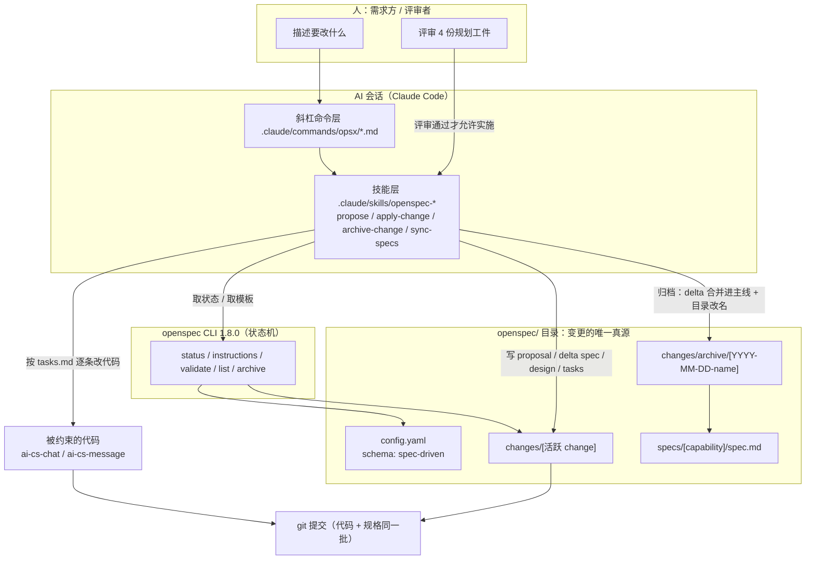
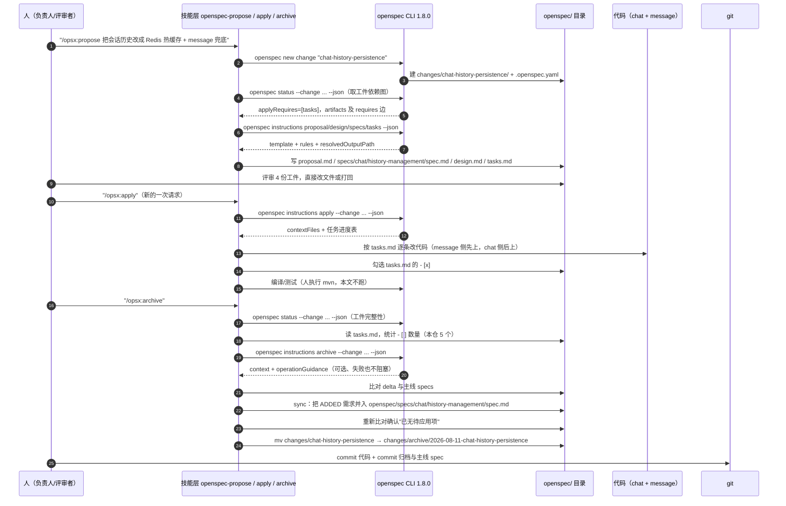

# OpenSpec 实战：把「会话历史持久化」做成一个可归档的变更

> **一句话结论**：OpenSpec 真正解决的问题不是「让 AI 多写几份文档」，而是把**一次变更本身**变成有状态、可评审、可归档的对象——`openspec list` 能回答"哪个变更还没做完"，`archive/` 能回答"三个月前这个字段为什么这么设计"，而这两件事 git 提交记录都答不上来。
> **阅读前置**：了解 chat 服务的一次对话大概经过 `ChatController → ChatServiceImpl → ChatClient`（见 `05-AI集成/01-SpringAI框架集成/01-SpringAI入门.md`），并且用过 git 分支；不需要装 OpenSpec，本文所有命令都能在本仓库只读复现。
> **证据基线**：本仓库 OpenSpec CLI **1.8.0** + `schema: spec-driven`；A 级 0 条、B 级 20 处（openspec 工件 / SKILL 文本 / chat·message 源码 / Spec-Kit 对照物）、C 级 6 条（分档见下表）；预计阅读 25 分钟。

**证据边界（先摊牌再讲）**

| 类别 | 本仓状态（实测） | 本篇怎么处理 |
|---|---|---|
| A 级（已入库源码摘录） | `learning-docs/24-源码分析/assets/source/` 共 908 个摘录文件，用 `Select-String -Pattern 'openspec\|OpenSpec\|spec delta'` 扫描 **0 命中** | 本篇 A 级 0 条。凡涉及 OpenSpec 内部实现（schema 引擎、store 解析）一律标注「未入库，依据官方文档与本仓 SKILL 文本」 |
| B 级（本仓库真实文件） | `openspec/` 目录真实存在（1 个活跃 change、2 个已归档 change、4 个主线 capability）、`.claude/skills/openspec-*` 技能、`ai-cs-chat`/`ai-cs-message` 落地代码、`.specify/` 与 `specs/005-after-sales-agent/` 对照物 | 路径 + 行号引用，行号均当次 `read` 核对 |
| C 级（可复现实测） | `openspec` CLI 只读命令（`--version`/`list`/`status`/`validate`）、pwsh 静态统计（目录树、勾选框、`Compare-Object`） | 每条给完整命令 + 真实输出 + 统计口径；全程不联网、不启动服务、不跑构建 |

---

## 0. 先看现象

**现象一：三个月后没人说得清某个字段/结构为什么这么设计。**
会话历史的 Redis key 为什么是 `chat:history:{sessionKey}` 的 **List**，而不是 Hash？为什么消息 DTO 只留 `role` + `content`，而不直接序列化 Spring AI 的 `Message`？代码里只剩 `rightPush` / `range`，理由全丢了。**答案其实还活着**——`openspec/changes/archive/2026-08-11-chat-history-persistence/design.md` 的 L20-L24（D1 决策）写着：

> 备选：`Hash`（field=index）不便于顺序读取；序列化整个 `List<Message>` 为单 key 字符串在并发追加时有覆盖风险 → 弃用。

注意这份理由的存放位置：不在代码注释里、不在提交信息里，而在 `archive/` 下。**它没有跟着会话历史功能一起被删除，因为归档目录是变更的化石层。**

**现象二：AI 新会话从零开始，重复踩已经踩过的坑。**
换个 AI 会话窗口，模型读不到上一轮讨论——它既不知道"message 模块原来只支持按数据库主键 `sessionId` 查"，也不知道"回源要限 200 条"。这些事实在 `design.md` L3（Context）和 L58（Risk）里躺着，但**只有把它当文件读一遍**才能恢复。本仓库的 `openspec-propose` 技能把这条写成了硬约束（`.claude/skills/openspec-propose/SKILL.md` L146）：

> Always read dependency artifacts before creating a new one - re-read from disk, not from conversation memory (files may have changed since you last saw them)

**现象三：需求改了，但 specs 没改——而且本项目有"两套 specs"。**
本仓库同时存在两套规格体系：`specs/005-after-sales-agent/spec.md`（Spec-Kit 产物，14 条 `FR-` 编号需求，统计见 §6 手法三）与 `openspec/specs/chat/*` 下的 4 个 capability（OpenSpec 主线规格）。改代码不动规格时，两边都会静默漂移，而**没有任何一条 `git commit` 会报警**。

顺便把探测结果直接说清（不假设、不脑补）：本仓库 `openspec/` 目录**真实存在**，`openspec/config.yaml` 32 行、首行 `schema: spec-driven`；当前 **1 个活跃 change**（`openspec/changes/2026-08-18-prompt-config/`）、**2 个已归档 change**（`archive/2026-08-11-chat-history-persistence/`、`archive/2026-08-14-llm-observability-cost-governance/`）、**4 个主线 capability**（`openspec/specs/chat/{history-management,llm-observability,model-usage,online-evaluation}/spec.md`）。项目是从 2026-08-11 那次会话历史变更开始用 OpenSpec 的——物证是归档目录里那份 `.openspec.yaml` 的 `created: 2026-08-11`。

**这些现象指向同一件事：变更的"状态"和"理由"没有跟代码一起被版本化。** 代码有 git，进度有口头，理由有记忆；只有 OpenSpec 把三者塞进同一个可 diff 的目录。

---

## 1. 整体地图



> **读图说明**：最关键的是两条箭头。第一条是从 `SK`（技能层）指向 `CLI` 的「取状态/取模板」——意味着**工件长什么样不是 AI 现编的**，模板和依赖顺序由 CLI 的 `openspec instructions` 下发；如果把这条箭头看成"AI 自己决定写什么"，就会得出"OpenSpec 只是个提示词包"的错误结论。第二条是从 `AR` 指向 `MS` 的「delta 合并进主线」——归档不是把目录挪走就完事，它会**改写主线 spec**；看错这条会以为归档是纯搬家操作，从而漏掉"归档前必须评估 delta 同步状态"这一步（本仓库 `openspec-archive-change` SKILL L89-L128 整段都在干这件事）。

**组件 / 责任 / 参与方**

| 组件 | 物理位置（本仓真实路径） | 责任 | 谁触发 |
|---|---|---|---|
| 默认 schema 声明 | `openspec/config.yaml`（32 行，L1 = `schema: spec-driven`） | 声明用哪套工件图；注释段示范 `context` / `rules` / `operations` 三段可配置项 | 人（一次性） |
| 活跃 change | `openspec/changes/2026-08-18-prompt-config/` | 承载**未完成**变更的 proposal / delta spec / design / tasks | `/opsx:propose` |
| 归档 change | `openspec/changes/archive/2026-08-11-chat-history-persistence/` 等 2 个 | 承载**已完成**变更的全套工件 + `.openspec.yaml`（schema + created 日期） | `/opsx:archive` |
| 主线规格 | `openspec/specs/chat/history-management/spec.md`（45 行）等 4 个 | 当前"系统必须做到什么"的合并后事实 | sync / archive 时写入 |
| 技能层 | `.claude/skills/openspec-{propose,apply-change,archive-change,sync-specs,update-change,explore}/SKILL.md` | 把 CLI 的原子能力编成带护栏的流程（含"规划阶段不许改代码"） | Claude Code 加载 |
| 斜杠命令层 | `.claude/commands/opsx/{propose,apply,archive,sync,update,explore}.md` | 人手动入口，内容与技能同源 | 人 |
| CLI | 本机 `openspec` 命令，版本 1.8.0 | 状态机与校验器：`status` 判工件是否齐全、`validate` 判格式、`archive` 搬目录 | 技能内部调用 |
| 被约束的代码 | `ai-cs-chat/src/main/java/...`、`ai-cs-message/src/main/java/...` | 实现 delta spec 里写的行为 | `/opsx:apply` 期间 |
| 镜像技能 | `.agents/skills/openspec-*` + 标记文件 `.agents/skills/.openspec-target` | 给其他 IDE/工具复用同一套技能 | 同步脚本 |

---

## 2. 关键概念与关键要素

先给结论：**OpenSpec 的核心模型只有 5 个对象（change / proposal / spec delta / tasks / archive），加上 2 个约定（capability 路径、schema）**，其余都是它们的组合。术语首现解释如下。

| 名称 | 位置（本仓实例） | 角色 | 关键点 |
|---|---|---|---|
| **change（变更）** | `openspec/changes/2026-08-18-prompt-config/` | 一个"待落地的变更"的容器目录，名字 kebab-case，**可与 git 分支同名** | 有生命周期：活跃 → 归档；`openspec list` 只列活跃的，归档后从列表消失（本仓实测只剩 1 条） |
| **`.openspec.yaml`** | 归档件 `archive/2026-08-11-chat-history-persistence/.openspec.yaml`（2 行：`schema: spec-driven` + `created: 2026-08-11`） | change 自己的"出生证明" | 活跃 change 里**没有**这个文件（`2026-08-18-prompt-config` 就没建全），归档件里必有——因为它随目录一起被 `mv` 走（archive SKILL L173） |
| **proposal（提案）** | `archive/2026-08-11-chat-history-persistence/proposal.md`（29 行） | 回答 **Why / What / Impact**：为什么要改、改什么、动谁 | 固定四段：`## Why`、`## What Changes`、`## Capabilities`、`## Impact`（L1/L5/L15/L23）；`Capabilities` 下再分 `### New Capabilities` 与 `### Modified Capabilities` |
| **spec delta（规格增量）** | `archive/.../specs/chat/history-management/spec.md`（45 行） | 只描述**本次新增/修改/删除**的需求，**不是主线 spec** | 头部用 `## ADDED Requirements`（L5），主线合并后变成 `## Requirements`；一个 change 可以有多个 delta（observability 那个 change 有 3 个） |
| **Requirement / Scenario** | delta spec L7、L10-L12 | 需求最小可验证单元 | `### Requirement: <名>` + 一句含 `SHALL`/`MUST` 的陈述；下挂 `#### Scenario: <名>` + `WHEN`/`THEN` |
| **tasks（任务清单）** | `archive/.../tasks.md`（40 行，23 个勾选框） | 实施阶段的进度条 | 分组编号 `## 1.` … + `- [x] 1.1`；归档**允许**未勾选但必须显式告警（archive SKILL L76-L87） |
| **archive（归档）** | `openspec/changes/archive/<YYYY-MM-DD-name>/` | 变更的化石层 | 目录名强制日期前缀，已有日期则不叠加（archive SKILL L137）；目标存在则报错而不是覆盖（L139-L141） |
| **capability（能力）** | 目录路径即能力名：`chat/history-management` | 规格的归属单位，对应一组需求 | 路径相对 `openspec/specs/`；delta 与主线**必须用同一路径**才对得上 |
| **schema（工作流模式）** | `openspec/config.yaml` L1 | 决定"要生成哪几份工件、依赖顺序如何" | 当前 `spec-driven`：proposal → specs → design → tasks；`design.md` 在 spec-driven 里是**条件工件**（可跳） |
| **store（规格库）** | 本仓未使用（SKILL 里给了 `--store` 用法与"就近 `openspec/` 根"回退规则） | 多仓库共享一份规格的机制 | 内部解析实现未入库，依据官方文档与本仓 SKILL L15/L29 文本 |


> **读图说明**：这张图画的是**状态机而不是流水线**，两处回边是关键：`R → P1`（评审能打回重写，本仓 prompt-config 的 delta spec 里还留着 `## MODIFIED Requirements` 的空占位注释，就是反复对齐的痕迹）与 `V → A2`（验证不通过回到实施）。最容易看错的是把 `S2`（sync）当成可选：如果漏掉它直接 `archive`，主线 `openspec/specs/...` 就不会被改写，下一轮 change 会基于错误的主线继续叠加——本仓之所以能用 `Compare-Object` 证明"只差一行"，正是因为那次 sync 确实执行过。

---

## 3. 原理与证据逐段精读

每小节都按四层走：在干什么 → 为什么这么设计 → 换成别的写法会怎样 → 常见坑。

### 3.1 变更是一个有状态的对象，不是一次对话

**在干什么**
`openspec status --change <name>` 把 change 目录里的**文件存在性**翻译成一份工件进度表；`openspec list` 把 `changes/` 下每个目录翻译成"任务进度 + 日期"。本仓实测输出（命令与输出见 §6 手法一）：

```text
Change: 2026-08-18-prompt-config
Schema: spec-driven
Change root: D:\Projects\Persion\ai-customer-service\openspec\changes\2026-08-18-prompt-config
Progress: 4/4 artifacts complete

[x] proposal
[x] specs
[x] design
[x] tasks
```

**为什么这么设计**
因为 AI 会话本身没有任何持久状态：关掉窗口，上下文就没了。把状态外化成**目录里的文件**，状态就同时获得三件免费能力——可 diff（git）、可评审（PR 里看文件）、可恢复（新会话读文件）。本仓 `openspec-propose` SKILL L108 甚至专门警告这种"状态"的边界：

> `status` is file-existence only, so an `applyRequires` artifact reading `done` does NOT mean its dependencies exist - writing `tasks.md` early marks `tasks` done while `specs` was never written

**换成别的写法会怎样**
- 只靠对话上下文 → 窗口一换就归零（现象二）。
- 只靠 Jira/看板 → 状态在系统里，理由（为什么选 Redis List）在评论里，代码一合并就和工单脱钩；且 AI 读不到工单。
- 只靠 `tasks.md` 一个文件 → 会退化成 todo list，没有 proposal/design 兜住"为什么"，也没有 delta spec 兜住"验收什么"。

**常见坑**
把 `status: done` 当验收通过。`status` 只查文件是否存在，`openspec validate --strict` 才查格式，**行为对不对**只有 delta spec 的 Scenario 和测试能查——这三层在本仓是分开的，别混为一谈。

### 3.2 delta spec：为什么改规格要"写增量"而不是"改主线"

**在干什么**
change 里的 `specs/<capability-path>/spec.md` 是**增量**，用四个头部之一声明意图：`## ADDED Requirements` / `## MODIFIED Requirements` / `## REMOVED Requirements` / `## RENAMED Requirements`（枚举来自 `.claude/skills/openspec-sync-specs/SKILL.md` L67-L70）。归档（或单独 sync）时，agent 读增量、**智能合并**进主线——不是整文件覆盖（sync SKILL L15：`agent-driven intelligent merging`）。

**为什么这么设计**
两个 change 并行时不冲突。如果每个 change 都直接改主线 `openspec/specs/...`，两个分支一起合并就是 Markdown 级冲突，而且评审者看不出"这次新增了什么"。delta 让"本次意图"变成结构化的、可被机器识别的集合运算。

**换成别的写法会怎样**
主线直接改 → 归档时没有"本次新增"的证据，评审只能靠人肉 diff；同 capability 两变更并行时 git 冲突；而且没法做"归档前必须先同步"的检查（因为没有 delta 这个概念可查）。

**常见坑（本仓有物证）**
- **写成 `## Requirements`**：delta 里出现主线风格的头部，sync 时就识别不出"要新增什么"。本仓所有 delta 都老老实实写 `## ADDED Requirements`（4 处，见 §6 手法二的统计）。
- **capability 路径不一致**：delta 在 `specs/chat/history-management/spec.md`，主线也必须在 `openspec/specs/chat/history-management/spec.md`；路径错一层，sync 会写出一份新的空 capability。
- **占位段落忘了写**：`2026-08-18-prompt-config` 的 delta spec L62 有 `## MODIFIED Requirements`，下面是一行注释 `<!-- 无：本 capability 为新增，不修改既有 spec 需求。 -->`——这是正确姿势：**明确说"没有"，而不是删掉这一节让人猜**。

### 3.3 需求必须写成「Requirement + Scenario」，这是能归档的前提

**在干什么**
两套规格体系的写法完全不同，本仓各有一份现成样本：

| 维度 | OpenSpec（`openspec/specs/chat/history-management/spec.md`） | Spec-Kit（`specs/005-after-sales-agent/spec.md`） |
|---|---|---|
| 需求载体 | `### Requirement: 会话历史持久化存储`（L7） | `## 功能需求`（L179）下的 `**FR-001**` 列表，实测 14 条 |
| 可验证性 | 每条需求下挂 `#### Scenario:` + `WHEN`/`THEN`（如 L43-L45「查询不存在的会话 → 返回空列表，不报错」） | 主要靠 `## 用户场景与测试` 里的用户故事 + 优先级（L10「用户故事 1 - 售后 Agent 一站式闭环（优先级：P1）」），实测 `WHEN/THEN` 字样 **0 处** |
| 澄清区 | 无独立区块（决策进 `design.md` 的 `## Decisions`） | 有 `## Clarifications`（L155）+ `### Session 2026-08-14`（L157） |
| 顶部治理 | 每 change 一份 proposal 讲 Why | `.specify/memory/constitution.md` 项目宪法（如 L21 第2条 SDD 流程强制规范、L35 第2-1条 TDD 强制规范） |

**为什么这么设计**
`WHEN/THEN` 是**可直接翻译成测试用例**的句型。"调用方请求一个没有历史记录的 sessionKey → 返回空列表，不报错"这一条，正好对应 `ChatHistoryServiceImpl.fallbackToMessage` 在回源返回空时的 `return new ArrayList<>()`（`ai-cs-chat/src/main/java/com/aics/chat/service/impl/ChatHistoryServiceImpl.java` L90-L92）。规格和代码能对上，不是靠自觉，而是因为句型逼你把边界情况写出来。

**换成别的写法会怎样**
只写"支持历史回看"这种自然语言需求 → 归档时无法判断实现覆盖了几条，`openspec list --specs` 也就没法告诉你每个 capability 有多少需求（实测：`chat/history-management` requirements 4、`llm-observability` 5、`model-usage` 4、`online-evaluation` 5）。需求计数能力来自结构，不来自勤奋。

**常见坑**
Scenario 写成实现细节（"调用 Redis 的 LRANGE"）。Scenario 描述**可观测行为**，实现细节属于 `design.md`。本仓 delta spec 写的是"该消息被追加到对应 sessionKey 的 Redis 历史缓存"（L12），把 Redis 说成了行为的一部分——这是**规格已经泄漏实现**的边界案例：它能工作，但以后换存储就得改规格。这类判断要写进设计取舍，而不是假装没发生。

### 3.4 design.md 的价值是「记录了被否决的方案」

**在干什么**
`archive/2026-08-11-chat-history-persistence/design.md`（71 行）分五段：`## Context`（L1）、`## Goals / Non-Goals`（L5）、`## Decisions`（L18，D1~D6）、`## Risks / Trade-offs`（L53）、`## Migration Plan`（L61）、`## Open Questions`（L69）。每条 Decision 都写成"选了什么 + 备选为什么弃用"。

**为什么这么设计**
代码只能表达"是什么"，永远表达不了"为什么不是另一种"。D1（L20-L24）同时否决了两个备选：`Hash` 不便于顺序读取、整串 JSON 并发追加有覆盖风险。D2（L26-L28）否决 Redisson：「本期无锁需求」。**否决理由是最容易在三个月后消失的信息**，也是"现象一"的根源。

**换成别的写法会怎样**
只写"我们用 Redis List 存历史" → 下一个人想改成 Hash 时没有任何阻力信息，可能重走一遍失败路径；或者反过来，看到 List 就以为是为了省事。风险项也一样：L58 那句「回源建缓存时限制条数（如最近 200 条）」直接对应了代码里的 `selectBySessionKey(sessionKey, 200)`（`ai-cs-message/src/main/java/com/aics/message/service/impl/MessageServiceImpl.java` L120）——没有 design.md 的这句，200 这个魔数就是不可解释的。

**常见坑**
- **Non-Goals 写成愿望**：本仓写的是「不做 `chat_session` 表的会话创建/关联」（L15）、「不引入消息时序一致性事务（依赖 MQ 最终一致）」（L16），是可判定的边界；写成"暂不支持高级功能"就等于没写。
- **Risks 只写风险不给动作**：每条形如「[风险] → [应对]」，L55-L59 五条全部带箭头。
- **Migration Plan 忽略发布顺序**：L63 第 1 步「先在 ai-cs-message 侧新增按 sessionKey 查询能力（独立发布，向后兼容）」——**先让被调用方上线**，这是跨服务改造里最容易漏的顺序约束。

### 3.5 tasks.md 是进度条，不是愿望清单

**在干什么**
`archive/.../tasks.md` 按交付边界分 6 组（message 侧能力 → chat 侧依赖 → 历史组件 → 改造 ChatServiceImpl → 回看接口 → 验证联调），每条形如 `- [x] 3.2 新增 ChatHistoryService：load(sessionKey)…`。归档时的真实勾选状态（C 级统计，见 §6 手法三）：`done=18 open=5 total=23`。

**为什么这么设计**
任务粒度决定能不能"边做边确认"。分组还隐含了**依赖顺序**——组 1 是组 3 的前置（chat 侧 Feign 要调 message 侧新端点）。归档不要求全勾（archive SKILL L82-L85：列出未完成数量 → 请用户确认 → 确认后继续），因为有些任务本质需要环境（双实例、重启验证），强行要求等于逼人造假。

**换成别的写法会怎样**
不加勾选框 → 归档前无法回答"这个变更做完了吗"，只能靠聊天记录；把验证类任务删掉凑 100% 勾满 → 归档件看起来完美，但"没在真实环境验证过"这个事实被抹掉了。本仓选择**留着 5 个未勾选项并归档**，这比"假装做完"诚实得多，也是本文档正在做的事：`§9 练习`里有 4 条就是把那 5 个未勾选项变成可执行步骤。

**常见坑**
- 任务写成"实现会话历史功能" → 无法逐条勾，任务清单退化成标题。
- 勾选时机和代码脱节：先勾后写，回头看 tasks.md 全是 `[x]`，而 `ChatServiceImpl` 里连 `chatHistoryService.load` 都没有。**验证手法**：直接数调用点（§6 手法三，实测 `load(` 5 处、`append(` 9 处）。

### 3.6 归档 = 三件事：检查 → 合并 delta → 目录改名

**在干什么**
`openspec-archive-change` SKILL 把归档拆成 6 步：选 change → 查工件完整性（L62-L74）→ 查任务完成度（L76-L87）→ **评估 delta 同步状态**（L89-L128）→ 执行归档（L130-L145）→ 出摘要（L147-L167）。第 4 步是关键：比对每个 delta 与主线，判断需要 add/modify/remove/rename 什么，然后 inline 跑 `openspec-sync-specs`，**再重新比对一遍**确认"没有东西待应用"，最后才 `mv`。

**为什么这么设计**
因为归档后目录就"死"了：`changeRoot` 被移走，任何人再想读 delta 都得翻 `archive/`。如果合并没做完就搬，主线 spec 会永久缺一截，而错误会被下一次 change 继承。SKILL L120 甚至禁止把 sync 扔到后台：

> Do not delegate it to a background task — step 5 would move `changeRoot` out from under a sync that is still reading it, leaving the change archived and the main specs never updated.

**换成别的写法会怎样**
- 只 `mv` 不 merge → 主线 specs 是空壳/旧版，`openspec list --specs` 的 counts 就是错的。
- 先 merge 再检查 → 出了问题无法回退（目录已搬），只能手工 `git checkout`。
- 用脚本整文件覆盖主线 → 会丢主线里别的 change 追加的需求。

**常见坑（本仓可验证）**
归档后**路径变了**：`changes/<name>/` → `changes/archive/YYYY-MM-DD-<name>/`，日期还会被强制前置（L137「Never stack a second date」）。旧稿把 change 目录写成 `openspec/changes/chat-history-persistence/`，在归档之后这个路径确实不存在了——查证命令与真实结果见 §6 手法二。

### 3.7 变更与代码分支：1:1 的约定，不是强约束

**在干什么**
OpenSpec **不创建 git 分支**。`openspec new change "<name>"` 只做一件事：在规划根下建出带 `.openspec.yaml` 的目录骨架（propose SKILL L62-L69）。分支是 git 的职责。两者靠**同名约定**对齐：本仓 Spec-Kit 侧把这条写进了 `CLAUDE.md` 的 `<!-- SPECKIT START -->` 块——当前活动功能 `005-after-sales-agent`、分支 `005-after-sales-agent`，三个标识（feature-id、分支名、目录名）同名。

**为什么这么设计**
变更的边界（"这次改了什么"）和代码的边界（"这次合并了什么"）本来就是同一个东西，只是表述方式不同：change 用文件表达意图，分支用提交表达实现。同名让"从 commit 反查规格"成本降到零：`git log` 看到分支名 → `openspec show <同名 change>`。

**换成别的写法会怎样**
- 一个分支塞多个 change → 回滚一个变更等于回滚整条分支，change 的"可归档独立性"失效。
- 一个 change 跨多分支 → 归档时不知道"到底哪部分真的上线了"，tasks.md 的勾选会变成猜。
- 完全不对齐（分支叫 `feature/x`、change 叫 `add-dark-mode`）→ 三个月后两边对不上（现象一）。

**常见坑**
把归档时机定在"代码合并后很久"。归档应该发生在**合并动作附近**：此时已知哪些任务真的完成、哪些留待环境；拖久了 tasks.md 的勾选就靠回忆了。

### 3.8 对 AI 协作的真正意义：文件是跨会话的内存

**在干什么**
技能文本里反复出现三类护栏，全部指向同一件事——**状态必须从磁盘读，不能从记忆读**：
1. 规划阶段隔离：propose SKILL L15「This workflow creates planning artifacts only… Do not edit project code」，即 `propose` 与 `apply` 是两次**独立的人类请求**。
2. 依赖重读：propose SKILL L146「re-read from disk, not from conversation memory」。
3. 同步不可并行：archive SKILL L176「Never archive while a spec sync is still in flight」。

**为什么这么设计**
LLM 会话的三个物理事实：上下文窗口有上限、上下文会被压缩（本文档所在仓库的 `billion-context` 压缩机制就是活例子）、会话会断。把事实写进仓库，等于给 AI 一个**可寻址的外部内存**：新会话只要 `read` 这几个文件，就恢复了上个会话的状态与理由。这和"提示词工程"是两类问题——前者解决"知识放哪"，后者解决"话怎么说"。

**换成别的写法会怎样**
把状态塞进 prompt / 塞进聊天记录 → 每次新会话都要人肉复述，而人肉复述必然丢细节（"回源限 200 条"这种参数第一个丢）。更糟的是无法验证：模型说"已经实现了"，你没有文件可以核对。

**常见坑**
- 工件写给人看、机器读不出来：Scenario 里全是叙述，`openspec validate` 能过，但下一次 change 想复用就提取不出需求条目。
- 把 `design.md` 当 README 写：没有 `Decisions` 段，就退化成"技术方案介绍"，被否决的方案永久丢失。
- 让 AI 在同一次请求里"规划完顺手实现"：propose SKILL L15 明确禁止，因为**评审动作会被跳过**——评审是本模型里唯一的人类门禁。

---

## 4. 一次完整执行时序

以本仓真实发生过的会话历史变更为蓝本（change 名 `chat-history-persistence`，归档于 `2026-08-11`）。



> **读图说明**：请盯住第 8 步到第 9 步之间的**人**。整个流程里只有两处人类门禁：`评审 4 份工件`（第 8 步之后）和 `"/opsx:archive"`（第 22 步）。其余步骤之间**没有**人工确认——如果把这条边界看错，以为"`/opsx:propose` 会顺手把代码也改了"，就会得出"OpenSpec 会自动实现需求"的错误结论；反之，如果以为归档完全自动，就会漏掉第 25 步"5 个任务未勾选需要人确认"这个真实发生的交互。第二关键点是第 28 步 `sync` 在第 30 步 `mv` **之前**——顺序颠倒会让主线 spec 永久缺失。

**每一步失败会怎样（谁兜底）**

| 环节 | 失败表现 | 兜底机制 | 本仓证据 |
|---|---|---|---|
| `new change` | 同名 change 已存在 | 技能会先问"继续它还是新建"，不静默覆盖 | propose SKILL L148 |
| 取 instructions | CLI 非 0 / JSON 非法 | propose 阶段直接停；archive 阶段的 `instructions archive` 被明确允许"降级继续" | archive SKILL L41-L45 |
| 写工件 | 少写一份（如漏 design） | `status` 显示 3/4，`apply` 前会看到 `blocked` 状态 | apply-change SKILL L53-L54 |
| 评审 | 需求写错方向 | 人直接改文件（工件是普通 Markdown），打回重写 | 本仓 prompt-config delta spec L62 的 `MODIFIED` 占位注释 |
| 实施 | 漏改一侧服务（只改 chat 不改 message） | 编译期报"找不到符号"；Feign 路径与 Controller 路径必须字面一致 | 旧稿记录的真实坑：`找不到符号 selectBySessionKey` |
| 实施 | 任务勾了但没实现 | 只能靠核查调用点数量发现（§6 手法三） | 实测 `load(` 5 处 / `append(` 9 处 / `sessionHistory` 0 处 |
| 归档检查 | 工件不齐 / 任务未勾 | 告警 + 要求确认，**不阻断** | archive SKILL L71-L74、L82-L85 |
| sync | 合并写错 | 归档前**重新比对**，不匹配就停且**不搬目录**（目录还完整） | archive SKILL L122-L128 |
| sync | 被并行执行 | 禁止后台化，必须 inline 完成 | archive SKILL L120、L176 |
| 归档移动 | 目标目录已存在（同日同名） | 直接报错，提示改名或换日期 | archive SKILL L139-L141 |
| 运行验证 | 需要真实中间件（Redis/Nacos/RocketMQ）才能验 | **允许归档时留未勾选项**（本仓 5 个） | `archive/.../tasks.md` L6、L37-L40 |

---

## 5. 设计取舍

**四个真实取舍（都有本仓物证）**

| 取舍点 | 本仓选择 | 替代方案 | 代价 / 收益 | 证据 |
|---|---|---|---|---|
| 规格组织方式 | **delta + 主线分离**（`## ADDED Requirements` → 合并成 `## Requirements`） | 每个 change 直接改主线 spec | 代价：多一步 sync；收益：变更意图可机器识别、并行不冲突 | 两条 C 级输出：delta 与主线 45 行对 45 行，`Compare-Object` **只差 1 行** |
| 状态载体 | **仓库里的 Markdown 文件** | Jira / 数据库 / 纯对话 | 代价：没有看板视图、没有权限模型；收益：可 diff、AI 可读、与代码同批提交 | `openspec/changes/archive/...` 全套工件随 git 走 |
| 归档门禁强度 | **告警不阻断**（未勾任务、未完成工件都能确认后归档） | 硬门禁（不 100% 不出关） | 代价：可能出现"归档了但没跑过真环境"；收益：不为凑指标造假 | 归档件 `tasks.md` `done=18 open=5` 仍然躺在那儿 |
| 与 Spec-Kit 并存 | **两套都留**：`specs/`（Spec-Kit）与 `openspec/specs/`（OpenSpec） | 二选一 | 代价：规格漂移风险翻倍（现象三）；收益：历史资产不丢、可按场景选 | `CLAUDE.md` 的 SPECKIT 块 + `openspec/config.yaml` 同仓共存 |

**可扩展点清单（按改动成本从低到高）**

1. **补 `openspec/config.yaml` 的 `context` 段**（当前 L3-L10 全是注释示例）：写上"本项目技术栈、命名规范、JaCoCo 门禁"等，AI 生成工件时会自动带上这些约束，不用每次重复交代。
2. **补 `rules` 段**（L12-L20 示例）：例如强制 `proposal.Why` 至少 3 条、`tasks` 每条 ≤ 半天——把团队写作习惯变成机器约束。
3. **补 `operations` 段**（L22-L32 示例）：给 `apply` / `archive` 加额外指引（如"archive 前必须先跑 `mvn -pl ai-cs-chat test`"）。注意它的定位是**建议**，不改变 CLI 契约（archive SKILL L49-L51）。
4. **把 `openspec validate --strict` 接进 CI**：当前只在技能流程里手动跑（本仓实测能过），接进流水线就能拦住"头部写错、路径写错"的 delta。
5. **补齐活跃 change 的 `.openspec.yaml`**：`2026-08-18-prompt-config` 目前没有该文件，归档时会缺 `created` 元数据；重新 `openspec new change` 出来的目录才有。
6. **双技能层自动化同步**：`.claude/skills/openspec-*` 与 `.agents/skills/openspec-*` 靠 `.agents/skills/.openspec-target` 标记手动/脚本同步，手改一侧就会出现两套行为不一致。
7. **拆细 capability 粒度**：当前 4 个 capability 全在 `chat/` 下；跨服务（如 history 涉及 message 侧查询）时，考虑在 delta spec 里明确"跨服务契约"归属，避免需求写进 chat 而实现落在 message。

---

## 6. 踩坑与调试手法

**踩坑表（现象 → 根因 → 验证手段 → 解法）**

| # | 现象 | 根因 | 验证手段 | 解法 |
|---|---|---|---|---|
| 1 | 归档后再去找 change 目录，报"路径不存在" | 归档把目录 `mv` 到 `changes/archive/` 且加日期前缀 | `openspec list`（只列活跃）；再看 `changes/archive/` | 直接去 `openspec/changes/archive/2026-08-11-chat-history-persistence/` 读；旧稿里写的 `openspec/changes/chat-history-persistence/` 已失效 |
| 2 | 脚本里 `openspec status ... 2>&1` 抓到一堆乱码/报错行 | CLI 把加载动画写到 **stderr**（`- Loading change status...`），pwsh 会包成 `NativeCommandError` | 只重定向 stdout：`& openspec status ... 2>$null` 或直接用 `--json` | 用 `--json` 解析；人读时才看默认输出 |
| 3 | 主线 spec 里少了一条需求，但 change 里明明写了 | 归档前没做 delta 同步，或 sync 失败后仍搬了目录 | `Compare-Object` 比对 delta 与主线（手法二） | 归档流程里先 sync 并**重新比对**，不匹配就停 |
| 4 | `tasks.md` 全勾，但代码里没有对应实现 | 勾选与实现脱节 | 数调用点（手法三）：`chatHistoryService.load(` 应为 5 处 | 勾选前先 `git diff` 看真实改动 |
| 5 | 编译报"找不到符号 `selectBySessionKey`" / "方法不会覆盖或实现超类型的方法" | 操作中误点了"拒绝"，工具把 mapper 与 service 接口回退，而调用方已改 | `git status` + `git diff` 对照哪些文件被还原 | 重新补齐 `@Select` 方法与接口声明（旧稿记录的真实事故，保留在此作为"AI 协作误操作"的典型） |
| 6 | 需求改了、`specs/` 与 `openspec/specs/` 都没改 | 两套规格体系并存，无自动联动 | 分别跑 `openspec list --specs` 与数 `specs/005-after-sales-agent/spec.md` 的 `FR-` 条数 | 约定"哪个体系是当前真源"，或在 change 的 `Impact` 段显式写"需同步 Spec-Kit 侧 spec" |
| 7 | 归档目录出现 `2026-08-11-2026-08-11-name` | 手工重命名时又加了一次日期 | `ls changes/archive/` | 交给 CLI/技能做改名（它按 L137 规则只在缺前缀时补） |

**手法一：用 CLI 读状态，而不是靠记忆（只读，30 秒内）**

```powershell
cd D:\Projects\Persion\ai-customer-service
& openspec --version
& openspec list
& openspec list --specs
& openspec status --change 2026-08-18-prompt-config
```

真实输出（统计口径：本机安装的 `openspec` 1.8.0，只读本地 `openspec/` 目录）：

```text
1.8.0
Changes:
  2026-08-18-prompt-config     18/23 tasks   2026/9/5
Specs:
  chat/history-management     requirements 4
  chat/llm-observability      requirements 5
  chat/model-usage            requirements 4
  chat/online-evaluation      requirements 5
Change: 2026-08-18-prompt-config
Schema: spec-driven
Progress: 4/4 artifacts complete
[x] proposal
[x] specs
[x] design
[x] tasks
All planning artifacts complete!
```

怎么读：`Changes:` 段只有 1 条 → 说明另外 2 个 change 已归档；`18/23 tasks` 与 `tasks.md` 的 `done=18 open=5` 完全一致（两处口径互相印证）；`Specs:` 段的 `requirements N` 是**主线**的需求计数，可直接拿来做"规格覆盖率"分母；`4/4 artifacts complete` 只说明文件齐了，**不代表任务做完**（18/23）。

**手法二：证明 delta 真的合并进了主线（这是"归档有没有生效"的唯一硬证据）**

```powershell
cd D:\Projects\Persion\ai-customer-service
$a = 'openspec\changes\archive\2026-08-11-chat-history-persistence\specs\chat\history-management\spec.md'
$b = 'openspec\specs\chat\history-management\spec.md'
Compare-Object (Get-Content $a -Encoding UTF8) (Get-Content $b -Encoding UTF8) | Format-Table -AutoSize
```

真实输出（统计口径：逐行文本比较，`<=` 表示只存在于左侧 delta，`=>` 表示只存在于右侧主线）：

```text
InputObject           SideIndicator
-----------           -------------
## Requirements       =>
## ADDED Requirements <=
```

怎么读：**45 行对 45 行，唯一差异是第 5 行的头部**。这直接证明了两件事：（1）那次归档确实执行了 sync，把 4 条 Requirement 原样搬进了主线；（2）"增量变主线"的机械动作就是把 `## ADDED Requirements` 换成 `## Requirements`，**内容一个字都不改**——所以如果你在主线里看到某条需求被改写，那一定是人手工动的，可以顺着 git blame 追。

**手法三：验证"规格说做了"与"代码真做了"是否一致（静态统计，不启动服务）**

```powershell
cd D:\Projects\Persion\ai-customer-service
$files = Get-ChildItem -Recurse -File ai-cs-chat\src\main\java -Include *.java
"sessionHistory 命中行数: " + ($files | Select-String -Pattern 'sessionHistory' -AllMatches | Measure-Object).Count
"chatHistoryService.load( 调用点: " + ($files | Select-String -Pattern 'chatHistoryService\.load\(' | Measure-Object).Count
"chatHistoryService.append( 调用点: " + ($files | Select-String -Pattern 'chatHistoryService\.append\(' | Measure-Object).Count
"chat 模块 java 文件数: " + $files.Count
'--- Spec-Kit 侧对照 ---'
$s = Get-Content specs\005-after-sales-agent\spec.md -Encoding UTF8
"FR- 条数: " + ($s | Select-String -Pattern '\*\*FR-\d+' -AllMatches).Count
"WHEN/THEN 行数: " + ($s | Select-String -Pattern 'WHEN|THEN' -AllMatches).Count
```

真实输出（统计口径：`ai-cs-chat/src/main/java` 下全部 `.java` 文本匹配计数；`FR-` 匹配 `**FR-` 开头的加粗编号）：

```text
sessionHistory 命中行数: 0
chatHistoryService.load( 调用点: 5
chatHistoryService.append( 调用点: 9
chat 模块 java 文件数: 215
--- Spec-Kit 侧对照 ---
FR- 条数: 14
WHEN/THEN 行数: 0
```

怎么读：`sessionHistory 0 命中` 是"内存 Map 已被彻底移除"的证据（对应 tasks.md 4.1）；`load(` 5 处 / `append(` 9 处说明持久化历史真的接进了对话主链路（`ai-cs-chat/src/main/java/com/aics/chat/service/impl/ChatServiceImpl.java` L335、L338、L356、L550-L551、L571、L574、L776、L856、L859、L885、L903）。而 Spec-Kit 那份 spec 的 `WHEN/THEN 0 处` 正好与 OpenSpec delta spec 的 Scenario 风格形成对照（§3.3）——**同一个仓库里，两套规格的"可验证性"不是同一个量级**。

**手法四：检查 delta 头部与勾选框是否自洽（归档前的自查）**

```powershell
cd D:\Projects\Persion\ai-customer-service
Get-ChildItem openspec -Recurse -File -Filter spec.md |
  Select-String -Pattern '^## (ADDED|MODIFIED|REMOVED|RENAMED) Requirements|^## Requirements' |
  ForEach-Object { "$($_.Path.Replace($PWD.Path+'\','')):$($_.LineNumber)| $($_.Line)" }
Get-ChildItem openspec -Recurse -File -Filter tasks.md | ForEach-Object {
  $t = Get-Content $_.FullName -Encoding UTF8
  "{0,-72} done={1,2} open={2,2} total={3,2}" -f $_.FullName.Replace($PWD.Path+'\',''),
    ($t | Select-String -Pattern '^- \[x\]' -AllMatches).Count,
    ($t | Select-String -Pattern '^- \[ \]' -AllMatches).Count,
    ($t | Select-String -Pattern '^- \[[ x]\]' -AllMatches).Count
}
```

真实输出（统计口径：`spec.md` 只匹配行首二级标题；`tasks.md` 只匹配行首勾选框 `- [x]` / `- [ ]`）：

```text
openspec\changes\2026-08-18-prompt-config\specs\chat\prompt-config\spec.md:5| ## ADDED Requirements
openspec\changes\2026-08-18-prompt-config\specs\chat\prompt-config\spec.md:62| ## MODIFIED Requirements
openspec\changes\archive\2026-08-11-chat-history-persistence\specs\chat\history-management\spec.md:5| ## ADDED Requirements
openspec\changes\archive\2026-08-14-llm-observability-cost-governance\specs\chat\llm-observability\spec.md:5| ## ADDED Requirements
openspec\changes\archive\2026-08-14-llm-observability-cost-governance\specs\chat\model-usage\spec.md:5| ## ADDED Requirements
openspec\changes\archive\2026-08-14-llm-observability-cost-governance\specs\chat\online-evaluation\spec.md:5| ## ADDED Requirements
openspec\specs\chat\history-management\spec.md:5| ## Requirements
openspec\specs\chat\llm-observability\spec.md:5| ## Requirements
openspec\specs\chat\model-usage\spec.md:5| ## Requirements
openspec\specs\chat\online-evaluation\spec.md:5| ## Requirements
openspec\changes\2026-08-18-prompt-config\tasks.md                            done=18 open= 5 total=23
openspec\changes\archive\2026-08-11-chat-history-persistence\tasks.md          done=18 open= 5 total=23
openspec\changes\archive\2026-08-14-llm-observability-cost-governance\tasks.md done=36 open= 0 total=36
```

怎么读：`changes/` 下 5 处 `ADDED`/`MODIFIED`、`specs/` 下 4 处 `Requirements`，**数量对不上是正常的**——一个 change 可以有多个 delta，多个 delta 又可能合并进同一个 capability。真正要看的规律是：**delta 目录（`changes/`）永远写 `ADDED|MODIFIED|REMOVED|RENAMED`，主线目录（`specs/`）永远写 `## Requirements`**。一旦你在 `changes/` 下看到 `## Requirements`，sync 就会漏掉它。勾选框统计则给出"归档门禁实际怎么执行的"：两个 2026-08 的 change 都是 5 个未勾选就归档了，而 observability 那个 36/36 全勾——说明团队对"环境依赖型任务"和"代码型任务"的容忍度不同。

---

## 7. ⚠️ 版本差异

旧稿写于 OpenSpec 早期用法，当前基线与它的差异集中在**命令形态、目录路径、工件元数据**三处。下表逐条给迁移动作。

| 项 | 旧写法（旧稿） | 当前基线（本仓实测） | 变化点 | 迁移动作 |
|---|---|---|---|---|
| 斜杠命令名 | `/opsx-propose`、`/opsx-apply`、`/opsx-archive`（连字符、无冒号） | `/opsx:propose`、`/opsx:apply`、`/opsx:archive`、`/opsx:sync`、`/opsx:update`、`/opsx:explore`（冒号命名空间） | `.claude/commands/opsx/propose.md` L27 原文是 `/opsx:propose`；技能层另有一套 `openspec-*`（`SKILL.md` 的 `generatedBy: "1.8.0"`） | 记命令用冒号形式；AI 里可用技能名 `openspec-propose` 等等价入口 |
| 命令层数 | 只有斜杠命令一层 | 两层：`.claude/commands/opsx/*.md` + `.claude/skills/openspec-*/SKILL.md`，并镜像到 `.agents/skills/` | 技能可被自动触发，命令只被人触发 | 想让人显式控制流程 → 用 `/opsx:*`；想让 AI 自己判断该走哪步 → 让它加载技能 |
| change 目录路径 | `openspec/changes/chat-history-persistence/` | 归档后为 `openspec/changes/archive/2026-08-11-chat-history-persistence/` | 归档会把目录移入 `archive/` 并**强制加日期前缀**（archive SKILL L137） | 文档里引用已归档 change 必须写全路径；否则三个月后查不到（现象一） |
| change 元数据 | 旧稿未提 | 每个 change 目录有 `.openspec.yaml`（2 行：`schema` + `created`） | 归档摘要与 `openspec show` 依赖它 | 手工建 change 目录时容易漏建；漏了就没有 `created` 字段 |
| 项目级配置 | 旧稿未提 | `openspec/config.yaml` 32 行，L1 `schema: spec-driven`，L3-L31 是 `context`/`rules`/`operations` 注释示例 | 配置项本身没被使用（全是注释） | 想统一工件风格，就在这三段里写实的 |
| 归档前同步 | 旧稿：「归档时检测到主线 spec 未同步，选择"同步后归档"」 | 现在有专门命令链路：`openspec instructions archive/specs --json` + inline 跑 `openspec-sync-specs` + 归档前**重新比对** | sync 从"归档的一个选项"升级为"带验证的独立工作流" | 需要单独同步（不归档）时用 `/opsx:sync` |
| `openspec list` 语义 | 旧稿未提 | 只列**活跃** change，并显示 `18/23 tasks` 与日期；`--specs` 另列主线需求数 | 进度信息被前置到列表层 | CI 里可用它做"是否有未完成变更"的看板 |
| 未勾任务数量 | 旧稿正文写"5 个未勾选"，但 §六 只列了 4 项 | `tasks.md` 实测 `done=18 open=5 total=23`，未勾选为 `1.4`、`6.2`、`6.3`、`6.4`、`6.5` | 旧稿漏记 `1.4`（编译并启动验证 ai-cs-message） | 以 `tasks.md` 文件为准，别抄文档 |
| stdout/stderr | 旧稿未提 | `openspec status` 会把加载动画写 stderr，pwsh 下被包成 `NativeCommandError` | 影响脚本抓输出 | 脚本里用 `--json` 或 `2>$null` |
| CLI 版本 | 旧稿未标 | 本机 `openspec --version` = **1.8.0**，`validate --strict` 通过 | 版本差异会带出命令参数差异（如 `--store`、`instructions archive`） | 升级后重跑 §6 手法一，确认四个命令都还在 |

---

## 8. 面试高频问与答

只列问题（能答上来才算真读懂，答案在正文各节，自测题里有部分参考答案）。

1. OpenSpec 里的 change 到底是什么？为什么说它是"有状态的对象"，状态存在哪？
2. spec delta 和主线 spec 是什么关系？为什么不直接改主线？
3. `## ADDED Requirements` / `## MODIFIED Requirements` / `## REMOVED Requirements` / `## RENAMED Requirements` 四种头部各自的合并语义是什么？
4. 为什么 OpenSpec 要求需求写成 `Requirement + Scenario(WHEN/THEN)`？这和"能归档"有什么因果关系？
5. 归档操作具体做了哪三件事？如果漏掉 sync 会发生什么？
6. 归档时允许存在未勾选任务，这个设计是偷懒还是合理？风险如何被控制？
7. `design.md` 里最容易被忽略、又最有价值的部分是哪一段？举个例子。
8. change 和 git 分支是什么关系？一个分支含多个 change 会带来什么问题？
9. 为什么 OpenSpec 的技能文本反复强调"从磁盘重读，不要用对话记忆"？
10. 在多服务改造（chat + message）里，`design.md` 的 Migration Plan 必须体现什么顺序约束？
11. OpenSpec 与 Spec-Kit 在"需求的可验证性"上的差异，从两份真实 spec 文件能看出什么？
12. 如果让你把这个仓库的 OpenSpec 用法接入 CI，你会挂哪几个命令？各自拦什么错？

---

## 9. 动手练习

全部只读或只改 `openspec/`（不碰别人的代码文件），每条都有可判定的验收标准。

**练习 1：用 CLI 复述项目现状（5 分钟）**
跑 §6 手法一的四条命令，然后不看文档回答：当前有几个活跃 change？主线有几个 capability、各自多少条需求？活跃 change 的任务完成率是多少？
*验收*：能给出 `1` 个活跃 change、`4` 个 capability、需求数 `4/5/4/5`、`18/23`，并且知道这些数字来自哪个命令的哪一段输出。

**练习 2：亲自证明"delta 已合并"（10 分钟）**
跑 §6 手法二，然后解释为什么输出只有 2 行。
*验收*：能说出"delta 与主线 45 行逐行相同，唯一差异是第 5 行头部 `## ADDED Requirements` → `## Requirements`"，并能推断"如果主线里某条需求的措辞被改过，git blame 一定指向人工提交"。

**练习 3：为一个未勾选任务写"可执行版本"（20 分钟）**
挑 `openspec/changes/archive/2026-08-11-chat-history-persistence/tasks.md` 里未勾选的 `6.5`（Redis 不可用时会话能降级继续），把它改写成 3 步可执行验证（命令 + 期望现象 + 失败时看哪行日志）。
*验收*：三步里至少有一处引用真实代码位置（如 `ChatHistoryServiceImpl.java` L54-L56 的 `log.warn("读取 Redis 会话历史失败，走回源…")` 或 L101 的降级 warn），且不看代码也能照做。

**练习 4：给活跃 change 补一份"证据缺口清单"（15 分钟）**
读 `openspec/changes/2026-08-18-prompt-config/` 下的 proposal/design/tasks，找出至少 2 处"设计里写了、但仓库里找不到实现痕迹"的条目。
*验收*：每条给出"design 的行号 + 你用来判断未落地的检索命令 + 检索结果"，例：用 `Select-String -Pattern 'PromptRegistry' -Recurse ai-cs-chat\src\main\java` 判断该类是否存在。

**练习 5：写一份"归档前自查清单"（20 分钟）**
基于 §6 的四个手法，产出一份 6~8 条的清单，每条必须是"命令 + 通过标准"。
*验收*：清单里至少包含"delta 头部统计"、"勾选框统计"、"delta↔主线 `Compare-Object`"、"`openspec validate --strict`"四项，且每条通过标准可被机器判定（不是"看起来合理"）。

**练习 6：补 `config.yaml` 的 `context` 段（15 分钟，唯一允许改文件的一条）**
把 `openspec/config.yaml` L3-L10 的注释示例替换成本项目的真实上下文（技术栈、命名规范、TDD/JaCoCo 门禁、分支约定），保持 YAML 合法。
*验收*：`openspec list` 与 `openspec validate 2026-08-18-prompt-config --strict` 仍然正常输出；`context` 至少覆盖 3 类约束；改完不产生任何新文件。

---

## 小结

- OpenSpec 的定位是**把变更做成对象**：change 有目录、有状态、有生命周期（活跃 → 归档），因此"哪个变更没做完"从口头问题变成一条命令。
- 核心模型只有 5 个对象：change / proposal / **spec delta** / tasks / archive，加 2 个约定（capability 路径、schema）。其余全是组合。
- delta spec 的存在目的是**让变更意图可被机器识别**：`ADDED|MODIFIED|REMOVED|RENAMED` → 合并成 `## Requirements`。本仓用 45 行对 45 行、只差 1 行的事实证明了这一点。
- 需求写法的价值在"可验证"：`Requirement + Scenario(WHEN/THEN)` 逼你把边界情况写出来，也让需求计数（4/5/4/5）成为可统计的分母。
- `design.md` 最珍贵的不是"选了什么"，而是**"否决了什么、为什么"**——那是三个月后唯一能救你的信息。
- 归档是三件事：检查工件与任务 → **合并 delta 进主线（并重新比对）** → 目录改名进 `archive/` 并加日期前缀；顺序错了主线就永久缺一截。
- 对 AI 协作的意义：文件是跨会话的内存。技能文本反复要求"从磁盘重读、规划与实施分开、sync 不许后台化"，本质都是"状态靠文件不靠记忆"。
- **可操作归纳**：任何一次改动开始前，先问三个问题——这次变更的**目录名（=分支名）** 叫什么？它的 delta spec 会**新增哪几条 Requirement**？归档时我需要**同步哪一份主线 spec**？三问答不出来，就别急着让 AI 改代码。

---

## 自测题

<details>
<summary>参考答案 1：change 是什么？状态存在哪？</summary>

change 是 `openspec/changes/<kebab-name>/` 下的一个目录，装本次变更的 proposal、spec delta、design、tasks 四类工件，外加 `.openspec.yaml` 记录 schema 与创建日期。它的"状态"不是数据库里的字段，而是**文件是否存在**与**tasks 里的勾选框**——所以 `openspec status` 只能判断工件齐不齐，判断不了做没做对。
</details>

<details>
<summary>参考答案 2：delta spec 与主线 spec 的关系？</summary>

delta 只写"本次要新增/修改/删除哪些需求"，用 `## ADDED Requirements` 等头部声明意图；主线 `openspec/specs/<capability>/spec.md` 是合并后的当前事实，头部为 `## Requirements`。之所以不直接改主线，是为了让多个并行变更不冲突、让"本次意图"可被机器识别，并支持归档前的一致性校验。
</details>

<details>
<summary>参考答案 3：四种 delta 头部的合并语义</summary>

`ADDED` 追加新需求；`MODIFIED` 替换既有需求的描述/场景（其他场景须保留）；`REMOVED` 删除需求（若某 capability 的最后一条被删，其主线 spec 应删除而不是留空文件）；`RENAMED` 以新名字存在、旧名字消失。归档流程会按这四类逐项验证"已无待应用项"。
</details>

<details>
<summary>参考答案 4：为什么 Requirement 必须配 Scenario？</summary>

因为归档与同步都依赖结构化条目：有 `### Requirement:` 才能计提数（`openspec list --specs` 显示 requirements 4/5/4/5），有 `WHEN/THEN` 才能把需求翻译成测试用例、判断实现是否越界。没有这两层，spec 就只是散文，既不能集合运算，也无法验收。
</details>

<details>
<summary>参考答案 5：归档做了哪三件事？漏 sync 会怎样？</summary>

检查工件完整性与任务完成度 → 评估并把 delta 合并进主线（并重新比对确认无待应用项）→ 把 `changeRoot` 移入 `changes/archive/` 并按需加 `YYYY-MM-DD-` 前缀。漏掉 sync 就直接搬目录，主线 spec 永久缺一截，且错误会被下一个 change 继承——因为下一个 change 是读主线来理解现状的。
</details>

<details>
<summary>参考答案 6：允许未勾选任务归档合理吗？</summary>

合理但必须显式化：归档会统计 `- [ ]` 数量、告警并要求用户确认。理由是部分任务本质依赖真实环境（双实例、重启、Redis 宕机降级），硬门禁会逼人造假。本仓 chat-history 变更就是 `done=18 open=5` 归档的，未勾选事实被完整保留在归档件里，可追溯。
</details>

<details>
<summary>参考答案 7：design.md 最值钱的是哪段？</summary>

`## Decisions` 里"备选方案为什么被否决"的部分。例如 D1 明确否决了 `Hash`（不便于顺序读取）和"整串 `List<Message>` 单 key 序列化"（并发追加有覆盖风险）。代码只能表达"是什么"，这段表达"为什么不是别的"，也是唯一能阻止后来人重走失败路径的材料。
</details>

<details>
<summary>参考答案 8：change 与分支的关系？</summary>

OpenSpec 不创建分支：`openspec new change` 只建目录。二者靠**同名约定**对齐（本仓 Spec-Kit 侧 feature-id、分支名、目录名三者同名）。一个分支塞多个 change 会让"回滚一个变更"变成"回滚整条分支"；一个 change 跨多分支则归档时无法判断哪些部分真上线，tasks 勾选只能靠猜。
</details>

<details>
<summary>参考答案 9：为什么强调"从磁盘重读"？</summary>

因为 LLM 会话的上下文会丢、会被压缩、会断，且同一次会话里用户可能刚改过文件。磁盘是唯一权威状态源。技能文本因此禁止依赖对话记忆，禁止把 sync 放后台执行，并要求规划与实施分成两次独立请求——都是为了让"状态"始终可被重新读取和验证。
</details>

<details>
<summary>参考答案 10：跨服务改造的顺序约束</summary>

必须"被调用方先上线"：本仓 Migration Plan 第 1 步是先给 `ai-cs-message` 加按 `sessionKey` 查询能力并独立发布（向后兼容），chat 侧才引入 Feign 调用。反过来做会让 chat 调用一个不存在的端点；现在代码里 `MessageFeignClient` 的 `/api/message/session-key/{sessionKey}/messages` 与 `MessageController` 的映射必须字面一致，就是这个顺序落地的结果。
</details>

<details>
<summary>参考答案 11：两套规格的可验证性差异</summary>

OpenSpec 侧每条需求下挂 WHEN/THEN Scenario，OpenSpec 主线能被计数并要求同步；Spec-Kit 侧 `specs/005-after-sales-agent/spec.md` 是 14 条 `FR-` 编号需求 + 用户故事 + 优先级，实测 `WHEN/THEN` 出现 0 次，可验证性主要靠后续的 tasks 与测试规格。差异不在"谁更好"，而在"哪种结构能被什么工具消费"。
</details>

<details>
<summary>参考答案 12：接 CI 该挂什么</summary>

至少挂三条：`openspec validate --strict`（拦 delta 头部写错、capability 路径错、格式非法）、`openspec status --change <name> --json`（拦工件不齐就进实施/归档）、以及"delta↔主线 `Compare-Object`"这类自建校验（拦归档后主线和 delta 不一致）。再进一步可以挂 `openspec list` 做"是否存在长期不收敛的活跃 change"的看板告警。全部只用 `--json` 或重定向 stdout，避免 stderr 的加载动画干扰解析。
</details>
