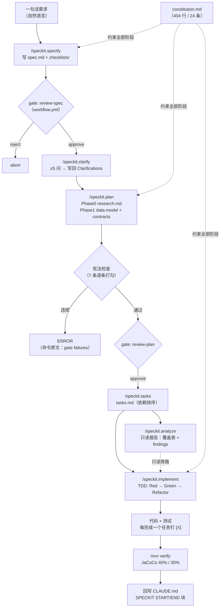
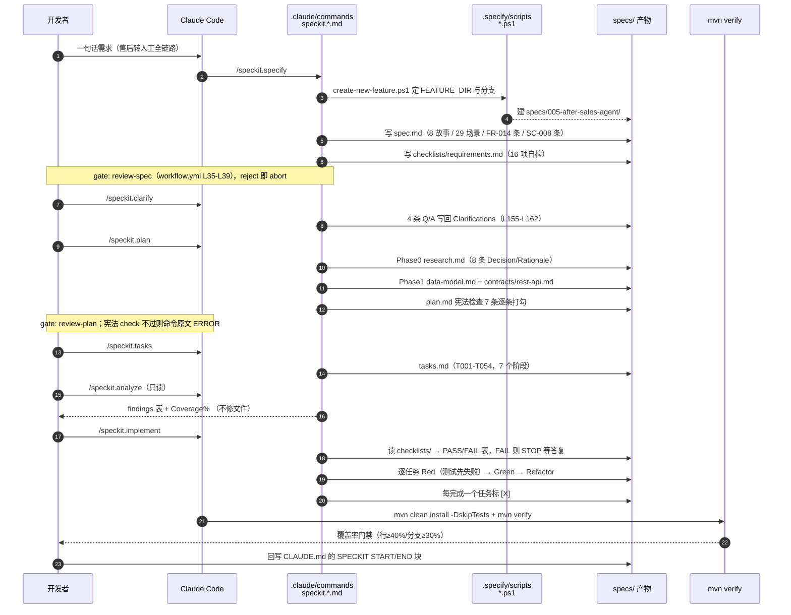

# Superpowers（Spec Kit）实战：把一句话需求拆成四段可验收产物

> 一句话结论：Spec Kit 的价值不在于"让 AI 多写几份文档"，而在于把一句需求拆成四个互相咬合的产物——**spec（要什么）→ plan（怎么做）→ tasks（按什么顺序做）→ implement（做完凭什么说做完）**，每一段都给下一段留下准入判据；本仓 `specs/005-after-sales-agent/` 是一条完整实例，同时也是一条反面样本：四段产物齐全、代码也写完了，但 `tasks.md` 的 54 个勾选框一个都没打。
>
> 阅读前置：读过同目录 `01-OpenSpec实战-会话历史持久化.md` 与 `03-SpecKit-OpenSpec-Superpowers-对比与实战指南.md`；用 Claude Code / Qoder 改过至少一个真实模块；知道 `mvn verify` 与 JaCoCo 覆盖率门禁是怎么卡构建的。
>
> 证据基线：Spec Kit 命令集（`.claude/commands/` 下 9 个 `speckit.*.md` + `.specify/extensions/git/commands/` 下 5 个）、项目宪法 v1.0.0（生效 2026-08-01）、`specs/005-after-sales-agent/`（spec 287 行 / plan 123 行 / tasks 160 行）；技术底座 Spring Boot 4.2.0 / Spring AI 2.1.0 / JDK 17。预计阅读 45~55 分钟。

**证据边界（先划清，避免把推演当实测）**

| 级别 | 来源 | 本篇怎么用 |
|------|------|-----------|
| A 级 | `learning-docs/24-源码分析/assets/source/` 下已入库的 905 个 `.java.md` 摘录 | 只用到 2 处：`CircuitBreaker.java.md`（熔断抽象只有两个入口）与 `Resilience4JCircuitBreakerFactory.java.md`（按 id 造熔断器实例）。**Spec Kit 本身是 CLI 工具链，未入库**——凡是涉及"Spec Kit 命令的行为"，本篇一律引本仓 `.claude/commands/speckit.*.md` 与 `.specify/` 产物原文，不虚构任何"官方实现源码"。 |
| B 级 | 本仓库真实文件（本篇主证据） | `.specify/memory/constitution.md`、`.specify/templates/*.md`、`.specify/workflows/speckit/workflow.yml`、`specs/005-after-sales-agent/` 全部产物、`CLAUDE.md`、`.claude/commands/speckit.*.md`、`.claude/skills/` 目录、`ai-cs-chat/src/main/java/com/aics/chat/` 下真实实现。引用行号前逐条 `read` 核对过。 |
| C 级 | 离线可复现命令（pwsh 静态统计） | 只做行数统计、正则计数、目录清单、文件存在性检查。**没有启动任何服务、没有联网、没有跑 `mvn`/`npm` 构建**，每条命令都在 30 秒内返回。统计口径写在各命令上方。 |

**落地面**：本文里"本项目怎么用"的结论，都能在仓库里找到对应文件；"未落地"的部分单独标了 ⚠️（任务勾选未回填、analyze 未执行、配置与代码漂移三处）。

---

## 0. 先看现象

### 现象一：任务清单 54 个框，0 个打勾，代码却已经写完

`specs/005-after-sales-agent/tasks.md` 是这次需求的任务台账。按 C 级口径统计（`-Encoding utf8` + `Select-String`，见第 6 节命令）：

```text
任务行(- [ ] Tnnn) : 54
已勾选(- [x] Tnnn) : 0
[P] 标记 : 0
[USn] 标记 : 0
阶段标题(## 阶段) : 7
TDD 测试分组 : 4
```

同一时刻，代码侧的静态清点是（`ai-cs-chat/src/main/java/com/aics/chat/agent/` 递归计数 37 个 `.java`，测试侧 11 个 `*Test.java`）：

```text
workflow/AfterSaleAgentService.java   833 行
intent/IntentClassifierService.java   276 行
trace/AgentTraceRecorder.java         155 行
tool/AgentToolRegistry.java            77 行
state/AgentStateMachine.java          101 行
confirm/ConfirmationService.java       88 行
ai-cs-chat/src/test/java/com/aics/chat/agent/workflow/AfterSaleAgentServiceTest.java  422 行
```

任务说"没做"，代码说"做完了"。中间缺的不是人，而是**回填动作**——`/speckit.implement` 的命令原文要求"每完成一个任务就打 `[X]`"，这一步没人执行，`tasks.md` 就从"验收台账"退化成了"任务名册"。

### 现象二：spec 写得很全，但产物之间对不上账

同一份 `specs/005-after-sales-agent/checklists/requirements.md#L21` 自评写着"边界情况已识别——边界情况 **10** 条"，而 `specs/005-after-sales-agent/spec.md#L145-L153` 实际只有 **9** 条；`specs/README.md#L32` 更直接地把上一轮的问题写在台面上：

```text
| 004-vlm-multimodal | 多模态图生文（VLM） | 已实施 | …；spec 的"状态"字段仍为草稿，待回填 |
```

而 `specs/005-after-sales-agent/spec.md#L5` 的状态字段今天仍然写着 `**状态**: 草稿` —— 功能已经在跑（`specs/README.md#L33` 标"实施中"），产物头部却停在草稿态。更硬的一处断链：`specs/005-after-sales-agent/tasks.md#L139` 要求"更新 `docs` 目录下 `15-AI功能与技术缺口分析.md` 的 3.1 节状态"，但 `docs/` 里那份文件已经不存在了（现在是 `15-TDD开发商品服务实践.md`），而 `specs/005-after-sales-agent/research.md#L3` 又把它写成唯一来源——**上游文档一改名，整条产物链的引用就悬空**。

### 现象三：技术选型留了两套版本，门禁却只有一句"✔"

`specs/005-after-sales-agent/plan.md#L21-L22` 把两套技术基线并排放在一起：

```text
- 原实施基线：Spring Boot 3.2.5、Spring AI 1.1.4、MyBatis-Plus 3.5.6
- 当前复核（2026-11-26）：Spring Boot 4.2.0、Spring AI 2.1.0、MyBatis-Plus 3.5.13
```

这是**好**的留痕手法。但紧接着 `specs/005-after-sales-agent/plan.md#L31-L39` 的"宪法检查"七条全部打勾，没有任何一条附执行证据；`specs/005-after-sales-agent/tasks.md#L86-L95` 的阶段 5（notify 通知）也漏掉了其他阶段都有的 `### 测试（必选 - TDD Red 阶段）⚠️` 分组。同一类漂移在代码里也能摸到：`ai-cs-chat/src/main/java/com/aics/chat/config/Resilience4jConfig.java#L40-L41` 的注释声称"通过 `@TimeLimiter` / `@Retry` / `@CircuitBreaker` 在 `ResilientAiService` 中引用"，而实测该类里这三个注解出现 **0** 次——真实实现早就换成了按模型粒度的熔断器（`ai-cs-chat/src/main/java/com/aics/chat/modelrouter/ModelHealthRegistry.java#L18-L20`）。

这些现象指向同一件事：**AI 写代码的产出会漂移；Spec Kit 真正在治的不是"文档写得好不好"，而是"每一段产物能否成为下一段的准入判据"，以及产物之间能否互相校验。**产物一旦没人回填、没人复算，四个阶段就退化成四份互不相干的 Markdown。

---

## 1. 整体地图



> **读图说明**：重点看三处"人必须点头"的位置——gate 两次、checklist FAIL 一次；它们后面会展开。这张图最容易被看错的是两条**虚线边**。第一条是 `analyze --只读旁路--> implement`：analyze 不在主链上，它**不阻塞**、**不改文件**，跑完只产出一张报告——所以"我跑过 analyze"不等于"问题修好了"。第二条是 `constitution -.约束全部阶段.->`：宪法不是某个阶段的输入文件，而是贯穿四个阶段的判定尺，`plan.md` 里的"宪法检查"和 `analyze` 的 pass D 用的是同一把尺子，只是一个由人自评、一个由程序复算。另外注意 gate 只在 `workflow.yml` 这条自动串联路径上存在；如果你像本项目一样手动逐个敲 `/speckit.xxx`，gate 就退化为"人自己记得检查"。

**参与方与产物**

| 组件 | 责任（一句话） | 谁调用它 |
|------|----------------|----------|
| `.claude/commands/speckit.*.md`（9 个） | 每个阶段一份"给模型看的操作规程"，含格式硬约束 | 开发者在对话里输入 `/speckit.xxx` |
| `.claude/skills/speckit-*`（14 个） | 同一批能力的 skill 形态（连字符命名），供支持 skill 的工具复用 | 支持 skill 检索的 IDE/Agent |
| `.specify/templates/*.md`（7 个） | 产物骨架；spec 分"业务/框架"两套 | 各命令在写文件前读取 |
| `.specify/scripts/powershell/*.ps1`（5 个） | 解析 `FEATURE_DIR`、创建分支与目录、前置校验 | 命令与 hook 调用 |
| `.specify/workflows/speckit/workflow.yml` | 把 specify→plan→tasks→implement 串成带 gate 的流水线 | `workflow-registry.json` 注册后由工作流引擎驱动 |
| `.specify/memory/constitution.md` | 宪法：24 条不可跳过的红线 | 人被要求遵守，`analyze` 用它做 pass D |
| `specs/<feature-id>/spec.md` | 要什么（用户价值 + 可验收场景） | `/speckit.specify` 产出，`tasks` 读它切故事 |
| `specs/<feature-id>/plan.md` | 怎么做（技术上下文 + 宪法检查 + 结构决策） | `/speckit.plan` 产出，`implement` 读它落地 |
| `specs/<feature-id>/tasks.md` | 按依赖排序的任务清单（`[P]`/`[USn]`） | `/speckit.tasks` 产出，`implement` 逐条执行 |
| `CLAUDE.md` 的 `SPECKIT START/END` 块 | 当前活动功能的"指针"，让下一个会话知道读哪份产物 | `/speckit.plan` 与人工回写 |

**参与方（谁能改什么）**

| 角色 | 在本文语境下的权限 | 证据 |
|------|--------------------|------|
| 人（开发者） | 批准 gate、回答 clarify、确认 checklist FAIL 时是否继续 | `workflow.yml#L35-L39`、`speckit.implement.md#L71-L76` |
| `/speckit.analyze` | **严格只读**，只出报告，修复要人显式批准 | `.claude/commands/speckit.analyze.md#L53` |
| Challenger / Implementer / Deliverer | 质量门禁裁决 / 实现执行 / 发布，三权分立 | `.claude/agents/` 下三个 md + 宪法第 4 条 |
| CI（`mvn verify`） | 覆盖率不达标直接失败，人无法口头豁免 | 宪法第 2-1 条（行 ≥40%、分支 ≥30%） |

---

## 2. 关键概念与关键要素

| 名称 | 位置 | 角色 | 关键点 |
|------|------|------|--------|
| 宪法（constitution） | `.specify/memory/constitution.md`（404 行） | 全流程最高准则 | 第 1 条"任何产出必须可追溯到本宪法条款"；第 24 条"冲突时以宪法为准并上报"；🔴/✅ 双符号排版 |
| SDD（规格驱动开发） | 宪法第 2 条 | 流程骨架 | 强制顺序 `constitution → specify → clarify → plan → tasks → implement`，禁止跳阶段 |
| spec.md | `specs/005-after-sales-agent/spec.md`（287 行） | 要什么 | 只写用户价值与可验收场景，**不写技术栈/API/类结构** |
| 用户故事四段式 | spec.md#L10-L141 | spec 的最小可验收单元 | `此优先级的原因` / `独立测试` / `验收场景（假设-当-则）` |
| Clarifications | spec.md#L155-L162 | 隐含决策的落地页 | 每条 Q/A 后面都对应一个下游产物差异（落哪个库、要不要做某模块） |
| plan.md | `specs/005-after-sales-agent/plan.md`（123 行） | 怎么做 | 技术上下文 12 字段 + 宪法检查 + 项目结构 + 复杂度追踪 |
| research.md | `specs/005-after-sales-agent/research.md`（39 行） | plan 的 Phase 0 产物 | 每条决策写成 Decision / Rationale / Alternatives |
| data-model.md + contracts/ | `specs/005-after-sales-agent/data-model.md`（109 行）、`specs/005-after-sales-agent/contracts/rest-api.md`（150 行） | plan 的 Phase 1 产物 | 表结构先定，跨服务契约先定，chat 侧才能并行编码 |
| tasks.md | `specs/005-after-sales-agent/tasks.md`（160 行） | 按什么顺序做 | 每任务必须含 ID + 确切文件路径；`[P]`=可并行；`[USn]`=属于哪个故事 |
| `[P]` 标记 | `tasks-template.md#L16-L20` | 唯一机器可读的并行信号 | 判据是"不同文件 + 无未完成依赖" |
| `[USn]` 标记 | `tasks-template.md#L16-L20` | 唯一机器可读的"能独立验收"线索 | 阶段 3+ 必须带；Setup/Foundational/Polish 阶段不许带 |
| checklists/requirements.md | `specs/005-after-sales-agent/checklists/requirements.md`（34 行） | spec 的自检表 | `/speckit.implement` 启动前会扫这份表，有未勾选项就 STOP 等人工确认 |
| gate（准入闸） | `.specify/workflows/speckit/workflow.yml#L35-L51` | 自动串联时的人工确认点 | `review-spec`、`review-plan` 两个 gate，reject 即 abort |
| `/speckit.analyze` | `.claude/commands/speckit.analyze.md`（249 行） | 三方一致性复算 | 严格只读；宪法冲突自动判 CRITICAL；输出 Coverage% |
| SPECKIT 块 | `CLAUDE.md#L95-L101` | 会话间的产物指针 | 记录 feature-id 与 plan/spec 路径，避免新会话到处找 |

一句话分工：**spec 决定"验收什么"，plan 决定"为什么这么选"，tasks 决定"谁先谁后"，implement 决定"凭什么算完"，宪法决定"以上任何一步都不许偷懒"。**

---

## 3. 原理与证据逐段精读

### 3.1 宪法先行：它约束的不是人，是 AI 的自由度

**在干什么**

`.specify/templates/constitution-template.md#L43-L47` 给出宪法的骨架：`## Governance`（治理条款）+ 版本号/批准日/修订日三件套，注释里写明"宪法优先于其他一切实践；修订需文档、批准、迁移方案"。本仓把它填成了 24 条、404 行的实体，例如第 16-1 条要求 spec/plan 必须含"包结构映射表"且不得使用 `CLAUDE.md` 未定义的包名（`.specify/memory/constitution.md#L266-L276`），第 20-1 条要求 ChatClient 必须经 `ChatClient.Builder` 构建、结构化输出 `temperature ≤ 0.3`（`.specify/memory/constitution.md#L337-L345`）。

**为什么这么设计**

AI 编码最大的变量不是能力，而是**自由度**：同一句"给聊天接口加超时重试"，它能给你 Resilience4j 注解、Spring 原生 `RestClient` 超时、手写 `CompletableFuture.get` 三种方案，验收、监控、降级语义完全不同。宪法把这些选择收窄成"必须/禁止/顺序"三类可机械判定的句子，于是"AI 做的方案"第一次有了对错标准——不是"我不喜欢"，而是"违反第 X 条"。

**换成别的写法会怎样**

如果把同样的约束写进对话 prompt（"请注意遵守 TDD，注意文档用中文"），它随会话结束而消失，换个人、换个会话就重新谈一遍。宪法是文件：`analyze` 的 pass D（宪法对齐）能拿它逐条比对产物，`plan.md` 的"宪法检查"小节能拿它逐条打勾——同一个约束因此可以被人和程序各校验一次。

**常见坑**

宪法最容易烂成"自评打勾表"。`specs/005-after-sales-agent/plan.md#L33-L39` 七条全 ✔，但没有任何一条附证据（哪个 commit 是 Red、哪次构建覆盖率达到 40%）。自查的办法很土但有效：随手抽一条，问"如果它被违反了，哪份文件会露出马脚"——答不上来，说明这条检查只是装饰。

### 3.2 spec.md：写"要什么"，绝不写"怎么做"

**在干什么**

`.claude/commands/speckit.specify.md#L268-L273` 给了四条硬口吻（Quick Guidelines）：聚焦 **WHAT** 与 **WHY**；**避免 HOW**（不写技术栈、API、代码结构）；写给业务方看而不是写给开发看；不许把 checklist 内嵌进 spec。同一文件 L131-L133 规定成功标准"可度量、与技术无关、不需要知道实现细节即可验证"，L123 还把待澄清标记数量卡死在 3 个以内。

本仓落地结果在 `specs/005-after-sales-agent/spec.md`：8 个用户故事，每条固定四段，验收场景用"假设 / 当 / 则"写法（例：`spec.md#L20-L23` 覆盖"确认换货→带幂等键创建申请"和"拒绝→进入 CANCELLED、零写操作"）；再往下是 FR-001~FR-014（`spec.md#L181-L194`）与 SC-001~SC-008（`spec.md#L261-L268`）。

**为什么这么设计**

spec 里唯一"可执行"的部分是验收场景——它决定 tasks 能不能按故事切分、测试能不能先写出来。而"用户价值 vs 实现细节"的分界线可以量化成一句话：**这条描述能不能由非开发者用业务语言判定通过/失败**。"用户拒绝确认后不产生任何写操作"能判定；"用 Resilience4j 实现 30 秒超时"不能——它是在指定方案，属于 plan。

**换成别的写法会怎样**

把技术方案提前塞进 spec，会连带毁掉两件事：plan 没话可说，只剩重复抄写；tasks 无法按用户故事切分，只能按技术层切（"先写 config、再写 service"），于是每个故事都不再能独立验收。005 的处理值得抄：约束只写"不引入新第三方框架（状态机用自研轻量实现，避免引入 Spring StateMachine——需经技术栈扩展评审）"（`specs/005-after-sales-agent/spec.md#L287`）——它划定边界，但不指定实现。

**常见坑**

最常见的坑是"spec 写成需求调研报告"：背景写两页、场景写三条、验收标准全是形容词。判定方法：把 spec 交给一个没参与的人，让他只用"假设/当/则"复述每个故事的验收条件；复述不出来，就是没写成可验收。

### 3.3 clarify：把隐含决策摊到桌面上

**在干什么**

`.claude/commands/speckit.clarify.md#L55` 把时序钉死：澄清应在 `/speckit.plan` **之前**完成；若用户明确跳过，必须警告"下游返工风险上升"。005 的产出是 `specs/005-after-sales-agent/spec.md#L155-L162` 四条 Q/A，其中第一条直接决定了本文标题的写法：

```text
Q: "Superpowers" 工作流在本环境不可用，如何处理？
→ A: 采用项目宪法规定的 Spec-Kit / SDD 工作流（specify → clarify → plan → tasks → implement），
     其"计划先行 + 测试先行（TDD）"方法论与 Superpowers 一致
```

**为什么这么设计**

每条 clarify 结论都对应一个下游产物的具体差异：第 2 条决定售后规则落到 `ai-cs-knowledge` 的新知识库（文档编号 ASR-xxx）；第 3 条决定换货申请落 `ai-cs-order` 新表、轨迹与工单落 `ai-cs-message`；第 4 条决定 MVP 不做坐席工作台。这四条如果只在对话里说过，`plan.md` 的包结构、`data-model.md` 的 6 张表、`tasks.md` 的阶段划分就没有依据。

**换成别的写法会怎样**

"让 plan 替用户拍板"看起来更快，代价是决策进不了 spec：验收标准里就缺一条"转人工工单必须携带订单、情绪、问题摘要、已执行步骤"，`tasks.md` 也不会出现对应的字段完整性测试（005 里它是 `specs/005-after-sales-agent/tasks.md#L112` 的 T034 用例之一）。

**常见坑**

clarify 的结论不写回 spec，只留在聊天记录里。半年后回溯"为什么这张表落 message 不落 chat"，只能靠考古。005 把四条都写回了 `Clarifications` 小节，这是可查的最低成本形态。

### 3.4 plan.md：技术决策的价值在于"为什么没选另一个"

**在干什么**

plan 由三层留痕组成。第一层是`.specify/templates/plan-template.md#L12-L27` 的技术上下文 12 字段（语言/版本、主要依赖、存储、测试、目标平台、项目类型、性能目标、约束、规模范围……），每个字段都带 `需要澄清` 兜底，逼你把未知写出来。第二层是 Phase 0 的 `research.md`，`.claude/commands/speckit.plan.md#L119-L124` 规定每条决策写成 `Decision / Rationale / Alternatives considered`。第三层是`plan-template.md#L94-L101` 的复杂度追踪表，表头就三个词：`违规项 / 为何需要 / 拒绝更简单替代方案的原因`。

005 三层都用了。`specs/005-after-sales-agent/research.md#L22-L29` 八条决策全部带理由（例："显式状态机而非 ReAct：写操作强约束（未确认零执行）与可回放审计只能靠显式状态"）；`specs/005-after-sales-agent/plan.md#L117-L123` 三条复杂度追踪明确写"拒绝了什么"——拒绝 LLM 自由 ReAct、拒绝内存 Map 存 run 状态、拒绝纯 LLM 判规则。

**为什么这么设计**

决策记录真正要回答的不是"选了什么"，而是"为什么不选另一个"。因为三个月后回来，你早就记得自己选了 Redis，却不会记得当时也评估过内存 Map、以及为什么放弃（多实例会丢确认上下文）。

**换成别的写法会怎样**

只在 commit message 或 PR 描述里写决策，检索成本极高；写在代码注释里则随代码被重写而消失——`ai-cs-chat/src/main/java/com/aics/chat/config/Resilience4jConfig.java#L22-L23` 正是这样一个孤证：它记录的是旧方案（`非流式: 30s TimeLimiter → 指数退避重试(3次) → 熔断器(10次滑动窗口/50%阈值)`），而真实实现早已换成模型粒度熔断，没人回来改注释。

**常见坑**

版本号只写一套。005 的处理是双基线并存并标注复核日期（`plan.md#L21-L22`，复核日 2026-11-26），这样"当时按 3.2.5 验收"和"今天跑在 4.2.0 上"两件事都不失真。

### 3.5 tasks.md：依赖排序与"能不能并行"的机器可读表达

**在干什么**

`.specify/templates/tasks-template.md#L16-L20` 规定每行任务的格式必须是 `[ID] [P?] [故事] 描述`：`[P]` 只在"不同文件、无未完成依赖"时才加，`[故事]` 标出它服务哪个用户故事，描述里必须带确切文件路径。`.claude/commands/speckit.tasks.md#L193-L201` 进一步规定阶段结构：Phase 1 Setup → Phase 2 Foundational（**阻塞前置，没完成不许开故事**）→ Phase 3+ 按 P1/P2 逐个故事 → 最后 Polish；并且**每个故事阶段必须以一个"跑完本故事全部测试 + 覆盖率校验"的任务收尾**。

**为什么这么设计**

`[P]` 是整个产物链里唯一"机器和人都不用再读散文就能调度"的信号：拿到 tasks.md 的 agent 可以直接把带 `[P]` 的任务并行派出去，把不带的串起来跑；`[USn]` 则是"这个任务属于哪个可独立验收的切片"的唯一线索。

**换成别的写法会怎样**

005 恰好是这个反例：C 级统计 `[P] 标记 : 0`、`[USn] 标记 : 0`，并行关系只写在散文里（`specs/005-after-sales-agent/tasks.md#L157-L160`："阶段 2、3、4、5 可并行（不同模块不同文件）"）。结论是正确的，但**不可被工具消费**：`analyze` 的 pass F 需要读 `[P]` 判断任务顺序是否矛盾（`.claude/commands/speckit.analyze.md#L70-L99` 明确要求从 tasks 里提取 "Parallel markers [P]"），读不到就只能跳过这项检查。

**常见坑**

任务粒度写成"实现 XX 功能"。005 的做法可以当模板：`specs/005-after-sales-agent/tasks.md#L112` 的 T034 把"核心链路"拆成了可数的九个子断言（完整链路 / 未确认零写操作 / 拒绝→CANCELLED / 资格不满足→转人工 / 多候选询问 / 无订单引导 / 步骤超限降级 / 幂等键=runId）。每个子断言都能直接翻成一条测试方法名。

### 3.6 implement：TDD 不是口号，是"Red 证据"这个具体物件

**在干什么**

`/speckit.implement` 有三道门。第一道在 `.claude/commands/speckit.implement.md#L51-L80`：扫 `checklists/` 下所有清单，统计 `- [ ]` 与 `- [X]`，出 PASS/FAIL 表；**只要有未完成项就 STOP**，问人"要不要继续"，人答 no 直接中止。第二道在 `#L144-L148`：TDD 强制——"开始一个实现任务前，它的测试任务必须已完成，且测试必须至少运行过一次并留下失败记录（Red 证据：编译错误或断言失败）"，提交顺序"测试先于（或与实现同一次，但绝不晚于）实现"。第三道在 `#L167-L170`：完成校验跑覆盖率门禁。

**为什么这么设计**

"要求测试通过"和"要求有 Red 证据"是两件强度完全不同的事：前者后补测试也能满足，后者逼你把测试写在前面。宪法第 2-1 条把这条落到可执行的阈值上（行 ≥40%、分支 ≥30%，目标 80%/70%），并规定"测试提交必须先于实现提交，作为 Challenger 审查的 Red 证据"（`.specify/memory/constitution.md#L35-L47`）。

**换成别的写法会怎样**

如果门禁只检查"覆盖率达标"，最快的作弊路径是写完实现再补一堆断言糊住行数。005 的 `specs/005-after-sales-agent/tasks.md#L24-L28` 把测试任务排在实施任务之前（T003/T004/T005 先于 T006-T009），结构上就堵住了这条路——但前提是有人按顺序做。

**常见坑**

勾选框不回填（现象一）。它毁掉的不只是台账：`implement` 每次重跑都会从第一个未勾选任务开始，导致重复劳动；`analyze` 的任务覆盖统计也会失真。补一次的成本是几秒钟，不补的代价是整份产物失去可信度。

### 3.7 analyze：三个产物由三次自由生成，必须用统一口径复算

**在干什么**

`.claude/commands/speckit.analyze.md` 把这件事的边界写得很硬：必须在 `/speckit.tasks` 产出完整 tasks.md **之后**运行（`#L49`）；`**STRICTLY READ-ONLY**`（`#L53`）；宪法冲突自动判 CRITICAL 且"必须改 spec/plan/tasks，而不是稀释或忽略原则"（`#L55`）。检测本身分六个 pass（`#L110-L146`）：A 重复、B 歧义（`fast/scalable/secure` 这类词没有量化就标记；`TODO/TKTK/???` 未解决也标记）、C 欠定（有动词没宾语；任务引用了 spec/plan 里没定义的文件或组件）、D 宪法对齐、E 覆盖缺口（**有需求零任务 / 有任务无需求 / SC 里需要落地工作的项没进任务**）、F 不一致（术语漂移、实体在 plan 有 spec 无、任务顺序矛盾）。输出含一张 `Coverage Summary Table` 和一组 Metrics，其中 `Coverage %` = "至少有一个任务的需求比例"（`#L157-L185`）。

**为什么这么设计**

spec、plan、tasks 是三份独立生成的文档，漂移是必然的。analyze 的作用是把"人对人 review 只能看大标题"变成"按固定 pass 逐项复算"——它不发明新事实，只是把三份文件放在同一张表上对齐。

**换成别的写法会怎样**

用本仓的 005 反推最能说明问题。如果真跑过 analyze，至少三处会被抓出来：`checklists` 自称边界情况 10 条 vs spec 实际 9 条（pass B/F，数字漂移）；`tasks.md#L139` 引用了 `docs` 下已不存在的文件（pass C，引用了没定义的产物）；`[P]=0` 却在散文里宣称可并行（pass F，顺序与声明不一致）。`tasks.md#L142` 确实把"`speckit-analyze` 跨产物一致性检查并修复问题"排进了阶段 7——但它是倒数第三个任务，且没有任何报告留档，⚠️ **本篇确认：仓库里没有 analyze 的输出文件，这一步未落地。**

**常见坑**

把 analyze 报告当成结论。它只读、不改；报告出来不修，等于又生成了一份没人读的文档。合规做法是把 findings 逐条转成 tasks 里的修复项，再跑一遍。

### 3.8 与 Superpowers 系列 skill 的关系：真实触发点在哪

先把事实钉住：`spec.md#L159` 记录了"Superpowers 工作流在本环境不可用 → 采用 Spec-Kit / SDD"这个决策；而 `.claude/skills/` 下实际有 20 个目录，全部是 `speckit-*`（14 个）与 `openspec-*`（6 个），**没有** `brainstorming` / `writing-plans` / `executing-plans` / `verification-before-completion`。所以两者不是"二选一装哪套"，而是**方法论同构、载体不同**：

| Superpowers skill | 在本仓的等价物 | 真实触发点（什么时候必须用） |
|-------------------|----------------|------------------------------|
| `brainstorming` | `/speckit.clarify` + spec 的用户故事段 | 需求里出现"最好""尽快""合理"这类没有判定标准的词时 |
| `writing-plans` | `/speckit.plan`（Phase 0 research + Phase 1 design） | spec 的验收场景定稿、准备动代码之前 |
| `executing-plans` | `/speckit.implement` | tasks.md 里出现第 1 个未勾选任务时 |
| `verification-before-completion` | `/speckit.analyze` + 宪法第 6 条四级门禁 | 准备说"做完了"、准备提交/合并之前 |
| `using-git-worktrees` | `.specify/extensions/git/commands/speckit.git.feature.md` | 开工建功能分支时 |

共同点在于**触发点都是"动作之前"**：brainstorming 在写代码前，writing-plans 在动手前，verification 在宣布完成前。Spec Kit 只是把这四个"之前"固化成四个命令文件，于是不依赖某个 IDE 恰好装了哪套 skill。

**常见坑**：命令名与 skill 名不是同一个字符串。命令是 `/speckit.analyze`（点），skill 是 `speckit-analyze`（连字符），git 扩展又是 `/speckit.git.commit` 这种三段式。照抄二手文章里的 `/speckit-analyze` 在本仓调不到任何东西——旧稿就是这么写的。

### 3.9 把"LLM 调用工程化"这个具体案例拆开看

旧稿讲的是一个"给 LLM 调用加超时/重试/熔断/降级"的需求，方案是注解式：`@TimeLimiter(name="chatService")` 30 秒、`@Retry` 3 次、`@CircuitBreaker` 50%/10 次滑窗/30 秒。本仓真实跑着的却是另一套：**按模型粒度**的熔断 + `CompletableFuture.get(timeoutMs)` 超时。

A 级证据先看抽象层——Spring Cloud 的熔断接口只有两个入口，一个不带降级、一个带降级：

```java
public interface CircuitBreaker {

	default <T> T run(Supplier<T> toRun) {
		return run(toRun, throwable -> {
			throw new NoFallbackAvailableException("No fallback available.", throwable);
		});
	}

	<T> T run(Supplier<T> toRun, Function<@Nullable Throwable, T> fallback);

}
```

(src: CircuitBreaker.java.md#L29-L39)

再看法厂：它是**按 id 造实例**的，这正是"每个模型一个熔断器"的实现基础。

```java
	public org.springframework.cloud.client.circuitbreaker.CircuitBreaker create(String id) {
		Resilience4JCircuitBreaker resilience4JCircuitBreaker = create(id, id, this.executorService);
	public org.springframework.cloud.client.circuitbreaker.CircuitBreaker create(String id, String groupName) {
		Resilience4JCircuitBreaker resilience4JCircuitBreaker = create(id, groupName, groupExecutorService);
```

(src: Resilience4JCircuitBreakerFactory.java.md#L149-L161)

B 级证据看本仓怎么用：`ai-cs-chat/src/main/java/com/aics/chat/modelrouter/ModelHealthRegistry.java#L18-L20` 用 `computeIfAbsent(modelId, ...)` 按模型 id 造熔断器；`ai-cs-chat/src/main/java/com/aics/chat/service/impl/ResilientAiService.java#L268` 在流式路径取 `healthRegistry.breaker(...)`，`#L390` 用 `future.get(timeoutMs, MILLISECONDS)` 做超时，`#L451-L452` 的 `fallbackText(scenario)` 按场景给不同兜底话术（SUMMARY 场景返回空串）。

**这次演进为什么值得写进 Spec Kit 的文章？**因为它是一次**没有产物的重构**。方案从"注解式、按接口分两个熔断器"变成"按模型分 N 个熔断器、超时下沉到配置"，中间没有 spec 记录需求变化、没有 plan 记录为什么换、没有 tasks 记录迁移步骤。后果就在仓库里：`ai-cs-chat/src/main/resources/application.yml#L71-L147` 还完整保留着 `resilience4j.timelimiter.chatService / sseChatService / visionService` 与 `retry`、`circuitbreaker` 三段配置，`ai-cs-chat/src/main/java/com/aics/chat/config/Resilience4jConfig.java#L40-L41` 还写着"通过 `@TimeLimiter` / `@Retry` / `@CircuitBreaker` 在 `ResilientAiService` 中引用"，而 `ResilientAiService` 里这三个注解出现 0 次。

对照组是 005：它的幂等（`idempotencyKey`）、失败降级、写操作确认都有产物托底——spec 有 FR-008/FR-013（`spec.md#L188-L193`），plan 有复杂度追踪说明为什么自研状态机（`plan.md#L117-L123`），tasks 有 T034 的九条断言（`tasks.md#L112`），代码在 `ai-cs-chat/src/main/java/com/aics/chat/agent/confirm/ConfirmationService.java#L33-L42` 落成"token + payload SHA-256 摘要 + 超时"。**这就是"工程化"和"规格化"的差别**：前者靠个人手艺，后者留下可复核的痕迹。

---

## 4. 一次完整执行时序



> **读图说明**：重点看三处"人必须点头"的位置——gate 两次、checklist FAIL 一次。它们不是流程装饰：`review-spec` 之后才允许 `/speckit.clarify`，`review-plan` 之后才允许生成 tasks，checklist 未完成时 `implement` **停下来等人回话**（`speckit.implement.md#L71-L76`）。最容易被看错的是 `analyze` 那条消息：它回给开发者而不写文件，所以图里它是"回箭头"而不是"写文件"——这也是为什么本仓跑完 tasks 之后并没有多出任何报告文件。另外注意 loop 段（第 21-23 步）的 `Red → Green → Refactor` 是**每个任务一次**，不是整个阶段一次。

| 失败点 | 触发条件 | 报错/日志 | 用户看到 |
|--------|----------|-----------|----------|
| specify | 需求描述为空 | 命令原文 `ERROR "No feature description provided"` | 命令直接中止，不建目录 |
| review-spec gate | 人点 reject | `on_reject: abort`（`workflow.yml#L39`） | 流水线中止，spec 留在草稿态 |
| 宪法检查 | 违反某条 🔴 红线 | 命令原文 `ERROR on gate failures`（`speckit.plan.md#L149`） | plan 无法定稿，必须改方案 |
| tasks 生成 | 没有用户故事就想要任务 | 命令要求先有 spec 的 User Scenarios | 生成的任务无法按故事分组 → 不可独立验收 |
| analyze | 宪法冲突 | CRITICAL（`speckit.analyze.md#L55`） | 报告标红，**但文件不会被改** |
| implement 前置 | checklists 有未勾选项 | PASS/FAIL 表 + `STOP and ask` | 停下来问"要不要继续"，答 no 即中止 |
| implement 执行 | 没有 Red 证据就写实现 | 命令原文：测试必须至少失败过一次 | 违反第 2-1 条，Challenger 可退回 |
| 覆盖率门禁 | 行 <40% 或分支 <30% | `mvn verify` 构建失败 | 无法合并，无法口头豁免 |

---

## 5. 设计取舍

| 决策点 | 备选方案 | 优点 | 代价 | 本项目怎么选（证据） |
|--------|----------|------|------|----------------------|
| 谁来定"要什么" | AI 直接读需求开工 / 先出 spec 再开工 | 后者产出可验收场景，测试能先写 | 多一轮人工评审 | 先 spec：8 个故事 + 29 条"假设/当/则"（`spec.md#L10-L141`） |
| 约束写在 prompt 还是宪法 | 会话内叮嘱 / 仓库内宪法文件 | 文件可被程序复算、可跨会话 | 每次要读 404 行 | 宪法 + plan 里逐条打勾（`plan.md#L31-L39`） |
| spec 模板用哪套 | 通用 `spec-template.md`（框架技术能力） / `spec-business-template.md`（业务） | 业务模板带用户故事段 | 两套并存容易选错 | 005 用业务模板；`spec-template.md` 与 `spec-framework-template.md` 内容相同（均 140 行），选错就会出现"有 FR 无用户故事"的规格 |
| 任务按什么切 | 按技术层（config→service→controller） / 按用户故事 | 后者可独立验收 | 需要先有清晰故事边界 | 005 折中：按**模块**切 7 个阶段、阶段 6 内部再按故事组织，代价是 `[USn]` 标记全缺 |
| 并行怎么表达 | 散文说明 / `[P]` 标记 | 标记可被工具消费 | 要求写明"不同文件无依赖" | 005 只写散文（`tasks.md#L157-L160`），`[P]=0`，工具无法调度 |
| analyze 能不能自动修 | 只读出报告 / 直接改文件 | 只读更安全，人保最终解释权 | 人要多干一步 | 严格只读（`speckit.analyze.md#L53`）；⚠️ 本仓未留任何 analyze 报告 |
| 当前功能指针放哪 | 独立 dashboard / README / `CLAUDE.md` 的 SPECKIT 块 | 块内 4 行即可被会话自动读到 | 需要人工回写 | `CLAUDE.md#L95-L101` 指向 005 |

**可扩展点清单**（按"改了会不会动别人"排序，越靠后越安全）

1. 给 `tasks.md` 补 `[P]`/`[USn]` 标记——只动一个文件，但会让 `analyze` 的 pass F 真正生效。
2. 把"每完成一个任务打 `[X]`"加进 CI 检查（有实现类、无勾选即失败）——动一个 workflow 文件。
3. 给 `checklists/requirements.md` 加数字核对项（"边界情况条数 = spec 实际条数"）——只动模板。
4. 让 `plan.md` 的"宪法检查"每行必须带证据链接（commit / 构建号）——动模板 + 既有 5 个功能的 plan。
5. 为业务/框架两套 spec 模板加互斥提示（头注释写明"业务功能请用 business 模板"）——动 2 个模板。
6. 把 `Resilience4jConfig` 这类"仅说明"类清掉，配置说明迁移到 `docs` ——动代码，但不影响运行。
7. 在 `.claude/skills` 与 `.claude/commands` 之间加一条命名对照表（`speckit.analyze` ↔ `speckit-analyze`）——纯文档。

---

## 6. 踩坑与调试手法

### 6.1 坑：勾选框从不回填，台账变名册

**现象**：54 个任务全空框，代码却是完整的（37 个 agent 类）。
**调试手法**（可复现，口径：`ReadAllLines` 计物理行；正则逐行匹配，`-Encoding utf8` 必须显式写，否则中文行会因默认编码错位而漏匹配——这一点我实测踩过）：

```powershell
cd D:\Projects\Persion\ai-customer-service
$t = "specs\005-after-sales-agent\tasks.md"
"任务行 : " + (Select-String -Path $t -Pattern "^- \[ \] T\d{3}" -Encoding utf8).Count
"已勾选 : " + (Select-String -Path $t -Pattern "^- \[[xX]\] T\d{3}" -Encoding utf8).Count
(Get-ChildItem "ai-cs-chat\src\main\java\com\aics\chat\agent" -Recurse -Filter *.java).Count
```

```text
任务行 : 54
已勾选 : 0
37
```

**怎么读**：① 两个数字一个 54 一个 0，说明台账从未维护；② 第三行 37 说明实现确实存在，"没勾"不是"没做"；③ 若第二行长期为 0 而构建是绿的，可判定 `implement` 的勾选动作没有制度化，而不是任务太难。

### 6.2 坑：产物之间的数字对不上（自评表会撒谎）

**现象**：`checklists/requirements.md#L21` 写"边界情况 10 条"，spec 实际 9 条。
**调试手法**：把自评表里的数字逐个回到源文件复算——这是 analyze pass B/F 的手工版。

```powershell
cd D:\Projects\Persion\ai-customer-service
$s = "specs\005-after-sales-agent\spec.md"
"用户故事 : " + (Select-String -Path $s -Pattern "^### 用户故事 \d" -Encoding utf8).Count
"验收场景 : " + (Select-String -Path $s -Pattern "^\d+\. \*\*假设\*\*" -Encoding utf8).Count
"FR       : " + (Select-String -Path $s -Pattern "^- \*\*FR-\d{3}\*\*" -Encoding utf8).Count
"SC       : " + (Select-String -Path $s -Pattern "^- \*\*SC-\d{3}\*\*" -Encoding utf8).Count
"边界情况 : " + (Select-String -Path $s -Pattern "^- .+" -Encoding utf8 | Where-Object { $_.LineNumber -ge 145 -and $_.LineNumber -le 153 }).Count
```

```text
用户故事 : 8
验收场景 : 29
FR       : 14
SC       : 8
边界情况 : 9
```

**怎么读**：① 29 条场景与自评表里的"29 条"一致，说明那份自评不是随手编的；② 但"边界情况 10 条"对不上实际 9 条 —— 这类偏差正好是 analyze 的 B（歧义）/F（不一致）该抓的；③ 只要有一项对不上，整份自检表的"全部通过"结论就要打折。

### 6.3 坑：`[P]`/`[USn]` 一个都没有，并行只能靠嘴说

**调试手法**：直接数标记，再和模板的强制格式对照（`tasks-template.md#L16-L20` 要求 `[ID] [P?] [故事] 描述`）。

```powershell
cd D:\Projects\Persion\ai-customer-service
$t = Get-Content "specs\005-after-sales-agent\tasks.md" -Encoding utf8 -Raw
"[P]   : " + ([regex]::Matches($t,'\[P\]')).Count
"[USn] : " + ([regex]::Matches($t,'\[US\d\]')).Count
"阶段  : " + (Select-String -Path "specs\005-after-sales-agent\tasks.md" -Pattern "^## 阶段" -Encoding utf8).Count
"TDD 分组 : " + (Select-String -Path "specs\005-after-sales-agent\tasks.md" -Pattern "^### 测试（必选" -Encoding utf8).Count
```

```text
[P]   : 0
[USn] : 0
阶段  : 7
TDD 分组 : 4
```

**怎么读**：① 7 个阶段里只有 4 个带"测试（必选 - TDD Red 阶段）"分组，差额就是阶段 5（notify）——它把测试任务 T025 和实施任务 T026 混排在同一层；② `[P]=0` 说明并行关系不可被工具消费；③ 想让 dashboards / agent 调度器真正起作用，先把这两类标记补上，比写十段散文解释都有效。

### 6.4 坑：上游文档改名，整条产物链悬空

**现象**：`tasks.md#L139` 要更新 `docs` 下 `15-AI功能与技术缺口分析.md`，`research.md#L3` 把它写成唯一来源，而 `docs/` 里现在只有 `15-TDD开发商品服务实践.md`。
**调试手法**：把 tasks 里出现的文档路径全提出来做存在性检查（这正是 analyze pass C 的"引用未定义产物"）。

```powershell
cd D:\Projects\Persion\ai-customer-service
Get-ChildItem "docs" -Filter "15*.md" | ForEach-Object { $_.Name }
```

```text
15-TDD开发商品服务实践.md
```

**怎么读**：① 只有一份 15 号文档，且主题完全不同 → T049 指向的目标已消失；② 这说明"spec 描述的是当时的仓库状态"，上游文档重构后必须回头改产物，否则 analyze 一跑就是 CRITICAL 级别的悬空引用；③ 长期方案是把这类外部依赖写进 spec 的"假设与约束"，让它的失效可被发现。

### 6.5 坑：spec 模板选错，产出"有 FR 无故事"的规格

`/speckit.specify` 的流程要求加载 `spec-template.md`（`.claude/commands/speckit.specify.md#L110`），但本仓 `spec-template.md` 与 `spec-framework-template.md` 是同一份"框架技术能力规格"（各 140 行），真正的业务模板是 `spec-business-template.md`（293 行，含 `## 用户场景与测试 *（必填）*`）。选错的表现是：规格里 FR 编号一路排到 FR-014，却没有一条"假设/当/则"——于是 tasks 无法按故事切，`[USn]` 永远填不出来。自查：打开 spec 看有没有 `### 用户故事 1 - …（优先级：P1）` 这一段，没有就是选错模板。

### 6.6 坑：宪法门禁被"自评打勾"绕过

`plan.md#L31-L39` 七条全 ✔，但没有任何一条附证据。可操作的替代做法是把每条检查变成"带引用的断言"：第 2-1 条要知道哪个 commit 提供了 Red 证据，第 13-1 条要指向 `deploy/mysql/after-sales-agent-init.sql`，第 20-1 条要指向 `ai-cs-chat/src/main/java/com/aics/chat/agent/intent/IntentClassifierService.java` 里 `temperature` 的取值处。写不出引用，就说明这条还没真正满足。

### 6.7 坑：注释与配置活在旧世界（配置在、注解不在）

`ai-cs-chat/src/main/java/com/aics/chat/config/Resilience4jConfig.java#L40-L41` 声称三个注解"在 `ResilientAiService` 中引用"，实测该类里这三个注解出现 0 次；`ai-cs-chat/src/main/resources/application.yml#L71-L147` 仍保留 `chatService`/`sseChatService` 两组配置，但真实熔断器是按 `modelId` 动态建的（`ai-cs-chat/src/main/java/com/aics/chat/modelrouter/ModelHealthRegistry.java#L18-L20`）。**调试手法**：反查注解名——把所有 `@Xxx(name="…")` 的 name 与 yml 里的配置键做差集，差集里剩下的就是死配置。这类"僵尸配置"不报错、不影响启动，只会让下一个人按错误的心智模型改代码。

---

## 7. ⚠️ 版本差异

| 旧写法 | 当前基线 | 变化点 | 迁移动作 |
|--------|----------|--------|----------|
| `/speckit-analyze`、`/speckit-specify`（旧稿与大量二手文章） | `.claude/commands/speckit.analyze.md`、`speckit.specify.md`，调用写作 `/speckit.analyze` | 文件名用点号分段，git 扩展还是三段式 `/speckit.git.commit` | 按 `.claude/commands` 实际文件名调用；文档里引用命令时保留点号 |
| "总用 `spec-template.md`" | 业务功能用 `spec-business-template.md`（293 行），技术能力用 `spec-template.md`/`spec-framework-template.md`（各 140 行） | 业务模板才含用户故事段与"假设/当/则"验收场景 | 新建 spec 前先看需求是业务还是框架能力，别默认第一条命令写的模板 |
| 任务行只写"- [ ] T001 实现 XX" | `[ID] [P?] [故事] 描述（含确切文件路径）`（`tasks-template.md#L16-L20`） | 增加了并行标记与故事标记两个必需位 | 给既有 tasks.md 回补标记；没有路径的任务行视为不合格 |
| 覆盖率门禁按 Gradle 记（命令原文 `gradle jacocoTestCoverageVerification`，`speckit.implement.md#L170`） | 本仓是 Maven：`mvn verify` 触发 JaCoCo，行 ≥40% / 分支 ≥30%（宪法第 2-1 条） | 构建工具不同，同一原则不同命令 | 命令原文照抄会跑不起来；以宪法第 2-1 条与本仓 `pom.xml` 为准 |
| 当前功能指针写进 `QODER.md`（`speckit.plan.md#L142` 原文） | 本仓写进 `CLAUDE.md` 的 `<!-- SPECKIT START -->`…`<!-- SPECKIT END -->`（`CLAUDE.md#L95-L101`） | 集成对象从 Qoder 换成 Claude Code | 回写时改 `CLAUDE.md`，别去建一份 `QODER.md` |
| LLM 容错：注解式 `@TimeLimiter/@Retry/@CircuitBreaker` + `chatService`/`sseChatService` 两个熔断器（`Resilience4jConfig.java#L22-L23`） | 按模型粒度的 `ModelHealthRegistry.breaker(modelId)` + `CompletableFuture.get(timeoutMs)`（`ResilientAiService.java#L268`、`#L390`） | 熔断维度从"接口"变成"模型",超时从注解下沉到配置 | 清掉 `application.yml` 里 chatService/sseChatService 死配置，或把它们接到真实 code path 上 |
| 单基线版本号 | `plan.md#L21-L22` 双基线：原基线 Boot 3.2.5 / Spring AI 1.1.4 + 复核基线 4.2.0 / 2.1.0（2026-11-26） | 升级后不擦掉历史，标注复核日期 | 新功能照此格式写两行；旧 plan 补一行复核记录 |

---

## 8. 面试高频问与答

1. Spec Kit 的四个阶段各自解决了什么问题？为什么顺序不能换？
2. spec.md 里出现"用 Resilience4j 实现 30 秒超时"，你会怎么处理？依据是什么？
3. constitution（宪法）为什么必须是第一步？它约束的到底是人还是 AI？
4. spec 的"用户故事四段式"里，`独立测试` 那一段的实际作用是什么？
5. plan.md 的"复杂度追踪"表为什么只要求在违规时填？它防的是哪种失败？
6. `research.md` 里 Decision / Rationale / Alternatives 三件套，缺了 Alternatives 会有什么后果？
7. `tasks.md` 的 `[P]` 标记判据是什么？为什么"不同文件"不等于"可以并行"？
8. 为什么每个用户故事阶段必须以"跑完本故事全部测试 + 覆盖率校验"收尾？
9. `/speckit.implement` 里的 "Red 证据"具体指什么？为什么"测试通过"不够？
10. `/speckit.analyze` 为什么设计成严格只读？如果让它自动改文件会引入什么风险？
11. analyze 的六个 pass 里，哪几个能抓出"checklist 说 10 条、spec 实际 9 条"这种问题？
12. Spec Kit 与 Superpowers 那套 skill 是替代关系还是同构关系？给触发点各自的证据。
13. 你负责的仓库里 `tasks.md` 全没打勾但代码写完了，这算流程失败还是记账失败？怎么补救？
14. 一个"没有 spec 产物"的重构（比如把注解式熔断改成按模型熔断）会留下哪些长期成本？
15. 如果宪法某条与业务方要求冲突，按本仓规则应该怎么做？

---

## 9. 动手练习

### 练习 1：给 005 的 tasks.md 补 `[P]` 与 `[USn]`

按 `tasks-template.md#L16-L20` 的格式，为 `specs/005-after-sales-agent/tasks.md` 的 54 个任务补标记：阶段 2/3/4/5 的跨模块任务标 `[P]`，阶段 2-6 的任务标出对应的 `[USn]`。
**验收标准**：① `[regex]::Matches($t,'\[P\]')` ≥ 8；② 每个 `[USn]` 都能在 spec 的 8 个故事里找到编号；③ `[P]` 任务两两之间无同文件冲突（用文件路径列交叉验证）。

### 练习 2：手工复算一次"产物一致性"

不跑 analyze，用 pwsh 把 spec 的用户故事数、验收场景数、FR 数、SC 数与 checklists 自评逐项对照。
**验收标准**：① 输出一张两列表（自评值 / 实测值）；② 指出至少 1 处不一致（提示：边界情况）；③ 写出你会怎么改——改 spec 还是改自评表，并说明理由。

### 练习 3：为一个真实需求写 spec 的用户故事段

从 `docs/15-TDD开发商品服务实践.md` 里挑一个已有功能，反向补写一个"用户故事 1"，严格四段式。
**验收标准**：① 验收场景 ≥3 条且全部是"假设/当/则"；② 不出现任何框架名、类名、表名；③ 能由一个没读过代码的人判定每条通过与否。

### 练习 4：验证一条宪法检查是否"可验证"

从 `plan.md#L33-L39` 挑第 20-1 条（Spring AI 编码规范），在代码里找出对应证据。
**验收标准**：① 指出 ChatClient 经 `Builder` 构建的位置；② 指出至少一个 `@Tool` 的 description；③ 指出结构化输出 `temperature ≤ 0.3` 的取值点；④ 若任一项找不到，写成一条 tasks 修复项。

### 练习 5：给"僵尸配置"做一次体检

把 `ai-cs-chat/src/main/resources/application.yml#L71-L147` 里所有 resilience4j 配置键列出来，与实际存在的熔断器名做差集。
**验收标准**：① 输出"配置键 / 是否有代码引用"两列表；② 明确指出 `chatService`、`sseChatService` 是否有消费者；③ 给出处置建议（删配置 / 接线 / 保留并写注释说明原因）。

### 练习 6：跑一次"无副作用"的 analyze 预演

按 `.claude/commands/speckit.analyze.md#L110-L146` 的六个 pass，对 005 做人工预演，输出 findings 表（ID / Category / Severity / Location / Summary / Recommendation）。
**验收标准**：① 至少 3 条 findings，Severity 至少一条 HIGH 以上；② 每条都带精确文件位置；③ 附 Coverage 估算（有任务覆盖的需求数 / 需求总数）。

---

## 小结

- Spec Kit 的骨架不是"文档四件套"，而是**四段准入判据**：spec 交出可验收场景，plan 交出技术决策与拒绝理由，tasks 交出可调度顺序，implement 交出 Red 证据与勾选台账。
- 宪法是第一步，因为它把"AI 的自由度"从审美问题变成对错问题；它约束的是**方案空间**，不是人的勤奋程度。
- spec 与 plan 的分界线可以一句话判定：能不能由非开发者用业务语言判定通过/失败——能，写 spec；不能，写 plan。
- tasks 的可调度性全靠两个标记：`[P]`（可并行）与 `[USn]`（可独立验收）；005 两个都是 0，所以并行只能靠散文描述，工具读不到。
- implement 的核心是"Red 证据"这个物件：它把"先写测试"从道德要求变成可审查的证据；覆盖率门禁只是它的副产品。
- analyze 是唯一的三方复算环节，而且**只读**——它能抓出数字漂移、悬空引用、任务顺序矛盾，但不会替你改一个字符。
- 可操作归纳：下次接手一个 Spec Kit 功能，按这个顺序查三样——(1) `tasks.md` 的 `[x]` 数与实现类数是否匹配；(2) `checklists` 里的每个数字能否在 spec 里复算出来；(3) `plan.md` 的每条宪法检查是否带证据引用。三项都过，产物链才是活的。

---

## 自测题

<details>
<summary>1. Spec Kit 的四个阶段分别产出什么文件？</summary>

**参考答案**：specify 产出 `spec.md` 与 `checklists/requirements.md`；plan 产出 `plan.md`、`research.md`、`data-model.md`、`contracts/`、`quickstart.md`；tasks 产出 `tasks.md`；implement 产出代码与测试并回填 `[X]`。宪法 `constitution.md` 不属于任何阶段，是贯穿全部阶段的约束文件。
</details>

<details>
<summary>2. 为什么 005 的 tasks.md 里 `[P]` 和 `[USn]` 都是 0 会被认为是问题？</summary>

**参考答案**：模板要求任务行格式为 `[ID] [P?] [故事] 描述`，这两个标记是唯一的机器可读信号：`[P]` 表示可并行（不同文件、无未完成依赖），`[USn]` 表示该任务属于哪个可独立验收的用户故事。为 0 意味着并行关系只能写在散文里，`/speckit.analyze` 的 pass F 也读不到并行标记，无法检查任务顺序是否矛盾。
</details>

<details>
<summary>3. spec.md 里能不能写"用 Resilience4j 实现 30 秒超时"？为什么？</summary>

**参考答案**：不能。`speckit.specify.md` 的 Quick Guidelines 明确要求聚焦 WHAT 与 WHY、避免 HOW（不写技术栈、API、代码结构）。技术选型属于 `plan.md`，写进 spec 会锁死方案，并让 tasks 无法按用户故事切分。可接受的边界写法是像 005 那样只写约束："不引入新第三方框架，需经技术栈扩展评审"。
</details>

<details>
<summary>4. 宪法第一条与第二十四条分别说了什么？</summary>

**参考答案**：第 1 条确立宪法在 SDD 中的最高准则地位，任何产出必须可追溯到对应条款；第 24 条规定任何 Agent 收到与宪法冲突的指令时，以宪法为准并立即上报。这两条合起来构成"冲突时谁赢"的答案。
</details>

<details>
<summary>5. `/speckit.implement` 里的"Red 证据"指什么？为什么不能用"测试通过"替代？</summary>

**参考答案**：Red 证据指对应测试任务在实现之前至少运行过一次并留下失败记录（编译错误或断言失败均可）。"测试通过"无法证明测试写在实现之前，后补测试也能通过，因此不能作为 TDD 的执行证据。
</details>

<details>
<summary>6. analyze 的六个 pass 分别检查什么？</summary>

**参考答案**：A 重复、B 歧义（无量化形容词、未解决的 TODO/TKTK 占位符）、C 欠定（有动词无宾语、引用 spec/plan 未定义的文件或组件）、D 宪法对齐、E 覆盖缺口（有需求零任务、有任务无需求）、F 不一致（术语漂移、实体缺失、任务顺序矛盾）。
</details>

<details>
<summary>7. 为什么 analyze 被设计成严格只读？</summary>

**参考答案**：因为它要做的是"发现并按严重度排序"，修复涉及在 spec/plan/tasks 三份产物之间做取舍，必须由人或经批准的执行者决定。同时只读保证了它不会为了让自己报告变干净而稀释原则——命令原文特别强调宪法冲突要改产物而不是忽略原则。
</details>

<details>
<summary>8. workflow.yml 里的 gate 在手动敲命令时还有效吗？</summary>

**参考答案**：不生效。gate（`review-spec`、`review-plan`）定义在 `workflow.yml` 的自动串联流程里，reject 即 abort。手动逐个执行 `/speckit.xxx` 时没有引擎拦截，评审就退化为"人自己记得检查"。
</details>

<details>
<summary>9. 005 的 checklists 自评"边界情况 10 条"，这说明什么？</summary>

**参考答案**：说明自评表与源文件之间发生了数字漂移——spec 实际只有 9 条（L145-L153）。这类偏差正是 analyze 的 B/F 类检测目标；只要有一项对不上，整份"全部通过"的结论就要重新打折看待。
</details>

<details>
<summary>10. 为什么说"LLM 调用工程化"那次重构留下了长期成本？</summary>

**参考答案**：因为方案从注解式（chatService/sseChatService 两个熔断器）改成按模型粒度熔断时，没有 spec/plan/tasks 承载这次变更。后果是 `Resilience4jConfig` 的注释仍声称三个注解在 `ResilientAiService` 中被引用（实测 0 次），`application.yml` 仍保留两组无人消费的配置，后人只能靠考古还原现状。
</details>

<details>
<summary>11. SPECKIT START/END 块的作用是什么？本仓写在哪份文件里？</summary>

**参考答案**：它记录"当前活动功能"的 feature-id 与 spec/plan 路径，让新会话不必翻目录就知道该读哪份产物。本仓写在 `CLAUDE.md` 里（L95-L101），而 `/speckit.plan` 的命令原文写的是更新 `QODER.md`——这是集成对象差异，迁移时以本仓实际文件为准。
</details>

<details>
<summary>12. 覆盖率门禁的具体阈值来自哪里？命令原文与本仓命令为何不同？</summary>

**参考答案**：阈值来自宪法第 2-1 条：行覆盖率 ≥40%、分支覆盖率 ≥30%（目标 80%/70%）。`speckit.implement.md` 的完成校验写的是 Gradle 的 `jacocoTestCoverageVerification`，而本仓是 Maven，由 `mvn verify` 触发 JaCoCo 检查——同一原则、不同构建工具，照抄命令会跑不起来。
</details>

<details>
<summary>13. 如何用一条命令判断 tasks.md 是"活的台账"还是"任务名册"？</summary>

**参考答案**：统计 `^- \[ \] T\d{3}` 与 `^- \[[xX]\] T\d{3}` 的行数，再与实现类数量对照。若任务数远大于勾选数（如 54 比 0）而代码已存在，就是名册；若勾选数随进展单调增加且与实现文件对应，才是台账。注意必须显式指定 `-Encoding utf8`，否则中文行会漏匹配。
</details>

<details>
<summary>14. 如果一个功能验收完，spec 的状态字段该怎么处理？本仓的真实情况如何？</summary>

**参考答案**：应把 `**状态**: 草稿` 回填为已实施/已验收。本仓 005 的状态仍是"草稿"而 README 标"实施中"，004 更被 README 直接点出"spec 的状态字段仍为草稿，待回填"——说明这一回填动作在流程里没有责任人，需要靠 CI 或 checklist 项来兜。
</details>
