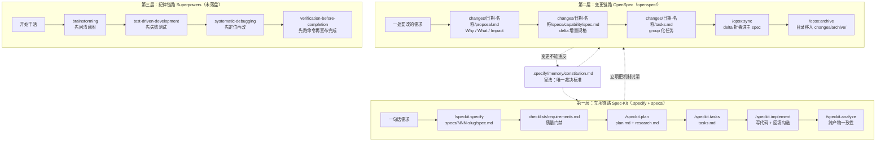
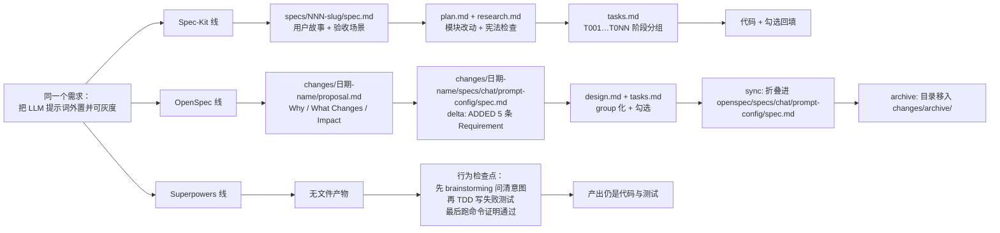
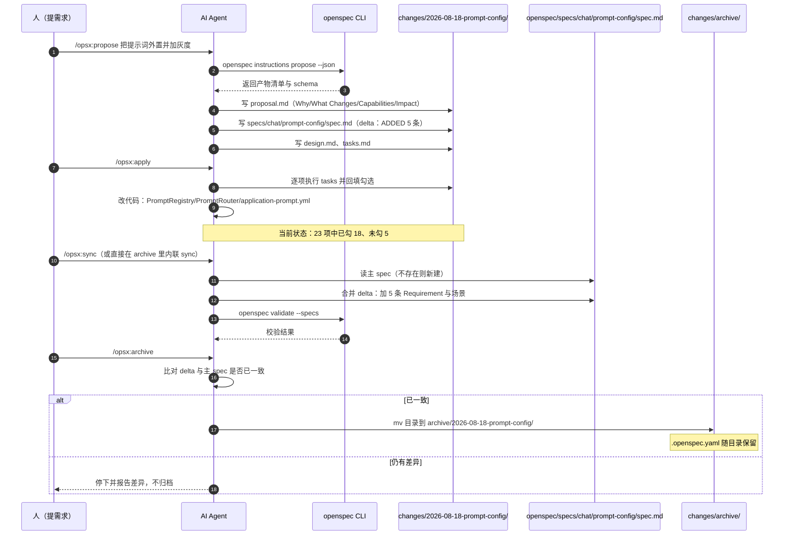

# 三个工具，三个层面：Spec-Kit 管立项、OpenSpec 管变更、Superpowers 管纪律

> **一句话结论**：Spec-Kit / OpenSpec / Superpowers 不是三选一的竞品，它们各自补齐 SDD（Specification-Driven Development，规约驱动开发）链条上的一环——Spec-Kit 管"从头做一个功能"的立项链路，产物是一整个 `specs/<编号>-<短名>/` 目录；OpenSpec 管"改完之后怎么留痕"的变更链路，产物是 delta spec（增量规格）加归档目录；Superpowers 管"AI 干活时的作业纪律"，产物根本不是文件而是行为约束。本仓库三套都装了，但只有 Spec-Kit 在批量产出（5 个 feature / 40 份产物），OpenSpec 只在一个 capability 上试点，Superpowers 连仓库都没落盘。
> **阅读前置**：读过 [01-OpenSpec实战-会话历史持久化.md](01-OpenSpec实战-会话历史持久化.md) 或 [04-SpecKit实战-RAG进阶六件套.md](04-SpecKit实战-RAG进阶六件套.md) 任一篇，知道 `/speckit.specify` 大概是干什么的；不要求装过这三个工具。术语首现处均就地解释。
> **证据基线**：A 级=0 条（这三个工具的实现不在 `24-源码分析/assets/source/` 里，未入库，本篇依据官方文档与本项目文档）；B 级=本仓库真实文件，含 `.claude/commands/`、`.claude/skills/`、`.specify/`、`specs/`、`openspec/`、`ai-cs-common/src/main/java/com/aics/common/result/ResultCode.java` 等，行号均当次 read 核对；C 级=4 组可复现的静态统计命令（不启服务、不联网、不跑构建），输出为真实粘贴。预计阅读 30 分钟。

**证据边界**（先说清哪些结论没有实测支撑）：

| 级别 | 来源 | 本篇覆盖的文件或对象 | 不能证明什么 |
|------|------|----------------------|--------------|
| A | `24-源码分析/assets/source/` 已入库摘录 | **0 条**：该目录 908 份摘录全是 Spring / JDK 框架源码，本项目文件与这三个工具的实现都未入库 | 不能拿框架源码论证规格工具行为，本篇不做这种嫁接 |
| B | 本仓库真实文件（当次核对行号） | `.claude/commands/speckit.*.md`（9）、`.claude/commands/opsx/*.md`（6）、`.claude/skills/`（20）、`.specify/`（模板 7 / 脚本 5 / 扩展 / 工作流）、`specs/`（5 feature × 8 产物）、`openspec/`（配置 + 主 spec 4 + 变更 1 + 归档 2）、`ai-cs-common/src/main/java/com/aics/common/result/ResultCode.java`、`ai-cs-chat/src/main/java/com/aics/chat/agent/` 等真实源码 | 只能证明"本仓库怎么用"，不能证明上游工具的通用能力边界 |
| C | 4 组 pwsh / node 静态统计（30 秒内、纯本地文件读取） | 资产计数、tasks.md 勾选率、delta 与主 spec 体积差、`openspec/config.yaml` 有效行数 | 统计口径见各命令；不是性能测试，不含任何耗时/开销数字 |

> **特别声明**：旧稿里出现过的 Spec-Kit / OpenSpec / Superpowers 星标数、贡献者数、集成 Agent 数量等动态指标，来自 2026-08 的外部站点，本机无法复现核验，**未入库，本篇不采信为基线**，需要时只说明"官方站点口径"。

---

## 0. 先看现象

**现象一：三套工具在同一棵树里各占一个目录，命令加起来 15 条，却没有一处文档说清"今天该用哪套"。**

```powershell
node -e "const fs=require('fs');const c=(d,f)=>fs.existsSync(d)?fs.readdirSync(d).filter(x=>!f||f(x)).length:0;console.log('speckit 命令',c('.claude/commands',x=>x.startsWith('speckit.')&&x.endsWith('.md')));console.log('opsx 命令',c('.claude/commands/opsx'));console.log('技能目录',c('.claude/skills'));console.log('.specify 模板',c('.specify/templates'));console.log('specs feature',c('specs',x=>fs.statSync('specs/'+x).isDirectory()));console.log('openspec 主spec',fs.readdirSync('openspec/specs/chat',{recursive:true}).filter(x=>String(x).endsWith('spec.md')).length);console.log('openspec 归档',c('openspec/changes/archive'));"
```

```text
speckit 命令 9
opsx 命令 6
技能目录 20
.specify 模板 7
specs feature 5
openspec 主spec 4
openspec 归档 2
```

怎么读：`speckit 命令 9` 与 `opsx 命令 6` 是两套并存的工作流入口，`技能目录 20` 是它们的技能镜像（其中 14 个 `speckit-*`、6 个 `openspec-*`），`.specify 模板 7` 是 Spec-Kit 的脚手架。数量本身不说明好坏，它说明的是：**装了、齐全、能用，但没有一份文档把"什么时候该走哪条"写下来**——真正的浪费不是装了三套，而是三套都在等一个不会来的调用。

**现象二：同一个需求，仓库里有三份互相矛盾的描述。**

以当前活动功能 005 为例，四个地方各说一套：

| 位置 | 原话 | 含义 |
|------|------|------|
| `specs/005-after-sales-agent/spec.md#L5` | `**状态**: 草稿` | 还没定稿 |
| `specs/README.md#L33` | `005-after-sales-agent …… 实施中` | 已经在写代码 |
| [CLAUDE.md](../../../CLAUDE.md) 的 SPECKIT 标记块 | `当前活动功能：智能客服 Agent 编排与人工转接` | 是当前主线 |
| `ai-cs-chat/src/main/java/com/aics/chat/agent/` | 实际存在 **37 个 .java 文件**（含 `workflow/AfterSaleAgentService.java`、`tool/AgentToolRegistry.java`、`state/AgentStateMachine.java`） | 代码早已写了大半 |

四份描述里，只有代码是不会撒谎的。规格文件说"草稿"，代码说"已经跑了"。

**现象三：规格产物只在立项时写一次，之后全烂掉。**

用同一口径统计 5 个 feature 的 `tasks.md` 勾选率（勾选标记大小写不敏感，`[x]` 与 `[X]` 都算）：

```powershell
node -e "const fs=require('fs');console.log('feature'.padEnd(26)+'已勾 未勾 合计 勾选率');for(const d of fs.readdirSync('specs').filter(x=>fs.statSync('specs/'+x).isDirectory())){const c=fs.readFileSync('specs/'+d+'/tasks.md','utf8');const done=(c.match(/^- \[[xX]\]/gm)||[]).length,todo=(c.match(/^- \[ \]/gm)||[]).length;console.log(d.padEnd(26)+String(done).padStart(3)+String(todo).padStart(5)+String(done+todo).padStart(5)+(done+todo?'  '+(done/(done+todo)*100).toFixed(0)+'%':'  -'));}"
```

```text
feature                   已勾 未勾 合计 勾选率
001-cart-checkout          48    6   54  89%
002-rag-quality-upgrade     0   53   53  0%
003-rag-advanced-features  68    0   68  100%
004-vlm-multimodal         33    0   33  100%
005-after-sales-agent       0   54   54  0%
```

怎么读：`002-rag-quality-upgrade` 在 `specs/README.md#L30` 里写着"已实施"，但它的 53 项任务**一个都没勾**；`005` 在 README 里是"实施中"，54 项也一个没勾，而它的代码已经写进仓库。反过来 `003`、`004` 是 100%——注意 `004` 用的是大写 `[X]`（这也是它前一行统计里容易被漏掉的原因，见第 6 节坑 2）。也就是说：**勾选率不是进度条，是回填记录；不回填的规格文件 30 天后就是废纸。**

这些现象指向同一件事：**三套工具缺的不是能力，是分工约定和收口动作**——Spec-Kit 负责把"要做"变成可执行的清单，OpenSpec 负责把"改完了"变成可追溯的历史，Superpowers 负责让 AI 不跳步；本项目三样都缺了后半段（回填、归档、纪律落盘），所以三套都显得"装了没人用"。

---

## 1. 整体地图



> **读图说明**：最重要的不是三条并行的流水线，而是图底部两条虚线箭头——`CONST -.-> L1` 与 `CONST -.-> L2`。它们表示宪法同时约束立项和变更两条链路，**看错成"宪法只属于 Spec-Kit"就会得出错误结论**：以为 OpenSpec 的 delta 可以不合宪法。实际 `.claude/commands/speckit.analyze.md#L55` 把宪法写成 "non-negotiable"，而任何 spec（含 OpenSpec 主 spec）都在它的裁决范围内。第二个关键箭头是 `L1 -.->|立项把机制说清| L2`：Spec-Kit 产出的是机制描述（"系统要做成什么样"），OpenSpec 产出的是机制变更（"这次改动了哪几条需求"），方向是单向的——**变更可以改机制，机制不会反过来推翻变更历史**，这条方向决定了第 5 节"谁是唯一事实来源"的答案。
>
> 对照下面这张表读图：每条流水线都有"谁写这个产物"的对应行——Spec-Kit 侧由命令层写、脚本层解析路径、`feature.json` 定位；OpenSpec 侧由 `/opsx:*` 写、主 spec 存事实、归档区存历史；Superpowers 侧没有落盘行，这正是它的定位特征。

| 组件 | 落盘位置 | 责任 | 谁调它 |
|------|----------|------|--------|
| Spec-Kit 命令层 | `.claude/commands/speckit.specify.md` 等 9 个 | 每个命令负责一个阶段的产物生成与校验（specify 造 spec.md、plan 造 plan.md + research.md、analyze 做跨产物一致性检查） | 人手动打 `/speckit.xxx`，或 `.specify/workflows/speckit/workflow.yml` 按 step 串起来 |
| Spec-Kit 脚手架 | `.specify/templates/`（7 个模板）、`.specify/scripts/powershell/`（5 个脚本） | 模板决定产物骨架，脚本负责路径解析（`setup-plan.ps1` 解析出 FEATURE_SPEC / IMPL_PLAN / SPECS_DIR / BRANCH） | 命令内部调用 |
| Spec-Kit 当前指针 | `.specify/feature.json` | 记录"当前正在做哪个 feature"，3 行文件 | 所有后续命令读它定位目录 |
| Spec-Kit 扩展 | `.specify/extensions/git/` + `.specify/extensions.yml` | 在指定阶段前后自动执行命令（建分支、提交） | 命令的前置检查阶段按 hooks 触发 |
| 宪法 | `.specify/memory/constitution.md` | 不可协商的评审标准：SDD 阶段顺序、TDD、门禁 L1~L4、留痕与审计 | `/speckit.plan` 填 Constitution Check、`/speckit.analyze` 判 CRITICAL |
| OpenSpec 命令层 | `.claude/commands/opsx/{propose,apply,update,sync,archive,explore}.md`（6 个） | 变更生命周期的六步：提议、实施、修订、同步、归档、探索 | 人手动打 `/opsx:xxx`，或技能层 `openspec-*` |
| OpenSpec 主 spec | `openspec/specs/chat/<capability>/spec.md`（当前 4 份） | 变更合并后的**事实来源** | `/opsx:sync` 写、`/opsx:archive` 读校验 |
| OpenSpec 变更区 | `openspec/changes/<YYYY-MM-DD>-<name>/` | 未完成的变更，含 proposal.md / design.md / tasks.md / delta spec / `.openspec.yaml` | 人 + Agent 读写 |
| OpenSpec 归档区 | `openspec/changes/archive/<YYYY-MM-DD>-<name>/` | 已完成的变更历史，delta 与主 spec 已对齐 | 只读 |
| OpenSpec 配置 | `openspec/config.yaml`（27 行） | 项目上下文 / 每个产物的写作规则 / 每步操作指引 | `openspec` CLI 与 `/opsx:*` 读取 |
| Superpowers 技能 | **本仓库无落盘**（`.claude/skills/` 与 `.agents/skills/` 都没有） | 会话级行为约束：先设计、先测试、先验证再宣布完成 | AI Agent 在 harness 运行环境内自取 |

---

## 2. 关键概念与关键要素

**表 2-1 术语与要素**

| 名称 | 位置 | 角色 | 关键点 |
|------|------|------|--------|
| `spec.md`（Spec-Kit 版） | `specs/005-after-sales-agent/spec.md` | 功能规格：用户故事 + 验收场景 | 状态字段是人工维护的，`#L5` 写着 `**状态**: 草稿`，与代码进度无关 |
| `plan.md` | `specs/005-after-sales-agent/plan.md` | 实施计划：模块改动 + 技术上下文 + 宪法检查 | `#L31-L39` 逐条对应宪法条款，这是"可评审"的落点 |
| `tasks.md` | `specs/005-after-sales-agent/tasks.md` | 任务清单：按阶段分组，每阶段带 `**检查点**` | 任务是 `- [ ] T001 …` 形式，勾选靠人/Agent 回填，**没有工具会替你勾** |
| `checklists/requirements.md` | `specs/<feature>/checklists/requirements.md` | 规格质量门禁清单 | 由 `/speckit.specify` 在写完 spec 后自动生成并自检（`.claude/commands/speckit.specify.md#L139-L159`） |
| `[NEEDS CLARIFICATION]` 标记 | spec 正文内 | 未决问题占位符 | 硬上限 3 个（`speckit.specify.md#L123`），`plan.md` 的 Phase 0 必须把它们变成 `research.md` 里的答案 |
| constitution（宪法） | `.specify/memory/constitution.md` | 最高准则，第 1 条就写明是 SDD 项目最高规范 | `#L21-L33` 明令禁止跳过任何阶段、禁止用非 Spec Kit 命令启动流程 |
| delta spec（增量规格） | `openspec/changes/<name>/specs/<capability>/spec.md` | 本次变更**新增/修改/删除**了哪些需求 | 只写差异，用 `## ADDED / MODIFIED / REMOVED Requirements` 分区；`.claude/commands/opsx/propose.md#L15` 明确写它是 "a delta, not the main spec" |
| main spec（主规格） | `openspec/specs/<capability>/spec.md` | 合并后的当前事实状态 | `.claude/commands/opsx/sync.md#L204` 规定主 spec **永远不许带** delta 操作标题 |
| `.openspec.yaml` | 每个 change 目录根下 | change 的元数据（schema 等） | 归档时随目录一起搬走（`opsx/archive.md#L216`），丢了就丢溯源信息 |
| capability（能力） | `openspec/specs/chat/<capability>/` | OpenSpec 的切分单位，比 feature 细 | 本项目已有 4 个：history-management / llm-observability / model-usage / online-evaluation |
| 技能（SKILL.md） | `.claude/skills/<name>/SKILL.md` | 可被 Agent 加载的操作说明书 | 本项目 20 个：14 个 `speckit-*` + 6 个 `openspec-*`；`.agents/skills/` 是同一份镜像（多一个 `.openspec-target` 标记） |
| hook | `.specify/extensions.yml` 的 `hooks` 段 | 在阶段前后自动执行的命令 | 实测 18 条；`auto_execute_hooks: true`；`before_constitution`、`before_specify` 是 `optional: false`（不可跳过），其余 16 条 `optional: true` |
| gate（闸门） | `.specify/workflows/speckit/workflow.yml#L35-L51` | 工作流里的审批点 | `type: gate` + `options: [approve, reject]` + `on_reject: abort`，拒绝就整条流水线中止 |

**表 2-2 三者定位对照（本篇的核心结论表）**

| 维度 | Spec-Kit | OpenSpec | Superpowers |
|------|----------|----------|-------------|
| 解决什么问题 | 从头做一个功能：一句话需求 → 可执行任务清单 | 变更的可追溯与归档：改了什么、为什么改、怎么合回去 | AI 的作业纪律：不许跳设计、不许跳测试、不许没验证就说完成 |
| 产物形态 | `specs/<编号>-<短名>/` 一整个目录，本项目每 feature 8 份 md，共 40 份 | change 目录（proposal / design / tasks / delta spec / `.openspec.yaml`）+ 归档目录 | **不是文件**：是 SKILL.md 形式的检查点，产出物是代码、测试、计划文本 |
| 状态管理 | 单指针 `.specify/feature.json` 指向当前 feature；状态靠 spec.md 的"状态"字段 + tasks.md 勾选（人工回填） | 目录即状态：在 `changes/` 是未完成，在 `changes/archive/` 是已完成；中间态由 `.openspec.yaml` 承载 | 无持久状态，状态在会话上下文里，会话结束即消失 |
| 与 Git 的关系 | 强耦合：`before_specify` hook 自动建 feature 分支，`before_constitution` 建仓；`.specify/init-options.json` 里 `branch_numbering: sequential` 决定编号；分支名与目录名解耦但本项目同名 | 弱耦合：靠目录名里的 `YYYY-MM-DD-` 前缀排序，不管分支；`/opsx:apply` 开始前分支由你自己准备 | 间接：`using-git-worktrees`、`finishing-a-development-branch` 等技能会要求隔离工作区，但工具本身不管 Git |
| 适合的团队规模 | 1~5 人小团队或个人主导；顺序编号天然串行，多人并行抢编号会冲突 | 中大型、多人并行：按 capability 切分，不同人改不同 capability 不打架 | 任意规模，收益随"AI 参与度"上升；纯人工团队几乎无感 |
| 学习成本 | 中：9 个命令必须按顺序走，7 个模板要读懂，宪法条款要背 | 中高：delta 语义（ADDED/MODIFIED/REMOVED/RENAMED）+ 合并规则 + sync/archive 区别 | 低（读 SKILL.md 就能用）到高（要改掉自己"先写代码再说"的习惯） |
| 本仓库现状 | 在批量用：5 feature / 40 产物 / 整体勾选率 57%（149/262 项，见第 0 节统计） | 试点：4 个主 spec、1 个未归档变更、2 个归档 | **未落盘**：仓库里零技能文件，仅在 harness 运行环境可见 14 个 |

---

## 3. 原理与证据逐段精读

### 3.1 Spec-Kit 的立项链是一条"文件接力 + 闸门卡点"的流水线

**在干什么**：把"要做个功能"这件事拆成 6 个阶段命令，每个阶段的产物是下一阶段的输入，中间插审批闸门。`.specify/workflows/speckit/workflow.yml` 把这个链条写成了可执行的 step 列表：

```yaml
# .specify/workflows/speckit/workflow.yml#L28-L59（节选）
steps:
  - id: specify
    command: speckit.specify
    input:
      args: "{{ inputs.spec }}"

  - id: review-spec
    type: gate
    message: "Review the generated spec before planning."
    options: [approve, reject]
    on_reject: abort

  - id: plan
    command: speckit.plan
```

**为什么这么设计**：SDD 的核心假设是"规格错了，代码写得再好也是废的"。所以它不能让你一口气从需求跑到代码，必须在 spec 之后、plan 之后各插一个 gate，让人为判断负责。这道闸门不是礼貌性提示，`on_reject: abort` 意味着拒绝即终止整条工作流——**这是把流程纪律变成机器可执行约束的唯一手段**，光写"最佳实践"是拦不住人的。

**换成别的写法会怎样**：如果去掉 gate，只剩命令串行执行，那么"spec 写得含糊"这件事要到 `/speckit.implement` 才会暴露，代价从"改一份 md"变成"改一堆代码"。反过来如果 gate 太多（每个命令后都插），流程成本会超过收益，团队就会绕过整套工具手工写文档——本项目 002 的 tasks 勾选率 0% 就是"绕过"的迹象。

**常见坑**：把 gate 当形式点"approve"。`specs/005-after-sales-agent/spec.md#L5` 状态至今是"草稿"，说明 gate 被跳过了——**approve 而没有真正评审，等价于没有 gate**。

### 3.2 Spec-Kit 的"当前功能"是一个 3 行单指针，这是它最大的隐性约束

**在干什么**：`.specify/feature.json` 全文只有 3 行，记录当前 feature 目录：

```json
{
"feature_directory": "specs/005-after-sales-agent"
}
```

**为什么这么设计**：`/speckit.plan`、`/speckit.tasks`、`/speckit.implement` 都不接受"给哪个 feature 干活"的参数，它们读这个指针。这样命令可以极简，人不用每次重复路径。`.claude/commands/speckit.specify.md#L81-L107` 说明生成规则：读 `.specify/init-options.json` 的 `branch_numbering`，本项目为 `sequential`，于是扫描 `specs/` 现有目录取下一个 3 位编号；同时明确写"spec 目录名与 git 分支名相互独立"。

**换成别的写法会怎样**：如果改成"每次命令显式传路径"，就没有当前指针带来的歧义问题，但多 feature 并行时会频繁传错；如果改成完全没有指针、靠 git 分支名推断，那么分支名一改（rebase、改名）全链路就断。

**常见坑**：**单指针 = 串行**。同一时刻只有一个"当前 feature"，于是 `specs/005-after-sales-agent/spec.md#L5` 状态、`specs/README.md#L33` 状态、CLAUDE.md 的活动功能标记三处必然不同步——指针只记得一个是 005，但 README 里还挂着 001~005 五条状态，没有任何机制逼你回填。这就是现象二的机制根源。

### 3.3 OpenSpec 的产物是 delta，不是 spec——它的第一性原理是"主 spec 只存当前真相"

**在干什么**：`/opsx:propose` 一次生成四份产物，其中规格部分写的是一份**增量**：

```text
propose.md#L13-L17（原文摘要）
- proposal.md (what & why)
- `specs/<capability-path>/spec.md` (what the system must do - a delta, not the main spec)
- design.md (how)
- tasks.md (implementation steps)
```

本仓库的真实 delta 长这样：`openspec/changes/2026-08-18-prompt-config/specs/chat/prompt-config/spec.md` 共 65 行，`#L5` 起是 `## ADDED Requirements`，下面 5 条 `### Requirement: X`（Prompt 外置配置化 / 版本管理 / 灰度发布 / 热回滚 / 效果关联），每条配 1~2 个 `#### Scenario:`（全文 10 个），用 `- **WHEN** … - **THEN** …` 的句式；`#L62-L64` 的 `## MODIFIED Requirements` 下只有一行注释 `<!-- 无：本 capability 为新增，不修改既有 spec 需求。 -->`。需求正文统一用 `SHALL` 句式（该文件里 `SHALL` 出现 6 次）。

**为什么这么设计**：如果每次变更都直接改主 spec，你会丢掉"上一版是什么样"的答案——git 能给你 diff，但 diff 读不出"为什么这么改、当时否掉了什么方案"。所以 OpenSpec 把"当前真相"（main spec）和"这次改动"（delta）分开存：main spec 永远只描述现在，delta + proposal 保存决策过程，归档后两者一起成为历史。

**换成别的写法会怎样**：如果只留 main spec（纯 Spec-Kit 风格），回看三个月前的变更就得翻 git log 加猜；如果只留 delta 不合并，主 spec 会逐渐腐烂成"最后一次全量重写的时间点"——本项目 `openspec/specs/chat/` 下 4 份主 spec 是合并过的（见 3.4 的证据），说明这条路真走通了。

**常见坑**：在 delta 里写整篇规格（复制主 spec 再改几处）。后果在 `sync.md#L204` 被点名：主 spec "must never contain delta operation headers"，一复制合并时就得手工剥离，极易出错。正确做法是只写 `ADDED/MODIFIED/REMOVED` 差异块。

### 3.4 OpenSpec 的归档 = "折叠 delta + 搬目录"，成功率能用字节数验证

**在干什么**：`/opsx:archive` 先比对 delta 与主 spec，必要时内联调用 `/opsx:sync` 把差异合并进主 spec，再把整个 change 目录移到 `changes/archive/<YYYY-MM-DD>-<name>/`。关键约束在 `opsx/archive.md`：

| 行号 | 原文要点 | 含义 |
|------|----------|------|
| `#L93` | 把 delta 与 `openspec/specs/<capability-path>/spec.md` 逐条比对 | 归档前必须核对事实来源 |
| `#L120-L121` | MODIFIED 要带上 delta 里点名的场景改动且其余场景保持完整；REMOVED 要从主 spec 移除 | 合并是"手术"不是"覆盖" |
| `#L124` | 同步失败或有不一致就停下，不许归档 | 主 spec 与 delta 不一致时禁止产生历史 |
| `#L140` | `mv "<changeRoot>" "<changesDir>/archive/<target-name>"` | 归档就是搬家，不是复制 |
| `#L216` | 移动时保留 `.openspec.yaml` | 元数据跟目录走，否则溯源断链 |

**为什么这么设计**：历史一旦归档就应"不可再改"，所以选择移动而非复制；同时主 spec 必须在归档动作**之前**就与 delta 对齐，否则会出现"历史里说改了、主 spec 里没改"的永久性不一致。

**换成别的写法会怎样**：只复制不移动，两处副本会立刻分叉，下一个人不知道读哪个；先归档再合并，等于把不一致写进历史，之后要改就得改历史。

**常见坑**：判断"合没合"靠肉眼。其实有零成本的判据——比较归档 delta 与主 spec 的字节数。差值约等于 delta 头被折叠掉的长度：

```powershell
node -e "const fs=require('fs');for(const c of ['llm-observability','model-usage','online-evaluation']){const a='openspec/changes/archive/2026-08-14-llm-observability-cost-governance/specs/chat/'+c+'/spec.md';const b='openspec/specs/chat/'+c+'/spec.md';console.log(c.padEnd(20),'delta',String(fs.statSync(a).size).padStart(5)+'B','主spec',String(fs.statSync(b).size).padStart(5)+'B','差',fs.statSync(a).size-fs.statSync(b).size);}"
```

```text
llm-observability    delta  3739B 主spec  3733B 差 6
model-usage          delta  3266B 主spec  3260B 差 6
online-evaluation    delta  3513B 主spec  3507B 差 6
```

怎么读：三份 delta 与三份主 spec 各差 **6 字节**，且差值完全一致——说明合并动作是机械的、可预测的（少掉的正是 `## ADDED` 这类 delta 操作标题与空行），而不是"人手重写一遍"。如果某份差值变成几十上百字节，就说明有人在合并时顺手改了内容，那才是要审的地方。

### 3.5 Superpowers 的产物不是文件，是"每次回答前的强制动作"

**在干什么**：它不生成任何 md。它给你一套技能，规定"开始干活前必须做什么"。本仓库**没有落盘**——`.claude/skills/` 20 个目录里 14 个 `speckit-*` + 6 个 `openspec-*`，`.agents/skills/` 是同一份镜像多一个 `.openspec-target` 标记，**两个目录都没有任何 superpowers 技能**。它只在本会话的 harness 运行环境里可见 14 个：`brainstorming`、`test-driven-development`、`systematic-debugging`、`writing-plans`、`executing-plans`、`subagent-driven-development`、`dispatching-parallel-agents`、`requesting-code-review`、`receiving-code-review`、`verification-before-completion`、`using-git-worktrees`、`using-superpowers`、`writing-skills`、`finishing-a-development-branch`。

**为什么这么设计**：Spec-Kit 和 OpenSpec 治理的是"文档是否正确"，Superpowers 治理的是"执行者是否守规矩"。文档可以造得很漂亮而代码全是猜的；纪律类工具针对的正是这个缝隙。它必须是技能而不是模板，因为模板管不住"我跳过模板直接写代码"。

**换成别的写法会怎样**：把这套纪律写成 `.claude/rules/` 里的一段文字（本项目已有 `coding-rules.md`、`git-workflow.md`），效果取决于模型是否真读——而技能是**按需触发**的：`verification-before-completion` 这类技能在"要宣布完成"时被加载，比常驻一段没人读的规则更可能生效。

**常见坑**：以为装了 Spec-Kit 就有了纪律。本项目宪法 `#L35-L47` 第2-1条已经强制 TDD（禁止无失败测试就写实现、禁止补测试冒充 TDD），`specs/005-after-sales-agent/tasks.md#L6` 也重申"测试任务必选"——但 005 的 54 项任务勾选率 0%，说明**规则写进宪法 ≠ 规则被执行**。纪律层缺的就是"宣布完成前必须跑命令"这个动作的落盘，见第 9 节练习 6。

### 3.6 同一需求在三条流水线上的产物链对比



> **读图说明**：注意 `O5` 这一步——OpenSpec 线里**唯一没有对应物**的环节就是"折叠"。Spec-Kit 线走完 `tasks.md → 代码 + 勾选` 就结束了，它的产物停在"这个功能当时打算怎么做"；OpenSpec 线多出一个 `sync` 把 delta 变成新的主 spec，因此它产出的是"这个系统现在是什么样"。**看错这一点会把 OpenSpec 当成"又一个写 spec 的工具"**，从而忽略它真正的价值：主 spec 是可累积的当前真相，而 Spec-Kit 的 spec.md 是一次性的立项快照。第二个关键点是 `P1 --> P2` 这条"无文件产物"——Superpowers 线在前两条线里都能插入（它管的是执行过程），但它自己没有链尾产物，所以永远没法用"看产物"的方式验收它是否生效。

**交叠与互补点**（三条线不是互斥，是可以串的）：

| 交叠处 | 谁和谁撞 | 互补关系 |
|--------|----------|----------|
| 需求描述 | Spec-Kit 的 spec.md 与 OpenSpec 的 proposal.md 都在写"要做什么" | 前者写给"从零建功能"，后者写给"在已有系统上改一处"，粒度不同：feature 级 vs capability 级 |
| 任务清单 | 两边都有 tasks.md（本项目 5 份 + 1 份） | 格式几乎一样（阶段/分组 + `- [ ]` + 检查点），差异在勾选回填的时机：Spec-Kit 全靠自觉，OpenSpec 的 `/opsx:apply` 会在 `state: "all_done"` 时提示归档（`opsx/apply.md#L51`） |
| 规格演进 | Spec-Kit 的 spec.md 改一次要重写全文；OpenSpec 的 delta 只写差异 | **Spec-Kit 缺的正是 OpenSpec 的增量能力**，这是两条线最该串的地方 |
| 纪律约束 | Superpowers 的 TDD 技能 vs 宪法第2-1条 TDD 强制 | 同一个要求，两个施加点：一个在人的流程里，一个在 Agent 的会话里 |

**混用时的边界（谁的产物是唯一事实来源）**——这是本节最该记住的一条：

| 问题 | 唯一事实来源 | 依据 |
|------|--------------|------|
| "这个系统现在的行为是什么" | `openspec/specs/<capability>/spec.md` 主 spec | `opsx/sync.md#L204` 规定主 spec 不许带 delta 头，它是合并结果 |
| "这个功能当初为什么这么做" | `openspec/changes/archive/<日期>-<name>/` 里的 proposal.md + delta | 归档目录是不可再改的历史 |
| "这个功能还没做完，剩下什么" | `specs/<feature>/tasks.md`（Spec-Kit） | 它是唯一带阶段检查点的执行清单 |
| "哪些规则不许违反" | `.specify/memory/constitution.md` | `speckit.analyze.md#L55` 写明宪法在该分析范围内 non-negotiable |
| "代码实际怎么写的" | 代码本身 | 005 的教训：37 个 java 文件 vs tasks 0 勾选，**只有代码不说谎** |

---

## 4. 一次完整执行时序

以本仓库唯一在跑的 OpenSpec 变更 `2026-08-18-prompt-config` 为样本（真实数据：proposal.md 35 行、design.md 7241B、tasks.md 44 行 23 项、delta spec 65 行），走一遍完整生命周期：



> **读图说明**：最关键的是 `A->>M` 与 `A->>AR` 这两步的**顺序**——先写主 spec，后移目录。看错顺序（以为归档会顺手帮你合并）就会得出错误结论"归档只是个整理动作"。实际 `opsx/archive.md#L124` 明文规定：sync 失败或任何 capability 不一致就停下不许归档，`#L219` 再补一句"Never archive while a spec sync is still in flight"。第二个值得盯的是 `alt/else` 分支：正常路径里"归档"这个动作**没有失败机会**，因为失败都提前被 sync 校验拦住了。

每一步失败分别报什么（都是本仓库可复现的判据）：

| 失败点 | 触发条件 | 现象/报错 | 用户看到 |
|--------|----------|-----------|----------|
| ② `openspec instructions` | 本地 openspec CLI 未安装或版本不支持子命令 | 命令不存在/退出码非 0，`archive.md#L40` 专门写了"does not support this command yet — continue the archive workflow" | Agent 退化为无 CLI 辅助的手工流程，产物结构仍能生成但缺 schema 校验 |
| ④⑤ 产物结构 | 缺 `.openspec.yaml`（本项目 `2026-08-18-prompt-config` 就缺） | 归档时元数据无从保留，`archive.md#L216` 的"保留 .openspec.yaml"落空 | 历史目录里没有 schema 记录，日后无法判断它当时按哪套规则生成 |
| ⑦ `apply` 执行 | tasks 里有依赖未装的项（如本项目 3.6 过渡开关"各调用点未逐一传 fallback"） | 任务保持未勾 | 变更长期停在"78% 完成"，永远进不了 archive |
| ⑫ `sync` 合并 | delta 里带了整篇规格而非差异块 | 主 spec 出现 `## ADDED Requirements` 标题，违反 `sync.md#L204` | 下一轮 sync 在旧 delta 头上叠加，主 spec 逐版腐化 |
| ⑬ `validate --specs` | 主 spec 出现 TBD Purpose 占位（`sync.md#L158` 点名） | 校验告警/失败 | 新 capability 的主 spec 缺 Purpose，读者读不懂这块能力是干什么的 |
| ⑭ 归档 | 目标目录已存在同名（`archive.md#L136`） | `Archive Failed`：Target archive directory already exists | 需要改名重试，注意 `#L133` 对已带日期前缀的目录不再加日期 |

---

## 5. 设计取舍

| 决策点 | 备选 | 优点 | 代价 | 本项目怎么选 |
|--------|------|------|------|--------------|
| 规格切分单位 | feature（Spec-Kit）/ capability（OpenSpec） | feature 好立项，capability 好并行 | 两套切分会让同一需求出现在两处 | 混用：新功能走 feature（`specs/005-…`），存量能力演进走 capability（`openspec/specs/chat/…`） |
| 规格演进方式 | 全量重写 spec（Spec-Kit）/ 增量 delta（OpenSpec） | 增量省力且留决策痕迹 | delta 需要合并动作，少了 sync 就分叉 | OpenSpec 用于 chat 的 4 个 capability；Spec-Kit 的 spec.md 仍是全量快照 |
| 状态存放 | 文件里的状态字段 / tasks 勾选 / 目录位置 | 目录位置最不依赖人的自觉 | 目录位置表达不了"做到一半" | OpenSpec 用目录位置（changes vs archive）；Spec-Kit 只能靠勾选，于是最不可靠（005 = 0%） |
| 分支与目录关系 | 强绑定（同名）/ 解耦 | 解耦耐改名，绑定好找 | 解耦后要记两套名 | 解耦但本项目同名（`005-after-sales-agent` 既是分支名又是目录名），靠 `feature.json` 单指针定位 |
| 谁来执行阶段 | 人手动打命令 / 工作流 step 串联 | 手动灵活，工作流有 gate | 工作流一断就全断 | 已有 `workflows/speckit/workflow.yml`（3 个 gate）但实际仍以手动打命令为主 |
| 纪律施加点 | 宪法条文（`.specify/memory/constitution.md`）/ 常驻规则（`.claude/rules/`）/ 技能（Superpowers） | 条文权威、规则常驻、技能按需触发 | 条文可被无视、规则没人读、技能不在仓库 | 条文有了（第2-1条 TDD），规则有了（`coding-rules.md`），技能没落盘 |
| 扩展机制 | 内置全部功能 / 扩展包（`.specify/extensions/git/`）+ hooks | 扩展让工具链可插拔 | 注册表与 hooks 容易不同步 | 装了 git 扩展（5 个命令 + 4 个 bash 脚本 + 4 个 powershell 脚本），但 `extensions.yml#L1` 是 `installed: []`，见第 6 节坑 1 |
| 单一事实来源 | 主 spec / 代码 / 宪法 | 各有权威域 | 不清边界就会两处各写一份 | 按 3.6 表分工：行为看主 spec、决策看归档、规则看宪法、真相看代码 |

**可扩展点清单**（都基于仓库已有机制，不需要引入新工具）：

- 在 `.specify/templates/`（现有 7 个模板）里加一个"状态回填"检查项，让每次 `/speckit.implement` 结束都提示更新 `spec.md` 状态字段。
- 把 `openspec/config.yaml` 的三个注释段（project context / per-artifact rules / per-operation guidance）填满，让 `/opsx:propose` 生成产物时自动带上本项目约定。
- 给 `.claude/skills/` 补 2~3 个纪律技能（如"宣布完成前跑 verify"），`.agents/skills/` 镜像自动同步。
- 在 `.specify/extensions.yml` 的 hooks 里挂一条 `after_implement` 钩子做勾选率巡检。
- 为 `openspec/changes/` 加一个预检（要求每个 change 目录必须有 `.openspec.yaml`），堵住本项目已出现的缺口。

**本项目当前处于哪一档 + 下一步该补什么**（明确结论，不做"各有优劣"的中立表态）：

| 层面 | 工具 | 判定依据 | 当前档位 | 下一步唯一该补的动作 |
|------|------|----------|----------|----------------------|
| 立项 | Spec-Kit | 5 个 feature、40 份产物、7 个模板、9 个命令、3 个 gate | **已规模化，但状态失修** | 回填：把 `specs/005-after-sales-agent/spec.md#L5` 的"草稿"改成实际状态；把 002 的 53 项与 005 的 54 项勾选如实补上（或删掉不做的项） |
| 变更 | OpenSpec | 4 个主 spec、1 个未归档变更（78%）、2 个归档、配置 27 行里仅 1 行生效 | **试点可用，配置空转** | 填 `openspec/config.yaml` 三段注释；补 `2026-08-18-prompt-config/.openspec.yaml`；清掉 4 项未勾任务后 archive |
| 纪律 | Superpowers | 仓库 0 个技能文件，仅 harness 14 个 | **未落地** | 把 `verification-before-completion` 与 `test-driven-development` 两条写成 `.claude/skills/` 下的技能或在 `CLAUDE.md` TDD 段挂引用，让"宣布完成前必须贴命令输出"有落盘依据 |

一句话结论：**本项目处在"Spec-Kit 一档独走、OpenSpec 刚试点、Superpowers 完全空转"的一档半状态**，最短板不是缺工具，是缺三件收口动作——回填勾选、填满配置、落盘纪律。

---

## 6. 踩坑与调试手法

| 现象 | 根因 | 验证手段 | 解法 |
|------|------|----------|------|
| 1. `.specify/extensions.yml` 第 1 行 `installed: []`，但第 5~148 行的 hooks 全在引用 `extension: git` 的命令（实测 18 条） | 扩展目录已存在（`.specify/extensions/git/` 有 5 个命令 + 8 个脚本），但注册表没写进去；而 `auto_execute_hooks: true` 让 hooks 照跑 | `node -e "const t=require('fs').readFileSync('.specify/extensions.yml','utf8').split(/\r?\n/);console.log(t[0]);console.log(t.filter(l=>/extension: git/.test(l)).length+' 条 hook 引用 git')"` → 输出 `installed: []` 与 `18 条 hook 引用 git` | 把 git 写进 `installed`，或重跑 `speckit extension add`；在此之前不要指望 `before_specify` 一定建出分支 |
| 2. 统计勾选率时 `004` 显示 0 项 | 它用的是大写 `[X]`，正则 `^- \[x\]` 匹配不到 | 两种正则各跑一次：`grep -c '^- \[x\]'` 与 `grep -c '^- \[X\]'`，本项目后者命中 33 行 | 统一为小写 `[x]`；统计脚本用 `[xX]` 字符类 |
| 3. PowerShell 5.1 读 `specs/README.md` 出现 `鏈洰褰?` 乱码 | 文件是 UTF-8 **无 BOM**（前三字节 `23 20 53`），PS 5.1 的 `Get-Content` 默认按 ANSI 解码 | 用 `node -e "console.log(require('fs').readFileSync('specs/README.md','utf8').slice(0,30))"` 对比同一文件 | 统一用 `Get-Content -Encoding UTF8` 或 node 读取；写脚本别依赖 PS 默认编码 |
| 4. 三份文档对 005 状态说法不一 | 状态字段靠人工回填，没有工具校验一致性 | 对比 `specs/005-after-sales-agent/spec.md#L5`、`specs/README.md#L33`、CLAUDE.md SPECKIT 块 | 以 tasks 勾选 + 代码事实为准回填三处，或在 `/speckit.analyze` 里加"状态一致性"检查项 |
| 5. `specs/005` tasks 勾选率 0%，但 `ai-cs-chat/src/main/java/com/aics/chat/agent/` 已有 37 个 java 文件 | 实现先行、产物后补的反向操作（违反宪法第2条顺序） | `node -e "const fs=require('fs');console.log(fs.readdirSync('ai-cs-chat/src/main/java/com/aics/chat/agent',{recursive:true}).filter(f=>String(f).endsWith('.java')).length)"` → 37 | 一次性回填勾选（诚实标注哪些真做完）；重要教训写进 plan.md 的"当前复核"段（005 已这么做过版本复核，见第 7 节） |
| 6. `openspec/config.yaml` 27 行里只有 1 行生效 | 三段配置全是官方模板注释，没人填 | 过滤非注释行，见下方手法 B | 填 project context（技术栈、目录约定）、per-artifact rules（proposal 必须写 Impact）、per-operation guidance |
| 7. `openspec/changes/2026-08-18-prompt-config/` 缺 `.openspec.yaml`，而两个归档目录都有（40B） | propose 时未生成元数据；归档命令会"保留"一个不存在的文件 | `node -e "const fs=require('fs');console.log(fs.existsSync('openspec/changes/2026-08-18-prompt-config/.openspec.yaml'))"` → `false` | 归档前补上，否则历史里缺 schema 记录 |
| 8. 同一需求在 `specs/` 与 `openspec/changes/` 各写一份 | 只约定"新功能/存量能力"分工，没有写入任何文档，靠人记 | 对比两边 capability 名与 feature 名是否重复 | 把 3.6 的"唯一事实来源"表写进 CLAUDE.md 的 SDD 段，让分工从默契变成条文 |

**两个真调试手法**（本篇亲测，都不需要启动服务、不联网、不跑构建）：

**手法 A：一行统计三套资产 + 勾选率，判断"装了几套、回填多少"**

```powershell
node -e "const fs=require('fs');const c=(d,f)=>fs.existsSync(d)?fs.readdirSync(d).filter(x=>!f||f(x)).length:0;console.log('speckit 命令',c('.claude/commands',x=>x.startsWith('speckit.')&&x.endsWith('.md')));console.log('opsx 命令',c('.claude/commands/opsx'));console.log('技能目录',c('.claude/skills'));console.log('.specify 模板',c('.specify/templates'));console.log('specs feature',c('specs',x=>fs.statSync('specs/'+x).isDirectory()));console.log('openspec 主spec',fs.readdirSync('openspec/specs/chat',{recursive:true}).filter(x=>String(x).endsWith('spec.md')).length);console.log('openspec 归档',c('openspec/changes/archive'));"
```

```text
speckit 命令 9
opsx 命令 6
技能目录 20
.specify 模板 7
specs feature 5
openspec 主spec 4
openspec 归档 2
```

怎么读：这是**能力盘点**，不是成绩单。`speckit 命令 9` 对 `opsx 命令 6`，说明两条工作流的入口都在；`openspec 主spec 4` 对 `specs feature 5`，说明 OpenSpec 只覆盖了 chat 一个服务的 4 个能力，远未铺开；`openspec 归档 2` 是最关键的数——**归档数才代表 OpenSpec 真正闭环过几次**，其余都只是"装好了"。三者合起来回答"三套是不是都装了"：是，而且齐全。

**手法 B：用"非注释行数 + 字节差"判断配置有没有真填、delta 有没有真合并**

```powershell
node -e "const fs=require('fs');fs.readFileSync('openspec/config.yaml','utf8').split(/\r?\n/).forEach((l,i)=>{if(l.trim()&&!l.trim().startsWith('#'))console.log((i+1)+': '+l)})"
```

```text
1: schema: spec-driven
```

怎么读：27 行的配置文件里，只有第 1 行是有效配置，其余全是 `# Project context (optional)`、`# Per-artifact rules (optional)`、`# Per-operation guidance (optional)` 三段被注释掉的示例。**"装了但没配"的特征就是这个形状**：文件存在、体积不小、生效行只有 1 行。同理，第 3.4 节的字节差命令回答"合没合"——差值稳定在 6 字节说明合并是机械折叠；差值异常说明有人在合并时改了内容。两个手法都不需要 openspec CLI 在 PATH 里，纯文件读取，30 秒内跑完。

---

## 7. ⚠️ 版本差异

| 项 | 旧写法 | 当前基线（本仓库实测） | 变化点 | 迁移动作 |
|----|--------|------------------------|--------|----------|
| OpenSpec 是否安装 | 旧稿按"未安装/候选方案"的口吻写 | **已装且在跑**：`openspec/config.yaml`（27 行）、`openspec/specs/chat/` 4 份主 spec、`changes/` 1 个进行中、`changes/archive/` 2 个已归档 | 结论反转：从"要不要上"变成"怎么用好" | 旧稿相关段落整段作废；按新结论重写选型建议（本篇已做） |
| 技能数量口径 | 旧稿称 `.agents/skills/` 有 14 个 speckit 技能 | `.claude/skills/` **20 个**（14 个 `speckit-*` + 6 个 `openspec-*`）；`.agents/skills/` 同一份镜像多一个 `.openspec-target` | OpenSpec 技能已补齐，数量从 14 → 20 | 引用数量时按 `ls .claude/skills` 实况；别再把 14 当总数 |
| Spec-Kit 命令写法 | 宪法 `#L27-L32` 写成 `/speckit-constitution`、`/speckit-specify`（连字符） | 实际文件是 `.claude/commands/speckit.specify.md`（点号），`specs/README.md#L11-L18` 也用点号 | 两套写法并存，连字符写法是新版 slash command 的命名 | 文档统一用点号（`/speckit.specify`），宪法的连字符写法保留但标注"等价" |
| Spec-Kit 版本号 | 旧稿未记版本 | `.specify/init-options.json` 里 `speckit_version: 0.8.1`，`.specify/integration.json` 里 `"version": "0.8.2"` | 两个文件版本号不一致（脚手架初始化 0.8.1，集成分发 0.8.2） | 升级时以 `integration.json` 为准；用 `workflow.yml#L10` 的 `speckit_version: ">=0.7.2"` 做下限校验 |
| 技术栈版本基线 | `specs/005-after-sales-agent/plan.md#L21`：Spring Boot 3.2.5 / Spring AI 1.1.4 / MyBatis-Plus 3.5.6 | `plan.md#L22` 的"当前复核（2026-11-26）"：Boot 4.2.0 / Spring AI 2.1.0 / MyBatis-Plus 3.5.13 | 规格产物被**回填复核**，历史语义保留、新旧并列 | 这是正例：规格不该擦掉旧基线，而应像 L22 这样加"当前复核 + 另见文档"（回归记录在 `docs/30-Spring-AI-2.1升级实施与验证.md`） |
| tasks.md 勾选标记 | 默认小写 `[x]` | `004-vlm-multimodal/tasks.md` 用大写 `[X]`（33 项） | 大小写不统一导致统计口径失真 | 统一小写；统计脚本用 `[xX]` |
| Superpowers 落地状态 | 旧稿当成"本项目已在使用的能力"叙述 | 仓库 `.claude/skills/` 与 `.agents/skills/` **零个** superpowers 技能；仅 harness 运行环境有 14 个 | 从"已落地"降级为"未落盘" | 凡是要求"Superpowers 保证"的结论都标注"运行环境提供，仓库无落盘，换机器即失效" |

---

## 8. 面试高频问与答

1. Spec-Kit、OpenSpec、Superpowers 各自解决哪一层问题？为什么说它们不是竞品？
2. Spec-Kit 的 `specs/<NNN>-<slug>/` 目录里为什么要有 `research.md`？它和 `plan.md` 的 `[NEEDS CLARIFICATION]` 是什么关系？
3. `.specify/feature.json` 只有一个字段，这种"单指针"设计在多 feature 并行时会暴露什么？
4. `/speckit.specify` 生成的 `checklists/requirements.md` 是给谁看的？它拦住的是什么错误？
5. OpenSpec 的 delta spec 和主 spec 为什么要分开存？如果只保留主 spec 会丢什么？
6. `MODIFIED Requirements` 的合并规则里，"保留 delta 未提及的场景"这一条为什么关键？
7. `/opsx:sync` 和 `/opsx:archive` 的边界在哪？为什么必须 sync 成功才允许 archive？
8. 归档为什么用 `mv` 而不是 `cp`？`.openspec.yaml` 为什么必须跟着走？
9. 你如何用一条命令证明"这次 delta 真的合进主 spec 了"？
10. 同一需求同时出现在 `specs/` 和 `openspec/changes/` 时，谁的产物是唯一事实来源？依据是什么？
11. 宪法（constitution）在 Spec-Kit 里是软约束还是硬约束？体现在哪个命令的哪一段？
12. Superpowers 这类"纪律型"工具为什么不产出文档也能生效？它的失效条件是什么？
13. 从"无规格流程"迁移到 Spec-Kit，再迁移到 OpenSpec，两次迁移的成本分别落在哪里？
14. 如果一个团队只有 2 个人，你会砍掉哪一套？如果是 20 人并行改同一服务呢？

---

## 9. 动手练习

**练习 1：给三套工具做一次资产盘点**
执行第 6 节手法 A 的命令，再补一条统计 `.specify/extensions/git/commands` 与 `.specify/scripts/powershell` 的数量，形成一张"能力-数量"表。
*验收标准*：表里至少 6 行且每行都有可重跑的命令；其中必须能回答"OpenSpec 归档过几次"（当前答案：2 次）。

**练习 2：把 005 的状态三处对齐**
读 `specs/005-after-sales-agent/spec.md#L5`、`specs/README.md#L33`、CLAUDE.md 的 SPECKIT 块，再核对 `ai-cs-chat/src/main/java/com/aics/chat/agent/` 下真实文件数，写出你认为正确的状态，并说明依据。
*验收标准*：三处结论一致，且每个结论后面都挂着"文件路径 + 行号"或"命令输出"；不允许出现"大概是实施中"这种表述。

**练习 3：统计并修复勾选口径**
用 `[x]` 与 `[X]` 两种正则分别统计 5 个 feature 的勾选数，指出哪种口径会漏，给出统一后的数字。
*验收标准*：能复现"`004` 在小写口径下是 0 项、在大小写不敏感口径下是 33 项"这一差异，并说明根因。

**练习 4：验证一次 delta 是否已折叠**
挑 `openspec/changes/archive/2026-08-14-llm-observability-cost-governance/specs/chat/` 下的 `model-usage/spec.md`，与 `openspec/specs/chat/model-usage/spec.md` 做字节数与内容对比（`Compare-Object` 或 node 逐行 diff）。
*验收标准*：能说出差值是多少字节、差的到底是哪几行、并解释为什么这个差值"可以接受"。

**练习 5：给 OpenSpec 填一段真配置**
在 `openspec/config.yaml` 的 project context 段落里，按注释示例写出本项目技术栈（Java 17 / Spring Boot 4.2.0 / 多模块微服务）与目录约定（产物只写 `openspec/`，代码只在 `ai-cs-*`）。
*验收标准*：填完后第 6 节手法 B 的命令输出从 1 行变成 ≥3 行；同时不影响任何现有 change 目录的解析。

**练习 6：把一条纪律落盘**
从 harness 提供的 14 个纪律技能里选 `verification-before-completion`，把它的核心要求（"宣布完成前必须贴出命令与输出"）写成 `.claude/skills/verify-before-done/SKILL.md`（结构参照现有 20 个技能），并在 CLAUDE.md 的 TDD 段加一行引用。
*验收标准*：`.claude/skills/` 目录数从 20 变 21；`SKILL.md` 里明确写出"没有命令输出不允许说完成"这一条硬约束，且给出本项目可用的验证命令（例如 `mvn -pl ai-cs-chat test`）。

---

## 小结

- **三个工具是三个层面，不是三个选项**：Spec-Kit 管"从头做一个功能"（产物是一整个 `specs/<NNN>-<slug>/` 目录），OpenSpec 管"变更的可追溯与归档"（产物是 delta + 归档历史），Superpowers 管"AI 的作业纪律"（产物是行为约束，不是文件）。
- **Spec-Kit 的真实机制**：6 阶段命令 + `workflow.yml` 的 3 个 gate（`on_reject: abort`）+ 单指针 `.specify/feature.json` + 不可协商的宪法；强项是立项链路完整，弱项是"单指针 = 串行"且状态全靠人工回填。
- **OpenSpec 的真实机制**：delta spec 只写差异，主 spec 只存当前真相，`sync` 负责折叠、`archive` 负责搬家；`sync.md#L204` 的主 spec 不许带 delta 头是最硬的一条规则。
- **折叠是可验证的**：本项目三份 delta 与主 spec 各差 6 字节且完全一致，证明合并是机械动作而非重写。
- **三套在本仓库的真实状态**：Spec-Kit 已规模化（5 feature / 40 产物）但状态失修（002 = 0%、005 = 0%）；OpenSpec 试点可用（4 主 spec / 1 未归档 / 2 归档）但配置 27 行只有 1 行生效；Superpowers **零落盘**。
- **最硬的教训**：代码不会撒谎。005 的 `spec.md` 说"草稿"、tasks 勾选 0%，而 `agent/` 下已有 37 个 java 文件——规格文件一旦不回填，30 天后就是废纸。
- **迁移成本的真实落点**：从无到有的成本在"模板与命令学习"（7 模板 / 9 命令），从 Spec-Kit 到 OpenSpec 的成本在"思维切换"（从全量快照写到增量差异写）加上一次性的主 spec 初始化。
- **可操作归纳**：下次接手这个仓库，先跑第 6 节两条命令——手法 A 看"装了几套、归档几次"，手法 B 看"配置填了几行、delta 合了没合"，两个数字就能定位问题在哪一层；然后再决定是该回填勾选（Spec-Kit 层）、填满配置并归档（OpenSpec 层）、还是把纪律写成技能落盘（Superpowers 层）。

---

## 自测题

1. 为什么说这三个工具不是竞品？

<details><summary>参考答案</summary>
因为它们治理的对象不同：Spec-Kit 治理"立项链路是否正确"，产物是 `specs/` 下的规格目录；OpenSpec 治理"变更是否可追溯"，产物是 delta spec 与归档；Superpowers 治理"执行者是否守纪律"，产物是行为约束而非文件。三者可以同时存在且互补，本仓库就同时装了三套（前两套有落盘，第三套未落盘）。
</details>

2. `.specify/feature.json` 只有 3 行，它是干什么的？这种设计有什么隐性代价？

<details><summary>参考答案</summary>
它记录"当前正在做哪个 feature"（本项目为 `specs/005-after-sales-agent`），后续 `/speckit.plan`、`/speckit.tasks` 等命令靠它定位目录，所以命令不必接收路径参数。代价是单指针天然串行：同一时刻只有一个"当前 feature"，多个 feature 的进度状态没有机制强制同步，于是出现 `spec.md#L5` 写"草稿"、`specs/README.md#L33` 写"实施中"、CLAUDE.md 又标"当前活动功能"的三方不一致。
</details>

3. Spec-Kit 的工作流里 `type: gate` 是什么？去掉它会怎样？

<details><summary>参考答案</summary>
gate 是审批闸门，写在 `.specify/workflows/speckit/workflow.yml` 的 step 里，配 `options: [approve, reject]` 与 `on_reject: abort`，拒绝即中止整条流水线。去掉后 spec/plan 写错要到 `/speckit.implement` 才暴露，纠错成本从"改一份 md"变成"改一堆代码"；反之 gate 过多会让流程成本超过收益，团队就会绕过工具手工写文档。
</details>

4. OpenSpec 的 delta spec 与主 spec 有什么区别？各自回答什么问题？

<details><summary>参考答案</summary>
delta 只写本次变更的差异，用 `## ADDED / MODIFIED / REMOVED Requirements` 分区，回答"这次改了什么、为什么改"；主 spec（`openspec/specs/<capability>/spec.md`）是合并后的当前真相，回答"系统现在是什么样"。`.claude/commands/opsx/propose.md#L15` 明确 delta 不是主 spec，`sync.md#L204` 明确主 spec 永远不许带 delta 操作标题。
</details>

5. 为什么 OpenSpec 归档前必须先 sync 成功？

<details><summary>参考答案</summary>
归档目录是不可再改的历史，一旦先把 delta 搬进 archive 再合并，就会产生"历史说改了、主 spec 里没改"的永久不一致。所以 `opsx/archive.md#L124` 规定同步失败或任何 capability 不一致就停下、不许归档，`#L219` 再补一句不许在 sync 未完成时归档，顺序是先写主 spec、后移目录。
</details>

6. `.openspec.yaml` 为什么必须随归档目录一起移动？

<details><summary>参考答案</summary>
它是 change 的元数据（含 schema 等），决定这个变更当时按哪套规则生成。归档命令在 `opsx/archive.md#L216` 明确要求保留它。本项目 `2026-08-18-prompt-config` 目录就缺这个文件，而两个已归档目录都有（40B），说明缺失会让历史失去 schema 记录、日后无法判断产物口径。
</details>

7. 怎么用数据证明"这次 delta 真的合进主 spec 了"？

<details><summary>参考答案</summary>
比较归档 delta 与主 spec 的字节数：本项目三份（llm-observability / model-usage / online-evaluation）的差值都是 **6 字节**且完全一致，说明合并是机械折叠（少掉的是 `## ADDED` 类 delta 操作标题与空行）。如果差值异常变大，说明有人在合并时顺手改了内容，那正是需要人工复核的地方。
</details>

8. 本仓库的 OpenSpec 配置处于什么状态？怎么一条命令看出来？

<details><summary>参考答案</summary>
处于"装了但没配"状态：`openspec/config.yaml` 共 27 行，过滤掉注释后只剩第 1 行 `schema: spec-driven` 生效，project context / per-artifact rules / per-operation guidance 三段全是官方模板注释。用第 6 节手法 B 的 node 一行命令即可复现这个输出。
</details>

9. 宪法在 Spec-Kit 里是软约束还是硬约束？举两处证据。

<details><summary>参考答案</summary>
是硬约束。`.specify/memory/constitution.md#L21-L33` 第2条明令禁止跳过 SDD 任何阶段、禁止用非 Spec Kit 命令启动流程、禁止未评审文档进入下一阶段；`.claude/commands/speckit.analyze.md#L55` 把宪法写成 "non-negotiable"，宪法违规在该命令里被归为 CRITICAL 并优先处理。
</details>

10. Superpowers 在本仓库的落地状态是什么？为什么这个结论必须写清楚？

<details><summary>参考答案</summary>
未落盘：`.claude/skills/`（20 个目录）与 `.agents/skills/`（21 项，多一个 `.openspec-target`）里都没有任何 superpowers 技能，它只在本会话 harness 运行环境里可见 14 个。必须写清楚是因为结论一旦写成"本项目已用 Superpowers 保证质量"，换机器或换会话就失效，等于给了虚假保证。
</details>

11. 从 Spec-Kit 迁到 OpenSpec，成本主要落在哪？

<details><summary>参考答案</summary>
主要落在思维切换：Spec-Kit 的 `spec.md` 是全量快照，改一次要重写全文；OpenSpec 的 delta 只写差异块，需要先学会 `ADDED/MODIFIED/REMOVED` 的语义和"主 spec 不带 delta 头"的约束。另有一次性的主 spec 初始化成本——要先把现有能力整理成 `openspec/specs/<capability>/spec.md`，之后才能开始增量。
</details>

12. 同一需求同时出现在 `specs/` 和 `openspec/changes/` 时，你信谁？

<details><summary>参考答案</summary>
按权威域分工：问"系统现在的行为"看 OpenSpec 主 spec；问"当初为什么这么做"看 `changes/archive/` 里的 proposal + delta；问"还没做完什么"看 Spec-Kit 的 `specs/<feature>/tasks.md`；问"哪些规则不许违反"看宪法；问"代码实际怎么写的"看代码本身。005 就是反例——三个文档说三种状态，只有 `agent/` 下 37 个 java 文件不会撒谎。
</details>
