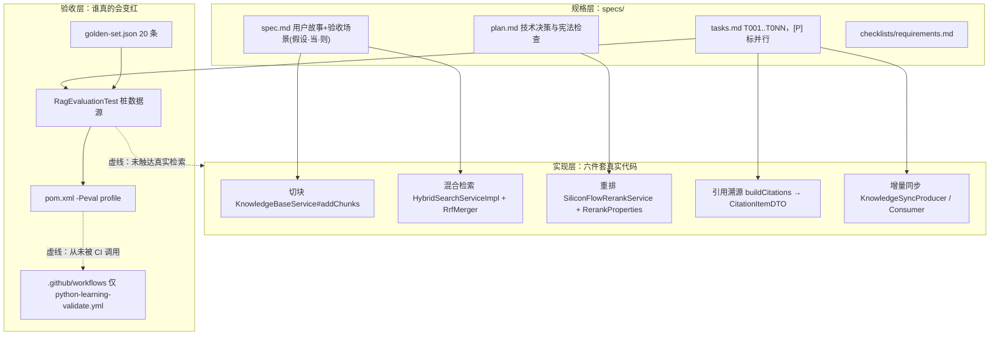
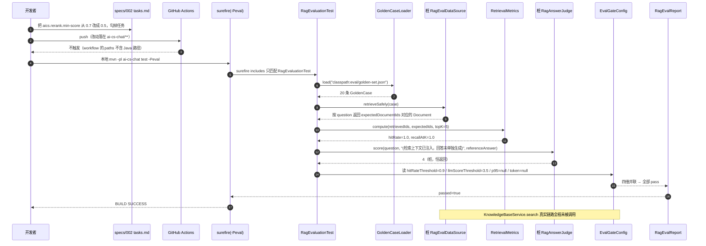

# Spec-Kit 实战：把 RAG 六件套拆成「能被改坏而变红」的规格

> **一句话结论**：切块优化 / 混合检索 / 重排 / 引用溯源 / 增量同步 / 评估门禁这六件事，在本仓库都已经有可运行的代码；真正缺的不是实现，而是「量化且可被证伪」的验收判据——用 Spec-Kit 重做六件套的全部价值，就在于把每条形容词换成一个**故意改坏就一定会变红**的断言。
> **阅读前置**：先读 [01-RAG检索增强生成.md](../02-RAG全栈实战/01-RAG检索增强生成.md)（知道 `recallTopK=20` / `recallThreshold=0.3` / `buildContext` 的「【资料N】」三段），再翻 [03-SpecKit-OpenSpec-Superpowers-对比与实战指南.md](./03-SpecKit-OpenSpec-Superpowers-对比与实战指南.md) 了解 `specify → clarify → plan → tasks → implement → analyze` 的产物形状；没写过 spec 也能读，§2 会补齐名词。
> **证据基线**：Spring Boot 4.2.0 / Spring AI 2.1.0（学习文档基线），代码取证于当前工作树 `main`；A 级摘录取自 `learning-docs/24-源码分析/assets/source/`（908 份），B 级为本仓库真实文件（行号当次核对），C 级命令全部离线可复现。预计阅读 40 分钟。

**证据边界**

| 级别 | 本文用在哪 | 覆盖的实件 |
|---|---|---|
| A（已入库摘录） | §3.2 切块默认值、§3.3 检索请求语义、§3.6 写入语义、§3.7 评测接口 | `TokenTextSplitter.java.md`、`VectorStore.java.md`、`SearchRequest.java.md`、`DocumentPostProcessor.java.md`、`DocumentJoiner.java.md`、`RelevancyEvaluator.java.md` |
| B（仓库真实文件） | 全篇主体 | `specs/002-rag-quality-upgrade/`、`specs/003-rag-advanced-features/`、`ai-cs-chat/`、`ai-cs-search/`、`ai-cs-knowledge/`、`ai-cs-frontend/`、`.specify/`、`.github/workflows/` |
| C（离线实测） | §2.2 落地度表、§6.6、§6.7 | pwsh 静态统计，口径、命令、输出三样都贴 |
| A 未入库 | 重排 / 混合检索 / 增量同步的**项目实现类** | 这些类没有进 `assets/source`，本文一律按 B 级引用真实路径+行号，**不伪造 `[[源码:]]` 锚点** |

## 0. 先看现象

三个症状都能在仓库里当下复现，不需要启动任何服务。

### 0.1 门禁测试永远绿

`ai-cs-chat/src/test/java/com/aics/chat/rag/eval/RagEvaluationTest.java` 是 `-Peval` profile 唯一会跑的测试（`ai-cs-chat/pom.xml` L226-L245 的 surefire `includes` 只写了它）。它的数据源是**桩**：

```java
// 摘录 ai-cs-chat/src/test/java/com/aics/chat/rag/eval/RagEvaluationTest.java L29-L41
RagEvalDataSource stub = (kb, query, topK) -> {
    List<Document> docs = new ArrayList<>();
    for (GoldenCase c : cases) {
        if (c.getQuestion().equals(query) && c.getExpectedDocumentIds() != null) {
            for (String id : c.getExpectedDocumentIds()) {
                docs.add(new Document("doc-" + id, "text", Map.of("documentId", id)));
            }
        }
    }
    return docs;
};
RagAnswerJudge stubJudge = (q, a, r) -> 4;
service = new RagEvalServiceImpl(loader, stub, stubJudge, new EvalGateConfig());
```

桩数据源按 `question` 直接返回 `expectedDocumentIds` 本身，于是 L57-L61 断言的 `hitRate == 1.0`、`recallAtK == 1.0`、`avgLlmScore == 4.0`、`isPassed() == true` **在数学上必然成立**，与真实检索质量无关。把 golden 集的期望文档全改成 `"999"`，它照样绿——因为桩会照着改后的期望值返回 `"doc-999"`。

### 0.2 评估看起来评了回答，其实评的是一个常量串

`ai-cs-chat/src/main/java/com/aics/chat/rag/eval/RagEvalServiceImpl.java` L239-L241：

```java
private String buildAnswerPlaceholder(GoldenCase c) {
    return "(检索上下文已注入，回答未单独生成)";
}
```

L139-L145 把它当 `answer` 传给 `answerJudge.score(question, buildAnswerPlaceholder(c), referenceAnswer)`。也就是说 LLM-as-Judge 那一维分数，是对着同一句常量在不同问题下反复打分——它测的是「判官模型对固定输入的偏爱」，不是回答质量。

### 0.3 开关没配，请求了也静默降级

`ai-cs-chat/src/main/java/com/aics/chat/rag/retrieve/RagRetrieveProperties.java` 里 `hybridEnabled / rewriteEnabled / graphEnabled` 默认全是 `false`（L14/L17/L20），而 Nacos 的 `tools/nacos-config/ai-cs-chat.yml` 中 `aics.rag` 块只有两个键（L22-L25：`recall-top-k: 20`、`recall-threshold: 0.3`），**没有** `hybrid-enabled` / `rrf-k`。于是 `HybridRetriever.java` L123-L126 走到：

```java
// 摘录 ai-cs-chat/src/main/java/com/aics/chat/rag/retrieve/HybridRetriever.java L123-L126
case HYBRID -> properties.isHybridEnabled()
        ? hybrid(kb, query, k)
        : vector(kb, query, k, "hybrid 全局未启用");
```

请求带了 `hybrid=true`，实际仍走纯向量，降级原因只落在 `RetrieveResult.degradeReason`（L308-L314）里，而调用方 `ChatServiceImpl` L437 只取文档列表。**你以为的混合检索，在默认配置下从未发生。**

这些现象指向同一件事：六件套每一项都写完了「实现」，却没有一项写下「可被证伪的验收判据」，于是 `spec.md` 里的成功标准退化成形容词，`tasks.md` 打勾就等于完成。

## 1. 整体地图



> **读图说明**：先看两条**虚线**。第一条 `G2 -.-> CODE` 表示门禁测试根本没有触达实现层——如果你把它误读成实线，就会得出「我们有 RAG 质量门禁」这个错误结论，而真相是门禁只验证评估框架自身能跑通（§4 的时序会逐格展开）。第二条 `G3 -.-> G4` 表示 `-Peval` profile 存在、但唯一的 workflow 文件从不调用它（`paths` 只监听 `learning-docs/22-Python速成/**` 与 `ai-cs-py-recommend/**`），所以「本地能跑」和「CI 会拦」是两件事。再看 `S1 --> C1/C2` 的实线：规格到代码这一段是通的，六件套的实现都在，问题全部集中在这两条虚线缺口上。

| 组件 | 责任 | 参与方（写/跑/读） | 证据位置 |
|---|---|---|---|
| `specs/002-rag-quality-upgrade/spec.md` | 定义 Rerank / 混合 / 引用 / 多格式 / 增量同步五个用户故事与验收场景 | 人写、`/speckit.specify` 生成骨架、评审读 | 198 行，含 FR-001~FR-012、SC-001~SC-006 |
| `specs/003-rag-advanced-features/tasks.md` | 68 个任务的依赖序与 `[P]` 并行标注 | 人写、`/speckit.tasks` 生成 | T001~T068，10 个 Phase |
| `KnowledgeBaseService` | 两阶段检索：宽召回 20 条 → 重排取 topN | chat 服务运行时 | `ai-cs-chat/src/main/java/com/aics/chat/service/KnowledgeBaseService.java` L228-L260 |
| `HybridSearchServiceImpl` | BM25 + 向量双路召回后 RRF 融合 | search 服务运行时 | `ai-cs-search/src/main/java/com/aics/search/hybrid/HybridSearchServiceImpl.java` L41-L71 |
| `SiliconFlowRerankService` | 调外部 rerank 接口，失败静默降级 | chat 服务运行时（外部 API 依赖） | `ai-cs-chat/src/main/java/com/aics/chat/rag/rerank/SiliconFlowRerankService.java` L127-L198 |
| `buildCitations` | 把 metadata 转成前端可渲染的引用项 | chat 服务 + 前端 | `ai-cs-chat/src/main/java/com/aics/chat/service/impl/ChatServiceImpl.java` L1041-L1078 |
| `KnowledgeSyncProducer/Consumer` | 文档变更经 RocketMQ 驱动向量化 | knowledge 服务 + RocketMQ | `ai-cs-knowledge/src/main/java/com/aics/knowledge/mq/KnowledgeSyncConsumer.java` L53-L78 |
| `golden-set.json` | 唯一的量化验收样本 | 人维护、评估与 CI 读 | `ai-cs-chat/src/main/resources/eval/` 下的 `golden-set.json`（20 条） |
| `-Peval` profile | 评估的构建入口 | 人手动跑 | `ai-cs-chat/pom.xml` L226-L245 |

## 2. 关键概念与关键要素

### 2.1 名词表

| 名称 | 位置 | 角色 | 关键点 |
|---|---|---|---|
| 用户故事（User Story） | `spec.md` | 把「一个能力」写成可独立交付的单位 | 每个故事必须带「此优先级的原因」和「独立测试」两栏，后者是判据的落户点 |
| 验收场景（假设·当·则） | `spec.md` 各故事下 | 判据的书写格式 | 「假设」放**基线条件**（哪个知识库、多少条样本、什么参数指纹），「则」必须是带数字的断言 |
| 可测判据 | `spec.md` 的 SC-xxx | 决定能不能自动判定 | 反例：`specs/002` SC-001 写的是「人工评估相关命中率不下降」——「人工评估」意味着无法进 CI |
| 负向验证 | 测试代码 | 证明门禁不是摆设 | 故意把期望值改错，门禁必须 FAIL；只跑一次全绿不能证明任何事 |
| golden 集 | `eval/golden-set.json` | 判据的样本底座 | 现有 20 条、单知识库 `product-manual`、字段含 `expectedDocumentIds` 与 `referenceAnswer` |
| 宽召回 / 精排 | `KnowledgeBaseService#search` | 两阶段检索的两个闸口 | 召回要宽（20 条、阈值 0.3），精排要严（topN=5、minScore=0.7） |
| RRF（Reciprocal Rank Fusion） | `RrfMerger` | 混合检索的融合算法 | 只吃**名次**不吃分数，`k=60` 决定尾部衰减速度 |
| 幂等（idempotent） | 写入/同步链路 | 同一条消息重投不许产生副作用 | 取决于写入原语：`add` 与 `upsert` 语义完全不同（§3.6） |
| 门禁裁定（gate） | `EvalGateConfig` | 把指标变成红/绿 | 现有四维**并联**判定，任一维 `null` 即该维放行 |
| 回归隔离 | tasks 分层 | 改检索不许打坏生成 | 靠「检索层断言」和「生成层断言」拆成两条测试，别用一条混着判 |

### 2.2 六件套 × 验收判据 × 当前是否达标 × 证据位置

这张表就是本篇的交付物：把它当成 `specs/00X/spec.md` 的 SC 段和 `tasks.md` 的任务清单直接用。

| 六件套 | 验收判据（可测断言） | 当前是否达标 | 证据位置 |
|---|---|---|---|
| 切块优化 | 固定 golden 集与重排参数，只改切块参数，`Recall@20` 相对基线下降 ≤ 2pp；报告须写出 `splitter` 版本 + `chunkSize` + `overlap` 指纹；正文 <350 字符的文档不得产出空块 | ❌ 未达标：三处 `new TokenTextSplitter()` 全用默认值，无参数化入口、无指纹、无 A/B 记录 | `ai-cs-chat/src/main/java/com/aics/chat/service/KnowledgeBaseService.java` L114/L161；`ai-cs-knowledge/src/main/java/com/aics/knowledge/service/KnowledgeVectorService.java` L77 |
| 混合检索 | 型号/编号类子集（如含 `ABC-123`）的 `HitRate` 相对纯向量 ≥ +5pp；单路失败时降级率与 `degradeReason` 必须进指标，而不是只写日志 | ⚠️ 部分达标：融合与降级都实现了，但没有子集判据；`hybrid-enabled` 未配置，默认 `false`，「混合」实际不生效 | `ai-cs-search/src/main/java/com/aics/search/hybrid/HybridSearchServiceImpl.java` L41-L71；`ai-cs-chat/src/main/java/com/aics/chat/rag/retrieve/RagRetrieveProperties.java` L14；`tools/nacos-config/ai-cs-chat.yml` L22-L25 |
| 重排 | 精排后 topN 内相关文档率 ≥ 基线；`Rerank` 调用 P95 ≤ 2000ms；降级率 <5%（降级必须可观测） | ⚠️ 部分达标：`minScore=0.7`、`topN=5` 已配置，但降级走 `onErrorResume → Mono.empty()` 静默，无降级计数 | `ai-cs-chat/src/main/java/com/aics/chat/rag/rerank/SiliconFlowRerankService.java` L138-L198；`KnowledgeBaseService.java` L236-L257 |
| 引用溯源 | 有命中的回答 100% 带 `citations`；`citations[].documentId` 必须能在知识库文档表里查到（可 JOIN），查不中记为缺陷 | ❌ 未达标：chat 侧写入 `documentId = chunk.getId()`（每块一个不同值），knowledge 侧写入 `documentId = doc.getId()`，两侧语义不一致，引用 ID 无法回指业务文档 | `KnowledgeBaseService.java` L168-L175 vs `KnowledgeVectorService.java` L79-L83 |
| 增量同步 | 同一文档更新后，旧块残留数 = 0；同一条消息重投 3 次后向量行数不变；DB 提交到可检索 P95 ≤ 5s | ❌ 未达标：`UPDATE` 分支直接 `vectorize`，而 `vectorize` 走 `vectorStore.add`，重复 id 行为「交给底层 provider」；consumer 还 `catch` 吞异常 | `KnowledgeSyncConsumer.java` L56-L77；`KnowledgeVectorService.java` L85；[[源码:VectorStore.java.md#L58-L82]] |
| 评估门禁 | 故意把 golden 集某条 `expectedDocumentIds` 改成不存在的 id，`-Peval` 必须 FAIL；CI 对 `ai-cs-chat/**` 变更必须触发该任务 | ❌ 未达标：桩数据源恒真、门禁阈值全 `null`（`aics.eval.gate` 无任何赋值）、workflow 不监听 Java 路径 | `RagEvaluationTest.java` L29-L41；`ai-cs-chat/src/main/java/com/aics/chat/rag/eval/EvalGateConfig.java` L34-L43；`.github/workflows/python-learning-validate.yml` |

## 3. 原理与证据逐段精读

每小节按四层讲：**在干什么 → 为什么这么设计 → 换写法会怎样 → 常见坑**。§3.2、§3.3、§3.7 各附一段可照抄的 spec 片段。

### 3.1 spec 模板的槽位怎么变成验收判据

**在干什么**：`.specify/templates/spec-template.md`（140 行）把每个用户故事钉成四个固定槽位——优先级、此优先级的原因、**独立测试**、验收场景（假设·当·则）。`specs/002-rag-quality-upgrade/spec.md` 与 `specs/003-rag-advanced-features/spec.md` 都严格按这个形状写。

**为什么这么设计**：「独立测试」这一栏是整份模板里唯一强制你回答「我能不能单独验证它」的地方。它逼你把「能力」翻译成「观察点」，而观察点自带一个隐含要求：**必须有可比对的基线**。`specs/003` SC-002 写「含型号查询 Hybrid 命中率 ≥ 纯向量」就是这种写法——不管数字定多少，它天然可以被判红。

**换写法会怎样**：如果跳过这一栏、只写 FR 清单（「系统应支持混合检索」），规格就退化成功能目录，`tasks.md` 里的每个 `[x]` 都只能证明「代码写了」，不能证明「效果对了」。本仓库 `specs/002` SC-001 是个现成的教训：写「人工评估相关命中率不下降」，「人工」二字直接把它排除在 CI 之外，于是这条 SC 永远不会红。

**常见坑**：把边界情况写成「系统应优雅处理异常」。边界的价值在于**能被构造**——「正文 <350 字符时不得产出空块」可以构造一条输入就验，「优雅处理」不能。

### 3.2 切块优化：参数写死在默认值上，判据必须先于参数存在

**在干什么**：全仓只有三处切块调用，全部是默认构造：

```java
// 摘录 ai-cs-chat/src/main/java/com/aics/chat/service/KnowledgeBaseService.java L159-L181
private int addChunks(String knowledgeBase, List<Document> documents) {
    List<Document> chunks = new TokenTextSplitter().apply(documents);

    String title = extractTitle(chunks, documents);

    chunks.forEach(chunk -> {
        Map<String, Object> meta = chunk.getMetadata();
        meta.put("knowledgeBase", knowledgeBase);
        meta.put("documentId", chunk.getId());
        if (title != null) {
            meta.put("title", title);
        }
    });

    vectorStore.add(chunks);
    return chunks.size();
}
```

`new TokenTextSplitter()` 的默认值来自框架：

```java
// (src: TokenTextSplitter.java.md#L56-L70)
public static final int DEFAULT_CHUNK_SIZE = 800;
public static final int DEFAULT_CHUNK_OVERLAP = 0;
public static final int MIN_CHUNK_SIZE_CHARS = 350;
public static final int MIN_CHUNK_LENGTH_TO_EMBED = 5;
public static final int MAX_NUM_CHUNKS = 10000;
```

**为什么这么设计**：800 token 是「一篇手册条目」的经验中位数，`overlap=0` 保证块数不膨胀。框架选择默认重叠 0，是因为重叠的收益高度依赖文档结构——代码块、表格、FAQ 本来就自带边界，硬重叠反而切坏语义。

**换写法会怎样**：`overlap=0` 对「一句话跨两段」的客服手册是危险的——答案被切在块边界上，召回任何一半都答不全。这正是判据要管的事：判据说「只改切块参数，`Recall@20` 下降 ≤ 2pp」，等于把这个风险变成一个可回滚的 A/B 决策，而不是一次性手调。

**常见坑**：`KnowledgeBaseService` 与 `KnowledgeVectorService` 两条入库路径各写一次切块（L161 与 L77），参数一旦要调就必须调两处，且没有任何测试兜住不一致。判据里写「报告须含参数指纹」，就是为了让两处不一致在下一次评估报告里自己暴露。

spec 片段示范（可直接粘进 `spec.md` 的用户故事段）：

```markdown
### 用户故事 1：切块参数可回滚（优先级：P1）

**此优先级的原因**：切块是检索链路最上游，它的参数变更等于改动所有下游指标的基线，
不先锁住它就无从判断「重排变好」是不是真的变好。

**独立测试**：在 golden 集 v1（100 条，覆盖 ≥3 个知识库）与重排参数固定为
`topN=5 / minScore=0.7` 的前提下，只改切块参数，能单独读出 `Recall@20` 的变化量。

**验收场景**

1. **假设** golden 集 v1 已冻结、重排开关为开
   **当** 切块参数为 `chunkSize=800, overlap=0`
   **则** 评估报告输出 `Recall@20` 基线值，并在报告头部写出参数指纹
   （splitter 版本 + chunkSize + overlap + 知识库名）
2. **假设** 同上基线已记录
   **当** 切块参数改为 `chunkSize=512, overlap=64`
   **则** `Recall@20` 相对基线下降不超过 2 个百分点；超过则本变更禁止合并
3. **假设** 输入是一篇正文 200 字符的 FAQ
   **当** 执行切块
   **则** 产出恰好 1 个块且不抛异常（`MIN_CHUNK_SIZE_CHARS=350` 生效）

**边界情况**
- 正文为空串或全空白：不产出块，且不写入向量库
- 单文档块数触达 `MAX_NUM_CHUNKS=10000`：记录告警，不静默截断
```

三个要点值得记下来：①「假设」里写死了**其他所有变量**，这才叫可独立验证；②「则」给的是**变化量**（≤2pp）不是绝对分，避免基线自然漂移时误判；③边界两条都能用一次单测构造出来。

### 3.3 混合检索：RRF 只吃名次，所以判据必须按「子集」切

**在干什么**：`ai-cs-search` 侧双路召回后融合。

```java
// 摘录 ai-cs-search/src/main/java/com/aics/search/hybrid/HybridSearchServiceImpl.java L41-L71（已删减）
private static final int RETRIEVE_TOP_K = 20;
private static final int RRF_K = 60;
...
List<RankedItem> esItems = keywordSearch(kb, query);        // multiMatch("title^2","content")
List<RankedItem> vectorItems = vectorSearch(kb, query);     // SearchRequest.topK(20)
if (esItems.isEmpty() && vectorItems.isEmpty()) return emptyList();
if (esItems.isEmpty()) return toTopK(vectorItems, topK);    // 单路降级
if (vectorItems.isEmpty()) return toTopK(esItems, topK);
return RrfMerger.merge(esItems, vectorItems, topK, RRF_K);
```

**为什么这么设计**：BM25 与向量分数的量纲不可比（前者无上界、后者在 [-1,1]），只有名次是同一套坐标，所以 RRF 用 `1/(k+rank)` 累加。`k=60` 是学术界常用取值，作用是把头部名次的优势压平一点：`k` 越大，第一名和第 20 名的差距越小，融合结果越「稳」但越钝。

**换写法会怎样**：如果改成加权分数和（`0.7*向量分 + 0.3*BM25分`），就必须先做分数归一化，且每次换 embedding 模型都要重标定权重——参数面从 1 个（k）变成 N+1 个，判据也跟着不可维护。本仓库 `specs/002` 直接把「RRF k=60」写进 Clarifications，就是把这个决策冻结住。

**常见坑**：`HybridSearchServiceImpl` L84-L92 的 ES 查询用 `term("knowledgeBase", kb)` 过滤、L175-L177 用 `kb.toLowerCase(Locale.ROOT)` 当索引名——**索引命名与知识库名被隐式绑定**。给知识库改名或新建带大写/中文名的知识库，关键字那一路会静默空返回，然后按 L61-L68 降级成纯向量，你只会看到「混合检索好像没效果」。所以判据里必须同时统计**降级率**，否则「效果没提升」和「根本没跑」两种故障你分不开。

spec 片段示范：

```markdown
**验收场景**：假设知识库 product-manual 内既有型号串（如 `ABC-123`）又有语义描述
**当** 用户提问「ABC-123 的保修期」且 `aics.rag.hybrid-enabled=true`
**则** 结果集是纯向量结果的**超集**（同 topK 下命中数不少于纯向量），且报告里 `degraded=false`
**边界**：ES 路空返回时降级纯向量并记 `degradeReason=keyword-empty`，不得返回空列表；
RRF 的 `k` 从 60 改任何值都必须重跑同一份判据
```

### 3.4 重排：两阶段 + 三条静默降级路径

**在干什么**：`KnowledgeBaseService#search` 先宽召回再精排。

```java
// 摘录 ai-cs-chat/src/main/java/com/aics/chat/service/KnowledgeBaseService.java L228-L260（已删减）
public List<Document> search(Long kb, String query, int topK, double threshold) {
    List<Document> recalled = searchRaw(kb, query, recallTopK, recallThreshold);  // 20 / 0.3
    if (recalled.isEmpty()) return List.of();
    RerankService rerankService = rerankServiceProvider.getIfAvailable();
    if (rerankService != null) {
        List<Document> reranked = rerankService.rerank(query, recalled, topK).block();
        if (reranked != null && !reranked.isEmpty()) return reranked;
    }
    return recalled.subList(0, Math.min(topK, recalled.size()));   // 降级
}
```

**为什么这么设计**：向量检索的成本随候选数线性增长，而重排模型（`BAAI/bge-reranker-v2-m3`）是对 (query, doc) 逐对打分，成本更高。两阶段让「便宜但粗」的召回负责覆盖率、「贵但准」的精排负责排序精度，`recallTopK=20 → topN=5` 是最小可行配比。用 `ObjectProvider<RerankService>` 注入，是为了让 rerank 成为**可缺席**能力，缺 bean 时整条链路照常工作。

**换写法会怎样**：把重排做成硬依赖（`@Autowired` 必填），则 `apiKey` 为空时服务起不来——`SiliconFlowRerankService` L129-L133 恰恰把「key 为空」当作正常情况返回 `Mono.empty()`。硬依赖会把这个设计意图推翻。反过来，如果为了稳而不做重排，`recallThreshold=0.3` 这么宽的召回（0.3 意味着大量弱相关文档进入上下文）会直接把噪声灌进提示词，生成质量反而下降。

**常见坑**：降级有三条路径——① `getIfAvailable()` 为 `null`；② `Mono` 超时（`timeoutMs=5000`，L138-L159）；③ 外部接口报错被 `onErrorResume` 吞掉（L157 只打一行 `log.warn`）。三条路径对用户是同一个结果（换个排序），对判据是三种原因，**必须分开计数**。另外 `minScore=0.7` 是 `bge-reranker` 的分数量纲，不是余弦相似度；把 0.7 这个数字从 rerank 挪到向量阈值上，等于把召回砍掉一大半——`.specify/memory/constitution.md` L343 写的「RAG 场景 similarityThreshold ≥ 0.70」与代码里的 `recallThreshold=0.3`（`KnowledgeBaseService` L94-L99）、`ChatServiceImpl` L437 传的 `0.5` 三处数字互相打架，正是这个坑的现场。

spec 片段示范：

```markdown
**验收场景**：假设 `recallTopK=20`、`minScore=0.7`、golden 集 v1 已冻结
**当** 对同一批查询分别以「重排开 / 重排关」各跑一次
**则** 重排开的 `Recall@5` 不低于关的，且「降级率」与「`minScore` 过滤后为空率」分别单独上报
**边界**：`apiKey` 为空、超时 5000ms、外部接口 5xx 三种情况都必须退回原始排序而不是返回空，
且 `degradeReason` 能区分三者（`no-key` / `timeout` / `remote-error`）
```

### 3.5 引用溯源：`documentId` 有两个语义，判据要钉在「可回指」上

**在干什么**：chat 侧把检索结果的 metadata 转成前端卡片。

```java
// 摘录 ai-cs-chat/src/main/java/com/aics/chat/service/impl/ChatServiceImpl.java L1041-L1078（已删减）
private List<CitationItemDTO> buildCitations(List<Document> docs) {
    for (Document doc : docs) {
        CitationItemDTO item = new CitationItemDTO();
        Object docId = meta.get("documentId");
        if (docId != null) {
            try { item.setDocumentId(Long.valueOf(String.valueOf(docId))); }
            catch (NumberFormatException ignored) { }        // ← 静默丢 ID
        }
        item.setTitle(...); item.setPage(...); item.setScore(...); item.setContent(...);
        citations.add(item);
    }
}
```

**为什么这么设计**：注释 L1042-L1044 说得很清楚——检索结果按「自包含」设计，引用卡片只依赖文档 `metadata`，不回头查库。好处是不引入 chat → knowledge 的同步调用，坏处是把「metadata 里有什么」变成了隐式契约。

**换写法会怎样**：如果改成「拿到 docId 再查一次文档表」，能拿到权威标题和页码，但每条引用多一次 RPC，且回答链路会比检索链路更脆弱。工程上更划算的是把契约显式化：在入库时保证 `documentId` 一定是**业务文档 id 且可 JOIN**。

**常见坑**：这里有一个真实的语义漂移。chat 侧入库写的是 `meta.put("documentId", chunk.getId())`（`KnowledgeBaseService` L168-L175）——`chunk.getId()` 是**每个块各自随机生成**的 id，所以同一篇文档的 5 个块有 5 个不同 `documentId`；而 knowledge 侧写的是 `documentId = doc.getId()`（`KnowledgeVectorService` L79-L83），是业务文档 id。两条入库路径写进同一个字段的两种东西，前端卡片拿到的 `documentId` 有一半是「只在向量库里存在的块 id」。判据因此不能写「citations 非空」，必须写「`citations[].documentId` 能在 `knowledge_db` 的文档表里查到」——这条断言会让上述漂移立刻变红。

引用溯源这条的 spec 片段可以很短，但一样要三件套：

```markdown
**验收场景**：假设知识库 product-manual 有 12 篇文档、回答命中 3 篇
**当** 客户端发起带 RAG 的问答（流式）
**则** `done` 事件的 `citations` 恰好 3 条，每条 `documentId` 都能在
`knowledge_db.knowledge_document` 中查到，且 `title` 与该文档标题一致
**边界**：无命中时 `citations` 为空数组而不是 `null`；`documentId` 非数字时保留原始字符串，不得静默丢弃
```

### 3.6 增量同步：`add` 不是 upsert，`UPDATE` 会留下旧块

**在干什么**：文档增删改经 RocketMQ 驱动向量化。

```java
// 摘录 ai-cs-knowledge/src/main/java/com/aics/knowledge/mq/KnowledgeSyncConsumer.java L53-L78（已删减日志）
public void onMessage(KnowledgeSyncMessage message) {
    String action = message.getAction();
    try {
        if ("DELETE".equals(action)) {
            knowledgeVectorService.deleteByDocumentId(message.getDocumentId());
        } else {
            // CREATE / UPDATE：构造文档对象后直接向量化入库
            KnowledgeDocument doc = new KnowledgeDocument();
            doc.setId(message.getDocumentId());
            doc.setContent(message.getContent());
            knowledgeVectorService.vectorize(doc);
        }
    } catch (Exception e) {
        log.error("知识文档同步消息消费失败: action={}, documentId={}, err={}", ...);
        // 不抛异常（RocketMQ 默认重试 16 次后进入死信队列），避免阻塞后续消息消费
    }
}
```

而 `vectorize` 的写入原语是 `vectorStore.add(chunks)`（`KnowledgeVectorService` L85），切块后每个块的 id 都是新生成的。框架对这个原语的语义写得很直白：

```java
// (src: VectorStore.java.md#L46-L66)
	/**
	 * Adds list of {@link Document}s to the vector store.
	 * @param documents the list of documents to store. Throws an exception if the
	 * underlying provider checks for duplicate IDs.
	 */
	void add(List<Document> documents);
	...
	 * Write semantics are replace-by-id: if an entry's document id already exists, the
	 * existing row is replaced; otherwise a new row is inserted. As a result, an
	 * ingestion job that uses stable ids is safe to re-run — the same input yields the
	 * same rows with no duplicates. This is in contrast to {@link #add(List)}, whose
	 * behavior for a repeated id is left to the underlying provider.
```

**为什么这么设计**：框架把「重复 id 该怎么办」留给了具体向量库（Milvus、PGVector、Redis 的处理各不相同），只保证 `add` 是「写一批」。这是为了兼容性牺牲语义确定性。

**换写法会怎样**：`UPDATE` 分支直接 `add` 新块、却不先删旧块，结果是**同一篇文档更新三次后，向量库里存在三份内容**。检索时会同时召回新旧版本，答出已经下架的参数。正确写法二选一：① `UPDATE` 先 `deleteByDocumentId` 再 `vectorize`；② 切块时给块 id 用「文档 id + 块序号」这种稳定 id，改用 `upsert`（2.x 新增，摘录里那句 "safe to re-run" 就是为这种场景写的）。

**常见坑**：`KnowledgeSyncConsumer` L76 的注释说「不抛异常（RocketMQ 默认重试 16 次后进入死信队列），避免阻塞后续消息消费」——但 `catch` 把异常吞了，Broker 根本收不到失败信号，**重试与死信都不会发生**，那条消息等于永久丢失。这类「注释与实现相反」的地方，判据只能靠外部观测：`DB 提交到可检索 P95 ≤ 5s` 一旦有实例超时,就说明消息丢了,而不是「慢」。

spec 片段示范（这条判据的关键是「块数不累加」，它能同时抓出旧块残留和重复入库）：

```markdown
**验收场景**：假设某文档已入库可检索，向量库中该文档块数 = N
**当** 对同一文档连续提交 3 次 UPDATE
**则** 该文档在向量库中的块数仍为 N（不累加），新内容可检索、旧内容不可检索
**边界**：MQ 不可用时 DB 提交照常成功并留下待重投记录；消费失败必须可见
（进重试或死信），不得静默吞掉
```

### 3.7 评估门禁：四道并联判定，和 `null` 的短路逻辑

**在干什么**：`RagEvalServiceImpl` 跑完 golden 集后做四个维度的判定。

```java
// 摘录 ai-cs-chat/src/main/java/com/aics/chat/rag/eval/RagEvalServiceImpl.java L183-L195
boolean hitPass = request.getHitRateThreshold() == null
        || overall.getHitRate() >= request.getHitRateThreshold();
boolean llmPass = request.getLlmScoreThreshold() == null
        || avgLlm == null
        || avgLlm >= request.getLlmScoreThreshold();
// 新增门禁：P95 延迟与平均 Token（阈值未配置的维度只记录不判定）
boolean p95Pass = gateConfig.getP95LatencyMs() == null
        || report.getP95LatencyMs() == null
        || report.getP95LatencyMs() <= gateConfig.getP95LatencyMs();
boolean tokenPass = gateConfig.getAvgTokensPerRequest() == null
        || report.getAvgTokensPerRequest() == null
        || report.getAvgTokensPerRequest() <= gateConfig.getAvgTokensPerRequest();
report.setPassed(hitPass && llmPass && p95Pass && tokenPass);
```

延迟与 token 两维读 `EvalGateConfig`（`@ConfigurationProperties(prefix = "aics.eval.gate")`，L34），其 javadoc L18 明确「阈值未配置的维度只记录指标值，不参与门禁判定」，L26 写着「宁可放行不可误杀」。

**为什么这么设计**：这是渐进式治理的合理选择——先观测再卡点，避免门禁一上线就把所有构建打红导致团队绕过它。`RagEvaluationTest` 里 `new EvalGateConfig()` 直接构造实例、阈值全 `null`，就是这条路线的产物。

**换写法会怎样**：如果四个维度都配了阈值但数据源仍是桩，门禁依然恒绿（桩数据让指标恒优）；只有**阈值 + 真实数据源 + 负向用例**三样齐了，门禁才有意义。§2.2 表里评估门禁那一行的判据为什么写成「故意改坏必须 FAIL」，原因就在这里：能变红才是门禁，不能变红只是报表。

**常见坑**：`EvalGateConfig` 的阈值也可以走请求体传入——`RagEvaluationTest` L52-L53 传的是 `hitRateThreshold=0.9`、`llmScoreThreshold=3.5`，而这两个数写死在测试代码里，改阈值等于改测试源码，评审时很容易被当成「顺手调的测试数据」。阈值应该来自配置文件，测试只负责断言「配置被读取」。

spec 片段示范（门禁是最容易只说不做的一件，所以这里写得最细）：

```markdown
### 用户故事 6：评估门禁进 CI（优先级：P1）

**此优先级的原因**：没有门禁，前五件套的任何一项改动都无法证明没有变坏；
门禁是唯一能阻止「参数随手调、效果全靠感觉」的机制。

**独立测试**：在真实数据源（网关 → knowledge → 向量库）上跑 golden 集，
故意篡改 1 条样本的期望值，断言构建失败；恢复后断言构建通过。

**验收场景**

1. **假设** golden 集 100 条、覆盖 ≥3 个知识库，阈值写在 `aics.eval.gate` 配置块
   **当** 开发者提交只改 `ai-cs-chat/**` 的 PR
   **则** CI 自动触发 `mvn -pl ai-cs-chat test -Peval`，并把 4 类指标写入构建产物
2. **假设** 上一次合并的指标基线已归档
   **当** `hitRate` 相对基线下降 >2pp 或 `p95LatencyMs` 超阈值
   **则** 构建失败，PR 不可合并
3. **假设** 有人把某条样本的 `expectedDocumentIds` 改成不存在的 id
   **当** 门禁运行
   **则** 构建失败（负向用例，每个季度至少跑一次，用来证明门禁没被绕开）

**边界情况**
- 外部依赖（网关/ES/向量库）不可达：标记为 `blocked` 而不是 `failed`，不阻塞无关 PR
- golden 集条数 <50：门禁只允许「记录」，禁止作为合并依据
```

### 3.8 plan 阶段要定的技术决策清单

`/speckit.plan` 的产出是 `plan.md`，它的正文只有一张表最要紧：**决策点 / 选择 / 换来什么 / 代价**。六件套要定的决策点如下（`specs/003-rag-advanced-features/research.md` 的 D1~D15 就是这种写法的实例，例如 D7「RRF 融合自建 MultiQueryMerger」、D8「异常降级原问题」）。

| 决策点 | 必须在 plan 阶段回答的问题 | 现状 |
|---|---|---|
| 切块参数来源 | 写死默认 / 配置项 / 按文档类型分流？ | 写死（三处 `new TokenTextSplitter()`） |
| 重排降级策略 | 静默降级 / 显式告警 / 直接失败？ | 静默（三条路径都只 `log.warn`） |
| 混合开关归属 | chat 侧开关 / search 侧开关 / 请求级参数？ | 双侧都有，且 chat 侧默认关，最易踩 |
| 融合公式 | RRF(k) / 加权分数和 / 学习式融合？ | RRF，k=60 |
| 引用 id 语义 | 块 id / 业务文档 id / 两者都存？ | 两条入库路径不一致（§3.5） |
| 同步幂等实现 | `add` / 先删再 `add` / 稳定 id + `upsert`？ | `add`（§3.6） |
| 门禁阈值来源 | 代码常量 / `aics.eval.gate` 配置 / 环境变量？ | 配置类存在但无任何赋值 |
| golden 集版本 | 单库 20 条 / 多库 100 条 / 按季度轮换？ | 单库 20 条，从不轮换 |
| 门禁失败语义 | 阻断合并 / 只告警 / 降级为 block？ | 尚不存在 |

### 3.9 tasks 拆解与并行度：什么能 `[P]`，什么必须串

`specs/002-rag-quality-upgrade/tasks.md`（149 行）给了三组并行标注，`specs/003-rag-advanced-features/tasks.md`（230 行）给了六组：

| 并行组 | 内容 | 为什么能并行 | 证据 |
|---|---|---|---|
| 组 A | US1 Rerank + US4 Tika | 「Rerank 与 Tika 无依赖关系，可并行开发」——一个改排序、一个改解析入口，写不同文件 | `specs/002-rag-quality-upgrade/tasks.md` L22 |
| 组 B | US2 Hybrid | 只碰 `ai-cs-search`，与 chat 侧无共享类 | 同上 L23 |
| 组 C | US5 MQ Sync | 只碰 `ai-cs-knowledge` 的 `mq/` 包 | 同上 L24 |

必须**串行**的三条依赖链，以及它们为什么不能并行：

1. **引用溯源依赖重排**（`specs/002` L32：「US3 Citation 依赖 US1 组件就绪后」）。因为引用卡片要的 `score` 字段，来源是精排分数；重排未定型时，这个字段没有稳定含义。
2. **评估门禁排在最后**。`specs/003` 的依赖图里 `Phase10 = CI 门禁与文档收尾`，且 US1（评估体系）要先就位。门禁需要前面每件的指标名先定下来，否则判据无法命名。
3. **golden 集扩样必须在切块/检索冻结之后**。样本期望值与切块边界强相关：先扩样再改切块，等于用旧基线判新参数，判据会集体失真。

判断能否 `[P]` 的可操作标准只有两条：**是否改同一批文件**、**是否有共享可变状态**（同一个类、同一份配置、同一个知识库的向量数据）。`tasks.md` 里 68 个任务中有 30 多个带 `[P]`，但真正能同时合并的只有上面三组——`[P]` 说的是「可以并行写」，不是「可以并行合」。

### 3.10 回归风险隔离：改检索不许打坏生成

**在干什么**：把「检索质量」和「生成质量」拆成两条独立判据，而不是一条混判。

**为什么这么设计**：`RagEvalServiceImpl` 现有的四维门禁恰好天然支持这个拆分——`hitRate`/`recallAtK` 属于检索层，`avgLlmScore` 属于生成层。只要两层各有基线，改检索时检索维会红、生成维不动；改提示词时反之。

**换写法会怎样**：现在 `RagEvaluationTest` 用桩数据源、桩判官，两层都被短路，任何一侧的回归都读不出来。这正是「改重排参数没人跑过回归」的技术根因：不是没人跑，是跑了也看不出。

**常见坑**：容易把 `expectedDocumentIds` 和 `referenceAnswer` 混在一条用例里判。可操作的做法是把 golden 集拆两类：**检索用例**只断言 `expectedDocumentIds` 命中（纯检索层，不依赖 LLM），**回答用例**在固定检索结果的前提下断言 `referenceAnswer` 相似度（纯生成层，不依赖向量库）。`GoldenCase` 现有字段（`expectedDocumentIds` / `referenceAnswer` / `expectedKeywords`）足以支撑这个拆分，不需要改数据结构。

## 4. 一次完整执行时序

下面这条时序是「改一个重排参数 → 门禁判定」的完整路径，也是六件套里最容易出幻觉的一段：每一步都能走通，但走通的是**空气**。



> **读图说明**：盯住第 3 步和第 8-12 步两处。第 3 步 `CI-->>Dev：不触发` 是关键岔口——它说明这套流程实际是**纯本地自愿行为**，没有强制力；如果把它看成「CI 会跑」，后面所有关于「门禁保护主干」的推论都不成立。第 8 步 `S-->>T: 按 question 返回 expectedDocumentIds 对应的 Document` 是第二个岔口：数据源用**期望答案**去喂评估，等价于让学生自己出卷自己判卷，`hitRate=1.0` 是构造出来的而不是测出来的。把这两处虚线当成实线，就会得出「六件套已闭环」的错误结论。图上 `Note over S,G` 那一行是第三个证据点：真正会被参数变更影响的那条链路，压根没进这张图。

| 步骤 | 若换成真实实现（或缺失时） | 失败表现 | 是否有人会发现 |
|---|---|---|---|
| 3 CI 触发 | `paths` 加 `ai-cs-chat/**` | PR 直接变红 | 会（但目前没做） |
| 5 `-Peval` | profile 被删 | 评估根本不执行，跑的是默认单测 | 会（BUILD 里没有 eval 报告） |
| 6 golden 加载 | 文件不在 classpath | `IOException` → 构建失败 | 会 |
| 8 真实数据源 | 网关/ES/向量库不可达 | `retrieveSafely` catch 成空列表 → `hitRate=0` → 若阈值非 `null` 则红 | 会（前提是阈值已配） |
| 10 指标计算 | `expectedIds` 为空 | 分母为 0，指标无意义但不报错 | **不会** |
| 11 判官 | 接真 `ChatClient` | 分数波动 ±0.5，单次采样不可信 | **不会**（未做重复采样） |
| 12 门禁阈值 | 阈值从配置读且非 `null` | 能真正 FAIL | 会 |
| 13 `isPassed()` 断言 | 测试 L61 已断言 `report.isPassed()` 为 `true` | **这一环是全流程唯一接好的**：指标一旦塌，构建确实会红 | 会 |

## 5. 设计取舍

| 决策点 | 本仓库的选择 | 换来什么 | 付了什么代价 | 证据 |
|---|---|---|---|---|
| 评估放哪 | 不新增服务，内嵌在 `ai-cs-chat` 的 `rag/eval` 包 + Maven profile | 零运维、复用 chat 的检索客户端 | 评估与 chat 生命周期绑死，评估跑不动时 chat 也起不来 | `specs/003-rag-advanced-features/research.md` D1 |
| 门禁载体 | JUnit 测试 + `-Peval` profile | 与现有构建体系同构，不引入新工具 | 只能跑「一次性全量」，做不了基线对比与趋势 | `ai-cs-chat/pom.xml` L226-L245 |
| 数据源可插拔 | `RagEvalDataSource` / `RagAnswerJudge` 接口 | 单测可完全离线，不依赖中间件 | 桩实现太容易变成「自证正确」，必须靠负向用例守住 | `RagEvalServiceImpl.java` L116/L229-L236 |
| 门禁阈值 `null` 放行 | 未配置即跳过该维 | 上线初期不会误杀 | 现在等于全维放行，门禁形同虚设 | `EvalGateConfig.java` L18-L26 |
| 重排降级为静默 | `onErrorResume → Mono.empty()` + 降级到向量排序 | 外部 API 抖动不影响可用性 | 降级不可观测，效果变差无法归因 | `SiliconFlowRerankService.java` L157 |
| 引用结果自包含 | 只读 `metadata`，不回查文档表 | 回答链路没有额外 RPC | 契约隐式化，`documentId` 语义漂移无人察觉 | `ChatServiceImpl.java` L1042-L1044 |
| 同步用 `add` | `vectorize` 内部直接 `add` | 实现最短、无删除逻辑 | 更新后旧块残留，语义随向量库实现漂移 | `KnowledgeVectorService.java` L85；[[源码:VectorStore.java.md#L58-L82]] |
| 默认关闭进阶能力 | `hybridEnabled/rewriteEnabled/graphEnabled` 默认 `false` | 主链路行为稳定可控 | 「配置里没有」和「功能没做」在观测上无法区分 | `RagRetrieveProperties.java` L14-L20 |

**可扩展点清单**

- `RetrievalMode` 枚举（`VECTOR / HYBRID / HYBRID_QUERY_REWRITE / GRAPH_RAG`）已经是策略分派点，新增检索策略只需加枚举 + 实现，`HybridRetriever` L121 的 `switch` 是唯一改动位置。
- `RagEvalDataSource` 是接真实链路的现成插槽：把桩换成「走网关调 knowledge 检索」的实现，`RagEvaluationTest` 立刻具备真实判定力。
- `RagAnswerJudge` 同理，接真 `ChatClient` 只需实现 `score`。
- `GoldenCase` 字段（`expectedKeywords` 尚未被 `RagEvalServiceImpl` 全部使用）可承载「关键词覆盖」判据，不必改数据结构。
- `VectorStore.upsert` 是增量同步的现成替代原语，配合稳定块 id（文档 id + 序号）即可把 §3.6 的残留问题一次解决。
- `EvalGateConfig` 已经预留 `p95LatencyMs` / `avgTokensPerRequest` 两个字段，缺的只是配置文件里的赋值。
- `.github/workflows/` 只有一个 Python 文档校验流，新增 `rag-eval.yml` 的成本就是一份 YAML。

## 6. 踩坑与调试手法

### 6.1 门禁恒绿：桩数据源把「期望」当「结果」

`RagEvaluationTest` L29-L39 的桩按 `question` 返回 `expectedDocumentIds`，命中率必然是 1.0。
**调试手法**：把桩改成 `return List.of();`，重跑 `-Peval`。期望结果是构建**变红**（`hitRate=0` 低于 L52 的 `0.9`，而 L61 断言 `isPassed()` 为 `true`）。如果它依然绿，说明断链发生在更上游——阈值没读到或报告对象没被断言。**先证明它能红，再相信它是绿的**。

### 6.2 评估评的是常量串

`buildAnswerPlaceholder` 返回固定字符串（L239-L241），LLM 分是对常量的评分。
**调试手法**：全局搜 `buildAnswerPlaceholder`，确认只有一处调用（`RagEvalServiceImpl` L140）。任何出现在 `answerJudge.score(...)` 里的非生成内容，都必须在这个搜索中被发现。

### 6.3 `documentId` 两种语义

chat 侧 `meta.put("documentId", chunk.getId())`（L168-L175）与 knowledge 侧 `documentId = doc.getId()`（L79-L83）写同名不同物。
**调试手法**：搜 `meta.put("documentId"`，逐个确认右侧表达式是块 id 还是业务文档 id。判据层面的收口方式是断言「引用 id 可 JOIN 到文档表」（§3.5），这样不一致会以测试失败而不是以用户投诉的形式出现。

### 6.4 请求了 hybrid 但其实没跑

三层开关：`aics.rag.hybrid-enabled`（默认 `false`）→ Nacos 无该键 → `HybridRetriever` L123-L126 静默降级。
**调试手法**：`Select-String -Path "tools/nacos-config/ai-cs-chat.yml" -Pattern "^\s*(hybrid|rrf)"` 若 0 命中，就说明混合检索在线上从未启用；再搜日志串「hybrid 全局未启用」确认降级原因是否被打印。

### 6.5 `UPDATE` 留下旧块

`KnowledgeSyncConsumer` 的 `else` 分支同时处理 CREATE 与 UPDATE，直接 `vectorize`（`vectorStore.add`），不先删旧块。
**调试手法**：读 consumer 的 `if/else` 结构与 `vectorize` 内部写入原语；再看框架摘录确认 `add` 对重复 id 的行为「交给 provider」。判据侧用「更新后旧块残留数 = 0」把它固定成可测项。

### 6.6 一条命令量出六件套落地度（离线可复现）

统计口径写在脚本注释里：Java 全仓递归且排除 `\target\`；yml 递归但排除 `target` 与 `node_modules`；只数**非注释行**命中；「主代码文件」是命中关键类名的 `src/main` 侧文件数。

```bash
# 在仓库根执行（pwsh），约 3 秒
$java  = Get-ChildItem -Recurse -Include *.java | Where-Object { $_.FullName -notmatch '\\target\\' }
$mainJ = $java | Where-Object { $_.FullName -match '\\src\\main\\' }
$testJ = $java | Where-Object { $_.FullName -match '\\src\\test\\' }
$ymls  = Get-ChildItem -Recurse -Include *.yml,*.yaml | Where-Object { $_.FullName -notmatch '\\target\\|node_modules' }
function Row($cap,$cls,$cfg){
  $m = @($mainJ | Where-Object { (Get-Content $_.FullName -Raw) -match $cls }).Count
  $t = @($testJ | Where-Object { (Get-Content $_.FullName -Raw) -match $cls }).Count
  $n = 0
  foreach($y in $ymls){ $n += @(Get-Content $y.FullName -Encoding UTF8 | Select-String $cfg | Where-Object { $_.Line -notmatch '^\s*#' }).Count }
  "{0,-6} 主代码文件 {1,2} | 测试文件 {2,2} | yml 非注释命中行 {3,2}" -f $cap,$m,$t,$n
}
Row '切块' 'TokenTextSplitter' 'chunk|splitter'
Row '混合' 'HybridSearchServiceImpl|RrfMerger|HybridRetriever' 'hybrid|rrf'
Row '重排' 'RerankService|SiliconFlowRerankService|RerankProperties' 'rerank|top-n|min-score'
Row '引用' 'CitationItemDTO|buildCitations' 'citation'
Row '同步' 'KnowledgeSyncProducer|KnowledgeSyncConsumer' 'knowledge-doc-sync-topic'
Row '门禁' 'RagEvaluationTest|RagEvalServiceImpl|EvalGateConfig|RetrievalMetrics' '^\s*eval:|^\s*gate:'
```

真实输出（本机，2026-11-27）：

```text
切块     主代码文件  3 | 测试文件  0 | yml 非注释命中行  0
混合     主代码文件  9 | 测试文件  6 | yml 非注释命中行  0
重排     主代码文件  5 | 测试文件  1 | yml 非注释命中行  8
引用     主代码文件  4 | 测试文件  1 | yml 非注释命中行  0
同步     主代码文件  4 | 测试文件  0 | yml 非注释命中行  0
门禁     主代码文件  7 | 测试文件  3 | yml 非注释命中行  0
```

**怎么读这张表**：这是「六件套落地度表」，三列分别回答三个问题——
- **主代码文件数 > 0**：代码真的写了。切块 3 个文件（`KnowledgeBaseService` 一处 + `KnowledgeVectorService` 一处 + `DocumentLoader`）、混合 9 个、重排 5 个、引用 4 个、同步 4 个、门禁 7 个，六件套在 Java 侧一件不缺。
- **测试文件数**：只有混合（6）和门禁（3）有可观的测试面；**切块 0、同步 0**——切块参数与 MQ 消费这两处最容易出错的地方，一行测试都没有。
- **yml 非注释命中行**：只有一个非零——重排 8 行（`tools/nacos-config/ai-cs-chat.yml` L11-L19 的 `aics.rerank` 六项 + 注释），其余五件套全是 0。也就是说：混合检索的开关（`hybrid-enabled`/`rrf-k`）、切块参数、引用渲染开关、同步 topic、门禁阈值，**没有任何一项能从配置文件调整**。

另两条可复核的数字：`golden-set.json` 的 `"id"` 字段计数 = **20**；`.github/workflows` 文件数 = **1**（只有 `python-learning-validate.yml`）。

### 6.7 两份 golden 集已经开始各走各路

`ai-cs-chat/src/main/resources/eval/` 下的 `golden-set.json` 与 `ai-cs-chat/src/test/resources/eval/` 下的 `golden-set.json` 是两份**物理独立**的文件。

```bash
Get-FileHash "ai-cs-chat\src\main\resources\eval\golden-set.json","ai-cs-chat\src\test\resources\eval\golden-set.json" -Algorithm SHA256 | Select-Object Hash,Path
```

真实输出（本机，2026-11-27）：

```text
Hash : 75584822E727619CBA27697889AFDA2CAEF9223E9D66C458A2C7DBF4C4188BB8
Path : D:\Projects\Persion\ai-customer-service\ai-cs-chat\src\main\resources\eval\golden-set.json

Hash : 75584822E727619CBA27697889AFDA2CAEF9223E9D66C458A2C7DBF4C4188BB8
Path : D:\Projects\Persion\ai-customer-service\ai-cs-chat\src\test\resources\eval\golden-set.json
```

**怎么读**：两份 hash 相同，说明此刻还没漂。但它们是两个独立维护点，只要有人只改 test 侧（评估跑的是 `classpath:eval/golden-set.json`，即 test 侧优先），生产侧那份就悄悄过期。把这条 hash 比较写进 CI 的「一致性检查」，比事后发现评估样本与实际运行样本不一致便宜得多。

## 7. ⚠️ 版本差异

| 旧写法（旧稿 / 历史 spec） | 当前基线 | 变化点 | 迁移动作 |
|---|---|---|---|
| `specs/003-rag-advanced-features/plan.md` 技术上下文写「Spring Boot 3.2.5 / Spring Cloud 2023 / Spring AI 1.1.4」 | Spring Boot 4.2.0 / Spring Cloud 2026.0.0 / Spring AI 2.1.0 | plan 里的 API 假设整体过期，1.x 的检索/向量写法不再适用 | 重写 plan 的技术上下文段；删掉 1.x 专有调用；重跑 `-Peval` 刷新基线 |
| 增量同步默认用 `vectorStore.add` | 2.x 提供 `upsert`（replace-by-id，「safe to re-run」） | 有稳定 id 时 `upsert` 天然幂等，不需要先删 | 块 id 改为「文档 id + 序号」，`vectorize` 切到 `upsert` |
| 旧稿：CI 的 `-Peval` 阶段「在提交 c06ba69、Jenkinsfile 未含该阶段」 | `.github/workflows` 仅 `python-learning-validate.yml`；`Jenkinsfile` / `Jenkinsfile-k8s` 仍无 RAG 阶段 | 门禁连「本地手动」都算勉强，CI 侧依旧是零 | 新增 `rag-eval.yml`，`paths` 加 `ai-cs-chat/**`、`ai-cs-search/**`、`ai-cs-knowledge/**` |
| 旧稿：golden 集「未打包进运行时 jar」 | `main/resources/eval/` 与 `test/resources/eval/` 各一份，hash 相同 | 打包问题解决了，但变成双份漂移风险 | 只保留一份（建议 test 侧），另一份用构建期拷贝或纯配置指向 |
| 宪法 L343：RAG 场景 `similarityThreshold ≥ 0.70`、`topK 5-10` | 代码 `recallThreshold=0.3`、`ChatServiceImpl` 传 `0.5`、`topN=5` | 宪法与实现三处数字互相矛盾，评审时无法引用任何一边 | 明确区分「宽召回阈值」与「精排阈值」，宪法补一句区分，或把代码调到合规 |
| 旧稿把六件套定义为「评估体系 / Hybrid / 改写+HyDE / GraphRAG / 问数图表 / 运营闭环」 | 本篇六件套：切块 / 混合 / 重排 / 引用 / 同步 / 门禁 | 前一组是「能力扩展」，后一组是「质量基线」，只有后者能用同一套 golden 集判定 | 003 的 GraphRAG / 图表 / 闭环降级为独立特性，不进「进阶基线」；基线六件套以 002 规格为主干 |

## 8. 面试高频问与答

（本节只列问题。答案请盖住下一节，自己先答一遍，再对照 §9 的练习验收。）

1. 为什么六件套的验收判据要写成「相对基线的变化量」，而不是「绝对值 ≥ 某数」？
2. RRF 为什么只用名次不用分数？`k` 从 60 调到 10 或 200，分别会让融合结果偏向哪一路？
3. 切块的 `overlap=0` 在什么样的文档上一定会出问题？你会怎么用一条判据把它抓出来？
4. 两阶段检索里，`recallTopK=20 / recallThreshold=0.3` 与 `topN=5 / minScore=0.7` 这两组数字为什么不能互换量纲？
5. 重排的三条降级路径为什么必须分开计数？不分开会导致什么误判？
6. `documentId = chunk.getId()` 与 `documentId = doc.getId()` 在引用溯源上分别意味着什么？哪个能支撑「点击跳转原文」？
7. 为什么 `vectorStore.add` 不能代替 `upsert` 做增量更新？在不确定底层实现时，安全的更新姿势是什么？
8. 消息消费端 `catch` 所有异常并只打日志，会导致 RocketMQ 的哪两个机制失效？你怎么在不改 MQ 配置的前提下发现消息丢了？
9. 门禁阈值「未配置即放行」在产品早期是合理设计，什么时候它会变成技术债？转折点的信号是什么？
10. 一条门禁测试如果永远绿，你怎么用最小改动证明它是有效的（而不是删掉它）？
11. 为什么 `[P]` 标记只说明「可以并行写」，不能说明「可以并行合」？给出你所在项目的两条判定标准。
12. 把「检索质量」与「生成质量」拆成两条测试，具体要怎么拆？用现有的 `GoldenCase` 字段怎么落地？
13. 如果只能先做六件套里的两件，你选哪两件？各自的第一条判据是什么？

## 9. 动手练习

每条都给了验收标准，达标即可认为「这件的判据真的立起来了」。

**练习 1：给评估门禁做一次负向验证**
把 `ai-cs-chat/src/test/resources/eval/` 下的 `golden-set.json` 中任意一条的 `expectedDocumentIds` 改成 `["does-not-exist"]`，重跑 `mvn -pl ai-cs-chat test -Peval`。
验收标准：构建失败，且失败信息里能看到该 case 的 `hitRate` 变为 0；恢复文件后重新变绿。**不能变红的门禁不算门禁，这条不过，后面五条都不用做。**

**练习 2：把桩数据源换成真实链路**
实现一个 `RagEvalDataSource`，内部走网关调 `ai-cs-knowledge` 的检索接口（或直接注入 `KnowledgeBaseService`），保留原桩作为对照组。
验收标准：同一份 golden 集，两组数据源跑出的 `hitRate` 有差异（差异为 0 说明你的「真实」实现其实还在返回期望值）；报告里同时出现两组数字。

**练习 3：为切块参数建 A/B 基线**
把 `KnowledgeBaseService` L161 与 `KnowledgeVectorService` L77 各抽出 `chunkSize/overlap` 两个配置项，默认值保持不变。
验收标准：配置项能在 `tools/nacos-config/ai-cs-chat.yml` 与 `ai-cs-knowledge.yml` 中设置；评估报告头部出现参数指纹；用 `512/64` 与 `800/0` 各跑一次，两张报告可对比。

**练习 4：修掉 `documentId` 的语义漂移**
统一入库侧 `documentId` 为业务文档 id（改 `KnowledgeBaseService` L168-L175），块 id 用「文档 id + 序号」。
验收标准：一条端到端问答的 `citations[].documentId` 能在 `knowledge_db` 的文档表里查到；新增一条单测断言「引用 id 可回指」；`-Peval` 仍绿。

**练习 5：让 `UPDATE` 不再残留旧块**
把 `KnowledgeSyncConsumer` 的 UPDATE 分支改为「先 `deleteByDocumentId` 再 `vectorize`」，或改用 `upsert` + 稳定块 id。
验收标准：同一文档连续更新 3 次（内容各不相同），用文档 id 过滤检索「只应命中最新内容」——断言旧内容的块数 = 0；重复投递同一条消息 3 次，向量行数不变。

**练习 6：把门禁接进 CI**
新增 `.github/workflows/rag-eval.yml`，`paths` 覆盖三个 Java 模块，跑 `mvn -pl ai-cs-chat test -Peval`，并把 4 类指标落到构建产物。
验收标准：只改 `ai-cs-chat/**` 的 PR 会触发该 workflow；故意改坏一条样本时 PR 变红；无关模块的 PR 不被触发。

**练习 7：扩样到 100 条、3 个知识库**
现集 20 条且全部落在 `product-manual`，按 §2.2 的判据要求扩到 100 条、覆盖 ≥3 个知识库，并拆成「检索用例」与「回答用例」两类。
验收标准：`"id"` 计数 = 100；`knowledgeBase` 字段去重后 ≥3；两类用例分别能独立跑；门禁对两类分别判定。

## 小结

- 六件套（切块 / 混合 / 重排 / 引用 / 同步 / 门禁）在本仓库**代码侧一件不缺**，缺的是量化判据：§6.6 的落地度表显示主代码文件数分别是 3/9/5/4/4/7，而 `yml` 侧只有重排有 8 行配置，其余五项为 0。
- 门禁当前是**恒绿**的：桩数据源按 `question` 返回期望文档、判官是对常量串打分、`aics.eval.gate` 全仓零赋值。三者任一存在，门禁都不具备判定力。
- 判据的唯一检验方式是**负向验证**：改坏一条样本，构建必须失败。这是六件套里投入产出比最高的一条改动，改动量小于 10 行。
- 「做了」与「生效了」是两件事：`hybridEnabled` 默认 `false` 且 Nacos 无该键，`HybridRetriever` 静默降级为纯向量——线上混合检索从未发生，日志里只有一句「hybrid 全局未启用」。
- 引用溯源的断点在 `documentId` 的两种语义（块 id vs 业务文档 id），它让「点击引用跳原文」在任何实现下都无法成立，而修它只需要改一行 metadata 赋值。
- 增量同步的断点在写入原语：`add` 对重复 id 的行为「交给 provider」，`UPDATE` 直接 `add` 就会残留旧块；2.x 的 `upsert` 是现成的正确姿势。
- tasks 的 `[P]` 只保证「可以并行写」：真正可并行的是 Rerank+Tika、Hybrid、MQ Sync 三组（`specs/002` L22-L24），引用溯源依赖重排、门禁依赖全部指标先命名、golden 扩样依赖切块冻结。
- **可操作归纳**：本周只做三件事——①把 `RagEvaluationTest` 的桩数据源换成 `return List.of()` 跑一次，确认它能红；②把 `buildAnswerPlaceholder` 的调用点删掉或接真判官；③把门禁阈值从测试源码搬到配置——`aics.eval.gate` 目前只有 `p95-latency-ms` / `avg-tokens-per-request` 两个字段，`hitRate` 与 `llmScore` 两维还得先补字段再赋值，否则那两维永远由请求体里的硬编码数字决定。三件做完，`specs/002` 的 SC 段才有资格被称为「验收标准」。

## 自测题

**1. 本篇所说的六件套是哪六项？为什么不是旧稿那六项？**

<details>
<summary>参考答案</summary>

切块优化、混合检索、重排、引用溯源、增量同步、评估门禁。旧稿那六项（改写+HyDE、GraphRAG、问数图表、运营闭环等）是**能力扩展**，各自需要独立的验收场景；本篇六项是**质量基线**，能共用同一套 golden 集与同一组指标判定，所以只有它们适合放在一个 spec 里做判据化拆解。

</details>

**2. 一条合格的验收判据必须满足哪三个条件？**

<details>
<summary>参考答案</summary>

可测（有数字或可判定的布尔）、有基线（能算变化量而不是孤立绝对值）、能被构造性违反（故意改坏一定变红）。本仓库的 `specs/002` SC-001 写成「人工评估相关命中率不下降」，因为「人工」而无法进 CI，是典型的反例。

</details>

**3. 为什么说现有门禁测试「恒绿」？给出两个独立原因。**

<details>
<summary>参考答案</summary>

一是桩数据源按 `question` 直接返回 `expectedDocumentIds` 对应的文档，命中率在数学上必然为 1.0；二是 `EvalGateConfig` 的延迟与 token 阈值为 `null`，按 javadoc 的定义「不参与判定」直接放行。两者任一存在，测试都不可能失败。

</details>

**4. `buildAnswerPlaceholder` 返回什么？它破坏了哪一维判据？**

<details>
<summary>参考答案</summary>

返回常量串 `"(检索上下文已注入，回答未单独生成)"`。它破坏了 LLM-as-Judge 那一维——判官对固定输入反复打分，测出的是判官模型的偏好而不是回答质量，所以 `avgLlmScore` 无论检索质量如何都稳定在同一个数上。

</details>

**5. RRF 为什么只使用名次？`k=60` 意味着什么？**

<details>
<summary>参考答案</summary>

BM25 分数无上界、向量相似度在 [-1,1]，量纲不可比，只有名次是共同坐标。`1/(k+rank)` 中 `k` 控制头部优势的压平程度：`k` 越大，第 1 名与第 20 名的差距越小，融合更稳但更钝；`k=60` 是学术界的常用折中值，本仓库把它冻结在 `HybridSearchServiceImpl` L44 与 `RagRetrieveProperties` L23。

</details>

**6. 请求里带了 `hybrid=true`，为什么线上实际仍是纯向量？**

<details>
<summary>参考答案</summary>

三层开关里最后一层没打开：`RagRetrieveProperties.hybridEnabled` 默认 `false`，且 Nacos 的 `aics.rag` 块只有 `recall-top-k` 与 `recall-threshold` 两个键。`HybridRetriever` 在 L123-L126 判断到未启用就改走 `vector(...)`，降级原因只写进 `RetrieveResult.degradeReason`，调用方不读，所以静默。

</details>

**7. 两阶段检索中，为什么 0.3 和 0.7 这两个阈值不能互换或统一？**

<details>
<summary>参考答案</summary>

`recallThreshold=0.3` 是**余弦相似度**阈值，处在宽召回阶段，宁松勿严，靠后面的精排兜底；`minScore=0.7` 是 **bge-reranker 的 relevanceScore**，量纲完全不同，处在精排阶段，宁严勿松。把 0.7 挪到召回阶段会砍掉大量正确候选，把 0.3 挪到精排阶段则等于不做精排。

</details>

**8. 重排有三条降级路径，分别是哪三条？为什么必须分开计数？**

<details>
<summary>参考答案</summary>

① `ObjectProvider.getIfAvailable()` 返回 `null`（未装配 bean）；② `Mono` 超时（`timeoutMs=5000`）；③ 外部接口异常被 `onErrorResume` 吞掉后返回 `Mono.empty()`。三者对用户是同一个结果，但成因分别是「配置缺失」「网络/性能」「外部服务故障」，合并计数会让「效果变差」无法归因到具体动作。

</details>

**9. 引用溯源的真实断点在哪里？怎么用一条断言把它抓出来？**

<details>
<summary>参考答案</summary>

`documentId` 有两种语义：chat 侧入库写 `chunk.getId()`（每块各不相同的块 id），knowledge 侧写 `doc.getId()`（业务文档 id）。断言的写法是「每条 `citations[].documentId` 必须能在文档表中查到」，这样语义漂移会表现为测试失败，而不是上线后「点击引用打不开」。

</details>

**10. 为什么 `vectorStore.add` 不能承担增量更新？框架怎么描述它？**

<details>
<summary>参考答案</summary>

框架摘录明确写 `add` 在重复 id 时的行为「left to the underlying provider」，即各家向量库不一致；而 `upsert` 是 replace-by-id，「an ingestion job that uses stable ids is safe to re-run」。本仓库的 `UPDATE` 分支直接 `add` 且块 id 每次新生成，结果是旧块累积、检索同时命中新旧版本。

</details>

**11. 消费端把异常全 `catch` 住只打日志，会导致哪两个机制失效？怎么发现消息丢了？**

<details>
<summary>参考答案</summary>

RocketMQ 的重试（默认 16 次）与死信队列都依赖消费失败信号，异常被吞后 Broker 认为成功，消息等于永久丢失；`KnowledgeSyncConsumer` L76 的注释恰好与实现相反。发现手段是外部观测：用「DB 提交到可检索的 P95」这类端到端指标，超时即说明丢消息，而不是「慢」。

</details>

**12. 门禁阈值「未配置即放行」什么时候从合理设计变成技术债？**

<details>
<summary>参考答案</summary>

当团队开始**依赖**门禁结论做合并决策时。信号是：代码注释或文档里出现「CI 会拦住」「门禁会失败」这类说法，但实际阈值仍为空。此时放行逻辑会产生「我们已经有门禁」的错觉，比没有门禁更危险。

</details>

**13. `[P]` 标记的正确语义是什么？判定标准有哪两条？**

<details>
<summary>参考答案</summary>

`[P]` 表示「可以并行编写」，不表示「可以并行合并」。判定能否并行的两条标准：是否修改同一批文件；是否存在共享可变状态（同一个类、同一份配置、同一个知识库的向量数据）。`specs/002` L22-L24 的三组（Rerank+Tika、Hybrid、MQ Sync）都满足这两条。

</details>

**14. 检索质量与生成质量要怎么拆成两条独立测试？**

<details>
<summary>参考答案</summary>

用现有 `GoldenCase` 字段拆：**检索用例**只断言 `expectedDocumentIds` 的命中（`hitRate`/`recallAtK`），不调用 LLM；**回答用例**在固定检索结果（可注入固定 `List<Document>`）的前提下断言 `referenceAnswer` 相关度，不触达向量库。这样改检索只影响前者，改提示词只影响后者，回归信号不会互相掩盖。

</details>

**15. §2.2 的落地度表里，哪一列最能暴露「六件套只做了一半」？**

<details>
<summary>参考答案</summary>

`yml 非注释命中行` 那一列：除重排 8 行外全为 0，说明混合开关、切块参数、引用开关、同步 topic、门禁阈值都无法从配置文件调整。加上 `测试文件` 列里切块与同步都是 0，两列交叉看即可得出「实现存在、可调性为零、测试面为零」的结论。

</details>
