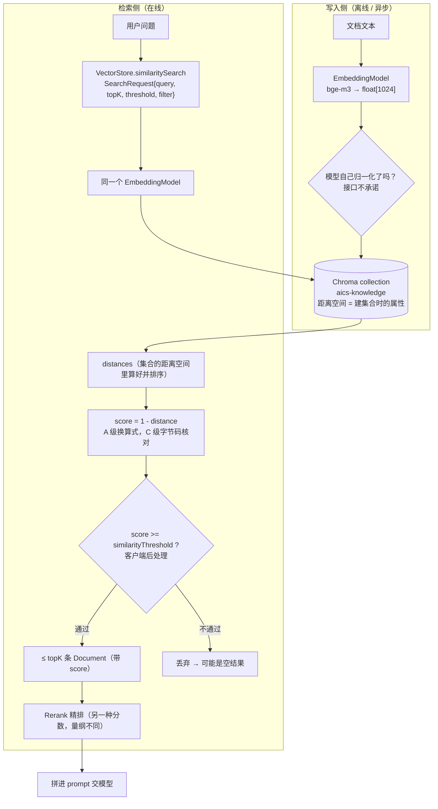
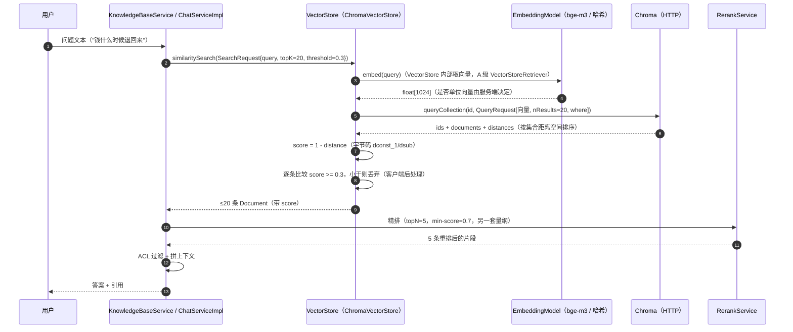

# 向量与相似度：相似不是算出来的，是被距离函数定义的

> **一句话结论**：向量里不存"相似"，相似是距离函数在这个向量上**算**出来的；度量选错、归一化漏做、模型换过没重建库，语义再对也会排错——而且绝大多数情况**不报错**，只是安静地给出错误顺序。
> **阅读前置**：读过本模块 `01-SpringAI入门`（知道 `EmbeddingModel` 只是一个 Bean、`VectorStore` 只是"写入 + 检索"）与 [02-RAG全栈实战/01-RAG检索增强生成](../02-RAG全栈实战/01-RAG检索增强生成.md)（知道 `topK` / `similarityThreshold` 在检索链路里的位置）；会开 `pwsh` 与 `node`。不要求线性代数基础——本篇所有公式都配了能手算的 3 维例子。
> **证据基线**：A 级 = `learning-docs/24-源码分析/assets/source/` 已入库的 Spring AI 2.1.0 摘录（行号即原文件行号）；B 级 = 本项目 `ai-cs-chat` / `ai-cs-common` / `ai-cs-knowledge` / `ai-cs-search` / `ai-cs-product` 真实代码与配置，行号当次核对；C 级 = 本机 `node` / `javap` / `Select-String` 的真实输出（命令可复制）。预计阅读 40 分钟。

**证据边界（先说清楚哪些是查过的，哪些是查不到的）**

| 级别 | 来源 | 本篇覆盖的类/文件 |
| --- | --- | --- |
| A | `assets/source/` 已入库摘录 | `VectorStore`、`VectorStoreRetriever`、`VectorStoreDocumentRetriever`、`SearchRequest`、`EmbeddingModel`、`Document` |
| A（未入库，明确标注） | `ChromaVectorStore.java`、`ChromaApi.java` | 源码摘录未入库 → 本篇**不引它的源码行号**，只用 C 级 `javap` 的字节码签名与指令作证据 |
| B | 本项目真实代码/配置 | `SpringAiConfig`（chat / search 两份）、`KnowledgeAiConfig`、`OpenAiEmbeddingConfig`、`HashEmbeddingModel`、`EmbeddingAutoConfig`、`CachingEmbeddingModel`、`EmbeddingMath`、`EmbeddingClusterService`、`VectorStoreConfig`、`KnowledgeBaseService`、`AgentProperties`、`OpsProperties`、`application.yml` |
| C | 本机命令真实输出 | `node` 复刻哈希向量与三度量对比、`javap` 反查 `spring-ai-chroma-store:2.1.0`、`Select-String` 统计阈值与 Bean 分布 |

本机没有启动 Chroma（`127.0.0.1:8000` 不通，见 RAG 篇 6.6 的探测记录），所以本篇**没有任何实跑召回率、延迟、命中条数**。所有"向量计算"数字都来自 `node` 对真实算法/真实公式的复刻，所有"框架行为"数字都来自 `javap` 读字节码——两者都能在你机器上重跑出同样的输出。**建库时的距离空间（`hnsw:space`）本仓代码里没有显式设置**（C 级：全仓 `*.java/*.yml/*.xml/*.properties/*.vue/*.ts` 844 个文件里 `hnsw` 只命中 1 处注释），这一项**未核实**，本篇按 Chroma 默认 `l2` 讨论，并明确标注。

---

## 0. 先看现象

三个现象都能在本机重跑出来（命令见 6.1），它们分别对应"Embedding 的语义天花板""度量/阈值不可比""排序分叉"。

**现象一：两句话人看是同一个意思，机器算出来 0.0000。**

```text
# C 级真实输出（node 复刻 ai-cs-common/src/main/java/com/aics/common/ai/embedding/HashEmbeddingModel.java 的 768 维双哈希算法，完整命令见 6.1）
"如何申请退款"           tokens= 5  nnz= 10/768   L2= 1.000000
"怎么办理退货"           tokens= 5  nnz= 10/768   L2= 1.000000
cos("如何申请退款", "怎么办理退货") = 0.0000
cos("如何申请退款", "退款流程是什么") = 0.2739
```

这不是 bug，是**哈希向量没有语义泛化能力**的必然结果：两句话一个二元字符组都不重合（`如何/何申/申请/请退/退款` vs `怎么/么办/办理/理退/退货`），所以向量正交。更值得记住的是 0.2739 这个数——它已经**低于本项目的召回阈值 0.3**（`aics.rag.recall-threshold:0.3`），也就是"共享'退款'两个字的两句话"在默认配置下会被直接丢弃。换成 bge-m3 后同一对句子会跳到 0.8 以上，但**阈值 0.3 是为哈希向量标的**，这个数字并不会自动跟着迁移（见现象二）。

**现象二：同一个阈值数字，换一种度量就是完全不同的严格程度。**

```text
# C 级真实输出：Chroma 返回 distance，Spring AI 换算 score = 1 - distance（字节码证据见 3.6）
| score 阈值 | 对应 L2 距离 | 等价余弦（单位向量） |
| 0.30       | 0.7000       | 0.7550               |
| 0.50       | 0.5000       | 0.8750               |
| 0.70       | 0.3000       | 0.9550               |
| 0.82       | 0.1800       | 0.9838               |
| 0.90       | 0.1000       | 0.9950               |
```

于是"把阈值从 0.3 提到 0.7"看起来只是"严一点"，实际是"要求两条文本的余弦相似度从 0.755 提到 0.955"——在 bge-m3 上这基本等于"只要几乎逐字相同"。这不是理论推演：项目里同一个仓库并存三个阈值（C 级统计，口径见 6.2）——`similarityThreshold(0.3d)`（`ai-cs-chat/src/main/java/com/aics/chat/config/SpringAiConfig.java#L270`）、`ruleSimilarityThreshold = 0.7`（`ai-cs-chat/src/main/java/com/aics/chat/agent/AgentProperties.java#L48`）、`similarityThreshold = 0.82`（`ai-cs-knowledge/src/main/java/com/aics/knowledge/ops/OpsProperties.java#L14`）。三个数都没有错，因为它们**各自搭配了不同的度量与不同的用途**：前者是 Chroma 的 `l2` 空间、后两者是**手写余弦**（`EmbeddingClusterService` 的 `cosine`，`ai-cs-knowledge/src/main/java/com/aics/knowledge/ops/EmbeddingClusterService.java#L125`）。

**现象三："明明是同一个意思"，内积排第一的文档在余弦下排最后。**

```text
# C 级真实输出：q=[1,2,2]
doc                  |v|      dot       cos       L2
A(long,skew)         4.1231   6.0000    0.4851    3.7417
B(short,aligned)     1.8000   5.4000    1.0000    1.2000
C(shorter,skew)      0.4583   1.2000    0.8729    2.6096

rank by dot  desc: A > B > C
rank by cos  desc: B > C > A
rank by L2   asc : B > C > A
```

A 和 B 的"语义"（方向）谁更接近 q 一目了然：B 与 q 完全同向（余弦 1.0），A 偏了 61 度。但 A 因为**更长**，内积 6.0 > 5.4，在内积排序里拿第一。这就是"同一个意思排在第 20 位"最典型的成因：**向量长度混进了分数**。注意 C 也只有 0.4583 的模长，却拿到 0.8729 的余弦——短向量在余弦下不吃亏，在内积下几乎永远排后面。

这些现象指向同一件事：**"相似"不是向量的属性，而是"向量 + 度量 + 归一化方式"三者共同定义的函数；三者任意一个变了，排序与阈值就同时失效，而系统不会有任何报错。**

---

## 1. 整体地图

向量检索只有两条流水线：写入侧把文本变成坐标并落库，检索侧把问题变成同一坐标系里的坐标再比远近。**"相似"这个判断发生在第三步——距离函数**，而它既不在 `EmbeddingModel` 里，也不在 `SearchRequest` 里，而是躺在向量库集合的建库属性里。



> **读图说明**：图里最容易被看错的三条边。① `N1` 不是框架行为，而是**模型行为**——`EmbeddingModel` 接口只承诺"文本进、`float[]` 出"（见 3.2），归一化是 `HashEmbeddingModel` 自己做的（`normalize(vector)` 在 `ai-cs-common/src/main/java/com/aics/common/ai/embedding/HashEmbeddingModel.java#L48`），远端 bge-m3 是否返回单位向量**取决于服务端**。② `D1 → SC` 是整张图唯一的"物理量换算点"：库里给的是距离（越小越近），框架换成 `1 - distance`（越大越像），这一步换来的是**方向**而不是"可比的相似度"。③ `RR` 的分数与 `TH` 的阈值**不能互相比较**——Rerank 是另一个模型输出的相关性分，量纲完全不同（本项目 `aics.rerank.min-score` 是 0.7，与 `recall-threshold` 的 0.3 不构成"0.7 更严"的关系）。

| 参与方 | 责任 | 本项目实现 | 谁在用它 |
| --- | --- | --- | --- |
| Embedding 模型 | 文本 → 定长浮点向量；顺带决定维度与"归一不归一" | `BAAI/bge-m3`（1024 维，`@Primary`）；`HashEmbeddingModel`（768 维，兜底） | 写入侧与检索侧**必须同一个** |
| 向量库集合 | 存向量 + 元数据；**承载距离空间**与索引 | Chroma，`collection-name: aics-knowledge` | chat / knowledge / search |
| 检索请求对象 | 表达"查什么、取多少、门槛多少、过滤谁" | `SearchRequest`（`query` / `topK` / `similarityThreshold` / `filterExpression`） | `VectorStore.similaritySearch` |
| 距离函数 | 把两个向量变成一个数（越小越近 or 越大越像） | **不在本仓代码里**：集合建库属性（未显式设置，C 级 grep 无 `hnsw:space`） | Chroma 服务端 |
| 分数换算 | `distance → score`，把"越小越好"翻成"越大越像" | `ChromaVectorStore` 内部 `1 - distance`（C 级字节码） | `Document.score` |
| 阈值 / topK | 决定"哪些进入 prompt" | 客户端后处理阈值 + 服务端 `nResults` 截断 | `KnowledgeBaseService` / `QuestionAnswerAdvisor` |
| 精排 | 用另一个模型把候选重新排序 | `RerankService`（硅基流动 bge-reranker） | 仅精排链路 |
| 手写余弦 | 不经向量库、在内存里比对 | `EmbeddingMath.cosine`、`EmbeddingClusterService.cosine` | 语义缓存 / 问题聚类 |

---

## 2. 关键概念与关键要素

先给结论：**这篇文档里所有"玄学"，最终都归结为三个可验证的问题——向量有多长（维度）、向量有多"归一"（模长）、两个向量怎么比（度量）。** 记住这三个问题，面试与线上排障都能落到具体字段上。

| 名称 | 位置 | 角色 | 关键点 |
| --- | --- | --- | --- |
| 向量（embedding） | `float[]`，长度 = 模型维度 | 文本在"语义空间"里的坐标 | 坐标轴**无名字、无含义**，只有相对关系有意义 |
| 维度 | `EmbeddingModel.dimensions()`：`[[源码:EmbeddingModel.java.md#L130-L139]]` | 模型属性，不是业务参数 | 默认实现会真调一次远端端点；已知维度应覆写 |
| 模长 / 归一化 | `HashEmbeddingModel.normalize`、`EmbeddingMath.cosine` 的 `normA/normB` | 决定"长度"会不会污染分数 | L2 归一化后模长恒为 1，余弦退化为内积 |
| 欧氏距离 L2 | 向量库集合属性 | 越小越近 | 与余弦在单位向量上单调等价（`L2² = 2 − 2cos`） |
| 内积 IP | 向量库集合属性 | 越大越像，但**混入长度** | 归一化后与余弦数值完全相同 |
| 余弦 | 手写代码 / 集合属性 | 只看方向，忽略长度 | 取值 `[-1, 1]`，零向量时无定义 |
| `distance` | `ChromaApi$Embedding.distances` | 库里返回的原始距离 | 方向与"相似"相反；单位随度量变化 |
| `score` | `Document.score`：`[[源码:Document.java.md#L146-L160]]` | 检索时写入的相关性分 | javadoc 明说 "higher scores indicate greater similarity (opposite of distance)" |
| `similarityThreshold` | `SearchRequest`：`[[源码:SearchRequest.java.md#L44-L58]]` | 相似度下限，`[0,1]` | javadoc 明说**客户端后处理**，且 0.0 = 全接受 |
| `topK` | `SearchRequest.DEFAULT_TOP_K = 4` | 服务端截断 | 先截断再过滤 → 阈值一严就"空结果" |
| 稀疏向量 | BM25 / 词袋（`HashEmbeddingModel` 的 nnz 很低也算准稀疏） | 词面匹配，可解释 | 与稠密向量互补，混合检索用它 |
| 稠密向量 | bge-m3 等模型输出 | 语义匹配 | 不可解释、不可跨模型比较 |
| Matryoshka | 模型能力（如 text-embedding-3 系列） | 前 k 维可截断使用 | 本仓未使用；截断后必须**全量重建** |

> 一句话口诀：**模型决定坐标，归一化决定长度，度量决定远近，阈值决定谁进 prompt——四件事各自独立，任何一件换了都要重新标定。**

---

## 3. 原理与证据逐段精读

### 3.1 为什么需要向量：符号匹配的天花板

**在干什么**：先明确"为什么不能只用倒排索引 / `LIKE` / BM25"。符号匹配把文本当**词的多重集**，命中条件是"词面重合"。它能精确回答"包含'退款'二字的文档有哪些"，但回答不了"用户问'钱什么时候能退回来'"。

**为什么这么设计**：`VectorStore` 的类注释把这件事写死了——向量库是"基于向量表示而非精确匹配做相似度搜索"的：

```java
(src: VectorStore.java.md#L32-L40)
/**
 * The {@code VectorStore} interface defines the operations for managing and querying
 * documents in a vector database. It extends {@link DocumentWriter} to support document
 * writing operations. Vector databases are specialized for AI applications, performing
 * similarity searches based on vector representations of data rather than exact matches.
 * This interface allows for adding, deleting, and searching documents based on their
 * similarity to a given query.
 */
public interface VectorStore extends DocumentWriter, VectorStoreRetriever {
```

**换成别的写法会怎样**：本项目两条路都留着，各管一段——ES BM25 负责"关键词必须命中"（型号、订单号、错误码），向量负责"换个说法也能找到"，再用 RRF 融合（`ai-cs-search/src/main/java/com/aics/search/hybrid/HybridSearchServiceImpl.java`）。如果只用 BM25：`如何申请退款` 与 `怎么办理退货` 词汇零重合，召回率为 0；如果只用向量：`订单号 20241015001` 这种"必须精确命中"的查询会被语义邻居干扰，召回出大量近似订单。**符号匹配的天花板不是"不够智能"，而是它无法表达"语义相近但用词不同"；向量的天花板则是它无法表达"必须逐字命中"。**

**常见坑**：把"上了向量库"当成"可以删掉倒排索引"。混用场景下真正的分界线是——**是否需要精确匹配（权限、ID、金额、错误码）**，需要就留符号一路。

### 3.2 Embedding 是什么：接口只承诺"文本进、float[] 出"

**在干什么**：`EmbeddingModel` 是整个体系的地基，而它的契约小得惊人：一个方法，输入文本，输出 `float[]`。

```java
(src: EmbeddingModel.java.md#L36-L53)
@FunctionalInterface
public interface EmbeddingModel extends Model<EmbeddingRequest, EmbeddingResponse> {
	default float[] embed(String text) {
		Assert.notNull(text, "Text must not be null");
		return this.call(new EmbeddingRequest(List.of(text), EmbeddingOptions.builder().build()))
			.getResults()
			.get(0)
			.getOutput();
	}
```

**为什么这么设计**：接口只承诺"定长浮点数组"，**不承诺**归一化、**不承诺**度量、**不承诺**语义质量。这是刻意留白：模型厂商五花八门（归一化的 / 不归一化的、开源本地 / 远端 HTTP），把归一化写进接口就会与"厂商原样返回"的实现冲突。`dimensions()` 的默认实现更能说明问题——它直接真调一次远端：

```java
(src: EmbeddingModel.java.md#L130-L139)
	/**
	 * Get the number of dimensions of the embedded vectors. Note that by default, this
	 * method will call the remote Embedding endpoint to get the dimensions of the
	 * embedded vectors. If the dimensions are known ahead of time, it is recommended to
	 * override this method.
	 * @return the number of dimensions of the embedded vectors.
	 */
	default int dimensions() {
		return embed("Test String").length;
	}
```

**换成别的写法会怎样**：本项目两种实现刚好覆盖两端。兜底 `HashEmbeddingModel` 自己 L2 归一化（`vector[i] /= norm`，`ai-cs-common/src/main/java/com/aics/common/ai/embedding/HashEmbeddingModel.java#L107-L119`），并覆写 `dimensions()` 直接返回常量 768（同文件 L72-L75），避免"为了问维度而付一次 API 调用"。远端 bge-m3 走 `OpenAiEmbeddingModel`，**归一化与否由服务端决定**——这一点是"混用度量"事故的源头（见 3.9）。

**常见坑**：① 用 `dimensions()` 探测维度时把 API Key 打进了日志/异常（它会真发一次请求）；② 以为 `embed("Test String").length` 是"免费的"而每次启动都调一遍；③ 空文本：`HashEmbeddingModel` 对 `"!!!"` 这类无 token 文本返回**全零向量**（C 级实测 `nnz=0/768 L2=0.000000`），而余弦对零向量无定义——`EmbeddingMath.cosine` 的处理是**直接返回 0**（`ai-cs-chat/src/main/java/com/aics/chat/cache/EmbeddingMath.java#L30-L32`），于是"空问题"会安静地走到"什么都不像"分支。

### 3.3 三种度量：公式、几何直觉、能手算的例子

**在干什么**：给定查询向量 q 与文档向量 d，三种度量都能输出一个"远近"，但含义完全不同。

| 度量 | 公式 | 几何直觉 | 取值范围 | 长度是否影响结果 |
| --- | --- | --- | --- | --- |
| 欧氏距离 L2 | `‖q − d‖₂ = √Σ(qᵢ − dᵢ)²` | 两个点之间的直线距离 | `[0, +∞)`，越小越近 | 影响（长向量天然更远） |
| 内积 IP | `q · d = Σ qᵢdᵢ` | d 在 q 方向上的投影 × q 长度 | `(-∞, +∞)`，越大越像 | **强影响**（∝ 两个模长） |
| 余弦 | `cos = (q·d) / (‖q‖‖d‖)` | 两个箭头之间的夹角 | `[-1, 1]`，越大越像 | 不影响（被分母除掉） |

**为什么这么设计**：三种度量对应三种业务信念。"文本越长越相关"（比如长文档比短摘要更可能是答案）→ 内积合理；"只关心主题方向"（客服问答，长短片段等价）→ 余弦；"关心绝对位置"（图像特征、聚类质心）→ L2。**没有哪一种是"正确"的，只有"与你的业务假设一致"的。**

**换写法会怎样**：这就是现象三的数值来源。用 q = [1, 2, 2]、A = [4, 1, 0]、B = [0.6, 1.2, 1.2] 手算一遍（每一步都能在纸上复核）：

| 步骤 | A = [4, 1, 0] | B = [0.6, 1.2, 1.2] |
| --- | --- | --- |
| 内积 `q·v` | 1×4 + 2×1 + 2×0 = **6** | 1×0.6 + 2×1.2 + 2×1.2 = **5.4** |
| 模长 `‖v‖` | √(16+1+0) = √17 ≈ **4.1231** | √(0.36+1.44+1.44) = √3.24 = **1.8** |
| `‖q‖` | √(1+4+4) = **3** | **3** |
| 余弦 | 6 ÷ (3 × 4.1231) ≈ **0.4851** | 5.4 ÷ (3 × 1.8) = **1.0000** |
| L2 距离 | √(9+1+4) = √14 ≈ **3.7417** | √(0.16+0.64+0.64) = √1.44 = **1.2** |

结论：**内积把 A 排第一（6 > 5.4），余弦与 L2 都把 B 排第一（1.0 > 0.4851）**。A 之所以在内积里赢，只因为它更长——B 与 q 完全同向却输了。这不是极端构造：`|v|` 从 1.8 到 4.1231 的差距，在真实语料里就是"一段 200 字片段 vs 一段 40 字片段"的差距。

**常见坑**：① 以为"内积 = 余弦"，只在归一化后成立（3.5 给出精确关系）；② 以为"L2 和余弦方向相反"——它们其实**单调一致**（单位向量上），只是数值刻度不同；③ 把不同度量算出的分数写进同一个字段（`Document.score`）后再比较，例如手写余弦 0.82 与 Chroma 的 `1 - distance` 0.3 混在一张表里判断"哪个更相关"。

### 3.4 归一化为什么必须做：排序会分叉，阈值会失真

**在干什么**：归一化 = 把向量长度缩放到 1（L2 归一化），`v̂ = v / ‖v‖`。它的作用不是"让数字好看"，而是**把长度这个无关变量从分数里剔除**。

**为什么这么设计**：因为三种度量对长度的敏感度不同（3.3 表格最后一列），一旦写入侧与检索侧的长度口径不一致，**同一批数据在两种度量下会给出不同排序**。C 级实测（真实输出，命令见 6.1）：把 3.3 的 A、B、C 三个向量与 q 各自归一化后再算：

```text
# C 级真实输出（同上脚本的第二段）
after L2-normalize both sides (|q|=1, |v|=1):
doc                  dot       cos       L2        L2^2
A(long,skew)         0.4851    0.4851    1.0148    1.0299
B(short,aligned)     1.0000    1.0000    0.0000    0.0000
C(shorter,skew)      0.8729    0.8729    0.5042    0.2543
rank by dot desc: B > C > A
rank by cos desc: B > C > A
```

**归一化后 `dot` 与 `cos` 两列数值完全相同、排序完全一致**——这就是 3.5 要证的恒等式。归一化前排序分叉（A 第一），归一化后统一（B 第一）。

**换成别的写法会怎样**：只归一化写入侧、不归一化查询侧，是最隐蔽的一种。排序可能还是对的（单调性没破），但**绝对分数整体位移，所有阈值判断同时失效**。C 级实测最直观的一行：

```text
# C 级真实输出：q=[1,2,2], A=[4,1,0]（未归一化）
dot = 6.0000  cos = 0.4851  L2 = 3.7417  1-L2 = -2.7417  1-L2^2 = -13.0000
```

Chroma 按 `1 - distance` 给分，于是 A 的 score 是 **−2.74**，被 `0.3` 的阈值一刀砍掉——**而它的余弦其实有 0.4851，比现象一里那句"0.2739"还高**。用户的感受就是"明明相关，却一条都召不回来"。

**常见坑**：① 以为"bge-m3 输出的就是单位向量"（未核实，不同服务端/版本可能不同）→ 正确做法是在**自己的代码里**显式归一化，或至少用 C 级手段核对一次模长；② 混用"归一化向量"与"未归一化向量"写入同一集合（换模型/换预处理时最容易发生），此时库里的向量模长参差，任何度量都失真；③ 把一个 `σ = 0.0317` 的余弦分布（见 3.10）当成"阈值 0.5 就是中等相似"——分布本身没有 0.5 这种"中间值"。

### 3.5 三者的相互关系：两条恒等式，一条单调关系

**在干什么**：把"该选哪个度量"从口味问题变成数学问题。两条恒等式 + 一条单调关系，覆盖所有需要换算的场合。

**① 归一化后，内积 = 余弦。**

```text
若 ‖q̂‖ = ‖d̂‖ = 1，则  q̂ · d̂ = (q·d) / (‖q‖‖d‖) = cos(q, d)
```

C 级验证：上面那张表里 `dot` 列与 `cos` 列逐行相等（0.4851/0.4851、1.0000/1.0000、0.8729/0.8729）。**工程含义**：既然归一化后两者等价，那么"选余弦还是选内积"在归一化前提下是同一个选择；差别只在实现——内积少两次除法，快一点点，但**要求你保证归一化**，一旦某条路径漏归一化，内积立刻变成"长度加权余弦"。

**② 单位向量上，L2 与余弦单调等价。**

```text
‖q̂ − d̂‖² = ‖q̂‖² + ‖d̂‖² − 2 q̂·d̂ = 2 − 2cos(q, d)     (因两者模长均为 1)
```

C 级真实输出（脚本第三段，直接构造 `cos = c`、`L2 = √(2−2c)` 的两个 2 维向量）：

```text
cos vs L2 on unit vectors (L2^2 = 2-2cos):
  cos = 1.0000   L2 = 0.0000   L2^2 = 0.0000   2-2cos = 0.0000
  cos = 0.9000   L2 = 0.4472   L2^2 = 0.2000   2-2cos = 0.2000
  cos = 0.8000   L2 = 0.6325   L2^2 = 0.4000   2-2cos = 0.4000
  cos = 0.5000   L2 = 1.0000   L2^2 = 1.0000   2-2cos = 1.0000
  cos = 0.0000   L2 = 1.4142   L2^2 = 2.0000   2-2cos = 2.0000
```

**工程含义**：在**向量已归一化**的集合上，"用 L2 检索"与"用余弦检索"**排序完全一致**，只是分数刻度不同。这条恒等式解释了 3.6 的换算表，也解释了为什么"改度量"往往不会改变前几名、却会改变"过不过阈值"。

**③ 一般情形下三者不单调**：只要模长不等，L2 与内积都可能与余弦分叉（3.3 的 A/B/C 就是反例）。这就是为什么"向量库默认 L2 + 应用层按余弦意义标阈值"是一件必须显式核对的事。

**换写法会怎样**：如果为了"省掉归一化"而直接用内积，你必须接受"长文档更容易被召回"这个业务假设，并且**在入库时就不能归一化**（否则内积退化成余弦），两件事必须二选一并全链路一致。

**常见坑**：把恒等式当"随便换算"用。恒等式的前提是**两侧都单位化**；离线批处理里做了一次、在线查询路径忘了做，就退化成 3.4 的负分事故。

### 3.6 score 从哪来：库里给 distance，框架换成 1 − distance

**在干什么**：`Document.score` 是业务代码唯一能看到的"相关度"，它并不是模型输出，而是**框架对库返回值的一次单调换算**。A 级先看语义：`score` 被明确定义为"越大越像，与距离相反"。

```java
(src: Document.java.md#L145-L160)
	/**
	 * A numeric score associated with this document that can represent various types of
	 * relevance measures.
	 * <p>
	 * Common uses include:
	 * <ul>
	 * <li>Measure of similarity between the embedding value of the document's text/media
	 * and a query vector, where higher scores indicate greater similarity (opposite of
	 * distance measure)
	 * <li>Text relevancy rankings from retrieval systems
	 * <li>Custom relevancy metrics from RAG patterns
	 * </ul>
	 * <p>
	 * Higher values typically indicate greater relevance or similarity.
	 */
	private final @Nullable Double score;
```

换算式的证据在字节码里（`ChromaVectorStore.java` 未入库，故用 C 级 `javap`，命令见 6.3）：

```text
# C 级真实输出（javap -p -c spring-ai-chroma-store-2.1.0.jar，节选）
     131: fconst_1
     132: fload         10
     134: fsub
     135: f2d
     136: aload_2
     137: invokevirtual #458   // Method SearchRequest.getSimilarityThreshold:()D
     140: dcmpl
     141: iflt          242
...
     216: dconst_1
     217: fload         10
     219: f2d
     220: dsub
     221: invokestatic  #495   // Method java/lang/Double.valueOf:(D)Ljava/lang/Double;
     224: invokevirtual #498   // Method Document$Builder.score:(Ljava/lang/Double;)Lorg/springframework/ai/document/Document$Builder;
```

怎么读这段：局部变量槽 10 是 Chroma 返回的 `distance`（float）。`fconst_1 / fload 10 / fsub` = `1.0 - distance`，随后与 `getSimilarityThreshold()` 比较（`dcmpl` + `iflt 242` 即"小于阈值就跳过这条"）；`dconst_1 / fload 10 / dsub` 再把同一个 `1.0 - distance` 写进 `Document.score`。**读法结论有两条**：① `score = 1 − distance`，是**单调递减的线性换算**，不改变顺序；② 阈值的比较发生在 Spring AI 进程内、逐条文档比较——这就是 3.7 说的"客户端后处理"在字节码层面的样子。

于是有了现象二那张换算表。推导（单位向量，`distance` 就是 L2）：`score = 1 − d` → `d = 1 − score` → `cos = 1 − d²/2`。代入 `score = 0.3`：`d = 0.7`，`cos = 1 − 0.49/2 = 0.755`。**这是本项目 `recall-threshold: 0.3` 的真实严格程度**（前提：集合用 L2 且向量已归一化）。

**换写法会怎样**：如果集合用 `cosine` 距离（Chroma 的 `cosine` 空间返回 `1 − cos`），同样的 `score = 1 − distance` 换算后 `score = cos`，那么阈值 0.3 就真的是"余弦 0.3"。**同一个配置文件、同一个数字，在两种集合配置下相差 0.45 的余弦**——这就是"换库/重建集合后阈值全部要重标"的技术原因。

**常见坑**：① 把 `score` 当"概率"或"百分比"往产品文案里塞（它既不是概率也不是百分比，只是 `1 − distance`）；② 跨库/跨模型比较 `score`（例如把 Chroma 的 0.42 与 Rerank 的 0.42 等同）；③ 用 `score` 反推相似度时忘了问"这个集合的 distance 是什么度量、向量归一化没有"。

### 3.7 Spring AI 把距离计算交给 provider，把阈值留在客户端

**在干什么**：这是本篇最重要的一条架构事实，它决定了你能改什么、不能改什么。A 级证据：`VectorStore` 接口**没有任何度量参数**——没有 `metric`、没有 `L2/COSINE/IP`，只有写入、删除、检索：

```java
(src: VectorStore.java.md#L46-L51)
	/**
	 * Adds list of {@link Document}s to the vector store.
	 * @param documents the list of documents to store. Throws an exception if the
	 * underlying provider checks for duplicate IDs.
	 */
	void add(List<Document> documents);
```

```java
(src: VectorStoreRetriever.java.md#L38-L45)
	/**
	 * Retrieves documents by query embedding similarity and metadata filters to retrieve
	 * exactly the number of nearest-neighbor results that match the request criteria.
	 * @param request Search request for set search parameters, such as the query text,
	 * topK, similarity threshold and metadata filter expressions.
	 * @return Returns documents that match the query request conditions.
	 */
	List<Document> similaritySearch(SearchRequest request);
```

`SearchRequest` 的字段清单同样干净——`query` / `topK` / `similarityThreshold` / `filterExpression`，没有度量：

```java
(src: SearchRequest.java.md#L54-L60)
	private String query = "";

	private int topK = DEFAULT_TOP_K;

	private double similarityThreshold = SIMILARITY_THRESHOLD_ACCEPT_ALL;

	private Filter.@Nullable Expression filterExpression;
```

而阈值的语义被 javadoc 写死为"**客户端后处理**"：

```java
(src: SearchRequest.java.md#L164-L178)
		/**
		 * Similarity threshold score to filter the search response by. Only documents
		 * with similarity score equal or greater than the 'threshold' will be returned.
		 * Note that this is a post-processing step performed on the client not the server
		 * side. A threshold value of 0.0 means any similarity is accepted or disable the
		 * similarity threshold filtering. A threshold value of 1.0 means an exact match
		 * is required.
		 * @param threshold The lower bound of the similarity score.
		 * @return this builder.
		 */
		public Builder similarityThreshold(double threshold) {
			Assert.isTrue(threshold >= 0 && threshold <= 1, "Similarity threshold must be in [0,1] range.");
			this.searchRequest.similarityThreshold = threshold;
			return this;
		}
```

**为什么这么设计**：Spring AI 是"多后端适配层"，PGVector / Chroma / Milvus / Qdrant 的距离函数名称、默认值、是否归一化各不相同。把度量放进 `SearchRequest` 就等于承诺"所有后端都支持同一种度量切换"——做不到。于是框架做了一个**最小公约数**：请求里只保留各后端都有的东西（向量、条数、过滤条件），度量交给后端自己的建库属性；唯一能统一的"相似度"概念则用 `score = 1 − distance` 归一化到"越大越像"，再由客户端用 `[0,1]` 阈值裁剪。C 级证据显示这条路走到 HTTP 层也没带度量：

```text
# C 级真实输出（javap ChromaApi$QueryRequest）
private final java.util.List<float[]> queryEmbeddings;
private final java.lang.Integer nResults;
private final java.util.Map<java.lang.String, java.lang.Object> where;
private final java.util.List<...QueryRequest$Include> include;
```

`QueryRequest` 只有"向量 / 条数 / 过滤 / 返回哪些字段"四个字段——**度量根本没有随请求走**。它和 3.6 的 `getTopK()` 一起解释了完整的分工：**`topK` 下推到服务端当 `nResults`，阈值留在客户端逐条比较**。

**换成别的写法会怎样**：如果业务上确实需要"同一集合内按不同度量检索"，Spring AI 这条路给不了——只能建两个集合（不同 `hnsw:space`）或绕开抽象直接调 `ChromaApi`。反过来，若用 PGVector，阈值可以下推成 SQL 的 `WHERE 1 - (embedding <=> $1) > 0.3`，能省网络与序列化——但会和 ANN 索引的 `LIMIT` 语义打架（先取近邻再过滤 → 可能不足 K 条）。

**常见坑**：① 在配置文件里找"度量"配置项找不到，就以为"框架用了余弦"——实际是集合默认值（Chroma 默认 `l2`）；② 指望调高阈值"降低服务端开销"——服务端已经按 `topK` 取完了，阈值只减少进 prompt 的条数；③ 阈值 + 小 `topK` 组合出"空结果"（先截断 5 条、再全被阈值砍掉，而第 6~100 条达标的根本没被取回）。

### 3.8 相似度分数不可比：跨度量、跨模型、跨 query

**在干什么**：把"分数能不能比"拆成三个独立问题，三个答案都是"不能"。

| 比较场景 | 能否直接比 | 原因 | 本项目的现场 |
| --- | --- | --- | --- |
| 跨度量（L2 vs 余弦） | ❌ | 同一 `score` 语义不同：`1−L2` 与 `1−(1−cos)=cos` | 集合度量未显式设置（C 级无 `hnsw:space`）；手写余弦另有两处 |
| 跨模型（bge-m3 vs 哈希 vs 另一家） | ❌ | 坐标系不同，分数分布不同（见 3.9） | `HashEmbeddingModel` 768 维兜底 + bge-m3 1024 维主用 + product 默认 `text-embedding-3-small` |
| 跨 query（同一个问题问两次） | ⚠️ 只能同 query 内比 | 分数是"这一对向量的相对关系"，不是全局刻度 | 阈值必须按 query 分布标定，不能当绝对标准 |

**为什么这么设计**：`score` 的定义只保证"同一批返回结果内部有序"，javadoc 用词是 "can represent various types of relevance measures"——**它是个容器，不是一个刻度**。框架能保证的只有"方向和排序"，不能保证"跨库可比"。

**换成别的写法会怎样**：把阈值从一个绝对数改成"每次 query 的相对位置"（例如取第 top-20 名的分数 × 0.8 作为截断线），可以规避"跨 query 不可比"，代价是失去"兜底拒绝"能力——永远会有 20 条被返回，哪怕全是噪声。本项目选的是**绝对阈值宽召回 + 精排兜底**（`recall-threshold:0.3` + `aics.rerank.min-score`），代价是"阈值 0.3 必须随模型迁移重新标定"。

**常见坑**：① 用"余弦 0.9 就是很相关"做产品承诺——同义句在 bge-m3 上能到 0.9+，在哈希向量上是 0.0，在另一家模型上可能是 0.7；② 把 `similarityThreshold` 当权限/安全边界（它只是截断，见 3.7）；③ 两套检索参数并存还共用同一个"阈值"命名：本项目 `SpringAiConfig` 的 0.3/5 与 `KnowledgeBaseService` 的 20/0.3（`ai-cs-chat/src/main/java/com/aics/chat/service/KnowledgeBaseService.java#L94-L99`）就是两份，调参时极易只改一处。

### 3.9 不同模型不可混用：同一段文本在不同坐标系里的坐标

**在干什么**：区分"同一个模型的不同版本"与"不同厂商的模型"，并给出为什么它们之间**没有可比性**。

**为什么这么设计**：每个模型都是独立训练出来的映射 `text → R^d`，它的坐标轴（那 1024 个维度）对每个模型来说含义都不同、也没有名字。**坐标轴无含义**这一点必须咬住：不能用"第 37 维是不是情感"这种思路解释向量，也不能把 A 模型第 37 维与 B 模型第 37 维相减。A 级源码把这件事说得比任何文档都直白——`similaritySearch(float[] queryEmbedding, SearchRequest)` 的 javadoc：

```java
(src: VectorStoreRetriever.java.md#L58-L69)
	/**
	 * Retrieves documents by similarity to a query embedding the caller has already
	 * computed, instead of embedding query text with the store's own embedding model.
	 * <p>
	 * This is the search-side counterpart of {@link VectorStore#upsert(List)}: an
	 * application that produces its own embeddings can embed the query the same way and
	 * search with the result, so the store's embedding model is never involved. The query
	 * embedding must come from the same model, with the same settings, as the stored
	 * embeddings; otherwise the results are meaningless even though no error is raised.
```

"**meaningless even though no error is raised**"——这句话是本篇的题眼：混用模型不会报错，只会安静地给出乱序（只要维度对得上，连校验都不会触发）。维度不对时才会炸：`doSimilaritySearch(float[], SearchRequest)` 的第一条指令就是 `checkDimensions("Query embedding", ...)`（C 级字节码偏移 0~9），错误信息里带的是维数，不是"模型不一致"。

**换成别的写法会怎样**：本项目用"配置约定 + `@Primary`"来保证一致性，C 级统计显示**四个服务各自声明了一个 `EmbeddingModel` Bean**：

| 服务 | 声明点 | 默认模型 | 条件 |
| --- | --- | --- | --- |
| chat | `ai-cs-chat/src/main/java/com/aics/chat/config/SpringAiConfig.java#L171-L204` | `aics.embedding.model:BAAI/bge-m3` | `@Primary` + 向量缓存装饰器 |
| knowledge | `ai-cs-knowledge/src/main/java/com/aics/knowledge/config/KnowledgeAiConfig.java#L55-L67` | `aics.embedding.model:BAAI/bge-m3` | `@Primary` |
| search | `ai-cs-search/src/main/java/com/aics/search/config/SpringAiConfig.java#L40-L51` | `aics.embedding.model:BAAI/bge-m3` | `@Primary` |
| product | `ai-cs-product/src/main/java/com/aics/product/config/OpenAiEmbeddingConfig.java#L27-L48` | `spring.ai.openai.embedding.options.model:text-embedding-3-small` | `aics.ai.embedding.provider=openai` |
| common（兜底） | `ai-cs-common/src/main/java/com/aics/common/ai/embedding/EmbeddingAutoConfig.java#L14-L22` | 无模型名，纯本地哈希 768 维 | `@ConditionalOnMissingBean` + `aics.ai.embedding.provider=local`（缺省） |

三个服务写同一个 Nacos key、走同一个 `@Primary` Bean 的写法能工作，但它是**约定**不是**约束**：第四列已经露出破口——product 的默认模型来自另一个配置前缀（`spring.ai.openai.embedding.options.model`），与 chat/knowledge/search 的 `aics.embedding.model` **不是同一个 key**。一旦有人只改 Nacos 的 `aics.embedding.model`，product 侧不会跟着变。项目自己的注释把这个风险写明了："所有商品/文档向量必须来自同一模型，否则向量空间不一致、余弦相似度无意义"（`ai-cs-product/src/main/java/com/aics/product/config/OpenAiEmbeddingConfig.java#L23-L24`）。

向量缓存这一层则体现了"知道会踩坑"的防御：缓存键以**模型名做命名空间**，因为"换模型后向量空间不同，旧缓存必须失效"（`ai-cs-chat/src/main/java/com/aics/chat/config/SpringAiConfig.java#L202-L203`）。

**常见坑**：① 换了模型却没重建集合（旧向量 + 新查询向量 = 乱序，无报错）；② 只有部分服务改了模型名（本例 product 的 key 不同）；③ 以为"同厂商不同版本可以混"（bge-m3 vs bge-large 的坐标系就不同）；④ 用 Matryoshka 截断维度后与未截断的向量混存。

### 3.10 维度的成本：存储线性、计算线性、收益非线性

**在干什么**：把"维度越高越好"这个直觉拆成三笔账。

**为什么这么设计**：维度 `d` 决定每条的字节数（`4d` B，float32）与每次比较的乘法次数（`2d` FLOP）。C 级真实输出（脚本第二段第 3 节，纯算术，口径写进命令里）：

```text
== 3. 维度成本（float32，1 条向量字节数 / 100 万条 GB）==
d=768 -> 3072 B/条, 1e6 条 = 2.86 GB, 10 万次暴力 L2 = 153600.0 GFLOP
d=1024 -> 4096 B/条, 1e6 条 = 3.81 GB, 10 万次暴力 L2 = 204800.0 GFLOP
d=1536 -> 6144 B/条, 1e6 条 = 5.72 GB, 10 万次暴力 L2 = 307200.0 GFLOP
d=3072 -> 12288 B/条, 1e6 条 = 11.44 GB, 10 万次暴力 L2 = 614400.0 GFLOP
```

怎么读：① GB 是 GiB（除以 1024³），**不含** HNSW 索引、原文、元数据、副本；② 暴力检索的成本下限由**内存带宽**决定而不是算力——一次全表扫描要读 `3.81 GiB`，按 20 GB/s 有效带宽估，单个 query 的下限是 **≈0.19 s**，这也是"百万级必须上 ANN 索引"的算术理由（索引算法的细节见 [02-索引算法](02-索引算法-向量检索怎么从全表扫描里活下来.md)）。

收益为什么非线性：这是高维几何的性质，不是玄学。随机两个单位向量的余弦，其标准差约 `1/√d`。C 级真实输出（每维 2000 次随机抽样）：

```text
== 4. 高维距离集中：随机单位向量对的余弦分布（d 越大越挤在 0 附近）==
d=   3 mean=-0.0116 sd=0.5784 min=-0.9982 max=0.9996
d=  10 mean= 0.0034 sd=0.3156 min=-0.8944 max=0.8526
d= 100 mean= 0.0009 sd=0.0995 min=-0.2989 max=0.2919
d= 768 mean=-0.0011 sd=0.0361 min=-0.1163 max=0.1215
d=1024 mean= 0.0007 sd=0.0317 min=-0.1055 max=0.1081
```

怎么读：`1/√768 = 0.0361`、`1/√1024 = 0.03125`，与实测 `sd` 完全吻合。含义有两层：① **维度越高，"随机不相关"的向量越挤在余弦 0 附近**（d=1024 时随机对的余弦几乎落在 ±0.1 内），所以"0.3 算不算相似"这种问题**没有跨模型的通用答案**；② 也正因为挤，**真正相关的信号必须明显偏离 0** 才能被检出——这解释了为什么在真实语料里 0.7 以上的余弦往往已经相当可信，而 0.3~0.5 区间噪声极多。

**换成别的写法会怎样**：想用降维省成本有三条路——Matryoshka 截断（模型支持时才有效，且必须**全量重建**）、PCA/量化（PQ、int8，牺牲精度换内存）、换小模型（768 维）。本项目实际的选择是 `768 维哈希兜底` vs `1024 维 bge-m3 主用`：兜底方案省的是"API Key 与网络"，不是存储。

**常见坑**：① 只算浮点数组大小，忘了 HNSW 图结构（通常再加 30%~60%）；② 把"维度高 = 更准"当定论——训练样本不足时，高维反而稀释差异（README 的误区表也点了这一条）；③ 截断维度后与旧向量混存（同 3.9 的坑）。

### 3.11 稀疏 vs 稠密：两种"坐标"互补，不要互相替代

**在干什么**：稀疏向量（词表维度、绝大多数为 0，如 BM25 词袋 / SPLADE）表达"出现了哪些词"；稠密向量（几百到几千维、几乎每维非零）表达"整体语义"。

**为什么这么设计**：两者的失败模式正好互补——稀疏向量精确、可解释、对未登录同义词无能为力；稠密向量泛化好、对 ID/型号/数字敏感度低。

**换成别的写法会怎样**：本项目的 `HashEmbeddingModel` 是个很好的中间态样本。它是**稠密数组形式的稀疏内容**：C 级实测一句话 ~5 个 token 只点亮 10 个槽位（`nnz=10/768`），却占满 3072 B 的存储。也就是说"768 维哈希向量"既没有得到稠密向量的语义泛化（现象一：同义句 0.0），又付出了稠密向量的存储成本——**它唯一的用途是让开发环境把链路跑通**（类注释自己写着"语义质量一般，仅兜底""生产必须切换 bge-m3"，`ai-cs-common/src/main/java/com/aics/common/ai/embedding/HashEmbeddingModel.java#L19-L27`）。这也是本项目保留 ES BM25 一路做混合检索的根本理由：稀疏一路在"必须命中关键词"的场景里不可替代。

**常见坑**：① 用哈希向量/词袋向量做语义检索的评估基线，得出"向量检索不如关键词"的结论（那是**同义改写能力为 0** 的基线，不是向量检索的上限）；② 混合检索时把两路分数直接相加或比较（RRF 只看排名，正是为了绕开量纲）。

### 3.12 相似 ≠ 相关：三种反例

**在干什么**：给"余弦高就一定有用"去魅。相似度衡量的是"文本表示的接近"，不是"能不能回答问题"。

**为什么这么设计**：`score` 的 javadoc 只说 "relevance measures"（一种相关度度量），从未承诺"答案就在这里"。三种可复现的反例：

| 反例 | 现象 | 机制 | 本项目怎么兜 |
| --- | --- | --- | --- |
| 否定 / 反义 | "如何**取消**退款" 与 "如何申请退款" 余弦很高 | 共享绝大部分词与句式，方向几乎一致 | 精排模型 + 提示词约束；`DecisionDocumentFilter` 一类后处理 |
| 长文本稀释 | 一条 2000 字大片段里只有 2 行是答案，却因为"整体像"排第一 | 切块过大 → 向量是整段的平均，局部答案被稀释 | `TokenTextSplitter` 800 token 切块 |
| 同词不同义 | "苹果手机保修" 与 "苹果产地气候" 在客服库里互相干扰 | 领域内多义词，稠密向量的坐标系不区分业务意图 | metadata 过滤（`knowledgeBase` / 文档类型）+ 精排 |

**换成别的写法会怎样**：如果只用"余弦 > 0.9"当唯一判据，上面三种反例都会进 prompt，而模型的回答会"有据可依地答错"。反过来，加一层 Rerank（cross-encoder 读 query+doc 全文）能显著改善，但它**不是相似度的替代品**：Rerank 贵、慢，只能对少量候选做，所以工程上的标准结构是"宽召回（低阈值、大 topK）→ 精排（小模型重打分）→ 阈值截断"，见 [04-RAG进阶实战-Rerank重排序](../02-RAG全栈实战/04-RAG进阶实战-Rerank重排序.md)。

**常见坑**：① 用相似度阈值当"答不答"的开关（阈值高 → 全拒答；阈值低 → 答错）；② 认为"精排分高 = 一定相关"，忽略精排模型的训练域（本项目用的是通用 `bge-reranker-v2-m3`，对客服领域术语未必最优，**未核实**其在业务集上的表现）。

---

## 4. 一次完整执行时序

把 3.x 的所有结论压进一次真实调用：用户提问 → 向量化 → 检索 → 换算 → 阈值过滤 → 精排 → 拼 prompt。图中每一步都对应一段可核对的代码或字节码。



> **读图说明**：三个必须记住的细节。① 第 3~4 步说明**查询向量是 `VectorStore` 自己算的**（`ChromaVectorStore.doSimilaritySearch(SearchRequest)` 内部 `embed`，C 级字节码可见），所以"用哪个 EmbeddingModel"由注入到 `VectorStore` 的那个 Bean 决定——本项目靠 `@Primary` 保证一致（`ai-cs-chat/src/main/java/com/aics/chat/config/VectorStoreConfig.java#L73-L89`）。② 第 5 步 `nResults=20` 与第 8 步"客户端过滤"的位置决定了**阈值永远不会让服务端少干活**；同时意味着"取回的 20 条如果全不达标，结果是 0 条，而 HTTP 依然 200"。③ 第 11 步的精排是**另一套分数**（`min-score=0.7`），它和第 2 步的 `threshold=0.3` 不构成"谁更严"的关系。

**哪一步失败会怎样**

| 失败点 | 触发条件 | 报错 / 现象 | 用户看到 |
| --- | --- | --- | --- |
| 3 `embed` | 远端 embedding 不可达 / Key 失效 / 限流 | HTTP 4xx/5xx 或超时异常（`OpenAiEmbeddingModel` 抛出） | "系统繁忙"，或走降级链路 |
| 3 `embed` 维度 | 换了模型但集合没重建 | `checkDimensions("Query embedding", 1024, 768)` 类断言失败（C 级字节码偏移 0~9） | 检索整体报错 |
| 5 请求 | `topK` 传 0 或负数 | `Assert.isTrue(topK >= 0, "TopK should be positive.")`（`[[源码:SearchRequest.java.md#L158-L162]]`） | 启动/调用即失败，易发现 |
| 5 请求 | 阈值传 -0.1 或 1.5 | `Assert.isTrue(threshold >= 0 && threshold <= 1, "Similarity threshold must be in [0,1] range.")`（`[[源码:SearchRequest.java.md#L174-L178]]`） | 同上，易发现 |
| 6 集合度量 | 集合建库时用了 `cosine` 而阈值按 `1−L2` 标定 | **无报错**，只是过/不过阈值的边界整体偏移（3.6） | "召回条数莫名变少/变多" |
| 7 换算 | 向量未归一化（写入侧或查询侧漏做） | **无报错**，`score` 出现负值或异常大值 | "明明相关却一条不返"（3.4 的 −2.74） |
| 8 阈值 | 阈值偏高 + `topK` 偏小 | **无报错**，返回 0 条且 `citations` 为空 | 答案无引用、开始幻觉 |
| 11 精排 | Rerank 服务不可用 | 异常被捕获 → 降级为按 `score` 截断（`ai-cs-chat/src/main/java/com/aics/chat/service/KnowledgeBaseService.java` 的降级分支） | 精度下降，但仍有答案 |

---

## 5. 设计取舍

向量检索里所有"配置项"其实都是三选一的赌注：**赌数据、赌度量、赌阈值**。下表把本项目的真实选择与代价列清楚。

| 决策点 | 备选 | 优点 | 代价 | 本项目怎么选 |
| --- | --- | --- | --- | --- |
| 文本用什么向量 | 哈希词袋 / bge-m3 / text-embedding-3 | 哈希零依赖离线可跑；bge-m3 中文强、1024 维、免费额度；OpenAI 生态成熟 | 哈希无语义；bge-m3 依赖外部 HTTP；OpenAI 需海外网络与付费 | bge-m3 主用（`@Primary`），哈希兜底（`@ConditionalOnMissingBean`） |
| 归一化在哪做 | 模型侧 / 应用侧 / 不做 | 应用侧最可控 | 应用侧要自己维护、易漏；不做则度量语义失真 | 哈希模型自己归一化；远端模型依赖服务端（**未核实**，故阈值取宽 0.3） |
| 度量 | L2 / IP / 余弦 | 余弦只看方向、最贴合"语义相近"；L2 是 Chroma 默认、零配置 | L2 混入长度（未归一化时）；余弦在零向量上无定义 | 集合用默认（未显式设置，C 级无 `hnsw:space`）；手写段用余弦（缓存、聚类） |
| 阈值放哪 | 客户端后处理 / 下推到库 | 下推省网络与序列化 | 与 ANN 的 `LIMIT` 语义冲突；框架不支持 | 客户端（框架唯一支持的方式），配 `topK=20` 宽召回 |
| 单阶段 vs 两阶段 | 阈值一刀切 / 宽召回+精排 | 两阶段兼顾召回与精度 | 多一次外部模型调用、多一个可用性单点 | 两阶段：`recall-threshold:0.3` + Rerank `min-score:0.7` |
| 维度 | 768 / 1024 / 1536 / 3072 | 高维表达力强 | 存储与延迟线性涨，收益非线性（3.10） | 1024（bge-m3），兜底 768 |
| 稠密 vs 稀疏 | 纯向量 / 纯 BM25 / 混合 | 混合互补（3.11） | 两套索引、融合要另设策略（RRF 只看排名） | 混合（ES BM25 + 向量 + RRF） |
| 每次实时 embed vs 缓存 | 每次调 API / 加缓存 | 缓存省 API 与延迟 | 换模型必须失效，否则跨空间污染 | `CachingEmbeddingModel`，缓存键以模型名做命名空间 |

**可扩展点清单（按落地成本从低到高）**

1. 把 `similarityThreshold` / `recall-threshold` 与**模型名、集合名**绑定成一个配置组（改模型时强制提醒重标阈值）——纯配置，半天。
2. 在启动时打一条"向量口径自检"日志：模型名、`dimensions()`、对一个固定探针文本的向量模长（判断是否已归一化）——纯代码，一天。
3. 给 `EmbeddingMath.cosine` 与库内 `score` 加"来源标注"（枚举 `COSINE` / `ONE_MINUS_L2`），禁止跨来源比较——一天，能挡住 3.8 的整类错误。
4. 把 product 的模型配置 key 统一到 `aics.embedding.model`（消除 3.9 的破口）——一天，但有配置迁移风险。
5. 阈值标定脚本：用 golden set 跑一遍，输出不同阈值下的召回/命中曲线，替代拍脑袋数字——三到五天（涉及评估集与统计口径）。

---

## 6. 踩坑与调试手法

| # | 现象 | 根因 | 验证手段 | 解法 |
| --- | --- | --- | --- | --- |
| 1 | 换了 embedding 模型后召回骤降/乱序 | 集合里是旧模型的向量，查询向量来自新模型（3.9） | 比对集合 `dimension` 与 `EmbeddingModel.dimensions()`；用同一段文本手工算两次余弦 | 全量重建集合；缓存键带模型名 |
| 2 | 阈值一调高就"什么都没有" | 阈值是客户端后处理 + `topK` 先截断（3.7） | 打印 `SearchRequest.toString()`（含 `topK` 与 `threshold`，`[[源码:SearchRequest.java.md#L105-L108]]`） | 阈值与 `topK` 联动调整；或改两阶段 |
| 3 | 明明相关的文档 score 是负数 | 向量未归一化 + `score = 1 − L2`（3.4/3.6） | 取一条入库向量算 L2 模长，应 ≈1（C 级脚本可复刻） | 在 EmbeddingModel 侧统一归一化 |
| 4 | 空格/标点/表情的 query 召回异常 | 零向量：余弦无定义，手写实现返回 0（3.2 的坑） | 对空文本打日志看 `nnz`；`EmbeddingMath.cosine` 的 `normA == 0` 分支 | 入参校验 + 空向量直接短路 |
| 5 | 同义改写问句完全召不回 | 用了哈希/词袋向量，无语义泛化（3.11） | C 级脚本复刻两个句子的余弦（现象一：0.0000） | 换真实 embedding 模型；或用混合检索 |
| 6 | 手写余弦阈值 0.82 与库内阈值 0.3 互相"打架" | 两套度量、两套量纲（3.8） | `Select-String` 统计全仓阈值与 cosine 实现位置（6.2） | 分名字、分配置、文档化 |
| 7 | 精排后结果反而更差 | 把 Rerank 分当相似度分与阈值比较（3.12） | 打印精排前后 `score` 与 `min-score` | 精排单独设阈值，禁止混比 |

### 6.1 手法一：用 `node` 复刻向量，验证"同义 = 0.0000"与"排序分叉"

**为什么可信**：脚本逐行复刻 `ai-cs-common/src/main/java/com/aics/common/ai/embedding/HashEmbeddingModel.java` 的算法——768 维、`Math.floorMod(hashCode(token), 768)` 与自定义 `fnv1a` 双哈希、按 token 累加、最后 L2 归一化。**不是调用 Java，是同一算法的 JS 复刻**，所以输出可复核但不等同于运行时结果。

```powershell
cd D:\Projects\Persion\ai-customer-service
$code = @'
const DIM = 768;
function javaHash(s){let h=0;for(const ch of s){h=(Math.imul(31,h)+ch.charCodeAt(0))|0;}return h;}
function fnv1a(s){let h=0xcbf29ce484222325n;for(let i=0;i<s.length;i++){h^=BigInt(s.charCodeAt(i));h=BigInt.asUintN(64,h*0x100000001b3n);}return h;}
function floorMod(x,m){const r=BigInt(x)%BigInt(m);return Number((r+BigInt(m))%BigInt(m));}
function tokens(t){const o=[];const n=t.toLowerCase().trim();for(const w of n.split(/[^a-z0-9]+/))if(w.length>=2)o.push('w:'+w);
  const c=n.replace(/[^\u4e00-\u9fa5]/g,'');for(let i=0;i<c.length-1;i++)o.push('c:'+c[i]+c[i+1]);return o;}
function embed(t){const v=new Float64Array(DIM);for(const k of tokens(t)){v[floorMod(javaHash(k),DIM)]+=1;v[floorMod(fnv1a(k),DIM)]+=1;}
  let s=0;for(const x of v)s+=x*x;if(s!==0){const n=Math.sqrt(s);for(let i=0;i<DIM;i++)v[i]/=n;}return v;}
const dot=(a,b)=>{let s=0;for(let i=0;i<DIM;i++)s+=a[i]*b[i];return s;};
const norm=a=>Math.sqrt(dot(a,a));
const cos=(a,b)=>dot(a,b)/(norm(a)*norm(b));
const info=t=>{const v=embed(t);console.log(JSON.stringify(t).padEnd(18),'tokens=',String(tokens(t).length).padEnd(2),'nnz=',(v.reduce((c,x)=>c+(x!==0?1:0),0)+'/'+DIM).padEnd(8),'L2=',norm(v).toFixed(6));};
const pair=(x,y)=>console.log('cos('+JSON.stringify(x)+', '+JSON.stringify(y)+') =',cos(embed(x),embed(y)).toFixed(4));
info('如何申请退款'); info('怎么办理退货');
pair('如何申请退款','怎么办理退货');
pair('如何申请退款','退款流程是什么');
pair('如何申请退款','如何申请退款？');
'@
node -e $code
```

真实输出：

```text
"如何申请退款"           tokens= 5  nnz= 10/768   L2= 1.000000
"怎么办理退货"           tokens= 5  nnz= 10/768   L2= 1.000000
cos("如何申请退款", "怎么办理退货") = 0.0000
cos("如何申请退款", "退款流程是什么") = 0.2739
cos("如何申请退款", "如何申请退款？") = 1.0000
```

怎么读：**同义不同词 0.0000**、**共享"退款"二字 0.2739（低于默认阈值 0.3）**、**只多一个全角问号 1.0000**（标点不产生 token，被 `extractTokens` 吃掉）。这三行同时说明两件事：哈希向量的"相似"完全由字面二元组决定；而 `normalizeQuestion`（`ai-cs-chat/src/main/java/com/aics/chat/cache/EmbeddingMath.java#L41-L47`）这类"去标点"预处理在精确匹配缓存里是必需的，在向量链路里则是无用的。

### 6.2 手法二：统计"度量与阈值"在仓库里的真实分布

**为什么可信**：纯静态统计，不启动任何服务；口径写死在命令里（文件类型、排除目录、匹配模式），任何人重跑结果一致。

```powershell
cd D:\Projects\Persion\ai-customer-service
$root = (Get-Location).Path
$files = Get-ChildItem -Path $root -Recurse -File -Include *.java,*.yml,*.yaml,*.xml,*.properties,*.vue,*.ts |
  Where-Object { $_.FullName -notmatch '\\(target|node_modules|\.git)\\' }
"待扫文件数: $($files.Count)"
"hnsw 命中: " + ($files | Select-String -Pattern 'hnsw' -SimpleMatch).Count
"cosine 命中: " + ($files | Select-String -Pattern 'cosine' -SimpleMatch).Count
$files | Select-String -Pattern 'similarityThreshold\s*\(\s*[0-9.]+|similarityThreshold\s*=\s*[0-9.]+|recall-threshold:\s*[0-9.]+|SimilarityThreshold\s*=\s*[0-9.]+' |
  ForEach-Object { '{0}:{1}: {2}' -f $_.Path.Substring($root.Length+1), $_.LineNumber, $_.Line.Trim() }
```

真实输出（全部 9 行阈值命中，未节选）：

```text
待扫文件数: 844
hnsw 命中: 1
cosine 命中: 13
ai-cs-chat\src\main\java\com\aics\chat\agent\AgentProperties.java:48: private double ruleSimilarityThreshold = 0.7;
ai-cs-chat\src\main\java\com\aics\chat\config\SpringAiConfig.java:235: * 这里配置 {@code similarityThreshold=0.3}（较低阈值，宽召回）+ {@code topK=5}。</p>
ai-cs-chat\src\main\java\com\aics\chat\config\SpringAiConfig.java:249: *   <li><b>similarityThreshold=0.3</b>：相似度阈值，低于此值的文档不返回。
ai-cs-chat\src\main\java\com\aics\chat\config\SpringAiConfig.java:270: .similarityThreshold(0.3d)
ai-cs-chat\src\main\java\com\aics\chat\service\KnowledgeBaseService.java:98: @Value("${aics.rag.recall-threshold:0.3}")
ai-cs-knowledge\src\main\java\com\aics\knowledge\ops\OpsProperties.java:14: private double similarityThreshold = 0.82;
ai-cs-knowledge\src\test\java\com\aics\knowledge\ops\EmbeddingClusterServiceTest.java:28: properties.setSimilarityThreshold(0.82);
tools\nacos\data\tenant-config-data\aics\DEFAULT_GROUP\ai-cs-chat.yml:26: recall-threshold: 0.3
tools\nacos-config\ai-cs-chat.yml:25: recall-threshold: 0.3
```

怎么读：① `hnsw` 只命中 1 处且是缓存服务的注释 → **本项目没有显式设置集合距离空间**，度量完全取决于 Chroma 建库时的默认值（未核实，按 `l2` 讨论）；② 9 行阈值命中里真正决定运行时行为的只有 4 处——`AgentProperties:48` 的 0.7、`SpringAiConfig:270` 与 `KnowledgeBaseService:98` 的 0.3、`OpsProperties:14` 的 0.82，其余是 2 行 javadoc 注释（`SpringAiConfig:235/249`）、1 行测试（`EmbeddingClusterServiceTest:28`）、2 份 Nacos 配置副本（同一 key 的 `0.3`）；③ 取值只有 0.3 / 0.7 / 0.82 三档，而手写 `cosine` 出现 13 次（`EmbeddingMath`、`EmbeddingClusterService`、各类测试）——**"库内度量 + 手写余弦"两套并行**是事实，不是推测；这也解释了本仓为什么没有一个统一的"相似度口径"：三档阈值分别对应召回、规则匹配、聚类三个不同分布。

### 6.3 手法三：`javap` 反查框架到底怎么算分

**为什么可信**：直接读本地 m2 里真实 jar 的字节码，不依赖任何文档与网络。

```powershell
$jar = "$env:USERPROFILE\.m2\repository\org\springframework\ai\spring-ai-chroma-store\2.1.0\spring-ai-chroma-store-2.1.0.jar"
javap -p -c -classpath $jar org.springframework.ai.chroma.vectorstore.ChromaVectorStore |
  Select-String -Pattern 'getSimilarityThreshold|dconst_1|fconst_1|dsub|fsub|getTopK|checkDimensions'
```

真实输出（节选）：

```text
 35: invokevirtual #432   // Method SearchRequest.getTopK:()I
137: invokevirtual #458   // Method SearchRequest.getSimilarityThreshold:()D
140: dcmpl
141: iflt          242
216: dconst_1
220: dsub
```

怎么读：`getTopK` 出现在构造 `QueryRequest` 的位置（下推给服务端当 `nResults`）；`getSimilarityThreshold` 出现在 `1.0 - distance` 之后（客户端比较）；`dconst_1 / dsub` 就是 `1.0 - x`。**一行配置的语义，靠这三个指令就定死了**——比任何二手文档都可靠。

---

## 7. ⚠️ 版本差异

本项目的基线是 Spring AI **2.1.0**（`assets/source/` 摘录版本），本地 m2 里同时存在 `spring-ai-chroma-store` 的 **1.1.4** 与 **2.1.0**（C 级：`Get-ChildItem` 输出），因此升级前后的行为差异是实打实会遇到的问题。

| 旧写法 | 当前基线（2.1.0） | 变化点 | 迁移动作 |
| --- | --- | --- | --- |
| `new SearchRequest(query)` / 无参构造 + setter | `SearchRequest.builder().query(q).topK(k).similarityThreshold(t).build()` | 构建方式改为 Builder，且新增 `similarityThresholdAll()`（`[[源码:SearchRequest.java.md#L180-L188]]`） | 全局替换构造点；`similarityThresholdAll()` 等价于 `similarityThreshold(0.0)` |
| 只能"给文本、由库自己 embedding" | 新增 `upsert(List<EmbeddedDocument>)`（`[[源码:VectorStore.java.md#L58-L82]]`，`@since 2.1.0`）与 `similaritySearch(float[], SearchRequest)`（`[[源码:VectorStoreRetriever.java.md#L58-L85]]`，`@since 2.1.0`） | 允许**调用方自带向量**，绕过库自己的模型 | 自己管向量的项目可以直接用；但必须自行保证"同一模型、同一设置"（javadoc 原文：otherwise meaningless even though no error is raised） |
| 默认实现一律支持 `upsert` | 默认实现**抛** `UnsupportedOperationException`（`VectorStore.java.md#L80-L82`：`getName() + " does not support upsert"`） | 能力探测取代"假定支持" | 升级后若调 `upsert` 报这个异常，说明该 store 未实现；改回 `add` 或换后端 |
| `spring.ai.openai.embedding.enabled=false` 之类开关 | `spring.ai.model.embedding: none`（`ai-cs-chat/src/main/resources/application.yml#L36-L38`） | 开关收敛到 `spring.ai.model.*` 一族 | 用新 key 关闭自动装配，模型 Bean 全部手写（本项目四份配置类都是这么做的） |
| `ChromaVectorStore` 只在首次使用时初始化 | 2.1 的实现是 `InitializingBean`，启动即触发一次集合查询；本项目用 `ProxyFactory` + `LazyInitTargetSource` 延迟到首次调用（`ai-cs-chat/src/main/java/com/aics/chat/config/VectorStoreConfig.java#L58-L71`），并设 `initialize-schema: false`（`application.yml#L48`） | 启动期与运行期的失败边界被移动 | 无 Chroma 时启动不再必挂，但**第一次检索必挂**——排查顺序要相应调整 |

**升级时最容易漏的两件事**：① 度量与阈值从来不在 `SearchRequest` 里（3.7），所以"升级不改行为"这句话不成立——换了 store 实现或集合默认度量，`score` 语义就变了；② `Document.score` 的方向是"越大越像"，任何把 `distance` 直接塞进 `score` 的自定义实现都会让阈值反转（`[[源码:Document.java.md#L146-L160]]` 的 "opposite of distance" 就是在提醒这件事）。

---

## 8. 面试高频问与答

1. 为什么不能只用 BM25 / 倒排索引？向量的解法与它的天花板分别是什么？
2. `EmbeddingModel` 接口承诺了什么、又刻意没承诺什么？`dimensions()` 的默认实现有什么坑？
3. 写出余弦、内积、L2 三个公式，并说明"长度"对各自的影响。
4. 归一化之后余弦和内积为什么相等？给出推导。
5. 单位向量上 L2 与余弦是什么关系？为什么"改度量不改变粗排顺序"？
6. 为什么必须做归一化？只归一化写入侧会出什么问题？
7. `Document.score` 是什么？`score` 与 `distance` 的关系，Chroma 里具体怎么换算？
8. Spring AI 把距离计算放在哪一层？`similarityThreshold` 是服务端过滤还是客户端后处理，有什么工程后果？
9. `similarityThreshold=0.3` 在 L2 集合上等价于多少余弦？为什么换个集合这个换算就变了？
10. 为什么相似度分数跨模型不可比？能不能给产品一个"0.9 就是很相关"的承诺？
11. 换了 embedding 模型要做什么？为什么"不报错"是最危险的信号？
12. 向量维度带来哪些成本？高维为什么会让"随机向量"的余弦挤在 0 附近？
13. 稀疏向量与稠密向量各自解决什么问题？哈希向量属于哪一种？
14. "相似 ≠ 相关"举三个反例，以及各自的工程解法。
15. 如果让你从零设计一次检索（含度量、归一化、阈值、topK、精排），你会按什么顺序做决策？

---

## 9. 动手练习

**练习 1（15 分钟）**：手算一遍 3.3 的表格，不看答案填出 A、B 两行的内积、模长、余弦、L2。
> 验收标准：四个数字与 6.0000 / 5.4000、4.1231 / 1.8000、0.4851 / 1.0000、3.7417 / 1.2000 一致；能说出"为什么内积把 A 排第一"。

**练习 2（20 分钟）**：把 6.1 的脚本改成"归一化 / 不归一化"两版，分别对 q=[1,2,2] 与 A、B、C 计算 `dot`，打印两种排序。
> 验收标准：归一化前 `A > B > C`、归一化后 `B > C > A`（与 3.3/3.4 的实测一致），并能解释变化的唯一原因是长度。

**练习 3（20 分钟）**：用 `Select-String` 统计本项目所有"阈值"与"度量"出现点，做一张"谁在用哪套度量"的表。
> 验收标准：至少覆盖 `SpringAiConfig#L270`、`KnowledgeBaseService#L94-L99`、`AgentProperties#L48`、`OpsProperties#L14` 四处，并标注每处是"库内 `1−L2`"还是"手写余弦"。

**练习 4（30 分钟）**：给 `HashEmbeddingModel` 写一个测试：输入 `"!!!"`，断言输出向量全零、模长为 0，并说明 `EmbeddingMath.cosine(零向量, x)` 返回 0 的合理性。
> 验收标准：测试通过；注释里写清"零向量不参与相似度判断，调用方必须短路"，且不与 `HashEmbeddingModelTest`（`ai-cs-common/src/test/java/com/aics/common/ai/embedding/HashEmbeddingModelTest.java`）里已有断言冲突。

**练习 5（40 分钟）**：写一个"向量口径自检"启动日志：打印模型名、`dimensions()`、探针文本"测试"的向量前 3 维与 L2 模长。
> 验收标准：启动日志里能看出"是否单位向量"（模长 ≈1.000000 或明显不等于 1）；对 bge-m3 与哈希模型各跑一次，结论不同且能解释。

**练习 6（30 分钟）**：把 3.6 的换算表用一段脚本生成（输入 `score` 阈值，输出等价余弦），并在代码注释里引用它解释 `recall-threshold: 0.3`。
> 验收标准：脚本输出与 0.7550 / 0.8750 / 0.9550 / 0.9838 / 0.9950 一致；注释里明确"前提是集合用 L2 且向量已归一化"。

---

## 小结

- **相似不是向量的属性**，而是"向量 + 度量 + 归一化"三者共同定义的函数；三者任一改变，排序与阈值同时失效。
- `EmbeddingModel` 只承诺"文本进、`float[]` 出"（A 级 `EmbeddingModel` L36-L53），**不承诺归一化、不承诺度量**；`dimensions()` 默认会真调一次远端。
- 三种度量：L2 越小越近、内积越大越像但混入长度、余弦只看方向；**归一化后内积 = 余弦**，单位向量上 `L2² = 2 − 2cos`（单调等价）。
- 归一化的意义是剔除长度：C 级实测同一组向量在归一化前排序 `A>B>C`、归一化后 `B>C>A`；漏做归一化会让 Chroma 的 `score` 变成负值（`1 − 3.7417 = −2.74`）。
- Spring AI **把度量交给 provider**（`VectorStore` / `SearchRequest` 里没有度量字段，`ChromaApi$QueryRequest` 也只有 4 个字段），**把阈值留在客户端**（javadoc 原文 + 字节码双证据）；`score = 1 − distance` 是唯一换算点。
- 因此阈值不可移植：`0.3` 在 L2 集合上等价余弦 **0.755**，在 cosine 集合上就是 0.3；本项目 0.3 / 0.7 / 0.82 三档并存，因为它们搭配的度量与用途不同。
- 分数跨模型不可比，模型混用**不报错**（A 级 javadoc：meaningless even though no error is raised）；本仓四个服务各建一个 `EmbeddingModel` Bean，其中 product 绑的是另一个配置 key，是最现实的破口。
- **可操作归纳**：拿到"明明是同一个意思却排得靠后/召不回"，只查四件事——① 集合的度量是什么、向量归一化了没（算一条入库向量的模长）；② 写入与检索是不是同一个模型（比对 `dimensions()` 与模型名）；③ `score` 的换算与阈值是不是同一套量纲（L2 vs 余弦差 0.45）；④ `topK` 有没有先把正确答案截断掉。这四步能解释绝大多数"语义明明对却检不出"的疑难。

---

## 自测题

<details>
<summary>1. 为什么说"相似"不是向量的属性？</summary>
**参考答案**：向量只是一串坐标，本身没有"多远"的概念；远近由距离（或相似度）函数在给定坐标系上算出。同一对向量在 L2、内积、余弦下可以给出不同排序（3.3 的 A/B/C：内积 A 第一，余弦 B 第一），所以相似是"向量 + 度量 + 归一化"三者的联合结论。
</details>

<details>
<summary>2. `EmbeddingModel` 接口为什么不把"归一化"写进契约？</summary>
**参考答案**：接口只承诺 `float[]`（`EmbeddingModel.java.md#L36-L53`），因为各厂商实现不一致，把归一化写进接口会与"原样返回厂商向量"的实现冲突。代价是调用方必须自己核对模长——这也是本项目阈值取得很宽（0.3）的原因之一。
</details>

<details>
<summary>3. 写出余弦公式，并说明它为什么不受向量长度影响。</summary>
**参考答案**：`cos = (q·d)/(‖q‖‖d‖)`。分子随两个模长线性放大，分母恰好把它们除掉，所以结果只与夹角有关，取值范围 `[-1,1]`。零向量时分母为 0，无定义——`EmbeddingMath.cosine` 的处理是直接返回 0（`ai-cs-chat/src/main/java/com/aics/chat/cache/EmbeddingMath.java#L30-L32`）。
</details>

<details>
<summary>4. 归一化后内积与余弦为什么相等？</summary>
**参考答案**：当 `‖q̂‖=‖d̂‖=1` 时，`q̂·d̂ = (q·d)/(‖q‖‖d‖) = cos`。C 级实测里归一化后的 `dot` 与 `cos` 两列逐行相同（0.4851/0.4851、1.0000/1.0000、0.8729/0.8729）。工程含义：归一化前提下"选内积还是余弦"只影响实现开销，不影响结果。
</details>

<details>
<summary>5. 单位向量上 L2 与余弦是什么关系？给出推导。</summary>
**参考答案**：`‖q̂−d̂‖² = ‖q̂‖²+‖d̂‖²−2q̂·d̂ = 2−2cos`。所以 L2 是余弦的严格单调递减函数，排序完全一致，只是刻度不同。实测：cos=0.8 对应 L2=0.6325、cos=0.5 对应 L2=1.0、cos=0 对应 L2=1.4142。
</details>

<details>
<summary>6. 只归一化写入侧、查询侧忘了归一化，会发生什么？</summary>
**参考答案**：排序可能仍然正确（单调性没破），但绝对分数整体位移，所有阈值判断同时失效。实测 q=[1,2,2]、A=[4,1,0] 未归一化时 L2=3.7417，Chroma 的 `score = 1 − L2 = −2.74`，被 0.3 的阈值全部砍掉——而它的余弦其实有 0.4851。
</details>

<details>
<summary>7. `Document.score` 与 `distance` 是什么关系？</summary>
**参考答案**：方向相反，`score = 1 − distance`。A 级 javadoc 说 score 越大越相似、与 distance 相反（`Document.java.md#L146-L160`）；C 级字节码在 `ChromaVectorStore` 里看到 `dconst_1 / dsub` 即 `1.0 − x` 后写入 `Document$Builder.score`。这只是单调换算，不改变顺序，但会改变"过不过阈值"。
</details>

<details>
<summary>8. `similarityThreshold=0.3` 在 L2 集合上等价于多少余弦？怎么推的？</summary>
**参考答案**：约 **0.755**。推理链：`score = 1 − d` → `d = 0.7`；单位向量上 `L2² = 2 − 2cos` → `cos = 1 − d²/2 = 1 − 0.245 = 0.755`。前提有两条：集合用 L2、向量已归一化；换成 cosine 集合，0.3 就真的是余弦 0.3。
</details>

<details>
<summary>9. Spring AI 为什么把度量交给 provider，而不是放进 `SearchRequest`？</summary>
**参考答案**：Spring AI 是多后端适配层，各库的度量名、默认值、是否归一化都不同，放进请求等于承诺"所有后端都支持切换"，做不到。于是请求里只保留共同项（向量、`topK`、`filterExpression`），度量成为集合的建库属性；统一概念只剩 `score = 1 − distance`。
</details>

<details>
<summary>10. `similarityThreshold` 是服务端过滤还是客户端后处理？有什么工程后果？</summary>
**参考答案**：客户端后处理。javadoc 原文 "this is a post-processing step performed on the client not the server side"（`SearchRequest.java.md#L164-L178`），字节码里也能看到 `1.0−distance` 之后才比较阈值。后果：调高阈值不省服务端算力，也不补位——`topK` 先截断，阈值一严就可能只剩 0 条，而 HTTP 仍然 200。
</details>

<details>
<summary>11. 为什么换 embedding 模型必须全量重建，而且"不报错"最危险？</summary>
**参考答案**：每个模型的坐标系不同，维度对得上时不会触发任何校验，只会在错误的空间里算距离——A 级 javadoc 原文 "otherwise the results are meaningless even though no error is raised"（`VectorStoreRetriever.java.md#L58-L69`）。维度不同才会报错（`checkDimensions`）。
</details>

<details>
<summary>12. 本项目有几种 embedding 来源？为什么说它们之间存在破口？</summary>
**参考答案**：四种显式声明 + 一种兜底：chat / knowledge / search 各一个 `@Primary` 的 `OpenAiEmbeddingModel`（都读 `aics.embedding.model`，默认 `BAAI/bge-m3`）、product 一个读 `spring.ai.openai.embedding.options.model`（默认 `text-embedding-3-small`）、common 的 `HashEmbeddingModel`（768 维，`@ConditionalOnMissingBean`）。破口在于 product 绑的是另一个配置 key，只改 Nacos 的 `aics.embedding.model` 不会同步到它。
</details>

<details>
<summary>13. 维度给系统带来哪些成本？高维为什么让余弦挤在 0 附近？</summary>
**参考答案**：成本是存储 `4d` 字节/条与比较 `2d` FLOP/次，都随 d 线性增长：1024 维、100 万条约 3.81 GiB，暴力扫描单 query 的带宽下限约 0.19 s（按 20 GB/s 估）。随机单位向量对的余弦标准差约 `1/√d`（实测 d=768 → 0.0361、d=1024 → 0.0317），所以维度越高，"随机不相关"越集中在 0 附近——这也是"0.3 算不算相似"没有跨模型通用答案的原因。
</details>

<details>
<summary>14. 稀疏向量与稠密向量各自解决什么问题？`HashEmbeddingModel` 属于哪一种？</summary>
**参考答案**：稀疏（BM25/词袋）表达"出现了哪些词"，精确、可解释、对同义词无能为力；稠密表达"整体语义"，泛化好、不可解释、对 ID/型号不敏感。`HashEmbeddingModel` 是"稠密数组形式的稀疏内容"：768 维数组里只点亮 10 个槽位（实测 `nnz=10/768`），既没有语义泛化又付了稠密存储，因此只适合开发兜底。
</details>

<details>
<summary>15. 为什么相似度高不等于相关？举两例并给出工程解法。</summary>
**参考答案**：① 否定/反义（"如何取消退款" vs "如何申请退款"）句子几乎同向；② 长文段稀释（2000 字里只有 2 行是答案，向量是整段平均）。共同原因是相似度只衡量"表示的接近"，不衡量"能否回答问题"。解法是切块 + 精排（cross-encoder 读全文重打分）+ metadata 过滤，而不是继续调余弦阈值。
</details>
